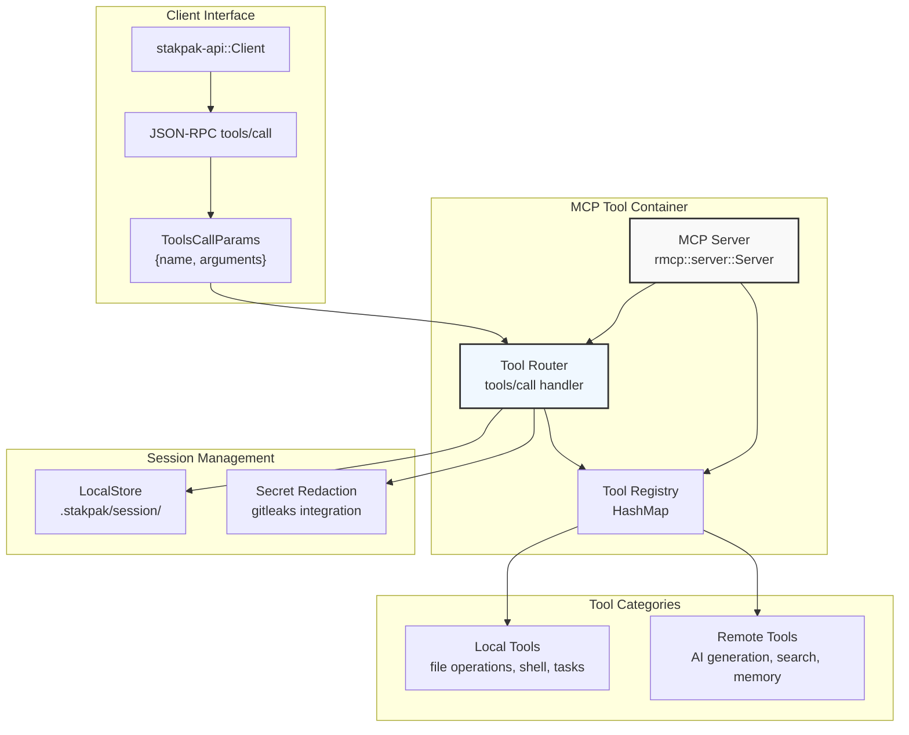
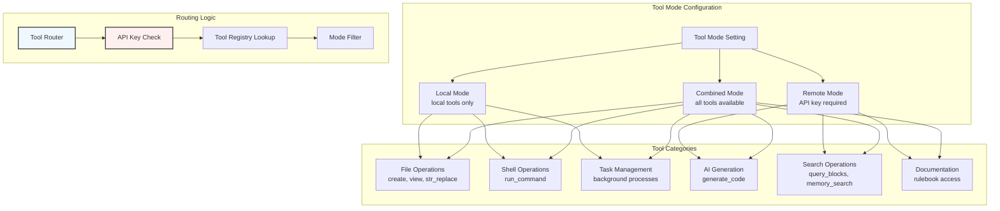
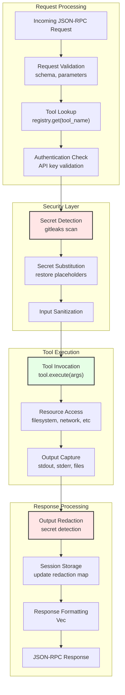
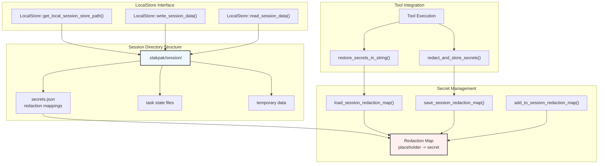
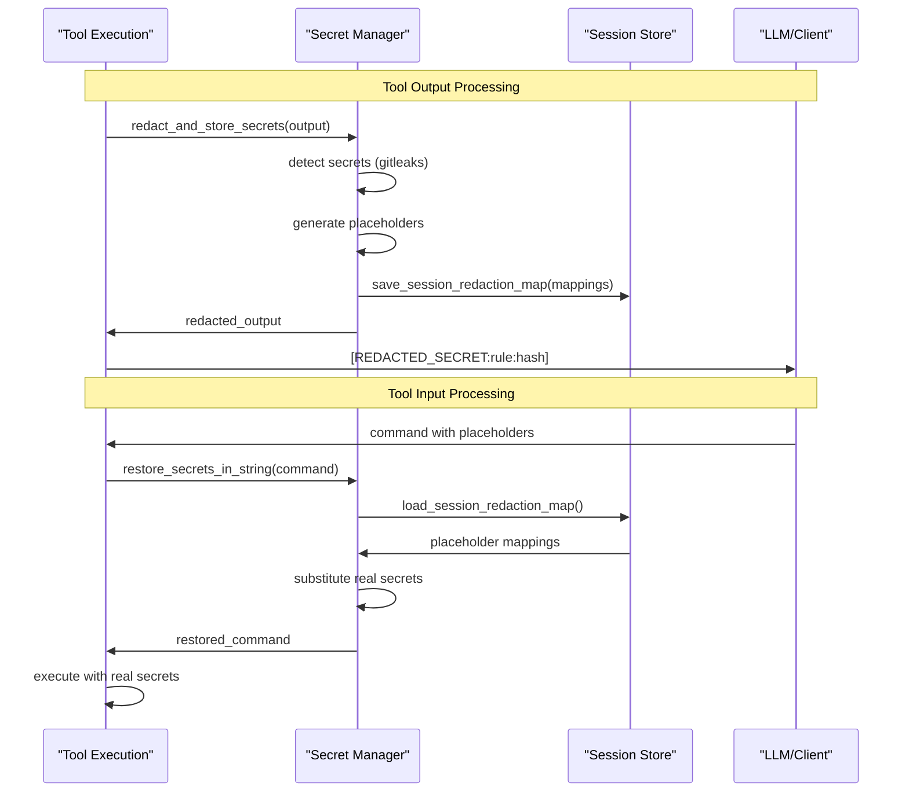
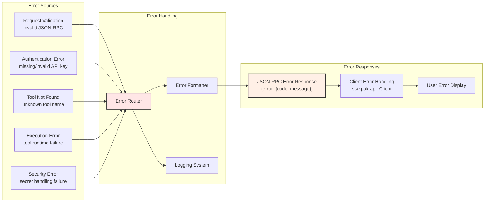

<!-- source: DeepWiki mcp.deepwiki.com · repo stakpak/agent · page 5.2 Tool Container and Execution Flow · fetched 2026-10-27 -->

# Tool Container and Routing

Relevant source files

The following files were used as context for generating this wiki page:

- [cli/src/utils/local_context.rs](cli/src/utils/local_context.rs)
- [libs/mcp/server/src/local_tools.rs](libs/mcp/server/src/local_tools.rs)
- [libs/shared/src/local_store.rs](libs/shared/src/local_store.rs)
- [libs/shared/src/remote_connection.rs](libs/shared/src/remote_connection.rs)
- [libs/shared/src/task_manager.rs](libs/shared/src/task_manager.rs)
- [libs/shared/src/utils.rs](libs/shared/src/utils.rs)

This document covers how tools are organized, routed, and executed within the MCP (Model Context Protocol) system. It explains the tool container architecture, request routing mechanisms, execution flows, and session management that enables both local and remote tool capabilities.

For information about specific local tools, see [Local Tools](#4.2). For details about remote AI-powered tools, see [Remote Tools](#4.3). For MCP server configuration and initialization, see [Server Architecture](#4.1).

## Tool Container Architecture

The MCP system uses a centralized tool container approach where all tools are managed through a single MCP server instance that acts as the execution environment and router.

**Tool Container Components**

| Component | Purpose | Implementation |
|-----------|---------|----------------|
| `MCP Server` | Central container and request handler | `rmcp::server::Server` |
| `Tool Registry` | Maps tool names to implementations | `HashMap<String, Tool>` |
| `Tool Router` | Routes requests to appropriate tools | JSON-RPC `tools/call` method handler |
| `Session Manager` | Maintains state and secrets | `.stakpak/session/` directory |

Sources: [libs/api/src/lib.rs:702-735](), [libs/shared/src/local_store.rs:9-31]()

## Tool Routing Mechanisms

The MCP server implements tool routing through a JSON-RPC interface that dispatches tool calls based on tool names and modes.

### JSON-RPC Tool Call Protocol

```mermaid
graph LR
    subgraph "Client Side"
        ClientCall["Client::call_mcp_tool()"]
        ToolsCallParams["ToolsCallParams<br/>{name: String, arguments: Value}"]
        JSONPayload["JSON-RPC Payload<br/>{method: 'tools/call', params: {...}}"]
    end
    
    subgraph "Transport"
        HTTPPost["HTTP POST /mcp"]
        JSONRequest["JSON-RPC 2.0 Request"]
    end
    
    subgraph "Server Side"
        MCPHandler["MCP tools/call Handler"]
        ToolDispatcher["Tool Dispatcher"]
        ToolExecution["Tool Execution"]
        JSONResponse["JSON-RPC Response<br/>{result: {content: Vec<Content>}}"]
    end
    
    ClientCall --> ToolsCallParams
    ToolsCallParams --> JSONPayload
    JSONPayload --> HTTPPost
    HTTPPost --> JSONRequest
    JSONRequest --> MCPHandler
    MCPHandler --> ToolDispatcher
    ToolDispatcher --> ToolExecution
    ToolExecution --> JSONResponse
    
    style MCPHandler fill:#e6f3ff,stroke:#333,stroke-width:2px
    style ToolDispatcher fill:#fff2e6,stroke:#333,stroke-width:2px
```

The routing protocol follows this structure:

1. **Request Format**: JSON-RPC 2.0 with `method: "tools/call"`
2. **Parameters**: `{name: tool_name, arguments: tool_args}`
3. **Response**: `{result: {content: Vec<Content>}}`
4. **Error Handling**: Standard JSON-RPC error responses

Sources: [libs/api/src/lib.rs:705-713](), [libs/api/src/models.rs:1129-1137]()

### Tool Mode Routing

The MCP server supports different tool modes that determine which tools are available:

**Tool Mode Routing Rules**

| Mode | Authentication | Available Tools | Use Case |
|------|---------------|-----------------|----------|
| Local | None required | File, shell, task tools only | Offline development |
| Remote | API key required | AI-powered tools only | Cloud-based operations |
| Combined | API key required | All tools available | Full functionality |

Sources: Based on context diagrams and tool architecture

## Tool Execution Flow

The tool execution flow involves request processing, security handling, tool invocation, and response formatting.

### Request Processing Pipeline

**Execution Pipeline Stages**

1. **Validation**: JSON-RPC schema and parameter validation
2. **Authorization**: API key check for remote tools
3. **Security**: Secret detection and placeholder substitution
4. **Execution**: Tool invocation with resource access
5. **Post-processing**: Output redaction and session updates
6. **Response**: Formatted JSON-RPC response

Sources: [libs/mcp/server/README_SECRETS.md:75-103](), [libs/api/src/lib.rs:725-734]()

## Session Management and State

The MCP system maintains session state for tool executions, particularly for secret redaction mappings and background task management.

### Session Storage Architecture

**Session Data Management**

| Component | File Path | Purpose | Format |
|-----------|-----------|---------|--------|
| `LocalStore` | `.stakpak/session/` | Session directory management | Directory structure |
| Secret mappings | `secrets.json` | Placeholder-to-secret mappings | JSON object |
| Task state | Various files | Background task persistence | Tool-specific |

### Secret Redaction Session Flow

The secret redaction system maintains session state to enable secure tool operations:

**Secret Session Management**

1. **Detection**: Tools scan output for secrets using gitleaks rules
2. **Placeholder Generation**: Unique identifiers like `[REDACTED_SECRET:api-key:abc123]`
3. **Session Storage**: Mappings stored in `secrets.json` with pretty-printing
4. **Restoration**: Placeholders replaced with real values during execution
5. **Persistence**: Session data maintained throughout tool execution lifecycle

Sources: [libs/mcp/server/README_SECRETS.md:52-69](), [libs/shared/src/local_store.rs:13-30]()

## Error Handling and Diagnostics

The tool container implements comprehensive error handling for routing and execution failures.

### Error Response Structure

**Error Categories and Handling**

| Error Type | HTTP Status | JSON-RPC Code | Client Handling |
|------------|-------------|---------------|-----------------|
| Validation Error | 400 | -32600 | Parameter correction |
| Authentication Error | 401 | -32001 | Login prompt |
| Tool Not Found | 404 | -32601 | Tool availability check |
| Execution Error | 500 | -32000 | Retry with different params |
| Security Error | 403 | -32002 | Permission escalation |

Sources: [libs/api/src/lib.rs:51-69]()

---

