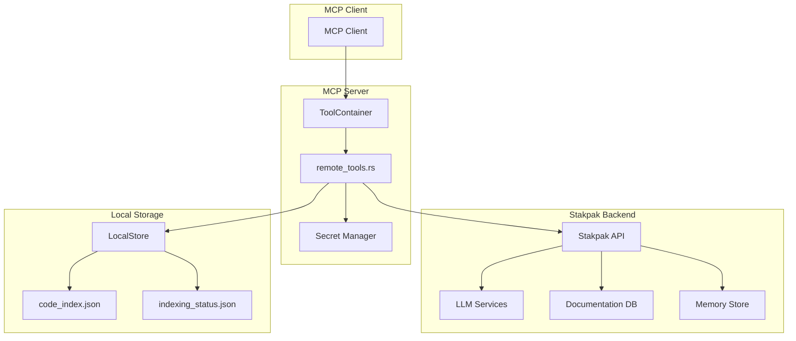
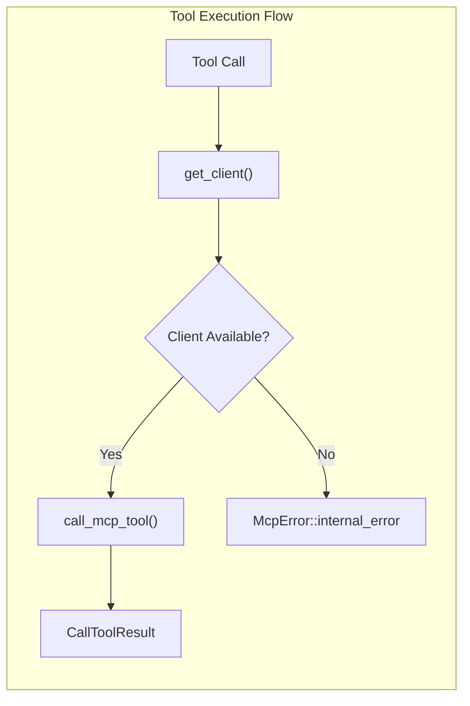
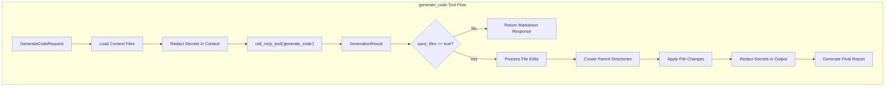
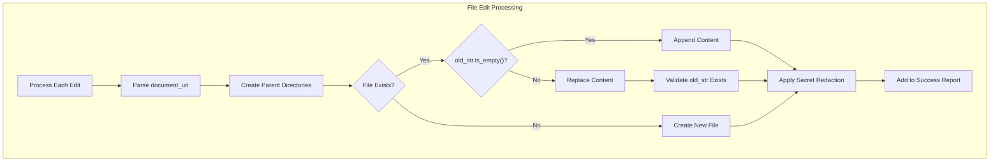
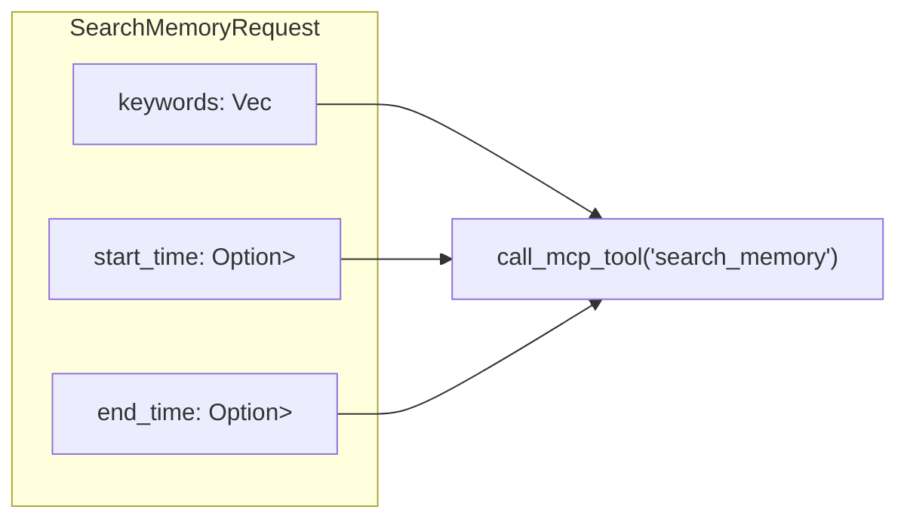
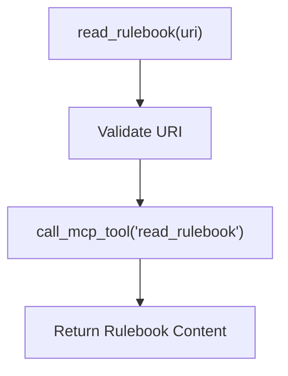
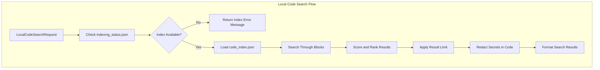
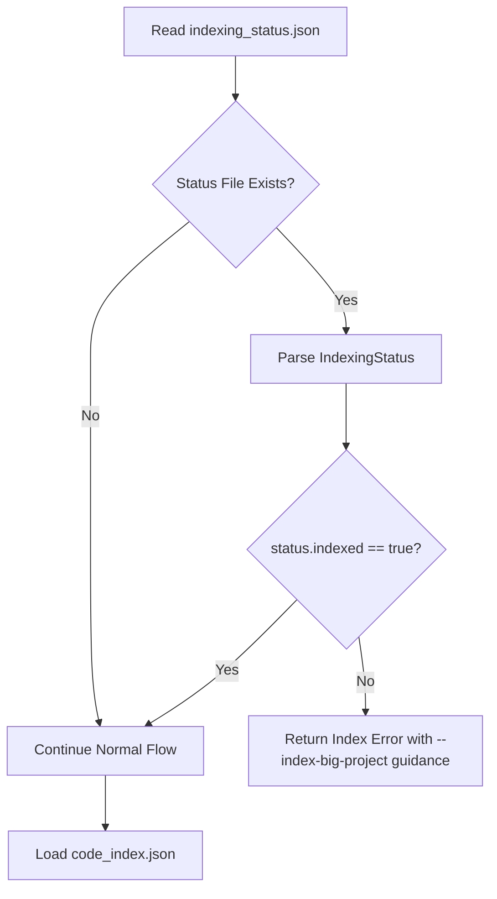
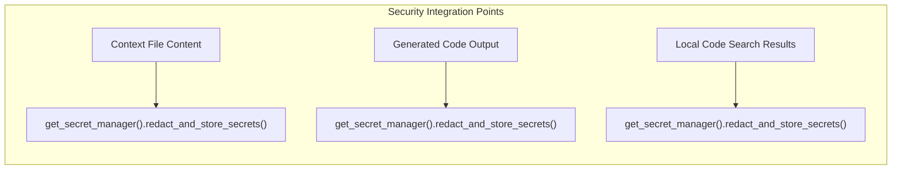

<!-- source: DeepWiki mcp.deepwiki.com · repo stakpak/agent · page 5.5 Remote Operations and SSH · fetched 2026-10-27 -->

# Remote Tools

Relevant source files

The following files were used as context for generating this wiki page:

- [cli/src/utils/local_context.rs](cli/src/utils/local_context.rs)
- [libs/mcp/server/src/local_tools.rs](libs/mcp/server/src/local_tools.rs)
- [libs/shared/src/local_store.rs](libs/shared/src/local_store.rs)
- [libs/shared/src/remote_connection.rs](libs/shared/src/remote_connection.rs)
- [libs/shared/src/task_manager.rs](libs/shared/src/task_manager.rs)
- [libs/shared/src/utils.rs](libs/shared/src/utils.rs)

Remote tools provide AI-powered capabilities that extend beyond local system operations by connecting to external services and APIs. These tools require authentication and network connectivity to function, offering advanced features like code generation, documentation search, and memory access. For local system operations, see [Local Tools](#4.2). For information about how tools are organized within the MCP system, see [Tool Container and Routing](#4.4).

## Architecture Overview

Remote tools are implemented as part of the MCP server system and communicate with the Stakpak backend API to provide AI-enhanced functionality. Unlike local tools that operate directly on the filesystem and system resources, remote tools proxy requests to external services while maintaining security through secret redaction and privacy controls.

### Remote Tools System Flow

Sources: [libs/mcp/server/src/remote_tools.rs:1-16]()

### Tool Authentication and Client Integration

Remote tools depend on the `ToolContainer` having an authenticated client to the Stakpak API. Each tool validates client availability before making requests and returns structured error responses when authentication is unavailable.

Sources: [libs/mcp/server/src/remote_tools.rs:138-145](), [libs/mcp/server/src/remote_tools.rs:369-376]()

## Code Generation Tool

The `generate_code` tool provides AI-powered code generation and editing capabilities with optional file system integration. This tool is designed for DevOps configurations and infrastructure as code with intelligent file management.

### Code Generation Request Structure

| Field | Type | Description |
|-------|------|-------------|
| `prompt` | `String` | Detailed generation prompt with file path specifications |
| `save_files` | `Option<bool>` | Whether to save generated files to filesystem (default: false) |
| `context` | `Option<Vec<String>>` | File paths to include as context for generation |

The tool supports two output modes controlled by the `save_files` parameter:
- **Preview mode** (`save_files: false`): Returns markdown-formatted code for review
- **Save mode** (`save_files: true`): Processes JSON-formatted edit instructions to create/modify files

Sources: [libs/mcp/server/src/remote_tools.rs:18-32](), [libs/mcp/server/src/remote_tools.rs:88-104](), [libs/mcp/server/src/remote_tools.rs:165-187]()

### File Edit Processing

When `save_files` is enabled, the tool processes `GenerationResult.edits` to perform file operations:

Sources: [libs/mcp/server/src/remote_tools.rs:192-321](), [libs/mcp/server/src/remote_tools.rs:240-270](), [libs/mcp/server/src/remote_tools.rs:272-319]()

## Documentation Search Tool

The `search_docs` tool provides web search capabilities for technical documentation across cloud providers, development frameworks, and other technical resources.

### Search Strategy Implementation

| Parameter | Type | Purpose |
|-----------|------|---------|
| `keywords` | `Vec<String>` | Primary search terms |
| `exclude_keywords` | `Option<Vec<String>>` | Terms to filter out |
| `limit` | `Option<u32>` | Max results (capped at 5) |

The tool implements intelligent search strategy guidance:
- **Specific queries**: Use multiple related keywords in single call for targeted results
- **Broad exploration**: Break into multiple calls with fewer keywords each

Sources: [libs/mcp/server/src/remote_tools.rs:34-46](), [libs/mcp/server/src/remote_tools.rs:349-367](), [libs/mcp/server/src/remote_tools.rs:377-384]()

## Memory Search Tool

The `search_memory` tool enables searching through previous conversation history and code generation sessions to accelerate request fulfillment.

### Memory Search Parameters

The tool searches against memory title, tags, and content with optional time-based filtering for precise historical context retrieval.

Sources: [libs/mcp/server/src/remote_tools.rs:48-62](), [libs/mcp/server/src/remote_tools.rs:399-429]()

## Rulebook Access Tool

The `read_rulebook` tool provides access to user-defined playbooks, guidelines, policies, and rules stored in the Stakpak system.

### Rulebook Request Structure

| Field | Type | Description |
|-------|------|-------------|
| `uri` | `String` | Valid URI pointing to rulebook document |

Sources: [libs/mcp/server/src/remote_tools.rs:64-70](), [libs/mcp/server/src/remote_tools.rs:444-465]()

## Local Code Search Tool

The `local_code_search` tool searches through locally indexed code blocks for Terraform, Kubernetes, Dockerfile, and GitHub Actions files. While implemented in the remote tools module, it operates on local indices.

### Code Search Architecture

### Scoring Algorithm

The search implements a weighted scoring system:

| Match Type | Score Weight | Description |
|------------|--------------|-------------|
| Name match | 10 points | Block name contains keyword |
| Type match | 8 points | Block type contains keyword |
| Kind match | 6 points | Block kind contains keyword |
| File path match | 4 points | Document URI contains keyword |
| Code content match | 2 points | Block code contains keyword |
| Multi-keyword bonus | 5 points | Per additional matched keyword |

Sources: [libs/mcp/server/src/remote_tools.rs:72-84](), [libs/mcp/server/src/remote_tools.rs:479-532](), [libs/mcp/server/src/remote_tools.rs:538-594]()

### Index Dependency Management

The tool validates indexing status and provides guidance when indices are unavailable:

Sources: [libs/mcp/server/src/remote_tools.rs:490-508](), [libs/mcp/server/src/remote_tools.rs:510-522]()

## Security Integration

All remote tools integrate with the secret management system to ensure sensitive data is redacted from both input and output. The `SecretManager` is called at key points in tool execution to maintain security boundaries.

### Secret Redaction Points

For detailed information about the secret management system, see [Security and Privacy](#6).

Sources: [libs/mcp/server/src/remote_tools.rs:115-117](), [libs/mcp/server/src/remote_tools.rs:236-238](), [libs/mcp/server/src/remote_tools.rs:636-638]()

## Error Handling

Remote tools implement consistent error handling patterns with structured error responses. Each tool validates prerequisites and returns descriptive error messages with context for troubleshooting.

### Common Error Patterns

| Error Type | Condition | Response |
|------------|-----------|----------|
| Client unavailable | No authenticated API client | `McpError::internal_error` with "Client not found" |
| API failure | Backend service error | `CallToolResult::error` with tool-specific error code |
| Local resource missing | Required files/indices unavailable | Guidance message with resolution steps |

Sources: [libs/mcp/server/src/remote_tools.rs:140-145](), [libs/mcp/server/src/remote_tools.rs:387-394](), [libs/mcp/server/src/remote_tools.rs:497-501]()

---

