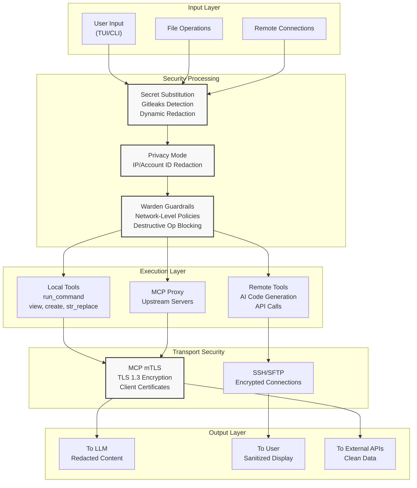
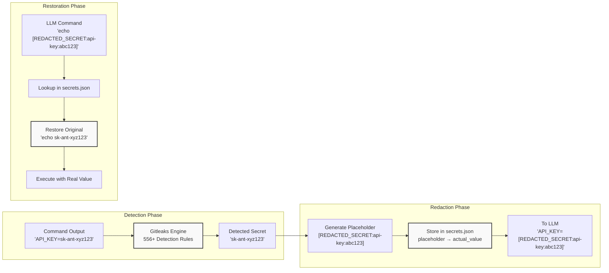
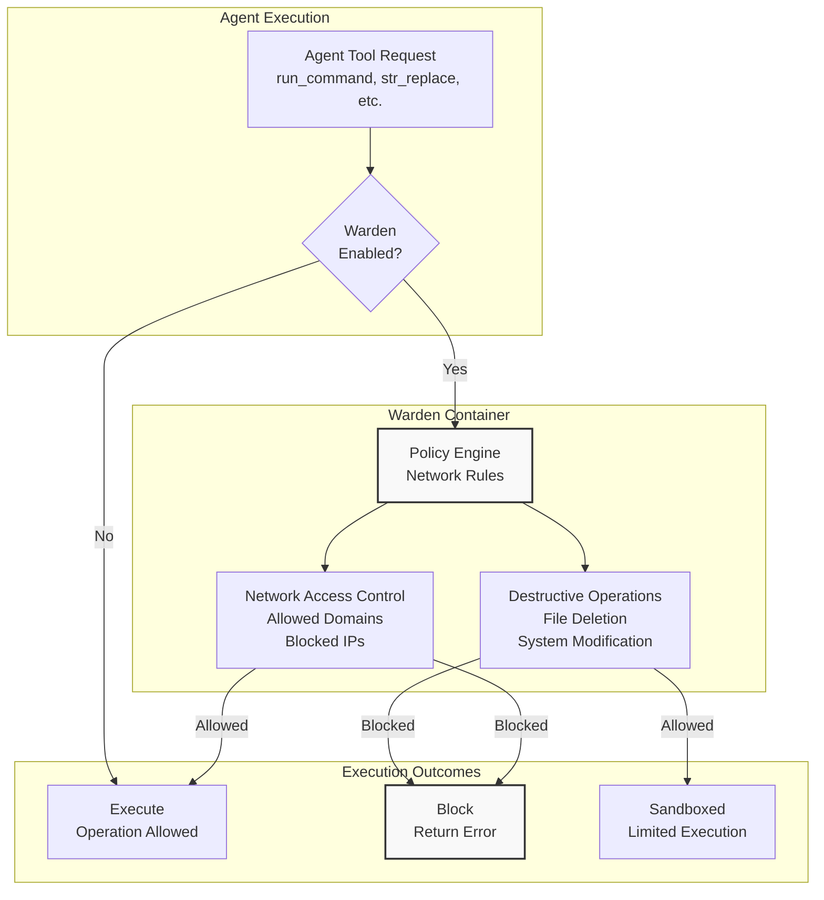
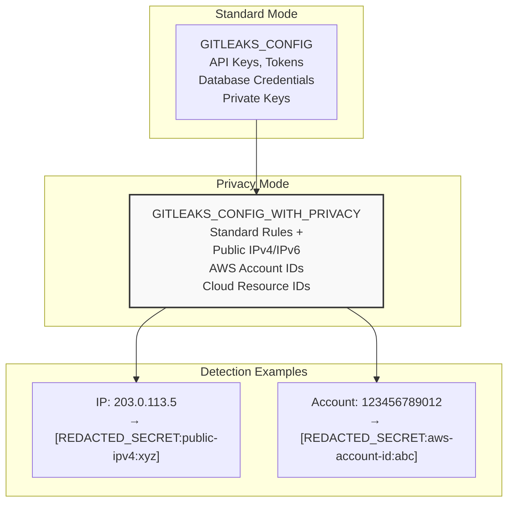
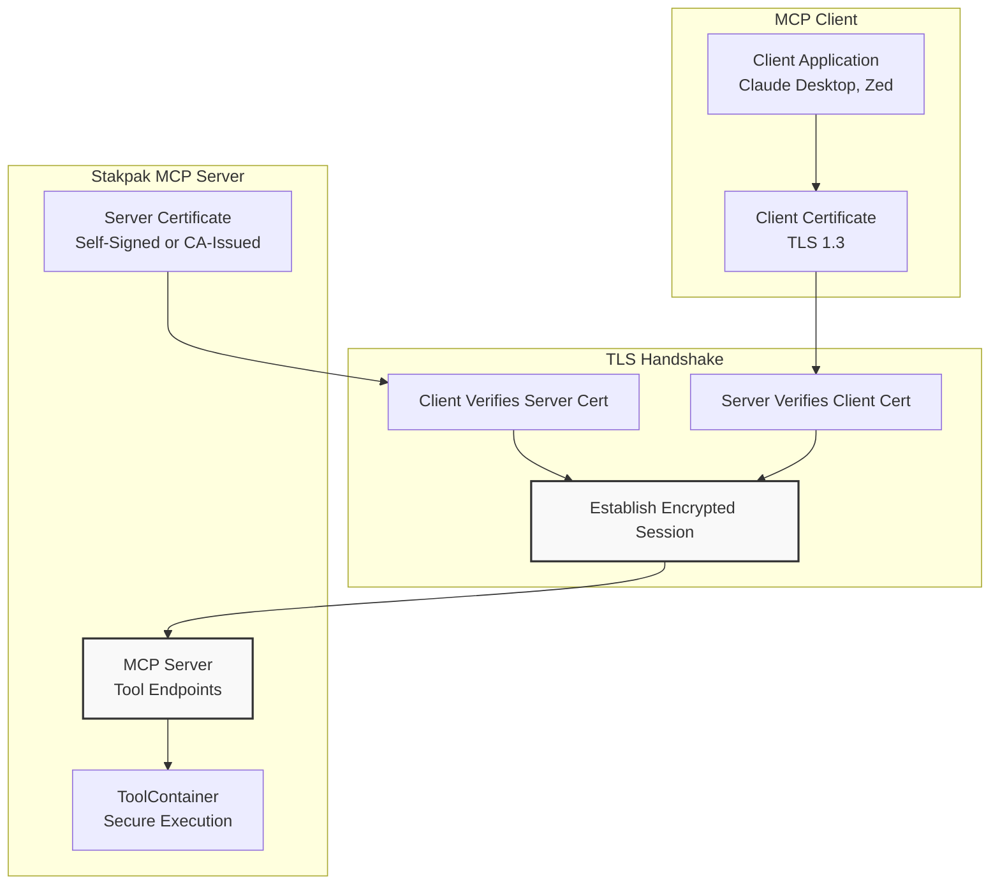
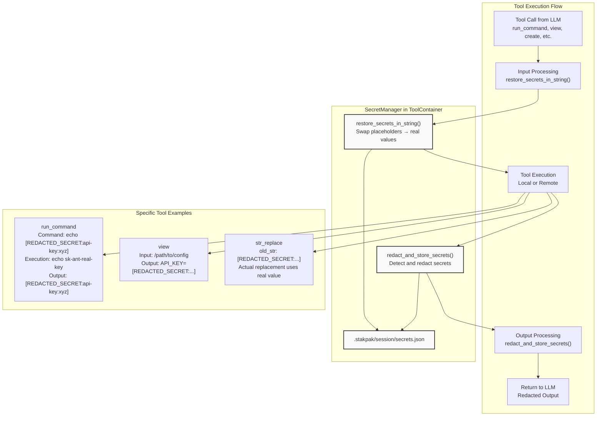

<!-- source: DeepWiki mcp.deepwiki.com · repo stakpak/agent · page 6 Security and Privacy · fetched 2026-10-27 -->

# Security and Privacy

<details>
<summary>Relevant source files</summary>

The following files were used as context for generating this wiki page:

- [README.md](README.md)
- [assets/stakpak-dark.png](assets/stakpak-dark.png)
- [assets/stakpak-light.png](assets/stakpak-light.png)
- [cli/src/utils/local_context.rs](cli/src/utils/local_context.rs)
- [libs/api/Cargo.toml](libs/api/Cargo.toml)
- [libs/api/src/lib.rs](libs/api/src/lib.rs)
- [libs/api/src/models.rs](libs/api/src/models.rs)
- [libs/mcp/server/README_SECRETS.md](libs/mcp/server/README_SECRETS.md)
- [libs/mcp/server/src/local_tools.rs](libs/mcp/server/src/local_tools.rs)
- [libs/shared/src/local_store.rs](libs/shared/src/local_store.rs)
- [libs/shared/src/remote_connection.rs](libs/shared/src/remote_connection.rs)
- [libs/shared/src/task_manager.rs](libs/shared/src/task_manager.rs)
- [libs/shared/src/utils.rs](libs/shared/src/utils.rs)

</details>


Stakpak implements multiple layers of security to protect sensitive data and prevent destructive operations when AI agents interact with systems. The security architecture includes four primary components: **Dynamic Secret Substitution**, **Warden Guardrails**, **Privacy Mode**, and **mTLS Encryption**.

These security features are designed to work transparently across all system interactions—from user input and tool execution to remote connections and external API calls—ensuring that sensitive information never reaches the LLM and that operations are safely constrained.

## Overview of Security Components



**Sources:** [README.md:42-61](), [libs/mcp/server/README_SECRETS.md:1-218]()

## Security Features Matrix

| Feature | Purpose | Implementation | Coverage |
|---------|---------|----------------|----------|
| **Secret Substitution** | Prevent LLM from seeing actual secret values | Gitleaks-based detection, placeholder generation, session storage | All text input/output, file operations, command execution |
| **Warden Guardrails** | Block destructive operations before execution | Network-level policies, container-based sandboxing | Tool execution, network access |
| **Privacy Mode** | Redact personally identifiable information | Extended detection rules for IPs, account IDs | Optional enhancement to secret detection |
| **mTLS Encryption** | Secure MCP communication channels | TLS 1.3 with client certificates | MCP server connections |

**Sources:** [README.md:55-61](), [README.md:241-289]()

## Dynamic Secret Substitution

The secret substitution system uses the Gitleaks detection engine to automatically identify and redact sensitive information before it reaches the LLM, while maintaining functionality through placeholder restoration during execution.

### How It Works



The system operates in three phases: **Detection** using Gitleaks rules, **Redaction** with placeholder generation and storage, and **Restoration** when executing commands. This allows the LLM to reference secrets without seeing their actual values.

**Key Implementation Details:**

- **Detection Engine**: Uses `detect_secrets()` in [libs/shared/src/secrets/gitleaks.rs:358-430]() with 556+ pre-configured rules
- **Session Storage**: Mappings stored in `.stakpak/session/secrets.json` via `LocalStore::write_session_data()` [libs/shared/src/local_store.rs:17-47]()
- **Placeholder Format**: `[REDACTED_SECRET:{rule_id}:{random_id}]` generated by `generate_redaction_key()` [libs/shared/src/secrets/mod.rs:189-193]()
- **Restoration**: `restore_secrets_in_string()` swaps placeholders back to real values before execution [libs/shared/src/secrets/mod.rs:143-152]()

For detailed implementation, see [Secret Substitution System](#6.1).

**Sources:** [libs/mcp/server/README_SECRETS.md:9-48](), [libs/mcp/server/src/local_tools.rs:193-196](), [libs/shared/src/secrets/mod.rs:36-141]()

## Warden Guardrails

Warden provides network-level protection by blocking destructive operations before they execute. This container-based security layer acts as a policy enforcement point for tool execution.

### Architecture



Warden runs as a separate Docker container that enforces security policies at the network and file system level. When enabled, all tool execution flows through Warden's policy engine, which can:

- **Block destructive file operations** (deletion, overwrite of critical paths)
- **Control network access** (whitelist/blacklist domains)
- **Sandbox execution** (isolate operations in controlled environment)
- **Audit operations** (log all attempted actions)

Configuration is managed through the Warden container deployment, separate from the main stakpak agent.

For detailed configuration, see [Warden Guardrails](#6.2).

**Sources:** [README.md:43-45](), [README.md:261-265]()

## Privacy Mode

Privacy mode extends secret detection to include personally identifiable information (PII) such as IP addresses and cloud account identifiers.

### Enhanced Detection

When privacy mode is enabled via the `--privacy-mode` flag, the system loads additional detection rules:



**Privacy-Specific Rules:**

| Rule Type | Pattern | Allowlist |
|-----------|---------|-----------|
| `public-ipv4` | Public IPv4 addresses | Excludes private ranges (10.x, 192.168.x, 172.16-31.x), localhost (127.x), link-local (169.254.x) |
| `public-ipv6` | Public IPv6 addresses | Excludes private/local ranges |
| `aws-account-id` | 12-digit AWS account numbers | Context-aware detection in ARNs |

Privacy mode is configured per-execution:

```bash
# Enable privacy mode for MCP server
stakpak mcp start --privacy-mode

# Enable privacy mode for MCP proxy
stakpak mcp proxy --privacy-mode
```

For detailed privacy rules, see [Privacy Mode and Data Redaction](#6.3).

**Sources:** [libs/shared/src/secrets/privacy_rules.toml:1-57](), [README.md:270-271](), [README.md:287-288]()

## mTLS Transport Security

The MCP server uses mutual TLS (mTLS) to encrypt and authenticate all connections between clients and servers.

### mTLS Architecture



**mTLS Features:**

- **TLS 1.3 Protocol**: Modern encryption standards with forward secrecy
- **Client Authentication**: Both parties verify each other's certificates
- **Automatic Certificate Generation**: Self-signed certificates created on first run
- **Enabled by Default**: Can be disabled with `--disable-mcp-mtls` (not recommended for production)

```bash
# Start MCP server with mTLS (default)
stakpak mcp start

# Disable mTLS (NOT recommended)
stakpak mcp start --disable-mcp-mtls
```

The mTLS implementation uses `TlsClientConfig` from [libs/shared/src/tls_client.rs] and `create_tls_client()` for secure HTTPS requests [libs/mcp/server/src/local_tools.rs:831-840]().

**Sources:** [README.md:57](), [README.md:263-264](), [libs/mcp/server/src/local_tools.rs:831]()

## Integration with MCP Tools

Security features are integrated directly into the MCP tool execution pipeline, ensuring all operations are protected by default.

### Tool-Level Security Integration



### Tool Security Methods

Each tool in `ToolContainer` uses the `SecretManager` for automatic security processing:

| Tool | Input Security | Output Security | Implementation |
|------|---------------|-----------------|----------------|
| `run_command` | Restores placeholders before execution [libs/mcp/server/src/local_tools.rs:293-295]() | Redacts output before returning [libs/mcp/server/src/local_tools.rs:217-227]() | Command runs with real secrets, output sanitized |
| `view` | N/A (read-only) | Redacts file contents | File contents never contain real secrets in LLM view |
| `str_replace` | Restores both `old_str` and `new_str` | Redacts diff output | Replacement uses real values, result shown redacted |
| `create` | Restores `file_text` content | N/A (write-only) | File written with real secrets, tracking maintained |
| `generate_password` | N/A (generates new) | Immediately redacts generated password [libs/mcp/server/src/local_tools.rs:783-786]() | LLM never sees actual generated password |

The `ToolContainer` maintains a `SecretManager` instance that provides:

- `get_secret_manager()`: Access to session-scoped secret mapping
- `redact_and_store_secrets()`: Detection and placeholder generation  
- `restore_secrets_in_string()`: Placeholder-to-value restoration

**Sources:** [libs/mcp/server/src/local_tools.rs:199-245](), [libs/mcp/server/src/local_tools.rs:617-648](), [libs/mcp/server/src/local_tools.rs:670-705](), [libs/mcp/server/README_SECRETS.md:94-104]()

## Configuration and Customization

### Rule Management

The system supports three levels of rule configuration:

1. **Base Rules** (`gitleaks.toml`): Standard gitleaks rule set with 556+ detection patterns
2. **Additional Rules** (`additional_rules.toml`): Custom extensions for specific services
3. **Privacy Rules** (`privacy_rules.toml`): PII detection patterns

Custom rules can be added by extending the `additional_rules.toml` configuration:

```toml
[[rules]]
id = "anthropic-api-key"
description = "Found an Anthropic API Key, posing a risk of unauthorized access to AI services and data manipulation."
regex = '''\bsk-ant-api03-[A-Za-z0-9_-]{20,100}[A-Za-z0-9_-]'''
entropy = 3.5
keywords = ["sk-ant-api", "anthropic"]
```

### Performance Optimization

The system includes several performance optimizations:

- **Lazy Loading**: Configurations loaded on first use via `Lazy<GitleaksConfig>` [libs/shared/src/secrets/gitleaks.rs:226-230]()
- **Keyword Pre-filtering**: Rules only process text containing relevant keywords [libs/shared/src/secrets/gitleaks.rs:587-592]()
- **Regex Compilation**: Pre-compiled patterns stored in configuration structures [libs/shared/src/secrets/gitleaks.rs:140-194]()
- **Entropy Calculation**: Shannon entropy validation for randomness checking [libs/shared/src/secrets/gitleaks.rs:324-347]()

**Sources:** [libs/shared/src/secrets/gitleaks.rs:226-278](), [libs/shared/src/secrets/additional_rules.toml:1-7](), [libs/shared/src/secrets/gitleaks.rs:587-610]()

---

