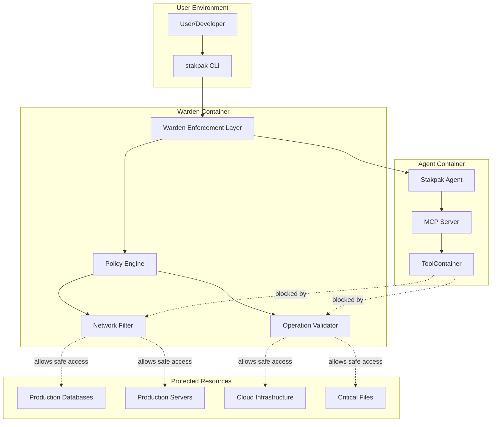
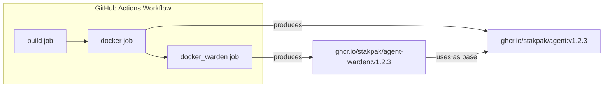
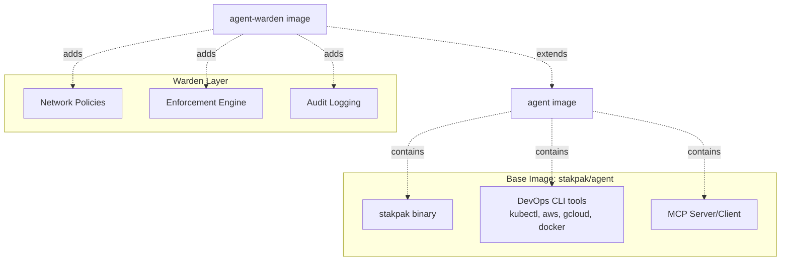
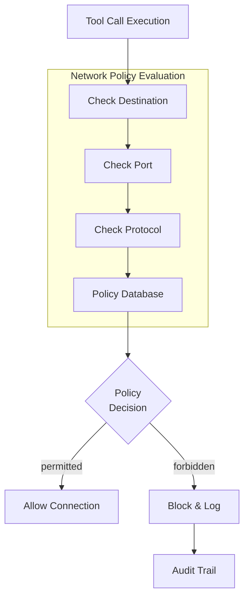
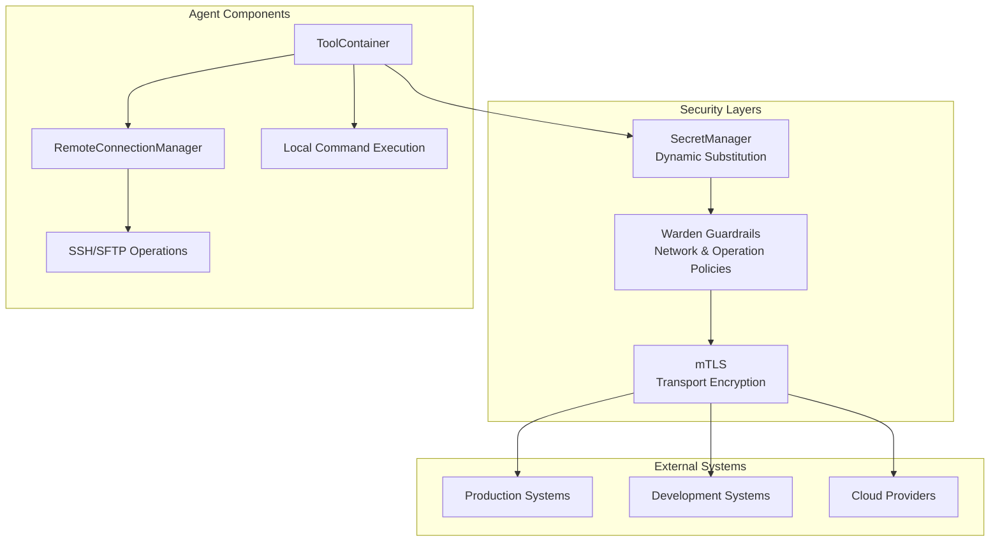
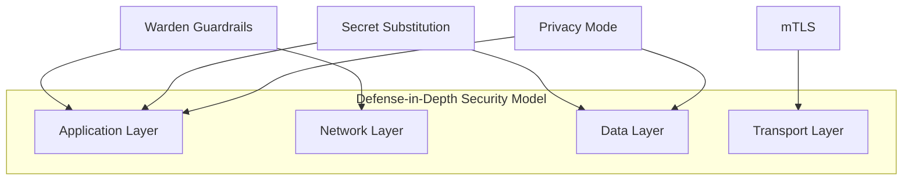

<!-- source: DeepWiki mcp.deepwiki.com · repo stakpak/agent · page 6.2 Warden Guardrails · fetched 2026-10-27 -->

# Warden Guardrails

<details>
<summary>Relevant source files</summary>

The following files were used as context for generating this wiki page:

- [.github/workflows/build-and-release.yml](.github/workflows/build-and-release.yml)
- [README.md](README.md)
- [assets/stakpak-dark.png](assets/stakpak-dark.png)
- [assets/stakpak-light.png](assets/stakpak-light.png)
- [cliff.toml](cliff.toml)
- [libs/popup-widget/Cargo.toml](libs/popup-widget/Cargo.toml)
- [libs/popup-widget/README.md](libs/popup-widget/README.md)
- [release.sh](release.sh)

</details>


## Purpose and Scope

Warden Guardrails is a network-level security layer that blocks destructive operations before they execute. It operates as a containerized enforcement mechanism that sits between the AI agent and production systems, providing policy-based protection against dangerous commands and operations.

This document covers the architecture, deployment model, and integration of Warden Guardrails. For information about credential protection, see [Secret Substitution System](#6.1). For transport-level security, see [MCP Architecture](#5.1).

## Architecture Overview

Warden Guardrails implements a defense-in-depth security model where network policies are enforced at the container level, independent of the agent's decision-making process. This architectural separation ensures that even if the agent attempts a destructive operation, it can be blocked before reaching production systems.



**Sources:** [README.md:42-45](), [Diagram 4 from high-level architecture]()

## Deployment Model

Warden Guardrails is packaged as a separate Docker image that wraps the main Stakpak agent. The build system creates two distinct images:

| Image | Purpose | Base |
|-------|---------|------|
| `ghcr.io/stakpak/agent:latest` | Standard agent | Includes CLI tools (docker, kubectl, aws, gcloud) |
| `ghcr.io/stakpak/agent-warden:latest` | Warden-protected agent | Built on top of agent image with network policies |

### Build Process



The build workflow creates the Warden image using the `.warden` context directory and passes the base image tag as a build argument:

**Sources:** [.github/workflows/build-and-release.yml:246-272]()

### Docker Image Structure



**Sources:** [.github/workflows/build-and-release.yml:246-272](), [README.md:102-107]()

## Policy Enforcement Mechanisms

Warden Guardrails operates at two levels to prevent destructive operations:

### Network-Level Filtering

Network policies restrict outbound connections to prevent unauthorized access to production systems. This operates independently of the agent's tool execution logic.



### Operation-Level Validation

Destructive operations are validated against policy rules before execution:

| Operation Type | Examples | Default Policy |
|----------------|----------|----------------|
| File deletion | `rm -rf`, `remove` tool | Requires explicit approval |
| Database drops | `DROP DATABASE`, `TRUNCATE` | Blocked in production |
| Infrastructure destruction | `terraform destroy`, `kubectl delete` | Requires multi-step approval |
| Credential modification | Password changes, key rotation | Audit + confirmation required |

**Sources:** [README.md:44](), [Diagram 4 security features]()

## Integration with Agent Components

Warden Guardrails integrates with the existing security architecture without modifying the core agent logic:



### Integration Points

1. **Before Tool Execution:** Warden evaluates policy before `ToolContainer` executes any tool call
2. **Network Interception:** All outbound connections from `RemoteConnectionManager` pass through network filters
3. **Audit Trail:** All blocked and allowed operations are logged for compliance
4. **Secret Coordination:** Works in conjunction with `SecretManager` to ensure credentials are both protected and properly scoped

**Sources:** [Diagram 4 from high-level architecture](), [Diagram 5 tool execution flow]()

## Usage and Configuration

### Running with Warden Protection

Users can run Stakpak with Warden Guardrails enabled by using the Warden Docker image:

```bash
# Standard agent (no Warden)
docker run -it ghcr.io/stakpak/agent:latest

# Warden-protected agent
docker run -it ghcr.io/stakpak/agent-warden:latest
```

For containerization tasks requiring Docker socket access:

```bash
docker run -it \
  -v "/var/run/docker.sock":"/var/run/docker.sock" \
  -v "{your app path}":"/agent/" \
  --entrypoint stakpak \
  ghcr.io/stakpak/agent-warden:latest
```

**Sources:** [README.md:229-237]()

### Policy Configuration

While the exact policy configuration format is defined in the `.warden` directory (not included in provided files), the policies typically control:

- **Network Access:** Whitelist/blacklist of IP ranges, domains, and ports
- **Command Patterns:** Regular expressions matching destructive operations
- **Resource Protection:** Specific files, directories, or database names to protect
- **Time Windows:** Restrictions based on time of day or change windows
- **Approval Requirements:** Multi-factor or manual approval for sensitive operations

## Comparison with Other Security Features

Warden Guardrails complements but does not replace other security mechanisms:

| Feature | Layer | Purpose | Implementation |
|---------|-------|---------|----------------|
| **Warden Guardrails** | Network/Container | Prevent destructive operations from executing | Policy engine at container boundary |
| **Secret Substitution** | Data/Application | Prevent LLM from seeing actual credentials | Dynamic replacement via `SecretManager` |
| **mTLS** | Transport | Encrypt communication between components | Certificate-based encryption in MCP |
| **Privacy Mode** | Data/Application | Redact sensitive data from logs/outputs | Pattern-based redaction |



**Sources:** [README.md:42-45](), [README.md:55-60](), [Diagram 4 security features]()

## Release and Distribution

Warden images are automatically built and published during the release process:

1. **Tag Creation:** When a version tag (e.g., `v1.2.3`) is pushed
2. **Base Image Build:** `docker` job creates the standard agent image
3. **Warden Image Build:** `docker_warden` job extends the base image with Warden layer
4. **Multi-Version Tags:** Both versioned (`v1.2.3`) and `latest` tags are published for stable releases
5. **Beta Releases:** Beta tags (e.g., `v1.2.3-beta.1`) only get versioned tags, not `latest`

The separation of build jobs ensures that the Warden layer can be updated independently of the base agent, and that both images are always synchronized in version.

**Sources:** [.github/workflows/build-and-release.yml:219-272](), [release.sh:274-278]()

## Implementation Notes

The Warden Guardrails implementation resides in the `.warden` directory, which contains:
- Dockerfile with policy configuration
- Network policy definitions
- Operation validation rules
- Audit logging configuration

The specific implementation details of the policy engine, network filtering mechanisms, and operation validators are defined in that directory but are not included in the current documentation scope.

**Sources:** [.github/workflows/build-and-release.yml:266]()

---

