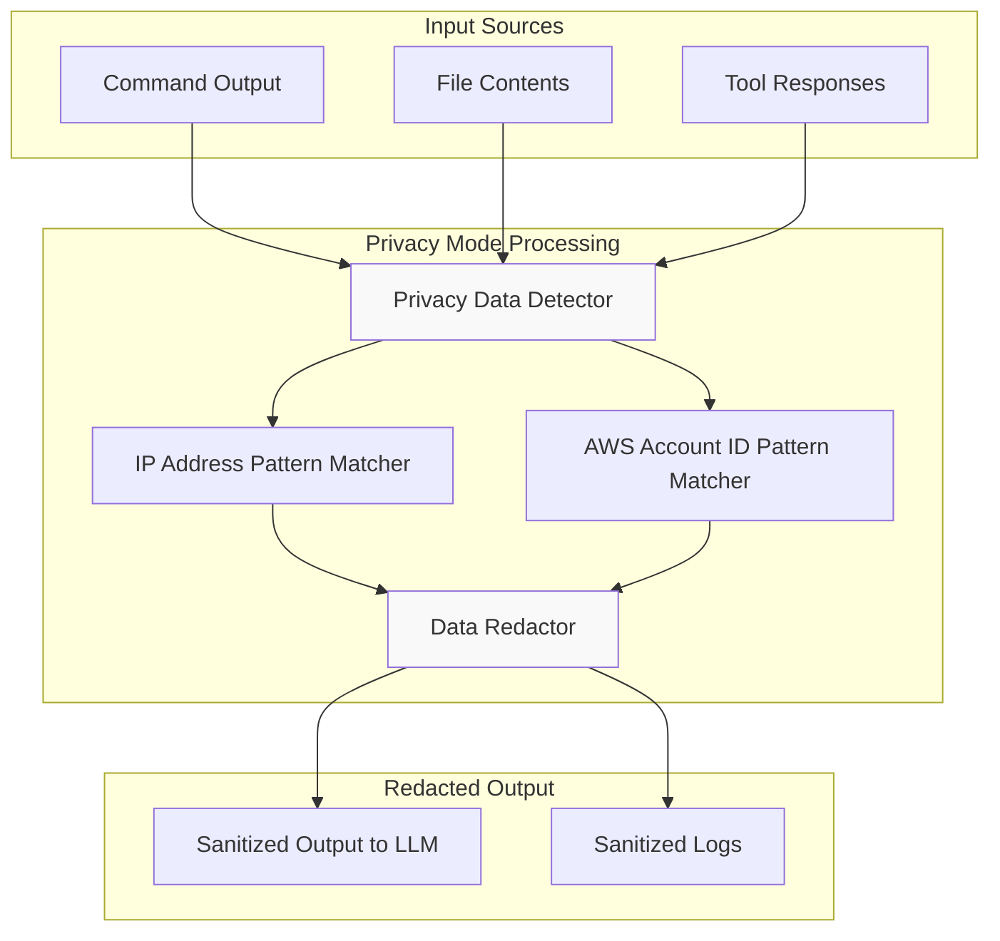
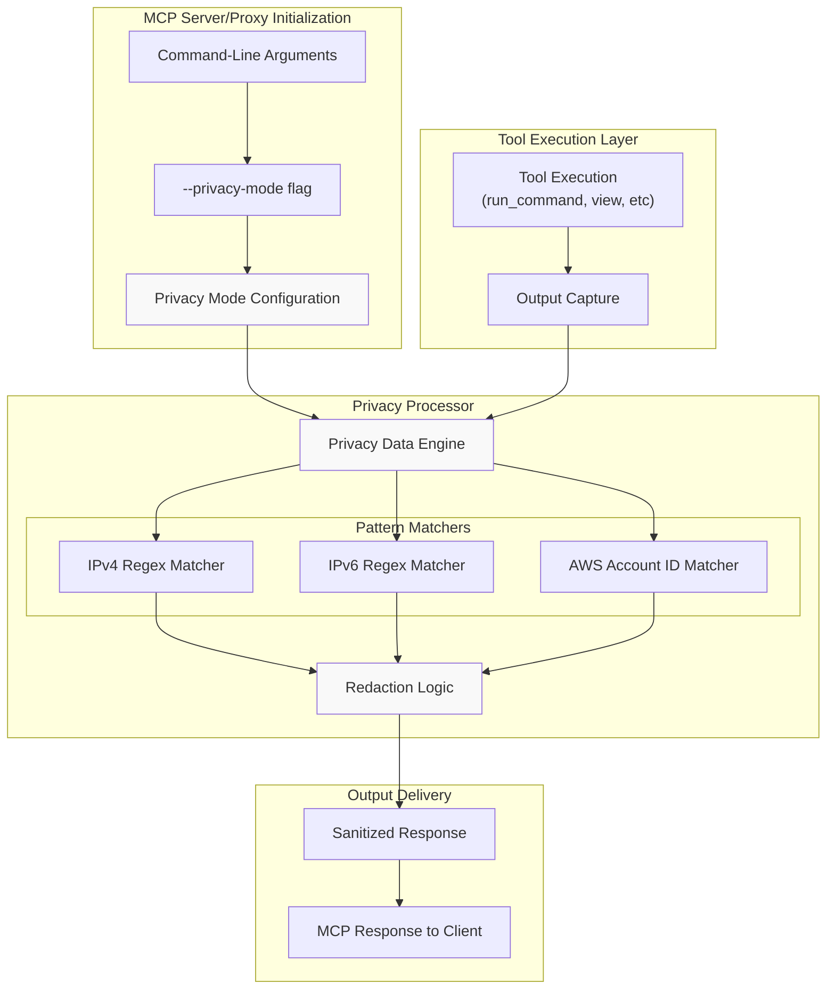
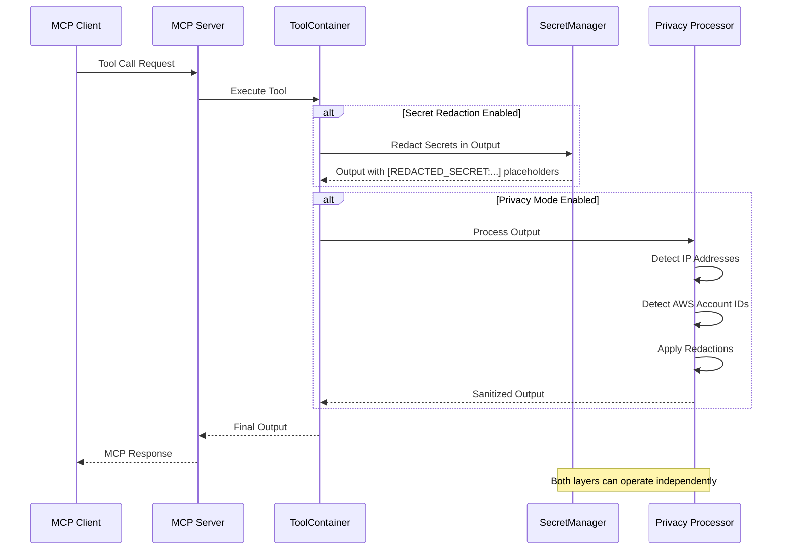
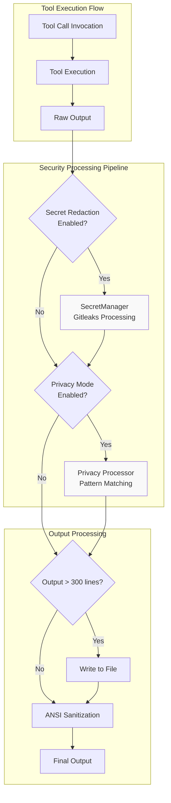

<!-- source: DeepWiki mcp.deepwiki.com · repo stakpak/agent · page 6.3 Privacy Mode and Data Redaction · fetched 2026-10-27 -->

# Privacy Mode and Data Redaction

<details>
<summary>Relevant source files</summary>

The following files were used as context for generating this wiki page:

- [README.md](README.md)
- [assets/stakpak-dark.png](assets/stakpak-dark.png)
- [assets/stakpak-light.png](assets/stakpak-light.png)
- [libs/api/Cargo.toml](libs/api/Cargo.toml)
- [libs/api/src/lib.rs](libs/api/src/lib.rs)
- [libs/api/src/models.rs](libs/api/src/models.rs)
- [libs/mcp/server/README_SECRETS.md](libs/mcp/server/README_SECRETS.md)

</details>


## Purpose and Scope

Privacy mode is a security feature that redacts sensitive operational data from MCP server and proxy outputs to prevent exposure of private infrastructure information to LLMs and external systems. This includes IP addresses, AWS account IDs, and other identifying information that could reveal details about the deployment environment.

**Note:** Privacy mode is distinct from the [Secret Substitution System](#6.1), which handles credentials, API keys, and tokens. Privacy mode focuses on operational metadata, while secret substitution handles authentication credentials.

For information about blocking destructive operations at the network level, see [Warden Guardrails](#6.2).

**Sources:** [README.md:43-60](), [README.md:270-289]()

---

## Privacy Mode Overview

Privacy mode provides an additional layer of data protection by redacting infrastructure-identifying information that could expose deployment details or enable reconnaissance of the operational environment. Unlike secret substitution which prevents credential exposure, privacy mode prevents leakage of environmental context.



**Sources:** [README.md:55-61]()

---

## Data Types Redacted

Privacy mode targets specific categories of sensitive operational data:

| Data Type | Description | Example | Redacted Form |
|-----------|-------------|---------|---------------|
| **IP Addresses (IPv4)** | Public and private IP addresses | `192.168.1.100`, `54.123.45.67` | `[REDACTED_IP]` |
| **IP Addresses (IPv6)** | IPv6 addresses | `2001:0db8:85a3::8a2e:0370:7334` | `[REDACTED_IP]` |
| **AWS Account IDs** | 12-digit AWS account identifiers | `123456789012` | `[REDACTED_ACCOUNT_ID]` |
| **Infrastructure Identifiers** | Other deployment-specific identifiers | Varies by context | Context-specific redaction |

This redaction prevents:
- **Network topology exposure** - Hiding internal network structure and addressing schemes
- **Cloud account identification** - Preventing correlation of activities to specific AWS accounts
- **Deployment fingerprinting** - Obscuring infrastructure patterns that could aid reconnaissance
- **Cross-reference attacks** - Making it harder to correlate activities across different data sources

**Sources:** [README.md:60]()

---

## Configuration and Usage

### MCP Server with Privacy Mode

Privacy mode is enabled via the `--privacy-mode` command-line flag when starting the MCP server:

```bash
# Enable privacy mode with local tools
stakpak mcp start --tool-mode local --privacy-mode

# Enable privacy mode with combined tools (default)
stakpak mcp start --privacy-mode

# Privacy mode with other security features
stakpak mcp start --privacy-mode --enable-slack-tools
```

**Configuration Matrix:**

| Flag Combination | Secret Redaction | Privacy Mode | Use Case |
|------------------|------------------|--------------|----------|
| Default | Enabled | Disabled | Standard secure operation |
| `--privacy-mode` | Enabled | Enabled | Maximum data protection |
| `--disable-secret-redaction` | Disabled | Disabled | **Not recommended** - debugging only |
| `--disable-secret-redaction --privacy-mode` | Disabled | Enabled | Credentials visible, IPs hidden |

**Sources:** [README.md:251-272]()

### MCP Proxy with Privacy Mode

The MCP proxy server also supports privacy mode for multiplexing connections to upstream MCP servers:

```bash
# Enable privacy mode with automatic config discovery
stakpak mcp proxy --privacy-mode

# Enable privacy mode with explicit config file
stakpak mcp proxy --config-file ~/.stakpak/mcp.toml --privacy-mode

# Combined with secret redaction control
stakpak mcp proxy --privacy-mode --disable-secret-redaction
```

**Sources:** [README.md:277-289]()

---

## Privacy Mode Architecture



**Sources:** [README.md:241-289]()

---

## Integration with Tool Execution

Privacy mode operates at the output processing layer, after tool execution but before responses are sent to clients:



**Key Integration Points:**

1. **Tool Output Processing**: Privacy mode processes all tool outputs before they are returned
2. **Independent from Secret Redaction**: Privacy mode and secret substitution operate independently
3. **Log Sanitization**: Privacy mode also applies to server logs when enabled
4. **Streaming Support**: Works with both synchronous and streaming tool responses

**Sources:** [README.md:55-61](), [README.md:241-272]()

---

## Comparison: Privacy Mode vs Secret Substitution

The system provides two complementary data protection mechanisms:

| Aspect | Privacy Mode | Secret Substitution |
|--------|-------------|---------------------|
| **Primary Purpose** | Hide infrastructure metadata | Protect credentials |
| **Target Data** | IP addresses, account IDs | API keys, passwords, tokens |
| **Detection Method** | Pattern matching (regex) | Gitleaks rule engine |
| **Redaction Format** | `[REDACTED_IP]`, `[REDACTED_ACCOUNT_ID]` | `[REDACTED_SECRET:rule-id:hash]` |
| **Restoration** | Not restorable | Restorable via session mapping |
| **Configuration Flag** | `--privacy-mode` | `--disable-secret-redaction` (inverse) |
| **Session Storage** | No session file | `.stakpak/session/secrets.json` |
| **Default State** | Disabled | Enabled |
| **Use Case** | Prevent infrastructure exposure | Allow LLM to work with credentials |

**Sources:** [README.md:43-44](), [README.md:58-60](), [libs/mcp/server/README_SECRETS.md:1-28]()

---

## Security Considerations

### When to Enable Privacy Mode

Privacy mode should be enabled in the following scenarios:

1. **Multi-tenant Environments**: When multiple users or systems share infrastructure
2. **Cloud Deployments**: To hide cloud provider account identifiers
3. **Compliance Requirements**: When regulations prohibit exposure of network topology
4. **Third-party LLM Services**: When using external LLM providers that may log requests
5. **Audit Trail Sanitization**: When logs may be reviewed by personnel without infrastructure access

### Privacy Mode Limitations

Privacy mode has certain limitations operators should understand:

- **Pattern-based Detection**: Only redacts known patterns; may miss uncommon formats
- **No Restoration**: Unlike secret substitution, redacted data cannot be restored
- **Context Loss**: Aggressive redaction may remove information useful for legitimate operations
- **Performance Impact**: Pattern matching adds processing overhead (typically negligible)
- **Log Correlation**: Redaction may make it harder to correlate events across different log sources

### Combining Security Features

For maximum protection, combine privacy mode with other security features:

```bash
# Maximum security configuration
stakpak mcp start \
  --privacy-mode \
  --tool-mode local \
  --enable-slack-tools

# With explicit secret redaction (already default)
stakpak mcp start \
  --privacy-mode
  # Secret redaction is enabled by default

# For debugging only (NOT RECOMMENDED for production)
stakpak mcp start \
  --disable-secret-redaction \
  --disable-mcp-mtls
  # Privacy mode still disabled, no protection
```

**Sources:** [README.md:55-61](), [README.md:251-272]()

---

## Operational Examples

### Example 1: Command Output Redaction

Without privacy mode:
```bash
$ kubectl get nodes -o wide
NAME           STATUS   IP            INTERNAL-IP
node-1         Ready    54.123.45.67  10.0.1.50
node-2         Ready    54.123.45.68  10.0.1.51
```

With privacy mode enabled:
```bash
$ kubectl get nodes -o wide
NAME           STATUS   IP                 INTERNAL-IP
node-1         Ready    [REDACTED_IP]      [REDACTED_IP]
node-2         Ready    [REDACTED_IP]      [REDACTED_IP]
```

### Example 2: AWS Configuration Redaction

Without privacy mode:
```bash
$ aws sts get-caller-identity
{
    "UserId": "AIDAI...",
    "Account": "123456789012",
    "Arn": "arn:aws:iam::123456789012:user/admin"
}
```

With privacy mode enabled:
```bash
$ aws sts get-caller-identity
{
    "UserId": "AIDAI...",
    "Account": "[REDACTED_ACCOUNT_ID]",
    "Arn": "arn:aws:iam::[REDACTED_ACCOUNT_ID]:user/admin"
}
```

### Example 3: Log File Sanitization

Original log content:
```
2024-01-15 10:30:45 INFO Connecting to database at 10.0.1.100:5432
2024-01-15 10:30:46 INFO Connection established from 54.123.45.67
2024-01-15 10:30:47 INFO AWS Account: 123456789012, Region: us-east-1
```

With privacy mode enabled:
```
2024-01-15 10:30:45 INFO Connecting to database at [REDACTED_IP]:5432
2024-01-15 10:30:46 INFO Connection established from [REDACTED_IP]
2024-01-15 10:30:47 INFO AWS Account: [REDACTED_ACCOUNT_ID], Region: us-east-1
```

**Sources:** [README.md:60]()

---

## Implementation Architecture

Privacy mode integrates with the existing tool execution and output processing pipeline:



**Processing Order:**

1. **Tool Execution**: Run command or operation
2. **Secret Redaction**: Apply gitleaks-based secret detection (if enabled)
3. **Privacy Redaction**: Apply pattern-based privacy data redaction (if enabled)
4. **Large Output Handling**: Write to file if output exceeds threshold
5. **Sanitization**: Remove ANSI codes and normalize text
6. **Delivery**: Return to MCP client

**Sources:** Inferred from [README.md:241-272]() and system architecture context

---

## Best Practices

### Recommended Configurations

**Production Environment:**
```bash
# Maximum security for production
stakpak mcp start --privacy-mode
```

**Development Environment:**
```bash
# Privacy mode without mTLS for local development
stakpak mcp start --privacy-mode --disable-mcp-mtls
```

**Debugging (Temporary):**
```bash
# Disable redaction for debugging (restore after troubleshooting)
stakpak mcp start --disable-secret-redaction
# Note: Privacy mode is disabled by default, so IPs will be visible
```

### Operational Guidelines

1. **Enable by Default in Production**: Always use `--privacy-mode` flag for production deployments
2. **Document Exceptions**: If disabling privacy mode, document the reason and duration
3. **Review Logs Regularly**: Verify that redaction is working as expected
4. **Combine with Network Controls**: Use privacy mode alongside [Warden Guardrails](#6.2) for defense in depth
5. **Test Pattern Coverage**: Verify that your specific data formats are being caught by privacy mode patterns

### Troubleshooting

If privacy mode is not working as expected:

1. **Verify flag is set**: Check that `--privacy-mode` is present in command invocation
2. **Check output format**: Ensure sensitive data matches expected patterns (standard IPv4/IPv6, AWS account ID format)
3. **Review logs**: Look for any privacy processor errors or warnings
4. **Test incrementally**: Start with a simple command that outputs known patterns

**Sources:** [README.md:251-289]()

---

## Related Security Features

Privacy mode is part of Stakpak's comprehensive security architecture:

- **[Secret Substitution System](#6.1)**: Dynamic credential redaction and restoration
- **[Warden Guardrails](#6.2)**: Network-level policy enforcement and destructive operation blocking
- **mTLS Encryption**: End-to-end encrypted MCP communication
- **Secure Password Generation**: Cryptographic password generation tools

Together, these features provide layered security for AI-powered DevOps operations.

**Sources:** [README.md:55-61]()

---

