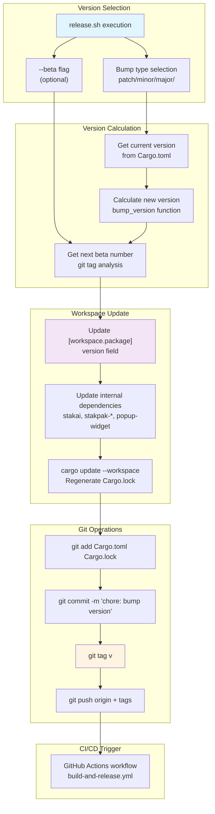
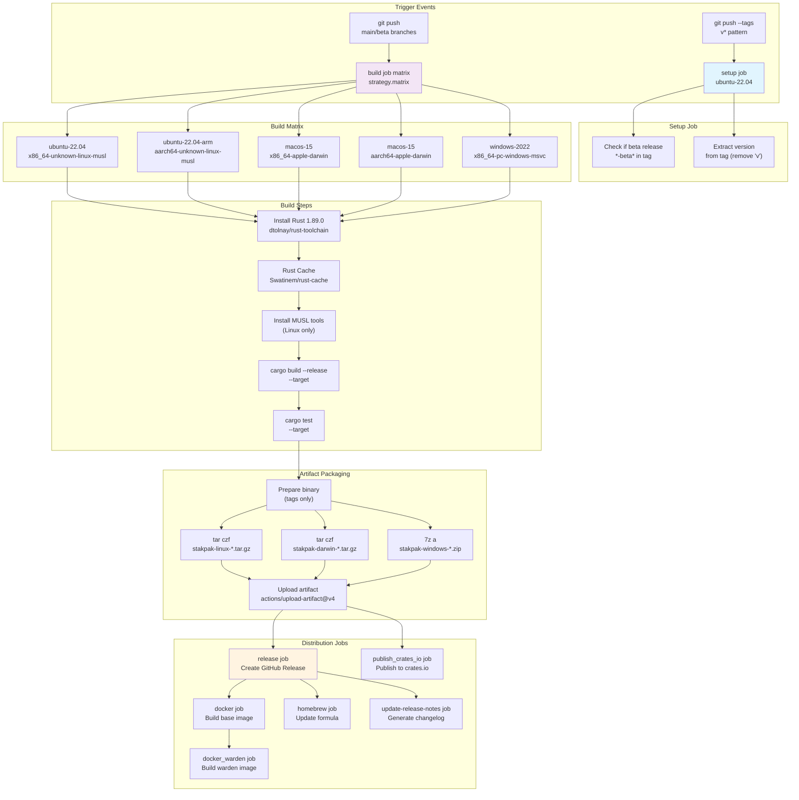
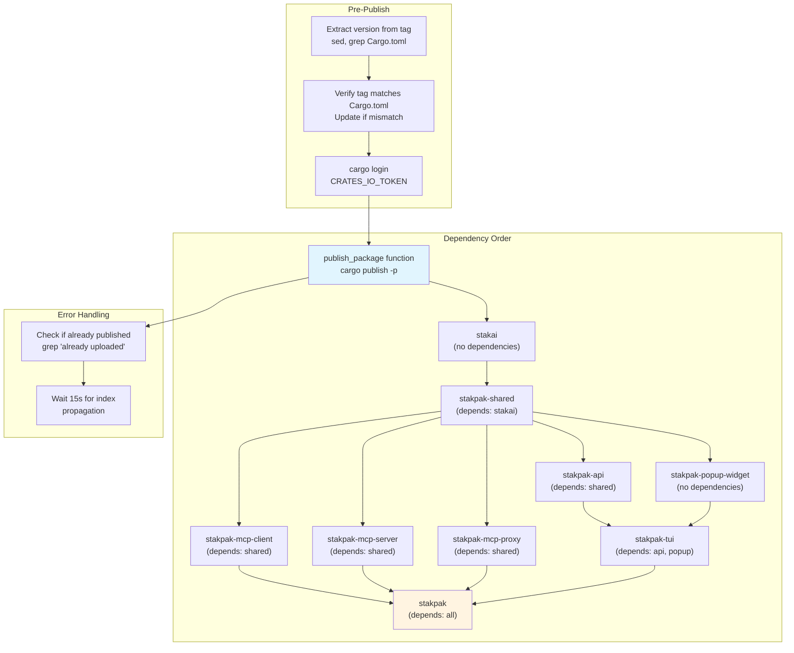
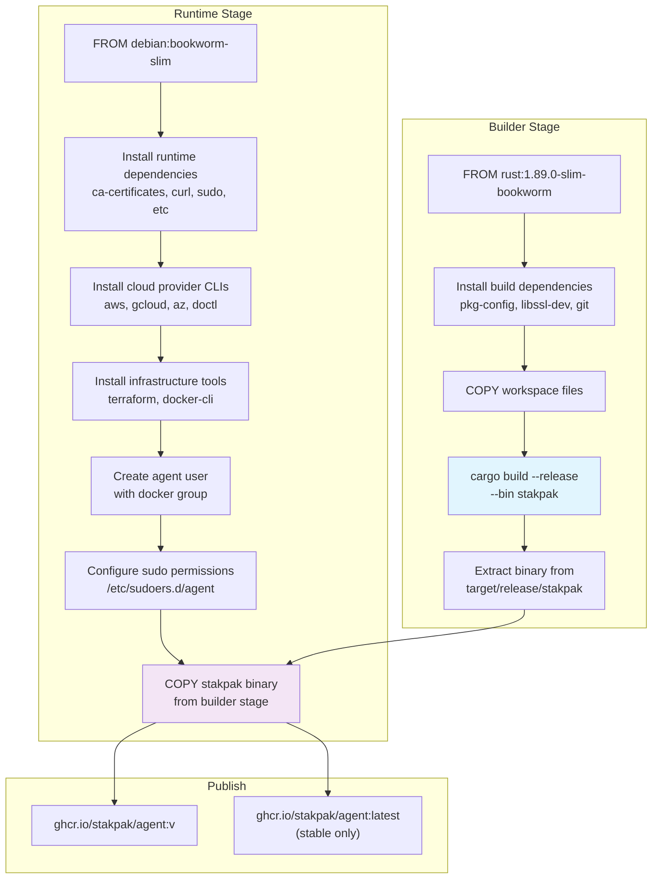
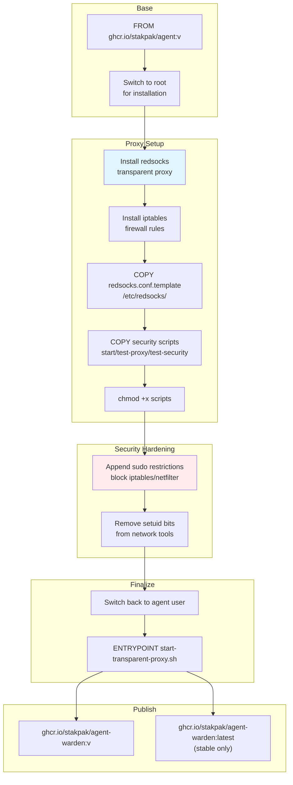
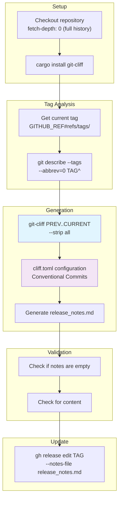
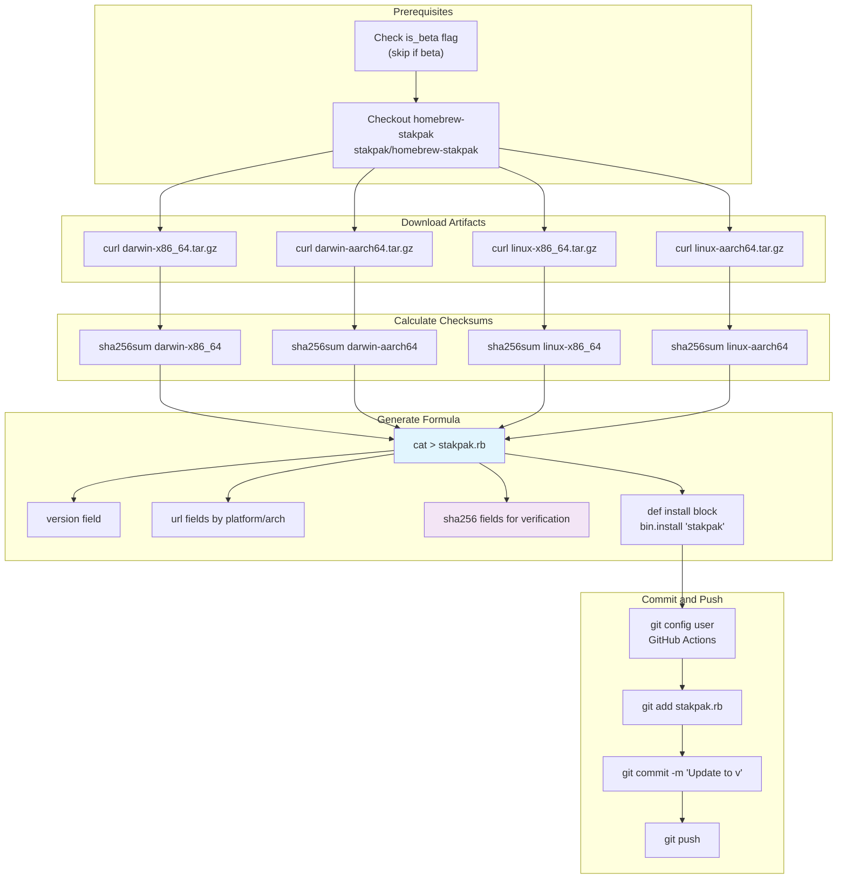
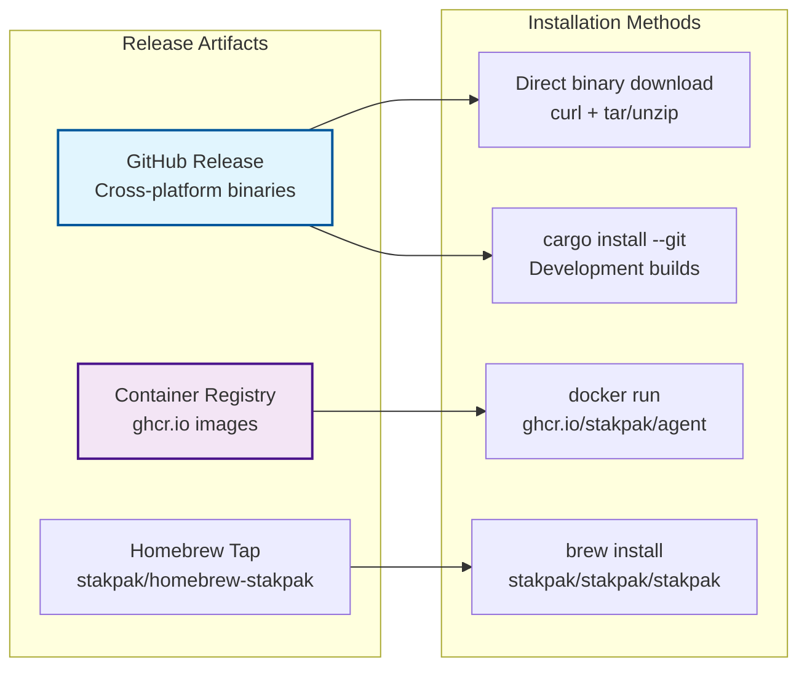

<!-- source: DeepWiki mcp.deepwiki.com · repo stakpak/agent · page 7 Build System and Deployment · fetched 2026-10-27 -->

# Build System and Deployment

<details>
<summary>Relevant source files</summary>

The following files were used as context for generating this wiki page:

- [.github/workflows/build-and-release.yml](.github/workflows/build-and-release.yml)
- [README.md](README.md)
- [assets/stakpak-dark.png](assets/stakpak-dark.png)
- [assets/stakpak-light.png](assets/stakpak-light.png)
- [cliff.toml](cliff.toml)
- [libs/popup-widget/Cargo.toml](libs/popup-widget/Cargo.toml)
- [libs/popup-widget/README.md](libs/popup-widget/README.md)
- [release.sh](release.sh)

</details>


This document covers the build system, release management, CI/CD pipeline, and distribution mechanisms for the Stakpak agent system. It details the automated release workflow, version management, multi-platform binary compilation, container image builds, and distribution through multiple channels including GitHub releases, crates.io, container registries, and package managers.

For information about workspace structure and package organization, see [Workspace Structure and Packages](#1.2). For security features implemented within deployment containers, see [Security and Privacy](#6).
</thinking>

## Build System Overview

Stakpak uses a Cargo workspace-based build system that compiles multiple interdependent crates into platform-specific binaries. The workspace configuration enforces unified versioning across all packages and includes comprehensive linting rules that deny `unwrap_used` and `expect_used` for production reliability.

**Workspace Structure:**

| Crate | Type | Purpose | Location |
|-------|------|---------|----------|
| `stakpak` | Binary | Main CLI executable | `cli/` |
| `stakpak-tui` | Library | Terminal user interface | `tui/` |
| `stakpak-shared` | Library | Common utilities and types | `libs/shared/` |
| `stakpak-api` | Library | Backend API client | `libs/api/` |
| `stakai` | Library | AI/LLM capabilities | `libs/ai/` |
| `stakpak-mcp-client` | Library | MCP protocol client | `libs/mcp/client/` |
| `stakpak-mcp-server` | Library | MCP protocol server | `libs/mcp/server/` |
| `stakpak-mcp-proxy` | Library | MCP proxy server | `libs/mcp/proxy/` |
| `stakpak-popup-widget` | Library | TUI popup component | `libs/popup-widget/` |

**Sources:** [Cargo.toml:1-17](), [Cargo.toml:19-61](), [Cargo.toml:64-66]()

## Release Management

The release process is managed through the `release.sh` script, which automates version bumping, git tagging, and triggers the CI/CD pipeline.

**Release Workflow:**



**Key Features:**

- **Version Bump Types:** Supports `patch`, `minor`, `major`, or explicit version numbers (e.g., `1.2.3`)
- **Beta Releases:** `--beta` flag creates pre-release tags like `v0.1.101-beta.1` with auto-incrementing beta numbers
- **Workspace Synchronization:** Updates both workspace-level version and all internal dependency version references
- **Interactive Mode:** Prompts for version type if not specified as argument
- **Safety Checks:** Validates version format, checks git status, and requires confirmation before proceeding

**Usage Examples:**

```bash
# Patch release: 0.1.100 -> 0.1.101
./release.sh patch

# Beta release: 0.1.100 -> 0.1.101-beta.1
./release.sh patch --beta

# Specific version: 0.1.100 -> 1.0.0
./release.sh 1.0.0

# Interactive mode
./release.sh
```

**Sources:** [release.sh:1-325](), [release.sh:48-94](), [release.sh:96-122](), [release.sh:175-186](), [release.sh:161-173]()

## CI/CD Pipeline

The GitHub Actions workflow `build-and-release.yml` orchestrates multi-platform builds, testing, artifact creation, and distribution across all release channels.

**Pipeline Architecture:**




**Job Dependencies and Execution Flow:**

The workflow uses a dependency graph where downstream jobs wait for upstream jobs to complete successfully:

1. **setup** → Determines release type (`is_beta`, `version`)
2. **build** → Compiles for all platforms in parallel (no dependencies)
3. **release** → Waits for `setup` + `build`, creates GitHub release
4. **publish_crates_io** → Waits for `build`, publishes to crates.io registry
5. **docker** → Waits for `setup` + `build`, builds base Docker image
6. **docker_warden** → Waits for `setup` + `docker`, builds warden image
7. **homebrew** → Waits for `setup` + `release`, updates Homebrew tap
8. **update-release-notes** → Waits for `release`, generates changelog with git-cliff

**Sources:** [.github/workflows/build-and-release.yml:1-15](), [.github/workflows/build-and-release.yml:27-46](), [.github/workflows/build-and-release.yml:48-112](), [.github/workflows/build-and-release.yml:114-137]()

## Build Configuration and Targets

**Platform Build Matrix:**

| Platform | OS Runner | Rust Target | Artifact Format | Special Setup |
|----------|-----------|-------------|-----------------|---------------|
| Linux x86_64 | ubuntu-22.04 | x86_64-unknown-linux-musl | tar.gz | musl-tools installation |
| Linux ARM64 | ubuntu-22.04-arm | aarch64-unknown-linux-musl | tar.gz | musl-tools installation |
| macOS x86_64 | macos-15 | x86_64-apple-darwin | tar.gz | None |
| macOS ARM64 | macos-15 | aarch64-apple-darwin | tar.gz | None |
| Windows x86_64 | windows-2022 | x86_64-pc-windows-msvc | zip | 7z compression |

**Build Optimizations:**

- **MUSL Targets:** Linux builds use MUSL libc for static linking, producing fully portable binaries without dynamic library dependencies
- **Rust Cache:** `Swatinem/rust-cache@v2` with per-target shared keys reduces build times by caching dependencies
- **Static Linking:** Linux builds set `RUSTFLAGS: '-C target-feature=+crt-static'` for complete static linking

**Sources:** [.github/workflows/build-and-release.yml:48-66](), [.github/workflows/build-and-release.yml:74-94]()

## Crates.io Publishing

The `publish_crates_io` job publishes all workspace crates to the Rust package registry in dependency order.

**Publishing Sequence:**



**Key Features:**

- **Dependency-First:** Publishes dependencies before dependents to avoid registry errors
- **Idempotency:** Skips already-published versions with "already uploaded" detection
- **Index Propagation:** 15-second wait between publishes for crates.io index to update
- **Verification Skip:** Uses `--no-verify` flag to skip re-compilation during publish
- **Version Synchronization:** Auto-updates Cargo.toml if tag version doesn't match

**Sources:** [.github/workflows/build-and-release.yml:139-218](), [.github/workflows/build-and-release.yml:179-200](), [.github/workflows/build-and-release.yml:202-214]()

## Docker Image Build Process

Docker images are built for both the base agent and the security-hardened warden wrapper.

**Base Image Build (`docker` job):**



**Installed Tooling:**

| Component | Purpose | Installation Method | Version Detection |
|-----------|---------|---------------------|-------------------|
| **AWS CLI** | Amazon Web Services management | Binary download | Architecture-specific (x86_64/aarch64) |
| **Google Cloud CLI** | Google Cloud Platform operations | APT repository | Latest stable from Google repo |
| **Azure CLI** | Microsoft Azure management | Microsoft script | Latest from install script |
| **DigitalOcean CLI** | DigitalOcean management | Binary download | GitHub API latest release |
| **Terraform** | Infrastructure as Code | Binary download | HashiCorp API latest version |
| **Docker CLI** | Container operations | APT repository | Latest from Docker official repo |
| **kubectl** | Kubernetes operations | Binary download | Latest stable version |
| **jq** | JSON processing | APT package | Debian repository version |

**User and Permissions Configuration:**

The container runs as a non-root `agent` user (UID 1001) with carefully configured sudo permissions:

- **User Setup:** Creates `agent` user and adds to `docker` group for Docker socket access
- **Sudo Rules:** `/etc/sudoers.d/agent` grants NOPASSWD access to package managers (apt-get, apt, dpkg, snap)
- **Working Directory:** `/agent` set as WORKDIR with agent ownership
- **Entrypoint:** `/usr/local/bin/stakpak` executable

**Sources:** [Dockerfile:1-113](), [Dockerfile:16-96](), [Dockerfile:97-113](), [Dockerfile:103-106]()

**Warden Image Build (`docker_warden` job):**

The warden image extends the base image with transparent proxy capabilities and enhanced security restrictions:



**Warden Security Features:**

- **Transparent Proxy:** `redsocks` redirects all outbound traffic through a SOCKS proxy
- **iptables Configuration:** Custom rules route traffic and prevent direct internet access
- **Sudo Restrictions:** Additional rules block `iptables`, `ip6tables`, `nft`, and related tools
- **Setuid Removal:** Removes setuid bits from `ping`, `ping6`, `traceroute`, `traceroute6`
- **Startup Script:** `start-transparent-proxy.sh` configures proxy and launches stakpak

**Sources:** [.warden/Dockerfile:1-47](), [.warden/Dockerfile:24-26](), [.warden/Dockerfile:28-39](), [.warden/Dockerfile:41-47](), [.github/workflows/build-and-release.yml:220-245](), [.github/workflows/build-and-release.yml:247-273]()

## Release Notes Generation

The `update-release-notes` job uses `git-cliff` to generate formatted changelogs following Conventional Commits.

**Changelog Generation Process:**



**Conventional Commit Categories:**

The `cliff.toml` configuration defines commit parsing rules:

| Commit Prefix | Category | Description |
|---------------|----------|-------------|
| `feat` | Features | New features and capabilities |
| `fix` | Bug Fixes | Bug fixes and corrections |
| `docs` | Documentation | Documentation updates |
| `perf` | Performance | Performance improvements |
| `refactor` | Refactoring | Code refactoring without behavior changes |
| `style` | Code Style | Formatting and style changes |
| `test` | Testing | Test additions and updates |
| `chore`, `ci` | Maintenance | Maintenance tasks and CI changes |
| `revert` | Reverts | Reverted changes |
| `*security*` (body) | Security | Security-related changes |

**Excluded Commits:**
- `chore(release): prepare for` - Release preparation commits
- `chore(deps*)` - Dependency update commits  
- `chore(pr)`, `chore(pull)` - PR-related commits

**Sources:** [.github/workflows/build-and-release.yml:275-328](), [cliff.toml:1-62](), [cliff.toml:31-46]()

## Homebrew Distribution

The `homebrew` job updates the Homebrew tap repository with new release information for stable (non-beta) releases only.

**Update Process:**



**Homebrew Formula Structure:**

The generated `stakpak.rb` formula includes:
- **Version Declaration:** Extracted from release tag
- **Platform Detection:** `on_macos` and `on_linux` blocks with CPU architecture checks
- **URL Generation:** GitHub release download URLs for each platform/architecture combination
- **SHA256 Verification:** Checksums for all artifacts to ensure download integrity
- **Installation Logic:** Simple `bin.install "stakpak"` to place binary in Homebrew's bin directory

**Sources:** [.github/workflows/build-and-release.yml:330-393](), [.github/workflows/build-and-release.yml:346-386]()

## Distribution Channels

The stakpak agent is distributed through multiple channels to support different deployment scenarios:

### GitHub Releases
Binary artifacts are automatically created for each tagged release with platform-specific packaging:
- Linux: `stakpak-linux-{x86_64,aarch64}.tar.gz`
- macOS: `stakpak-darwin-{x86_64,aarch64}.tar.gz`  
- Windows: `stakpak-windows-x86_64.zip`

### Container Registry
Docker images are published to GitHub Container Registry with semantic versioning:
- Base image: `ghcr.io/stakpak/agent:{version,latest}`
- Warden image: `ghcr.io/stakpak/agent-warden:{version,latest}`

### Homebrew Package Manager
The `homebrew` job automatically updates the Homebrew tap repository with new release information including SHA256 checksums for package verification.



**Sources:** [.github/workflows/build-and-release.yml:84-106](), [.github/workflows/build-and-release.yml:129-137](), [.github/workflows/build-and-release.yml:171-232]()

## Workspace Configuration

The deployment is built from a Cargo workspace containing multiple crates with shared dependencies and unified versioning.

| Crate | Purpose | Location |
|-------|---------|----------|
| `cli` | Main binary and entry point | `cli/` |
| `tui` | Terminal user interface | `tui/` |
| `stakpak-shared` | Common utilities and types | `libs/shared/` |
| `stakpak-api` | Backend API client | `libs/api/` |
| `mcp-client` | MCP protocol client | `libs/mcp/client/` |
| `mcp-server` | MCP protocol server | `libs/mcp/server/` |

The workspace uses version `0.1.156` with Rust edition `2024` and includes comprehensive linting rules that deny `unwrap_used` and `expect_used` for enhanced reliability in production deployments.

**Sources:** [Cargo.toml:1-17](), [Cargo.toml:64-66]()

---

