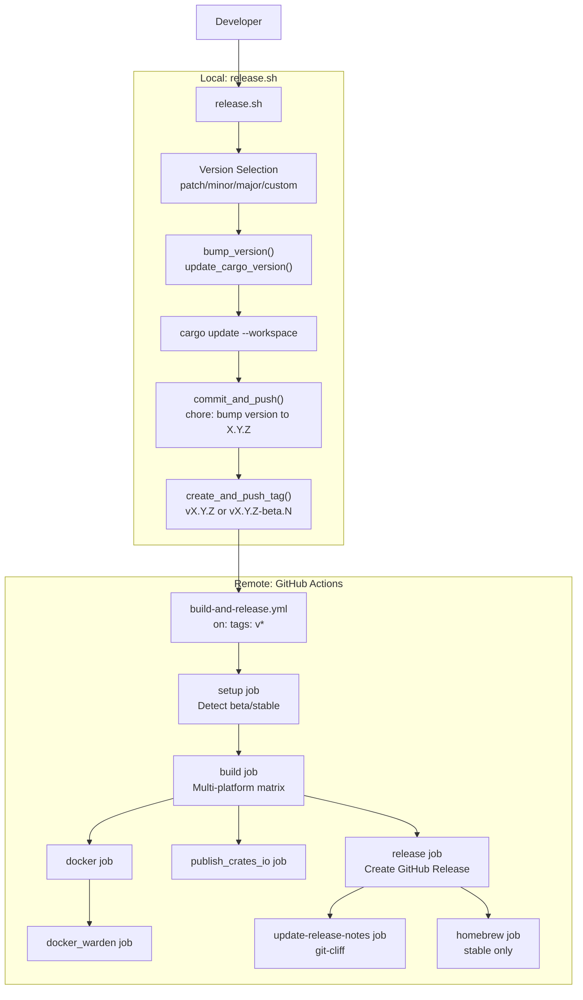
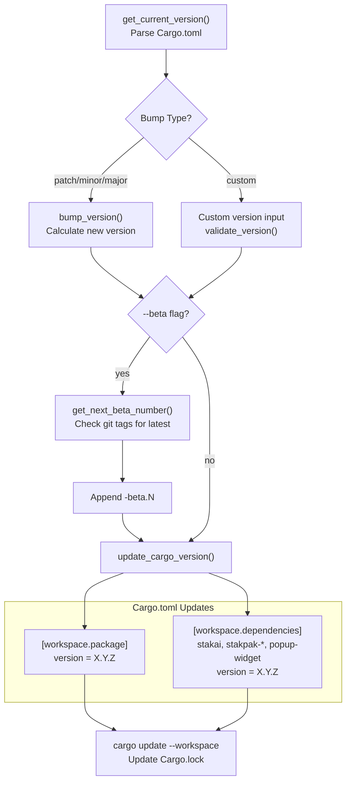
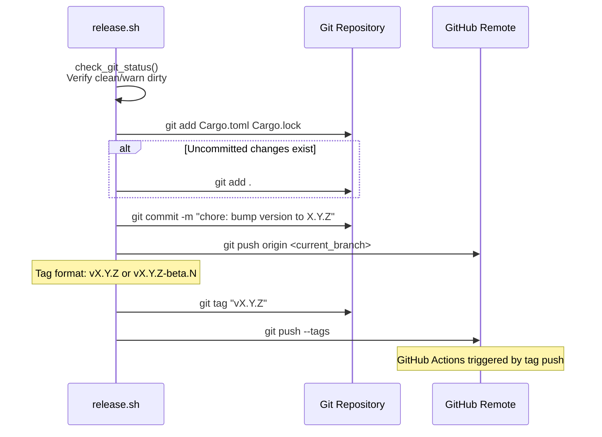
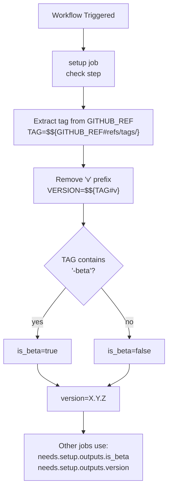
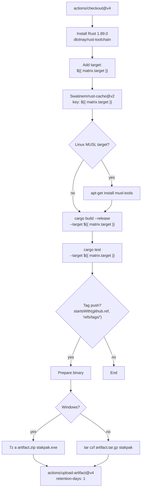
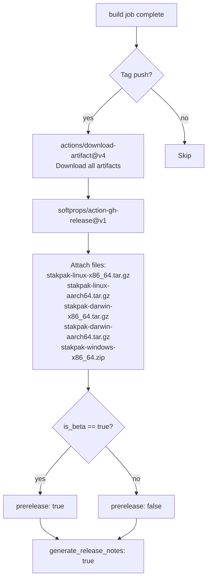
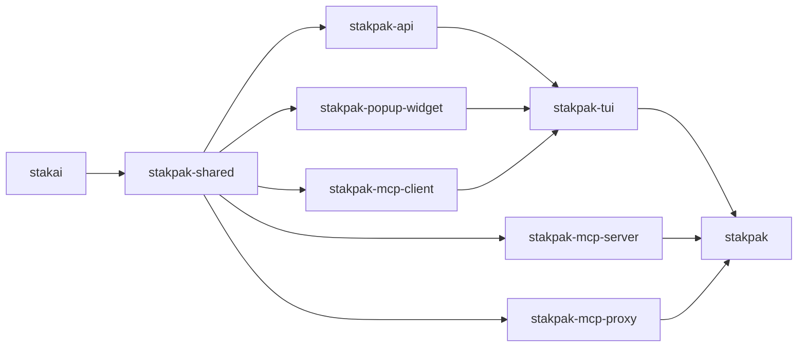
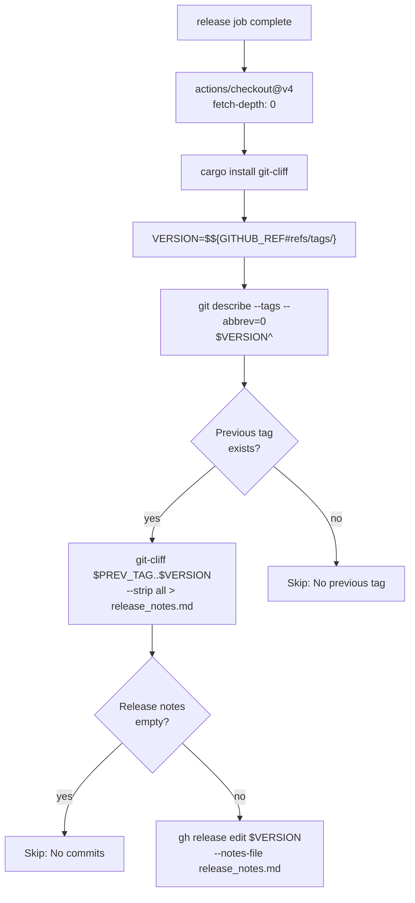
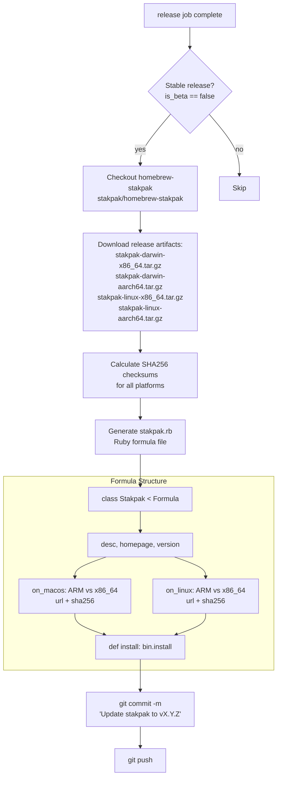

<!-- source: DeepWiki mcp.deepwiki.com · repo stakpak/agent · page 7.2 Release Management · fetched 2026-10-27 -->

# Release Management

<details>
<summary>Relevant source files</summary>

The following files were used as context for generating this wiki page:

- [.github/workflows/build-and-release.yml](.github/workflows/build-and-release.yml)
- [cliff.toml](cliff.toml)
- [libs/popup-widget/Cargo.toml](libs/popup-widget/Cargo.toml)
- [libs/popup-widget/README.md](libs/popup-widget/README.md)
- [release.sh](release.sh)

</details>


## Purpose and Scope

This document describes the release management system for Stakpak, including version bumping, git tagging, and the automated CI/CD pipeline that builds and distributes releases. The release process uses the `release.sh` script for version management and GitHub Actions workflows for building and publishing artifacts across multiple platforms and distribution channels.

For information about the CI/CD pipeline architecture and build matrix, see [CI/CD Pipeline](#7.1). For details on distribution channels and package publishing, see [Distribution Channels](#7.3).

## Release Process Overview

The release management system consists of a local release script and an automated CI/CD pipeline:

**Release Process Flow Diagram**



Sources: [release.sh:1-325](), [.github/workflows/build-and-release.yml:1-393]()

## Version Bumping with release.sh

The `release.sh` script manages version updates across the workspace. It provides both interactive and command-line modes for version bumping.

### Script Usage

| Command | Description | Example Result |
|---------|-------------|----------------|
| `./release.sh patch` | Bump patch version | 0.1.100 → 0.1.101 |
| `./release.sh minor` | Bump minor version | 0.1.100 → 0.2.0 |
| `./release.sh major` | Bump major version | 0.1.100 → 1.0.0 |
| `./release.sh 1.2.3` | Set specific version | → 1.2.3 |
| `./release.sh` | Interactive mode | Prompts for choice |
| `./release.sh patch --beta` | Create beta release | 0.1.100 → 0.1.101-beta.1 |

Sources: [release.sh:29-46]()

### Version Update Process

**Version Management Data Flow**



Sources: [release.sh:48-122]()

The version update process consists of:

1. **Current Version Extraction**: Uses `grep` and `sed` to parse the version from [Cargo.toml:1-999]()
2. **Version Calculation**: The `bump_version()` function increments major/minor/patch components [release.sh:64-94]()
3. **Validation**: The `validate_version()` function ensures semantic version format (X.Y.Z or X.Y.Z-beta.N) [release.sh:53-62]()
4. **Workspace Updates**: The `update_cargo_version()` function updates:
   - Workspace package version in `[workspace.package]` section
   - Internal dependency versions for `stakai`, `stakpak-*`, and `popup-widget` packages
   - All uses `sed` with regex patterns to update both occurrences [release.sh:96-112]()
5. **Lock File Update**: Runs `cargo update --workspace` to synchronize `Cargo.lock` [release.sh:115-121]()

## Git Workflow and Tagging

After updating version files, the script commits changes and creates git tags.

### Commit and Tag Creation

**Git Operations Sequence**



Sources: [release.sh:124-173]()

The git workflow functions:

- **check_git_status()**: Verifies working directory state, warns about uncommitted changes, and requests confirmation [release.sh:124-138]()
- **commit_and_push()**: Stages version files (Cargo.toml, Cargo.lock), commits with standardized message format "chore: bump version to X.Y.Z", and pushes to current branch [release.sh:140-159]()
- **create_and_push_tag()**: Creates annotated tag with "v" prefix (e.g., `v0.1.101` or `v0.1.101-beta.1`) and pushes to remote [release.sh:161-173]()

### Beta Version Tracking

For beta releases, the `get_next_beta_number()` function queries existing git tags to determine the next beta number:

```bash
git tag -l "v${base_version}-beta.*" | sort -V | tail -1
```

This ensures sequential beta versioning (beta.1, beta.2, beta.3, etc.) for the same base version [release.sh:175-186]().

Sources: [release.sh:175-186]()

## CI/CD Pipeline Trigger and Setup

The GitHub Actions workflow is triggered by tag pushes and branch pushes with different behaviors.

### Workflow Triggers

**Trigger Configuration Table**

| Trigger Type | Pattern | Build | Release | Publish |
|--------------|---------|-------|---------|---------|
| Tag (stable) | `v1.2.3` | ✓ | ✓ | ✓ all channels |
| Tag (beta) | `v1.2.3-beta.1` | ✓ | ✓ prerelease | ✓ (no Homebrew) |
| Branch (main) | `main` | ✓ | ✗ | ✗ |
| Branch (beta) | `beta` | ✓ | ✗ | ✗ |

Sources: [.github/workflows/build-and-release.yml:3-14]()

The workflow configuration:

```yaml
on:
  push:
    branches: [main, beta]  # Build only
    tags: ["v*"]            # Full release
```

### Setup Job

The `setup` job runs first to determine release characteristics:

**Setup Job Logic**



Sources: [.github/workflows/build-and-release.yml:27-45]()

The setup job outputs:
- `is_beta`: Boolean flag indicating beta/stable release
- `version`: Parsed version number without "v" prefix

These outputs are consumed by downstream jobs via `needs.setup.outputs.*` references.

## Build Matrix and Artifacts

The `build` job creates binaries for multiple platforms using a matrix strategy.

### Build Matrix Configuration

| OS | Target Triple | Architecture | Artifact Name |
|----|---------------|--------------|---------------|
| ubuntu-22.04 | x86_64-unknown-linux-musl | x86_64 Linux | stakpak-linux-x86_64 |
| ubuntu-22.04-arm | aarch64-unknown-linux-musl | ARM64 Linux | stakpak-linux-aarch64 |
| macos-15 | x86_64-apple-darwin | x86_64 macOS | stakpak-darwin-x86_64 |
| macos-15 | aarch64-apple-darwin | ARM64 macOS | stakpak-darwin-aarch64 |
| windows-2022 | x86_64-pc-windows-msvc | x86_64 Windows | stakpak-windows-x86_64 |

Sources: [.github/workflows/build-and-release.yml:48-66]()

### Build Process Steps

**Build Job Workflow**



Sources: [.github/workflows/build-and-release.yml:70-112]()

Key build features:
- Uses `RUSTFLAGS` for static linking on Linux GNU targets [.github/workflows/build-and-release.yml:90]()
- Linux MUSL targets require `musl-tools` package [.github/workflows/build-and-release.yml:83-85]()
- Windows artifacts use `.zip`, others use `.tar.gz` [.github/workflows/build-and-release.yml:96-104]()
- Artifacts retained for 1 day before release job processes them [.github/workflows/build-and-release.yml:112]()

## Release Creation and Publishing

After successful builds, multiple jobs handle release creation and distribution.

### Release Job

The `release` job creates the GitHub release with all platform artifacts:

**Release Creation Process**



Sources: [.github/workflows/build-and-release.yml:114-136]()

The release job:
- Downloads all artifacts from the build job [.github/workflows/build-and-release.yml:120-121]()
- Creates GitHub release using `softprops/action-gh-release` [.github/workflows/build-and-release.yml:124]()
- Marks as prerelease if `is_beta == 'true'` [.github/workflows/build-and-release.yml:133]()
- Generates release notes automatically from commits [.github/workflows/build-and-release.yml:134]()

### Crates.io Publishing

The `publish_crates_io` job publishes all workspace packages to crates.io in dependency order:

**Crates.io Publishing Sequence**



Sources: [.github/workflows/build-and-release.yml:202-213]()

The publishing process:
1. **Version Verification**: Checks that tag version matches `Cargo.toml`, updates if needed [.github/workflows/build-and-release.yml:148-165]()
2. **Sequential Publishing**: Uses `publish_package()` function that:
   - Runs `cargo publish -p <package> --no-verify` [.github/workflows/build-and-release.yml:185]()
   - Checks for "already uploaded" error and skips if present [.github/workflows/build-and-release.yml:193-194]()
   - Waits 15 seconds between packages for index propagation [.github/workflows/build-and-release.yml:191-192]()
3. **Dependency Order**: Publishes in strict order to ensure dependencies are available [.github/workflows/build-and-release.yml:202-213]()

Sources: [.github/workflows/build-and-release.yml:138-217]()

## Beta Releases

Beta releases follow a modified workflow with specific constraints.

### Beta Release Characteristics

| Feature | Stable Release | Beta Release |
|---------|----------------|--------------|
| Tag Format | `v1.2.3` | `v1.2.3-beta.1` |
| GitHub Release | Normal release | Marked as prerelease |
| Crates.io | Published | Published |
| Docker Images | `:latest` + `:vX.Y.Z` | `:vX.Y.Z-beta.N` only |
| Homebrew | Updated | **Skipped** |

Sources: [.github/workflows/build-and-release.yml:133](), [.github/workflows/build-and-release.yml:244](), [.github/workflows/build-and-release.yml:272](), [.github/workflows/build-and-release.yml:332]()

### Creating Beta Releases

To create a beta release:

```bash
# Interactive beta release
./release.sh --beta

# Automatic patch beta release
./release.sh patch --beta

# Specific version beta release
./release.sh 1.2.3 --beta
```

The script automatically:
1. Queries existing beta tags for the base version
2. Increments the beta number (e.g., beta.1 → beta.2)
3. Creates tag like `v1.2.3-beta.2`

Sources: [release.sh:40-45](), [release.sh:274-278]()

### Beta Release Conditional Logic

**Docker Image Tagging for Beta vs Stable**

```yaml
tags: |
  ghcr.io/${{ github.repository }}:v${{ needs.setup.outputs.version }}
  ${{ needs.setup.outputs.is_beta != 'true' && format('ghcr.io/{0}:latest', github.repository) || '' }}
```

This expression conditionally adds the `:latest` tag only for stable releases [.github/workflows/build-and-release.yml:242-244]().

The Homebrew job uses a conditional to skip beta releases entirely:

```yaml
if: startsWith(github.ref, 'refs/tags/') && needs.setup.outputs.is_beta == 'false'
```

Sources: [.github/workflows/build-and-release.yml:332]()

## Release Notes Generation

Release notes are generated using `git-cliff` with conventional commit parsing.

### Release Notes Workflow

**Release Notes Update Process**



Sources: [.github/workflows/build-and-release.yml:274-327]()

### Git-Cliff Configuration

The `cliff.toml` configuration defines commit parsing rules:

**Commit Group Mappings**

| Commit Prefix | Group | Included in Notes |
|---------------|-------|-------------------|
| `feat` | Features | ✓ |
| `fix` | Bug Fixes | ✓ |
| `docs` | Documentation | ✓ |
| `perf` | Performance | ✓ |
| `refactor` | Refactoring | ✓ |
| `style` | Code Style | ✓ |
| `test` | Testing | ✓ |
| `chore`, `ci` | Maintenance | ✓ |
| `chore(release)` | - | ✗ Skipped |
| `chore(deps*)` | - | ✗ Skipped |
| `revert` | Reverts | ✓ |
| Body contains "security" | Security | ✓ |

Sources: [cliff.toml:31-46]()

The changelog template groups commits by category and links to pull requests:

```
## X.Y.Z
Released on YYYY-MM-DD.

### FEATURES
- Commit message (#123)

### BUG FIXES
- Commit message (#456)
```

Sources: [cliff.toml:8-23]()

## Docker Image Publishing

Two Docker images are built and published to GitHub Container Registry:

### Main Docker Image

The `docker` job builds the standard Stakpak image:

- **Context**: Root directory (`.`)
- **Platform**: `linux/amd64` only
- **Tags**: 
  - `ghcr.io/stakpak/agent:vX.Y.Z` (always)
  - `ghcr.io/stakpak/agent:latest` (stable only)

Sources: [.github/workflows/build-and-release.yml:219-244]()

### Warden Docker Image

The `docker_warden` job builds the security-focused Warden variant:

- **Context**: `.warden` directory
- **Base Image**: Uses main image as base via `BASE_IMAGE_TAG` build arg
- **Tags**: 
  - `ghcr.io/stakpak/agent-warden:vX.Y.Z` (always)
  - `ghcr.io/stakpak/agent-warden:latest` (stable only)

Sources: [.github/workflows/build-and-release.yml:246-272]()

The Warden job depends on the `docker` job completion to ensure the base image exists [.github/workflows/build-and-release.yml:247]().

## Homebrew Formula Updates

The `homebrew` job automatically updates the Homebrew tap for stable releases only.

**Homebrew Update Process**



Sources: [.github/workflows/build-and-release.yml:329-392]()

The formula generation:
1. Downloads all release artifacts from GitHub [.github/workflows/build-and-release.yml:346-349]()
2. Calculates SHA256 checksums for integrity verification [.github/workflows/build-and-release.yml:351-354]()
3. Generates `stakpak.rb` with platform-specific URLs and checksums [.github/workflows/build-and-release.yml:356-386]()
4. Commits and pushes to `stakpak/homebrew-stakpak` repository [.github/workflows/build-and-release.yml:388-392]()

The job requires a separate `HOMEBREW_TAP_GITHUB_TOKEN` secret for repository access [.github/workflows/build-and-release.yml:338]().

Sources: [.github/workflows/build-and-release.yml:329-392]()

---

