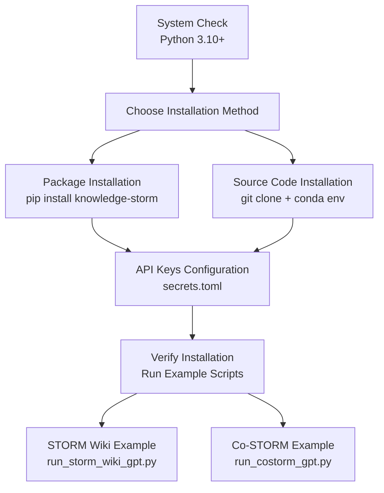
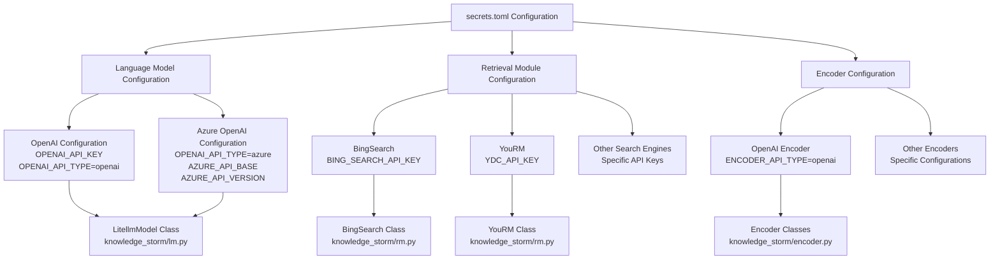
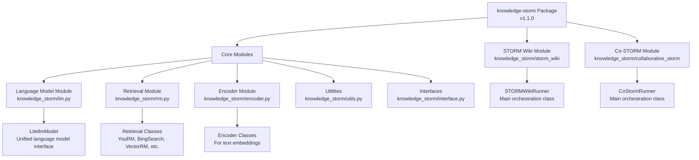

<!-- source: DeepWiki mcp.deepwiki.com · repo stanford-oval/storm · page 1.1 Installation and Setup · fetched 2026-10-27 -->

# Installation and Setup

<details>
<summary>Relevant source files</summary>

The following files were used as context for generating this wiki page:

- [.github/workflows/python-package.yml](.github/workflows/python-package.yml)
- [README.md](README.md)
- [knowledge_storm/__init__.py](knowledge_storm/__init__.py)
- [knowledge_storm/lm.py](knowledge_storm/lm.py)
- [setup.py](setup.py)

</details>


This page provides detailed instructions for installing and configuring the STORM system. It covers the prerequisites, installation methods, and configuration steps necessary to get both the STORM Wiki Generator and Co-STORM Collaborative system running. For details about the system architecture, see [Architecture Overview](#1.2).

## System Requirements

Before installing the STORM system, ensure your environment meets the following requirements:

- Python 3.10 or higher (3.11 recommended)
- Internet connection for downloading dependencies
- Sufficient disk space for the package and cached responses
- API keys for language models and search engines

Sources: [setup.py:36]()

## Installation Methods

The STORM system can be installed using one of two methods: as a Python package or from source code.

### Package Installation

The simplest and recommended method for most users is to install via pip:

```bash
pip install knowledge-storm
```

This installs the latest stable release (version 1.1.0 as of the latest update), which includes both the STORM Wiki Generator and Co-STORM Collaborative components.

Sources: [README.md:75-76](), [knowledge_storm/__init__.py:10](), [setup.py:17-19]()

### Source Code Installation

For development purposes or if you need to customize the codebase, install from source:

1. Clone the repository:
   ```bash
   git clone https://github.com/stanford-oval/storm.git
   cd storm
   ```

2. Create and activate a conda environment:
   ```bash
   conda create -n storm python=3.11
   conda activate storm
   ```

3. Install dependencies:
   ```bash
   pip install -r requirements.txt
   ```

Sources: [README.md:77-89]()

## Configuration Setup

The STORM system requires configuration of API keys for language models and retrieval modules. This section explains how to set up these configurations.

### API Keys and Secrets Configuration

The recommended approach is to create a `secrets.toml` file in the root directory of your project. This file should contain all your API keys and configuration settings:

```toml
# Language model configurations
OPENAI_API_KEY="your_openai_api_key"

# If using OpenAI's API service
OPENAI_API_TYPE="openai"

# If using Microsoft Azure's API service
OPENAI_API_TYPE="azure"
AZURE_API_BASE="your_azure_api_base_url"
AZURE_API_VERSION="your_azure_api_version"

# Retriever configurations
BING_SEARCH_API_KEY="your_bing_search_api_key"  # If using Bing search
YDC_API_KEY="your_you_api_key"  # If using You.com search

# Encoder configurations
ENCODER_API_TYPE="openai"  # If using OpenAI encoder
```

Sources: [README.md:224-240]()

### Supported Components

The following components can be configured in the STORM system:

#### Language Models
All models supported by litellm, including:
- OpenAI (GPT-3.5, GPT-4, GPT-4o)
- Azure OpenAI
- Anthropic (Claude models)
- Groq
- Ollama
- VLLM
- Other providers supported by litellm

#### Retrieval Modules
For searching and retrieving information:
- `YouRM` (You.com)
- `BingSearch` (Microsoft Bing)
- `VectorRM` (Qdrant vector database)
- `SerperRM` (Serper.dev)
- `BraveRM` (Brave Search)
- `SearXNG` (Self-hosted search)
- `DuckDuckGoSearchRM` (DuckDuckGo)
- `TavilySearchRM` (Tavily)
- `GoogleSearch` (Google)
- `AzureAISearch` (Azure AI Search)

#### Embedding Models
All embedding models supported by litellm for text embeddings used in vector search and knowledge organization.

Sources: [README.md:95-98]()

## Installation and Setup Workflow

The following diagram illustrates the complete installation and setup process:



Sources: [README.md:72-89](), [README.md:220-270]()

## Configuration Components and Code Mapping

This diagram shows how the configuration in `secrets.toml` maps to the code components:



Sources: [README.md:95-98](), [README.md:224-240]()

## Quick Verification

After installation and configuration, verify your setup by running one of the example scripts provided in the repository.

### For STORM Wiki Generator:

```bash
python examples/storm_examples/run_storm_wiki_gpt.py \
    --output-dir ./output \
    --retriever bing \
    --do-research \
    --do-generate-outline \
    --do-generate-article \
    --do-polish-article
```

### For Co-STORM Collaborative System:

```bash
python examples/costorm_examples/run_costorm_gpt.py \
    --output-dir ./output \
    --retriever bing
```

If these scripts run successfully, your installation is properly set up and configured.

Sources: [README.md:244-270]()

## Package Architecture

This diagram illustrates the architecture of the installed package and its main components:



Sources: [knowledge_storm/__init__.py:1-9](), [README.md:92-100]()

## Basic Usage Examples

Once you've completed installation and configuration, you can use STORM in your Python code. Here are some basic examples:

### STORM Wiki Generator Example

```python
from knowledge_storm import STORMWikiRunnerArguments, STORMWikiRunner, STORMWikiLMConfigs
from knowledge_storm.lm import LitellmModel
from knowledge_storm.rm import BingSearch

# Configure language models
lm_configs = STORMWikiLMConfigs()
openai_kwargs = {
    'api_key': 'your_openai_api_key',
    'temperature': 1.0,
    'top_p': 0.9,
}
gpt_35 = LitellmModel(model='gpt-3.5-turbo', max_tokens=500, **openai_kwargs)
gpt_4 = LitellmModel(model='gpt-4o', max_tokens=3000, **openai_kwargs)

# Set different models for different components
lm_configs.set_conv_simulator_lm(gpt_35)
lm_configs.set_question_asker_lm(gpt_35)
lm_configs.set_outline_gen_lm(gpt_4)
lm_configs.set_article_gen_lm(gpt_4)
lm_configs.set_article_polish_lm(gpt_4)

# Configure arguments and retrieval module
engine_args = STORMWikiRunnerArguments(search_top_k=5)
rm = BingSearch(bing_search_api_key='your_bing_api_key', k=engine_args.search_top_k)

# Create and run the STORM Wiki Generator
runner = STORMWikiRunner(engine_args, lm_configs, rm)
runner.run(
    topic="Your topic here",
    do_research=True,
    do_generate_outline=True,
    do_generate_article=True,
    do_polish_article=True,
)
```

### Co-STORM Example

```python
from knowledge_storm.collaborative_storm.engine import CollaborativeStormLMConfigs, RunnerArgument, CoStormRunner
from knowledge_storm.lm import LitellmModel
from knowledge_storm.logging_wrapper import LoggingWrapper
from knowledge_storm.rm import BingSearch

# Configure language models
lm_config = CollaborativeStormLMConfigs()
openai_kwargs = {
    "api_key": "your_openai_api_key",
    "temperature": 1.0,
    "top_p": 0.9,
}
question_answering_lm = LitellmModel(model='gpt-4o', max_tokens=1000, **openai_kwargs)
discourse_manage_lm = LitellmModel(model='gpt-4o', max_tokens=500, **openai_kwargs)

# Set models for different components
lm_config.set_question_answering_lm(question_answering_lm)
lm_config.set_discourse_manage_lm(discourse_manage_lm)
# Additional model configurations...

# Configure arguments and retrieval module
runner_argument = RunnerArgument(topic="Your topic here", retrieve_top_k=5)
logging_wrapper = LoggingWrapper(lm_config)
bing_rm = BingSearch(bing_search_api_key='your_bing_api_key', k=runner_argument.retrieve_top_k)

# Create and run the Co-STORM system
costorm_runner = CoStormRunner(
    lm_config=lm_config,
    runner_argument=runner_argument,
    logging_wrapper=logging_wrapper,
    rm=bing_rm
)

# Initialize and start the collaborative process
costorm_runner.warm_start()
conv_turn = costorm_runner.step()  # Observe conversation
costorm_runner.step(user_utterance="Your question or comment")  # Interact with the system
```

Sources: [README.md:102-216]()

---

