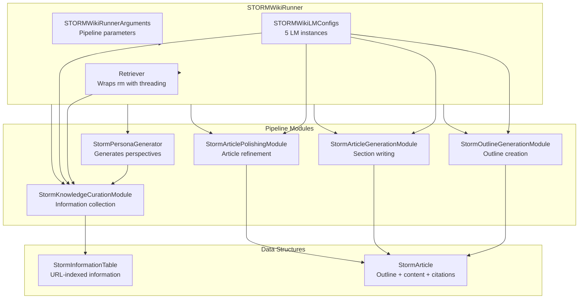
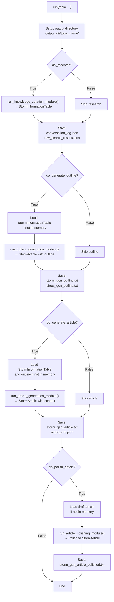
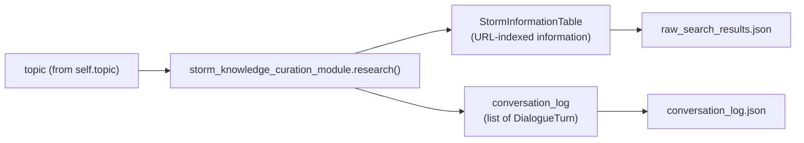
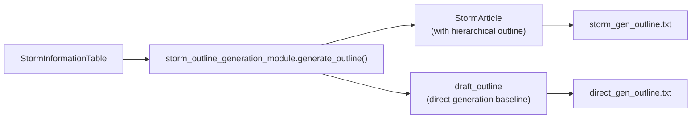
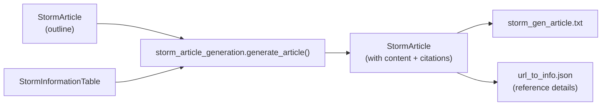
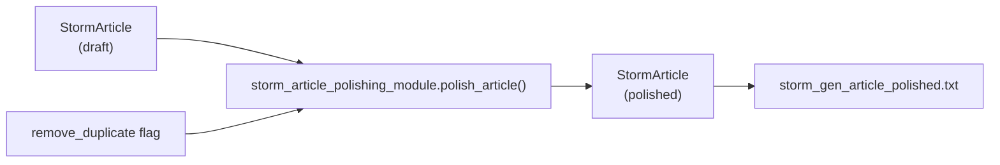
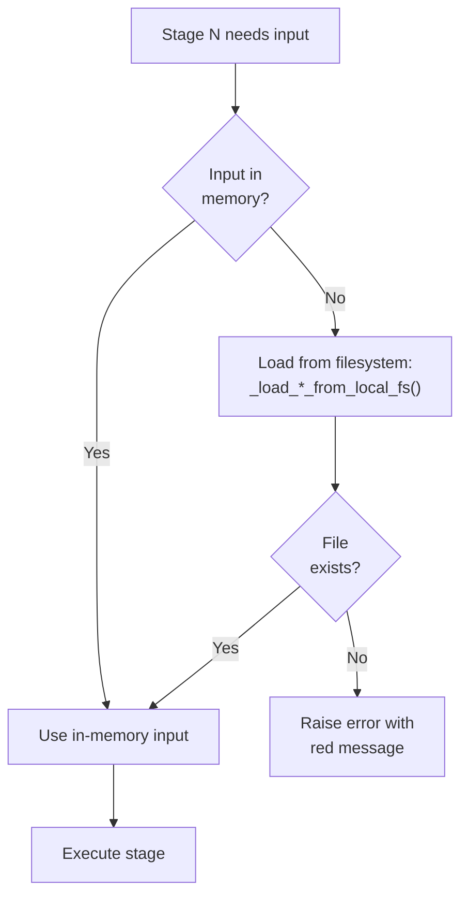
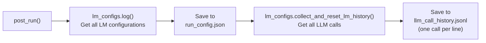
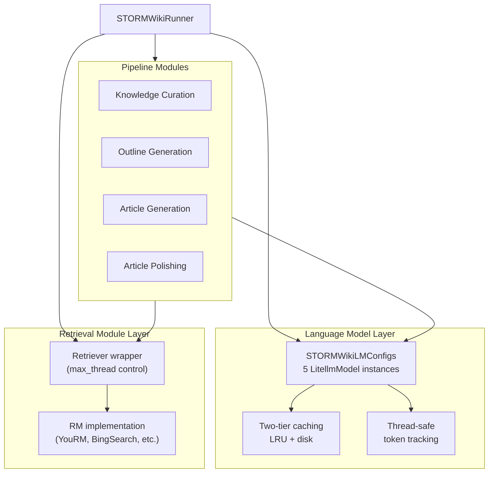

<!-- source: DeepWiki mcp.deepwiki.com · repo stanford-oval/storm · page 2.1 STORMWikiRunner · fetched 2026-10-27 -->

# STORMWikiRunner

<details>
<summary>Relevant source files</summary>

The following files were used as context for generating this wiki page:

- [README.md](README.md)
- [knowledge_storm/lm.py](knowledge_storm/lm.py)
- [knowledge_storm/storm_wiki/engine.py](knowledge_storm/storm_wiki/engine.py)
- [knowledge_storm/utils.py](knowledge_storm/utils.py)

</details>


**STORMWikiRunner** is the main orchestration engine for the STORM (Synthesis of Topic Outlines through Retrieval and Multi-perspective question asking) pipeline. It implements a 4-stage automated process for generating Wikipedia-like articles from scratch using perspective-guided question asking and internet search. This is the non-collaborative variant of the system; for the collaborative variant, see [CoStormRunner](#3.1).

**Sources:** [knowledge_storm/storm_wiki/engine.py:171-442]()

---

## Overview

STORMWikiRunner coordinates four sequential modules to transform a topic string into a comprehensive article:

1. **Knowledge Curation** - Collects information through simulated conversations
2. **Outline Generation** - Organizes information into a hierarchical structure  
3. **Article Generation** - Populates the outline with citations
4. **Article Polishing** - Adds lead section and refines the article

The runner manages state persistence, allowing each stage to be executed independently or skipped if intermediate results exist. All LLM calls, retrieved information, and generated artifacts are logged for reproducibility.

**Sources:** [knowledge_storm/storm_wiki/engine.py:171-210](), [README.md:42-54]()

---

## Configuration Classes

### STORMWikiLMConfigs

`STORMWikiLMConfigs` specifies five separate language model configurations optimized for different complexity levels in the pipeline:

| LM Configuration | Purpose | Typical Model | Max Tokens |
|-----------------|---------|---------------|------------|
| `conv_simulator_lm` | Simulates conversation responses, synthesizes answers | GPT-4o-mini | 500 |
| `question_asker_lm` | Generates follow-up questions | GPT-4o-mini | 500 |
| `outline_gen_lm` | Creates hierarchical outlines | GPT-4 | 400 |
| `article_gen_lm` | Writes article sections with citations | GPT-4o | 700 |
| `article_polish_lm` | Polishes article, adds lead section | GPT-4o | 4000 |

```python
lm_configs = STORMWikiLMConfigs()
lm_configs.set_conv_simulator_lm(LitellmModel(model='gpt-4o-mini', ...))
lm_configs.set_question_asker_lm(LitellmModel(model='gpt-4o-mini', ...))
lm_configs.set_outline_gen_lm(LitellmModel(model='gpt-4o', ...))
lm_configs.set_article_gen_lm(LitellmModel(model='gpt-4o', ...))
lm_configs.set_article_polish_lm(LitellmModel(model='gpt-4o', ...))
```

The class provides `init_openai_model()` for legacy compatibility with the NAACL'24 paper setup, but the setter methods allow full customization with any LiteLLM-supported model.

**Sources:** [knowledge_storm/storm_wiki/engine.py:21-125]()

---

### STORMWikiRunnerArguments

`STORMWikiRunnerArguments` is a dataclass controlling pipeline behavior:

| Parameter | Default | Description |
|-----------|---------|-------------|
| `output_dir` | (required) | Directory for all output artifacts |
| `max_conv_turn` | 3 | Maximum questions per simulated conversation |
| `max_perspective` | 3 | Number of perspectives for question asking |
| `max_search_queries_per_turn` | 3 | Search queries generated per conversation turn |
| `disable_perspective` | False | Disable perspective-guided question asking |
| `search_top_k` | 3 | Top-k search results per query |
| `retrieve_top_k` | 3 | Top-k references retrieved per section |
| `max_thread_num` | 10 | Maximum concurrent threads for LM/retrieval calls |

**Sources:** [knowledge_storm/storm_wiki/engine.py:127-169]()

---

## Initialization and Architecture

### Component Structure



**Component Initialization in `__init__()`**

```mermaid
graph LR
    Init["STORMWikiRunner.__init__"] --> CreateRetriever["Create Retriever<br/>with rm and max_thread"]
    CreateRetriever --> CreatePersona["Create StormPersonaGenerator<br/>with question_asker_lm"]
    CreatePersona --> CreateKnowCur["Create StormKnowledgeCurationModule<br/>with retriever, persona_generator, LMs"]
    CreateKnowCur --> CreateOutline["Create StormOutlineGenerationModule<br/>with outline_gen_lm"]
    CreateOutline --> CreateArticle["Create StormArticleGenerationModule<br/>with article_gen_lm, retrieve_top_k"]
    CreateArticle --> CreatePolish["Create StormArticlePolishingModule<br/>with article_gen_lm, article_polish_lm"]
    CreatePolish --> InitCheck["lm_configs.init_check()"]
    InitCheck --> ApplyDecorators["apply_decorators()"]
```



**Sources:** [knowledge_storm/storm_wiki/engine.py:174-210]()

---

## Execution Flow

### The `run()` Method

The `run()` method is the main entry point that orchestrates the 4-stage pipeline with optional stage skipping:

```python
runner.run(
    topic="Topic name",
    ground_truth_url="",  # Optional: URL to exclude from search
    do_research=True,
    do_generate_outline=True,
    do_generate_article=True,
    do_polish_article=True,
    remove_duplicate=False,
    callback_handler=BaseCallbackHandler()
)
```

**Pipeline Flow Diagram**



**Key behavior:**
- Each stage checks if its input is already in memory; if not, loads from filesystem
- Stages can be independently skipped by setting `do_*=False`
- Output directory is created based on sanitized topic name
- All intermediate results are persisted to disk

**Sources:** [knowledge_storm/storm_wiki/engine.py:341-442]()

---

## Module Execution Methods

### Knowledge Curation Stage

**Method:** `run_knowledge_curation_module(ground_truth_url, callback_handler)`



This stage generates perspectives, simulates expert-writer conversations, and collects information from search engines. The `ground_truth_url` parameter allows excluding a specific URL from search results (useful for evaluation against existing articles).

**Sources:** [knowledge_storm/storm_wiki/engine.py:211-235]()

---

### Outline Generation Stage

**Method:** `run_outline_generation_module(information_table, callback_handler)`



Generates a hierarchical outline using the collected information. Also produces a "direct generation" outline (without the research stage) for comparison purposes.

**Sources:** [knowledge_storm/storm_wiki/engine.py:237-254]()

---

### Article Generation Stage

**Method:** `run_article_generation_module(outline, information_table, callback_handler)`



Populates each section in the outline with content, grounded in the collected information with proper citations.

**Sources:** [knowledge_storm/storm_wiki/engine.py:256-274]()

---

### Article Polishing Stage

**Method:** `run_article_polishing_module(draft_article, remove_duplicate)`



Adds a summarization lead section and optionally removes duplicate content across sections.

**Sources:** [knowledge_storm/storm_wiki/engine.py:276-288]()

---

## File System Artifacts

Each execution creates a topic-specific directory under `output_dir` with the following structure:

```
output_dir/
└── topic_name/
    ├── conversation_log.json          # Stage 1: Simulated conversations
    ├── raw_search_results.json        # Stage 1: Retrieved information
    ├── storm_gen_outline.txt          # Stage 2: Generated outline
    ├── direct_gen_outline.txt         # Stage 2: Baseline outline
    ├── storm_gen_article.txt          # Stage 3: Draft article
    ├── url_to_info.json               # Stage 3: Reference metadata
    ├── storm_gen_article_polished.txt # Stage 4: Final article
    ├── run_config.json                # Post-run: LM configurations
    └── llm_call_history.jsonl         # Post-run: All LLM calls
```

### Artifact Details

| File | Content | Stage |
|------|---------|-------|
| `conversation_log.json` | List of `DialogueTurn` objects with questions, answers, citations | 1 |
| `raw_search_results.json` | `StormInformationTable` serialized as URL → Information mapping | 1 |
| `storm_gen_outline.txt` | Hierarchical markdown outline with section headers | 2 |
| `direct_gen_outline.txt` | Outline generated without research (baseline) | 2 |
| `storm_gen_article.txt` | Full article in markdown with inline citations | 3 |
| `url_to_info.json` | Reference list with URLs, titles, snippets | 3 |
| `storm_gen_article_polished.txt` | Final article with lead section | 4 |
| `run_config.json` | LM configurations and parameters used | Post-run |
| `llm_call_history.jsonl` | JSON Lines of all LLM API calls with prompts/responses | Post-run |

**Sources:** [knowledge_storm/storm_wiki/engine.py:228-234](), [knowledge_storm/storm_wiki/engine.py:248-253](), [knowledge_storm/storm_wiki/engine.py:268-273](), [knowledge_storm/storm_wiki/engine.py:284-287]()

---

## State Loading and Resume Capability

STORMWikiRunner supports resuming execution from intermediate states. Each stage checks if its input exists in memory; if not, it attempts to load from the filesystem:



**Loading Methods:**

| Method | Loads | From File |
|--------|-------|-----------|
| `_load_information_table_from_local_fs()` | `StormInformationTable` | `conversation_log.json` |
| `_load_outline_from_local_fs()` | `StormArticle` (outline only) | `storm_gen_outline.txt` |
| `_load_draft_article_from_local_fs()` | `StormArticle` (full) | `storm_gen_article.txt` + `url_to_info.json` |

This enables workflows like:
- Run research on one machine, generate article on another
- Experiment with different outline generation strategies on the same research data
- Re-polish an article with different parameters without regenerating

**Sources:** [knowledge_storm/storm_wiki/engine.py:312-339](), [knowledge_storm/storm_wiki/engine.py:397-438]()

---

## Post-Run Operations

The `post_run()` method should be called after execution completes to persist logging data:

```python
runner.run(topic="Machine Learning", ...)
runner.post_run()  # Dumps logs
runner.summary()    # Prints token usage summary
```

**Post-Run Data Collection**



**Logged Information:**

- **run_config.json**: All LM configurations (models, temperatures, max_tokens, etc.)
- **llm_call_history.jsonl**: Each line contains:
  - `prompt`: Input to the LLM
  - `messages`: Formatted messages (for chat models)
  - `response`: Full API response
  - `outputs`: Generated text
  - `usage`: Token counts (prompt + completion)
  - `cost`: API cost (if available)

The `summary()` method (inherited from `Engine`) prints aggregated token usage across all LM configurations.

**Sources:** [knowledge_storm/storm_wiki/engine.py:290-310](), [README.md:147-148]()

---

## Usage Example

Complete example from initialization to execution:

```python
import os
from knowledge_storm import STORMWikiRunnerArguments, STORMWikiRunner, STORMWikiLMConfigs
from knowledge_storm.lm import LitellmModel
from knowledge_storm.rm import YouRM

# Configure language models
lm_configs = STORMWikiLMConfigs()
openai_kwargs = {
    'api_key': os.getenv("OPENAI_API_KEY"),
    'temperature': 1.0,
    'top_p': 0.9,
}
gpt_35 = LitellmModel(model='gpt-3.5-turbo', max_tokens=500, **openai_kwargs)
gpt_4 = LitellmModel(model='gpt-4o', max_tokens=3000, **openai_kwargs)

lm_configs.set_conv_simulator_lm(gpt_35)
lm_configs.set_question_asker_lm(gpt_35)
lm_configs.set_outline_gen_lm(gpt_4)
lm_configs.set_article_gen_lm(gpt_4)
lm_configs.set_article_polish_lm(gpt_4)

# Configure pipeline
engine_args = STORMWikiRunnerArguments(
    output_dir='./results',
    max_conv_turn=3,
    max_perspective=3,
    search_top_k=3
)

# Initialize retriever and runner
rm = YouRM(ydc_api_key=os.getenv('YDC_API_KEY'), k=engine_args.search_top_k)
runner = STORMWikiRunner(engine_args, lm_configs, rm)

# Run pipeline
topic = "Artificial Neural Networks"
runner.run(
    topic=topic,
    do_research=True,
    do_generate_outline=True,
    do_generate_article=True,
    do_polish_article=True
)

# Save logs and print summary
runner.post_run()
runner.summary()
```

**Sources:** [README.md:108-148](), [knowledge_storm/storm_wiki/engine.py:171-210]()

---

## Integration with Infrastructure

STORMWikiRunner depends on three infrastructure components:

**Infrastructure Dependencies**



- **Language Models**: All 5 LM configurations are LiteLLM-based, supporting 100+ providers. See [Language Model Integration](#4.1)
- **Retrieval Modules**: The `rm` parameter can be any implementation from 11 available retrievers. See [Retrieval Modules](#4.2)
- **Data Structures**: Uses `StormInformationTable` and `StormArticle`. See [STORM Data Structures](#2.4)

**Sources:** [knowledge_storm/storm_wiki/engine.py:174-210](), [knowledge_storm/interface.py]()

---

