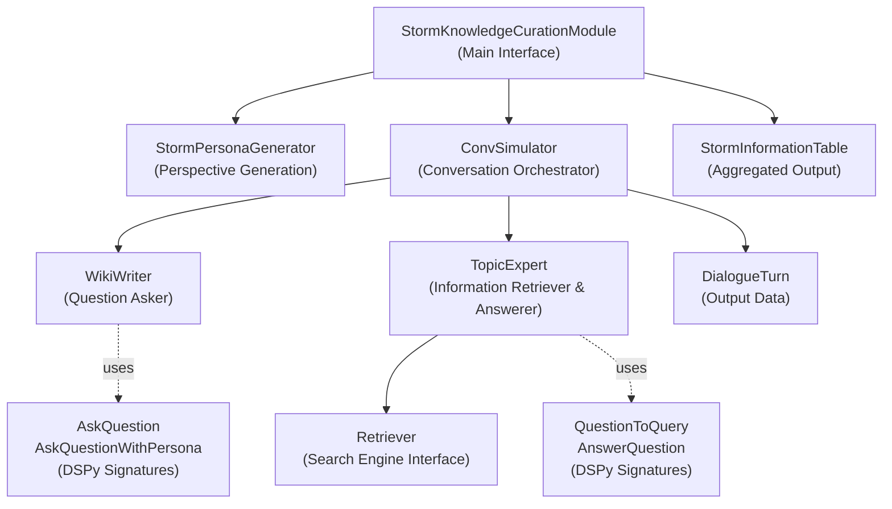
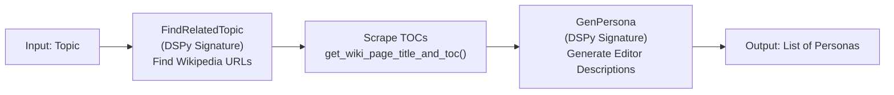
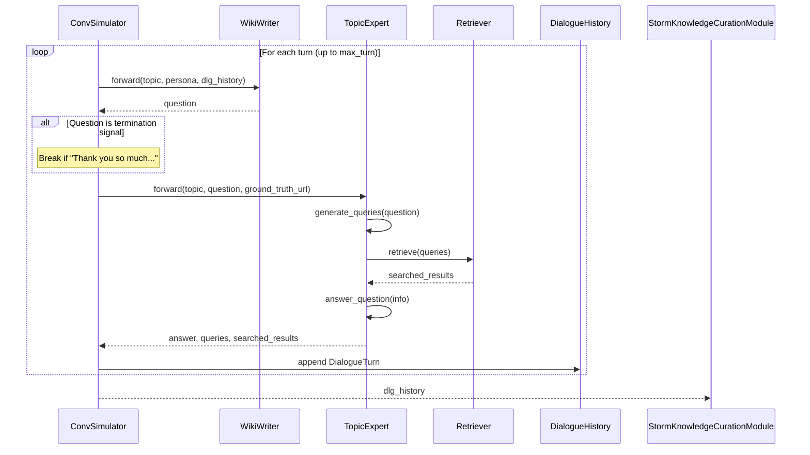
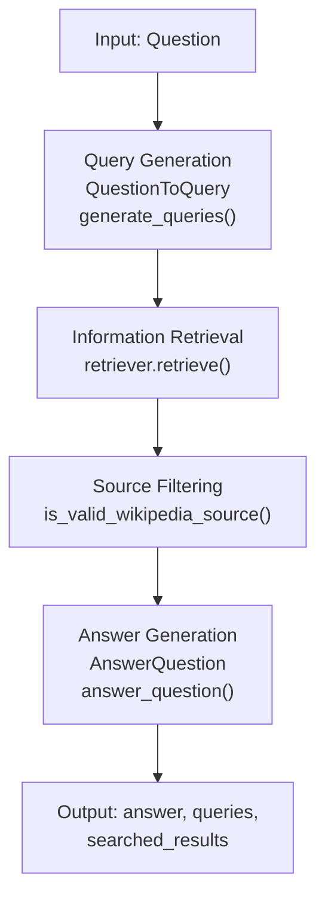
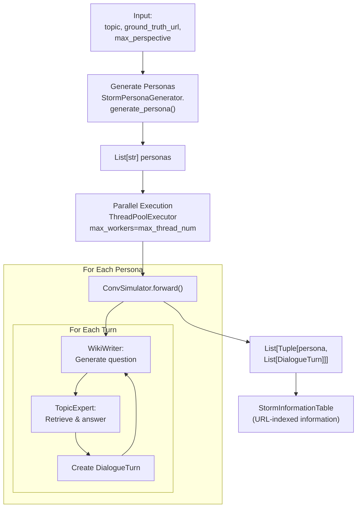

<!-- source: DeepWiki mcp.deepwiki.com · repo stanford-oval/storm · page 2.2 Knowledge Curation Module · fetched 2026-10-27 -->

# Knowledge Curation Module

<details>
<summary>Relevant source files</summary>

The following files were used as context for generating this wiki page:

- [knowledge_storm/storm_wiki/modules/article_generation.py](knowledge_storm/storm_wiki/modules/article_generation.py)
- [knowledge_storm/storm_wiki/modules/article_polish.py](knowledge_storm/storm_wiki/modules/article_polish.py)
- [knowledge_storm/storm_wiki/modules/knowledge_curation.py](knowledge_storm/storm_wiki/modules/knowledge_curation.py)
- [knowledge_storm/storm_wiki/modules/outline_generation.py](knowledge_storm/storm_wiki/modules/outline_generation.py)
- [knowledge_storm/storm_wiki/modules/persona_generator.py](knowledge_storm/storm_wiki/modules/persona_generator.py)
- [knowledge_storm/storm_wiki/modules/retriever.py](knowledge_storm/storm_wiki/modules/retriever.py)

</details>


## Purpose and Scope

The Knowledge Curation Module is the first stage of the STORM pipeline, responsible for gathering comprehensive information about a topic through perspective-guided question asking. This module generates diverse viewpoints (personas), simulates research conversations between Wikipedia writers and topic experts, and collects relevant information with citations into a structured format.

For information about how this collected information is organized into article outlines, see [Outline and Article Generation Modules](#2.3). For details on the data structures used to store collected information, see [STORM Data Structures](#2.4).

**Sources:** [knowledge_storm/storm_wiki/modules/knowledge_curation.py:247-394]()

## Overview

The Knowledge Curation Module implements a perspective-guided research strategy where multiple simulated Wikipedia writers, each with a specific perspective or focus area, engage in question-answer dialogues with a topic expert. The expert retrieves information from external sources and provides grounded answers with citations. This approach ensures comprehensive topic coverage from multiple angles.

The module produces a `StormInformationTable` containing all dialogue turns, search queries, and retrieved information snippets organized by source URL.

**Sources:** [knowledge_storm/storm_wiki/modules/knowledge_curation.py:247-250]()

## Architecture

### Component Hierarchy



**Sources:** [knowledge_storm/storm_wiki/modules/knowledge_curation.py:1-394](), [knowledge_storm/storm_wiki/modules/persona_generator.py:114-155]()

## Core Components

### StormKnowledgeCurationModule

The `StormKnowledgeCurationModule` class [knowledge_storm/storm_wiki/modules/knowledge_curation.py:247-394]() is the main interface for the knowledge curation stage. It orchestrates the entire research process and implements the `KnowledgeCurationModule` abstract interface.

#### Initialization Parameters

| Parameter | Type | Purpose |
|-----------|------|---------|
| `retriever` | `Retriever` | Search engine interface for information retrieval |
| `persona_generator` | `Optional[StormPersonaGenerator]` | Generator for diverse research perspectives |
| `conv_simulator_lm` | `Union[dspy.dsp.LM, dspy.dsp.HFModel]` | LLM for topic expert responses |
| `question_asker_lm` | `Union[dspy.dsp.LM, dspy.dsp.HFModel]` | LLM for generating questions |
| `max_search_queries_per_turn` | `int` | Maximum queries generated per question |
| `search_top_k` | `int` | Number of search results to retrieve per query |
| `max_conv_turn` | `int` | Maximum dialogue turns per conversation |
| `max_thread_num` | `int` | Maximum concurrent conversation threads |

**Sources:** [knowledge_storm/storm_wiki/modules/knowledge_curation.py:252-279]()

#### Research Method

The `research()` method [knowledge_storm/storm_wiki/modules/knowledge_curation.py:347-393]() is the main entry point that executes the following workflow:

1. **Perspective Identification**: Generate personas using `_get_considered_personas()` [knowledge_storm/storm_wiki/modules/knowledge_curation.py:281-284]()
2. **Parallel Conversations**: Run multiple conversations concurrently using `_run_conversation()` [knowledge_storm/storm_wiki/modules/knowledge_curation.py:286-345]()
3. **Information Aggregation**: Construct `StormInformationTable` from dialogue histories

**Sources:** [knowledge_storm/storm_wiki/modules/knowledge_curation.py:347-393]()

### Perspective Generation

The `StormPersonaGenerator` class [knowledge_storm/storm_wiki/modules/persona_generator.py:114-155]() creates diverse research perspectives to ensure comprehensive topic coverage.

#### Two-Stage Generation Process



**Sources:** [knowledge_storm/storm_wiki/modules/persona_generator.py:68-111](), [knowledge_storm/storm_wiki/modules/persona_generator.py:10-45]()

The generator first identifies related Wikipedia topics [knowledge_storm/storm_wiki/modules/persona_generator.py:48-54](), scrapes their table of contents for structural inspiration [knowledge_storm/storm_wiki/modules/persona_generator.py:10-45](), then generates personas representing different editor perspectives [knowledge_storm/storm_wiki/modules/persona_generator.py:56-66]().

A default "Basic fact writer" persona is always included [knowledge_storm/storm_wiki/modules/persona_generator.py:152]().

**Sources:** [knowledge_storm/storm_wiki/modules/persona_generator.py:114-155]()

### Conversation Simulation

The `ConvSimulator` class [knowledge_storm/storm_wiki/modules/knowledge_curation.py:25-82]() orchestrates multi-turn dialogues between a `WikiWriter` and `TopicExpert`.

#### Conversation Flow



**Sources:** [knowledge_storm/storm_wiki/modules/knowledge_curation.py:47-81]()

Each conversation runs until the maximum turn limit is reached or the `WikiWriter` generates the termination phrase "Thank you so much for your help!" [knowledge_storm/storm_wiki/modules/knowledge_curation.py:67-68]().

**Sources:** [knowledge_storm/storm_wiki/modules/knowledge_curation.py:25-82]()

### Question Generation (WikiWriter)

The `WikiWriter` class [knowledge_storm/storm_wiki/modules/knowledge_curation.py:84-126]() simulates a Wikipedia editor who asks questions based on their assigned persona and previous conversation history.

#### Implementation Details

The `WikiWriter` uses two DSPy signatures depending on whether a persona is provided:
- `AskQuestionWithPersona` [knowledge_storm/storm_wiki/modules/knowledge_curation.py:139-151](): Persona-guided question asking
- `AskQuestion` [knowledge_storm/storm_wiki/modules/knowledge_curation.py:128-137](): General question asking

The conversation history is formatted and truncated to preserve recent context [knowledge_storm/storm_wiki/modules/knowledge_curation.py:102-113]():
- Recent turns (last 4) include full expert responses
- Earlier turns omit expert responses to save token budget
- Citations are removed and word count is limited to 2500 words

**Sources:** [knowledge_storm/storm_wiki/modules/knowledge_curation.py:84-126]()

### Information Retrieval and Answering (TopicExpert)

The `TopicExpert` class [knowledge_storm/storm_wiki/modules/knowledge_curation.py:181-244]() implements a retrieve-then-generate pattern for answering questions with grounded information.

#### Three-Step Process



**Sources:** [knowledge_storm/storm_wiki/modules/knowledge_curation.py:204-243]()

#### Query Generation

The `QuestionToQuery` signature [knowledge_storm/storm_wiki/modules/knowledge_curation.py:154-165]() converts a natural language question into multiple search queries. Queries are cleaned and limited to `max_search_queries` [knowledge_storm/storm_wiki/modules/knowledge_curation.py:207-212]().

#### Retrieval

The retriever interface [knowledge_storm/storm_wiki/modules/knowledge_curation.py:214-216]() fetches `Information` objects from configured search engines, excluding the ground truth URL to prevent data leakage during evaluation.

#### Answer Synthesis

The `AnswerQuestion` signature [knowledge_storm/storm_wiki/modules/knowledge_curation.py:167-179]() generates informative responses using the top snippet from each search result [knowledge_storm/storm_wiki/modules/knowledge_curation.py:218-226](), with a 1000-word limit on the context.

If no information is found, the expert explicitly states inability to answer rather than hallucinating [knowledge_storm/storm_wiki/modules/knowledge_curation.py:239-240]().

**Sources:** [knowledge_storm/storm_wiki/modules/knowledge_curation.py:181-244]()

## Complete Data Flow



**Sources:** [knowledge_storm/storm_wiki/modules/knowledge_curation.py:347-393](), [knowledge_storm/storm_wiki/modules/knowledge_curation.py:286-345]()

## Parallel Execution Strategy

The module uses concurrent execution to simulate multiple persona-based conversations simultaneously [knowledge_storm/storm_wiki/modules/knowledge_curation.py:327-343]():

```python
# From _run_conversation method
max_workers = min(self.max_thread_num, len(considered_personas))

with concurrent.futures.ThreadPoolExecutor(max_workers=max_workers) as executor:
    future_to_persona = {
        executor.submit(run_conv, persona): persona
        for persona in considered_personas
    }
```

For Streamlit frontend integration, the module ensures proper logging context by adding script run context to executor threads [knowledge_storm/storm_wiki/modules/knowledge_curation.py:333-336]().

**Sources:** [knowledge_storm/storm_wiki/modules/knowledge_curation.py:286-345]()

## Source Reliability Filtering

The retrieval module includes quality controls based on Wikipedia's reliability standards [knowledge_storm/storm_wiki/modules/retriever.py:225-233]().

Three categories of unreliable sources are filtered:
- `GENERALLY_UNRELIABLE` [knowledge_storm/storm_wiki/modules/retriever.py:11-152](): Sources lacking editorial oversight
- `DEPRECATED` [knowledge_storm/storm_wiki/modules/retriever.py:153-201](): Sources with declining reliability
- `BLACKLISTED` [knowledge_storm/storm_wiki/modules/retriever.py:202-222](): Sources explicitly prohibited

The `is_valid_wikipedia_source()` function checks URLs against these sets before including information in responses.

**Sources:** [knowledge_storm/storm_wiki/modules/retriever.py:225-233](), [knowledge_storm/storm_wiki/modules/retriever.py:11-222]()

## Output Format

The module returns a `StormInformationTable` containing:
- All dialogue turns organized by persona
- Search queries generated for each question
- Retrieved information snippets with source URLs
- Expert answers with inline citations

The table structure enables:
1. URL-based indexing for efficient lookup
2. Semantic retrieval for article generation
3. Conversation log reconstruction for analysis

See [STORM Data Structures](#2.4) for detailed information about `DialogueTurn` and `StormInformationTable` classes.

**Sources:** [knowledge_storm/storm_wiki/modules/knowledge_curation.py:387-393]()

## Configuration Parameters

| Parameter | Default/Range | Description |
|-----------|---------------|-------------|
| `max_perspective` | 0-5 (typical) | Number of personas to generate beyond default |
| `disable_perspective` | `True`/`False` | Whether to use only default persona |
| `max_conv_turn` | 3-5 (typical) | Maximum dialogue turns per conversation |
| `max_search_queries_per_turn` | 3-5 (typical) | Queries generated per question |
| `search_top_k` | 5-10 (typical) | Search results retrieved per query |
| `max_thread_num` | 1-10 (typical) | Concurrent conversation threads |

**Sources:** [knowledge_storm/storm_wiki/modules/knowledge_curation.py:252-279](), [knowledge_storm/storm_wiki/modules/knowledge_curation.py:347-393]()

## Callback Integration

The module supports `BaseCallbackHandler` for monitoring and logging:
- `on_identify_perspective_start()` / `on_identify_perspective_end()` [knowledge_storm/storm_wiki/modules/knowledge_curation.py:367-375]()
- `on_information_gathering_start()` / `on_information_gathering_end()` [knowledge_storm/storm_wiki/modules/knowledge_curation.py:378-388]()
- `on_dialogue_turn_end()` [knowledge_storm/storm_wiki/modules/knowledge_curation.py:79]()

These callbacks enable progress tracking in user interfaces and logging systems.

**Sources:** [knowledge_storm/storm_wiki/modules/knowledge_curation.py:347-393]()

## Usage Example

```python
# Module is initialized and called by STORMWikiRunner
# Example initialization:
knowledge_curation_module = StormKnowledgeCurationModule(
    retriever=retriever,
    persona_generator=persona_generator,
    conv_simulator_lm=lm_configs.conv_simulator_lm,
    question_asker_lm=lm_configs.question_asker_lm,
    max_search_queries_per_turn=3,
    search_top_k=5,
    max_conv_turn=5,
    max_thread_num=3
)

# Execute research
information_table = knowledge_curation_module.research(
    topic="Quantum Computing",
    ground_truth_url="https://en.wikipedia.org/wiki/Quantum_computing",
    callback_handler=callback_handler,
    max_perspective=3,
    disable_perspective=False
)
```

**Sources:** [knowledge_storm/storm_wiki/modules/knowledge_curation.py:247-393]()

---

