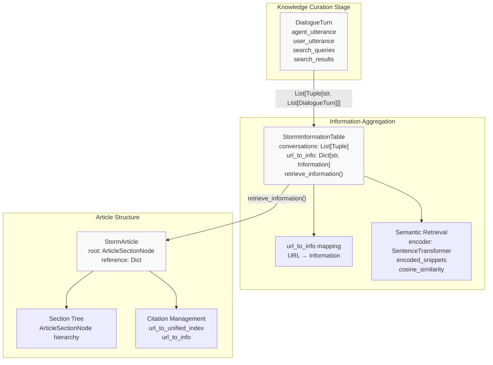
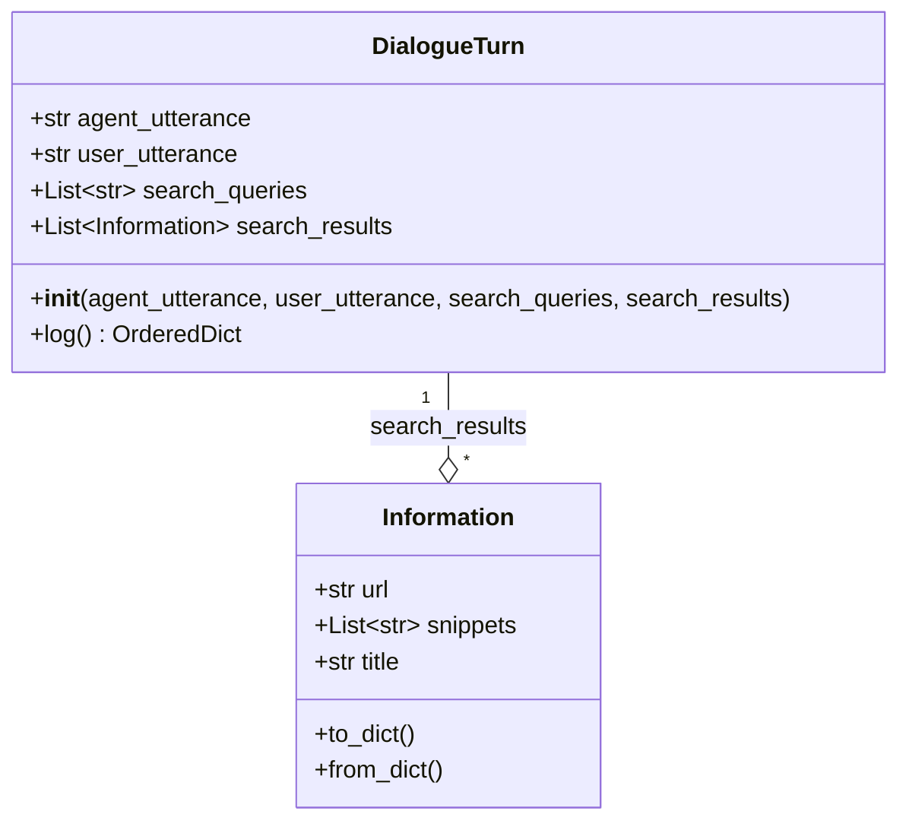
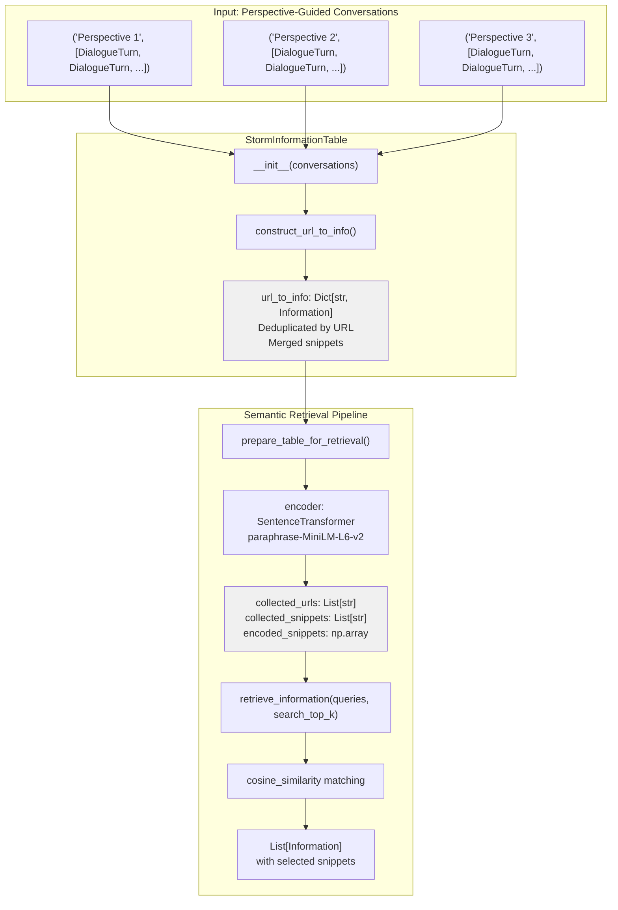
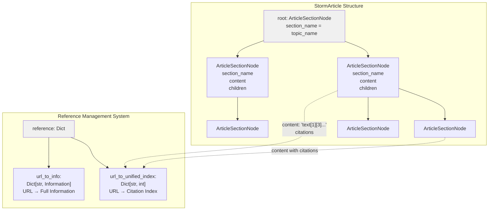
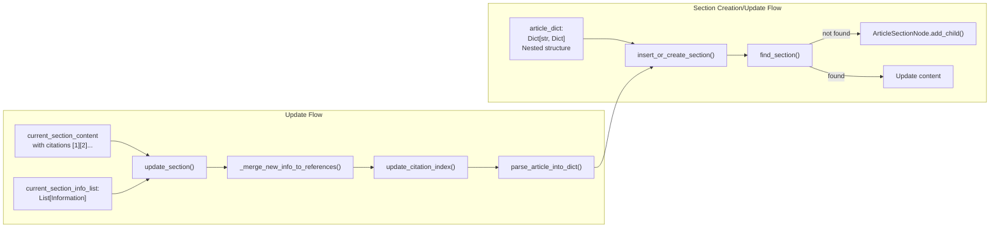

<!-- source: DeepWiki mcp.deepwiki.com · repo stanford-oval/storm · page 2.4 STORM Data Structures · fetched 2026-10-27 -->

# STORM Data Structures

<details>
<summary>Relevant source files</summary>

The following files were used as context for generating this wiki page:

- [knowledge_storm/storm_wiki/modules/storm_dataclass.py](knowledge_storm/storm_wiki/modules/storm_dataclass.py)

</details>


## Purpose and Scope

This document describes the three core data structures used in the STORM Wiki Generation System to store, organize, and transform information during the article generation pipeline. These data structures are defined in [knowledge_storm/storm_wiki/modules/storm_dataclass.py]() and implement abstract interfaces from the infrastructure layer.

For information about how these structures are populated and used within the STORM pipeline stages, see [Knowledge Curation Module](#2.2) and [Outline and Article Generation Modules](#2.3). For Co-STORM data structures (`KnowledgeBase`, `ConversationTurn`), see [Knowledge Base System](#3.2).

## Overview

The STORM system uses three primary data structures to manage information flow through its 4-stage pipeline:

| Data Structure | Purpose | Key Features | Used In Stages |
|----------------|---------|--------------|----------------|
| `DialogueTurn` | Captures Q&A exchanges during perspective-guided conversations | Stores queries, utterances, and retrieved information | Knowledge Curation |
| `StormInformationTable` | Aggregates and indexes collected information by URL | URL-based deduplication, semantic retrieval | Knowledge Curation → Outline/Article Generation |
| `StormArticle` | Represents hierarchical article structure with citations | Tree-based sections, unified citation management | Outline Generation → Article Generation → Polishing |



**Sources:** [knowledge_storm/storm_wiki/modules/storm_dataclass.py:14-505]()

## DialogueTurn Class

### Structure and Purpose

The `DialogueTurn` class [knowledge_storm/storm_wiki/modules/storm_dataclass.py:14-45]() represents a single exchange in a simulated conversation between a Wikipedia writer (expert) and a topic expert during the knowledge curation stage. Each turn captures both the dialogue and the information retrieval that occurred.



### Attributes

| Attribute | Type | Description |
|-----------|------|-------------|
| `agent_utterance` | `str` | The question or statement from the Wikipedia writer (simulated user) |
| `user_utterance` | `str` | The answer from the topic expert (simulated expert) |
| `search_queries` | `List[str]` | Search queries generated to find information for this turn |
| `search_results` | `List[Information]` | Retrieved information objects containing URLs, snippets, and metadata |

### Initialization and Serialization

The constructor [knowledge_storm/storm_wiki/modules/storm_dataclass.py:15-32]() accepts `Information` objects or dictionaries and automatically converts dictionaries to `Information` instances:

```python
# Automatic conversion from dict to Information
if type(self.search_results[idx]) == dict:
    self.search_results[idx] = Information.from_dict(self.search_results[idx])
```

The `log()` method [knowledge_storm/storm_wiki/modules/storm_dataclass.py:34-45]() serializes the turn to an `OrderedDict` for JSON export, converting all `Information` objects to dictionaries.

**Sources:** [knowledge_storm/storm_wiki/modules/storm_dataclass.py:14-45]()

## StormInformationTable Class

### Overview and Design

`StormInformationTable` [knowledge_storm/storm_wiki/modules/storm_dataclass.py:48-146]() implements the abstract `InformationTable` interface and serves as the primary data structure for organizing collected information during knowledge curation. It aggregates information from multiple perspective-guided conversations and provides both URL-based indexing and semantic retrieval capabilities.



### URL-Based Information Aggregation

The static method `construct_url_to_info()` [knowledge_storm/storm_wiki/modules/storm_dataclass.py:65-80]() processes conversations to build a deduplicated mapping:

1. Iterates through all `DialogueTurn` objects in all perspective conversations
2. For each `Information` in `search_results`, uses the URL as the primary key
3. If a URL already exists, merges snippets by extending the list
4. Deduplicates snippets using `set()` conversion [line 79]()

This approach ensures that information from the same source (URL) is consolidated, with all relevant snippets preserved.

### Semantic Retrieval System

The table supports semantic search over collected information through two methods:

#### Preparation Phase: `prepare_table_for_retrieval()`

[knowledge_storm/storm_wiki/modules/storm_dataclass.py:109-117]()

- Initializes `SentenceTransformer` with model `"paraphrase-MiniLM-L6-v2"`
- Flattens `url_to_info` into parallel lists: `collected_urls` and `collected_snippets`
- Pre-encodes all snippets into embedding vectors stored as `encoded_snippets`

#### Query Phase: `retrieve_information()`

[knowledge_storm/storm_wiki/modules/storm_dataclass.py:119-145]()

The retrieval algorithm:

1. Accepts single query string or list of queries
2. Encodes each query using the same `SentenceTransformer`
3. Computes cosine similarity between query embedding and all snippet embeddings
4. Selects top-k snippets per query using `np.argsort()` [line 129]()
5. Groups selected snippets by URL
6. Returns `List[Information]` with filtered snippets

| Method | Parameters | Returns | Purpose |
|--------|-----------|---------|---------|
| `construct_url_to_info()` | `conversations: List[Tuple[str, List[DialogueTurn]]]` | `Dict[str, Information]` | Build URL-indexed information map |
| `prepare_table_for_retrieval()` | None | None | Initialize semantic search encoder |
| `retrieve_information()` | `queries: Union[List[str], str]`, `search_top_k: int` | `List[Information]` | Semantic retrieval of relevant information |

### Persistence

- `dump_url_to_info()` [line 93-97](): Exports `url_to_info` to JSON file
- `from_conversation_log_file()` [line 99-107](): Reconstructs `StormInformationTable` from saved conversation logs
- `construct_log_dict()` [line 82-91](): Serializes conversations to JSON-compatible format

**Sources:** [knowledge_storm/storm_wiki/modules/storm_dataclass.py:48-146]()

## StormArticle Class

### Architecture and Hierarchical Structure

`StormArticle` [knowledge_storm/storm_wiki/modules/storm_dataclass.py:148-505]() implements the abstract `Article` interface and represents a Wikipedia-style article as a tree of sections with integrated citation management. The class maintains both the content hierarchy and a unified reference system.



### Core Components

#### 1. Section Tree (`ArticleSectionNode` Hierarchy)

The article structure is a tree where:
- **Root node**: Created with `topic_name` as section name [line 149-151]()
- **Child nodes**: Each `ArticleSectionNode` has a `section_name`, `content`, and list of `children`
- **Navigation**: `find_section()` method [line 153-172]() performs recursive search by section name

#### 2. Citation Reference System

The `reference` dictionary [line 151]() maintains two mappings:

```python
self.reference = {
    "url_to_unified_index": {},  # URL → citation index (e.g., "http://..." → 3)
    "url_to_info": {}            # URL → Information object
}
```

**Unified Citation Indexing**: All citations to the same URL use the same index number across the entire article, ensuring consistency.

### Key Methods

#### Section Management



| Method | Signature | Purpose |
|--------|-----------|---------|
| `find_section()` | `(node, name) → Optional[ArticleSectionNode]` | Recursive search for section by name [line 153-172]() |
| `insert_or_create_section()` | `(article_dict, parent_section_name, trim_children)` | Build/update section tree from nested dict [line 209-247]() |
| `update_section()` | `(current_section_content, current_section_info_list, parent_section_name)` | Add/update section with citation management [line 249-299]() |

#### Citation Management

The `_merge_new_info_to_references()` method [line 174-207]() implements the unified citation system:

1. **Input**: List of `Information` objects and indices to keep
2. **Process**:
   - For each new information, check if URL exists in `url_to_unified_index`
   - If new URL: assign next citation index (starts from 1)
   - If existing URL: merge snippets into existing `Information`
3. **Output**: Mapping from input list indices to unified citation indices

Example flow:
```
Input info list: [Info(url="A"), Info(url="B"), Info(url="A")]
                     ↓                ↓                ↓
Unified indices:     1                2                1  (reused)
```

The `update_section()` method [line 249-299]() performs comprehensive citation processing:

1. Parse existing citations from content using regex `r"\[(\d+)\]"` [line 269]()
2. Validate citation indices against info list length [line 271-280]()
3. Filter unused citations from info list [line 282]()
4. Merge into unified references via `_merge_new_info_to_references()`
5. Update citation numbers in content via `ArticleTextProcessing.update_citation_index()` [line 286-288]()

#### Reference Reordering

`reorder_reference_index()` [line 374-412]() ensures citations are numbered sequentially by order of first appearance:

1. **Pre-order traversal** to collect citation indices as they appear [line 377-385]()
2. **Build mapping**: First appearance of each index gets new sequential number [line 389-392]()
3. **Update content**: Replace all citation numbers in all nodes [line 395-402]()
4. **Update reference dict**: Remap `url_to_unified_index` [line 406-412]()

### Serialization and Deserialization

#### Export Methods

| Method | Output | Format |
|--------|--------|--------|
| `to_string()` | Full article text | Markdown with `#` section headers [line 352-372]() |
| `get_outline_as_list()` | Section names | List with optional `#` prefixes [line 301-350]() |
| `get_outline_tree()` | Hierarchical structure | Nested dictionary [line 414-421]() |
| `dump_outline_to_file()` | File export | Text file with `#` headers [line 476-478]() |
| `dump_reference_to_file()` | Reference export | JSON file [line 480-484]() |
| `dump_article_as_plain_text()` | Plain text export | Text file [line 486-488]() |

#### Import Methods

**From Outline String/File**: `from_outline_str()` and `from_outline_file()` [line 429-478]()

Algorithm:
1. Split outline by newlines and parse `#` levels
2. Use stack-based approach to track parent-child relationships
3. Build `ArticleSectionNode` tree by tracking `(level, node)` tuples [line 458-473]()

**From Complete Article**: `from_string()` [line 490-500]()
- Parses article text using `ArticleTextProcessing.parse_article_into_dict()`
- Reconstructs section tree via `insert_or_create_section()`
- Loads references and converts dict entries to `Information` objects

### Post-Processing

The `post_processing()` method [line 502-504]() performs final cleanup:
1. `prune_empty_nodes()`: Remove sections with no content
2. `reorder_reference_index()`: Renumber citations sequentially

**Sources:** [knowledge_storm/storm_wiki/modules/storm_dataclass.py:148-505]()

## Data Flow Through Pipeline

The three data structures work together through the STORM pipeline stages:

```mermaid
graph LR
    subgraph "Stage 1: Knowledge Curation"
        Perspectives["Generate<br/>Perspectives"]
        SimConv["Simulated<br/>Conversations"]
        Turns["DialogueTurn[]<br/>per perspective"]
        
        Perspectives --> SimConv
        SimConv --> Turns
    end
    
    subgraph "Stage 2: Outline Generation"
        BuildTable["StormInformationTable<br/>from conversations"]
        PrepRetrieval["prepare_table_for_retrieval()"]
        GenOutline["Generate Outline<br/>using LLM"]
        Article1["StormArticle<br/>from outline"]
        
        Turns --> BuildTable
        BuildTable --> PrepRetrieval
        PrepRetrieval --> GenOutline
        GenOutline --> Article1
    end
    
    subgraph "Stage 3: Article Generation"
        ForEachSection["For each section"]
        Retrieve["retrieve_information()<br/>semantic search"]
        WriteSection["Generate section<br/>content with LLM"]
        UpdateArticle["update_section()<br/>merge citations"]
        
        Article1 --> ForEachSection
        BuildTable --> Retrieve
        ForEachSection --> Retrieve
        Retrieve --> WriteSection
        WriteSection --> UpdateArticle
    end
    
    subgraph "Stage 4: Article Polishing"
        ReorderRefs["reorder_reference_index()"]
        Polish["Polish content<br/>add lead section"]
        Final["Final StormArticle"]
        
        UpdateArticle --> ReorderRefs
        ReorderRefs --> Polish
        Polish --> Final
    end
```



**Key Transitions:**

1. **DialogueTurn → StormInformationTable**: Multiple perspective conversations aggregated into URL-indexed information store
2. **StormInformationTable → StormArticle**: Semantic retrieval queries information table during section writing
3. **StormArticle Internal**: Citations continuously merged and unified as sections are added/updated

**Sources:** [knowledge_storm/storm_wiki/modules/storm_dataclass.py:1-505]()

---

