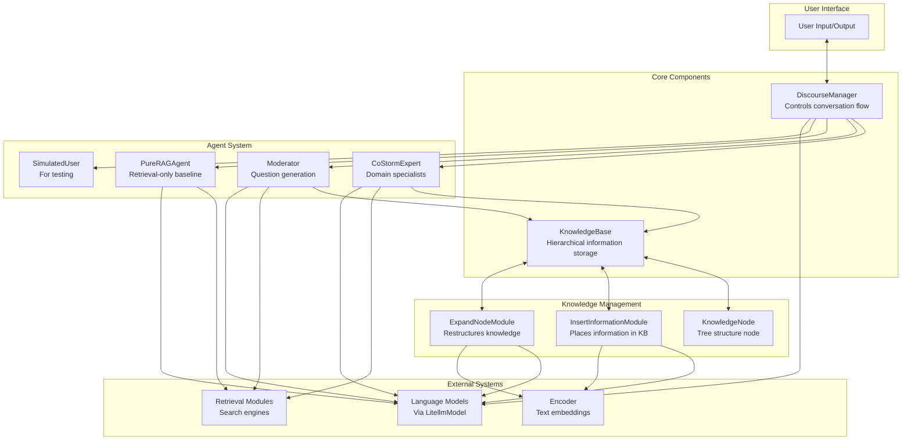
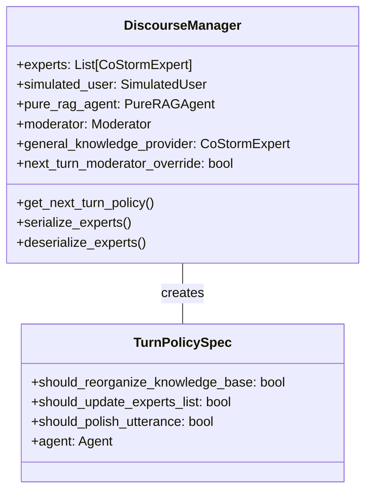
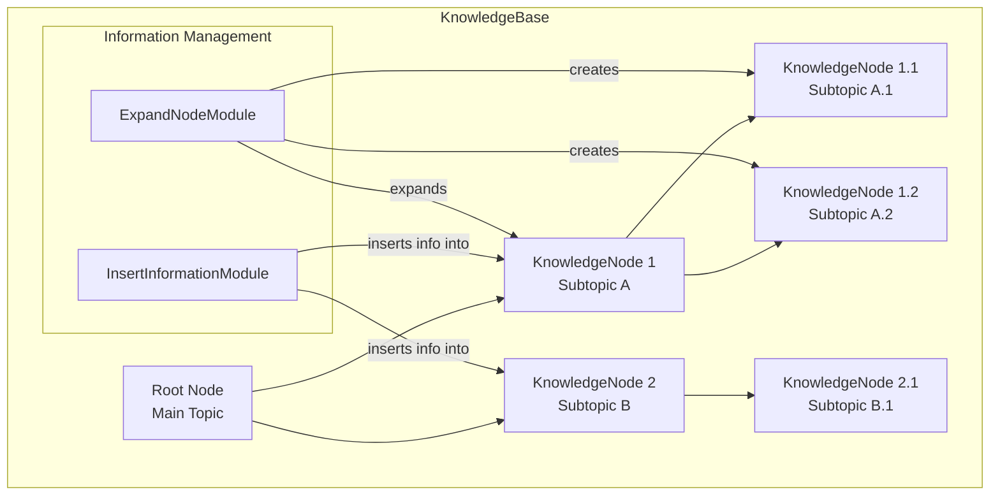
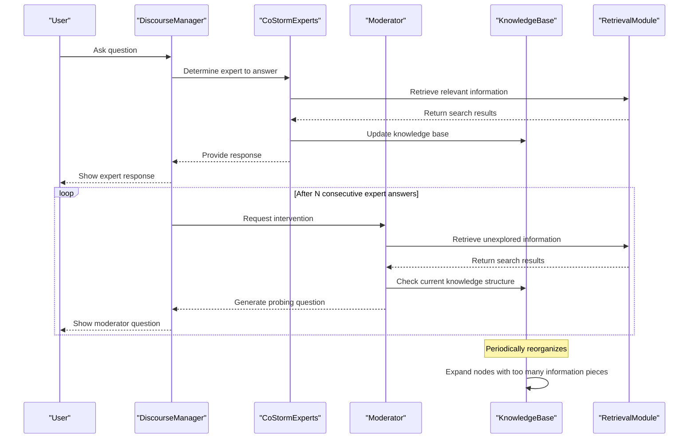
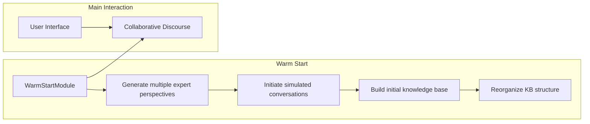
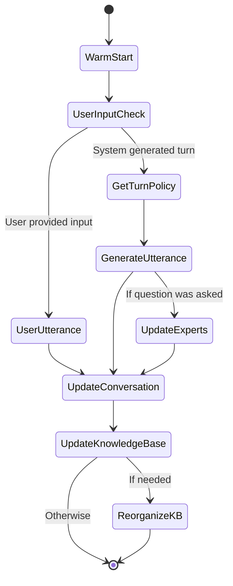
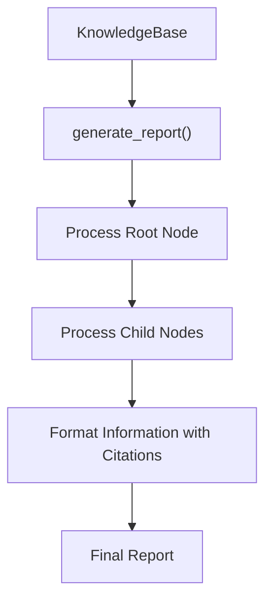
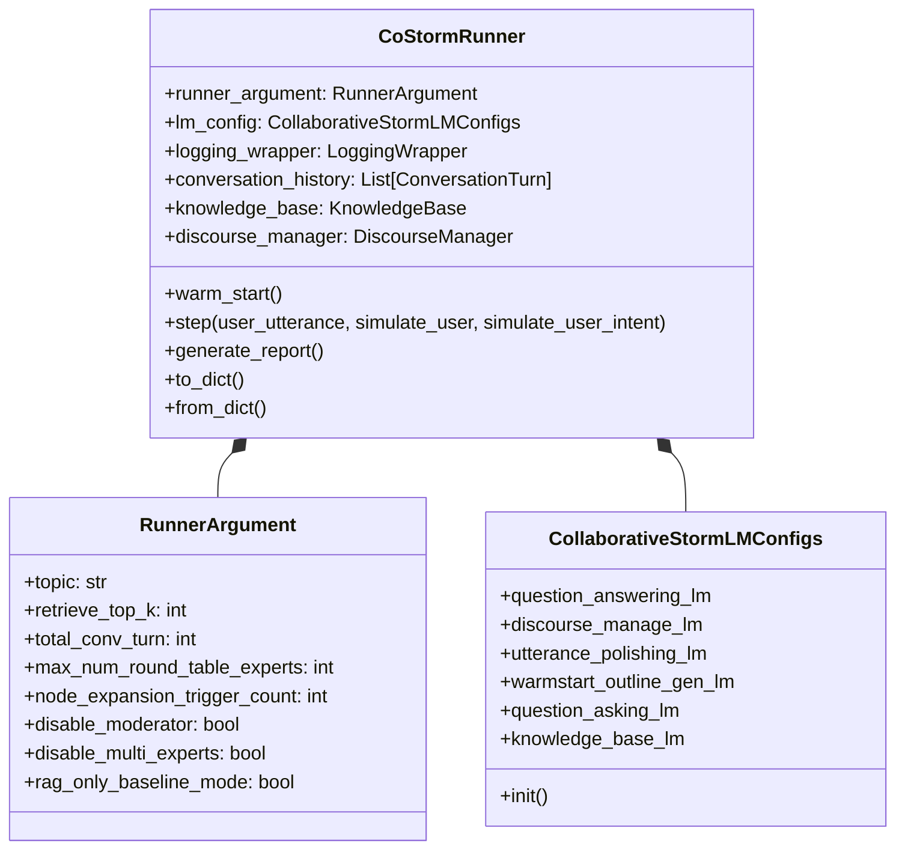

<!-- source: DeepWiki mcp.deepwiki.com · repo stanford-oval/storm · page 3 Co-STORM Collaborative System · fetched 2026-10-27 -->

# Co-STORM Collaborative System

<details>
<summary>Relevant source files</summary>

The following files were used as context for generating this wiki page:

- [README.md](README.md)
- [knowledge_storm/collaborative_storm/engine.py](knowledge_storm/collaborative_storm/engine.py)
- [knowledge_storm/collaborative_storm/modules/information_insertion_module.py](knowledge_storm/collaborative_storm/modules/information_insertion_module.py)
- [knowledge_storm/lm.py](knowledge_storm/lm.py)

</details>


Co-STORM (Collaborative STORM) is a system that enables human-AI collaborative knowledge curation through multi-agent conversations. It extends the capabilities of the STORM system (for information about the base STORM system, see [STORM Wiki Generation System](#2)) by implementing a collaborative protocol that allows users to either observe or actively participate in knowledge exploration. The system maintains a dynamic mind map that organizes collected information into a hierarchical concept structure, helping to build a shared conceptual space between humans and the system.

## Architecture Overview

Co-STORM's architecture centers around collaborative discourse between multiple agent types and a hierarchical knowledge base. The system orchestrates conversations, manages knowledge, and enables human participation in the knowledge curation process.



Sources: [knowledge_storm/collaborative_storm/engine.py:318-369](), [knowledge_storm/collaborative_storm/engine.py:505-539](), [README.md:58-70]()

## Core Components

### DiscourseManager

The DiscourseManager is the central orchestration component responsible for controlling the flow of conversation between different agents and the user. It implements a turn policy management system that determines which agent should speak next and what actions should be taken after each turn.



The DiscourseManager determines which agent should respond next based on the conversation history and the current state. It can decide to:
- Let an expert answer a query
- Have the moderator ask a question
- Allow a simulated user to participate
- Update the list of experts based on the conversation focus

Sources: [knowledge_storm/collaborative_storm/engine.py:319-502]()

### Knowledge Base System

The Knowledge Base in Co-STORM is a hierarchical tree structure that organizes information collected during the conversation. It consists of KnowledgeNodes arranged in a parent-child relationship, where each node represents a topic or subtopic.



Key components for managing the knowledge base:

1. **InsertInformationModule**: Responsible for placing new information in the appropriate node in the knowledge tree. It uses a combination of LLM-based decision making and vector similarity to determine where information belongs.

2. **ExpandNodeModule**: Automatically restructures knowledge when a node contains too many pieces of information, creating meaningful subsections to better organize the content.

Sources: [knowledge_storm/collaborative_storm/modules/information_insertion_module.py:16-313](), [knowledge_storm/collaborative_storm/modules/information_insertion_module.py:316-425]()

### Agent System

Co-STORM features multiple agent types that collaborate to curate knowledge:

#### 1. CoStormExpert
Domain specialists that can answer questions on specific aspects of the topic. They generate responses grounded in external knowledge sources and can ask follow-up questions.

#### 2. Moderator
Generates thought-provoking questions inspired by information discovered through retrieval but not directly addressed in previous turns. The moderator helps ensure comprehensive coverage of the topic and prevents the conversation from stagnating.

#### 3. PureRAGAgent
A retrieval-augmented generation agent that serves as a baseline comparison. It directly retrieves and presents information without the collaborative aspects of Co-STORM.

#### 4. SimulatedUser
For testing purposes, this agent can simulate user behavior to evaluate system performance without requiring actual human input.



Sources: [knowledge_storm/collaborative_storm/engine.py:337-377](), [README.md:58-70]()

## Workflow

### Warm Start Process

Before engaging with users, Co-STORM performs a "warm start" to build an initial shared conceptual space. This process is similar to a mini-STORM run that collects background information about the topic.



The warm start process:
1. Generates multiple expert perspectives on the topic
2. Initiates simulated conversations to gather information
3. Builds an initial knowledge base structure
4. Presents a concise summary to the user to establish common ground

Sources: [knowledge_storm/collaborative_storm/engine.py:582-640]()

### Collaborative Discourse

The core functionality of Co-STORM is its collaborative discourse protocol. This is implemented in the `step()` method of `CoStormRunner`, which manages a single turn in the conversation.

Each step in the collaborative discourse follows this pattern:

1. If a user utterance is provided, it's added to the conversation history
2. Otherwise, the system determines which agent should speak next based on turn policies
3. The selected agent generates an utterance using the knowledge base and conversation history
4. The knowledge base is updated with new information from the utterance
5. If needed, the knowledge base is reorganized to maintain a clear structure



Sources: [knowledge_storm/collaborative_storm/engine.py:661-761]()

### Report Generation

At any point during or after the collaborative discourse, Co-STORM can generate a structured report based on the accumulated knowledge. This report leverages the hierarchical organization of the knowledge base, using node names as section headings.



The generated report follows the traditional structure of STORM articles, with sections and subsections derived from the knowledge base hierarchy. Information from the collaborative discourse is organized coherently with proper citations.

Sources: [knowledge_storm/collaborative_storm/engine.py:642-656]()

## Implementation

### CoStormRunner

The main entry point for using Co-STORM is the `CoStormRunner` class. It coordinates all components and provides methods for interaction.



The `CoStormRunner` exposes three main methods:
1. `warm_start()`: Initializes the knowledge base before user interaction
2. `step(user_utterance="")`: Progresses the conversation by one turn
3. `generate_report()`: Creates a structured report from the knowledge base

Sources: [knowledge_storm/collaborative_storm/engine.py:505-761]()

### Configuration

Co-STORM uses two main configuration classes:

1. **CollaborativeStormLMConfigs**: Configure language models for different system components
   - `question_answering_lm`: For answering questions
   - `discourse_manage_lm`: For managing discourse flow
   - `utterance_polishing_lm`: For refining generated utterances
   - `warmstart_outline_gen_lm`: For generating initial outlines
   - `question_asking_lm`: For generating questions
   - `knowledge_base_lm`: For knowledge base operations

2. **RunnerArgument**: Control system behavior
   - `topic`: The topic of discourse
   - `retrieve_top_k`: Number of results to retrieve for each query
   - `total_conv_turn`: Maximum conversation turns
   - `max_num_round_table_experts`: Maximum active experts
   - `node_expansion_trigger_count`: When to trigger node expansion
   - Various flags to control system behavior (disable moderator, etc.)

Sources: [knowledge_storm/collaborative_storm/engine.py:24-187](), [knowledge_storm/collaborative_storm/engine.py:189-291]()

## Usage Example

Here's a basic example of how to use Co-STORM:

1. Initialize configurations and components:
```python
from knowledge_storm.collaborative_storm.engine import CollaborativeStormLMConfigs, RunnerArgument, CoStormRunner
from knowledge_storm.lm import LitellmModel
from knowledge_storm.logging_wrapper import LoggingWrapper
from knowledge_storm.rm import BingSearch

# Configure language models
lm_config = CollaborativeStormLMConfigs()
openai_kwargs = {"api_key": "your_api_key", "temperature": 1.0}
question_answering_lm = LitellmModel(model="gpt-4o", max_tokens=1000, **openai_kwargs)
# Set up other language models...
lm_config.set_question_answering_lm(question_answering_lm)

# Configure runner arguments
topic = "Quantum Computing"
runner_argument = RunnerArgument(topic=topic, retrieve_top_k=10)

# Initialize retriever and logging
logging_wrapper = LoggingWrapper(lm_config)
bing_rm = BingSearch(bing_search_api_key="your_bing_key", k=10)

# Create Co-STORM runner
costorm_runner = CoStormRunner(
    lm_config=lm_config,
    runner_argument=runner_argument,
    logging_wrapper=logging_wrapper,
    rm=bing_rm
)
```

2. Warm start the system and engage in conversation:
```python
# Initialize the system
costorm_runner.warm_start()

# Either observe the conversation or participate
# To observe:
conv_turn = costorm_runner.step()
print(f"{conv_turn.role}: {conv_turn.raw_utterance}")

# To participate:
costorm_runner.step(user_utterance="How does quantum entanglement work?")
```

3. Generate a report:
```python
# Reorganize the knowledge base
costorm_runner.knowledge_base.reorganize()

# Generate and display the report
article = costorm_runner.generate_report()
print(article)
```

Sources: [README.md:156-216]()

## Summary

Co-STORM extends STORM's capabilities by enabling collaborative knowledge curation. Its main innovations include:

1. **Multi-agent collaboration**: Different agent types (experts, moderator) work together to explore topics deeply
2. **Human participation**: Users can observe or actively steer the conversation
3. **Dynamic mind map**: A hierarchical knowledge organization that reduces cognitive load
4. **Turn-based discourse management**: Maintains coherent conversation flow
5. **Report generation**: Creates structured reports from the accumulated knowledge

The system strikes a balance between automation and human guidance, making it effective for complex information seeking tasks where human preferences and expertise are valuable.

Sources: [README.md:31-32](), [README.md:58-70]()

---

