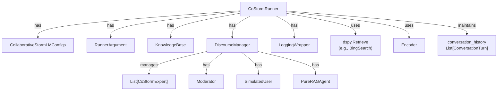
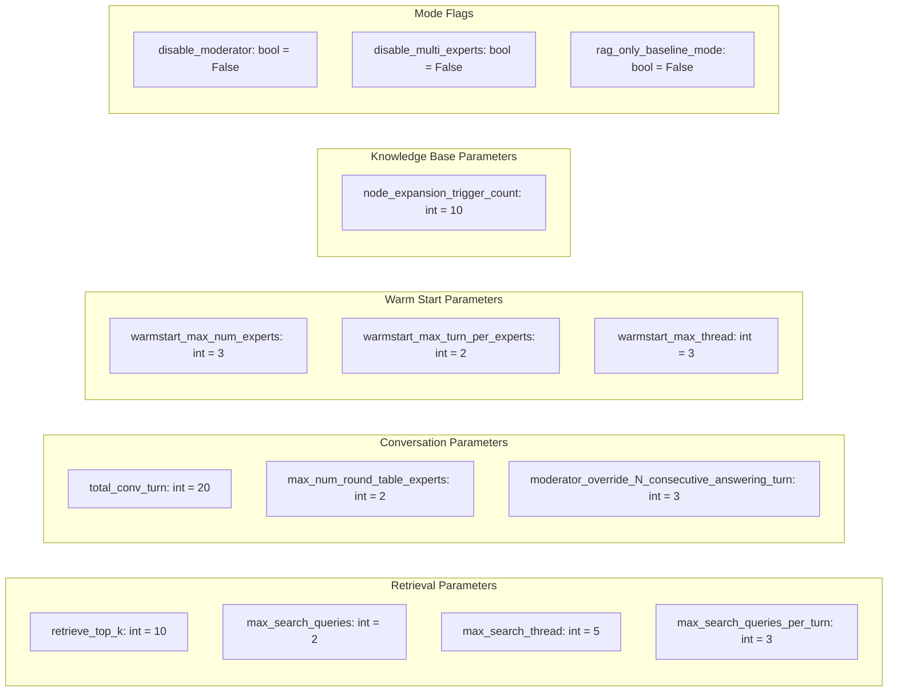
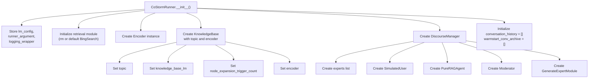
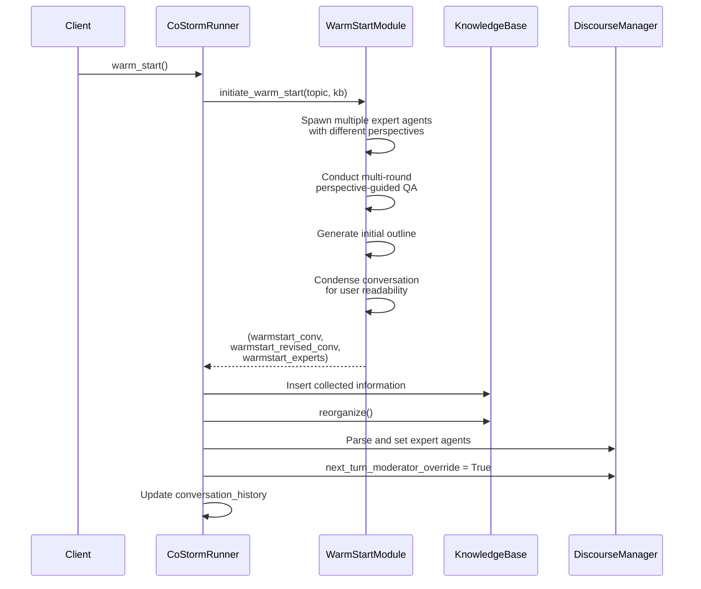
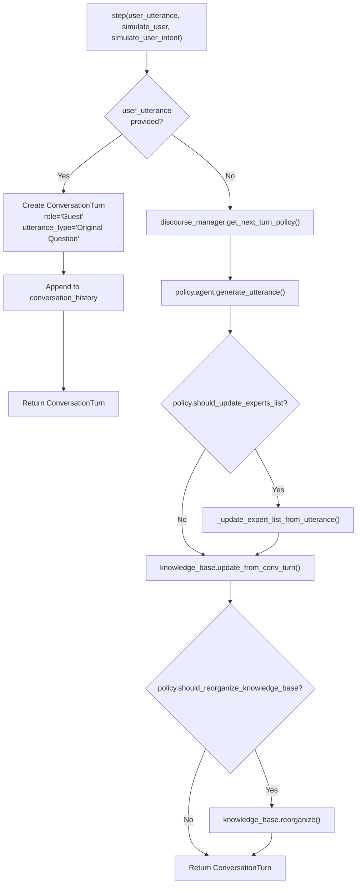
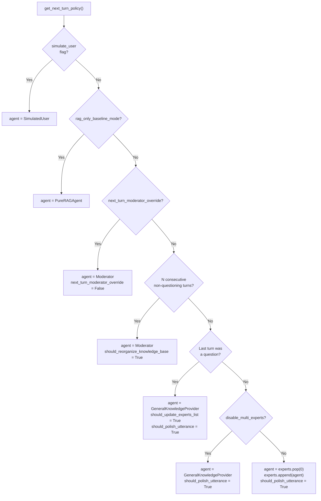
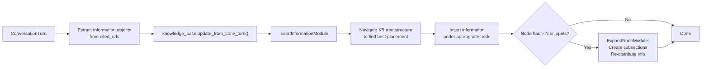
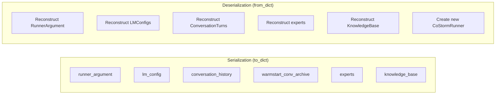
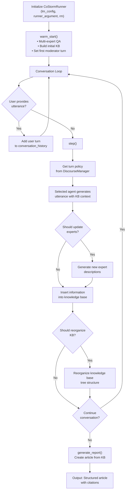

<!-- source: DeepWiki mcp.deepwiki.com · repo stanford-oval/storm · page 3.1 CoStormRunner · fetched 2026-10-27 -->

# CoStormRunner

<details>
<summary>Relevant source files</summary>

The following files were used as context for generating this wiki page:

- [README.md](README.md)
- [knowledge_storm/collaborative_storm/engine.py](knowledge_storm/collaborative_storm/engine.py)
- [knowledge_storm/collaborative_storm/modules/information_insertion_module.py](knowledge_storm/collaborative_storm/modules/information_insertion_module.py)
- [knowledge_storm/lm.py](knowledge_storm/lm.py)

</details>


`CoStormRunner` is the main orchestration class for the Co-STORM collaborative knowledge curation system. It manages the collaborative discourse between human users and AI agents, maintains the knowledge base (mind map), and coordinates the conversation flow through turn policy management. Unlike `STORMWikiRunner` (see [2.1](#2.1)) which runs a fully automated 4-stage pipeline, `CoStormRunner` enables interactive, turn-based collaboration where users can observe or participate in the discourse.

For information about the knowledge base structure that CoStormRunner manages, see [3.2](#3.2). For details about the agent system, see [3.3](#3.3). For Co-STORM specific modules, see [3.4](#3.4).

## Core Architecture

The `CoStormRunner` orchestrates multiple components to enable collaborative knowledge curation. The following diagram shows the key classes and their relationships:



Sources: [knowledge_storm/collaborative_storm/engine.py:505-538]()

## Configuration Classes

### CollaborativeStormLMConfigs

`CollaborativeStormLMConfigs` defines the language model configurations for different tasks in the Co-STORM system. The class separates LM usage into six specialized roles to balance quality and cost:

| LM Configuration | Purpose | Default Model | Token Limit |
|-----------------|---------|---------------|-------------|
| `question_answering_lm` | Expert agent responses | gpt-4o-2024-05-13 | 1000 |
| `discourse_manage_lm` | Turn policy decisions, expert generation | gpt-4o-2024-05-13 | 500 |
| `utterance_polishing_lm` | Response refinement | gpt-4o-2024-05-13 | 2000 |
| `warmstart_outline_gen_lm` | Initial outline generation | gpt-4-1106-preview | 500 |
| `question_asking_lm` | Question generation | gpt-4o-2024-05-13 | 300 |
| `knowledge_base_lm` | KB operations (insertion, expansion) | gpt-4o-2024-05-13 | 1000 |

```python
# Example initialization
lm_config = CollaborativeStormLMConfigs()
lm_config.init(lm_type="openai", temperature=1.0, top_p=0.9)

# Or configure individual models
from knowledge_storm.lm import LitellmModel
lm_config.set_question_answering_lm(
    LitellmModel(model='gpt-4o', max_tokens=1000, api_key="...")
)
```

The configuration supports three initialization modes via the `init()` method: `"openai"`, `"azure"`, and `"together"`. Each mode sets appropriate default models for all six LM roles.

Sources: [knowledge_storm/collaborative_storm/engine.py:24-187](), [README.md:165-186]()

### RunnerArgument

`RunnerArgument` is a dataclass that controls the behavioral parameters of the Co-STORM pipeline:



Key parameters:

- **`moderator_override_N_consecutive_answering_turn`**: Number of consecutive expert answers before the moderator asks a probing question (default: 3)
- **`node_expansion_trigger_count`**: Number of information snippets that trigger automatic node expansion in the knowledge base (default: 10)
- **`rag_only_baseline_mode`**: If True, switches to a pure RAG baseline without collaborative discourse (default: False)

Sources: [knowledge_storm/collaborative_storm/engine.py:189-290]()

## Initialization

The `CoStormRunner` constructor initializes all components needed for collaborative knowledge curation:



Sources: [knowledge_storm/collaborative_storm/engine.py:505-538]()

Example initialization from code:

```python
from knowledge_storm.collaborative_storm.engine import (
    CoStormRunner, CollaborativeStormLMConfigs, RunnerArgument
)
from knowledge_storm.logging_wrapper import LoggingWrapper
from knowledge_storm.rm import BingSearch

# Configure LMs
lm_config = CollaborativeStormLMConfigs()
lm_config.init(lm_type="openai")

# Set runner arguments
runner_argument = RunnerArgument(
    topic="Quantum Computing",
    retrieve_top_k=10,
    max_num_round_table_experts=2
)

# Initialize runner
costorm_runner = CoStormRunner(
    lm_config=lm_config,
    runner_argument=runner_argument,
    logging_wrapper=LoggingWrapper(lm_config),
    rm=BingSearch(bing_search_api_key="...", k=10)
)
```

Sources: [README.md:158-196](), [knowledge_storm/collaborative_storm/engine.py:505-538]()

## Warm Start Phase

The `warm_start()` method initializes the Co-STORM system by conducting background research to build a shared conceptual space with the user. This phase is analogous to a mini-STORM session:



The warm start process:

1. **Spawns multiple expert agents** with different perspectives (controlled by `warmstart_max_num_experts`)
2. **Conducts perspective-guided QA** where each expert asks and answers questions (up to `warmstart_max_turn_per_experts` per expert)
3. **Collects and organizes information** into the knowledge base
4. **Generates a condensed conversation** for user catch-up
5. **Sets the moderator** to ask the first question after warm start

Sources: [knowledge_storm/collaborative_storm/engine.py:582-641](), [README.md:202-203]()

Special mode: If `rag_only_baseline_mode=True`, warm start skips the multi-agent discourse and instead generates a single RAG-based background summary.

## Conversation Management: The step() Method

The `step()` method is the core of the conversation flow, handling both user inputs and system-generated utterances:



Sources: [knowledge_storm/collaborative_storm/engine.py:661-761]()

### Turn Policy Management

The `DiscourseManager` determines which agent speaks next through `get_next_turn_policy()`, which returns a `TurnPolicySpec`:

```python
@dataclass
class TurnPolicySpec:
    should_reorganize_knowledge_base: bool = False
    should_update_experts_list: bool = False
    should_polish_utterance: bool = False
    agent: Agent = None
```

**Turn policy decision tree**:



Sources: [knowledge_storm/collaborative_storm/engine.py:461-502](), [knowledge_storm/collaborative_storm/engine.py:293-317]()

### Usage Patterns

**Observing the conversation** (system generates utterances):
```python
conv_turn = costorm_runner.step()
print(f"{conv_turn.role}: {conv_turn.utterance}")
```

**Injecting user utterances** (actively steering):
```python
costorm_runner.step(user_utterance="Can you explain quantum entanglement?")
```

**Simulating user behavior** (for experiments):
```python
conv_turn = costorm_runner.step(
    simulate_user=True,
    simulate_user_intent="Ask about practical applications"
)
```

Sources: [README.md:205-210](), [knowledge_storm/collaborative_storm/engine.py:661-761]()

## Knowledge Base Integration

Each conversation turn automatically updates the `KnowledgeBase` through information insertion:



Sources: [knowledge_storm/collaborative_storm/engine.py:747-753]()

The `update_from_conv_turn()` method:
- Extracts `Information` objects from the conversation turn's `cited_urls`
- Uses `InsertInformationModule` to determine placement in the KB tree
- Creates new nodes if `allow_create_new_node=True`
- Triggers node expansion when a node accumulates more than `node_expansion_trigger_count` snippets

The knowledge base is reorganized (restructured) when `should_reorganize_knowledge_base=True` in the turn policy, typically after the moderator asks a question.

Sources: [knowledge_storm/collaborative_storm/engine.py:754-760](), [knowledge_storm/collaborative_storm/modules/information_insertion_module.py:53-314]()

## Report Generation

The `generate_report()` method converts the organized knowledge base into a structured article:

```python
article = costorm_runner.generate_report()
```

This method:
1. Calls `knowledge_base.to_report()` which traverses the KB tree
2. Treats each `KnowledgeNode` as a section heading
3. Generates section content from the information snippets stored in each node
4. Formats output with hierarchical markdown headers (`#`, `##`, `###`)
5. Includes citations in `[1][2]` format

The report generation uses the hierarchical structure of the mind map to create a well-organized article, where:
- Root node descendants become top-level sections
- Child nodes become subsections
- Information snippets provide the content with citations

Sources: [knowledge_storm/collaborative_storm/engine.py:642-656]()

## Persistence and State Management

`CoStormRunner` supports serialization for saving and resuming sessions:



**Saving state**:
```python
state_dict = costorm_runner.to_dict()
# Save to file or database
```

**Restoring state**:
```python
costorm_runner = CoStormRunner.from_dict(
    data=state_dict,
    callback_handler=my_callback_handler
)
```

Note: The current `from_dict()` implementation does not fully restore `lm_config` from the serialized data; it reinitializes with default settings based on the `OPENAI_API_TYPE` environment variable.

Sources: [knowledge_storm/collaborative_storm/engine.py:540-580]()

## DiscourseManager Internal Structure

The `DiscourseManager` class manages the roster of agents and implements turn policy logic:

| Component | Type | Purpose |
|-----------|------|---------|
| `experts` | `List[CoStormExpert]` | Active expert agents with specialized perspectives |
| `simulated_user` | `SimulatedUser` | LLM agent that simulates user behavior for experiments |
| `pure_rag_agent` | `PureRAGAgent` | Baseline agent for RAG-only mode |
| `moderator` | `Moderator` | Agent that asks probing questions |
| `general_knowledge_provider` | `CoStormExpert` | Default expert with general knowledge focus |
| `generate_expert_module` | `GenerateExpertModule` | Creates new expert descriptions based on conversation |

**Expert rotation mechanism**: When multiple experts are active and the last turn was not a question, experts are rotated in round-robin fashion using `experts.pop(0)` and `experts.append(agent)`.

Sources: [knowledge_storm/collaborative_storm/engine.py:319-407]()

## Callback Hooks

`CoStormRunner` supports callback handlers for UI integration:

```python
class BaseCallbackHandler:
    def on_turn_policy_planning_start(self): pass
    def on_mindmap_insert_start(self): pass
    def on_mindmap_insert_end(self): pass
    def on_mindmap_reorg_start(self): pass
    def on_mindmap_reorg_end(self): pass
```

These callbacks allow frontend applications to display loading states and progress indicators during long-running operations.

Sources: [knowledge_storm/collaborative_storm/engine.py:714-760]()

## Complete Workflow Diagram



Sources: [knowledge_storm/collaborative_storm/engine.py:505-761](), [README.md:199-215]()

---

