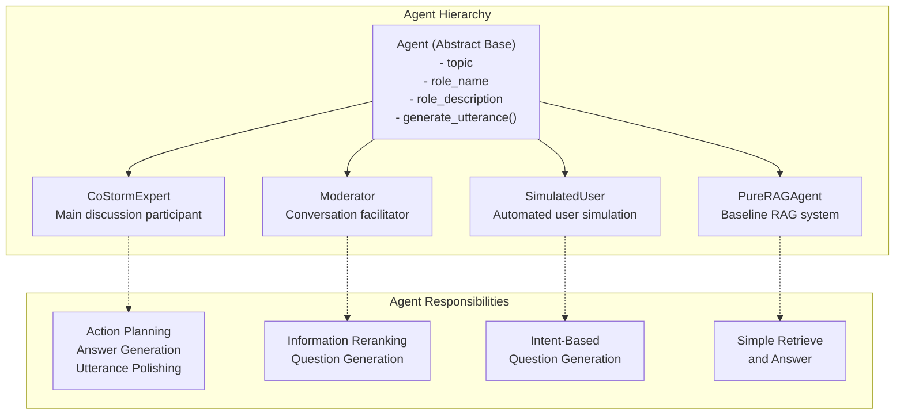
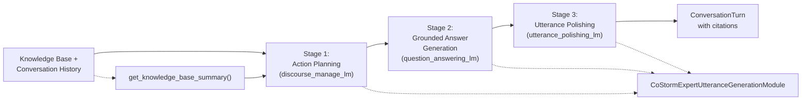
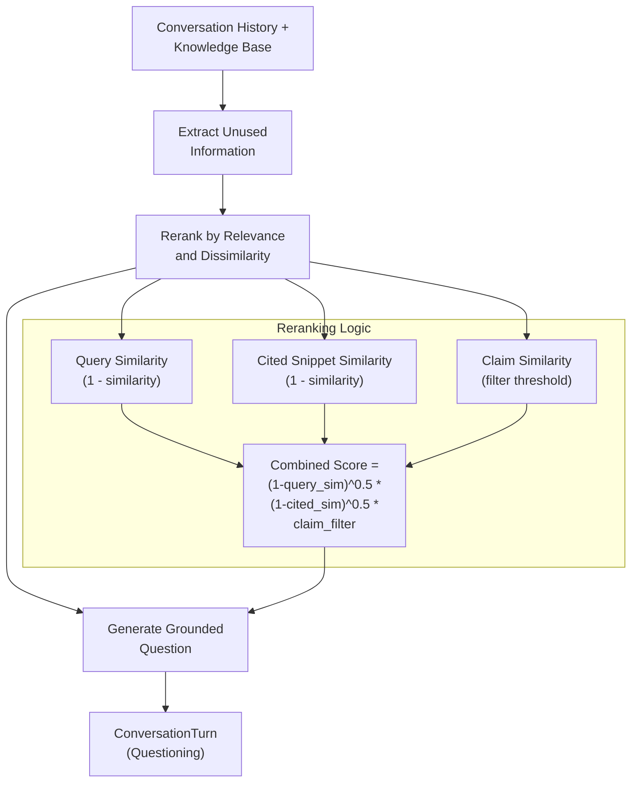
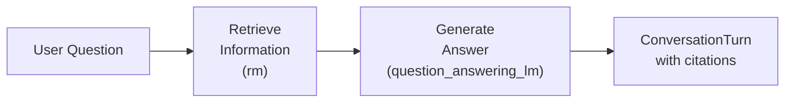
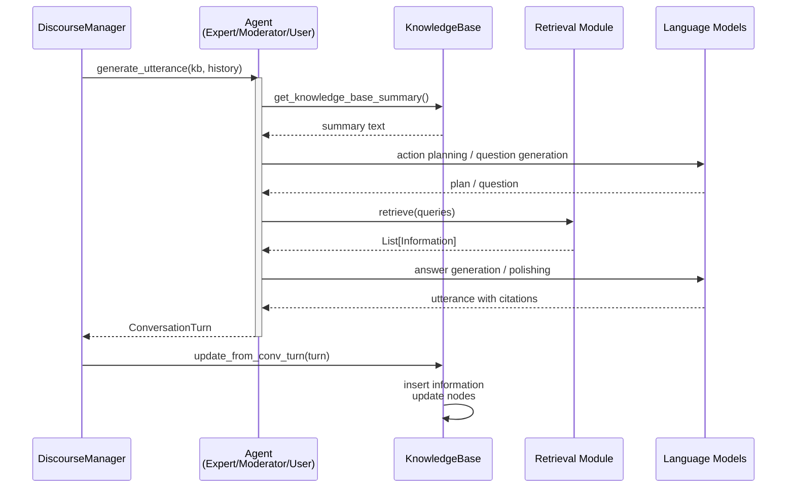
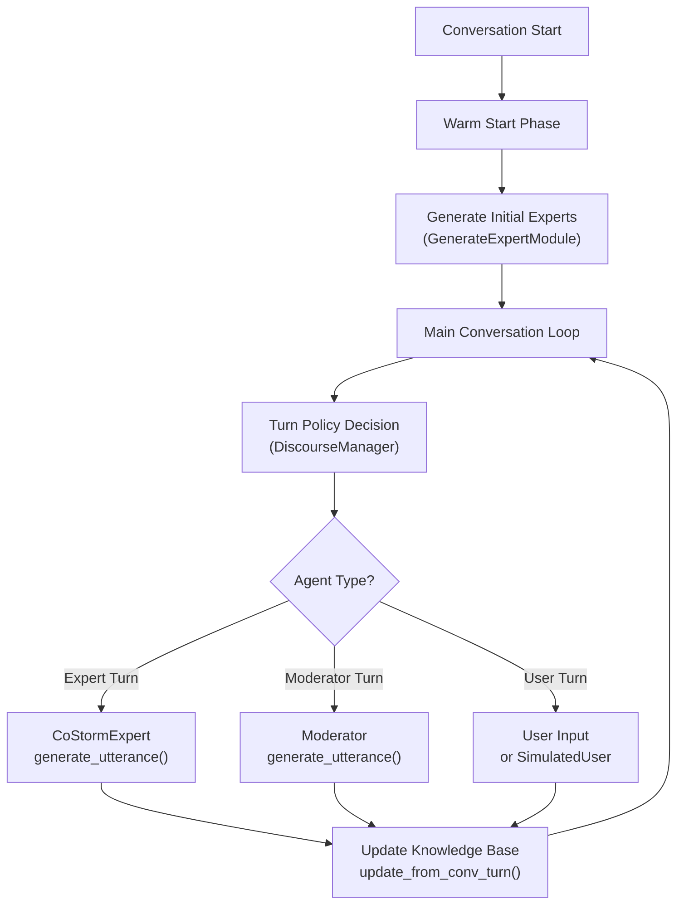

<!-- source: DeepWiki mcp.deepwiki.com · repo stanford-oval/storm · page 3.3 Agent System · fetched 2026-10-27 -->

# Agent System

<details>
<summary>Relevant source files</summary>

The following files were used as context for generating this wiki page:

- [knowledge_storm/collaborative_storm/modules/callback.py](knowledge_storm/collaborative_storm/modules/callback.py)
- [knowledge_storm/collaborative_storm/modules/co_storm_agents.py](knowledge_storm/collaborative_storm/modules/co_storm_agents.py)
- [knowledge_storm/collaborative_storm/modules/grounded_question_generation.py](knowledge_storm/collaborative_storm/modules/grounded_question_generation.py)
- [knowledge_storm/collaborative_storm/modules/warmstart_hierarchical_chat.py](knowledge_storm/collaborative_storm/modules/warmstart_hierarchical_chat.py)

</details>


## Purpose and Scope

The Agent System implements the core participants in Co-STORM's collaborative discourse protocol. This page documents the different agent types that engage in multi-turn conversations to curate knowledge collaboratively. Each agent type has a distinct role and utterance generation strategy.

For information about the overall Co-STORM system and conversation orchestration, see [Co-STORM Collaborative System](#3). For the discourse management and turn policy that coordinates these agents, see [Collaborative Modules](#3.4).

**Sources:** [knowledge_storm/collaborative_storm/modules/co_storm_agents.py:1-376]()

## Agent Base Class and Interface

All Co-STORM agents inherit from the abstract `Agent` class defined in [knowledge_storm/interface.py](). The base class requires three core attributes and one abstract method:

| Attribute | Type | Description |
|-----------|------|-------------|
| `topic` | `str` | The conversation topic |
| `role_name` | `str` | The agent's role identifier (e.g., "Expert", "Moderator") |
| `role_description` | `str` | Detailed description of the agent's perspective |

The abstract method that all agents must implement is:

```python
generate_utterance(
    knowledge_base: KnowledgeBase,
    conversation_history: List[ConversationTurn]
) -> ConversationTurn
```

This method takes the current state of the knowledge base and conversation history, then produces the next `ConversationTurn` from the agent's perspective.

**Sources:** [knowledge_storm/collaborative_storm/modules/co_storm_agents.py:24-157]()

## Agent Type Overview



**Sources:** [knowledge_storm/collaborative_storm/modules/co_storm_agents.py:1-376]()

## CoStormExpert

`CoStormExpert` represents domain experts participating in the collaborative discourse. Each expert has a specialized perspective and engages in multi-turn conversations to build the knowledge base.

### Initialization and Configuration

The expert agent is initialized with:

| Parameter | Type | Description |
|-----------|------|-------------|
| `topic` | `str` | Conversation topic |
| `role_name` | `str` | Expert's role identifier |
| `role_description` | `str` | Expert's perspective description |
| `lm_config` | `LMConfigs` | Language model configurations |
| `runner_argument` | `RunnerArgument` | Co-STORM execution parameters |
| `logging_wrapper` | `LoggingWrapper` | Event logging handler |
| `rm` | `Optional[dspy.Retrieve]` | Retrieval module for information gathering |
| `callback_handler` | `BaseCallbackHandler` | Callback for status updates |

**Sources:** [knowledge_storm/collaborative_storm/modules/co_storm_agents.py:42-76]()

### Utterance Generation Pipeline

The expert's utterance generation follows a three-stage pipeline:



The process is implemented in `generate_utterance()`:

1. **Knowledge Base Summary Extraction** ([knowledge_storm/collaborative_storm/modules/co_storm_agents.py:83-88]()): Retrieves a text summary of the current knowledge base state.

2. **Utterance Generation** ([knowledge_storm/collaborative_storm/modules/co_storm_agents.py:89-98]()): The `CoStormExpertUtteranceGenerationModule` generates the expert's response based on:
   - Topic
   - Expert's role description
   - Knowledge base summary
   - Last conversation turn

3. **Utterance Polishing** ([knowledge_storm/collaborative_storm/modules/co_storm_agents.py:99-107]()): Refines the generated utterance for conversational flow and coherence.

**Sources:** [knowledge_storm/collaborative_storm/modules/co_storm_agents.py:78-108]()

### Utterance Generation Module

The expert uses `CoStormExpertUtteranceGenerationModule` ([knowledge_storm/collaborative_storm/modules/co_storm_agents.py:62-76]()), which is configured with three specialized language models:

- `action_planning_lm`: Plans the expert's conversational action
- `utterance_polishing_lm`: Polishes the generated utterance
- `answer_question_module`: Generates grounded answers with citations

**Sources:** [knowledge_storm/collaborative_storm/modules/co_storm_agents.py:58-76]()

## Moderator

The `Moderator` agent prevents conversation stagnation by introducing new perspectives based on unused information from retrieval results.

### Moderator Architecture



**Sources:** [knowledge_storm/collaborative_storm/modules/co_storm_agents.py:159-312]()

### Unused Information Detection and Reranking

The moderator identifies unused information through a sophisticated reranking algorithm ([knowledge_storm/collaborative_storm/modules/co_storm_agents.py:190-246]()):

1. **Extract All Retrieved Snippets**: Collects all information snippets from the last N conversation turns (default: 2).

2. **Filter Out Cited Information**: Compares against `knowledge_base.info_uuid_to_info_dict` to identify snippets not yet cited.

3. **Compute Similarity Scores**: Using the `Encoder`, calculates:
   - **Query Similarity**: Cosine similarity to the original queries
   - **Cited Snippet Similarity**: Similarity to already-cited snippets
   - **Claim Similarity**: Relevance to the expert's intended claim (threshold: 0.25)

4. **Rerank by Combined Score**:
   ```
   score = ((1 - query_similarity)^0.5) * ((1 - cited_similarity)^0.5) * claim_filter
   ```
   This prioritizes information that is:
   - Different from the original query focus
   - Not similar to already-cited content
   - Still relevant to the conversation topic

**Sources:** [knowledge_storm/collaborative_storm/modules/co_storm_agents.py:190-283]()

### Question Generation

The moderator uses `GroundedQuestionGenerationModule` ([knowledge_storm/collaborative_storm/modules/grounded_question_generation.py:74-113]()) to generate questions grounded in the top-ranked unused snippets. The module:

1. Formats unused snippets as reference material
2. Generates a question using the knowledge base summary and last utterance
3. Polishes the question for conversational flow
4. Extracts citations from the generated question

**Sources:** [knowledge_storm/collaborative_storm/modules/co_storm_agents.py:285-312](), [knowledge_storm/collaborative_storm/modules/grounded_question_generation.py:74-113]()

## SimulatedUser

`SimulatedUser` enables automatic evaluation by simulating real user behavior based on predefined intents. This is primarily used for experimental comparisons (see Section 3.4 of the Co-STORM paper).

### Configuration and Intent

The simulated user requires an `intent` parameter that guides its utterance generation:

```python
SimulatedUser(
    topic=str,
    role_name="Guest",
    role_description=str,
    intent=str,  # User's information-seeking intent
    lm_config=LMConfigs,
    runner_argument=RunnerArgument,
    logging_wrapper=LoggingWrapper,
    callback_handler=BaseCallbackHandler
)
```

The `intent` drives the simulated user's questions throughout the conversation.

**Sources:** [knowledge_storm/collaborative_storm/modules/co_storm_agents.py:118-137]()

### Utterance Generation

The simulated user generates utterances using `GenSimulatedUserUtterance` ([knowledge_storm/collaborative_storm/modules/co_storm_agents.py:134-156]()):

1. Takes the conversation topic and user intent
2. Reviews conversation history
3. Generates the next question aligned with the intent
4. Returns a `ConversationTurn` with `utterance_type="Original Question"`

Unlike experts, simulated users do not perform retrieval or generate citations—they only ask questions.

**Sources:** [knowledge_storm/collaborative_storm/modules/co_storm_agents.py:139-157]()

## PureRAGAgent

`PureRAGAgent` is a baseline agent designed for comparison in the Co-STORM paper. It implements a simple retrieval-augmented generation approach without leveraging conversation history or knowledge base organization.

### Simplified Architecture



The agent ignores:
- Knowledge base structure
- Conversation history context
- Action planning
- Utterance polishing

**Sources:** [knowledge_storm/collaborative_storm/modules/co_storm_agents.py:314-376]()

### Implementation Details

The `PureRAGAgent` uses `_get_answer_question_module_instance()` ([knowledge_storm/collaborative_storm/modules/co_storm_agents.py:337-342]()) to perform grounded question answering. The `_gen_utterance_from_question()` method ([knowledge_storm/collaborative_storm/modules/co_storm_agents.py:344-360]()):

1. Calls the question-answering module with `mode="brief"` and `style="conversational and concise"`
2. Constructs a `ConversationTurn` with:
   - `claim_to_make`: The original question
   - `raw_utterance` and `utterance`: The generated answer
   - `queries`: Search queries used
   - `raw_retrieved_info` and `cited_info`: Retrieved and cited information

**Sources:** [knowledge_storm/collaborative_storm/modules/co_storm_agents.py:344-376]()

## Agent Interaction in the Discourse

The following diagram shows how agents interact with shared components during a conversation turn:



**Sources:** [knowledge_storm/collaborative_storm/modules/co_storm_agents.py:78-312]()

## Callback System for Agent Actions

The `BaseCallbackHandler` provides hooks to track agent actions during utterance generation. This enables UI updates, logging, and monitoring of the agent pipeline.

### Callback Hook Points

| Callback Method | Triggered When | Used By |
|-----------------|----------------|---------|
| `on_expert_action_planning_start()` | Expert begins action planning | `CoStormExpert` |
| `on_expert_information_collection_start()` | Expert starts retrieval | `CoStormExpert` |
| `on_expert_information_collection_end(info)` | Expert finishes retrieval | `CoStormExpert` |
| `on_expert_utterance_generation_end()` | Expert generates utterance | `CoStormExpert` |
| `on_expert_utterance_polishing_start()` | Expert begins polishing | `CoStormExpert` |
| `on_warmstart_update(message)` | Warm start progress update | `WarmStartModule` |

### Example: LocalConsolePrintCallBackHandler

The `LocalConsolePrintCallBackHandler` ([knowledge_storm/collaborative_storm/modules/callback.py:61-111]()) demonstrates callback usage by printing status messages to the console:

```python
def on_expert_action_planning_start(self, **kwargs):
    print("Reviewing discourse history; Deciding utterance intent.")

def on_expert_information_collection_start(self, **kwargs):
    print("Start searching with the search engine; browsing collected information.")
```

**Sources:** [knowledge_storm/collaborative_storm/modules/callback.py:1-111](), [knowledge_storm/collaborative_storm/modules/co_storm_agents.py:86-106]()

## Warm Start Agents

During the warm start phase, Co-STORM uses specialized agents to initialize the knowledge base. These agents are defined in `WarmStartModule`:

### WarmStartConversation

The `WarmStartConversation` module ([knowledge_storm/collaborative_storm/modules/warmstart_hierarchical_chat.py:126-257]()) generates initial experts and conducts multi-turn perspective-guided conversations:

1. **Expert Generation**: Uses `GenerateExpertModule` to identify domain experts based on background research
2. **Multi-threaded Conversations**: Runs parallel conversations with multiple experts (default: 3 experts, 2 turns each)
3. **Background Information Collection**: Each expert answers questions using `AnswerQuestionModule`

### Background Discussion Agents

During warm start, two special agent roles participate:

- **"Background discussion moderator"**: Asks questions to different experts
- **"Background discussion expert"**: Provides answers to moderator questions

These roles are later transformed into engaging conversation snippets via `ReportToConversation` ([knowledge_storm/collaborative_storm/modules/warmstart_hierarchical_chat.py:70-124]()).

**Sources:** [knowledge_storm/collaborative_storm/modules/warmstart_hierarchical_chat.py:1-409]()

## Agent Selection and Lifecycle



The `DiscourseManager` coordinates agent turns using turn policy logic (see [Collaborative Modules](#3.4)). Experts are dynamically added or selected based on conversation needs.

**Sources:** [knowledge_storm/collaborative_storm/modules/co_storm_agents.py:1-376](), [knowledge_storm/collaborative_storm/modules/warmstart_hierarchical_chat.py:126-257]()

---

