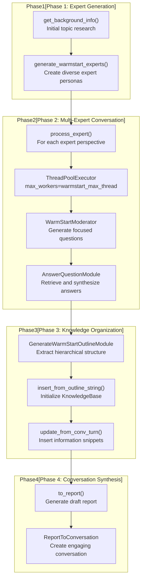
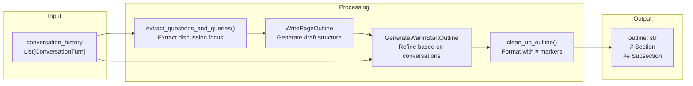
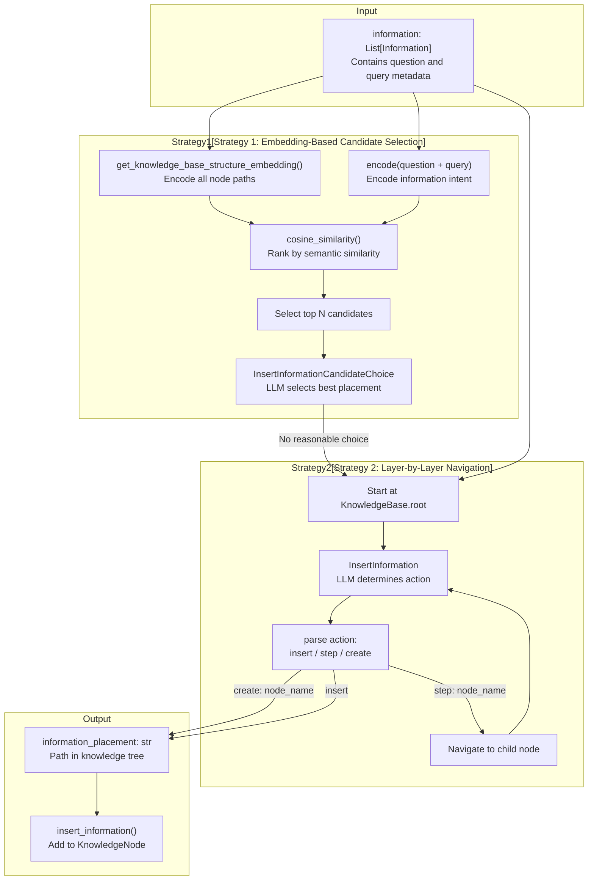
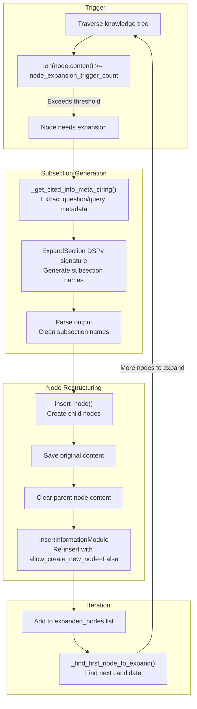
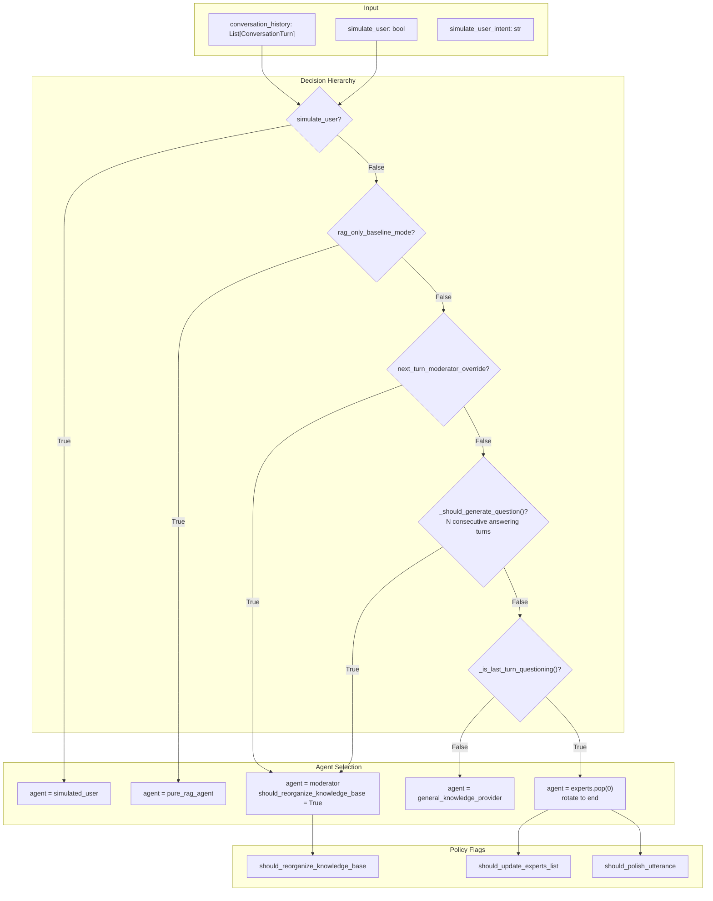
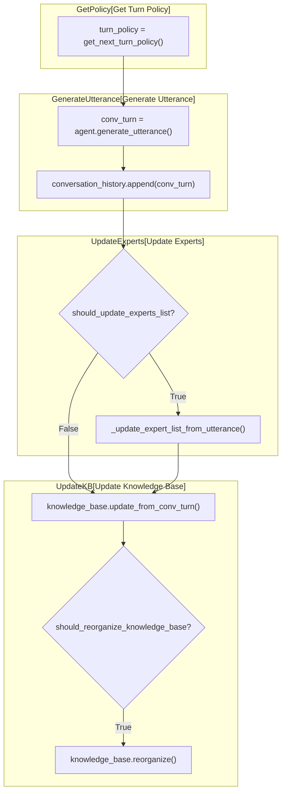
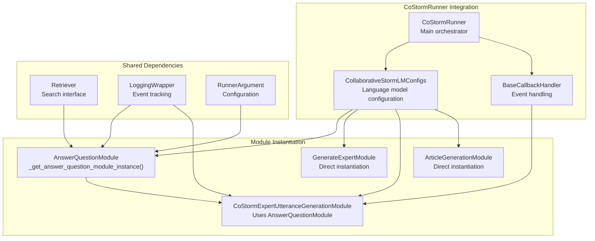

<!-- source: DeepWiki mcp.deepwiki.com · repo stanford-oval/storm · page 3.4 Collaborative Modules · fetched 2026-10-27 -->

# Collaborative Modules

<details>
<summary>Relevant source files</summary>

The following files were used as context for generating this wiki page:

- [knowledge_storm/collaborative_storm/engine.py](knowledge_storm/collaborative_storm/engine.py)
- [knowledge_storm/collaborative_storm/modules/callback.py](knowledge_storm/collaborative_storm/modules/callback.py)
- [knowledge_storm/collaborative_storm/modules/co_storm_agents.py](knowledge_storm/collaborative_storm/modules/co_storm_agents.py)
- [knowledge_storm/collaborative_storm/modules/grounded_question_generation.py](knowledge_storm/collaborative_storm/modules/grounded_question_generation.py)
- [knowledge_storm/collaborative_storm/modules/information_insertion_module.py](knowledge_storm/collaborative_storm/modules/information_insertion_module.py)
- [knowledge_storm/collaborative_storm/modules/warmstart_hierarchical_chat.py](knowledge_storm/collaborative_storm/modules/warmstart_hierarchical_chat.py)

</details>


This document covers the specialized modules that manage the Co-STORM collaborative discourse workflow. These modules handle warm start initialization, knowledge base organization, information insertion, node expansion, and turn policy management.

For information about the overall Co-STORM system architecture, see [Co-STORM Collaborative System](#3). For details about the knowledge base structure, see [Knowledge Base System](#3.2). For agent implementations, see [Agent System](#3.3).

## Module Architecture Overview

The Co-STORM collaborative modules coordinate the conversation flow and knowledge base management. Each module implements specific phases of the collaborative discourse process using the DSPy framework for language model integration.

**Core Collaborative Modules Architecture**

```mermaid
graph TB
    subgraph "Discourse Management"
        DiscourseManager["DiscourseManager<br/>knowledge_storm/collaborative_storm/engine.py"]
        TurnPolicy["TurnPolicySpec<br/>knowledge_storm/collaborative_storm/engine.py"]
    end
    
    subgraph "Initialization Modules"
        WarmStart["WarmStartModule<br/>knowledge_storm/collaborative_storm/modules/warmstart_hierarchical_chat.py"]
        WarmStartConv["WarmStartConversation"]
        GenerateOutline["GenerateWarmStartOutlineModule"]
        ReportToConv["ReportToConversation"]
    end
    
    subgraph "Knowledge Base Management"
        InsertInfo["InsertInformationModule<br/>knowledge_storm/collaborative_storm/modules/information_insertion_module.py"]
        ExpandNode["ExpandNodeModule<br/>knowledge_storm/collaborative_storm/modules/information_insertion_module.py"]
    end
    
    subgraph "Supporting Components"
        ExpertGen["GenerateExpertModule<br/>knowledge_storm/collaborative_storm/modules/expert_generation.py"]
        QuestionGen["GroundedQuestionGenerationModule<br/>knowledge_storm/collaborative_storm/modules/grounded_question_generation.py"]
        Callback["BaseCallbackHandler<br/>knowledge_storm/collaborative_storm/modules/callback.py"]
    end
    
    DiscourseManager --> TurnPolicy
    DiscourseManager --> ExpertGen
    DiscourseManager --> QuestionGen
    
    WarmStart --> WarmStartConv
    WarmStart --> GenerateOutline
    WarmStart --> ReportToConv
    
    WarmStartConv --> ExpertGen
    
    InsertInfo --> ExpandNode
```



**Sources:** [knowledge_storm/collaborative_storm/engine.py:294-317](), [knowledge_storm/collaborative_storm/engine.py:319-503](), [knowledge_storm/collaborative_storm/modules/warmstart_hierarchical_chat.py:312-409](), [knowledge_storm/collaborative_storm/modules/information_insertion_module.py:53-314]()

## WarmStartModule

The `WarmStartModule` initializes the Co-STORM system by conducting background research and establishing a shared conceptual space with the user. This stage functions as a mini-STORM pipeline that spawns multiple expert perspectives for multi-round conversations.

### WarmStartModule Components

| Component | Purpose | Implementation |
|-----------|---------|----------------|
| `WarmStartModule` | Main orchestrator for warm start process | [knowledge_storm/collaborative_storm/modules/warmstart_hierarchical_chat.py:312-409]() |
| `WarmStartConversation` | Multi-expert perspective-guided QA | [knowledge_storm/collaborative_storm/modules/warmstart_hierarchical_chat.py:126-257]() |
| `GenerateWarmStartOutlineModule` | Extract outline from conversation | [knowledge_storm/collaborative_storm/modules/warmstart_hierarchical_chat.py:279-310]() |
| `ReportToConversation` | Synthesize engaging conversation from report | [knowledge_storm/collaborative_storm/modules/warmstart_hierarchical_chat.py:70-124]() |

### Warm Start Pipeline

**Warm Start Execution Flow**



**Sources:** [knowledge_storm/collaborative_storm/modules/warmstart_hierarchical_chat.py:346-408]()

### Multi-Expert Perspective-Guided QA

The `WarmStartConversation` module implements parallel perspective-guided questioning across multiple expert personas:

**WarmStartConversation Configuration**

| Parameter | Default | Purpose |
|-----------|---------|---------|
| `max_num_experts` | 3 | Maximum number of expert perspectives to spawn |
| `max_turn_per_experts` | 2 | Conversation turns per expert |
| `max_thread` | 3 | Parallel thread count for expert conversations |

The conversation process follows these steps:

1. **Expert Generation**: Uses `GenerateExpertModule` to create diverse expert personas based on initial background research
2. **Parallel Conversations**: Each expert engages in `max_turn_per_experts` rounds of QA using `ThreadPoolExecutor`
3. **Question Generation**: The `WarmStartModerator` signature generates contextual questions for each expert based on conversation history
4. **Answer Collection**: The `AnswerQuestionModule` retrieves information and generates grounded responses

**Sources:** [knowledge_storm/collaborative_storm/modules/warmstart_hierarchical_chat.py:126-257](), [knowledge_storm/collaborative_storm/modules/warmstart_hierarchical_chat.py:183-256]()

### Outline Generation and Knowledge Base Initialization

The `GenerateWarmStartOutlineModule` extracts a hierarchical outline from the warm start conversations:

**Outline Generation Process**



The generated outline is inserted into the `KnowledgeBase` using `insert_from_outline_string()`, creating the initial hierarchical structure. Then, each conversation turn's information is inserted using `update_from_conv_turn()`.

**Sources:** [knowledge_storm/collaborative_storm/modules/warmstart_hierarchical_chat.py:279-310](), [knowledge_storm/collaborative_storm/modules/warmstart_hierarchical_chat.py:382-394]()

### Conversation Synthesis

The `ReportToConversation` module transforms the generated report back into engaging conversation turns for user presentation:

```python
# For each knowledge node with content:
# 1. Generate engaging question using SectionToConvTranscript
# 2. Generate engaging answer with inline citations
# 3. Create ConversationTurn objects for question and answer
```

This creates a conversational summary that helps users quickly understand the system's current knowledge about the topic.

**Sources:** [knowledge_storm/collaborative_storm/modules/warmstart_hierarchical_chat.py:70-124]()

## InsertInformationModule

The `InsertInformationModule` determines optimal placement of information snippets within the hierarchical knowledge base structure. It uses both semantic similarity and LLM-based reasoning to navigate the knowledge tree and insert information at appropriate locations.

### Module Components

| Component | Purpose | Implementation |
|-----------|---------|----------------|
| `InsertInformationModule` | Main orchestrator for information placement | [knowledge_storm/collaborative_storm/modules/information_insertion_module.py:53-314]() |
| `InsertInformation` | DSPy signature for layer-by-layer navigation | [knowledge_storm/collaborative_storm/modules/information_insertion_module.py:16-37]() |
| `InsertInformationCandidateChoice` | DSPy signature for candidate selection | [knowledge_storm/collaborative_storm/modules/information_insertion_module.py:39-51]() |

### Information Insertion Strategies

The module implements two complementary strategies for determining information placement:

**Dual-Strategy Insertion Architecture**



**Sources:** [knowledge_storm/collaborative_storm/modules/information_insertion_module.py:175-212](), [knowledge_storm/collaborative_storm/modules/information_insertion_module.py:108-148]()

### Embedding-Based Candidate Selection

The `choose_candidate_from_embedding_ranking()` method uses semantic similarity to identify potential placement locations:

1. **Encode Knowledge Structure**: Get embeddings for all node paths in the knowledge base
2. **Encode Information Intent**: Combine question and query into a single embedding
3. **Rank by Similarity**: Use cosine similarity to rank all possible placements
4. **LLM Selection**: Present top 5-8 candidates to LLM for final decision using `InsertInformationCandidateChoice`

**Sources:** [knowledge_storm/collaborative_storm/modules/information_insertion_module.py:175-212]()

### Layer-by-Layer Navigation

When embedding-based selection returns no reasonable choice, the `layer_by_layer_navigation_placement()` method navigates the knowledge tree interactively:

**Navigation Actions**

| Action | Format | Behavior |
|--------|--------|----------|
| Insert | `"insert"` | Place information at current node |
| Step | `"step: [child_name]"` | Navigate to specified child node |
| Create | `"create: [new_name]"` | Create new child node and place information |

The LLM receives context about:
- Current node name
- Available child nodes
- Navigation path taken so far
- Information intent (question + query)

**Sources:** [knowledge_storm/collaborative_storm/modules/information_insertion_module.py:72-107](), [knowledge_storm/collaborative_storm/modules/information_insertion_module.py:108-148]()

### Parallel vs Sequential Insertion

The `forward()` method handles two insertion modes:

**Insertion Mode Comparison**

| Mode | Condition | Threading | Knowledge Base Changes |
|------|-----------|-----------|------------------------|
| Parallel | `allow_create_new_node=False` | `ThreadPoolExecutor` with `max_thread=5` | Static structure |
| Sequential | `allow_create_new_node=True` | Single-threaded | Dynamic structure with new nodes |

In parallel mode, all information placements are determined concurrently since the knowledge base structure remains unchanged. In sequential mode, each insertion may create new nodes, requiring sequential processing to ensure consistent structure.

**Sources:** [knowledge_storm/collaborative_storm/modules/information_insertion_module.py:221-314]()

## ExpandNodeModule

The `ExpandNodeModule` refines knowledge base organization by subdividing nodes that contain too many information snippets. This prevents information overload at individual nodes and maintains a clean hierarchical structure.

### Module Architecture

| Component | Purpose | Implementation |
|-----------|---------|----------------|
| `ExpandNodeModule` | Main orchestrator for node expansion | [knowledge_storm/collaborative_storm/modules/information_insertion_module.py:334-425]() |
| `ExpandSection` | DSPy signature for subsection generation | [knowledge_storm/collaborative_storm/modules/information_insertion_module.py:316-332]() |
| `_find_first_node_to_expand()` | Identify nodes needing expansion | [knowledge_storm/collaborative_storm/modules/information_insertion_module.py:373-389]() |
| `_expand_node()` | Execute node expansion | [knowledge_storm/collaborative_storm/modules/information_insertion_module.py:391-413]() |

### Node Expansion Process

**Node Expansion Workflow**



**Sources:** [knowledge_storm/collaborative_storm/modules/information_insertion_module.py:415-424]()

### Expansion Trigger Configuration

The expansion process is controlled by the `node_expansion_trigger_count` parameter:

```python
# From RunnerArgument in engine.py
node_expansion_trigger_count: int = 10  # Default threshold
```

When a node accumulates 10 or more information snippets, it becomes eligible for expansion. The module uses a depth-first traversal to identify expansion candidates, ensuring parent nodes are expanded before children.

**Sources:** [knowledge_storm/collaborative_storm/modules/information_insertion_module.py:373-389]()

### Subsection Generation

The `ExpandSection` signature generates coherent subsections based on the information's question/query metadata:

**Input to ExpandSection**
- `section`: Current node's path from root
- `info`: String containing all question/query pairs for information in the node

**Output from ExpandSection**
- Subsection names (one per line)
- Or "None" if no expansion is needed

The generated subsection names are cleaned to remove formatting artifacts (leading numbers, dashes, asterisks) and citation brackets.

**Sources:** [knowledge_storm/collaborative_storm/modules/information_insertion_module.py:316-332](), [knowledge_storm/collaborative_storm/modules/information_insertion_module.py:355-371]()

### Re-insertion After Expansion

After creating subsections, the module:

1. Saves the original information snippets from `node.content`
2. Clears the parent node's content set
3. Calls `InsertInformationModule` with `allow_create_new_node=False` and `insert_root=node`
4. Re-inserts all information under the newly created subsections

This ensures information is redistributed to the most appropriate subsections without creating additional nodes.

**Sources:** [knowledge_storm/collaborative_storm/modules/information_insertion_module.py:391-413]()

## DiscourseManager

The `DiscourseManager` orchestrates conversation flow by determining which agent should speak next and managing the pool of available experts. It implements the turn policy logic that governs the collaborative discourse.

### DiscourseManager Components

| Component | Purpose | Implementation |
|-----------|---------|----------------|
| `DiscourseManager` | Main discourse orchestration class | [knowledge_storm/collaborative_storm/engine.py:319-503]() |
| `TurnPolicySpec` | Turn policy specification dataclass | [knowledge_storm/collaborative_storm/engine.py:294-317]() |
| `get_next_turn_policy()` | Determine next conversation action | [knowledge_storm/collaborative_storm/engine.py:461-502]() |
| `_update_expert_list_from_utterance()` | Refresh expert pool | [knowledge_storm/collaborative_storm/engine.py:446-453]() |

### DiscourseManager Role Management

The `DiscourseManager` maintains several agent instances:

**Managed Agents**

| Agent Type | Instance | Role |
|------------|----------|------|
| `experts` | `List[CoStormExpert]` | Pool of rotating expert perspectives |
| `simulated_user` | `SimulatedUser` | User simulation for experiments |
| `pure_rag_agent` | `PureRAGAgent` | Baseline RAG-only agent |
| `moderator` | `Moderator` | Injects new perspectives to avoid stagnation |
| `general_knowledge_provider` | `CoStormExpert` | Fallback expert for broad coverage |

**Sources:** [knowledge_storm/collaborative_storm/engine.py:337-381]()

### Turn Policy Determination

The `get_next_turn_policy()` method implements a hierarchical decision process to select the next agent:

**Turn Policy Decision Flow**



**Sources:** [knowledge_storm/collaborative_storm/engine.py:461-502]()

### Moderator Override Logic

The moderator is selected when:

1. **Explicit Override**: `next_turn_moderator_override` flag is set (e.g., after warm start)
2. **Consecutive Answering**: `moderator_override_N_consecutive_answering_turn` non-questioning turns have occurred

The `_should_generate_question()` method counts consecutive turns where `utterance_type` is not "Original Question" or "Information Request":

```python
# Default threshold from RunnerArgument
moderator_override_N_consecutive_answering_turn: int = 3
```

When moderator is selected, `should_reorganize_knowledge_base=True` is set, triggering knowledge base reorganization after the turn.

**Sources:** [knowledge_storm/collaborative_storm/engine.py:408-423](), [knowledge_storm/collaborative_storm/engine.py:479-484]()

### Expert Pool Rotation

When an expert is selected from the pool:

1. **Last Turn Questioning**: If previous turn was a question, update expert list using `_update_expert_list_from_utterance()`
2. **Expert Selection**: Pop first expert from `experts` list
3. **Rotation**: Append selected expert to end of list (round-robin)
4. **Flags**: Set `should_update_experts_list=True` and `should_polish_utterance=True`

The expert list is updated by:
- Extracting focus from last conversation turn
- Using `GenerateExpertModule` to generate new experts
- Parsing expert descriptions into `CoStormExpert` instances

**Sources:** [knowledge_storm/collaborative_storm/engine.py:489-501](), [knowledge_storm/collaborative_storm/engine.py:446-453]()

## TurnPolicySpec

The `TurnPolicySpec` dataclass encapsulates the decision output from `DiscourseManager`, specifying which agent should act and what operations should be performed after the turn.

### TurnPolicySpec Structure

```python
@dataclass
class TurnPolicySpec:
    should_reorganize_knowledge_base: bool = False
    should_update_experts_list: bool = False
    should_polish_utterance: bool = False
    agent: Agent = None
```

**Sources:** [knowledge_storm/collaborative_storm/engine.py:294-317]()

### Turn Policy Flags

| Flag | Purpose | Triggered When |
|------|---------|----------------|
| `should_reorganize_knowledge_base` | Calls `knowledge_base.reorganize()` | Moderator is selected |
| `should_update_experts_list` | Calls `_update_expert_list_from_utterance()` | Expert responds to question |
| `should_polish_utterance` | Calls `polish_utterance()` | Expert provides answer |
| `agent` | Specifies which agent generates utterance | Always set |

### Integration with CoStormRunner

The `CoStormRunner.step()` method consumes the turn policy:

**Turn Policy Execution in step()**



**Sources:** [knowledge_storm/collaborative_storm/engine.py:661-761]()

## Module Integration Patterns

The Co-STORM modules integrate through standardized interfaces and shared data structures to enable seamless collaborative knowledge curation.

### Integration Architecture



The modules are instantiated and configured through the `CoStormRunner` engine, which provides consistent language model configurations, logging, and callback handling across all components.

**Sources:** [knowledge_storm/collaborative_storm/modules/collaborative_storm_utils.py:243-262](), [knowledge_storm/collaborative_storm/modules/costorm_expert_utterance_generator.py:42-57]()

---

