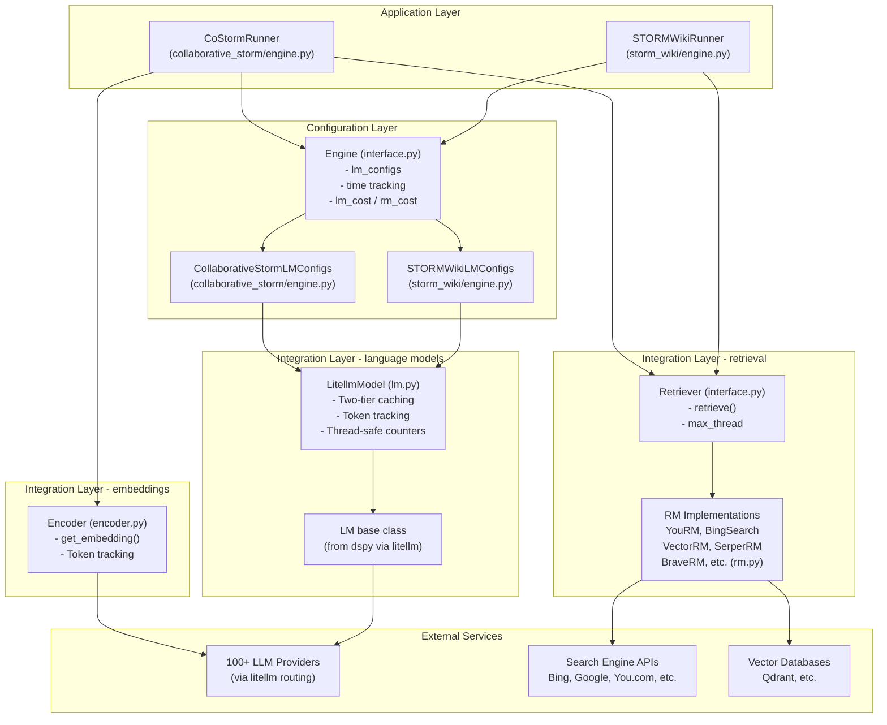
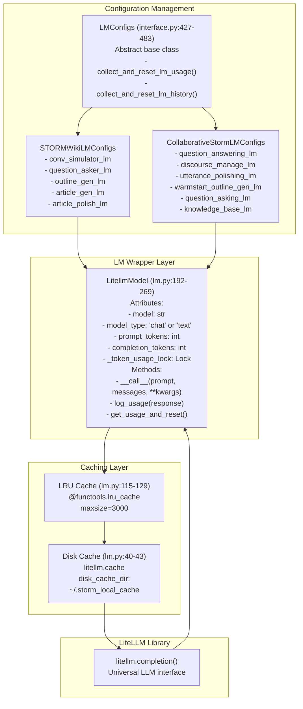
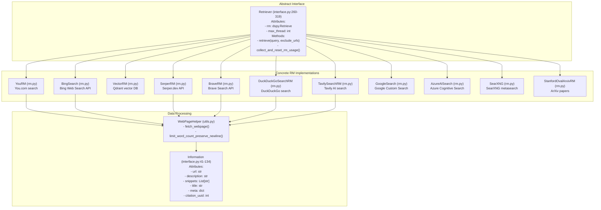
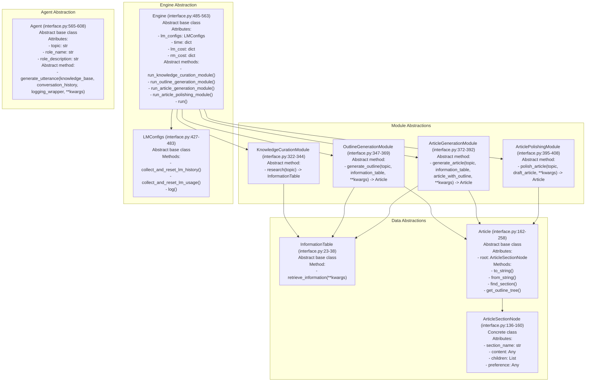
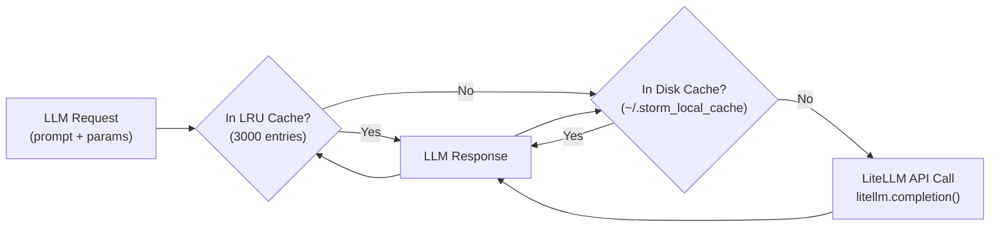
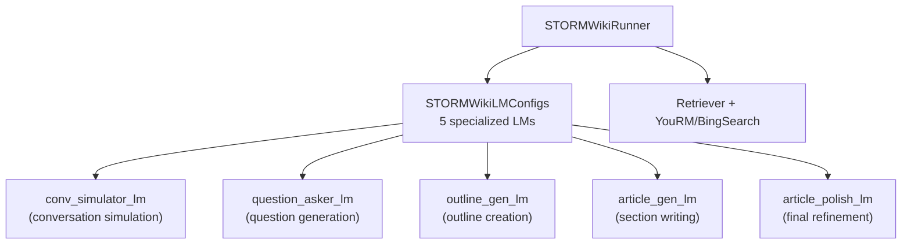
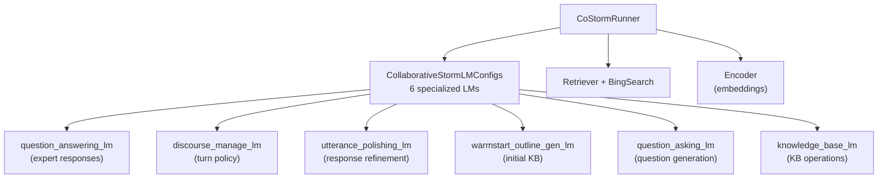

<!-- source: DeepWiki mcp.deepwiki.com · repo stanford-oval/storm · page 4 Core Infrastructure · fetched 2026-10-27 -->

# Core Infrastructure

<details>
<summary>Relevant source files</summary>

The following files were used as context for generating this wiki page:

- [README.md](README.md)
- [knowledge_storm/interface.py](knowledge_storm/interface.py)
- [knowledge_storm/lm.py](knowledge_storm/lm.py)

</details>


This document provides an overview of the shared infrastructure components that power both STORM and Co-STORM systems. The core infrastructure consists of three main integration layers (Language Models, Retrieval Modules, and Encoders) and a set of abstract interfaces that define contracts for custom implementations.

For detailed information about specific components:
- Language model integration and caching: see [Language Model Integration](#4.1)
- Retrieval module implementations: see [Retrieval Modules](#4.2)
- Text embedding generation: see [Encoder System](#4.3)
- Utility classes and helpers: see [Utilities and Helpers](#4.4)
- Abstract base classes and interfaces: see [Abstract Interfaces](#4.5)

## Purpose and Scope

The core infrastructure provides a provider-agnostic abstraction layer that allows both STORM and Co-STORM to operate with 100+ different LLM providers (via LiteLLM) and 11+ different search engines without changing application logic. This layer handles:

1. **Language Model Integration**: Universal wrapper for LLM providers with caching and token tracking
2. **Retrieval Module Integration**: Unified interface to web search engines, vector databases, and specialized retrievers
3. **Encoder Integration**: Text embedding generation for semantic similarity operations
4. **Abstract Interfaces**: Base classes that define contracts for custom implementations
5. **Performance Optimization**: Two-tier caching (LRU + disk), thread-safe token tracking, parallel query execution

The infrastructure is designed to be modular and extensible, allowing users to swap providers or implement custom components by adhering to the defined interfaces.

## Infrastructure Architecture

The following diagram shows the layered architecture of the core infrastructure and how it integrates with the two main systems (STORM and Co-STORM):



**Sources**: [knowledge_storm/interface.py:485-563](), [knowledge_storm/lm.py:192-269]()

The architecture consists of four distinct layers:

1. **Application Layer**: Contains `STORMWikiRunner` and `CoStormRunner` which orchestrate the respective pipelines
2. **Configuration Layer**: Manages LM configurations and tracks execution metrics through the `Engine` base class
3. **Integration Layer**: Provides universal wrappers for LLMs (`LitellmModel`), retrievers (`Retriever`), and embeddings (`Encoder`)
4. **External Services**: The actual LLM providers, search engines, and vector databases

## Language Model Integration Architecture

The language model integration is built around the `LitellmModel` class, which wraps the LiteLLM library to provide access to 100+ LLM providers. The following diagram shows how language model requests flow through the system:



**Sources**: [knowledge_storm/lm.py:192-269](), [knowledge_storm/interface.py:427-483](), [knowledge_storm/lm.py:40-43](), [knowledge_storm/lm.py:115-129]()

### Key Components

| Component | File Location | Purpose |
|-----------|--------------|---------|
| `LitellmModel` | [knowledge_storm/lm.py:192-269]() | Main wrapper class that provides thread-safe token tracking and integrates with caching layers |
| `LM` base class | [knowledge_storm/lm.py:57-114]() | Parent class from DSPy that defines the interface |
| `cached_litellm_completion` | [knowledge_storm/lm.py:115-117]() | LRU cache decorator with maxsize=3000 |
| `litellm.cache` | [knowledge_storm/lm.py:40-43]() | Disk cache initialized at `~/.storm_local_cache` |
| `LMConfigs` | [knowledge_storm/interface.py:427-483]() | Abstract base for collecting usage statistics |

### Token Tracking

The `LitellmModel` class implements thread-safe token counting using a `threading.Lock`:

```python
# From lm.py:206-216
self._token_usage_lock = threading.Lock()
self.prompt_tokens = 0
self.completion_tokens = 0

def log_usage(self, response):
    usage_data = response.get("usage")
    if usage_data:
        with self._token_usage_lock:
            self.prompt_tokens += usage_data.get("prompt_tokens", 0)
            self.completion_tokens += usage_data.get("completion_tokens", 0)
```

This allows multiple modules to safely track token usage concurrently. The `Engine` base class aggregates usage statistics from all configured LMs via `collect_and_reset_lm_usage()` [knowledge_storm/interface.py:452-473]().

**Sources**: [knowledge_storm/lm.py:206-232](), [knowledge_storm/interface.py:452-473]()

## Retrieval Module Architecture

The retrieval module layer provides a unified interface to 11+ different search engines and retrieval backends. The following diagram shows the retrieval architecture and concrete implementations:



**Sources**: [knowledge_storm/interface.py:260-319](), [knowledge_storm/interface.py:41-134]()

### Retriever Interface

The `Retriever` base class [knowledge_storm/interface.py:260-319]() provides:

1. **Parallel Query Execution**: Uses `ThreadPoolExecutor` with configurable `max_thread` to process multiple queries concurrently [knowledge_storm/interface.py:311-317]()
2. **Citation Processing**: Automatically removes citations from retrieved snippets to avoid confusion [knowledge_storm/interface.py:303-305]()
3. **Information Standardization**: Converts all retrieval results to `Information` objects with consistent schema [knowledge_storm/interface.py:306-308]()
4. **Usage Tracking**: Collects query counts from RM implementations via `collect_and_reset_rm_usage()` [knowledge_storm/interface.py:273-286]()

### Retrieval Module Implementations

Each RM implementation follows the pattern defined by DSPy's `dspy.Retrieve` interface and returns data in a standardized format that includes:

- `url`: Unique identifier for the source
- `snippets`: List of text excerpts
- `title`: Source title
- `description`: Brief source description

The `WebPageHelper` utility class [knowledge_storm/utils.py]() provides common functionality for fetching and processing web content used by multiple RM implementations.

**Sources**: [knowledge_storm/interface.py:260-319](), [knowledge_storm/interface.py:288-319]()

## Abstract Interface System

The codebase defines a comprehensive set of abstract interfaces in [knowledge_storm/interface.py]() that enable modularity and custom implementations. The following diagram shows the key abstract base classes and their relationships:



**Sources**: [knowledge_storm/interface.py:23-608]()

### Key Abstract Contracts

| Abstract Class | Purpose | Key Methods | Implementations |
|----------------|---------|-------------|-----------------|
| `InformationTable` | Store collected information | `retrieve_information(**kwargs)` | `StormInformationTable` (STORM) |
| `Article` | Represent article structure | `to_string()`, `from_string()` | `StormArticle` (STORM) |
| `KnowledgeCurationModule` | Collect information | `research(topic)` | `StormKnowledgeCurationModule` |
| `OutlineGenerationModule` | Generate article outline | `generate_outline(topic, information_table)` | `StormOutlineGenerationModule` |
| `ArticleGenerationModule` | Write article sections | `generate_article(topic, information_table, article_with_outline)` | `StormArticleGenerationModule` |
| `ArticlePolishingModule` | Refine final article | `polish_article(topic, draft_article)` | `StormArticlePolishingModule` |
| `Engine` | Orchestrate pipeline | `run_knowledge_curation_module()`, etc. | `STORMWikiRunner`, `CoStormRunner` |
| `LMConfigs` | Manage LM configurations | `collect_and_reset_lm_usage()` | `STORMWikiLMConfigs`, `CollaborativeStormLMConfigs` |
| `Agent` | Generate conversational utterances | `generate_utterance()` | `CoStormExpert`, `Moderator`, `SimulatedUser` |

### Decorator Pattern for Execution Tracking

The `Engine` base class [knowledge_storm/interface.py:485-523]() provides the `log_execution_time_and_lm_rm_usage` decorator that automatically wraps methods starting with `run_` to track:

1. **Execution Time**: Duration of each pipeline stage
2. **LM Cost**: Token usage per stage via `lm_configs.collect_and_reset_lm_usage()`
3. **RM Cost**: Query count per stage via `retriever.collect_and_reset_rm_usage()`

This is applied automatically in the `apply_decorators()` method [knowledge_storm/interface.py:512-522]().

**Sources**: [knowledge_storm/interface.py:492-523]()

## Performance Optimization and Observability

The infrastructure layer implements several performance optimizations and observability features:

### Two-Tier Caching System



**Sources**: [knowledge_storm/lm.py:54](), [knowledge_storm/lm.py:40-43](), [knowledge_storm/lm.py:115-129]()

The caching system has two levels:

1. **LRU Cache** [knowledge_storm/lm.py:115-129](): In-memory cache using `@functools.lru_cache` with `maxsize=3000`. Provides instant response for repeated queries within the same session.

2. **Disk Cache** [knowledge_storm/lm.py:40-43](): Persistent cache managed by LiteLLM at `~/.storm_local_cache`. Survives across sessions and can be shared between runs.

Cache keys are generated by serializing the request (model, messages, and parameters) to JSON using `ujson` [knowledge_storm/lm.py:93]().

### Token Usage Tracking

The infrastructure provides comprehensive token tracking at multiple levels:

| Level | Component | Method | Thread Safety |
|-------|-----------|--------|---------------|
| Individual LM | `LitellmModel` | `log_usage(response)` | Yes (uses `threading.Lock`) |
| LM Config | `LMConfigs` | `collect_and_reset_lm_usage()` | N/A (aggregates from LMs) |
| Engine | `Engine` | Automatic via decorator | N/A (aggregates per stage) |

The thread-safe implementation [knowledge_storm/lm.py:206-216]() allows multiple modules to safely increment token counters concurrently, which is important since both STORM and Co-STORM use parallel processing.

**Sources**: [knowledge_storm/lm.py:206-232](), [knowledge_storm/interface.py:452-473](), [knowledge_storm/interface.py:492-510]()

### Parallel Query Execution

The `Retriever` class [knowledge_storm/interface.py:288-319]() uses `concurrent.futures.ThreadPoolExecutor` to process multiple queries in parallel:

```python
# From interface.py:311-317
with concurrent.futures.ThreadPoolExecutor(max_workers=self.max_thread) as executor:
    results = list(executor.map(process_query, queries))
```

This enables efficient batch retrieval when multiple perspectives or questions need information simultaneously, which is common in both STORM's perspective-guided research and Co-STORM's collaborative discourse.

**Sources**: [knowledge_storm/interface.py:311-317]()

### Execution Time and Cost Summary

The `Engine.summary()` method [knowledge_storm/interface.py:544-557]() provides a comprehensive report of:

- **Execution time** for each pipeline stage
- **Token usage** broken down by model and stage
- **Query count** for retrieval operations

This enables developers to identify bottlenecks and optimize resource usage.

**Sources**: [knowledge_storm/interface.py:544-557]()

## Integration with STORM and Co-STORM

Both STORM and Co-STORM systems inherit from the `Engine` base class and use the same infrastructure components, but configure them differently based on their operational paradigms:

### STORM Configuration



**Sources**: [README.md:114-134]()

### Co-STORM Configuration



**Sources**: [README.md:165-196]()

The key differences:
- **STORM** uses 5 LMs for its linear pipeline stages, no encoder required
- **Co-STORM** uses 6 LMs for collaborative discourse management, plus an encoder for knowledge base organization
- Both systems can use any LLM provider supported by LiteLLM without code changes

**Sources**: [README.md:104-216]()

---

