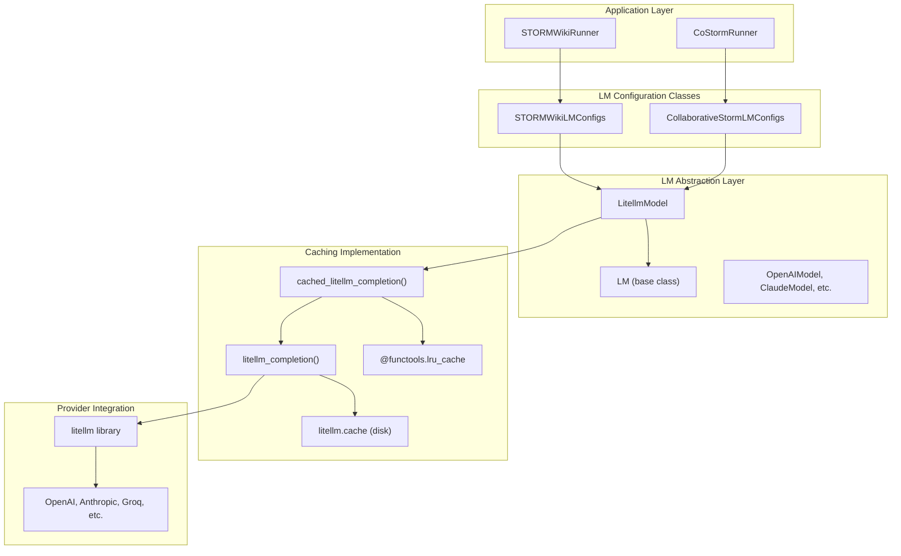
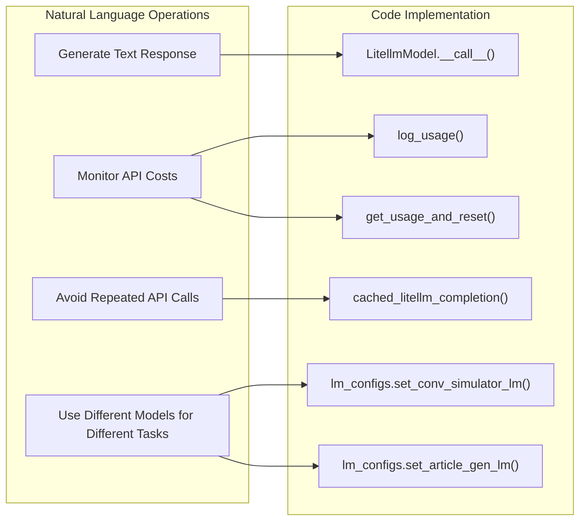
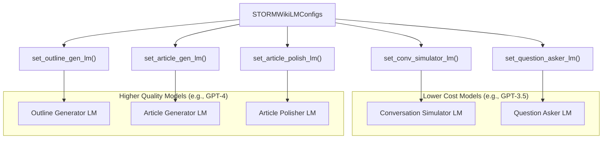
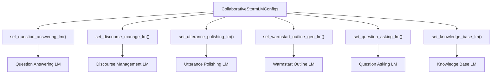

<!-- source: DeepWiki mcp.deepwiki.com · repo stanford-oval/storm · page 4.1 Language Model Integration · fetched 2026-10-27 -->

# Language Model Integration

<details>
<summary>Relevant source files</summary>

The following files were used as context for generating this wiki page:

- [README.md](README.md)
- [knowledge_storm/lm.py](knowledge_storm/lm.py)

</details>


The STORM system relies heavily on Language Models (LMs) to generate high-quality Wikipedia-like articles. This page documents how language models are integrated within the STORM framework, focusing on the abstraction layers, available providers, caching mechanisms, and usage patterns.

## Overview

The Language Model integration in STORM provides a unified interface to interact with various LM providers while handling common concerns like error handling, retries, caching, and token usage tracking. As of v1.1.0, STORM uses [litellm](https://github.com/BerriAI/litellm) as the primary integration pathway, providing access to a wide range of language model providers through a consistent API.

Sources: [README.md:12-12](), [knowledge_storm/lm.py:192-267]()

## Language Model Architecture

**System Component Integration Diagram**


**Natural Language to Code Mapping**


The STORM language model architecture consists of multiple layers:

1. **Application Layer**: `STORMWikiRunner` and `CoStormRunner` classes that orchestrate article generation
2. **Configuration Layer**: `STORMWikiLMConfigs` and `CollaborativeStormLMConfigs` that manage model assignments
3. **LM Abstraction Layer**: `LitellmModel` extends the base `LM` class to provide unified provider access
4. **Caching Layer**: `cached_litellm_completion()` with `@functools.lru_cache` and disk-based persistence
5. **Provider Integration**: `litellm` library connecting to external LLM APIs

Sources: [knowledge_storm/lm.py:57-113](), [knowledge_storm/lm.py:115-156](), [knowledge_storm/lm.py:192-269]()

## LitellmModel: The Primary Integration Class

The `LitellmModel` class is STORM's primary interface for interacting with language models. It leverages the litellm library to provide a consistent interface to a wide range of language model providers.

```python
from knowledge_storm.lm import LitellmModel

# Create a LitellmModel instance
lm = LitellmModel(
    model="openai/gpt-4o",  # Format: "provider/model_name"
    api_key="your_api_key",  # Optional, can use env vars
    temperature=1.0,
    top_p=0.9,
    max_tokens=1000,
    cache=True  # Enable caching
)

# Generate text
response = lm("What is STORM?")
```

The `LitellmModel` supports all providers available in litellm, including:

- OpenAI (GPT-3.5, GPT-4, etc.)
- Azure OpenAI
- Anthropic (Claude models)
- Groq
- Ollama (local models)
- Many others

Sources: [knowledge_storm/lm.py:192-267](), [README.md:114-128]()

## Multi-Model Strategy for Cost and Performance

STORM uses different language models for different components to balance cost and performance. More powerful (expensive) models are used only where necessary.

**STORM Component-Model Assignment**


**Co-STORM Component-Model Assignment**


### Configuration Implementation

The multi-model strategy is implemented through configuration classes:

| System | Configuration Class | Purpose |
|--------|-------------------|---------|
| **STORM** | `STORMWikiLMConfigs` | Assigns models to wiki generation pipeline stages |
| **Co-STORM** | `CollaborativeStormLMConfigs` | Assigns models to collaborative discourse components |

```python
# STORM Configuration Example
lm_configs = STORMWikiLMConfigs()
gpt_35 = LitellmModel(model='gpt-3.5-turbo', max_tokens=500, **kwargs)
gpt_4 = LitellmModel(model='gpt-4o', max_tokens=3000, **kwargs)

# Use cheaper model for less critical tasks
lm_configs.set_conv_simulator_lm(gpt_35)
lm_configs.set_question_asker_lm(gpt_35)

# Use more powerful model for core generation tasks
lm_configs.set_outline_gen_lm(gpt_4)
lm_configs.set_article_gen_lm(gpt_4)
lm_configs.set_article_polish_lm(gpt_4)

# Co-STORM Configuration Example
lm_config = CollaborativeStormLMConfigs()
lm_config.set_question_answering_lm(gpt_4)
lm_config.set_discourse_manage_lm(gpt_35)
lm_config.set_utterance_polishing_lm(gpt_4)
```

Sources: [README.md:120-128](), [README.md:164-186]()

## Caching System

STORM implements a two-tiered caching system for language model responses:

### Implementation Architecture

| Cache Level | Function | Implementation | Location |
|------------|----------|----------------|----------|
| **In-Memory LRU** | `cached_litellm_completion()` | `@functools.lru_cache(maxsize=3000)` | [knowledge_storm/lm.py:115-117]() |
| **Disk Cache** | `litellm_completion()` | `litellm.cache` with disk persistence | [knowledge_storm/lm.py:120-122]() |

### Configuration Details

The caching system is configured at module initialization:

- **Disk Cache Directory**: `~/.storm_local_cache` [knowledge_storm/lm.py:42-43]()
- **LRU Cache Size**: `LM_LRU_CACHE_MAX_SIZE = 3000` [knowledge_storm/lm.py:54]()
- **Cache Type**: `litellm.cache = Cache(disk_cache_dir=disk_cache_dir, type="disk")` [knowledge_storm/lm.py:43]()

### Usage Control

The caching system is automatically enabled when using `LitellmModel` and can be controlled via the `cache` parameter:

```python
# Enable caching (default)
lm = LitellmModel(model="openai/gpt-4o", cache=True)

# Disable caching
lm = LitellmModel(model="openai/gpt-4o", cache=False)

# Disable caching for a specific call
response = lm("What is STORM?", cache=False)
```

### Cache Flow

1. Request hits `LitellmModel.__call__()` [knowledge_storm/lm.py:233-268]()
2. If caching enabled, routes to `cached_litellm_completion()` [knowledge_storm/lm.py:241]()
3. LRU cache checks for existing response using request serialization via `ujson.dumps()`
4. Cache miss triggers `litellm_completion()` with disk cache parameters
5. Response stored in both memory and disk caches for future requests

The caching system significantly reduces API costs and improves response times for repeated queries.

Sources: [knowledge_storm/lm.py:42-43](), [knowledge_storm/lm.py:54](), [knowledge_storm/lm.py:115-122](), [knowledge_storm/lm.py:233-268]()

## Token Usage Tracking

`LitellmModel` automatically tracks token usage for cost monitoring through thread-safe counters.

### Implementation Details

| Component | Purpose | Implementation |
|-----------|---------|----------------|
| **Thread Lock** | `self._token_usage_lock` | `threading.Lock()` for concurrent access safety |
| **Prompt Tracking** | `self.prompt_tokens` | Counter for input tokens |
| **Completion Tracking** | `self.completion_tokens` | Counter for output tokens |
| **Usage Logging** | `log_usage()` | Extracts and accumulates token counts from responses |
| **Usage Retrieval** | `get_usage_and_reset()` | Returns usage statistics and resets counters |

### Usage Tracking Flow

1. `LitellmModel.__call__()` executes request [knowledge_storm/lm.py:233-268]()
2. Response received and passed to `log_usage()` [knowledge_storm/lm.py:251]()
3. `log_usage()` extracts token counts from `response["usage"]` [knowledge_storm/lm.py:210-216]()
4. Thread-safe accumulation using `self._token_usage_lock` [knowledge_storm/lm.py:214-216]()
5. Usage data retrievable via `get_usage_and_reset()` [knowledge_storm/lm.py:218-231]()

### Code Example

```python
# Create a language model
lm = LitellmModel(model="openai/gpt-4o")

# Make some calls
lm("What is STORM?")
lm("How does STORM work?")

# Get token usage statistics
usage = lm.get_usage_and_reset()
print(usage)
# Example output: {'openai/gpt-4o': {'prompt_tokens': 25, 'completion_tokens': 150}}
```

### Response Structure

The `get_usage_and_reset()` method returns a dictionary with model-specific usage:

```python
{
    "model_name": {
        "prompt_tokens": int,      # Input tokens consumed
        "completion_tokens": int   # Output tokens generated
    }
}
```

Token usage data is tracked separately for prompt tokens and completion tokens, enabling accurate cost estimation across different pricing models.

Sources: [knowledge_storm/lm.py:206-231](), [knowledge_storm/lm.py:251]()

## Legacy Model Integrations

While `LitellmModel` is the recommended approach as of v1.1.0, STORM maintains several legacy model integrations for backward compatibility:

| Model Class | Provider | Status |
|-------------|----------|--------|
| `OpenAIModel` | OpenAI | Deprecated |
| `DeepSeekModel` | DeepSeek | Deprecated |
| `AzureOpenAIModel` | Azure OpenAI | Deprecated |
| `GroqModel` | Groq | Deprecated |
| `ClaudeModel` | Anthropic | Deprecated |
| `VLLMClient` | vLLM | Deprecated |
| `OllamaClient` | Ollama | Deprecated |
| `TGIClient` | HuggingFace TGI | Deprecated |
| `TogetherClient` | Together.ai | Deprecated |
| `GoogleModel` | Google Gemini | Deprecated |

These legacy classes remain in the codebase but are no longer actively maintained.

Sources: [knowledge_storm/lm.py:271-274](), [knowledge_storm/lm.py:276-1285]()

## Integration Examples

### Basic STORM Integration

```python
from knowledge_storm import STORMWikiRunnerArguments, STORMWikiRunner, STORMWikiLMConfigs
from knowledge_storm.lm import LitellmModel
from knowledge_storm.rm import YouRM

lm_configs = STORMWikiLMConfigs()
openai_kwargs = {
    'api_key': os.getenv("OPENAI_API_KEY"),
    'temperature': 1.0,
    'top_p': 0.9,
}

# Configure models for different components
gpt_35 = LitellmModel(model='gpt-3.5-turbo', max_tokens=500, **openai_kwargs)
gpt_4 = LitellmModel(model='gpt-4o', max_tokens=3000, **openai_kwargs)
lm_configs.set_conv_simulator_lm(gpt_35)
lm_configs.set_question_asker_lm(gpt_35)
lm_configs.set_outline_gen_lm(gpt_4)
lm_configs.set_article_gen_lm(gpt_4)
lm_configs.set_article_polish_lm(gpt_4)

# Create runner
engine_args = STORMWikiRunnerArguments(...)
rm = YouRM(ydc_api_key=os.getenv('YDC_API_KEY'), k=engine_args.search_top_k)
runner = STORMWikiRunner(engine_args, lm_configs, rm)
```

### Co-STORM Integration

```python
from knowledge_storm.collaborative_storm.engine import CollaborativeStormLMConfigs, RunnerArgument, CoStormRunner
from knowledge_storm.lm import LitellmModel
from knowledge_storm.logging_wrapper import LoggingWrapper
from knowledge_storm.rm import BingSearch

# Co-STORM adopts the same multi LM system paradigm as STORM 
lm_config = CollaborativeStormLMConfigs()
openai_kwargs = {
    "api_key": os.getenv("OPENAI_API_KEY"),
    "temperature": 1.0,
    "top_p": 0.9,
}

# Configure different models for different components
question_answering_lm = LitellmModel(model='gpt-4o', max_tokens=1000, **openai_kwargs)
discourse_manage_lm = LitellmModel(model='gpt-4o', max_tokens=500, **openai_kwargs)
utterance_polishing_lm = LitellmModel(model='gpt-4o', max_tokens=2000, **openai_kwargs)
warmstart_outline_gen_lm = LitellmModel(model='gpt-4o', max_tokens=500, **openai_kwargs)
question_asking_lm = LitellmModel(model='gpt-4o', max_tokens=300, **openai_kwargs)
knowledge_base_lm = LitellmModel(model='gpt-4o', max_tokens=1000, **openai_kwargs)

# Assign models to components
lm_config.set_question_answering_lm(question_answering_lm)
lm_config.set_discourse_manage_lm(discourse_manage_lm)
lm_config.set_utterance_polishing_lm(utterance_polishing_lm)
lm_config.set_warmstart_outline_gen_lm(warmstart_outline_gen_lm)
lm_config.set_question_asking_lm(question_asking_lm)
lm_config.set_knowledge_base_lm(knowledge_base_lm)
```

Sources: [README.md:106-196]()

## Related Pages

- For information about the overall STORM architecture, see [Architecture Overview](#1.2)
- For information about the retrieval modules that provide context to language models, see [Retrieval Modules (RM)](#4.1)
- For information about the encoder system used for embeddings, see [Encoders](#4.3)

---

