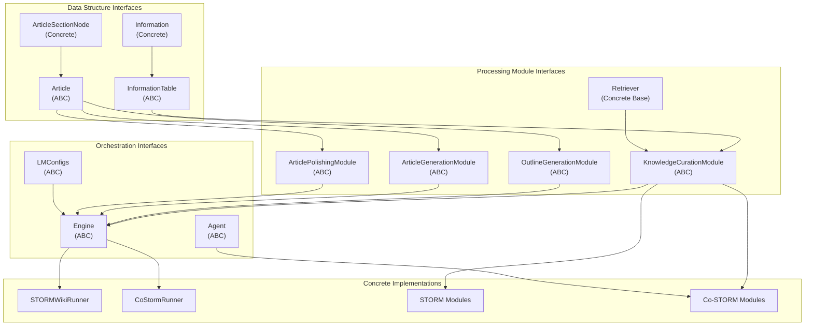
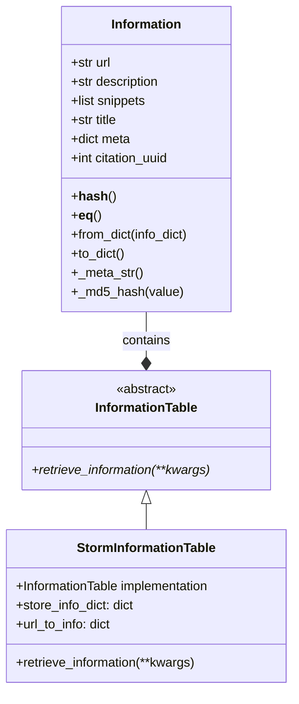
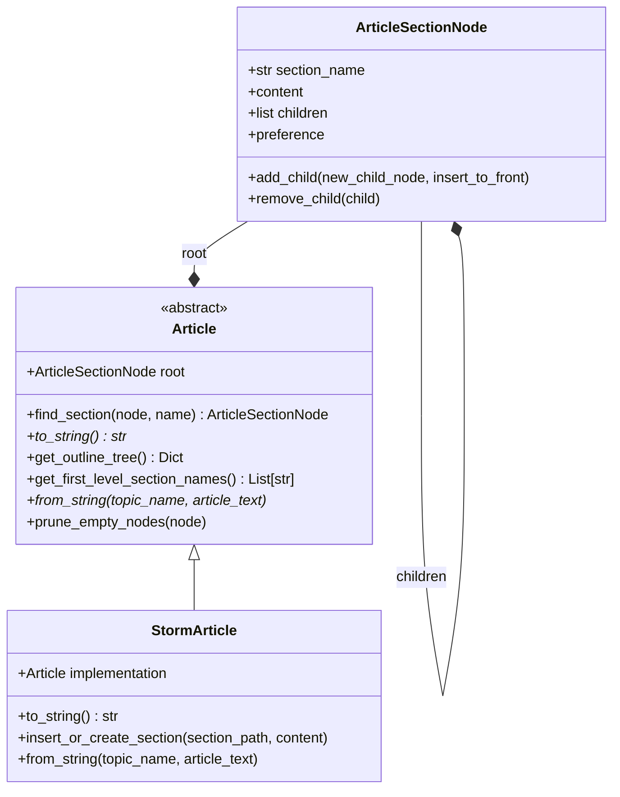
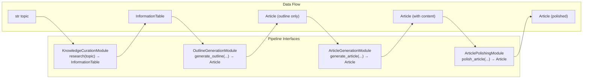
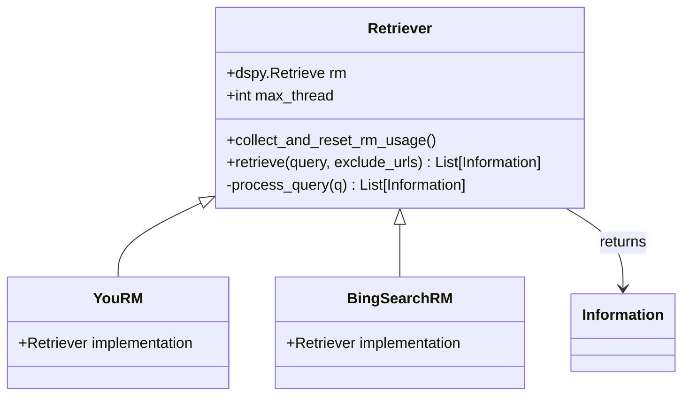
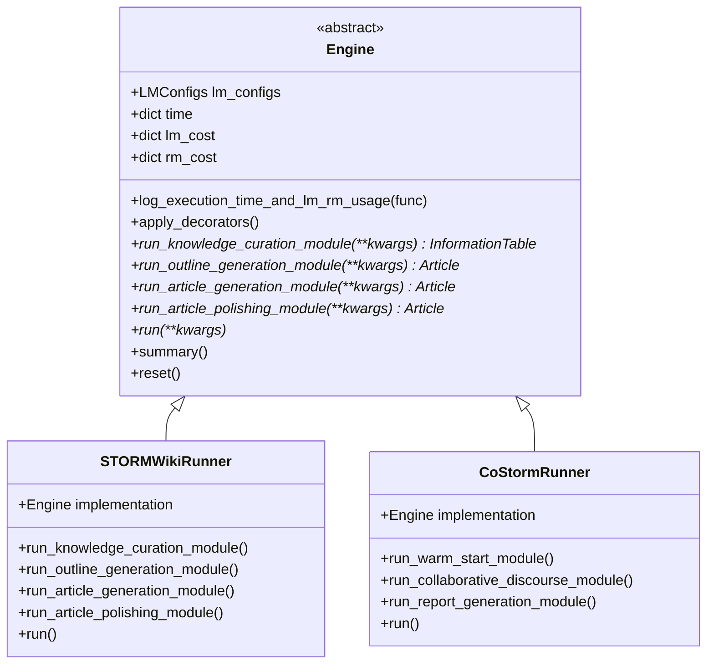
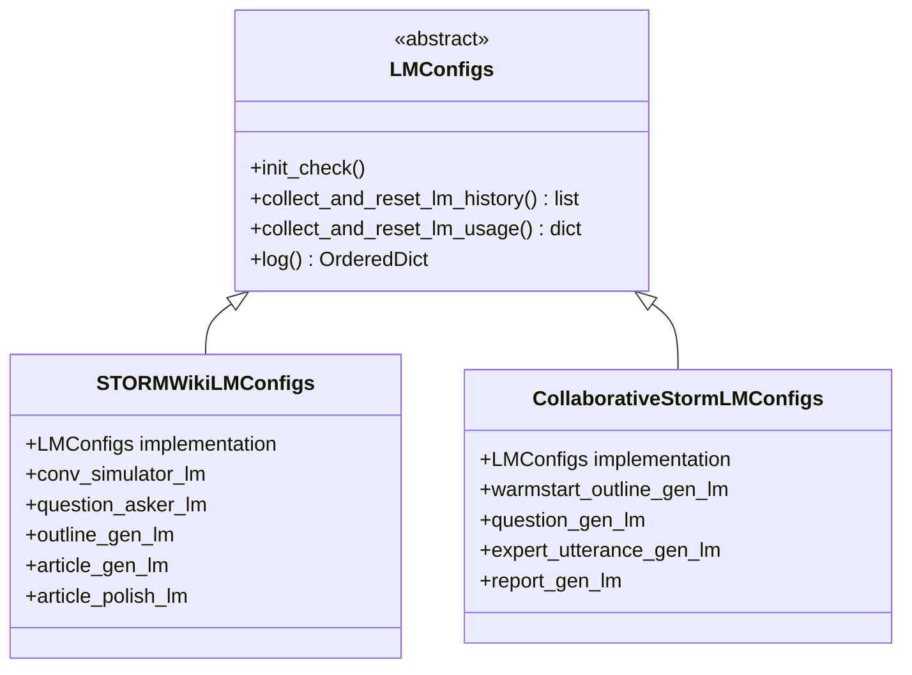
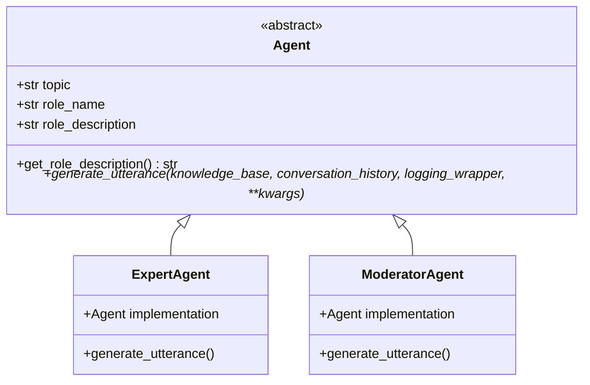

<!-- source: DeepWiki mcp.deepwiki.com · repo stanford-oval/storm · page 4.5 Abstract Interfaces · fetched 2026-10-27 -->

# Abstract Interfaces

Relevant source files

The following files were used as context for generating this wiki page:

- [knowledge_storm/interface.py](knowledge_storm/interface.py)

This document covers the abstract base classes and interfaces that define the modular architecture of the STORM knowledge curation system. These interfaces establish contracts for data structures, processing modules, and orchestration components that enable both STORM and Co-STORM systems to operate with pluggable implementations.

For information about concrete implementations of these interfaces in the STORM system, see [STORM Wiki Generation System](#2). For Co-STORM implementations, see [Co-STORM Collaborative System](#3).

## Interface Architecture Overview

The abstract interfaces in STORM are organized into three main categories: data structures for information representation, processing modules for pipeline stages, and orchestration classes for system coordination.

**Interface Hierarchy and Implementation Relationships**

Sources: [knowledge_storm/interface.py:1-609]()

## Core Data Structures

### Information and InformationTable

The `Information` class represents individual pieces of retrieved information with metadata, while `InformationTable` provides an abstract interface for storing and retrieving collections of information during knowledge curation.

**Information Class Structure and InformationTable Interface**

The `Information` class [knowledge_storm/interface.py:41-134]() includes URL-based identification, content snippets, and metadata tracking. The abstract `InformationTable` [knowledge_storm/interface.py:23-38]() requires implementations to provide a `retrieve_information` method for accessing stored information.

Sources: [knowledge_storm/interface.py:23-134]()

### Article Structure

The `Article` abstract base class defines a hierarchical document structure using `ArticleSectionNode` objects to represent sections and subsections.

**Article Hierarchical Structure**

The `ArticleSectionNode` [knowledge_storm/interface.py:136-160]() provides tree-like organization with parent-child relationships. The `Article` base class [knowledge_storm/interface.py:162-258]() includes methods for section navigation, outline generation, and serialization.

Sources: [knowledge_storm/interface.py:136-258]()

## Processing Module Interfaces

The processing pipeline is defined through four abstract module interfaces that correspond to the main stages of article generation.

**Processing Pipeline Interface Contracts**

### Knowledge Curation Interface

The `KnowledgeCurationModule` [knowledge_storm/interface.py:322-344]() defines the contract for information gathering:

| Method | Parameters | Return Type | Purpose |
|--------|------------|-------------|---------|
| `research` | `topic: str` | `InformationTable` | Curate information and knowledge for the given topic |

### Generation Module Interfaces

The remaining pipeline stages follow similar patterns:

| Interface | Key Method | Input Types | Output Type |
|-----------|------------|-------------|-------------|
| `OutlineGenerationModule` | `generate_outline` | `topic`, `information_table` | `Article` |
| `ArticleGenerationModule` | `generate_article` | `topic`, `information_table`, `article_with_outline` | `Article` |
| `ArticlePolishingModule` | `polish_article` | `topic`, `draft_article` | `Article` |

Sources: [knowledge_storm/interface.py:322-408]()

### Retriever Base Class

The `Retriever` class [knowledge_storm/interface.py:260-320]() provides a concrete base implementation for information retrieval with threading support and usage tracking.

**Retriever Implementation Pattern**  

Sources: [knowledge_storm/interface.py:260-320]()

## Orchestration Interfaces

### Engine Abstract Base Class

The `Engine` class [knowledge_storm/interface.py:485-563]() defines the main orchestration interface with execution tracking and cost monitoring.

**Engine Interface and Concrete Implementations**

The `Engine` interface includes automatic decoration of `run_*` methods [knowledge_storm/interface.py:512-523]() for execution time and resource usage logging.

Sources: [knowledge_storm/interface.py:485-563]()

### LMConfigs Abstract Base Class

The `LMConfigs` class [knowledge_storm/interface.py:427-483]() manages language model configurations with automatic usage tracking and validation.

**Language Model Configuration Management**

The convention requires language model attributes to end with `_lm` suffix [knowledge_storm/interface.py:438-441]() for automatic discovery and usage tracking.

Sources: [knowledge_storm/interface.py:427-483]()

## Agent Interface

The `Agent` abstract base class [knowledge_storm/interface.py:565-609]() defines the interface for conversational agents in collaborative systems.

**Agent Interface for Collaborative Discourse**

The `generate_utterance` method [knowledge_storm/interface.py:601-608]() takes a knowledge base, conversation history, and logging wrapper to produce contextual responses.

Sources: [knowledge_storm/interface.py:565-609]()

## Interface Implementation Patterns

### Logging and Monitoring Integration

The interfaces include built-in support for execution tracking and resource monitoring through decorators and usage collection methods.

| Interface | Monitoring Features |
|-----------|-------------------|
| `Engine` | Execution time, LM token usage, RM query counts |
| `LMConfigs` | Token usage tracking, model configuration logging |
| `Retriever` | Query count tracking, usage reset functionality |

### Extension Points

The abstract interfaces provide clear extension points for customization:

1. **Data Storage**: Implement `InformationTable` for custom information storage strategies
2. **Article Format**: Extend `Article` for different document structures  
3. **Processing Logic**: Implement pipeline modules for custom generation strategies
4. **Model Integration**: Extend `LMConfigs` for specialized model configurations
5. **Agent Behavior**: Implement `Agent` for custom conversational strategies

Sources: [knowledge_storm/interface.py:1-609]()

---

