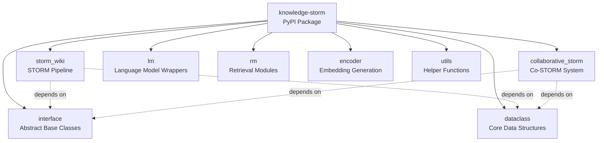
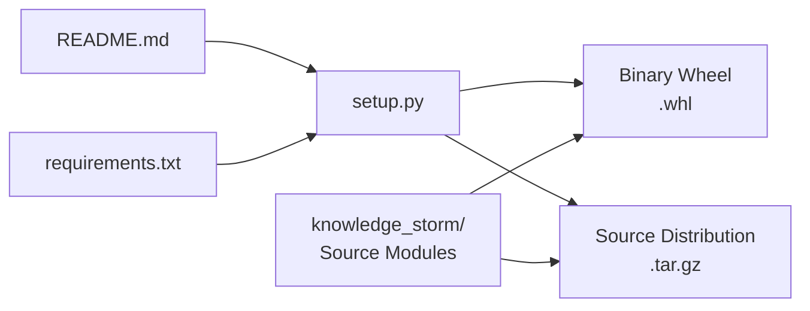
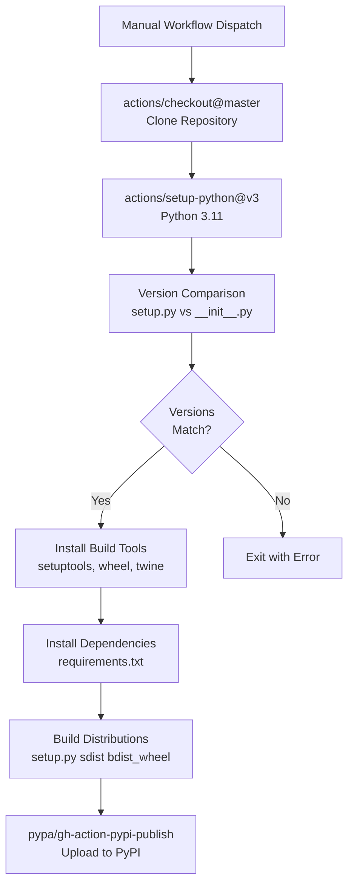

<!-- source: DeepWiki mcp.deepwiki.com · repo stanford-oval/storm · page 6 Package and Development · fetched 2026-10-27 -->

# Package and Development

<details>
<summary>Relevant source files</summary>

The following files were used as context for generating this wiki page:

- [.github/workflows/python-package.yml](.github/workflows/python-package.yml)
- [knowledge_storm/__init__.py](knowledge_storm/__init__.py)
- [setup.py](setup.py)

</details>


This page documents the package structure, distribution mechanism, CI/CD workflows, and development setup for the STORM repository. It covers how the `knowledge-storm` package is organized, versioned, and published to PyPI, as well as the automated workflows that ensure code quality and streamlined releases.

For information about using the package in your applications, see [Usage and Examples](#5). For information about the core infrastructure modules included in the package, see [Core Infrastructure](#4).

---

## Package Information

The STORM repository is distributed as a PyPI package named `knowledge-storm`. The package provides a modular architecture that exposes multiple sub-modules for different aspects of the knowledge curation system.

### Package Metadata

The package is configured in [setup.py:17-38]() with the following key information:

| Property | Value |
|----------|-------|
| Package Name | `knowledge-storm` |
| Version | `1.1.1` |
| Authors | Yijia Shao, Yucheng Jiang |
| License | MIT License |
| Python Requirement | `>=3.10` |
| Development Status | Alpha (3) |
| Repository | https://github.com/stanford-oval/storm |

The package description defines STORM as "a language model-powered knowledge curation engine" [setup.py:22]().

**Note**: There is a version mismatch between [setup.py:19]() (version `1.1.1`) and [knowledge_storm/__init__.py:10]() (version `1.1.0`). The CI/CD workflow is designed to catch such mismatches before publication [.github/workflows/python-package.yml:17-27]().

### Module Structure

The package exposes eight core sub-modules through [knowledge_storm/__init__.py:1-8]():



**Diagram 1: Package Module Structure**

The wildcard imports [knowledge_storm/__init__.py:1-8]() make all public classes and functions from these sub-modules available at the top level of the `knowledge_storm` namespace. This allows users to import directly:

```python
from knowledge_storm import STORMWikiRunner, CoStormRunner
```

**Sources**: [knowledge_storm/__init__.py:1-10](), [setup.py:17-38]()

---

## Distribution on PyPI

The package is configured for distribution through the Python Package Index (PyPI) using setuptools.

### Build Configuration

The [setup.py]() file configures the package build process:



**Diagram 2: Package Build Process**

The setup script performs the following operations:

1. **Read README**: Loads the long description from `README.md` and strips HTML paragraph tags [setup.py:6-10]()
2. **Load Dependencies**: Reads package dependencies from `requirements.txt` [setup.py:13-14]()
3. **Package Discovery**: Uses `find_packages()` to automatically discover all Python packages [setup.py:27]()
4. **Metadata Configuration**: Sets package classifiers including Python version support (3.10, 3.11) and development status [setup.py:28-35]()

### Installation

Users can install the package via pip:

```bash
pip install knowledge-storm
```

For development installation from source:

```bash
git clone https://github.com/stanford-oval/storm.git
cd storm
pip install -r requirements.txt
pip install -e .
```

**Sources**: [setup.py:1-38]()

---

## Dependencies

The package dependencies are managed through `requirements.txt` [setup.py:13-14](), which is loaded during the setup process and specified in the `install_requires` parameter [setup.py:37]().

### Dependency Categories

While the specific requirements file content is not shown, the codebase indicates dependencies in several categories:

| Category | Purpose | Example Components |
|----------|---------|-------------------|
| LLM Integration | Language model API access | `litellm` for 100+ LLM providers |
| Retrieval | Search and information retrieval | Search engine API clients, vector DB clients |
| Embeddings | Text embedding generation | Embedding model libraries |
| Web Processing | HTML parsing and text extraction | Web scraping utilities |
| Utilities | File I/O, caching, logging | Standard Python utilities |
| Frontend | Demo application | Streamlit framework |

The package requires Python 3.10 or higher [setup.py:36](), as specified in the `python_requires` parameter.

**Sources**: [setup.py:13-14](), [setup.py:36-37]()

---

## CI/CD Workflow

The repository uses GitHub Actions for continuous integration and deployment, configured in [.github/workflows/python-package.yml]().

### Workflow Overview



**Diagram 3: CI/CD Pipeline Flow**

### Workflow Stages

#### 1. Trigger
The workflow is manually triggered via GitHub's workflow dispatch mechanism [.github/workflows/python-package.yml:4](), providing control over when releases are published.

#### 2. Environment Setup
- Runs on Ubuntu latest [.github/workflows/python-package.yml:9]()
- Checks out the repository using `actions/checkout@master` [.github/workflows/python-package.yml:12]()
- Sets up Python 3.11 environment [.github/workflows/python-package.yml:13-16]()

#### 3. Version Validation
The workflow includes a critical version consistency check [.github/workflows/python-package.yml:17-27]():

```bash
VERSION_SETUP=$(grep -oP '(?<=version=\").*(?=\")' setup.py)
VERSION_INIT=$(grep -oP '(?<=__version__ = \").*(?=\")' knowledge_storm/__init__.py)
```

This extracts version strings from both files and compares them. If they don't match, the workflow exits with an error [.github/workflows/python-package.yml:23-26](). This prevents accidental publication with inconsistent version numbers.

#### 4. Build Dependencies
Installs required build tools [.github/workflows/python-package.yml:29]():
- `setuptools`: Package building
- `wheel`: Binary distribution format
- `twine`: PyPI upload utility

Also installs package dependencies from `requirements.txt` [.github/workflows/python-package.yml:32-33]().

#### 5. Package Build
Executes `python3 setup.py sdist bdist_wheel` [.github/workflows/python-package.yml:35]() to create:
- **Source distribution** (`sdist`): `.tar.gz` archive
- **Binary wheel** (`bdist_wheel`): `.whl` file for faster installation

#### 6. PyPI Publication
Uses the official PyPI publish action [.github/workflows/python-package.yml:36-40]() with token authentication from GitHub secrets. The `__token__` user with `PYPI_API_TOKEN` secret enables secure, automated publishing.

### Security Considerations

The workflow uses:
- **GitHub Secrets**: API token stored securely as `PYPI_API_TOKEN` [.github/workflows/python-package.yml:40]()
- **Official Actions**: Trusted GitHub and PyPA maintained actions
- **Manual Trigger**: Prevents accidental releases

**Sources**: [.github/workflows/python-package.yml:1-41]()

---

## Development Setup

### Local Development Installation

For contributors developing on the STORM codebase:

1. **Clone the repository**:
   ```bash
   git clone https://github.com/stanford-oval/storm.git
   cd storm
   ```

2. **Install in editable mode**:
   ```bash
   pip install -e .
   ```
   
   This installs the package in development mode, allowing code changes to be immediately reflected without reinstallation.

3. **Install dependencies**:
   ```bash
   pip install -r requirements.txt
   ```

### Version Management

When preparing a release, developers must update version numbers in **both** locations:
- [setup.py:19]() - The `version` parameter
- [knowledge_storm/__init__.py:10]() - The `__version__` variable

The CI/CD workflow enforces this consistency [.github/workflows/python-package.yml:17-27]().

### Package Structure Considerations

The package uses `find_packages()` [setup.py:27](), which automatically discovers Python packages (directories containing `__init__.py`). This means:
- New sub-modules should include an `__init__.py` file
- Sub-modules should be explicitly imported in the top-level [knowledge_storm/__init__.py]() if they need to be publicly accessible
- The directory structure under `knowledge_storm/` determines the import paths

### Publishing Workflow

To publish a new version:

1. Update version numbers in both files
2. Commit and push changes
3. Navigate to GitHub Actions
4. Manually trigger the "Build and upload Python package" workflow
5. The workflow validates versions, builds distributions, and publishes to PyPI

**Sources**: [setup.py:17-38](), [knowledge_storm/__init__.py:1-10](), [.github/workflows/python-package.yml:1-41]()

---

## Summary

The `knowledge-storm` package provides a well-structured, modular distribution of the STORM and Co-STORM systems. Key characteristics:

- **Modular Design**: Eight distinct sub-modules with clear separation of concerns
- **PyPI Distribution**: Standard Python packaging with setuptools
- **Automated Quality**: GitHub Actions workflow with version validation
- **MIT License**: Open source with permissive licensing
- **Python 3.10+**: Modern Python version requirement
- **Development-Friendly**: Editable installation support for contributors

The package structure enables users to import and use specific components as needed, while the CI/CD workflow ensures consistent, validated releases to PyPI.