# Page: Overview

# Overview

<details>
<summary>Relevant source files</summary>

The following files were used as context for generating this wiki page:

- [.github/workflows/python-package.yml](.github/workflows/python-package.yml)
- [README.md](README.md)
- [knowledge_storm/__init__.py](knowledge_storm/__init__.py)
- [knowledge_storm/lm.py](knowledge_storm/lm.py)
- [setup.py](setup.py)

</details>


This document provides a comprehensive overview of the STORM (Synthesis of Topic Outlines through Retrieval and Multi-perspective question asking) repository. STORM is a language model-powered system that generates Wikipedia-like articles from scratch using Internet search. The repository contains two distinct operational modes: **STORM** for automated article generation and **Co-STORM** for human-AI collaborative knowledge curation.

For detailed installation instructions and quick start guides, see [Installation and Setup](#1.1). For architecture details, see [System Architecture](#1.2). For STORM-specific implementation, see [STORM Wiki Generation System](#2). For Co-STORM implementation, see [Co-STORM Collaborative System](#3).

## What is STORM?

STORM is a multi-stage language model system that automates the research and writing process for long-form articles with citations. The system addresses the challenge of generating comprehensive, well-structured content by breaking the problem into two fundamental stages:

1. **Pre-writing stage**: Conducts Internet-based research to collect references and generates a hierarchical outline
2. **Writing stage**: Uses the outline and references to generate full-length articles with proper citations

The core innovation is **perspective-guided question asking**: instead of directly prompting language models to ask questions, STORM discovers different perspectives by surveying existing articles on similar topics and uses these perspectives to guide the question-asking process. Questions are asked through **simulated conversations** between a Wikipedia writer and a topic expert, both powered by language models, grounded in Internet sources.

Sources: [README.md:1-55]()

## What is Co-STORM?

Co-STORM extends STORM with a **collaborative discourse protocol** that enables human participation in the knowledge curation process. The system implements three types of agents:

- **Co-STORM LLM experts**: Generate answers grounded in external knowledge sources and raise follow-up questions
- **Moderator**: Generates thought-provoking questions inspired by retrieved information not yet discussed
- **Human user**: Can observe the discourse passively or actively engage by injecting utterances to steer the conversation

Co-STORM maintains a **dynamic mind map** (`KnowledgeBase`) that organizes collected information into a hierarchical concept structure. This shared conceptual space helps reduce cognitive load during long, in-depth conversations and enables the system to continuously reorganize information as the discourse progresses.

Sources: [README.md:56-70]()

## Core Package Structure

The STORM repository is distributed as the `knowledge-storm` package on PyPI (current version 1.1.1). The package exposes eight main modules:

| Module | Purpose | Key Classes |
|--------|---------|-------------|
| `storm_wiki` | STORM pipeline implementation | `STORMWikiRunner`, `STORMWikiRunnerArguments` |
| `collaborative_storm` | Co-STORM implementation | `CoStormRunner`, `RunnerArgument` |
| `interface` | Abstract base classes | `InformationTable`, `Article`, `Retriever`, `Module`, `Engine`, `Agent` |
| `lm` | Language model wrappers | `LitellmModel` (supports 100+ LLM providers) |
| `rm` | Retrieval module implementations | `YouRM`, `BingSearch`, `VectorRM`, etc. (11 total) |
| `encoder` | Text embedding generation | `Encoder` |
| `utils` | Helper functions | `ArticleTextProcessing`, `FileIOHelper`, `WebPageHelper` |
| `dataclass` | Core data structures | `Information`, `DialogueTurn`, `ConversationTurn` |

The package structure enables users to import only what they need while maintaining clear separation between abstract interfaces and concrete implementations.

Sources: [setup.py:17-38](), [knowledge_storm/__init__.py:1-10]()

## System Architecture: Code Entity View

The following diagram maps the natural language system description to actual code entities:

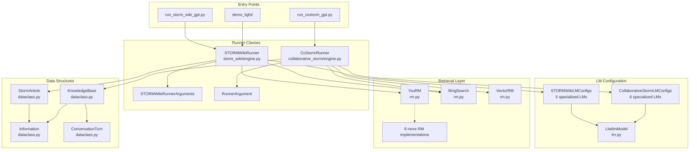

This architecture shows how user-facing entry points (example scripts and frontend) instantiate runner classes, which in turn coordinate language models, retrieval modules, and data structures.

Sources: [README.md:104-217](), [knowledge_storm/__init__.py:1-10]()

## STORM vs Co-STORM: Operational Paradigms

The repository implements two distinct operational paradigms that share infrastructure but differ fundamentally in execution:

### STORM: Linear 4-Stage Pipeline

```mermaid
graph LR
    Input["Topic String"] --> Stage1["Stage 1: Knowledge Curation<br/>StormKnowledgeCurationModule<br/>storm_wiki/modules/knowledge_curation.py"]
    Stage1 --> Stage2["Stage 2: Outline Generation<br/>StormOutlineGenerationModule<br/>storm_wiki/modules/outline_generation.py"]
    Stage2 --> Stage3["Stage 3: Article Generation<br/>StormArticleGenerationModule<br/>storm_wiki/modules/article_generation.py"]
    Stage3 --> Stage4["Stage 4: Article Polishing<br/>StormArticlePolishingModule<br/>storm_wiki/modules/article_polishing.py"]
    Stage4 --> Output["StormArticle"]
```

The STORM pipeline executes deterministically through four discrete stages:

1. **Knowledge Curation**: Simulates conversations between `ConvSimulator` (writer) and topic expert to collect information. Uses perspective-guided question asking to ensure breadth and depth.
2. **Outline Generation**: Organizes collected information into a hierarchical structure using the `StormInformationTable`.
3. **Article Generation**: Populates outline sections with content, section by section, using retrieved information.
4. **Article Polishing**: Adds lead section and optionally removes duplicate content.

Each stage completes fully before the next begins. Results are stored in `StormArticle` with proper citation management.

### Co-STORM: Iterative Collaborative Loop

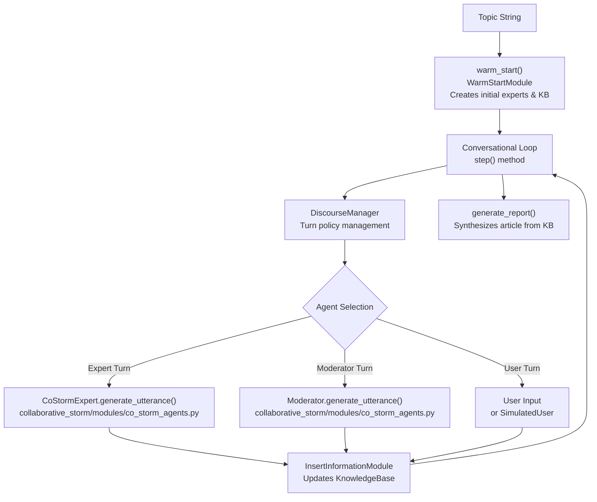

Co-STORM operates iteratively:

1. **Warm Start**: `warm_start()` initializes experts and creates initial `KnowledgeBase` structure
2. **Conversation Loop**: `step()` method repeatedly invokes agents based on turn policy
3. **Dynamic Knowledge Organization**: `KnowledgeBase` continuously reorganizes via `InsertInformationModule` and `ExpandNodeModule`
4. **Report Generation**: Final article synthesized from organized `KnowledgeBase`

The system uses `ConversationTurn` objects to track discourse history and supports both observation mode (user watches) and active mode (user participates).

Sources: [README.md:40-70](), [README.md:104-217]()

## Infrastructure Layer: Shared Components

Both STORM and Co-STORM rely on a common infrastructure layer that provides provider-agnostic access to external services:

### Language Model Integration

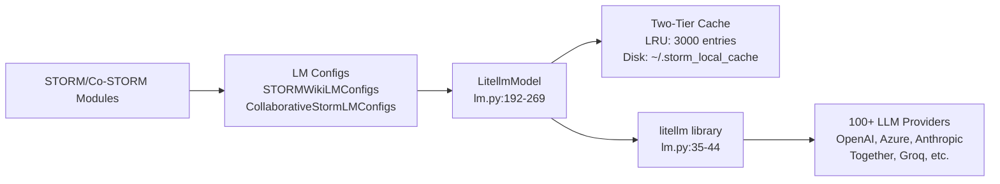

The `LitellmModel` class ([lm.py:192-269]()) wraps the `litellm` library to provide:

- **Universal LLM access**: Supports 100+ providers through a single interface
- **Two-tier caching**: LRU memory cache (3000 entries) plus disk cache to reduce API costs
- **Thread-safe token tracking**: `prompt_tokens` and `completion_tokens` counters with lock protection
- **Task-specific model assignment**: Different models can be assigned to different tasks (e.g., cheaper models for conversation, powerful models for generation)

The system configures multiple specialized language models per runner (5 for STORM, 6 for Co-STORM) to optimize cost-quality tradeoffs.

Sources: [knowledge_storm/lm.py:1-269](), [README.md:92-101]()

### Retrieval Module Layer

The repository provides 11 retrieval module implementations, all conforming to a unified interface:

| Retrieval Module | Type | Key Features |
|------------------|------|--------------|
| `YouRM` | Web Search | You.com search API integration |
| `BingSearch` | Web Search | Bing Search API with configurable results |
| `BraveRM` | Web Search | Brave Search engine |
| `SerperRM` | Web Search | Serper.dev API wrapper |
| `DuckDuckGoSearchRM` | Web Search | DuckDuckGo search |
| `TavilySearchRM` | Web Search | Tavily search API |
| `SearXNG` | Web Search | SearXNG meta-search |
| `GoogleSearch` | Web Search | Google Custom Search API |
| `VectorRM` | Vector Search | Qdrant vector database for custom documents |
| `AzureAISearch` | Specialized | Azure Cognitive Search |
| `StanfordOvalArxivRM` | Specialized | ArXiv paper search |

All retrieval modules implement the `retrieve(query: str, exclude_urls: list)` method and return `Information` objects with URL, snippets, and titles. The `VectorRM` uses the `Encoder` class for semantic similarity matching against user-provided documents.

Sources: [README.md:92-101](), [knowledge_storm/rm.py:1-50]() (note: full rm.py likely extends beyond shown lines)

## Data Flow and Transformation

### STORM Data Pipeline

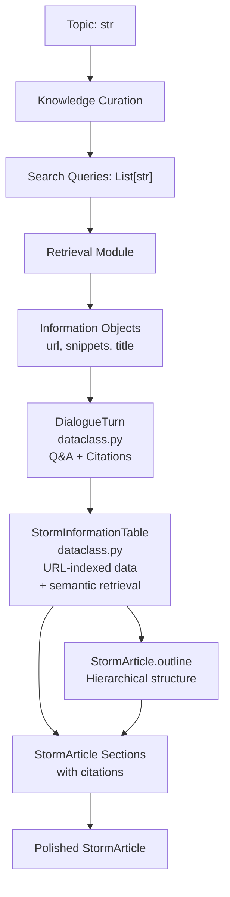

STORM transforms data through discrete stages:
1. Topic → Search queries via perspective-guided question asking
2. Queries → `Information` objects via retrieval module
3. `Information` → `DialogueTurn` objects (Q&A pairs with citations)
4. `DialogueTurn` → `StormInformationTable` (URL-indexed, supports semantic search)
5. `StormInformationTable` → `StormArticle` (outline + sections + citations)

### Co-STORM Data Flow

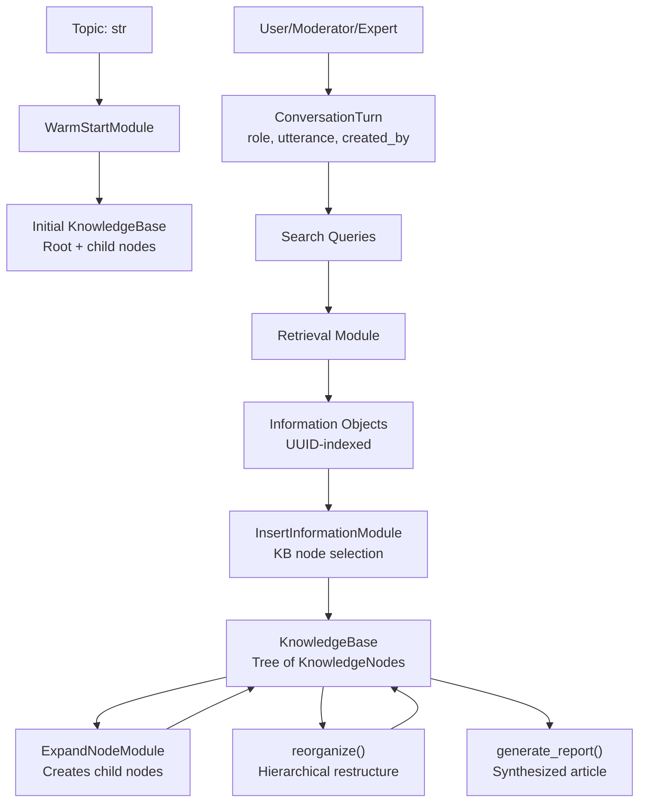

Co-STORM maintains dynamic data structures:
1. `ConversationTurn` objects capture each utterance with role and metadata
2. `Information` objects assigned UUIDs for citation tracking
3. `InsertInformationModule` maps information to appropriate `KnowledgeNode` in tree
4. `KnowledgeBase` continuously reorganizes as new information arrives
5. `ExpandNodeModule` creates child nodes when topics warrant deeper exploration
6. Final report generated by traversing organized knowledge tree

Sources: [README.md:1-70](), Diagram 4 from high-level overview

## Multi-LLM System Design

Both STORM and Co-STORM implement a **multi-LLM system paradigm** where different tasks are assigned to different language model instances:

### STORM Task Assignment (5 LMs)

| Configuration Method | Task | Rationale |
|---------------------|------|-----------|
| `set_conv_simulator_lm()` | Conversation simulation, query splitting | Cheaper/faster model acceptable |
| `set_question_asker_lm()` | Question generation | Cheaper/faster model acceptable |
| `set_outline_gen_lm()` | Outline structure creation | More powerful model needed |
| `set_article_gen_lm()` | Section writing with citations | Most powerful model needed |
| `set_article_polish_lm()` | Lead section and refinement | Powerful model needed |

### Co-STORM Task Assignment (6 LMs)

| Configuration Method | Task | Rationale |
|---------------------|------|-----------|
| `set_question_answering_lm()` | Expert utterance generation | Powerful model for quality responses |
| `set_discourse_manage_lm()` | Turn policy decisions | Moderate model for coordination |
| `set_utterance_polishing_lm()` | Utterance refinement | Powerful model for final output |
| `set_warmstart_outline_gen_lm()` | Initial KB structure | Moderate model |
| `set_question_asking_lm()` | Moderator questions | Moderate model |
| `set_knowledge_base_lm()` | KB operations (insert, expand) | Moderate model |

This design allows optimization for cost-quality tradeoffs: use cheaper models (e.g., `gpt-3.5-turbo`) for intermediate steps and more powerful models (e.g., `gpt-4o`) for user-facing outputs.

Sources: [README.md:104-217](), [knowledge_storm/lm.py:192-269]()

## Technology Stack Summary

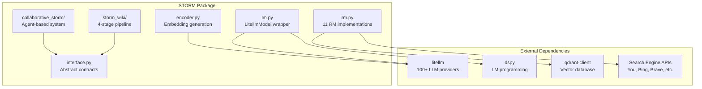

The repository is built on:
- **litellm**: Universal LLM provider interface supporting OpenAI, Azure, Anthropic, Together, Groq, and 100+ others
- **dspy**: Framework for language model programming with modular components
- **qdrant-client**: Vector database integration for semantic search over custom documents
- **Search APIs**: Direct integration with 8+ web search engines

The modular design with abstract interfaces ([interface.py]()) enables custom implementations of any component while maintaining compatibility with the rest of the system.

Sources: [README.md:72-101](), [requirements.txt]() (implied), [knowledge_storm/lm.py:1-44]()

## Usage Patterns

### STORM: Fully Automated Pipeline

```python
from knowledge_storm import STORMWikiRunnerArguments, STORMWikiRunner, STORMWikiLMConfigs
from knowledge_storm.lm import LitellmModel
from knowledge_storm.rm import YouRM

# Configure LMs
lm_configs = STORMWikiLMConfigs()
lm_configs.set_conv_simulator_lm(LitellmModel(model='gpt-3.5-turbo', ...))
lm_configs.set_article_gen_lm(LitellmModel(model='gpt-4o', ...))
# ... configure other LMs

# Initialize runner
engine_args = STORMWikiRunnerArguments(...)
rm = YouRM(ydc_api_key=..., k=engine_args.search_top_k)
runner = STORMWikiRunner(engine_args, lm_configs, rm)

# Execute pipeline
runner.run(
    topic="Quantum Computing",
    do_research=True,
    do_generate_outline=True,
    do_generate_article=True,
    do_polish_article=True
)
```

The `run()` method executes all stages sequentially. Boolean flags control which stages execute (useful for resuming from intermediate results).

### Co-STORM: Interactive Collaboration

```python
from knowledge_storm.collaborative_storm.engine import CoStormRunner, RunnerArgument
from knowledge_storm.lm import LitellmModel
from knowledge_storm.rm import BingSearch

# Configure runner
lm_config = CollaborativeStormLMConfigs()
# ... set 6 specialized LMs
runner_argument = RunnerArgument(topic="Climate Change", ...)
rm = BingSearch(bing_search_api_key=..., k=...)
costorm_runner = CoStormRunner(lm_config, runner_argument, rm)

# Warm start
costorm_runner.warm_start()

# Iterative discourse
for i in range(num_turns):
    # Observe mode: system generates next turn
    conv_turn = costorm_runner.step()
    
    # OR Active mode: user provides input
    # costorm_runner.step(user_utterance="Tell me more about...")

# Generate final report
costorm_runner.knowledge_base.reorganize()
article = costorm_runner.generate_report()
```

The `step()` method advances the conversation by one turn. Without arguments, agents generate utterances automatically. With `user_utterance`, the human steers the conversation.

Sources: [README.md:104-217]()

## Key Design Principles

1. **Abstraction through Interfaces**: [interface.py]() defines abstract contracts (`InformationTable`, `Article`, `Retriever`, `Module`, `Engine`, `Agent`) that enable custom implementations

2. **Provider Agnosticism**: The `LitellmModel` wrapper and multiple RM implementations allow switching between providers without code changes

3. **Modular Pipeline Design**: STORM's 4-stage pipeline and Co-STORM's agent system are composed of swappable modules

4. **Multi-LLM Optimization**: Different tasks assigned to different models optimize cost-quality tradeoffs

5. **Caching Strategy**: Two-tier LRU + disk caching reduces redundant API calls and costs

6. **Thread-Safe Operations**: Token tracking and concurrent operations protected by locks

7. **DSPy Integration**: Both systems leverage DSPy's language model programming paradigm for modular, declarative specifications

These principles enable the system to scale from research prototypes to production deployments while maintaining flexibility for customization.

Sources: [README.md:273-292](), [knowledge_storm/lm.py:115-123](), [knowledge_storm/interface.py:1-50]() (implied)

---

# Page: Installation and Setup

# Installation and Setup

<details>
<summary>Relevant source files</summary>

The following files were used as context for generating this wiki page:

- [.github/workflows/python-package.yml](.github/workflows/python-package.yml)
- [README.md](README.md)
- [knowledge_storm/__init__.py](knowledge_storm/__init__.py)
- [knowledge_storm/lm.py](knowledge_storm/lm.py)
- [setup.py](setup.py)

</details>


This page provides detailed instructions for installing and configuring the STORM system. It covers the prerequisites, installation methods, and configuration steps necessary to get both the STORM Wiki Generator and Co-STORM Collaborative system running. For details about the system architecture, see [Architecture Overview](#1.2).

## System Requirements

Before installing the STORM system, ensure your environment meets the following requirements:

- Python 3.10 or higher (3.11 recommended)
- Internet connection for downloading dependencies
- Sufficient disk space for the package and cached responses
- API keys for language models and search engines

Sources: [setup.py:36]()

## Installation Methods

The STORM system can be installed using one of two methods: as a Python package or from source code.

### Package Installation

The simplest and recommended method for most users is to install via pip:

```bash
pip install knowledge-storm
```

This installs the latest stable release (version 1.1.0 as of the latest update), which includes both the STORM Wiki Generator and Co-STORM Collaborative components.

Sources: [README.md:75-76](), [knowledge_storm/__init__.py:10](), [setup.py:17-19]()

### Source Code Installation

For development purposes or if you need to customize the codebase, install from source:

1. Clone the repository:
   ```bash
   git clone https://github.com/stanford-oval/storm.git
   cd storm
   ```

2. Create and activate a conda environment:
   ```bash
   conda create -n storm python=3.11
   conda activate storm
   ```

3. Install dependencies:
   ```bash
   pip install -r requirements.txt
   ```

Sources: [README.md:77-89]()

## Configuration Setup

The STORM system requires configuration of API keys for language models and retrieval modules. This section explains how to set up these configurations.

### API Keys and Secrets Configuration

The recommended approach is to create a `secrets.toml` file in the root directory of your project. This file should contain all your API keys and configuration settings:

```toml
# Language model configurations
OPENAI_API_KEY="your_openai_api_key"

# If using OpenAI's API service
OPENAI_API_TYPE="openai"

# If using Microsoft Azure's API service
OPENAI_API_TYPE="azure"
AZURE_API_BASE="your_azure_api_base_url"
AZURE_API_VERSION="your_azure_api_version"

# Retriever configurations
BING_SEARCH_API_KEY="your_bing_search_api_key"  # If using Bing search
YDC_API_KEY="your_you_api_key"  # If using You.com search

# Encoder configurations
ENCODER_API_TYPE="openai"  # If using OpenAI encoder
```

Sources: [README.md:224-240]()

### Supported Components

The following components can be configured in the STORM system:

#### Language Models
All models supported by litellm, including:
- OpenAI (GPT-3.5, GPT-4, GPT-4o)
- Azure OpenAI
- Anthropic (Claude models)
- Groq
- Ollama
- VLLM
- Other providers supported by litellm

#### Retrieval Modules
For searching and retrieving information:
- `YouRM` (You.com)
- `BingSearch` (Microsoft Bing)
- `VectorRM` (Qdrant vector database)
- `SerperRM` (Serper.dev)
- `BraveRM` (Brave Search)
- `SearXNG` (Self-hosted search)
- `DuckDuckGoSearchRM` (DuckDuckGo)
- `TavilySearchRM` (Tavily)
- `GoogleSearch` (Google)
- `AzureAISearch` (Azure AI Search)

#### Embedding Models
All embedding models supported by litellm for text embeddings used in vector search and knowledge organization.

Sources: [README.md:95-98]()

## Installation and Setup Workflow

The following diagram illustrates the complete installation and setup process:

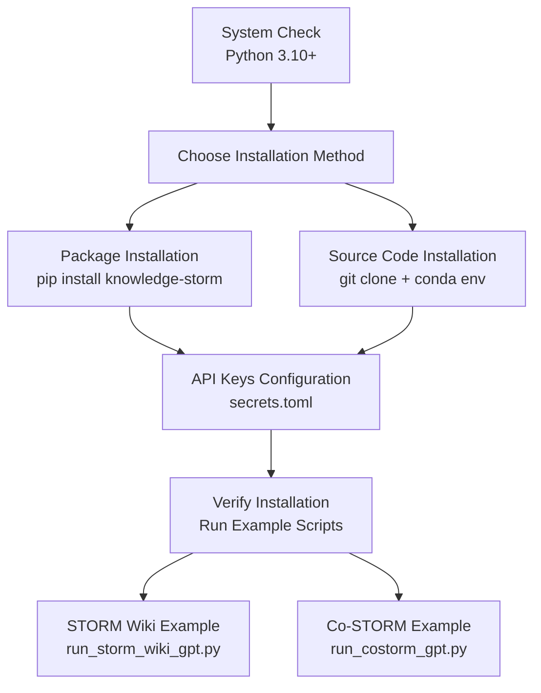

Sources: [README.md:72-89](), [README.md:220-270]()

## Configuration Components and Code Mapping

This diagram shows how the configuration in `secrets.toml` maps to the code components:

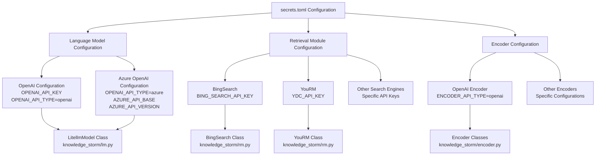

Sources: [README.md:95-98](), [README.md:224-240]()

## Quick Verification

After installation and configuration, verify your setup by running one of the example scripts provided in the repository.

### For STORM Wiki Generator:

```bash
python examples/storm_examples/run_storm_wiki_gpt.py \
    --output-dir ./output \
    --retriever bing \
    --do-research \
    --do-generate-outline \
    --do-generate-article \
    --do-polish-article
```

### For Co-STORM Collaborative System:

```bash
python examples/costorm_examples/run_costorm_gpt.py \
    --output-dir ./output \
    --retriever bing
```

If these scripts run successfully, your installation is properly set up and configured.

Sources: [README.md:244-270]()

## Package Architecture

This diagram illustrates the architecture of the installed package and its main components:

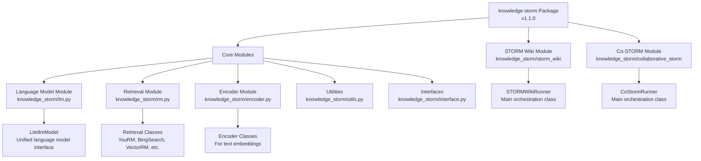

Sources: [knowledge_storm/__init__.py:1-9](), [README.md:92-100]()

## Basic Usage Examples

Once you've completed installation and configuration, you can use STORM in your Python code. Here are some basic examples:

### STORM Wiki Generator Example

```python
from knowledge_storm import STORMWikiRunnerArguments, STORMWikiRunner, STORMWikiLMConfigs
from knowledge_storm.lm import LitellmModel
from knowledge_storm.rm import BingSearch

# Configure language models
lm_configs = STORMWikiLMConfigs()
openai_kwargs = {
    'api_key': 'your_openai_api_key',
    'temperature': 1.0,
    'top_p': 0.9,
}
gpt_35 = LitellmModel(model='gpt-3.5-turbo', max_tokens=500, **openai_kwargs)
gpt_4 = LitellmModel(model='gpt-4o', max_tokens=3000, **openai_kwargs)

# Set different models for different components
lm_configs.set_conv_simulator_lm(gpt_35)
lm_configs.set_question_asker_lm(gpt_35)
lm_configs.set_outline_gen_lm(gpt_4)
lm_configs.set_article_gen_lm(gpt_4)
lm_configs.set_article_polish_lm(gpt_4)

# Configure arguments and retrieval module
engine_args = STORMWikiRunnerArguments(search_top_k=5)
rm = BingSearch(bing_search_api_key='your_bing_api_key', k=engine_args.search_top_k)

# Create and run the STORM Wiki Generator
runner = STORMWikiRunner(engine_args, lm_configs, rm)
runner.run(
    topic="Your topic here",
    do_research=True,
    do_generate_outline=True,
    do_generate_article=True,
    do_polish_article=True,
)
```

### Co-STORM Example

```python
from knowledge_storm.collaborative_storm.engine import CollaborativeStormLMConfigs, RunnerArgument, CoStormRunner
from knowledge_storm.lm import LitellmModel
from knowledge_storm.logging_wrapper import LoggingWrapper
from knowledge_storm.rm import BingSearch

# Configure language models
lm_config = CollaborativeStormLMConfigs()
openai_kwargs = {
    "api_key": "your_openai_api_key",
    "temperature": 1.0,
    "top_p": 0.9,
}
question_answering_lm = LitellmModel(model='gpt-4o', max_tokens=1000, **openai_kwargs)
discourse_manage_lm = LitellmModel(model='gpt-4o', max_tokens=500, **openai_kwargs)

# Set models for different components
lm_config.set_question_answering_lm(question_answering_lm)
lm_config.set_discourse_manage_lm(discourse_manage_lm)
# Additional model configurations...

# Configure arguments and retrieval module
runner_argument = RunnerArgument(topic="Your topic here", retrieve_top_k=5)
logging_wrapper = LoggingWrapper(lm_config)
bing_rm = BingSearch(bing_search_api_key='your_bing_api_key', k=runner_argument.retrieve_top_k)

# Create and run the Co-STORM system
costorm_runner = CoStormRunner(
    lm_config=lm_config,
    runner_argument=runner_argument,
    logging_wrapper=logging_wrapper,
    rm=bing_rm
)

# Initialize and start the collaborative process
costorm_runner.warm_start()
conv_turn = costorm_runner.step()  # Observe conversation
costorm_runner.step(user_utterance="Your question or comment")  # Interact with the system
```

Sources: [README.md:102-216]()

---

# Page: System Architecture

# Architecture Overview

<details>
<summary>Relevant source files</summary>

The following files were used as context for generating this wiki page:

- [README.md](README.md)
- [knowledge_storm/interface.py](knowledge_storm/interface.py)
- [knowledge_storm/lm.py](knowledge_storm/lm.py)
- [knowledge_storm/storm_wiki/engine.py](knowledge_storm/storm_wiki/engine.py)
- [knowledge_storm/utils.py](knowledge_storm/utils.py)

</details>


This document provides a comprehensive overview of the STORM repository's architecture, covering the modular design that supports both automated and collaborative knowledge curation systems. The architecture consists of two primary engines (`STORMWikiRunner` and `CoStormRunner`) built on shared infrastructure components including language models, retrieval modules, and abstract interfaces.

For specific implementation details of individual components, see [Core Components](#4). For usage examples and configuration, see [Examples and Usage](#5).

## Dual Engine System

The STORM repository implements two distinct but complementary knowledge curation engines that share common infrastructure while serving different use cases.

### Primary Engine Classes

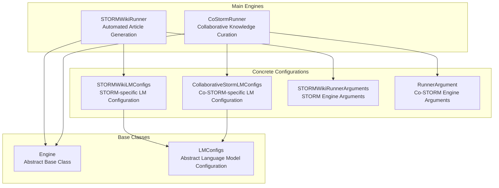

**STORM Engine Architecture**: `STORMWikiRunner` follows a sequential pipeline approach with four distinct phases: knowledge curation, outline generation, article generation, and article polishing. Each phase is implemented as a separate module with clearly defined interfaces.

**Co-STORM Engine Architecture**: `CoStormRunner` implements a collaborative discourse protocol supporting multi-agent interaction with human participants. It maintains a dynamic knowledge base structure and supports iterative conversation management.

Sources: [knowledge_storm/interface.py:485-563](), [README.md:104-216]()

## Shared Infrastructure Components

The architecture emphasizes modularity through shared infrastructure components that both engines utilize.

### Language Model Integration

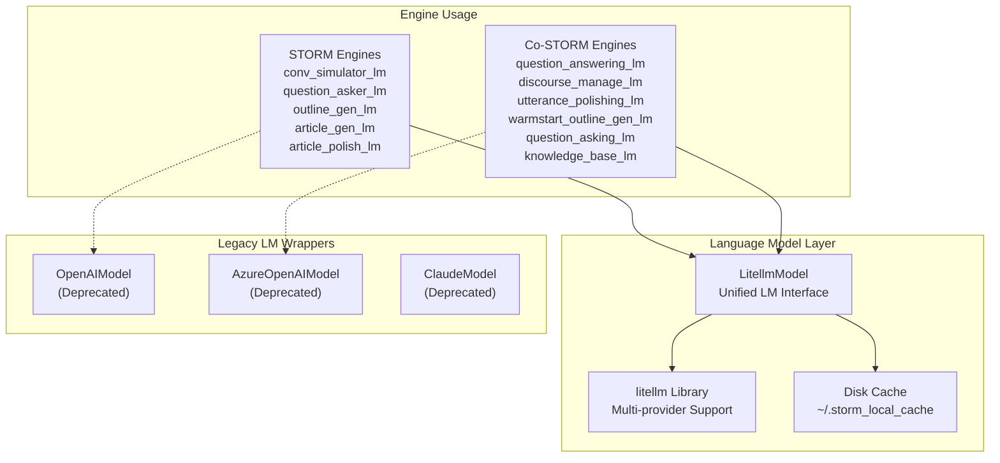

The `LitellmModel` class provides a unified interface supporting all language model providers listed in the litellm documentation. Both engines use specialized language model configurations with different models optimized for specific tasks.

Sources: [README.md:96-97](), [README.md:114-134](), [README.md:164-186]()

### Retrieval Module Architecture

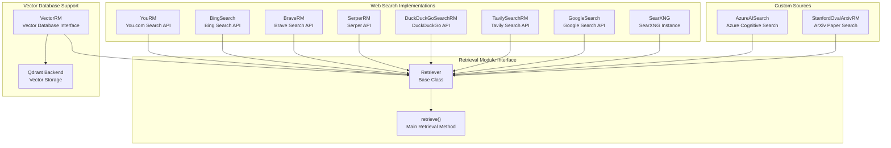

All retrieval modules implement the `Retriever` base class interface, enabling seamless switching between different search engines and vector databases. The `retrieve()` method returns a list of `Information` objects with standardized metadata.

Sources: [knowledge_storm/interface.py:260-320](), [README.md:98-100]()

## Abstract Interface System

The repository defines a comprehensive set of abstract interfaces that enable modularity and extensibility.

### Core Module Interfaces

| Interface Class | Purpose | Key Method | Implementations |
|-----------------|---------|------------|-----------------|
| `KnowledgeCurationModule` | Information gathering stage | `research()` | STORM conversation simulation, Co-STORM warm start |
| `OutlineGenerationModule` | Article structure generation | `generate_outline()` | STORM outline generation |
| `ArticleGenerationModule` | Content creation stage | `generate_article()` | STORM section-by-section writing |
| `ArticlePolishingModule` | Final refinement stage | `polish_article()` | STORM article polishing |

### Data Structure Interfaces

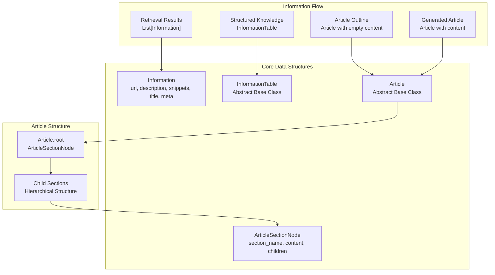

The `Information` class serves as the fundamental data unit, containing retrieved content with metadata. The `Article` class implements a hierarchical tree structure through `ArticleSectionNode` objects, supporting nested sections and content organization.

Sources: [knowledge_storm/interface.py:23-258](), [knowledge_storm/interface.py:322-408]()

## Agent System Architecture

Co-STORM implements a multi-agent architecture supporting collaborative discourse between AI agents and human participants.

### Agent Interface and Implementations

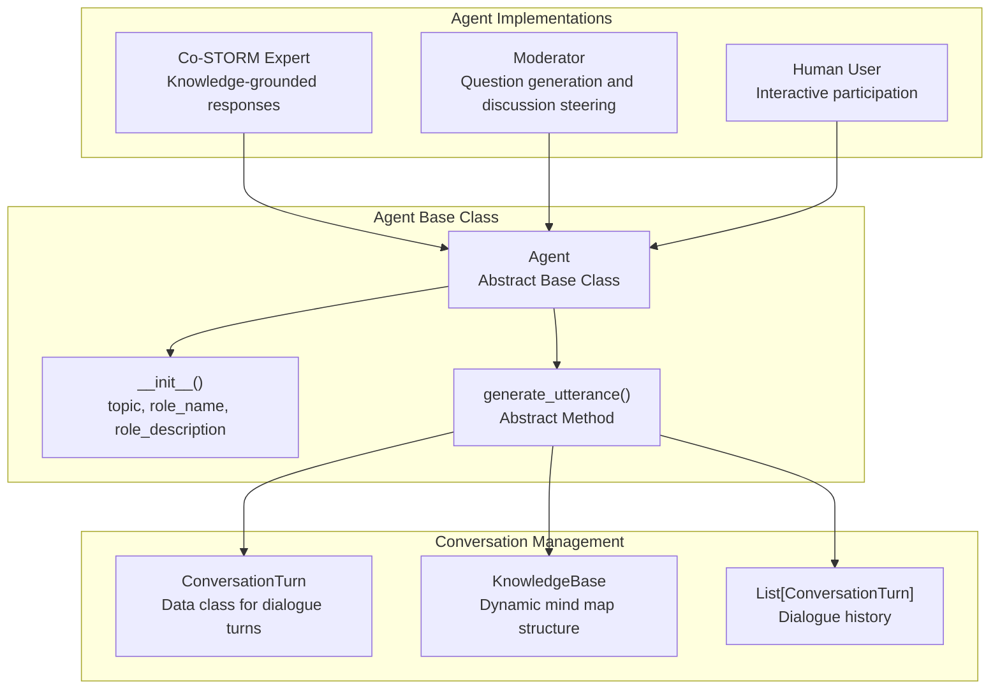

The `Agent` abstract base class defines the interface for all conversational participants in Co-STORM. Each agent implementation provides specialized utterance generation strategies based on their role and the current conversation context.

Sources: [knowledge_storm/interface.py:565-609]()

## Data Processing Pipeline

The system implements a structured data processing pipeline that transforms user topics into comprehensive articles through multiple stages.

### STORM Processing Flow

```mermaid
flowchart LR
    subgraph "Input Processing"
        UserTopic["User Topic<br/>String input"]
    end
    
    subgraph "Knowledge Curation"
        PersonaGeneration["Persona Generation<br/>Perspective discovery"]
        ConversationSimulation["Conversation Simulation<br/>Q&A dialogue"]
        InformationRetrieval["Information Retrieval<br/>Search API calls"]
        StormInformationTable["StormInformationTable<br/>Structured storage"]
    end
    
    subgraph "Content Generation"
        OutlineGeneration["Outline Generation<br/>Hierarchical structure"]
        SectionGeneration["Section Generation<br/>Content creation with citations"]
        ArticlePolishing["Article Polishing<br/>Summarization and refinement"]
    end
    
    subgraph "Output"
        FinalArticle["Final Article<br/>Wikipedia-style output"]
    end
    
    UserTopic --> PersonaGeneration
    PersonaGeneration --> ConversationSimulation
    ConversationSimulation --> InformationRetrieval
    InformationRetrieval --> StormInformationTable
    StormInformationTable --> OutlineGeneration
    OutlineGeneration --> SectionGeneration
    SectionGeneration --> ArticlePolishing
    ArticlePolishing --> FinalArticle
```

### Co-STORM Processing Flow

```mermaid
flowchart LR
    subgraph "Initialization"
        WarmStart["Warm Start<br/>Initial knowledge gathering"]
        InitialKnowledgeBase["Initial Knowledge Base<br/>Hierarchical mind map"]
    end
    
    subgraph "Collaborative Discourse"
        AgentUtterance["Agent Utterance<br/>Expert responses"]
        ModeratorQuestion["Moderator Question<br/>Discussion steering"]
        HumanInput["Human Input<br/>User participation"]
        KnowledgeBaseUpdate["Knowledge Base Update<br/>Dynamic reorganization"]
    end
    
    subgraph "Report Generation"
        ReportSynthesis["Report Synthesis<br/>Article generation from knowledge base"]
        CollaborativeArticle["Collaborative Article<br/>Final output"]
    end
    
    WarmStart --> InitialKnowledgeBase
    InitialKnowledgeBase --> AgentUtterance
    AgentUtterance --> ModeratorQuestion
    ModeratorQuestion --> HumanInput
    HumanInput --> KnowledgeBaseUpdate
    KnowledgeBaseUpdate --> AgentUtterance
    
    KnowledgeBaseUpdate --> ReportSynthesis
    ReportSynthesis --> CollaborativeArticle
```

The Co-STORM pipeline emphasizes iterative knowledge building through collaborative discourse, with the knowledge base continuously updated based on conversation turns.

Sources: [README.md:42-68](), [README.md:199-216]()

## Configuration and Extensibility

The architecture supports extensive configuration and customization through well-defined interfaces and configuration classes.

### Engine Configuration Structure

| Component | STORM Configuration | Co-STORM Configuration | Purpose |
|-----------|-------------------|----------------------|---------|
| Language Models | `STORMWikiLMConfigs` | `CollaborativeStormLMConfigs` | LM assignment for different tasks |
| Engine Arguments | `STORMWikiRunnerArguments` | `RunnerArgument` | Pipeline configuration parameters |
| Retrieval | `Retriever` implementations | `Retriever` implementations | External knowledge access |
| Logging | Built-in execution tracking | `LoggingWrapper` integration | Usage monitoring and debugging |

The modular design allows developers to customize individual components without affecting the overall architecture. Custom implementations can be created by extending the abstract base classes defined in `interface.py`.

Sources: [knowledge_storm/interface.py:427-483](), [README.md:273-292]()

---

# Page: STORM Wiki Generation System

# STORM Wiki Generation System

<details>
<summary>Relevant source files</summary>

The following files were used as context for generating this wiki page:

- [README.md](README.md)
- [knowledge_storm/lm.py](knowledge_storm/lm.py)
- [knowledge_storm/storm_wiki/engine.py](knowledge_storm/storm_wiki/engine.py)
- [knowledge_storm/utils.py](knowledge_storm/utils.py)

</details>


The STORM (Synthesis of Topic Outlines through Retrieval and Multi-perspective Question Asking) Wiki Generation System is a comprehensive framework for automatically generating Wikipedia-like articles from scratch using language models and information retrieval. This document describes the architecture, components, and workflows of the STORM Wiki Generation System. For information about the collaborative extension of STORM, see [Co-STORM Collaborative System](#3).

## System Architecture

STORM follows a modular pipeline architecture that breaks down article generation into four distinct stages:

1. **Knowledge Curation**: Collects information through perspective-guided questioning and simulated conversations
2. **Outline Generation**: Creates a structured outline based on the collected information
3. **Article Generation**: Generates content for each section with proper citations
4. **Article Polishing**: Refines the article by adding a lead section and optionally removing duplicated content

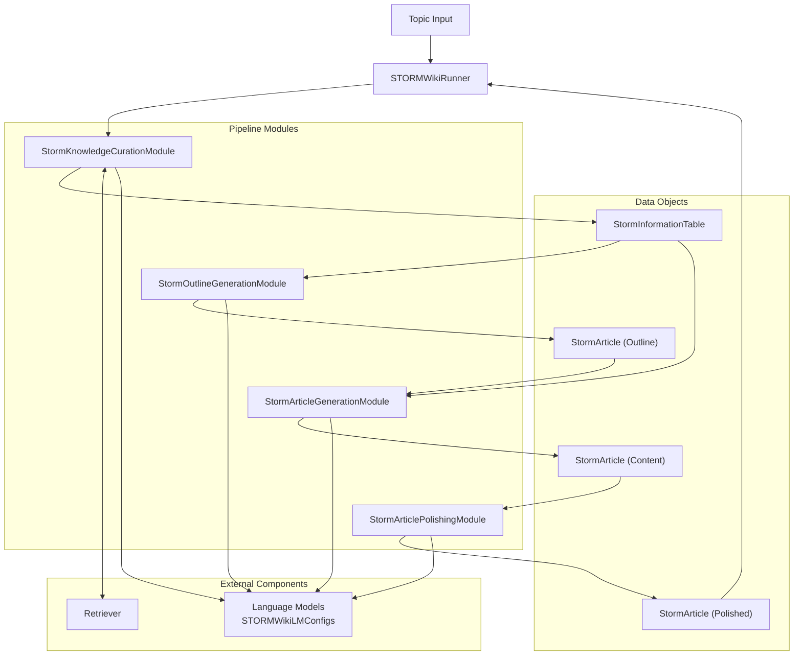

Sources: [knowledge_storm/storm_wiki/engine.py:171-441](), [README.md:40-55]()

## STORMWikiRunner

The `STORMWikiRunner` class orchestrates the entire article generation process by managing pipeline modules, configurations, and workflow execution.

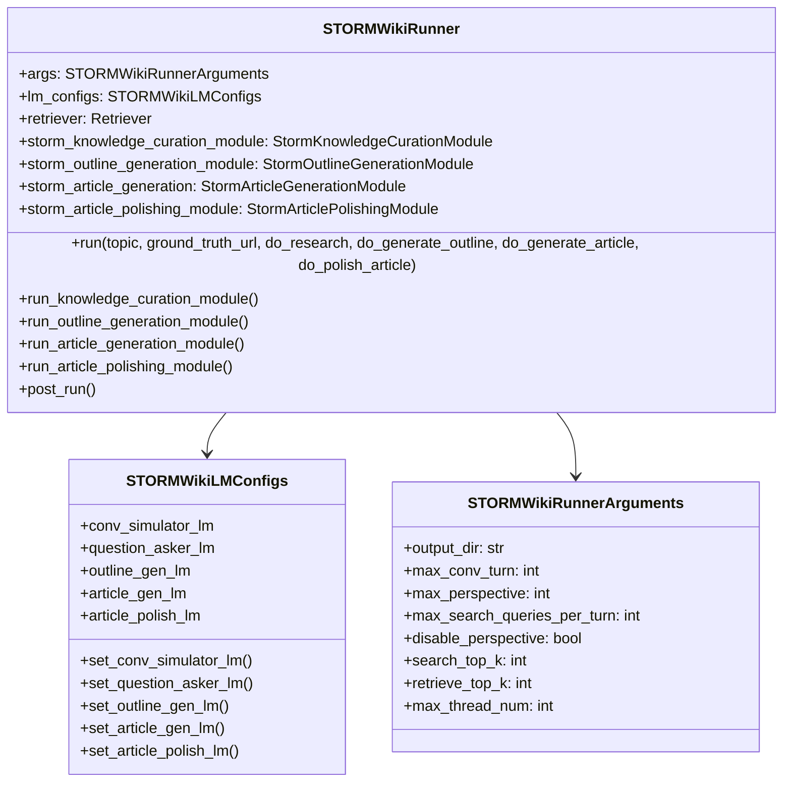

### Configuration and Initialization

The `STORMWikiRunner` is initialized with three main components:

1. **Arguments (`STORMWikiRunnerArguments`)**: Controls pipeline behavior such as maximum conversation turns, number of perspectives, and search parameters.
2. **Language Model Configurations (`STORMWikiLMConfigs`)**: Specifies which language models to use for different stages of the pipeline.
3. **Retrieval Module (`Retriever`)**: Handles information retrieval from external sources like search engines.

```python
# Example initialization
runner = STORMWikiRunner(engine_args, lm_configs, rm)
```

### Pipeline Execution

The `run()` method executes the entire article generation pipeline or specific stages based on the provided parameters:

```python
# Execute full pipeline
runner.run(
    topic="Quantum Computing",
    do_research=True,
    do_generate_outline=True,
    do_generate_article=True,
    do_polish_article=True
)
```

The pipeline allows for resuming from intermediate stages by setting earlier stages to `False` (the system will load previously generated data).

Sources: [knowledge_storm/storm_wiki/engine.py:174-311](), [README.md:106-147]()

## Knowledge Curation Pipeline

The Knowledge Curation module collects comprehensive information about a topic through perspective-guided question asking and simulated conversations between a Wikipedia writer and a topic expert.

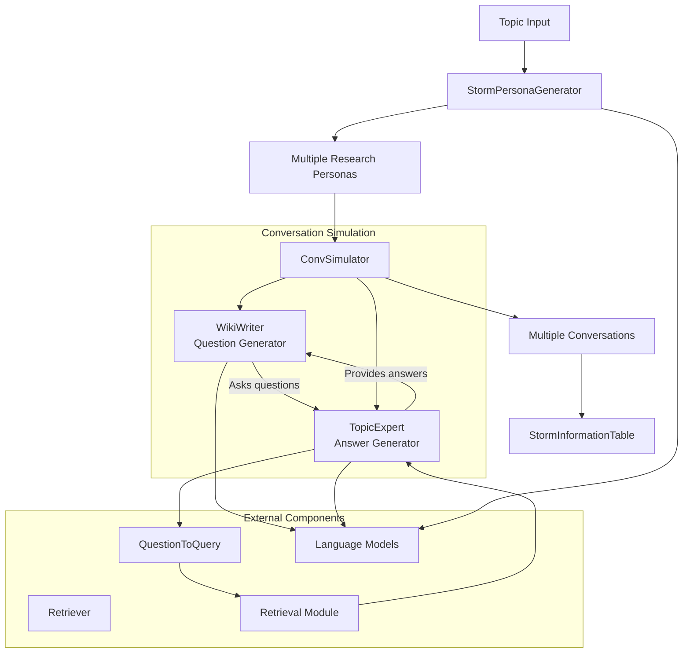

### Perspective-Guided Question Asking

To ensure comprehensive coverage of a topic, STORM first generates different research personas (perspectives) through `StormPersonaGenerator`:

1. The persona generator identifies related Wikipedia pages to inform perspective creation
2. Multiple personas are created (default is a basic fact-writer plus additional specialized perspectives)
3. Each persona guides the question-asking process in a different direction

### Simulated Conversations

For each persona, STORM simulates a conversation between:

1. **WikiWriter (`AskQuestion`, `AskQuestionWithPersona`)**: Creates questions based on the assigned persona
2. **TopicExpert (`TopicExpert`)**: Answers questions using information retrieved from search engines:
   - Converts questions to search queries
   - Retrieves information from external sources
   - Generates answers grounded in the retrieved information
   - Adds citations to reference the sources

### Information Organization

All conversations are processed and stored in a `StormInformationTable` that:
- Maintains a record of all dialogue turns
- Organizes information for later retrieval during article generation
- Preserves citation sources for proper attribution

Sources: [knowledge_storm/storm_wiki/modules/knowledge_curation.py:17-393](), [knowledge_storm/storm_wiki/modules/persona_generator.py:114-154](), [README.md:51-54]()

## Outline Generation

The Outline Generation module creates a structured outline for the article based on the information collected during the knowledge curation phase.

```mermaid
flowchart TD
    SIT["StormInformationTable"] --> SOGM["StormOutlineGenerationModule"]
    
    subgraph "Outline Generation Process"
        DG["Draft Outline Generation<br>WritePageOutline"]
        RG["Refined Outline Generation<br>WritePageOutlineFromConv"]
        DG --> DO["Draft Outline"]
        DO --> RG
        DLH["Dialogue History"] --> RG
        RG --> FO["Final Outline"]
    end
    
    SOGM --> DG
    SIT --> DLH
    FO --> Cleaning["Clean and Format<br>ArticleTextProcessing"]
    Cleaning --> SAO["StormArticle with Outline"]
```

The outline generation process follows these steps:

1. **Draft Outline Creation**: An initial outline is created directly from the LLM's knowledge of the topic using `WritePageOutline`
2. **Outline Refinement**: The draft outline is refined based on information from the simulated conversations using `WritePageOutlineFromConv`
3. **Cleaning and Formatting**: The outline is cleaned to ensure consistent formatting and remove unnecessary sections (like References)

The final outline follows a hierarchical Markdown structure with sections and subsections that will guide the article generation process.

Sources: [knowledge_storm/storm_wiki/modules/outline_generation.py:11-167](), [knowledge_storm/utils.py:456-503]()

## Article Generation

The Article Generation module transforms the outline and collected information into a coherent article with proper citations.

```mermaid
flowchart TD
    SAO["StormArticle with Outline"] --> SAGM["StormArticleGenerationModule"]
    SIT["StormInformationTable"] --> SAGM
    
    subgraph "Section Generation Process"
        SL["Extract Section List"]
        PG["Parallel Processing"]
        IR["Information Retrieval<br>Per Section"]
        CTS["ConvToSection<br>WriteSection"]
        SC["Section Content"]
        
        SL --> PG
        PG --> IR
        IR --> CTS
        CTS --> SC
    end
    
    SAGM --> SL
    SIT --> IR
    SC --> Assembly["Article Assembly"]
    Assembly --> SAC["Complete StormArticle<br>with Content"]
```

The article generation process involves:

1. **Section Extraction**: First-level sections are extracted from the outline
2. **Parallel Processing**: Multiple sections are generated concurrently using a thread pool
3. **Information Retrieval**: For each section, relevant information is retrieved from the `StormInformationTable`
4. **Section Writing**: The `ConvToSection` module generates content for each section using the `WriteSection` prompt
5. **Citation Management**: Citations are added inline to reference sources
6. **Article Assembly**: All sections are combined into a complete article

The module skips certain sections like "Introduction" (which will be created during polishing) and "Conclusion" (which is typically not included in Wikipedia articles).

Sources: [knowledge_storm/storm_wiki/modules/article_generation.py:15-176](), [README.md:284-282]()

## Article Polishing

The final stage refines the generated article to improve its quality and readability.

```mermaid
flowchart TD
    SA["StormArticle with Content"] --> SAPM["StormArticlePolishingModule"]
    
    subgraph "Polishing Process"
        PPM["PolishPageModule"]
        WLS["WriteLeadSection<br>Lead Generation"]
        PP["PolishPage<br>Duplicate Removal"]
        
        PPM --> WLS
        PPM --> PP
        WLS --> LS["Lead Section"]
        PP --> PC["Polished Content"]
    end
    
    SAPM --> PPM
    LS --> Combine["Combine Sections"]
    PC --> Combine
    Combine --> Post["Post-Processing"]
    Post --> FA["Final Polished StormArticle"]
```

The article polishing process includes:

1. **Lead Section Creation**: A concise overview (introduction) of the topic is generated using `WriteLeadSection`
2. **Duplicate Removal** (Optional): If enabled, the `PolishPage` module identifies and removes duplicate information
3. **Post-Processing**: Final cleanup to ensure proper citation formatting and section organization

The lead section serves as a summary of the article, providing readers with a quick overview of the topic before diving into the detailed sections.

Sources: [knowledge_storm/storm_wiki/modules/article_polish.py:11-102]()

## Language Model Configuration

STORM uses different language models for different tasks to balance quality and efficiency through the `STORMWikiLMConfigs` class.

```mermaid
flowchart TD
    SWLC["STORMWikiLMConfigs"]
    
    SWLC --> CSL["conv_simulator_lm<br>Conversation Simulation"]
    SWLC --> QAL["question_asker_lm<br>Question Generation"]
    SWLC --> OGL["outline_gen_lm<br>Outline Creation"]
    SWLC --> AGL["article_gen_lm<br>Content Generation"]
    SWLC --> APL["article_polish_lm<br>Article Refinement"]
    
    subgraph "Language Model Integration"
        LMI["LitellmModel Interface"]
        OpenAI["OpenAI Models"]
        Azure["Azure OpenAI Models"]
        Other["Other LLM Providers"]
        
        LMI --> OpenAI
        LMI --> Azure
        LMI --> Other
    end
    
    CSL --> LMI
    QAL --> LMI
    OGL --> LMI
    AGL --> LMI
    APL --> LMI
```

The language model configuration system allows:

1. **Task-Specific Models**: Different models for different pipeline stages (e.g., cheaper models for simpler tasks, more powerful models for content generation)
2. **Provider Flexibility**: Support for various LLM providers through the `LitellmModel` interface
3. **Parameter Customization**: Adjust temperature, top-p, and other parameters per task

Example configuration:

```python
lm_configs = STORMWikiLMConfigs()
gpt_35 = LitellmModel(model='gpt-3.5-turbo', max_tokens=500, **openai_kwargs)
gpt_4 = LitellmModel(model='gpt-4o', max_tokens=3000, **openai_kwargs)
lm_configs.set_conv_simulator_lm(gpt_35)
lm_configs.set_question_asker_lm(gpt_35)
lm_configs.set_outline_gen_lm(gpt_4)
lm_configs.set_article_gen_lm(gpt_4)
lm_configs.set_article_polish_lm(gpt_4)
```

Sources: [knowledge_storm/storm_wiki/engine.py:21-124](), [README.md:113-128]()

## Data Structures

STORM uses several key data structures to represent and manage information throughout the pipeline:

### StormInformationTable

Stores and organizes information collected during the knowledge curation phase:
- Maintains a record of all conversations with different personas
- Indexes information for efficient retrieval during article generation
- Preserves citation sources for proper attribution

### StormArticle

Represents the article at various stages (outline, draft, final):
- Stores hierarchical section structure
- Manages content for each section
- Handles references and citations
- Provides methods for serialization and deserialization

### DialogueTurn

Represents a single turn in the simulated conversations:
- User utterance (question from WikiWriter)
- Agent utterance (answer from TopicExpert)
- Search queries used to find information
- Search results retrieved from external sources

Sources: [knowledge_storm/storm_wiki/modules/storm_dataclass.py]()

## Integration with External Components

STORM integrates with several external components through well-defined interfaces:

### Retrieval Module

The `Retriever` class provides a unified interface to various search engines and information sources:
- Handles query formulation and execution
- Filters unreliable sources based on Wikipedia standards
- Normalizes search results for consistent processing

```python
# Example retrieval integration
rm = YouRM(ydc_api_key=os.getenv('YDC_API_KEY'), k=engine_args.search_top_k)
retriever = Retriever(rm=rm, max_thread=engine_args.max_thread_num)
```

### Language Model Integration

The language model integration leverages the `LitellmModel` class to provide a unified interface to various LLM providers:
- Supports OpenAI, Azure, and other providers
- Handles token limitations and response parsing
- Provides caching for efficiency

Sources: [knowledge_storm/storm_wiki/modules/retriever.py:1-233](), [knowledge_storm/lm.py](), [README.md:95-101]()

## Summary

The STORM Wiki Generation System implements a comprehensive pipeline for generating Wikipedia-like articles by breaking down the process into distinct stages that mirror human research and writing. By combining perspective-guided question asking, structured information organization, and quality-focused content generation, STORM produces well-sourced articles on a wide range of topics.

The modular architecture allows for customization of individual components, while the unified interfaces for language models and retrieval systems provide flexibility in deployment. The result is a powerful system that can automatically produce informative, well-structured articles with proper citations.

Sources: [README.md:40-55](), [README.md:282-286]()

---

# Page: STORMWikiRunner

# STORMWikiRunner

<details>
<summary>Relevant source files</summary>

The following files were used as context for generating this wiki page:

- [README.md](README.md)
- [knowledge_storm/lm.py](knowledge_storm/lm.py)
- [knowledge_storm/storm_wiki/engine.py](knowledge_storm/storm_wiki/engine.py)
- [knowledge_storm/utils.py](knowledge_storm/utils.py)

</details>


**STORMWikiRunner** is the main orchestration engine for the STORM (Synthesis of Topic Outlines through Retrieval and Multi-perspective question asking) pipeline. It implements a 4-stage automated process for generating Wikipedia-like articles from scratch using perspective-guided question asking and internet search. This is the non-collaborative variant of the system; for the collaborative variant, see [CoStormRunner](#3.1).

**Sources:** [knowledge_storm/storm_wiki/engine.py:171-442]()

---

## Overview

STORMWikiRunner coordinates four sequential modules to transform a topic string into a comprehensive article:

1. **Knowledge Curation** - Collects information through simulated conversations
2. **Outline Generation** - Organizes information into a hierarchical structure  
3. **Article Generation** - Populates the outline with citations
4. **Article Polishing** - Adds lead section and refines the article

The runner manages state persistence, allowing each stage to be executed independently or skipped if intermediate results exist. All LLM calls, retrieved information, and generated artifacts are logged for reproducibility.

**Sources:** [knowledge_storm/storm_wiki/engine.py:171-210](), [README.md:42-54]()

---

## Configuration Classes

### STORMWikiLMConfigs

`STORMWikiLMConfigs` specifies five separate language model configurations optimized for different complexity levels in the pipeline:

| LM Configuration | Purpose | Typical Model | Max Tokens |
|-----------------|---------|---------------|------------|
| `conv_simulator_lm` | Simulates conversation responses, synthesizes answers | GPT-4o-mini | 500 |
| `question_asker_lm` | Generates follow-up questions | GPT-4o-mini | 500 |
| `outline_gen_lm` | Creates hierarchical outlines | GPT-4 | 400 |
| `article_gen_lm` | Writes article sections with citations | GPT-4o | 700 |
| `article_polish_lm` | Polishes article, adds lead section | GPT-4o | 4000 |

```python
lm_configs = STORMWikiLMConfigs()
lm_configs.set_conv_simulator_lm(LitellmModel(model='gpt-4o-mini', ...))
lm_configs.set_question_asker_lm(LitellmModel(model='gpt-4o-mini', ...))
lm_configs.set_outline_gen_lm(LitellmModel(model='gpt-4o', ...))
lm_configs.set_article_gen_lm(LitellmModel(model='gpt-4o', ...))
lm_configs.set_article_polish_lm(LitellmModel(model='gpt-4o', ...))
```

The class provides `init_openai_model()` for legacy compatibility with the NAACL'24 paper setup, but the setter methods allow full customization with any LiteLLM-supported model.

**Sources:** [knowledge_storm/storm_wiki/engine.py:21-125]()

---

### STORMWikiRunnerArguments

`STORMWikiRunnerArguments` is a dataclass controlling pipeline behavior:

| Parameter | Default | Description |
|-----------|---------|-------------|
| `output_dir` | (required) | Directory for all output artifacts |
| `max_conv_turn` | 3 | Maximum questions per simulated conversation |
| `max_perspective` | 3 | Number of perspectives for question asking |
| `max_search_queries_per_turn` | 3 | Search queries generated per conversation turn |
| `disable_perspective` | False | Disable perspective-guided question asking |
| `search_top_k` | 3 | Top-k search results per query |
| `retrieve_top_k` | 3 | Top-k references retrieved per section |
| `max_thread_num` | 10 | Maximum concurrent threads for LM/retrieval calls |

**Sources:** [knowledge_storm/storm_wiki/engine.py:127-169]()

---

## Initialization and Architecture

### Component Structure

```mermaid
graph TB
    subgraph STORMWikiRunner["STORMWikiRunner"]
        Args["STORMWikiRunnerArguments<br/>Pipeline parameters"]
        LMConfigs["STORMWikiLMConfigs<br/>5 LM instances"]
        Retriever["Retriever<br/>Wraps rm with threading"]
    end
    
    subgraph Modules["Pipeline Modules"]
        PersonaGen["StormPersonaGenerator<br/>Generates perspectives"]
        KnowCur["StormKnowledgeCurationModule<br/>Information collection"]
        OutlineGen["StormOutlineGenerationModule<br/>Outline creation"]
        ArticleGen["StormArticleGenerationModule<br/>Section writing"]
        ArticlePol["StormArticlePolishingModule<br/>Article refinement"]
    end
    
    subgraph DataStructures["Data Structures"]
        InfoTable["StormInformationTable<br/>URL-indexed information"]
        Article["StormArticle<br/>Outline + content + citations"]
    end
    
    Args --> STORMWikiRunner
    LMConfigs --> STORMWikiRunner
    Retriever --> STORMWikiRunner
    
    STORMWikiRunner --> PersonaGen
    STORMWikiRunner --> KnowCur
    STORMWikiRunner --> OutlineGen
    STORMWikiRunner --> ArticleGen
    STORMWikiRunner --> ArticlePol
    
    KnowCur --> InfoTable
    OutlineGen --> Article
    ArticleGen --> Article
    ArticlePol --> Article
    
    PersonaGen --> KnowCur
    Retriever --> KnowCur
    LMConfigs --> KnowCur
    LMConfigs --> OutlineGen
    LMConfigs --> ArticleGen
    LMConfigs --> ArticlePol
```

**Component Initialization in `__init__()`**

```mermaid
graph LR
    Init["STORMWikiRunner.__init__"] --> CreateRetriever["Create Retriever<br/>with rm and max_thread"]
    CreateRetriever --> CreatePersona["Create StormPersonaGenerator<br/>with question_asker_lm"]
    CreatePersona --> CreateKnowCur["Create StormKnowledgeCurationModule<br/>with retriever, persona_generator, LMs"]
    CreateKnowCur --> CreateOutline["Create StormOutlineGenerationModule<br/>with outline_gen_lm"]
    CreateOutline --> CreateArticle["Create StormArticleGenerationModule<br/>with article_gen_lm, retrieve_top_k"]
    CreateArticle --> CreatePolish["Create StormArticlePolishingModule<br/>with article_gen_lm, article_polish_lm"]
    CreatePolish --> InitCheck["lm_configs.init_check()"]
    InitCheck --> ApplyDecorators["apply_decorators()"]
```

**Sources:** [knowledge_storm/storm_wiki/engine.py:174-210]()

---

## Execution Flow

### The `run()` Method

The `run()` method is the main entry point that orchestrates the 4-stage pipeline with optional stage skipping:

```python
runner.run(
    topic="Topic name",
    ground_truth_url="",  # Optional: URL to exclude from search
    do_research=True,
    do_generate_outline=True,
    do_generate_article=True,
    do_polish_article=True,
    remove_duplicate=False,
    callback_handler=BaseCallbackHandler()
)
```

**Pipeline Flow Diagram**

```mermaid
graph TB
    Start["run(topic, ...)"] --> SetupDir["Setup output directory:<br/>output_dir/topic_name/"]
    
    SetupDir --> CheckResearch{do_research?}
    CheckResearch -->|True| RunResearch["run_knowledge_curation_module()<br/>→ StormInformationTable"]
    CheckResearch -->|False| SkipResearch["Skip research"]
    
    RunResearch --> SaveResearch["Save:<br/>conversation_log.json<br/>raw_search_results.json"]
    SkipResearch --> SaveResearch
    
    SaveResearch --> CheckOutline{do_generate_outline?}
    CheckOutline -->|True| LoadInfo1["Load StormInformationTable<br/>if not in memory"]
    CheckOutline -->|False| SkipOutline["Skip outline"]
    
    LoadInfo1 --> RunOutline["run_outline_generation_module()<br/>→ StormArticle with outline"]
    RunOutline --> SaveOutline["Save:<br/>storm_gen_outline.txt<br/>direct_gen_outline.txt"]
    SkipOutline --> SaveOutline
    
    SaveOutline --> CheckArticle{do_generate_article?}
    CheckArticle -->|True| LoadInfo2["Load StormInformationTable<br/>and outline if not in memory"]
    CheckArticle -->|False| SkipArticle["Skip article"]
    
    LoadInfo2 --> RunArticle["run_article_generation_module()<br/>→ StormArticle with content"]
    RunArticle --> SaveArticle["Save:<br/>storm_gen_article.txt<br/>url_to_info.json"]
    SkipArticle --> SaveArticle
    
    SaveArticle --> CheckPolish{do_polish_article?}
    CheckPolish -->|True| LoadArticle["Load draft article<br/>if not in memory"]
    CheckPolish -->|False| End["End"]
    
    LoadArticle --> RunPolish["run_article_polishing_module()<br/>→ Polished StormArticle"]
    RunPolish --> SavePolish["Save:<br/>storm_gen_article_polished.txt"]
    SavePolish --> End
```

**Key behavior:**
- Each stage checks if its input is already in memory; if not, loads from filesystem
- Stages can be independently skipped by setting `do_*=False`
- Output directory is created based on sanitized topic name
- All intermediate results are persisted to disk

**Sources:** [knowledge_storm/storm_wiki/engine.py:341-442]()

---

## Module Execution Methods

### Knowledge Curation Stage

**Method:** `run_knowledge_curation_module(ground_truth_url, callback_handler)`

```mermaid
graph LR
    Input["topic (from self.topic)"] --> Research["storm_knowledge_curation_module.research()"]
    Research --> Output1["StormInformationTable<br/>(URL-indexed information)"]
    Research --> Output2["conversation_log<br/>(list of DialogueTurn)"]
    Output1 --> Save1["raw_search_results.json"]
    Output2 --> Save2["conversation_log.json"]
```

This stage generates perspectives, simulates expert-writer conversations, and collects information from search engines. The `ground_truth_url` parameter allows excluding a specific URL from search results (useful for evaluation against existing articles).

**Sources:** [knowledge_storm/storm_wiki/engine.py:211-235]()

---

### Outline Generation Stage

**Method:** `run_outline_generation_module(information_table, callback_handler)`

```mermaid
graph LR
    InfoTable["StormInformationTable"] --> Generate["storm_outline_generation_module.generate_outline()"]
    Generate --> Outline["StormArticle<br/>(with hierarchical outline)"]
    Generate --> DraftOutline["draft_outline<br/>(direct generation baseline)"]
    Outline --> Save1["storm_gen_outline.txt"]
    DraftOutline --> Save2["direct_gen_outline.txt"]
```

Generates a hierarchical outline using the collected information. Also produces a "direct generation" outline (without the research stage) for comparison purposes.

**Sources:** [knowledge_storm/storm_wiki/engine.py:237-254]()

---

### Article Generation Stage

**Method:** `run_article_generation_module(outline, information_table, callback_handler)`

```mermaid
graph LR
    Outline["StormArticle<br/>(outline)"] --> Generate["storm_article_generation.generate_article()"]
    InfoTable["StormInformationTable"] --> Generate
    Generate --> DraftArticle["StormArticle<br/>(with content + citations)"]
    DraftArticle --> Save1["storm_gen_article.txt"]
    DraftArticle --> Save2["url_to_info.json<br/>(reference details)"]
```

Populates each section in the outline with content, grounded in the collected information with proper citations.

**Sources:** [knowledge_storm/storm_wiki/engine.py:256-274]()

---

### Article Polishing Stage

**Method:** `run_article_polishing_module(draft_article, remove_duplicate)`

```mermaid
graph LR
    DraftArticle["StormArticle<br/>(draft)"] --> Polish["storm_article_polishing_module.polish_article()"]
    RemoveDup["remove_duplicate flag"] --> Polish
    Polish --> PolishedArticle["StormArticle<br/>(polished)"]
    PolishedArticle --> Save["storm_gen_article_polished.txt"]
```

Adds a summarization lead section and optionally removes duplicate content across sections.

**Sources:** [knowledge_storm/storm_wiki/engine.py:276-288]()

---

## File System Artifacts

Each execution creates a topic-specific directory under `output_dir` with the following structure:

```
output_dir/
└── topic_name/
    ├── conversation_log.json          # Stage 1: Simulated conversations
    ├── raw_search_results.json        # Stage 1: Retrieved information
    ├── storm_gen_outline.txt          # Stage 2: Generated outline
    ├── direct_gen_outline.txt         # Stage 2: Baseline outline
    ├── storm_gen_article.txt          # Stage 3: Draft article
    ├── url_to_info.json               # Stage 3: Reference metadata
    ├── storm_gen_article_polished.txt # Stage 4: Final article
    ├── run_config.json                # Post-run: LM configurations
    └── llm_call_history.jsonl         # Post-run: All LLM calls
```

### Artifact Details

| File | Content | Stage |
|------|---------|-------|
| `conversation_log.json` | List of `DialogueTurn` objects with questions, answers, citations | 1 |
| `raw_search_results.json` | `StormInformationTable` serialized as URL → Information mapping | 1 |
| `storm_gen_outline.txt` | Hierarchical markdown outline with section headers | 2 |
| `direct_gen_outline.txt` | Outline generated without research (baseline) | 2 |
| `storm_gen_article.txt` | Full article in markdown with inline citations | 3 |
| `url_to_info.json` | Reference list with URLs, titles, snippets | 3 |
| `storm_gen_article_polished.txt` | Final article with lead section | 4 |
| `run_config.json` | LM configurations and parameters used | Post-run |
| `llm_call_history.jsonl` | JSON Lines of all LLM API calls with prompts/responses | Post-run |

**Sources:** [knowledge_storm/storm_wiki/engine.py:228-234](), [knowledge_storm/storm_wiki/engine.py:248-253](), [knowledge_storm/storm_wiki/engine.py:268-273](), [knowledge_storm/storm_wiki/engine.py:284-287]()

---

## State Loading and Resume Capability

STORMWikiRunner supports resuming execution from intermediate states. Each stage checks if its input exists in memory; if not, it attempts to load from the filesystem:

```mermaid
graph TB
    Stage["Stage N needs input"] --> CheckMem{"Input in<br/>memory?"}
    CheckMem -->|Yes| Use["Use in-memory input"]
    CheckMem -->|No| LoadFS["Load from filesystem:<br/>_load_*_from_local_fs()"]
    LoadFS --> CheckExists{"File<br/>exists?"}
    CheckExists -->|Yes| Use
    CheckExists -->|No| Error["Raise error with<br/>red message"]
    Use --> Execute["Execute stage"]
```

**Loading Methods:**

| Method | Loads | From File |
|--------|-------|-----------|
| `_load_information_table_from_local_fs()` | `StormInformationTable` | `conversation_log.json` |
| `_load_outline_from_local_fs()` | `StormArticle` (outline only) | `storm_gen_outline.txt` |
| `_load_draft_article_from_local_fs()` | `StormArticle` (full) | `storm_gen_article.txt` + `url_to_info.json` |

This enables workflows like:
- Run research on one machine, generate article on another
- Experiment with different outline generation strategies on the same research data
- Re-polish an article with different parameters without regenerating

**Sources:** [knowledge_storm/storm_wiki/engine.py:312-339](), [knowledge_storm/storm_wiki/engine.py:397-438]()

---

## Post-Run Operations

The `post_run()` method should be called after execution completes to persist logging data:

```python
runner.run(topic="Machine Learning", ...)
runner.post_run()  # Dumps logs
runner.summary()    # Prints token usage summary
```

**Post-Run Data Collection**

```mermaid
graph LR
    PostRun["post_run()"] --> CollectConfig["lm_configs.log()<br/>Get all LM configurations"]
    CollectConfig --> SaveConfig["Save to<br/>run_config.json"]
    SaveConfig --> CollectHistory["lm_configs.collect_and_reset_lm_history()<br/>Get all LLM calls"]
    CollectHistory --> SaveHistory["Save to<br/>llm_call_history.jsonl<br/>(one call per line)"]
```

**Logged Information:**

- **run_config.json**: All LM configurations (models, temperatures, max_tokens, etc.)
- **llm_call_history.jsonl**: Each line contains:
  - `prompt`: Input to the LLM
  - `messages`: Formatted messages (for chat models)
  - `response`: Full API response
  - `outputs`: Generated text
  - `usage`: Token counts (prompt + completion)
  - `cost`: API cost (if available)

The `summary()` method (inherited from `Engine`) prints aggregated token usage across all LM configurations.

**Sources:** [knowledge_storm/storm_wiki/engine.py:290-310](), [README.md:147-148]()

---

## Usage Example

Complete example from initialization to execution:

```python
import os
from knowledge_storm import STORMWikiRunnerArguments, STORMWikiRunner, STORMWikiLMConfigs
from knowledge_storm.lm import LitellmModel
from knowledge_storm.rm import YouRM

# Configure language models
lm_configs = STORMWikiLMConfigs()
openai_kwargs = {
    'api_key': os.getenv("OPENAI_API_KEY"),
    'temperature': 1.0,
    'top_p': 0.9,
}
gpt_35 = LitellmModel(model='gpt-3.5-turbo', max_tokens=500, **openai_kwargs)
gpt_4 = LitellmModel(model='gpt-4o', max_tokens=3000, **openai_kwargs)

lm_configs.set_conv_simulator_lm(gpt_35)
lm_configs.set_question_asker_lm(gpt_35)
lm_configs.set_outline_gen_lm(gpt_4)
lm_configs.set_article_gen_lm(gpt_4)
lm_configs.set_article_polish_lm(gpt_4)

# Configure pipeline
engine_args = STORMWikiRunnerArguments(
    output_dir='./results',
    max_conv_turn=3,
    max_perspective=3,
    search_top_k=3
)

# Initialize retriever and runner
rm = YouRM(ydc_api_key=os.getenv('YDC_API_KEY'), k=engine_args.search_top_k)
runner = STORMWikiRunner(engine_args, lm_configs, rm)

# Run pipeline
topic = "Artificial Neural Networks"
runner.run(
    topic=topic,
    do_research=True,
    do_generate_outline=True,
    do_generate_article=True,
    do_polish_article=True
)

# Save logs and print summary
runner.post_run()
runner.summary()
```

**Sources:** [README.md:108-148](), [knowledge_storm/storm_wiki/engine.py:171-210]()

---

## Integration with Infrastructure

STORMWikiRunner depends on three infrastructure components:

**Infrastructure Dependencies**

```mermaid
graph TB
    Runner["STORMWikiRunner"]
    
    subgraph LMLayer["Language Model Layer"]
        LMConfigs["STORMWikiLMConfigs<br/>5 LitellmModel instances"]
        Cache["Two-tier caching<br/>LRU + disk"]
        TokenTrack["Thread-safe<br/>token tracking"]
    end
    
    subgraph RMLayer["Retrieval Module Layer"]
        RM["Retriever wrapper<br/>(max_thread control)"]
        RMImpl["RM implementation<br/>(YouRM, BingSearch, etc.)"]
    end
    
    subgraph Modules["Pipeline Modules"]
        Mod1["Knowledge Curation"]
        Mod2["Outline Generation"]
        Mod3["Article Generation"]
        Mod4["Article Polishing"]
    end
    
    Runner --> LMConfigs
    Runner --> RM
    
    LMConfigs --> Cache
    LMConfigs --> TokenTrack
    
    RM --> RMImpl
    
    Runner --> Modules
    Modules --> LMConfigs
    Modules --> RM
```

- **Language Models**: All 5 LM configurations are LiteLLM-based, supporting 100+ providers. See [Language Model Integration](#4.1)
- **Retrieval Modules**: The `rm` parameter can be any implementation from 11 available retrievers. See [Retrieval Modules](#4.2)
- **Data Structures**: Uses `StormInformationTable` and `StormArticle`. See [STORM Data Structures](#2.4)

**Sources:** [knowledge_storm/storm_wiki/engine.py:174-210](), [knowledge_storm/interface.py]()

---

# Page: Knowledge Curation Module

# Knowledge Curation Module

<details>
<summary>Relevant source files</summary>

The following files were used as context for generating this wiki page:

- [knowledge_storm/storm_wiki/modules/article_generation.py](knowledge_storm/storm_wiki/modules/article_generation.py)
- [knowledge_storm/storm_wiki/modules/article_polish.py](knowledge_storm/storm_wiki/modules/article_polish.py)
- [knowledge_storm/storm_wiki/modules/knowledge_curation.py](knowledge_storm/storm_wiki/modules/knowledge_curation.py)
- [knowledge_storm/storm_wiki/modules/outline_generation.py](knowledge_storm/storm_wiki/modules/outline_generation.py)
- [knowledge_storm/storm_wiki/modules/persona_generator.py](knowledge_storm/storm_wiki/modules/persona_generator.py)
- [knowledge_storm/storm_wiki/modules/retriever.py](knowledge_storm/storm_wiki/modules/retriever.py)

</details>


## Purpose and Scope

The Knowledge Curation Module is the first stage of the STORM pipeline, responsible for gathering comprehensive information about a topic through perspective-guided question asking. This module generates diverse viewpoints (personas), simulates research conversations between Wikipedia writers and topic experts, and collects relevant information with citations into a structured format.

For information about how this collected information is organized into article outlines, see [Outline and Article Generation Modules](#2.3). For details on the data structures used to store collected information, see [STORM Data Structures](#2.4).

**Sources:** [knowledge_storm/storm_wiki/modules/knowledge_curation.py:247-394]()

## Overview

The Knowledge Curation Module implements a perspective-guided research strategy where multiple simulated Wikipedia writers, each with a specific perspective or focus area, engage in question-answer dialogues with a topic expert. The expert retrieves information from external sources and provides grounded answers with citations. This approach ensures comprehensive topic coverage from multiple angles.

The module produces a `StormInformationTable` containing all dialogue turns, search queries, and retrieved information snippets organized by source URL.

**Sources:** [knowledge_storm/storm_wiki/modules/knowledge_curation.py:247-250]()

## Architecture

### Component Hierarchy

```mermaid
graph TD
    StormKnowledgeCurationModule["StormKnowledgeCurationModule<br/>(Main Interface)"]
    
    StormPersonaGenerator["StormPersonaGenerator<br/>(Perspective Generation)"]
    
    ConvSimulator["ConvSimulator<br/>(Conversation Orchestrator)"]
    
    WikiWriter["WikiWriter<br/>(Question Asker)"]
    TopicExpert["TopicExpert<br/>(Information Retriever & Answerer)"]
    
    Retriever["Retriever<br/>(Search Engine Interface)"]
    
    DialogueTurn["DialogueTurn<br/>(Output Data)"]
    StormInformationTable["StormInformationTable<br/>(Aggregated Output)"]
    
    StormKnowledgeCurationModule --> StormPersonaGenerator
    StormKnowledgeCurationModule --> ConvSimulator
    
    ConvSimulator --> WikiWriter
    ConvSimulator --> TopicExpert
    
    TopicExpert --> Retriever
    
    ConvSimulator --> DialogueTurn
    StormKnowledgeCurationModule --> StormInformationTable
    
    WikiWriter -.uses.-> AskQuestion["AskQuestion<br/>AskQuestionWithPersona<br/>(DSPy Signatures)"]
    TopicExpert -.uses.-> QuestionToQuery["QuestionToQuery<br/>AnswerQuestion<br/>(DSPy Signatures)"]
```

**Sources:** [knowledge_storm/storm_wiki/modules/knowledge_curation.py:1-394](), [knowledge_storm/storm_wiki/modules/persona_generator.py:114-155]()

## Core Components

### StormKnowledgeCurationModule

The `StormKnowledgeCurationModule` class [knowledge_storm/storm_wiki/modules/knowledge_curation.py:247-394]() is the main interface for the knowledge curation stage. It orchestrates the entire research process and implements the `KnowledgeCurationModule` abstract interface.

#### Initialization Parameters

| Parameter | Type | Purpose |
|-----------|------|---------|
| `retriever` | `Retriever` | Search engine interface for information retrieval |
| `persona_generator` | `Optional[StormPersonaGenerator]` | Generator for diverse research perspectives |
| `conv_simulator_lm` | `Union[dspy.dsp.LM, dspy.dsp.HFModel]` | LLM for topic expert responses |
| `question_asker_lm` | `Union[dspy.dsp.LM, dspy.dsp.HFModel]` | LLM for generating questions |
| `max_search_queries_per_turn` | `int` | Maximum queries generated per question |
| `search_top_k` | `int` | Number of search results to retrieve per query |
| `max_conv_turn` | `int` | Maximum dialogue turns per conversation |
| `max_thread_num` | `int` | Maximum concurrent conversation threads |

**Sources:** [knowledge_storm/storm_wiki/modules/knowledge_curation.py:252-279]()

#### Research Method

The `research()` method [knowledge_storm/storm_wiki/modules/knowledge_curation.py:347-393]() is the main entry point that executes the following workflow:

1. **Perspective Identification**: Generate personas using `_get_considered_personas()` [knowledge_storm/storm_wiki/modules/knowledge_curation.py:281-284]()
2. **Parallel Conversations**: Run multiple conversations concurrently using `_run_conversation()` [knowledge_storm/storm_wiki/modules/knowledge_curation.py:286-345]()
3. **Information Aggregation**: Construct `StormInformationTable` from dialogue histories

**Sources:** [knowledge_storm/storm_wiki/modules/knowledge_curation.py:347-393]()

### Perspective Generation

The `StormPersonaGenerator` class [knowledge_storm/storm_wiki/modules/persona_generator.py:114-155]() creates diverse research perspectives to ensure comprehensive topic coverage.

#### Two-Stage Generation Process

```mermaid
graph LR
    Topic["Input: Topic"]
    
    FindRelatedTopic["FindRelatedTopic<br/>(DSPy Signature)<br/>Find Wikipedia URLs"]
    
    ScrapePages["Scrape TOCs<br/>get_wiki_page_title_and_toc()"]
    
    GenPersona["GenPersona<br/>(DSPy Signature)<br/>Generate Editor Descriptions"]
    
    Personas["Output: List of Personas"]
    
    Topic --> FindRelatedTopic
    FindRelatedTopic --> ScrapePages
    ScrapePages --> GenPersona
    GenPersona --> Personas
```

**Sources:** [knowledge_storm/storm_wiki/modules/persona_generator.py:68-111](), [knowledge_storm/storm_wiki/modules/persona_generator.py:10-45]()

The generator first identifies related Wikipedia topics [knowledge_storm/storm_wiki/modules/persona_generator.py:48-54](), scrapes their table of contents for structural inspiration [knowledge_storm/storm_wiki/modules/persona_generator.py:10-45](), then generates personas representing different editor perspectives [knowledge_storm/storm_wiki/modules/persona_generator.py:56-66]().

A default "Basic fact writer" persona is always included [knowledge_storm/storm_wiki/modules/persona_generator.py:152]().

**Sources:** [knowledge_storm/storm_wiki/modules/persona_generator.py:114-155]()

### Conversation Simulation

The `ConvSimulator` class [knowledge_storm/storm_wiki/modules/knowledge_curation.py:25-82]() orchestrates multi-turn dialogues between a `WikiWriter` and `TopicExpert`.

#### Conversation Flow

```mermaid
sequenceDiagram
    participant ConvSimulator
    participant WikiWriter
    participant TopicExpert
    participant Retriever
    participant DialogueHistory
    
    loop For each turn (up to max_turn)
        ConvSimulator->>WikiWriter: forward(topic, persona, dlg_history)
        WikiWriter-->>ConvSimulator: question
        
        alt Question is termination signal
            Note over ConvSimulator: Break if "Thank you so much..."
        end
        
        ConvSimulator->>TopicExpert: forward(topic, question, ground_truth_url)
        TopicExpert->>TopicExpert: generate_queries(question)
        TopicExpert->>Retriever: retrieve(queries)
        Retriever-->>TopicExpert: searched_results
        TopicExpert->>TopicExpert: answer_question(info)
        TopicExpert-->>ConvSimulator: answer, queries, searched_results
        
        ConvSimulator->>DialogueHistory: append DialogueTurn
    end
    
    ConvSimulator-->>StormKnowledgeCurationModule: dlg_history
```

**Sources:** [knowledge_storm/storm_wiki/modules/knowledge_curation.py:47-81]()

Each conversation runs until the maximum turn limit is reached or the `WikiWriter` generates the termination phrase "Thank you so much for your help!" [knowledge_storm/storm_wiki/modules/knowledge_curation.py:67-68]().

**Sources:** [knowledge_storm/storm_wiki/modules/knowledge_curation.py:25-82]()

### Question Generation (WikiWriter)

The `WikiWriter` class [knowledge_storm/storm_wiki/modules/knowledge_curation.py:84-126]() simulates a Wikipedia editor who asks questions based on their assigned persona and previous conversation history.

#### Implementation Details

The `WikiWriter` uses two DSPy signatures depending on whether a persona is provided:
- `AskQuestionWithPersona` [knowledge_storm/storm_wiki/modules/knowledge_curation.py:139-151](): Persona-guided question asking
- `AskQuestion` [knowledge_storm/storm_wiki/modules/knowledge_curation.py:128-137](): General question asking

The conversation history is formatted and truncated to preserve recent context [knowledge_storm/storm_wiki/modules/knowledge_curation.py:102-113]():
- Recent turns (last 4) include full expert responses
- Earlier turns omit expert responses to save token budget
- Citations are removed and word count is limited to 2500 words

**Sources:** [knowledge_storm/storm_wiki/modules/knowledge_curation.py:84-126]()

### Information Retrieval and Answering (TopicExpert)

The `TopicExpert` class [knowledge_storm/storm_wiki/modules/knowledge_curation.py:181-244]() implements a retrieve-then-generate pattern for answering questions with grounded information.

#### Three-Step Process

```mermaid
graph TD
    Question["Input: Question"]
    
    QueryGen["Query Generation<br/>QuestionToQuery<br/>generate_queries()"]
    
    Retrieval["Information Retrieval<br/>retriever.retrieve()"]
    
    Filter["Source Filtering<br/>is_valid_wikipedia_source()"]
    
    AnswerGen["Answer Generation<br/>AnswerQuestion<br/>answer_question()"]
    
    Output["Output: answer, queries,<br/>searched_results"]
    
    Question --> QueryGen
    QueryGen --> Retrieval
    Retrieval --> Filter
    Filter --> AnswerGen
    AnswerGen --> Output
```

**Sources:** [knowledge_storm/storm_wiki/modules/knowledge_curation.py:204-243]()

#### Query Generation

The `QuestionToQuery` signature [knowledge_storm/storm_wiki/modules/knowledge_curation.py:154-165]() converts a natural language question into multiple search queries. Queries are cleaned and limited to `max_search_queries` [knowledge_storm/storm_wiki/modules/knowledge_curation.py:207-212]().

#### Retrieval

The retriever interface [knowledge_storm/storm_wiki/modules/knowledge_curation.py:214-216]() fetches `Information` objects from configured search engines, excluding the ground truth URL to prevent data leakage during evaluation.

#### Answer Synthesis

The `AnswerQuestion` signature [knowledge_storm/storm_wiki/modules/knowledge_curation.py:167-179]() generates informative responses using the top snippet from each search result [knowledge_storm/storm_wiki/modules/knowledge_curation.py:218-226](), with a 1000-word limit on the context.

If no information is found, the expert explicitly states inability to answer rather than hallucinating [knowledge_storm/storm_wiki/modules/knowledge_curation.py:239-240]().

**Sources:** [knowledge_storm/storm_wiki/modules/knowledge_curation.py:181-244]()

## Complete Data Flow

```mermaid
graph TB
    Input["Input:<br/>topic, ground_truth_url,<br/>max_perspective"]
    
    PersonaGen["Generate Personas<br/>StormPersonaGenerator.<br/>generate_persona()"]
    
    Personas["List[str] personas"]
    
    ParallelConv["Parallel Execution<br/>ThreadPoolExecutor<br/>max_workers=max_thread_num"]
    
    subgraph "For Each Persona"
        ConvSim["ConvSimulator.forward()"]
        
        subgraph "For Each Turn"
            WikiQ["WikiWriter:<br/>Generate question"]
            ExpertA["TopicExpert:<br/>Retrieve & answer"]
            TurnData["Create DialogueTurn"]
        end
        
        ConvSim --> WikiQ
        WikiQ --> ExpertA
        ExpertA --> TurnData
        TurnData --> WikiQ
    end
    
    ConvHistory["List[Tuple[persona,<br/>List[DialogueTurn]]]"]
    
    InfoTable["StormInformationTable<br/>(URL-indexed information)"]
    
    Input --> PersonaGen
    PersonaGen --> Personas
    Personas --> ParallelConv
    ParallelConv --> ConvSim
    ConvSim --> ConvHistory
    ConvHistory --> InfoTable
```

**Sources:** [knowledge_storm/storm_wiki/modules/knowledge_curation.py:347-393](), [knowledge_storm/storm_wiki/modules/knowledge_curation.py:286-345]()

## Parallel Execution Strategy

The module uses concurrent execution to simulate multiple persona-based conversations simultaneously [knowledge_storm/storm_wiki/modules/knowledge_curation.py:327-343]():

```python
# From _run_conversation method
max_workers = min(self.max_thread_num, len(considered_personas))

with concurrent.futures.ThreadPoolExecutor(max_workers=max_workers) as executor:
    future_to_persona = {
        executor.submit(run_conv, persona): persona
        for persona in considered_personas
    }
```

For Streamlit frontend integration, the module ensures proper logging context by adding script run context to executor threads [knowledge_storm/storm_wiki/modules/knowledge_curation.py:333-336]().

**Sources:** [knowledge_storm/storm_wiki/modules/knowledge_curation.py:286-345]()

## Source Reliability Filtering

The retrieval module includes quality controls based on Wikipedia's reliability standards [knowledge_storm/storm_wiki/modules/retriever.py:225-233]().

Three categories of unreliable sources are filtered:
- `GENERALLY_UNRELIABLE` [knowledge_storm/storm_wiki/modules/retriever.py:11-152](): Sources lacking editorial oversight
- `DEPRECATED` [knowledge_storm/storm_wiki/modules/retriever.py:153-201](): Sources with declining reliability
- `BLACKLISTED` [knowledge_storm/storm_wiki/modules/retriever.py:202-222](): Sources explicitly prohibited

The `is_valid_wikipedia_source()` function checks URLs against these sets before including information in responses.

**Sources:** [knowledge_storm/storm_wiki/modules/retriever.py:225-233](), [knowledge_storm/storm_wiki/modules/retriever.py:11-222]()

## Output Format

The module returns a `StormInformationTable` containing:
- All dialogue turns organized by persona
- Search queries generated for each question
- Retrieved information snippets with source URLs
- Expert answers with inline citations

The table structure enables:
1. URL-based indexing for efficient lookup
2. Semantic retrieval for article generation
3. Conversation log reconstruction for analysis

See [STORM Data Structures](#2.4) for detailed information about `DialogueTurn` and `StormInformationTable` classes.

**Sources:** [knowledge_storm/storm_wiki/modules/knowledge_curation.py:387-393]()

## Configuration Parameters

| Parameter | Default/Range | Description |
|-----------|---------------|-------------|
| `max_perspective` | 0-5 (typical) | Number of personas to generate beyond default |
| `disable_perspective` | `True`/`False` | Whether to use only default persona |
| `max_conv_turn` | 3-5 (typical) | Maximum dialogue turns per conversation |
| `max_search_queries_per_turn` | 3-5 (typical) | Queries generated per question |
| `search_top_k` | 5-10 (typical) | Search results retrieved per query |
| `max_thread_num` | 1-10 (typical) | Concurrent conversation threads |

**Sources:** [knowledge_storm/storm_wiki/modules/knowledge_curation.py:252-279](), [knowledge_storm/storm_wiki/modules/knowledge_curation.py:347-393]()

## Callback Integration

The module supports `BaseCallbackHandler` for monitoring and logging:
- `on_identify_perspective_start()` / `on_identify_perspective_end()` [knowledge_storm/storm_wiki/modules/knowledge_curation.py:367-375]()
- `on_information_gathering_start()` / `on_information_gathering_end()` [knowledge_storm/storm_wiki/modules/knowledge_curation.py:378-388]()
- `on_dialogue_turn_end()` [knowledge_storm/storm_wiki/modules/knowledge_curation.py:79]()

These callbacks enable progress tracking in user interfaces and logging systems.

**Sources:** [knowledge_storm/storm_wiki/modules/knowledge_curation.py:347-393]()

## Usage Example

```python
# Module is initialized and called by STORMWikiRunner
# Example initialization:
knowledge_curation_module = StormKnowledgeCurationModule(
    retriever=retriever,
    persona_generator=persona_generator,
    conv_simulator_lm=lm_configs.conv_simulator_lm,
    question_asker_lm=lm_configs.question_asker_lm,
    max_search_queries_per_turn=3,
    search_top_k=5,
    max_conv_turn=5,
    max_thread_num=3
)

# Execute research
information_table = knowledge_curation_module.research(
    topic="Quantum Computing",
    ground_truth_url="https://en.wikipedia.org/wiki/Quantum_computing",
    callback_handler=callback_handler,
    max_perspective=3,
    disable_perspective=False
)
```

**Sources:** [knowledge_storm/storm_wiki/modules/knowledge_curation.py:247-393]()

---

# Page: Outline and Article Generation Modules

# Outline and Article Generation Modules

<details>
<summary>Relevant source files</summary>

The following files were used as context for generating this wiki page:

- [knowledge_storm/storm_wiki/engine.py](knowledge_storm/storm_wiki/engine.py)
- [knowledge_storm/storm_wiki/modules/article_generation.py](knowledge_storm/storm_wiki/modules/article_generation.py)
- [knowledge_storm/storm_wiki/modules/article_polish.py](knowledge_storm/storm_wiki/modules/article_polish.py)
- [knowledge_storm/storm_wiki/modules/knowledge_curation.py](knowledge_storm/storm_wiki/modules/knowledge_curation.py)
- [knowledge_storm/storm_wiki/modules/outline_generation.py](knowledge_storm/storm_wiki/modules/outline_generation.py)
- [knowledge_storm/storm_wiki/modules/persona_generator.py](knowledge_storm/storm_wiki/modules/persona_generator.py)
- [knowledge_storm/storm_wiki/modules/retriever.py](knowledge_storm/storm_wiki/modules/retriever.py)
- [knowledge_storm/utils.py](knowledge_storm/utils.py)

</details>


This page documents the **outline generation**, **article generation**, and **article polishing** modules that constitute stages 2-4 of the STORM Wiki pipeline. These modules transform collected information from the knowledge curation stage into a structured, polished Wikipedia-style article.

For information about the knowledge curation stage (stage 1), see [Knowledge Curation Module](#2.2). For details on the data structures used (`StormInformationTable`, `StormArticle`), see [STORM Data Structures](#2.4).

## Overview: Pipeline Stages 2-4

After the knowledge curation stage collects information through simulated conversations, the remaining stages organize and synthesize this information into a final article:

1. **Stage 2 - Outline Generation**: Creates a hierarchical outline from collected information
2. **Stage 3 - Article Generation**: Writes content for each section using relevant information
3. **Stage 4 - Article Polishing**: Adds a lead section and optionally removes duplicate content

```mermaid
graph TB
    InfoTable["StormInformationTable<br/>(from Stage 1)"]
    
    subgraph Stage2["Stage 2: Outline Generation"]
        OutlineMod["StormOutlineGenerationModule"]
        WriteOutline["WriteOutline<br/>(dspy.Module)"]
        DraftSig["WritePageOutline<br/>(direct generation)"]
        RefineSig["WritePageOutlineFromConv<br/>(refine with conversations)"]
    end
    
    subgraph Stage3["Stage 3: Article Generation"]
        ArticleGenMod["StormArticleGenerationModule"]
        ConvToSec["ConvToSection<br/>(per-section writing)"]
        WriteSec["WriteSection<br/>(dspy.Signature)"]
    end
    
    subgraph Stage4["Stage 4: Article Polishing"]
        PolishMod["StormArticlePolishingModule"]
        PolishPage["PolishPageModule"]
        LeadSig["WriteLeadSection"]
        DedupSig["PolishPage<br/>(deduplication)"]
    end
    
    DraftArticle["StormArticle<br/>(outline only)"]
    FullDraft["StormArticle<br/>(full draft)"]
    FinalArticle["StormArticle<br/>(polished)"]
    
    InfoTable --> OutlineMod
    OutlineMod --> WriteOutline
    WriteOutline --> DraftSig
    WriteOutline --> RefineSig
    DraftSig --> RefineSig
    InfoTable --> RefineSig
    
    RefineSig --> DraftArticle
    
    DraftArticle --> ArticleGenMod
    InfoTable --> ArticleGenMod
    ArticleGenMod --> ConvToSec
    ConvToSec --> WriteSec
    
    ConvToSec --> FullDraft
    
    FullDraft --> PolishMod
    PolishMod --> PolishPage
    PolishPage --> LeadSig
    PolishPage --> DedupSig
    
    LeadSig --> FinalArticle
    DedupSig --> FinalArticle
```

**Diagram: Three-stage transformation from information to polished article**

Sources: [knowledge_storm/storm_wiki/engine.py:195-206](), [knowledge_storm/storm_wiki/modules/outline_generation.py:11-21](), [knowledge_storm/storm_wiki/modules/article_generation.py:15-32](), [knowledge_storm/storm_wiki/modules/article_polish.py:11-28]()

## Stage 2: Outline Generation Module

The `StormOutlineGenerationModule` creates a hierarchical outline from the information collected during knowledge curation. This stage uses a two-step process: first generating a draft outline from parametric knowledge, then refining it based on the conversation history.

### Module Architecture

The outline generation module is implemented in [knowledge_storm/storm_wiki/modules/outline_generation.py:11-73]().

| Component | Type | Purpose |
|-----------|------|---------|
| `StormOutlineGenerationModule` | Class | Main interface for outline generation |
| `WriteOutline` | `dspy.Module` | Orchestrates two-step outline creation |
| `WritePageOutline` | `dspy.Signature` | Generates initial draft outline |
| `WritePageOutlineFromConv` | `dspy.Signature` | Refines outline using conversation history |

### Two-Step Outline Generation Process

```mermaid
graph LR
    Topic["topic: str"]
    InfoTable["StormInformationTable"]
    
    subgraph Step1["Step 1: Draft Generation"]
        DraftSig["WritePageOutline"]
        DraftOutline["draft_outline: str"]
    end
    
    subgraph Step2["Step 2: Refinement"]
        Conv["Concatenated<br/>DialogueTurns"]
        RefineSig["WritePageOutlineFromConv"]
        FinalOutline["final_outline: str"]
    end
    
    CleanUp["ArticleTextProcessing<br/>.clean_up_outline()"]
    StormArticle["StormArticle.from_outline_str()"]
    
    Topic --> DraftSig
    DraftSig --> DraftOutline
    
    InfoTable --> Conv
    Topic --> RefineSig
    DraftOutline --> RefineSig
    Conv --> RefineSig
    
    RefineSig --> FinalOutline
    FinalOutline --> CleanUp
    CleanUp --> StormArticle
```

**Diagram: Two-step outline generation with draft and refinement**

Sources: [knowledge_storm/storm_wiki/modules/outline_generation.py:84-125]()

### Outline Format and Cleanup

The generated outline follows Wikipedia conventions using markdown headers. The cleanup process removes unnecessary sections and citations:

**Outline Format:**
- Section titles: `# Title`
- Subsection titles: `## Title`
- Sub-subsection titles: `### Title`

**Removed Sections** (per [knowledge_storm/utils.py:457-503]()):
- "See also", "Notes", "References", "External links"
- "Bibliography", "Further reading", "Summary"
- "Appendices", "Appendix"
- All inline citations `[1]`, `[2]`, etc.

### Key Methods

**`generate_outline()`** - Main entry point [knowledge_storm/storm_wiki/modules/outline_generation.py:22-72]()

```python
def generate_outline(
    topic: str,
    information_table: StormInformationTable,
    old_outline: Optional[StormArticle] = None,
    callback_handler: BaseCallbackHandler = None,
    return_draft_outline: bool = False
) -> Union[StormArticle, Tuple[StormArticle, StormArticle]]
```

Parameters:
- `topic`: Article topic
- `information_table`: Collected information with dialogue history
- `old_outline`: Optional previous outline for comparison
- `return_draft_outline`: If True, returns both final and draft outlines

Returns: `StormArticle` with hierarchical outline structure

**Implementation Details:**

1. Concatenates all dialogue turns from information table [knowledge_storm/storm_wiki/modules/outline_generation.py:56-58]()
2. Calls `WriteOutline` module [knowledge_storm/storm_wiki/modules/outline_generation.py:59-63]()
3. Converts outline string to `StormArticle` using `from_outline_str()` [knowledge_storm/storm_wiki/modules/outline_generation.py:64-66]()

Sources: [knowledge_storm/storm_wiki/modules/outline_generation.py:11-73](), [knowledge_storm/utils.py:457-503]()

## Stage 3: Article Generation Module

The `StormArticleGenerationModule` generates article content for each section in the outline. It retrieves relevant information for each section and uses an LLM to write section content with inline citations.

### Module Architecture

The article generation module is implemented in [knowledge_storm/storm_wiki/modules/article_generation.py:15-134]().

| Component | Type | Purpose |
|-----------|------|---------|
| `StormArticleGenerationModule` | Class | Main interface for article generation |
| `ConvToSection` | `dspy.Module` | Converts information to section content |
| `WriteSection` | `dspy.Signature` | LLM signature for writing sections |

### Configuration Parameters

```python
class StormArticleGenerationModule:
    def __init__(
        article_gen_lm: Union[dspy.dsp.LM, dspy.dsp.HFModel],
        retrieve_top_k: int = 5,  # Top-k info to retrieve per section
        max_thread_num: int = 10  # Parallel section generation
    )
```

Sources: [knowledge_storm/storm_wiki/modules/article_generation.py:21-31]()

### Section Generation Workflow

```mermaid
graph TB
    Outline["StormArticle<br/>(with outline)"]
    InfoTable["StormInformationTable"]
    
    subgraph Preparation["Preparation"]
        PrepTable["information_table<br/>.prepare_table_for_retrieval()"]
        GetSections["article.get_first_level_section_names()"]
    end
    
    subgraph PerSection["For Each Section (Parallel)"]
        GetQueries["article.get_outline_as_list()<br/>(section queries)"]
        Retrieve["information_table<br/>.retrieve_information()"]
        TopK["Top-k Information objects"]
        FormatInfo["Format snippets as<br/>[1] snippet1<br/>[2] snippet2"]
        WriteSec["WriteSection signature<br/>(LLM call)"]
        CleanUp["ArticleTextProcessing<br/>.clean_up_section()"]
    end
    
    subgraph Assembly["Assembly"]
        UpdateSec["article.update_section()<br/>(for each section)"]
        PostProc["article.post_processing()"]
    end
    
    FinalArticle["StormArticle<br/>(with content)"]
    
    Outline --> GetSections
    InfoTable --> PrepTable
    
    GetSections --> GetQueries
    GetQueries --> Retrieve
    PrepTable --> Retrieve
    Retrieve --> TopK
    TopK --> FormatInfo
    FormatInfo --> WriteSec
    WriteSec --> CleanUp
    
    CleanUp --> UpdateSec
    UpdateSec --> PostProc
    PostProc --> FinalArticle
```

**Diagram: Section-by-section article generation with information retrieval**

Sources: [knowledge_storm/storm_wiki/modules/article_generation.py:53-133]()

### Information Retrieval for Sections

The module retrieves relevant information for each section using semantic search:

1. **Query Generation**: Extract section and subsection titles as queries [knowledge_storm/storm_wiki/modules/article_generation.py:104-109]()
   ```python
   section_query = article_with_outline.get_outline_as_list(
       root_section_name=section_title,
       add_hashtags=False
   )
   ```

2. **Semantic Retrieval**: Search information table for top-k relevant snippets [knowledge_storm/storm_wiki/modules/article_generation.py:38-40]()
   ```python
   collected_info = information_table.retrieve_information(
       queries=section_query,
       search_top_k=self.retrieve_top_k
   )
   ```

3. **Format for LLM**: Present information with citation indices [knowledge_storm/storm_wiki/modules/article_generation.py:147-152]()

### Section Writing with Citations

The `WriteSection` signature instructs the LLM to write content with inline citations in Wikipedia format [knowledge_storm/storm_wiki/modules/article_generation.py:162-177]():

**Citation Format Requirements:**
- Use `[1]`, `[2]`, ..., `[n]` inline (e.g., "The capital is Washington, D.C.[1][3].")
- Use `#`, `##`, `###` for hierarchical section structure
- No separate References section needed

**Post-processing** [knowledge_storm/utils.py:506-538]():
- Remove incomplete sentences at the end
- Deduplicate citation groups
- Remove "Overall", "In summary", "In conclusion" phrases
- Remove "Summary" and "Conclusion" subsections

### Parallel Execution

The module uses `ThreadPoolExecutor` to generate sections in parallel [knowledge_storm/storm_wiki/modules/article_generation.py:91-123]():

```python
with concurrent.futures.ThreadPoolExecutor(
    max_workers=self.max_thread_num
) as executor:
    future_to_sec_title = {}
    for section_title in sections_to_write:
        future_to_sec_title[
            executor.submit(
                self.generate_section,
                topic, section_title, information_table,
                section_outline, section_query
            )
        ] = section_title
```

**Skipped Sections:**
- "Introduction" (handled by polishing stage)
- Sections starting with "conclusion" or "summary"

Sources: [knowledge_storm/storm_wiki/modules/article_generation.py:15-177](), [knowledge_storm/utils.py:506-538]()

## Stage 4: Article Polishing Module

The `StormArticlePolishingModule` performs final refinements on the draft article. It adds a lead section and optionally removes duplicate content across sections.

### Module Architecture

The article polishing module is implemented in [knowledge_storm/storm_wiki/modules/article_polish.py:11-103]().

| Component | Type | Purpose |
|-----------|------|---------|
| `StormArticlePolishingModule` | Class | Main interface for polishing |
| `PolishPageModule` | `dspy.Module` | Orchestrates lead writing and deduplication |
| `WriteLeadSection` | `dspy.Signature` | Generates Wikipedia-style lead section |
| `PolishPage` | `dspy.Signature` | Removes duplicate content |

### Lead Section Generation

The lead section (also called summary or introduction) provides a standalone overview of the article. The `WriteLeadSection` signature generates it with specific guidelines [knowledge_storm/storm_wiki/modules/article_polish.py:56-66]():

**Lead Section Requirements:**
1. Stand-alone concise overview
2. Identify topic, establish context, explain notability
3. Summarize most important points including controversies
4. Contain no more than four paragraphs
5. Include inline citations where necessary

```mermaid
graph LR
    DraftArticle["draft_article:<br/>StormArticle"]
    
    subgraph LeadGen["Lead Section Generation"]
        ToStr["draft_article.to_string()"]
        LeadSig["WriteLeadSection<br/>(LLM call)"]
        LeadText["lead_section: str"]
    end
    
    subgraph OptionalDedup["Optional: Deduplication"]
        PolishSig["PolishPage<br/>(LLM call)"]
        PolishedText["polished_page: str"]
    end
    
    subgraph Assembly["Assembly"]
        Combine["Prepend '# summary' + lead_section"]
        ParseDict["ArticleTextProcessing<br/>.parse_article_into_dict()"]
        Insert["article.insert_or_create_section()"]
        PostProc["article.post_processing()"]
    end
    
    FinalArticle["StormArticle<br/>(polished)"]
    
    DraftArticle --> ToStr
    ToStr --> LeadSig
    LeadSig --> LeadText
    
    ToStr --> PolishSig
    PolishSig --> PolishedText
    
    LeadText --> Combine
    PolishedText --> Combine
    Combine --> ParseDict
    ParseDict --> Insert
    Insert --> PostProc
    PostProc --> FinalArticle
```

**Diagram: Article polishing with lead generation and optional deduplication**

Sources: [knowledge_storm/storm_wiki/modules/article_polish.py:29-53]()

### Duplicate Content Removal

The optional deduplication step uses an LLM to identify and remove repeated information [knowledge_storm/storm_wiki/modules/article_polish.py:68-73]():

**`PolishPage` Signature Instructions:**
- Find repeated information in the article
- Delete repetitions while preserving non-repeated content
- Keep inline citations appropriately
- Preserve article structure (headers with `#`, `##`, etc.)

This step is enabled by setting `remove_duplicate=True` when calling `polish_article()`.

### Key Methods

**`polish_article()`** - Main entry point [knowledge_storm/storm_wiki/modules/article_polish.py:29-53]()

```python
def polish_article(
    topic: str,
    draft_article: StormArticle,
    remove_duplicate: bool = False
) -> StormArticle
```

Parameters:
- `topic`: Article topic
- `draft_article`: Draft article from generation stage
- `remove_duplicate`: Whether to deduplicate content

Implementation:
1. Convert article to string [knowledge_storm/storm_wiki/modules/article_polish.py:41]()
2. Call `PolishPageModule` [knowledge_storm/storm_wiki/modules/article_polish.py:42-44]()
3. Format lead section with `# summary` header [knowledge_storm/storm_wiki/modules/article_polish.py:45]()
4. Combine lead with polished page [knowledge_storm/storm_wiki/modules/article_polish.py:46]()
5. Parse into dictionary structure [knowledge_storm/storm_wiki/modules/article_polish.py:47-49]()
6. Insert into article object and post-process [knowledge_storm/storm_wiki/modules/article_polish.py:50-52]()

Sources: [knowledge_storm/storm_wiki/modules/article_polish.py:11-103]()

## Integration in STORMWikiRunner

The `STORMWikiRunner` class integrates all three modules and orchestrates their execution. Each stage has a dedicated runner method that can be invoked independently.

### Module Initialization

The runner initializes all three modules in its constructor [knowledge_storm/storm_wiki/engine.py:195-206]():

```python
# In __init__:
self.storm_outline_generation_module = StormOutlineGenerationModule(
    outline_gen_lm=self.lm_configs.outline_gen_lm
)
self.storm_article_generation = StormArticleGenerationModule(
    article_gen_lm=self.lm_configs.article_gen_lm,
    retrieve_top_k=self.args.retrieve_top_k,
    max_thread_num=self.args.max_thread_num,
)
self.storm_article_polishing_module = StormArticlePolishingModule(
    article_gen_lm=self.lm_configs.article_gen_lm,
    article_polish_lm=self.lm_configs.article_polish_lm,
)
```

### Execution Flow in STORMWikiRunner

```mermaid
graph TB
    subgraph RunnerMethods["STORMWikiRunner Methods"]
        RunOutline["run_outline_generation_module()"]
        RunArticle["run_article_generation_module()"]
        RunPolish["run_article_polishing_module()"]
    end
    
    subgraph Stage2Exec["Stage 2 Execution"]
        LoadOrGen["Load information_table<br/>(from conversation_log.json<br/>or from Stage 1)"]
        CallOutline["storm_outline_generation_module<br/>.generate_outline()"]
        DumpOutline["outline.dump_outline_to_file()<br/>(storm_gen_outline.txt)"]
    end
    
    subgraph Stage3Exec["Stage 3 Execution"]
        LoadOutline["Load outline<br/>(from storm_gen_outline.txt<br/>or from Stage 2)"]
        CallArticle["storm_article_generation<br/>.generate_article()"]
        DumpArticle["article.dump_article_as_plain_text()<br/>(storm_gen_article.txt)"]
        DumpRef["article.dump_reference_to_file()<br/>(url_to_info.json)"]
    end
    
    subgraph Stage4Exec["Stage 4 Execution"]
        LoadDraft["Load draft_article<br/>(from storm_gen_article.txt<br/>or from Stage 3)"]
        CallPolish["storm_article_polishing_module<br/>.polish_article()"]
        DumpPolished["Write polished article<br/>(storm_gen_article_polished.txt)"]
    end
    
    RunOutline --> LoadOrGen
    LoadOrGen --> CallOutline
    CallOutline --> DumpOutline
    
    RunArticle --> LoadOutline
    LoadOutline --> CallArticle
    CallArticle --> DumpArticle
    CallArticle --> DumpRef
    
    RunPolish --> LoadDraft
    LoadDraft --> CallPolish
    CallPolish --> DumpPolished
```

**Diagram: Module execution flow in STORMWikiRunner**

Sources: [knowledge_storm/storm_wiki/engine.py:237-288]()

### Stage Runner Methods

#### `run_outline_generation_module()`

[knowledge_storm/storm_wiki/engine.py:237-254]()

Inputs:
- `information_table`: `StormInformationTable` from knowledge curation
- `callback_handler`: Optional callback handler

Outputs:
- Returns `StormArticle` with outline
- Saves `storm_gen_outline.txt` and `direct_gen_outline.txt`

#### `run_article_generation_module()`

[knowledge_storm/storm_wiki/engine.py:256-274]()

Inputs:
- `outline`: `StormArticle` with outline structure
- `information_table`: `StormInformationTable` for retrieval
- `callback_handler`: Optional callback handler

Outputs:
- Returns `StormArticle` with full content
- Saves `storm_gen_article.txt` and `url_to_info.json`

#### `run_article_polishing_module()`

[knowledge_storm/storm_wiki/engine.py:276-288]()

Inputs:
- `draft_article`: `StormArticle` with draft content
- `remove_duplicate`: Boolean flag for deduplication

Outputs:
- Returns polished `StormArticle`
- Saves `storm_gen_article_polished.txt`

### Modular Execution Support

The runner supports executing stages independently by loading intermediate results from disk [knowledge_storm/storm_wiki/engine.py:312-339]():

| Stage | Load Method | Source File |
|-------|-------------|-------------|
| Outline Generation | `_load_information_table_from_local_fs()` | `conversation_log.json` |
| Article Generation | `_load_outline_from_local_fs()` | `storm_gen_outline.txt` |
| Article Polishing | `_load_draft_article_from_local_fs()` | `storm_gen_article.txt`, `url_to_info.json` |

This allows users to:
- Re-run a single stage without re-executing previous stages
- Experiment with different LLM configurations per stage
- Debug individual stages independently

Sources: [knowledge_storm/storm_wiki/engine.py:171-442]()

## Data Flow and Transformations

The three stages progressively transform raw information into a polished article:

```mermaid
graph LR
    subgraph Input["Input Data"]
        IT["StormInformationTable<br/>conversations: List[Tuple]<br/>url_to_info: Dict"]
    end
    
    subgraph Stage2Output["After Stage 2"]
        OutlineArticle["StormArticle<br/>article_dict: hierarchical sections<br/>No content, only structure"]
    end
    
    subgraph Stage3Output["After Stage 3"]
        DraftArticle["StormArticle<br/>article_dict: sections with content<br/>reference: Dict[url -> Info]<br/>No lead section yet"]
    end
    
    subgraph Stage4Output["After Stage 4"]
        FinalArticle["StormArticle<br/>article_dict: with '# summary'<br/>reference: Dict[url -> Info]<br/>Complete polished article"]
    end
    
    IT --> OutlineArticle
    OutlineArticle --> DraftArticle
    IT -.retrieve.-> DraftArticle
    DraftArticle --> FinalArticle
```

**Diagram: Progressive data transformation through stages 2-4**

### Key Data Transformations

**Stage 2: Information → Outline**
- Input: List of `DialogueTurn` objects with questions/answers/citations
- Transform: Concatenate conversations → LLM generates hierarchical outline → Parse into section structure
- Output: `StormArticle` with empty `section_content` fields

**Stage 3: Outline + Information → Draft Article**
- Input: Outline structure + Information table for retrieval
- Transform: For each section → Retrieve relevant info → LLM writes content with citations
- Output: `StormArticle` with populated `section_content` fields and citation mapping

**Stage 4: Draft → Polished Article**
- Input: Draft article with all sections
- Transform: Generate lead section → Optionally deduplicate → Insert lead as "# summary"
- Output: Complete `StormArticle` with lead section and refined content

Sources: [knowledge_storm/storm_wiki/modules/storm_dataclass.py](), [knowledge_storm/storm_wiki/engine.py:237-288]()

## LLM Configuration for Each Stage

Different LLMs can be configured for each stage via `STORMWikiLMConfigs` [knowledge_storm/storm_wiki/engine.py:21-125]():

| Stage | LM Config Field | Purpose | Default (OpenAI) |
|-------|----------------|---------|------------------|
| Stage 2 | `outline_gen_lm` | Generate hierarchical outline | `gpt-4-0125-preview` (400 tokens) |
| Stage 3 | `article_gen_lm` | Write section content | `gpt-4o-2024-05-13` (700 tokens) |
| Stage 4 (lead) | `article_gen_lm` | Write lead section | `gpt-4o-2024-05-13` (700 tokens) |
| Stage 4 (polish) | `article_polish_lm` | Remove duplicates | `gpt-4o-2024-05-13` (4000 tokens) |

**Rationale for Different Models:**
- **Outline generation** uses a more powerful model (GPT-4) as it requires understanding the entire information space and creating a coherent structure
- **Article generation** uses a capable model with moderate token limit for writing individual sections
- **Article polishing** uses high token limit (4000) to process the entire article for deduplication

Sources: [knowledge_storm/storm_wiki/engine.py:29-105]()

## Text Processing Utilities

Several text processing utilities support these modules, implemented in [knowledge_storm/utils.py:301-595]():

### Citation Management

| Function | Purpose | Location |
|----------|---------|----------|
| `parse_citation_indices()` | Extract `[1]`, `[2]` from text | [utils.py:353-364]() |
| `remove_citations()` | Strip all `[n]` patterns | [utils.py:337-350]() |
| `update_citation_index()` | Remap citation numbers | [utils.py:541-550]() |
| `remove_uncompleted_sentences_with_citations()` | Keep only complete sentences | [utils.py:367-425]() |

### Outline and Section Cleanup

| Function | Purpose | Location |
|----------|---------|----------|
| `clean_up_outline()` | Remove references, citations, convert bullets | [utils.py:457-503]() |
| `clean_up_section()` | Remove incomplete sentences, summary sections | [utils.py:506-538]() |
| `parse_article_into_dict()` | Parse markdown into nested dictionary | [utils.py:553-594]() |

### Content Limits

| Function | Purpose | Location |
|----------|---------|----------|
| `limit_word_count_preserve_newline()` | Truncate while preserving lines | [utils.py:303-334]() |

**Example Usage in Article Generation:**

```python
# Limit information for LLM context (Stage 3)
info = ArticleTextProcessing.limit_word_count_preserve_newline(info, 1500)

# Clean generated section (Stage 3)
section = ArticleTextProcessing.clean_up_section(
    self.write_section(topic=topic, info=info, section=section).output
)
```

Sources: [knowledge_storm/utils.py:301-595](), [knowledge_storm/storm_wiki/modules/article_generation.py:152-157]()

---

# Page: STORM Data Structures

# STORM Data Structures

<details>
<summary>Relevant source files</summary>

The following files were used as context for generating this wiki page:

- [knowledge_storm/storm_wiki/modules/storm_dataclass.py](knowledge_storm/storm_wiki/modules/storm_dataclass.py)

</details>


## Purpose and Scope

This document describes the three core data structures used in the STORM Wiki Generation System to store, organize, and transform information during the article generation pipeline. These data structures are defined in [knowledge_storm/storm_wiki/modules/storm_dataclass.py]() and implement abstract interfaces from the infrastructure layer.

For information about how these structures are populated and used within the STORM pipeline stages, see [Knowledge Curation Module](#2.2) and [Outline and Article Generation Modules](#2.3). For Co-STORM data structures (`KnowledgeBase`, `ConversationTurn`), see [Knowledge Base System](#3.2).

## Overview

The STORM system uses three primary data structures to manage information flow through its 4-stage pipeline:

| Data Structure | Purpose | Key Features | Used In Stages |
|----------------|---------|--------------|----------------|
| `DialogueTurn` | Captures Q&A exchanges during perspective-guided conversations | Stores queries, utterances, and retrieved information | Knowledge Curation |
| `StormInformationTable` | Aggregates and indexes collected information by URL | URL-based deduplication, semantic retrieval | Knowledge Curation → Outline/Article Generation |
| `StormArticle` | Represents hierarchical article structure with citations | Tree-based sections, unified citation management | Outline Generation → Article Generation → Polishing |

```mermaid
graph TB
    subgraph "Knowledge Curation Stage"
        DialogueTurn["DialogueTurn<br/>agent_utterance<br/>user_utterance<br/>search_queries<br/>search_results"]
    end
    
    subgraph "Information Aggregation"
        StormInformationTable["StormInformationTable<br/>conversations: List[Tuple]<br/>url_to_info: Dict[str, Information]<br/>retrieve_information()"]
        
        URLIndex["url_to_info mapping<br/>URL → Information"]
        SemanticRetrieval["Semantic Retrieval<br/>encoder: SentenceTransformer<br/>encoded_snippets<br/>cosine_similarity"]
    end
    
    subgraph "Article Structure"
        StormArticle["StormArticle<br/>root: ArticleSectionNode<br/>reference: Dict"]
        
        SectionTree["Section Tree<br/>ArticleSectionNode hierarchy"]
        CitationMgmt["Citation Management<br/>url_to_unified_index<br/>url_to_info"]
    end
    
    DialogueTurn -->|"List[Tuple[str, List[DialogueTurn]]]"| StormInformationTable
    StormInformationTable --> URLIndex
    StormInformationTable --> SemanticRetrieval
    
    StormInformationTable -->|"retrieve_information()"| StormArticle
    StormArticle --> SectionTree
    StormArticle --> CitationMgmt
    
    style DialogueTurn fill:#f9f9f9
    style StormInformationTable fill:#f9f9f9
    style StormArticle fill:#f9f9f9
```

**Sources:** [knowledge_storm/storm_wiki/modules/storm_dataclass.py:14-505]()

## DialogueTurn Class

### Structure and Purpose

The `DialogueTurn` class [knowledge_storm/storm_wiki/modules/storm_dataclass.py:14-45]() represents a single exchange in a simulated conversation between a Wikipedia writer (expert) and a topic expert during the knowledge curation stage. Each turn captures both the dialogue and the information retrieval that occurred.

```mermaid
classDiagram
    class DialogueTurn {
        +str agent_utterance
        +str user_utterance
        +List~str~ search_queries
        +List~Information~ search_results
        +__init__(agent_utterance, user_utterance, search_queries, search_results)
        +log() OrderedDict
    }
    
    class Information {
        +str url
        +List~str~ snippets
        +str title
        +to_dict()
        +from_dict()
    }
    
    DialogueTurn "1" --o "*" Information : search_results
```

### Attributes

| Attribute | Type | Description |
|-----------|------|-------------|
| `agent_utterance` | `str` | The question or statement from the Wikipedia writer (simulated user) |
| `user_utterance` | `str` | The answer from the topic expert (simulated expert) |
| `search_queries` | `List[str]` | Search queries generated to find information for this turn |
| `search_results` | `List[Information]` | Retrieved information objects containing URLs, snippets, and metadata |

### Initialization and Serialization

The constructor [knowledge_storm/storm_wiki/modules/storm_dataclass.py:15-32]() accepts `Information` objects or dictionaries and automatically converts dictionaries to `Information` instances:

```python
# Automatic conversion from dict to Information
if type(self.search_results[idx]) == dict:
    self.search_results[idx] = Information.from_dict(self.search_results[idx])
```

The `log()` method [knowledge_storm/storm_wiki/modules/storm_dataclass.py:34-45]() serializes the turn to an `OrderedDict` for JSON export, converting all `Information` objects to dictionaries.

**Sources:** [knowledge_storm/storm_wiki/modules/storm_dataclass.py:14-45]()

## StormInformationTable Class

### Overview and Design

`StormInformationTable` [knowledge_storm/storm_wiki/modules/storm_dataclass.py:48-146]() implements the abstract `InformationTable` interface and serves as the primary data structure for organizing collected information during knowledge curation. It aggregates information from multiple perspective-guided conversations and provides both URL-based indexing and semantic retrieval capabilities.

```mermaid
graph TB
    subgraph "Input: Perspective-Guided Conversations"
        Conv1["('Perspective 1', [DialogueTurn, DialogueTurn, ...])"]
        Conv2["('Perspective 2', [DialogueTurn, DialogueTurn, ...])"]
        Conv3["('Perspective 3', [DialogueTurn, DialogueTurn, ...])"]
    end
    
    subgraph "StormInformationTable"
        Constructor["__init__(conversations)"]
        URLConstruction["construct_url_to_info()"]
        URLMap["url_to_info: Dict[str, Information]<br/>Deduplicated by URL<br/>Merged snippets"]
    end
    
    subgraph "Semantic Retrieval Pipeline"
        PrepareRetrieval["prepare_table_for_retrieval()"]
        Encoder["encoder: SentenceTransformer<br/>paraphrase-MiniLM-L6-v2"]
        EncodedData["collected_urls: List[str]<br/>collected_snippets: List[str]<br/>encoded_snippets: np.array"]
        RetrieveMethod["retrieve_information(queries, search_top_k)"]
        CosineSim["cosine_similarity matching"]
        FilteredInfo["List[Information]<br/>with selected snippets"]
    end
    
    Conv1 --> Constructor
    Conv2 --> Constructor
    Conv3 --> Constructor
    Constructor --> URLConstruction
    URLConstruction --> URLMap
    
    URLMap --> PrepareRetrieval
    PrepareRetrieval --> Encoder
    Encoder --> EncodedData
    EncodedData --> RetrieveMethod
    RetrieveMethod --> CosineSim
    CosineSim --> FilteredInfo
    
    style URLMap fill:#f0f0f0
    style EncodedData fill:#f0f0f0
```

### URL-Based Information Aggregation

The static method `construct_url_to_info()` [knowledge_storm/storm_wiki/modules/storm_dataclass.py:65-80]() processes conversations to build a deduplicated mapping:

1. Iterates through all `DialogueTurn` objects in all perspective conversations
2. For each `Information` in `search_results`, uses the URL as the primary key
3. If a URL already exists, merges snippets by extending the list
4. Deduplicates snippets using `set()` conversion [line 79]()

This approach ensures that information from the same source (URL) is consolidated, with all relevant snippets preserved.

### Semantic Retrieval System

The table supports semantic search over collected information through two methods:

#### Preparation Phase: `prepare_table_for_retrieval()`

[knowledge_storm/storm_wiki/modules/storm_dataclass.py:109-117]()

- Initializes `SentenceTransformer` with model `"paraphrase-MiniLM-L6-v2"`
- Flattens `url_to_info` into parallel lists: `collected_urls` and `collected_snippets`
- Pre-encodes all snippets into embedding vectors stored as `encoded_snippets`

#### Query Phase: `retrieve_information()`

[knowledge_storm/storm_wiki/modules/storm_dataclass.py:119-145]()

The retrieval algorithm:

1. Accepts single query string or list of queries
2. Encodes each query using the same `SentenceTransformer`
3. Computes cosine similarity between query embedding and all snippet embeddings
4. Selects top-k snippets per query using `np.argsort()` [line 129]()
5. Groups selected snippets by URL
6. Returns `List[Information]` with filtered snippets

| Method | Parameters | Returns | Purpose |
|--------|-----------|---------|---------|
| `construct_url_to_info()` | `conversations: List[Tuple[str, List[DialogueTurn]]]` | `Dict[str, Information]` | Build URL-indexed information map |
| `prepare_table_for_retrieval()` | None | None | Initialize semantic search encoder |
| `retrieve_information()` | `queries: Union[List[str], str]`, `search_top_k: int` | `List[Information]` | Semantic retrieval of relevant information |

### Persistence

- `dump_url_to_info()` [line 93-97](): Exports `url_to_info` to JSON file
- `from_conversation_log_file()` [line 99-107](): Reconstructs `StormInformationTable` from saved conversation logs
- `construct_log_dict()` [line 82-91](): Serializes conversations to JSON-compatible format

**Sources:** [knowledge_storm/storm_wiki/modules/storm_dataclass.py:48-146]()

## StormArticle Class

### Architecture and Hierarchical Structure

`StormArticle` [knowledge_storm/storm_wiki/modules/storm_dataclass.py:148-505]() implements the abstract `Article` interface and represents a Wikipedia-style article as a tree of sections with integrated citation management. The class maintains both the content hierarchy and a unified reference system.

```mermaid
graph TB
    subgraph "StormArticle Structure"
        Root["root: ArticleSectionNode<br/>section_name = topic_name"]
        
        Section1["ArticleSectionNode<br/>section_name<br/>content<br/>children"]
        Section2["ArticleSectionNode<br/>section_name<br/>content<br/>children"]
        
        Subsection11["ArticleSectionNode"]
        Subsection12["ArticleSectionNode"]
        Subsection21["ArticleSectionNode"]
    end
    
    subgraph "Reference Management System"
        RefDict["reference: Dict"]
        URLToIndex["url_to_unified_index:<br/>Dict[str, int]<br/>URL → Citation Index"]
        URLToInfo["url_to_info:<br/>Dict[str, Information]<br/>URL → Full Information"]
    end
    
    Root --> Section1
    Root --> Section2
    Section1 --> Subsection11
    Section1 --> Subsection12
    Section2 --> Subsection21
    
    RefDict --> URLToIndex
    RefDict --> URLToInfo
    
    Section1 -.->|"content: 'text[1][3]...'<br/>citations"| URLToIndex
    Subsection11 -.->|"content with citations"| URLToIndex
    
    style Root fill:#f0f0f0
    style RefDict fill:#f0f0f0
```

### Core Components

#### 1. Section Tree (`ArticleSectionNode` Hierarchy)

The article structure is a tree where:
- **Root node**: Created with `topic_name` as section name [line 149-151]()
- **Child nodes**: Each `ArticleSectionNode` has a `section_name`, `content`, and list of `children`
- **Navigation**: `find_section()` method [line 153-172]() performs recursive search by section name

#### 2. Citation Reference System

The `reference` dictionary [line 151]() maintains two mappings:

```python
self.reference = {
    "url_to_unified_index": {},  # URL → citation index (e.g., "http://..." → 3)
    "url_to_info": {}            # URL → Information object
}
```

**Unified Citation Indexing**: All citations to the same URL use the same index number across the entire article, ensuring consistency.

### Key Methods

#### Section Management

```mermaid
graph LR
    subgraph "Section Creation/Update Flow"
        ArticleDict["article_dict:<br/>Dict[str, Dict]<br/>Nested structure"]
        InsertOrCreate["insert_or_create_section()"]
        FindSection["find_section()"]
        AddChild["ArticleSectionNode.add_child()"]
        
        ArticleDict --> InsertOrCreate
        InsertOrCreate --> FindSection
        FindSection -->|"not found"| AddChild
        FindSection -->|"found"| UpdateContent["Update content"]
    end
    
    subgraph "Update Flow"
        SectionContent["current_section_content<br/>with citations [1][2]..."]
        InfoList["current_section_info_list:<br/>List[Information]"]
        UpdateSection["update_section()"]
        MergeRefs["_merge_new_info_to_references()"]
        UpdateCitations["update_citation_index()"]
        Parse["parse_article_into_dict()"]
        
        SectionContent --> UpdateSection
        InfoList --> UpdateSection
        UpdateSection --> MergeRefs
        MergeRefs --> UpdateCitations
        UpdateCitations --> Parse
        Parse --> InsertOrCreate
    end
```

| Method | Signature | Purpose |
|--------|-----------|---------|
| `find_section()` | `(node, name) → Optional[ArticleSectionNode]` | Recursive search for section by name [line 153-172]() |
| `insert_or_create_section()` | `(article_dict, parent_section_name, trim_children)` | Build/update section tree from nested dict [line 209-247]() |
| `update_section()` | `(current_section_content, current_section_info_list, parent_section_name)` | Add/update section with citation management [line 249-299]() |

#### Citation Management

The `_merge_new_info_to_references()` method [line 174-207]() implements the unified citation system:

1. **Input**: List of `Information` objects and indices to keep
2. **Process**:
   - For each new information, check if URL exists in `url_to_unified_index`
   - If new URL: assign next citation index (starts from 1)
   - If existing URL: merge snippets into existing `Information`
3. **Output**: Mapping from input list indices to unified citation indices

Example flow:
```
Input info list: [Info(url="A"), Info(url="B"), Info(url="A")]
                     ↓                ↓                ↓
Unified indices:     1                2                1  (reused)
```

The `update_section()` method [line 249-299]() performs comprehensive citation processing:

1. Parse existing citations from content using regex `r"\[(\d+)\]"` [line 269]()
2. Validate citation indices against info list length [line 271-280]()
3. Filter unused citations from info list [line 282]()
4. Merge into unified references via `_merge_new_info_to_references()`
5. Update citation numbers in content via `ArticleTextProcessing.update_citation_index()` [line 286-288]()

#### Reference Reordering

`reorder_reference_index()` [line 374-412]() ensures citations are numbered sequentially by order of first appearance:

1. **Pre-order traversal** to collect citation indices as they appear [line 377-385]()
2. **Build mapping**: First appearance of each index gets new sequential number [line 389-392]()
3. **Update content**: Replace all citation numbers in all nodes [line 395-402]()
4. **Update reference dict**: Remap `url_to_unified_index` [line 406-412]()

### Serialization and Deserialization

#### Export Methods

| Method | Output | Format |
|--------|--------|--------|
| `to_string()` | Full article text | Markdown with `#` section headers [line 352-372]() |
| `get_outline_as_list()` | Section names | List with optional `#` prefixes [line 301-350]() |
| `get_outline_tree()` | Hierarchical structure | Nested dictionary [line 414-421]() |
| `dump_outline_to_file()` | File export | Text file with `#` headers [line 476-478]() |
| `dump_reference_to_file()` | Reference export | JSON file [line 480-484]() |
| `dump_article_as_plain_text()` | Plain text export | Text file [line 486-488]() |

#### Import Methods

**From Outline String/File**: `from_outline_str()` and `from_outline_file()` [line 429-478]()

Algorithm:
1. Split outline by newlines and parse `#` levels
2. Use stack-based approach to track parent-child relationships
3. Build `ArticleSectionNode` tree by tracking `(level, node)` tuples [line 458-473]()

**From Complete Article**: `from_string()` [line 490-500]()
- Parses article text using `ArticleTextProcessing.parse_article_into_dict()`
- Reconstructs section tree via `insert_or_create_section()`
- Loads references and converts dict entries to `Information` objects

### Post-Processing

The `post_processing()` method [line 502-504]() performs final cleanup:
1. `prune_empty_nodes()`: Remove sections with no content
2. `reorder_reference_index()`: Renumber citations sequentially

**Sources:** [knowledge_storm/storm_wiki/modules/storm_dataclass.py:148-505]()

## Data Flow Through Pipeline

The three data structures work together through the STORM pipeline stages:

```mermaid
graph LR
    subgraph "Stage 1: Knowledge Curation"
        Perspectives["Generate<br/>Perspectives"]
        SimConv["Simulated<br/>Conversations"]
        Turns["DialogueTurn[]<br/>per perspective"]
        
        Perspectives --> SimConv
        SimConv --> Turns
    end
    
    subgraph "Stage 2: Outline Generation"
        BuildTable["StormInformationTable<br/>from conversations"]
        PrepRetrieval["prepare_table_for_retrieval()"]
        GenOutline["Generate Outline<br/>using LLM"]
        Article1["StormArticle<br/>from outline"]
        
        Turns --> BuildTable
        BuildTable --> PrepRetrieval
        PrepRetrieval --> GenOutline
        GenOutline --> Article1
    end
    
    subgraph "Stage 3: Article Generation"
        ForEachSection["For each section"]
        Retrieve["retrieve_information()<br/>semantic search"]
        WriteSection["Generate section<br/>content with LLM"]
        UpdateArticle["update_section()<br/>merge citations"]
        
        Article1 --> ForEachSection
        BuildTable --> Retrieve
        ForEachSection --> Retrieve
        Retrieve --> WriteSection
        WriteSection --> UpdateArticle
    end
    
    subgraph "Stage 4: Article Polishing"
        ReorderRefs["reorder_reference_index()"]
        Polish["Polish content<br/>add lead section"]
        Final["Final StormArticle"]
        
        UpdateArticle --> ReorderRefs
        ReorderRefs --> Polish
        Polish --> Final
    end
```

**Key Transitions:**

1. **DialogueTurn → StormInformationTable**: Multiple perspective conversations aggregated into URL-indexed information store
2. **StormInformationTable → StormArticle**: Semantic retrieval queries information table during section writing
3. **StormArticle Internal**: Citations continuously merged and unified as sections are added/updated

**Sources:** [knowledge_storm/storm_wiki/modules/storm_dataclass.py:1-505]()

---

# Page: Co-STORM Collaborative System

# Co-STORM Collaborative System

<details>
<summary>Relevant source files</summary>

The following files were used as context for generating this wiki page:

- [README.md](README.md)
- [knowledge_storm/collaborative_storm/engine.py](knowledge_storm/collaborative_storm/engine.py)
- [knowledge_storm/collaborative_storm/modules/information_insertion_module.py](knowledge_storm/collaborative_storm/modules/information_insertion_module.py)
- [knowledge_storm/lm.py](knowledge_storm/lm.py)

</details>


Co-STORM (Collaborative STORM) is a system that enables human-AI collaborative knowledge curation through multi-agent conversations. It extends the capabilities of the STORM system (for information about the base STORM system, see [STORM Wiki Generation System](#2)) by implementing a collaborative protocol that allows users to either observe or actively participate in knowledge exploration. The system maintains a dynamic mind map that organizes collected information into a hierarchical concept structure, helping to build a shared conceptual space between humans and the system.

## Architecture Overview

Co-STORM's architecture centers around collaborative discourse between multiple agent types and a hierarchical knowledge base. The system orchestrates conversations, manages knowledge, and enables human participation in the knowledge curation process.

```mermaid
flowchart TD
    subgraph "Core Components"
        DM["DiscourseManager<br>Controls conversation flow"]
        KB["KnowledgeBase<br>Hierarchical information storage"]
    end
    
    subgraph "Agent System"
        EX["CoStormExpert<br>Domain specialists"]
        MOD["Moderator<br>Question generation"]
        RAG["PureRAGAgent<br>Retrieval-only baseline"]
        SU["SimulatedUser<br>For testing"]
    end

    subgraph "Knowledge Management"
        KN["KnowledgeNode<br>Tree structure node"]
        II["InsertInformationModule<br>Places information in KB"]
        EN["ExpandNodeModule<br>Restructures knowledge"]
    end

    subgraph "External Systems"
        LM["Language Models<br>Via LitellmModel"]
        RM["Retrieval Modules<br>Search engines"]
        EC["Encoder<br>Text embeddings"]
    end

    subgraph "User Interface"
        UI["User Input/Output"]
    end

    UI <--> DM
    DM --> EX
    DM --> MOD
    DM --> RAG
    DM --> SU
    
    EX --> KB
    MOD --> KB
    
    KB <--> KN
    KB <--> II
    KB <--> EN
    
    EX --> RM
    MOD --> RM
    RAG --> RM
    
    DM --> LM
    EX --> LM
    MOD --> LM
    RAG --> LM
    II --> LM
    EN --> LM
    
    II --> EC
    EN --> EC
```

Sources: [knowledge_storm/collaborative_storm/engine.py:318-369](), [knowledge_storm/collaborative_storm/engine.py:505-539](), [README.md:58-70]()

## Core Components

### DiscourseManager

The DiscourseManager is the central orchestration component responsible for controlling the flow of conversation between different agents and the user. It implements a turn policy management system that determines which agent should speak next and what actions should be taken after each turn.

```mermaid
classDiagram
    class DiscourseManager {
        +experts: List[CoStormExpert]
        +simulated_user: SimulatedUser
        +pure_rag_agent: PureRAGAgent
        +moderator: Moderator
        +general_knowledge_provider: CoStormExpert
        +next_turn_moderator_override: bool
        +get_next_turn_policy()
        +serialize_experts()
        +deserialize_experts()
    }
    
    class TurnPolicySpec {
        +should_reorganize_knowledge_base: bool
        +should_update_experts_list: bool
        +should_polish_utterance: bool
        +agent: Agent
    }
    
    DiscourseManager -- TurnPolicySpec: creates
```

The DiscourseManager determines which agent should respond next based on the conversation history and the current state. It can decide to:
- Let an expert answer a query
- Have the moderator ask a question
- Allow a simulated user to participate
- Update the list of experts based on the conversation focus

Sources: [knowledge_storm/collaborative_storm/engine.py:319-502]()

### Knowledge Base System

The Knowledge Base in Co-STORM is a hierarchical tree structure that organizes information collected during the conversation. It consists of KnowledgeNodes arranged in a parent-child relationship, where each node represents a topic or subtopic.

```mermaid
flowchart TD
    subgraph "KnowledgeBase"
        root["Root Node<br>Main Topic"]
        n1["KnowledgeNode 1<br>Subtopic A"]
        n2["KnowledgeNode 2<br>Subtopic B"]
        n11["KnowledgeNode 1.1<br>Subtopic A.1"]
        n12["KnowledgeNode 1.2<br>Subtopic A.2"]
        n21["KnowledgeNode 2.1<br>Subtopic B.1"]
        
        root --> n1
        root --> n2
        n1 --> n11
        n1 --> n12
        n2 --> n21
        
        subgraph "Information Management"
            IIM["InsertInformationModule"]
            ENM["ExpandNodeModule"]
        end
        
        IIM -- "inserts info into" --> n1
        IIM -- "inserts info into" --> n2
        ENM -- "expands" --> n1
        ENM -- "creates" --> n11
        ENM -- "creates" --> n12
    end
```

Key components for managing the knowledge base:

1. **InsertInformationModule**: Responsible for placing new information in the appropriate node in the knowledge tree. It uses a combination of LLM-based decision making and vector similarity to determine where information belongs.

2. **ExpandNodeModule**: Automatically restructures knowledge when a node contains too many pieces of information, creating meaningful subsections to better organize the content.

Sources: [knowledge_storm/collaborative_storm/modules/information_insertion_module.py:16-313](), [knowledge_storm/collaborative_storm/modules/information_insertion_module.py:316-425]()

### Agent System

Co-STORM features multiple agent types that collaborate to curate knowledge:

#### 1. CoStormExpert
Domain specialists that can answer questions on specific aspects of the topic. They generate responses grounded in external knowledge sources and can ask follow-up questions.

#### 2. Moderator
Generates thought-provoking questions inspired by information discovered through retrieval but not directly addressed in previous turns. The moderator helps ensure comprehensive coverage of the topic and prevents the conversation from stagnating.

#### 3. PureRAGAgent
A retrieval-augmented generation agent that serves as a baseline comparison. It directly retrieves and presents information without the collaborative aspects of Co-STORM.

#### 4. SimulatedUser
For testing purposes, this agent can simulate user behavior to evaluate system performance without requiring actual human input.

```mermaid
sequenceDiagram
    participant U as "User"
    participant DM as "DiscourseManager"
    participant E as "CoStormExperts"
    participant M as "Moderator"
    participant KB as "KnowledgeBase"
    participant RM as "RetrievalModule"
    
    U->>DM: Ask question
    DM->>E: Determine expert to answer
    E->>RM: Retrieve relevant information
    RM-->>E: Return search results
    E->>KB: Update knowledge base
    E-->>DM: Provide response
    DM-->>U: Show expert response
    
    loop After N consecutive expert answers
        DM->>M: Request intervention
        M->>RM: Retrieve unexplored information
        RM-->>M: Return search results
        M->>KB: Check current knowledge structure
        M-->>DM: Generate probing question
        DM-->>U: Show moderator question
    end
    
    Note over KB: Periodically reorganizes
    KB->>KB: Expand nodes with too many information pieces
```

Sources: [knowledge_storm/collaborative_storm/engine.py:337-377](), [README.md:58-70]()

## Workflow

### Warm Start Process

Before engaging with users, Co-STORM performs a "warm start" to build an initial shared conceptual space. This process is similar to a mini-STORM run that collects background information about the topic.

```mermaid
flowchart LR
    subgraph "Warm Start"
        direction TB
        WS["WarmStartModule"]
        WS --> MGP["Generate multiple expert perspectives"]
        MGP --> ISC["Initiate simulated conversations"]
        ISC --> BKB["Build initial knowledge base"]
        BKB --> RC["Reorganize KB structure"]
    end
    
    subgraph "Main Interaction"
        direction TB
        UI["User Interface"]
        CD["Collaborative Discourse"]
    end
    
    WS --> CD
    UI --> CD
```

The warm start process:
1. Generates multiple expert perspectives on the topic
2. Initiates simulated conversations to gather information
3. Builds an initial knowledge base structure
4. Presents a concise summary to the user to establish common ground

Sources: [knowledge_storm/collaborative_storm/engine.py:582-640]()

### Collaborative Discourse

The core functionality of Co-STORM is its collaborative discourse protocol. This is implemented in the `step()` method of `CoStormRunner`, which manages a single turn in the conversation.

Each step in the collaborative discourse follows this pattern:

1. If a user utterance is provided, it's added to the conversation history
2. Otherwise, the system determines which agent should speak next based on turn policies
3. The selected agent generates an utterance using the knowledge base and conversation history
4. The knowledge base is updated with new information from the utterance
5. If needed, the knowledge base is reorganized to maintain a clear structure

```mermaid
stateDiagram-v2
    [*] --> WarmStart
    WarmStart --> UserInputCheck
    
    state UserInputCheck <<choice>>
    UserInputCheck --> UserUtterance: User provided input
    UserInputCheck --> GetTurnPolicy: System generated turn
    
    UserUtterance --> UpdateConversation
    
    GetTurnPolicy --> GenerateUtterance
    GenerateUtterance --> UpdateExperts: If question was asked
    GenerateUtterance --> UpdateConversation
    
    UpdateExperts --> UpdateConversation
    UpdateConversation --> UpdateKnowledgeBase
    UpdateKnowledgeBase --> ReorganizeKB: If needed
    UpdateKnowledgeBase --> [*]: Otherwise
    
    ReorganizeKB --> [*]
```

Sources: [knowledge_storm/collaborative_storm/engine.py:661-761]()

### Report Generation

At any point during or after the collaborative discourse, Co-STORM can generate a structured report based on the accumulated knowledge. This report leverages the hierarchical organization of the knowledge base, using node names as section headings.

```mermaid
flowchart TD
    KB["KnowledgeBase"] --> RG["generate_report()"]
    RG --> S1["Process Root Node"]
    S1 --> S2["Process Child Nodes"]
    S2 --> S3["Format Information with Citations"]
    S3 --> FR["Final Report"]
```

The generated report follows the traditional structure of STORM articles, with sections and subsections derived from the knowledge base hierarchy. Information from the collaborative discourse is organized coherently with proper citations.

Sources: [knowledge_storm/collaborative_storm/engine.py:642-656]()

## Implementation

### CoStormRunner

The main entry point for using Co-STORM is the `CoStormRunner` class. It coordinates all components and provides methods for interaction.

```mermaid
classDiagram
    class CoStormRunner {
        +runner_argument: RunnerArgument
        +lm_config: CollaborativeStormLMConfigs
        +logging_wrapper: LoggingWrapper
        +conversation_history: List[ConversationTurn]
        +knowledge_base: KnowledgeBase
        +discourse_manager: DiscourseManager
        +warm_start()
        +step(user_utterance, simulate_user, simulate_user_intent)
        +generate_report()
        +to_dict()
        +from_dict()
    }
    
    class RunnerArgument {
        +topic: str
        +retrieve_top_k: int
        +total_conv_turn: int
        +max_num_round_table_experts: int
        +node_expansion_trigger_count: int
        +disable_moderator: bool
        +disable_multi_experts: bool
        +rag_only_baseline_mode: bool
    }
    
    class CollaborativeStormLMConfigs {
        +question_answering_lm
        +discourse_manage_lm
        +utterance_polishing_lm
        +warmstart_outline_gen_lm
        +question_asking_lm
        +knowledge_base_lm
        +init()
    }
    
    CoStormRunner *-- RunnerArgument
    CoStormRunner *-- CollaborativeStormLMConfigs
```

The `CoStormRunner` exposes three main methods:
1. `warm_start()`: Initializes the knowledge base before user interaction
2. `step(user_utterance="")`: Progresses the conversation by one turn
3. `generate_report()`: Creates a structured report from the knowledge base

Sources: [knowledge_storm/collaborative_storm/engine.py:505-761]()

### Configuration

Co-STORM uses two main configuration classes:

1. **CollaborativeStormLMConfigs**: Configure language models for different system components
   - `question_answering_lm`: For answering questions
   - `discourse_manage_lm`: For managing discourse flow
   - `utterance_polishing_lm`: For refining generated utterances
   - `warmstart_outline_gen_lm`: For generating initial outlines
   - `question_asking_lm`: For generating questions
   - `knowledge_base_lm`: For knowledge base operations

2. **RunnerArgument**: Control system behavior
   - `topic`: The topic of discourse
   - `retrieve_top_k`: Number of results to retrieve for each query
   - `total_conv_turn`: Maximum conversation turns
   - `max_num_round_table_experts`: Maximum active experts
   - `node_expansion_trigger_count`: When to trigger node expansion
   - Various flags to control system behavior (disable moderator, etc.)

Sources: [knowledge_storm/collaborative_storm/engine.py:24-187](), [knowledge_storm/collaborative_storm/engine.py:189-291]()

## Usage Example

Here's a basic example of how to use Co-STORM:

1. Initialize configurations and components:
```python
from knowledge_storm.collaborative_storm.engine import CollaborativeStormLMConfigs, RunnerArgument, CoStormRunner
from knowledge_storm.lm import LitellmModel
from knowledge_storm.logging_wrapper import LoggingWrapper
from knowledge_storm.rm import BingSearch

# Configure language models
lm_config = CollaborativeStormLMConfigs()
openai_kwargs = {"api_key": "your_api_key", "temperature": 1.0}
question_answering_lm = LitellmModel(model="gpt-4o", max_tokens=1000, **openai_kwargs)
# Set up other language models...
lm_config.set_question_answering_lm(question_answering_lm)

# Configure runner arguments
topic = "Quantum Computing"
runner_argument = RunnerArgument(topic=topic, retrieve_top_k=10)

# Initialize retriever and logging
logging_wrapper = LoggingWrapper(lm_config)
bing_rm = BingSearch(bing_search_api_key="your_bing_key", k=10)

# Create Co-STORM runner
costorm_runner = CoStormRunner(
    lm_config=lm_config,
    runner_argument=runner_argument,
    logging_wrapper=logging_wrapper,
    rm=bing_rm
)
```

2. Warm start the system and engage in conversation:
```python
# Initialize the system
costorm_runner.warm_start()

# Either observe the conversation or participate
# To observe:
conv_turn = costorm_runner.step()
print(f"{conv_turn.role}: {conv_turn.raw_utterance}")

# To participate:
costorm_runner.step(user_utterance="How does quantum entanglement work?")
```

3. Generate a report:
```python
# Reorganize the knowledge base
costorm_runner.knowledge_base.reorganize()

# Generate and display the report
article = costorm_runner.generate_report()
print(article)
```

Sources: [README.md:156-216]()

## Summary

Co-STORM extends STORM's capabilities by enabling collaborative knowledge curation. Its main innovations include:

1. **Multi-agent collaboration**: Different agent types (experts, moderator) work together to explore topics deeply
2. **Human participation**: Users can observe or actively steer the conversation
3. **Dynamic mind map**: A hierarchical knowledge organization that reduces cognitive load
4. **Turn-based discourse management**: Maintains coherent conversation flow
5. **Report generation**: Creates structured reports from the accumulated knowledge

The system strikes a balance between automation and human guidance, making it effective for complex information seeking tasks where human preferences and expertise are valuable.

Sources: [README.md:31-32](), [README.md:58-70]()

---

# Page: CoStormRunner

# CoStormRunner

<details>
<summary>Relevant source files</summary>

The following files were used as context for generating this wiki page:

- [README.md](README.md)
- [knowledge_storm/collaborative_storm/engine.py](knowledge_storm/collaborative_storm/engine.py)
- [knowledge_storm/collaborative_storm/modules/information_insertion_module.py](knowledge_storm/collaborative_storm/modules/information_insertion_module.py)
- [knowledge_storm/lm.py](knowledge_storm/lm.py)

</details>


`CoStormRunner` is the main orchestration class for the Co-STORM collaborative knowledge curation system. It manages the collaborative discourse between human users and AI agents, maintains the knowledge base (mind map), and coordinates the conversation flow through turn policy management. Unlike `STORMWikiRunner` (see [2.1](#2.1)) which runs a fully automated 4-stage pipeline, `CoStormRunner` enables interactive, turn-based collaboration where users can observe or participate in the discourse.

For information about the knowledge base structure that CoStormRunner manages, see [3.2](#3.2). For details about the agent system, see [3.3](#3.3). For Co-STORM specific modules, see [3.4](#3.4).

## Core Architecture

The `CoStormRunner` orchestrates multiple components to enable collaborative knowledge curation. The following diagram shows the key classes and their relationships:

```mermaid
graph TB
    Runner["CoStormRunner"]
    LMConfigs["CollaborativeStormLMConfigs"]
    RunnerArg["RunnerArgument"]
    KB["KnowledgeBase"]
    DM["DiscourseManager"]
    LogWrap["LoggingWrapper"]
    RM["dspy.Retrieve<br/>(e.g., BingSearch)"]
    Encoder["Encoder"]
    
    Runner -->|"has"| LMConfigs
    Runner -->|"has"| RunnerArg
    Runner -->|"has"| KB
    Runner -->|"has"| DM
    Runner -->|"has"| LogWrap
    Runner -->|"uses"| RM
    Runner -->|"uses"| Encoder
    
    DM -->|"manages"| Experts["List[CoStormExpert]"]
    DM -->|"has"| Moderator["Moderator"]
    DM -->|"has"| SimUser["SimulatedUser"]
    DM -->|"has"| PureRAG["PureRAGAgent"]
    
    Runner -->|"maintains"| ConvHistory["conversation_history<br/>List[ConversationTurn]"]
```

Sources: [knowledge_storm/collaborative_storm/engine.py:505-538]()

## Configuration Classes

### CollaborativeStormLMConfigs

`CollaborativeStormLMConfigs` defines the language model configurations for different tasks in the Co-STORM system. The class separates LM usage into six specialized roles to balance quality and cost:

| LM Configuration | Purpose | Default Model | Token Limit |
|-----------------|---------|---------------|-------------|
| `question_answering_lm` | Expert agent responses | gpt-4o-2024-05-13 | 1000 |
| `discourse_manage_lm` | Turn policy decisions, expert generation | gpt-4o-2024-05-13 | 500 |
| `utterance_polishing_lm` | Response refinement | gpt-4o-2024-05-13 | 2000 |
| `warmstart_outline_gen_lm` | Initial outline generation | gpt-4-1106-preview | 500 |
| `question_asking_lm` | Question generation | gpt-4o-2024-05-13 | 300 |
| `knowledge_base_lm` | KB operations (insertion, expansion) | gpt-4o-2024-05-13 | 1000 |

```python
# Example initialization
lm_config = CollaborativeStormLMConfigs()
lm_config.init(lm_type="openai", temperature=1.0, top_p=0.9)

# Or configure individual models
from knowledge_storm.lm import LitellmModel
lm_config.set_question_answering_lm(
    LitellmModel(model='gpt-4o', max_tokens=1000, api_key="...")
)
```

The configuration supports three initialization modes via the `init()` method: `"openai"`, `"azure"`, and `"together"`. Each mode sets appropriate default models for all six LM roles.

Sources: [knowledge_storm/collaborative_storm/engine.py:24-187](), [README.md:165-186]()

### RunnerArgument

`RunnerArgument` is a dataclass that controls the behavioral parameters of the Co-STORM pipeline:

```mermaid
graph LR
    subgraph "Retrieval Parameters"
        A1["retrieve_top_k: int = 10"]
        A2["max_search_queries: int = 2"]
        A3["max_search_thread: int = 5"]
        A4["max_search_queries_per_turn: int = 3"]
    end
    
    subgraph "Conversation Parameters"
        B1["total_conv_turn: int = 20"]
        B2["max_num_round_table_experts: int = 2"]
        B3["moderator_override_N_consecutive_answering_turn: int = 3"]
    end
    
    subgraph "Warm Start Parameters"
        C1["warmstart_max_num_experts: int = 3"]
        C2["warmstart_max_turn_per_experts: int = 2"]
        C3["warmstart_max_thread: int = 3"]
    end
    
    subgraph "Knowledge Base Parameters"
        D1["node_expansion_trigger_count: int = 10"]
    end
    
    subgraph "Mode Flags"
        E1["disable_moderator: bool = False"]
        E2["disable_multi_experts: bool = False"]
        E3["rag_only_baseline_mode: bool = False"]
    end
```

Key parameters:

- **`moderator_override_N_consecutive_answering_turn`**: Number of consecutive expert answers before the moderator asks a probing question (default: 3)
- **`node_expansion_trigger_count`**: Number of information snippets that trigger automatic node expansion in the knowledge base (default: 10)
- **`rag_only_baseline_mode`**: If True, switches to a pure RAG baseline without collaborative discourse (default: False)

Sources: [knowledge_storm/collaborative_storm/engine.py:189-290]()

## Initialization

The `CoStormRunner` constructor initializes all components needed for collaborative knowledge curation:

```mermaid
graph TD
    Init["CoStormRunner.__init__()"]
    Init --> SetConfigs["Store lm_config,<br/>runner_argument,<br/>logging_wrapper"]
    Init --> InitRM["Initialize retrieval module<br/>(rm or default BingSearch)"]
    Init --> InitEncoder["Create Encoder instance"]
    Init --> InitKB["Create KnowledgeBase<br/>with topic and encoder"]
    Init --> InitDM["Create DiscourseManager"]
    Init --> InitHistory["Initialize conversation_history = []<br/>warmstart_conv_archive = []"]
    
    InitKB --> KB1["Set topic"]
    InitKB --> KB2["Set knowledge_base_lm"]
    InitKB --> KB3["Set node_expansion_trigger_count"]
    InitKB --> KB4["Set encoder"]
    
    InitDM --> DM1["Create experts list"]
    InitDM --> DM2["Create SimulatedUser"]
    InitDM --> DM3["Create PureRAGAgent"]
    InitDM --> DM4["Create Moderator"]
    InitDM --> DM5["Create GenerateExpertModule"]
```

Sources: [knowledge_storm/collaborative_storm/engine.py:505-538]()

Example initialization from code:

```python
from knowledge_storm.collaborative_storm.engine import (
    CoStormRunner, CollaborativeStormLMConfigs, RunnerArgument
)
from knowledge_storm.logging_wrapper import LoggingWrapper
from knowledge_storm.rm import BingSearch

# Configure LMs
lm_config = CollaborativeStormLMConfigs()
lm_config.init(lm_type="openai")

# Set runner arguments
runner_argument = RunnerArgument(
    topic="Quantum Computing",
    retrieve_top_k=10,
    max_num_round_table_experts=2
)

# Initialize runner
costorm_runner = CoStormRunner(
    lm_config=lm_config,
    runner_argument=runner_argument,
    logging_wrapper=LoggingWrapper(lm_config),
    rm=BingSearch(bing_search_api_key="...", k=10)
)
```

Sources: [README.md:158-196](), [knowledge_storm/collaborative_storm/engine.py:505-538]()

## Warm Start Phase

The `warm_start()` method initializes the Co-STORM system by conducting background research to build a shared conceptual space with the user. This phase is analogous to a mini-STORM session:

```mermaid
sequenceDiagram
    participant Client
    participant Runner as CoStormRunner
    participant WS as WarmStartModule
    participant KB as KnowledgeBase
    participant DM as DiscourseManager
    
    Client->>Runner: warm_start()
    Runner->>WS: initiate_warm_start(topic, kb)
    WS->>WS: Spawn multiple expert agents<br/>with different perspectives
    WS->>WS: Conduct multi-round<br/>perspective-guided QA
    WS->>WS: Generate initial outline
    WS->>WS: Condense conversation<br/>for user readability
    WS-->>Runner: (warmstart_conv,<br/>warmstart_revised_conv,<br/>warmstart_experts)
    Runner->>KB: Insert collected information
    Runner->>KB: reorganize()
    Runner->>DM: Parse and set expert agents
    Runner->>DM: next_turn_moderator_override = True
    Runner->>Runner: Update conversation_history
```

The warm start process:

1. **Spawns multiple expert agents** with different perspectives (controlled by `warmstart_max_num_experts`)
2. **Conducts perspective-guided QA** where each expert asks and answers questions (up to `warmstart_max_turn_per_experts` per expert)
3. **Collects and organizes information** into the knowledge base
4. **Generates a condensed conversation** for user catch-up
5. **Sets the moderator** to ask the first question after warm start

Sources: [knowledge_storm/collaborative_storm/engine.py:582-641](), [README.md:202-203]()

Special mode: If `rag_only_baseline_mode=True`, warm start skips the multi-agent discourse and instead generates a single RAG-based background summary.

## Conversation Management: The step() Method

The `step()` method is the core of the conversation flow, handling both user inputs and system-generated utterances:

```mermaid
graph TD
    Start["step(user_utterance, simulate_user, simulate_user_intent)"]
    CheckUser{"user_utterance<br/>provided?"}
    
    Start --> CheckUser
    
    CheckUser -->|Yes| CreateUserTurn["Create ConversationTurn<br/>role='Guest'<br/>utterance_type='Original Question'"]
    CreateUserTurn --> AppendUser["Append to conversation_history"]
    AppendUser --> ReturnUser["Return ConversationTurn"]
    
    CheckUser -->|No| GetPolicy["discourse_manager.get_next_turn_policy()"]
    GetPolicy --> GenUtterance["policy.agent.generate_utterance()"]
    GenUtterance --> CheckUpdateExperts{"policy.should_update_experts_list?"}
    
    CheckUpdateExperts -->|Yes| UpdateExperts["_update_expert_list_from_utterance()"]
    CheckUpdateExperts -->|No| InsertKB
    UpdateExperts --> InsertKB["knowledge_base.update_from_conv_turn()"]
    
    InsertKB --> CheckReorg{"policy.should_reorganize_knowledge_base?"}
    CheckReorg -->|Yes| Reorg["knowledge_base.reorganize()"]
    CheckReorg -->|No| Return
    Reorg --> Return["Return ConversationTurn"]
```

Sources: [knowledge_storm/collaborative_storm/engine.py:661-761]()

### Turn Policy Management

The `DiscourseManager` determines which agent speaks next through `get_next_turn_policy()`, which returns a `TurnPolicySpec`:

```python
@dataclass
class TurnPolicySpec:
    should_reorganize_knowledge_base: bool = False
    should_update_experts_list: bool = False
    should_polish_utterance: bool = False
    agent: Agent = None
```

**Turn policy decision tree**:

```mermaid
graph TD
    Start["get_next_turn_policy()"]
    Start --> CheckSimUser{"simulate_user<br/>flag?"}
    CheckSimUser -->|Yes| UseSimUser["agent = SimulatedUser"]
    CheckSimUser -->|No| CheckRAGMode{"rag_only_baseline_mode?"}
    
    CheckRAGMode -->|Yes| UsePureRAG["agent = PureRAGAgent"]
    CheckRAGMode -->|No| CheckModOverride{"next_turn_moderator_override?"}
    
    CheckModOverride -->|Yes| UseMod1["agent = Moderator<br/>next_turn_moderator_override = False"]
    CheckModOverride -->|No| CheckConsec{"N consecutive<br/>non-questioning turns?"}
    
    CheckConsec -->|Yes| UseMod2["agent = Moderator<br/>should_reorganize_knowledge_base = True"]
    CheckConsec -->|No| CheckLastQ{"Last turn was<br/>a question?"}
    
    CheckLastQ -->|Yes| UseGeneral["agent = GeneralKnowledgeProvider<br/>should_update_experts_list = True<br/>should_polish_utterance = True"]
    CheckLastQ -->|No| CheckMulti{"disable_multi_experts?"}
    
    CheckMulti -->|Yes| UseGeneral2["agent = GeneralKnowledgeProvider<br/>should_polish_utterance = True"]
    CheckMulti -->|No| UseExpert["agent = experts.pop(0)<br/>experts.append(agent)<br/>should_polish_utterance = True"]
```

Sources: [knowledge_storm/collaborative_storm/engine.py:461-502](), [knowledge_storm/collaborative_storm/engine.py:293-317]()

### Usage Patterns

**Observing the conversation** (system generates utterances):
```python
conv_turn = costorm_runner.step()
print(f"{conv_turn.role}: {conv_turn.utterance}")
```

**Injecting user utterances** (actively steering):
```python
costorm_runner.step(user_utterance="Can you explain quantum entanglement?")
```

**Simulating user behavior** (for experiments):
```python
conv_turn = costorm_runner.step(
    simulate_user=True,
    simulate_user_intent="Ask about practical applications"
)
```

Sources: [README.md:205-210](), [knowledge_storm/collaborative_storm/engine.py:661-761]()

## Knowledge Base Integration

Each conversation turn automatically updates the `KnowledgeBase` through information insertion:

```mermaid
graph LR
    ConvTurn["ConversationTurn"]
    ConvTurn --> Extract["Extract Information objects<br/>from cited_urls"]
    Extract --> Insert["knowledge_base.update_from_conv_turn()"]
    Insert --> InfoModule["InsertInformationModule"]
    InfoModule --> Navigate["Navigate KB tree structure<br/>to find best placement"]
    Navigate --> Place["Insert information<br/>under appropriate node"]
    
    Place --> CheckExpand{"Node has > N snippets?"}
    CheckExpand -->|Yes| Expand["ExpandNodeModule:<br/>Create subsections<br/>Re-distribute info"]
    CheckExpand -->|No| Done["Done"]
    Expand --> Done
```

Sources: [knowledge_storm/collaborative_storm/engine.py:747-753]()

The `update_from_conv_turn()` method:
- Extracts `Information` objects from the conversation turn's `cited_urls`
- Uses `InsertInformationModule` to determine placement in the KB tree
- Creates new nodes if `allow_create_new_node=True`
- Triggers node expansion when a node accumulates more than `node_expansion_trigger_count` snippets

The knowledge base is reorganized (restructured) when `should_reorganize_knowledge_base=True` in the turn policy, typically after the moderator asks a question.

Sources: [knowledge_storm/collaborative_storm/engine.py:754-760](), [knowledge_storm/collaborative_storm/modules/information_insertion_module.py:53-314]()

## Report Generation

The `generate_report()` method converts the organized knowledge base into a structured article:

```python
article = costorm_runner.generate_report()
```

This method:
1. Calls `knowledge_base.to_report()` which traverses the KB tree
2. Treats each `KnowledgeNode` as a section heading
3. Generates section content from the information snippets stored in each node
4. Formats output with hierarchical markdown headers (`#`, `##`, `###`)
5. Includes citations in `[1][2]` format

The report generation uses the hierarchical structure of the mind map to create a well-organized article, where:
- Root node descendants become top-level sections
- Child nodes become subsections
- Information snippets provide the content with citations

Sources: [knowledge_storm/collaborative_storm/engine.py:642-656]()

## Persistence and State Management

`CoStormRunner` supports serialization for saving and resuming sessions:

```mermaid
graph LR
    subgraph "Serialization (to_dict)"
        TD1["runner_argument"]
        TD2["lm_config"]
        TD3["conversation_history"]
        TD4["warmstart_conv_archive"]
        TD5["experts"]
        TD6["knowledge_base"]
    end
    
    subgraph "Deserialization (from_dict)"
        FD1["Reconstruct RunnerArgument"]
        FD2["Reconstruct LMConfigs"]
        FD3["Reconstruct ConversationTurns"]
        FD4["Reconstruct experts"]
        FD5["Reconstruct KnowledgeBase"]
        FD6["Create new CoStormRunner"]
    end
```

**Saving state**:
```python
state_dict = costorm_runner.to_dict()
# Save to file or database
```

**Restoring state**:
```python
costorm_runner = CoStormRunner.from_dict(
    data=state_dict,
    callback_handler=my_callback_handler
)
```

Note: The current `from_dict()` implementation does not fully restore `lm_config` from the serialized data; it reinitializes with default settings based on the `OPENAI_API_TYPE` environment variable.

Sources: [knowledge_storm/collaborative_storm/engine.py:540-580]()

## DiscourseManager Internal Structure

The `DiscourseManager` class manages the roster of agents and implements turn policy logic:

| Component | Type | Purpose |
|-----------|------|---------|
| `experts` | `List[CoStormExpert]` | Active expert agents with specialized perspectives |
| `simulated_user` | `SimulatedUser` | LLM agent that simulates user behavior for experiments |
| `pure_rag_agent` | `PureRAGAgent` | Baseline agent for RAG-only mode |
| `moderator` | `Moderator` | Agent that asks probing questions |
| `general_knowledge_provider` | `CoStormExpert` | Default expert with general knowledge focus |
| `generate_expert_module` | `GenerateExpertModule` | Creates new expert descriptions based on conversation |

**Expert rotation mechanism**: When multiple experts are active and the last turn was not a question, experts are rotated in round-robin fashion using `experts.pop(0)` and `experts.append(agent)`.

Sources: [knowledge_storm/collaborative_storm/engine.py:319-407]()

## Callback Hooks

`CoStormRunner` supports callback handlers for UI integration:

```python
class BaseCallbackHandler:
    def on_turn_policy_planning_start(self): pass
    def on_mindmap_insert_start(self): pass
    def on_mindmap_insert_end(self): pass
    def on_mindmap_reorg_start(self): pass
    def on_mindmap_reorg_end(self): pass
```

These callbacks allow frontend applications to display loading states and progress indicators during long-running operations.

Sources: [knowledge_storm/collaborative_storm/engine.py:714-760]()

## Complete Workflow Diagram

```mermaid
graph TD
    Init["Initialize CoStormRunner<br/>(lm_config, runner_argument, rm)"]
    Init --> WarmStart["warm_start()<br/>• Multi-expert QA<br/>• Build initial KB<br/>• Set first moderator turn"]
    
    WarmStart --> Loop["Conversation Loop"]
    
    Loop --> CheckInput{"User provides<br/>utterance?"}
    CheckInput -->|Yes| UserTurn["Add user turn<br/>to conversation_history"]
    UserTurn --> Loop
    
    CheckInput -->|No| StepCall["step()"]
    StepCall --> Policy["Get turn policy<br/>from DiscourseManager"]
    Policy --> AgentGen["Selected agent generates<br/>utterance with KB context"]
    AgentGen --> UpdateExperts{"Should update<br/>experts?"}
    UpdateExperts -->|Yes| GenExperts["Generate new expert<br/>descriptions"]
    UpdateExperts -->|No| InsertInfo
    GenExperts --> InsertInfo["Insert information<br/>into knowledge base"]
    InsertInfo --> CheckReorg{"Should reorganize<br/>KB?"}
    CheckReorg -->|Yes| Reorg["Reorganize knowledge base<br/>tree structure"]
    CheckReorg -->|No| CheckContinue
    Reorg --> CheckContinue{"Continue<br/>conversation?"}
    CheckContinue -->|Yes| Loop
    CheckContinue -->|No| GenReport["generate_report()<br/>Create article from KB"]
    GenReport --> Output["Output: Structured article<br/>with citations"]
```

Sources: [knowledge_storm/collaborative_storm/engine.py:505-761](), [README.md:199-215]()

---

# Page: Knowledge Base System

# Knowledge Base System

<details>
<summary>Relevant source files</summary>

The following files were used as context for generating this wiki page:

- [knowledge_storm/collaborative_storm/engine.py](knowledge_storm/collaborative_storm/engine.py)
- [knowledge_storm/collaborative_storm/modules/information_insertion_module.py](knowledge_storm/collaborative_storm/modules/information_insertion_module.py)
- [knowledge_storm/dataclass.py](knowledge_storm/dataclass.py)

</details>


The Knowledge Base System is a dynamic, hierarchical mind map implementation used in Co-STORM to organize collected information as conversations progress. It serves as a shared conceptual space between the user and the system, continuously reorganizing information to maintain structure and reduce cognitive load.

For information about how agents interact with the Knowledge Base, see [Agent System](#3.3). For the overall Co-STORM workflow, see [CoStormRunner](#3.1).

## Overview

The Knowledge Base System consists of two main components: `KnowledgeBase` and `KnowledgeNode`. The system organizes information in a tree structure where each node represents a concept or topic, and edges represent parent-child relationships. Information retrieved during conversations is automatically placed under the most appropriate nodes based on semantic similarity and the questions/queries that led to its retrieval.

The system performs three key operations:
- **Information Insertion**: Places new information in the appropriate location in the tree
- **Node Expansion**: Automatically creates subtopics when nodes accumulate significant information
- **Knowledge Base Reorganization**: Maintains structure through bottom-up cleaning and top-down expansion

Sources: [knowledge_storm/dataclass.py:291-306]()

## Core Data Structures

### KnowledgeNode

`KnowledgeNode` represents a single concept or topic in the hierarchical structure. Each node maintains references to its parent, children, and the information associated with it.

```mermaid
graph TB
    subgraph "KnowledgeNode Structure"
        Node["KnowledgeNode<br/>name: str"]
        Content["content: Set[int]<br/>(UUID references)"]
        Children["children: List[KnowledgeNode]"]
        Parent["parent: KnowledgeNode"]
        Synth["synthesize_output: str<br/>need_regenerate: bool"]
        
        Node --> Content
        Node --> Children
        Node --> Parent
        Node --> Synth
    end
    
    subgraph "Key Methods"
        AddChild["add_child()<br/>Add child node"]
        CollectContent["collect_all_content()<br/>Gather all descendant content"]
        InsertInfo["insert_information()<br/>Add info UUID"]
        GetPath["get_path_from_root()<br/>Return path list"]
    end
    
    Node -.-> AddChild
    Node -.-> CollectContent
    Node -.-> InsertInfo
    Node -.-> GetPath
```

**Key Attributes:**

| Attribute | Type | Description |
|-----------|------|-------------|
| `name` | `str` | The name/title of the concept |
| `content` | `Set[int]` | Set of information UUIDs associated with this node |
| `children` | `List[KnowledgeNode]` | List of child nodes (subtopics) |
| `parent` | `KnowledgeNode` | Reference to parent node |
| `synthesize_output` | `str` | Cached synthesized text for this section |
| `need_regenerate_synthesize_output` | `bool` | Flag indicating if synthesis needs regeneration |

**Key Methods:**

- `add_child(child_node_name, duplicate_handling)`: Adds a child node with specified duplicate handling behavior (`"skip"`, `"raise error"`)
- `collect_all_content()`: Recursively collects all information UUIDs from this node and all descendants
- `insert_information(information_index)`: Adds an information UUID to this node's content set
- `get_path_from_root()`: Returns a list of node names from root to current node
- `get_all_descendents()`: Returns list of all descendant nodes
- `get_all_predecessors()`: Returns list of all ancestor nodes up to root

Sources: [knowledge_storm/dataclass.py:86-289]()

### KnowledgeBase

`KnowledgeBase` manages the entire hierarchical structure and provides high-level operations for information management and organization.

```mermaid
graph TB
    subgraph "KnowledgeBase Components"
        KB["KnowledgeBase"]
        Root["root: KnowledgeNode<br/>(tree root)"]
        InfoDict["info_uuid_to_info_dict<br/>Dict[int, Information]"]
        HashDict["info_hash_to_uuid_dict<br/>Dict[int, int]"]
        Encoder["encoder: Encoder"]
        EmbedCache["kb_embedding<br/>(cached structure embeddings)"]
        
        KB --> Root
        KB --> InfoDict
        KB --> HashDict
        KB --> Encoder
        KB --> EmbedCache
    end
    
    subgraph "Processing Modules"
        InsertMod["information_insert_module<br/>InsertInformationModule"]
        ExpandMod["expand_node_module<br/>ExpandNodeModule"]
        ArticleMod["article_generation_module<br/>ArticleGenerationModule"]
        SummaryMod["gen_summary_module<br/>KnowledgeBaseSummaryModule"]
        
        KB --> InsertMod
        KB --> ExpandMod
        KB --> ArticleMod
        KB --> SummaryMod
    end
```

**Key Attributes:**

| Attribute | Type | Description |
|-----------|------|-------------|
| `root` | `KnowledgeNode` | Root node of the tree (named "root") |
| `info_uuid_to_info_dict` | `Dict[int, Information]` | Maps citation UUIDs to Information objects |
| `info_hash_to_uuid_dict` | `Dict[int, int]` | Maps information hashes to UUIDs (deduplication) |
| `encoder` | `Encoder` | Text encoder for semantic similarity operations |
| `kb_embedding` | `Dict` | Cached embeddings of the KB structure |
| `_lock` | `threading.Lock` | Thread-safe lock for concurrent operations |

**Processing Modules:**

- `information_insert_module`: `InsertInformationModule` for placing information in appropriate nodes
- `expand_node_module`: `ExpandNodeModule` for creating subtopics when nodes grow large
- `article_generation_module`: `ArticleGenerationModule` for generating reports from the KB
- `gen_summary_module`: `KnowledgeBaseSummaryModule` for summarizing the KB

Sources: [knowledge_storm/dataclass.py:291-361]()

## Information Management

### UUID-Based Citation System

The Knowledge Base uses a UUID-based citation system to track and deduplicate information. Each piece of information is assigned a unique integer UUID that serves as its citation index.

```mermaid
graph LR
    subgraph "Information Flow"
        Info["Information Object<br/>citation_uuid: -1"]
        Hash["Hash Computation<br/>hash(Information)"]
        Check{"UUID exists?"}
        Assign["Assign new UUID<br/>len(dict) + 1"]
        Reuse["Reuse existing UUID"]
        Store["Store in<br/>info_uuid_to_info_dict"]
        Node["Insert UUID into<br/>KnowledgeNode.content"]
        
        Info --> Hash
        Hash --> Check
        Check -->|No| Assign
        Check -->|Yes| Reuse
        Assign --> Store
        Reuse --> Store
        Store --> Node
    end
```

The deduplication process prevents the same information from being stored multiple times:

1. Information object is hashed using `hash(information)`
2. System checks if hash exists in `info_hash_to_uuid_dict`
3. If new: assigns next available UUID (current dict length + 1)
4. If duplicate: reuses existing UUID
5. UUID is stored in node's `content` set and information object's `citation_uuid` field

Sources: [knowledge_storm/dataclass.py:696-714]()

### Information Object Storage

The `info_uuid_to_info_dict` stores the actual `Information` objects indexed by UUID. Each `Information` object contains:

- `url`: Source URL
- `title`: Document/page title  
- `snippets`: List of text snippets
- `citation_uuid`: Assigned UUID for citations
- `meta`: Dictionary with metadata including `"placement"` (path in KB), `"question"`, and `"query"`

The placement path is updated whenever information is inserted or the KB is reorganized:

```python
self.info_uuid_to_info_dict[citation_uuid].meta["placement"] = " -> ".join(node.get_path_from_root())
```

Sources: [knowledge_storm/dataclass.py:358-359](), [knowledge_storm/dataclass.py:710-713](), [knowledge_storm/dataclass.py:774-783]()

## Information Insertion System

The `InsertInformationModule` determines where to place new information in the knowledge base using two complementary strategies.

### Architecture

```mermaid
graph TB
    subgraph "InsertInformationModule"
        Module["InsertInformationModule<br/>(forward method)"]
        Intent["_info_list_to_intent_mapping<br/>Group by (question, query)"]
        
        subgraph "Strategy 1: Embedding Ranking"
            Embed["choose_candidate_from_embedding_ranking"]
            EncodeStruct["Encode KB structure"]
            EncodeQuery["Encode question+query"]
            CosineSim["Compute cosine similarity"]
            TopK["Select top-K candidates"]
            LLMChoose["LLM selects best from candidates"]
        end
        
        subgraph "Strategy 2: Layer-by-Layer Navigation"
            Navigate["layer_by_layer_navigation_placement"]
            NavChoice["_get_navigation_choice"]
            InsertSig["InsertInformation signature"]
            Actions["Parse action:<br/>insert | step | create"]
        end
        
        Module --> Intent
        Intent --> Embed
        Embed --> EncodeStruct
        EncodeStruct --> EncodeQuery
        EncodeQuery --> CosineSim
        CosineSim --> TopK
        TopK --> LLMChoose
        
        LLMChoose -->|Fallback| Navigate
        Intent -->|If skip_embedding| Navigate
        
        Navigate --> NavChoice
        NavChoice --> InsertSig
        InsertSig --> Actions
        
        Actions -->|"insert"| Return["Return placement path"]
        Actions -->|"step"| NavChoice
        Actions -->|"create"| Return
    end
```

### Strategy 1: Embedding-Based Ranking

This strategy uses semantic similarity to quickly identify candidate placements:

1. **Encode KB Structure**: Get embeddings of all node paths using `get_knowledge_base_structure_embedding()`
2. **Encode Query**: Combine question and query into a single string and encode
3. **Compute Similarity**: Calculate cosine similarity between query embedding and all node embeddings
4. **Rank Candidates**: Sort nodes by similarity and select top-N (default: 8)
5. **LLM Selection**: Present top candidates to LLM to choose best placement or reject all

The embedding cache is maintained in `KnowledgeBase.kb_embedding`:

```python
self.kb_embedding = {
    "hash": outline_string_hash,
    "encoded_structure": encoded_outline,
    "structure_string": outline_strings,
}
```

Sources: [knowledge_storm/collaborative_storm/modules/information_insertion_module.py:175-212](), [knowledge_storm/dataclass.py:399-423]()

### Strategy 2: Layer-by-Layer Navigation

When embedding ranking doesn't find a suitable placement, the system navigates the tree interactively:

1. **Present Current Node**: Show current node name, child names, and navigated path to LLM
2. **Get Action**: LLM decides to `insert`, `step: [child]`, or `create: [new_child]`
3. **Execute Action**:
   - `insert`: Return current node as placement location
   - `step`: Navigate to specified child node and repeat
   - `create`: Return path with new child name (created if `allow_create_new_node=True`)

The DSPy signature used for navigation decisions:

```
class InsertInformation(dspy.Signature):
    intent = dspy.InputField(prefix="Question and query leads to this info: ", format=str)
    structure = dspy.InputField(prefix="Tree structure: \n", format=str)
    choice = dspy.OutputField(prefix="Choice:\n", format=str)
```

Sources: [knowledge_storm/collaborative_storm/modules/information_insertion_module.py:16-37](), [knowledge_storm/collaborative_storm/modules/information_insertion_module.py:72-107](), [knowledge_storm/collaborative_storm/modules/information_insertion_module.py:108-148]()

### Multi-Threaded Processing

When `allow_create_new_node=False`, the module processes multiple information pieces in parallel using `ThreadPoolExecutor` since the KB structure remains static. When `allow_create_new_node=True`, processing is sequential to handle structure changes correctly.

Sources: [knowledge_storm/collaborative_storm/modules/information_insertion_module.py:273-313]()

## Knowledge Base Reorganization

The `reorganize()` method maintains KB structure through a two-phase process executed after certain conversation turns (when `TurnPolicySpec.should_reorganize_knowledge_base=True`).

### Reorganization Workflow

```mermaid
graph TD
    Start["reorganize() called"]
    
    subgraph "Phase 1: Pre-Processing"
        Trim1["trim_empty_leaf_nodes()<br/>Remove nodes with no content"]
        Merge1["merge_single_child_nodes()<br/>Merge single-child chains"]
    end
    
    subgraph "Phase 2: Node Expansion"
        FindExpand["Find nodes with content count ><br/>node_expansion_trigger_count"]
        ExpandNode["expand_node_module()<br/>Create subtopics"]
        GenSubsections["Generate subsection names<br/>via ExpandSection signature"]
        CreateNodes["Create child nodes"]
        ReInsert["Re-insert information<br/>under new structure"]
    end
    
    subgraph "Phase 3: Post-Processing"
        Trim2["trim_empty_leaf_nodes()"]
        Merge2["merge_single_child_nodes()"]
        UpdatePaths["update_all_info_path()<br/>Update placement metadata"]
    end
    
    Start --> Trim1
    Trim1 --> Merge1
    Merge1 --> FindExpand
    FindExpand --> ExpandNode
    ExpandNode --> GenSubsections
    GenSubsections --> CreateNodes
    CreateNodes --> ReInsert
    ReInsert --> Trim2
    Trim2 --> Merge2
    Merge2 --> UpdatePaths
    UpdatePaths --> End["Reorganization complete"]
```

Sources: [knowledge_storm/dataclass.py:828-847]()

### Node Expansion

The `ExpandNodeModule` identifies nodes that have accumulated too many information pieces (threshold: `node_expansion_trigger_count`) and breaks them into subtopics.

**Expansion Process:**

1. **Find Node to Expand**: Traverse tree to find first node with `len(content) >= node_expansion_trigger_count` that hasn't been expanded yet
2. **Generate Subsection Names**: Use `ExpandSection` DSPy signature with LLM to generate subsection names based on questions/queries of information in the node
3. **Create Child Nodes**: Add new child nodes with generated names
4. **Re-insert Information**: Clear original node's content and use `InsertInformationModule` to redistribute information to new child nodes
5. **Repeat**: Continue until no more nodes need expansion

The DSPy signature for subsection generation:

```
class ExpandSection(dspy.Signature):
    section = dspy.InputField(prefix="The section you need to expand: ", format=str)
    info = dspy.InputField(prefix="The collected information:\n", format=str)
    output = dspy.OutputField(prefix="Now provide the expanded subsection names...", format=str)
```

Sources: [knowledge_storm/collaborative_storm/modules/information_insertion_module.py:316-332](), [knowledge_storm/collaborative_storm/modules/information_insertion_module.py:334-424]()

### Cleaning Operations

**Trimming Empty Leaf Nodes:**

Iteratively removes leaf nodes that have no content. This ensures every leaf node in the KB contains at least one information piece. The process repeats until no more nodes can be trimmed.

```python
def trim_node(node):
    if not node.children and not node.content:
        return True  # Mark for removal
    node.children = [child for child in node.children if not trim_node(child)]
    return not node.children and not node.content
```

Sources: [knowledge_storm/dataclass.py:715-733]()

**Merging Single-Child Nodes:**

Merges a node with its single child to simplify structure. The parent node absorbs the child's content, and the grandchildren become direct children of the parent.

```python
if len(node.children) == 1:
    single_child = node.children[0]
    node.content.update(single_child.content)
    node.children = single_child.children
    for grandchild in node.children:
        grandchild.parent = node
```

Sources: [knowledge_storm/dataclass.py:752-772]()

## Knowledge Base Traversal and Queries

### Tree Traversal Methods

The `KnowledgeBase` provides several methods for traversing and querying the tree structure:

| Method | Description | Use Case |
|--------|-------------|----------|
| `traverse_down(node)` | Depth-first traversal from node downward | Collecting all descendant nodes |
| `traverse_up(node)` | Traverse from node to root | Getting ancestor context |
| `collect_all_nodes()` | Get all nodes in the tree | Global operations on all nodes |
| `find_node(current_node, node_name)` | Find node by name | Locating specific concepts |
| `find_node_by_path(path, missing_node_handling)` | Find node by path string | Direct access to specific location |

Sources: [knowledge_storm/dataclass.py:425-460](), [knowledge_storm/dataclass.py:495-512](), [knowledge_storm/dataclass.py:638-678]()

### Structure Representation

The `get_node_hierarchy_string()` method generates a string representation of the KB structure with various options:

- `include_indent`: Add tab indentation for visual hierarchy
- `include_full_path`: Show full path from root instead of just node name
- `include_hash_tag`: Add markdown-style `#` symbols for hierarchy levels
- `include_node_content_count`: Show number of information pieces in parentheses
- `cited_indices`: Highlight paths containing specific citations with ⭐

Example output with full path enabled:
```
root -> History
root -> History -> Early History
root -> History -> Modern Era
root -> Technology
root -> Technology -> Applications
```

Sources: [knowledge_storm/dataclass.py:540-636]()

### Structure Embedding Cache

The KB maintains cached embeddings of its structure for efficient semantic similarity operations. The cache is invalidated when the structure changes (detected via hash comparison):

```python
outline_string_hash = hash(outline_string)
if outline_string_hash != self.kb_embedding["hash"]:
    # Re-encode structure
    encoded_outline = self.encoder.encode(cleaned_outline_strings)
    self.kb_embedding = {
        "hash": outline_string_hash,
        "encoded_structure": encoded_outline,
        "structure_string": outline_strings,
    }
```

Sources: [knowledge_storm/dataclass.py:399-423]()

## Report Generation

The Knowledge Base can generate a structured article from its organized information using the `to_report()` method, which internally calls the `ArticleGenerationModule`.

```mermaid
graph TB
    KB["KnowledgeBase.to_report()"]
    ArticleGen["ArticleGenerationModule"]
    
    subgraph "Report Generation Process"
        TraverseTree["Traverse tree structure"]
        GenSections["Generate section for each node"]
        CollectInfo["Collect information UUIDs from node.content"]
        LookupInfo["Lookup Information objects<br/>from info_uuid_to_info_dict"]
        Synthesize["Synthesize text with citations"]
        Assemble["Assemble hierarchical document"]
    end
    
    KB --> ArticleGen
    ArticleGen --> TraverseTree
    TraverseTree --> GenSections
    GenSections --> CollectInfo
    CollectInfo --> LookupInfo
    LookupInfo --> Synthesize
    Synthesize --> Assemble
    Assemble --> Output["Return formatted article<br/>with # headers and [n] citations"]
```

The generated report follows the KB hierarchy, where:
- Each `KnowledgeNode` becomes a section with `#` headers indicating depth
- Section content is synthesized from the information pieces in `node.content`
- Citations are formatted as `[n]` where `n` is the citation UUID
- The tree structure defines the article's outline and organization

Sources: [knowledge_storm/dataclass.py:848-849](), [knowledge_storm/dataclass.py:325-350]()

## Integration with Co-STORM

### Initialization in CoStormRunner

The `KnowledgeBase` is initialized as part of `CoStormRunner`:

```python
self.knowledge_base = KnowledgeBase(
    topic=self.runner_argument.topic,
    knowledge_base_lm=self.lm_config.knowledge_base_lm,
    node_expansion_trigger_count=self.runner_argument.node_expansion_trigger_count,
    encoder=self.encoder,
)
```

Configuration parameters:
- `topic`: The conversation topic (becomes root node name)
- `knowledge_base_lm`: LLM instance for KB operations (node expansion, insertion decisions)
- `node_expansion_trigger_count`: Threshold for triggering node expansion (default: 10)
- `encoder`: Encoder instance for semantic similarity operations

Sources: [knowledge_storm/collaborative_storm/engine.py:525-530]()

### Update from Conversation Turns

After each conversation turn, the KB is updated with new information via `update_from_conv_turn()`:

```mermaid
graph LR
    ConvTurn["ConversationTurn<br/>with cited_info"]
    Update["update_from_conv_turn()"]
    
    subgraph "Update Process"
        Extract["Extract info from<br/>cited_info dict"]
        Insert["InsertInformationModule<br/>place in KB"]
        Remap["Remap citation indices<br/>old -> new UUIDs"]
        UpdateText["Update utterance text<br/>with new indices"]
    end
    
    ConvTurn --> Update
    Update --> Extract
    Extract --> Insert
    Insert --> Remap
    Remap --> UpdateText
    UpdateText --> Done["KB updated,<br/>turn citations remapped"]
```

Parameters:
- `allow_create_new_node`: If `True`, allows creating new nodes during insertion
- `insert_under_root`: If `True` (RAG baseline mode), inserts all information directly under root without organization

The method also handles citation index remapping since information gets assigned new UUIDs when inserted into the KB. The utterance text is updated to reflect the new citation indices.

Sources: [knowledge_storm/dataclass.py:784-824](), [knowledge_storm/collaborative_storm/engine.py:747-753]()

### Warm Start Initialization

During the warm start phase, the KB is initialized with information from perspective-guided conversations:

1. `WarmStartModule` runs mini-STORM with multiple expert perspectives
2. Information from conversations is inserted into KB
3. KB is reorganized using `reorganize()` to establish initial structure
4. The organized KB serves as the foundation for the main conversation

Sources: [knowledge_storm/collaborative_storm/engine.py:582-621]()

### Serialization and Persistence

The `KnowledgeBase` supports serialization to/from dictionary format for persistence:

**Serialization** (`to_dict()`):
- Converts root node to dict (recursive tree serialization)
- Serializes `info_uuid_to_info_dict` with Information objects
- Serializes `info_hash_to_uuid_dict` for deduplication mapping
- Stores topic string

**Deserialization** (`from_dict()`):
- Reconstructs `KnowledgeNode` tree from nested dictionaries
- Reconstructs Information objects from stored data
- Rebuilds UUID and hash mappings
- Requires providing LM, encoder, and configuration parameters

Sources: [knowledge_storm/dataclass.py:362-397](), [knowledge_storm/collaborative_storm/engine.py:540-552](), [knowledge_storm/collaborative_storm/engine.py:554-580]()

### Thread Safety

The `KnowledgeBase` uses a `threading.Lock` (`self._lock`) to ensure thread-safe operations when inserting information. This is critical since multiple agents may attempt to update the KB concurrently during conversation turns.

Sources: [knowledge_storm/dataclass.py:360](), [knowledge_storm/dataclass.py:697]()

---

# Page: Agent System

# Agent System

<details>
<summary>Relevant source files</summary>

The following files were used as context for generating this wiki page:

- [knowledge_storm/collaborative_storm/modules/callback.py](knowledge_storm/collaborative_storm/modules/callback.py)
- [knowledge_storm/collaborative_storm/modules/co_storm_agents.py](knowledge_storm/collaborative_storm/modules/co_storm_agents.py)
- [knowledge_storm/collaborative_storm/modules/grounded_question_generation.py](knowledge_storm/collaborative_storm/modules/grounded_question_generation.py)
- [knowledge_storm/collaborative_storm/modules/warmstart_hierarchical_chat.py](knowledge_storm/collaborative_storm/modules/warmstart_hierarchical_chat.py)

</details>


## Purpose and Scope

The Agent System implements the core participants in Co-STORM's collaborative discourse protocol. This page documents the different agent types that engage in multi-turn conversations to curate knowledge collaboratively. Each agent type has a distinct role and utterance generation strategy.

For information about the overall Co-STORM system and conversation orchestration, see [Co-STORM Collaborative System](#3). For the discourse management and turn policy that coordinates these agents, see [Collaborative Modules](#3.4).

**Sources:** [knowledge_storm/collaborative_storm/modules/co_storm_agents.py:1-376]()

## Agent Base Class and Interface

All Co-STORM agents inherit from the abstract `Agent` class defined in [knowledge_storm/interface.py](). The base class requires three core attributes and one abstract method:

| Attribute | Type | Description |
|-----------|------|-------------|
| `topic` | `str` | The conversation topic |
| `role_name` | `str` | The agent's role identifier (e.g., "Expert", "Moderator") |
| `role_description` | `str` | Detailed description of the agent's perspective |

The abstract method that all agents must implement is:

```python
generate_utterance(
    knowledge_base: KnowledgeBase,
    conversation_history: List[ConversationTurn]
) -> ConversationTurn
```

This method takes the current state of the knowledge base and conversation history, then produces the next `ConversationTurn` from the agent's perspective.

**Sources:** [knowledge_storm/collaborative_storm/modules/co_storm_agents.py:24-157]()

## Agent Type Overview

```mermaid
graph TB
    subgraph "Agent Hierarchy"
        Agent["Agent (Abstract Base)<br/>- topic<br/>- role_name<br/>- role_description<br/>- generate_utterance()"]
        
        CoStormExpert["CoStormExpert<br/>Main discussion participant"]
        Moderator["Moderator<br/>Conversation facilitator"]
        SimulatedUser["SimulatedUser<br/>Automated user simulation"]
        PureRAGAgent["PureRAGAgent<br/>Baseline RAG system"]
    end
    
    Agent --> CoStormExpert
    Agent --> Moderator
    Agent --> SimulatedUser
    Agent --> PureRAGAgent
    
    subgraph "Agent Responsibilities"
        CoStormExpert -.-> ActionPlan["Action Planning<br/>Answer Generation<br/>Utterance Polishing"]
        Moderator -.-> InfoRerank["Information Reranking<br/>Question Generation"]
        SimulatedUser -.-> IntentBased["Intent-Based<br/>Question Generation"]
        PureRAGAgent -.-> SimpleRAG["Simple Retrieve<br/>and Answer"]
    end
```

**Sources:** [knowledge_storm/collaborative_storm/modules/co_storm_agents.py:1-376]()

## CoStormExpert

`CoStormExpert` represents domain experts participating in the collaborative discourse. Each expert has a specialized perspective and engages in multi-turn conversations to build the knowledge base.

### Initialization and Configuration

The expert agent is initialized with:

| Parameter | Type | Description |
|-----------|------|-------------|
| `topic` | `str` | Conversation topic |
| `role_name` | `str` | Expert's role identifier |
| `role_description` | `str` | Expert's perspective description |
| `lm_config` | `LMConfigs` | Language model configurations |
| `runner_argument` | `RunnerArgument` | Co-STORM execution parameters |
| `logging_wrapper` | `LoggingWrapper` | Event logging handler |
| `rm` | `Optional[dspy.Retrieve]` | Retrieval module for information gathering |
| `callback_handler` | `BaseCallbackHandler` | Callback for status updates |

**Sources:** [knowledge_storm/collaborative_storm/modules/co_storm_agents.py:42-76]()

### Utterance Generation Pipeline

The expert's utterance generation follows a three-stage pipeline:

```mermaid
graph LR
    Input["Knowledge Base +<br/>Conversation History"]
    
    Stage1["Stage 1:<br/>Action Planning<br/>(discourse_manage_lm)"]
    Stage2["Stage 2:<br/>Grounded Answer<br/>Generation<br/>(question_answering_lm)"]
    Stage3["Stage 3:<br/>Utterance Polishing<br/>(utterance_polishing_lm)"]
    
    Output["ConversationTurn<br/>with citations"]
    
    Input --> Stage1
    Stage1 --> Stage2
    Stage2 --> Stage3
    Stage3 --> Output
    
    KB["get_knowledge_base_summary()"]
    Module["CoStormExpertUtteranceGenerationModule"]
    
    Input -.-> KB
    KB --> Stage1
    Stage1 -.-> Module
    Stage2 -.-> Module
    Stage3 -.-> Module
```

The process is implemented in `generate_utterance()`:

1. **Knowledge Base Summary Extraction** ([knowledge_storm/collaborative_storm/modules/co_storm_agents.py:83-88]()): Retrieves a text summary of the current knowledge base state.

2. **Utterance Generation** ([knowledge_storm/collaborative_storm/modules/co_storm_agents.py:89-98]()): The `CoStormExpertUtteranceGenerationModule` generates the expert's response based on:
   - Topic
   - Expert's role description
   - Knowledge base summary
   - Last conversation turn

3. **Utterance Polishing** ([knowledge_storm/collaborative_storm/modules/co_storm_agents.py:99-107]()): Refines the generated utterance for conversational flow and coherence.

**Sources:** [knowledge_storm/collaborative_storm/modules/co_storm_agents.py:78-108]()

### Utterance Generation Module

The expert uses `CoStormExpertUtteranceGenerationModule` ([knowledge_storm/collaborative_storm/modules/co_storm_agents.py:62-76]()), which is configured with three specialized language models:

- `action_planning_lm`: Plans the expert's conversational action
- `utterance_polishing_lm`: Polishes the generated utterance
- `answer_question_module`: Generates grounded answers with citations

**Sources:** [knowledge_storm/collaborative_storm/modules/co_storm_agents.py:58-76]()

## Moderator

The `Moderator` agent prevents conversation stagnation by introducing new perspectives based on unused information from retrieval results.

### Moderator Architecture

```mermaid
graph TB
    Input["Conversation History +<br/>Knowledge Base"]
    
    Extract["Extract Unused<br/>Information"]
    Rerank["Rerank by Relevance<br/>and Dissimilarity"]
    Generate["Generate Grounded<br/>Question"]
    
    Output["ConversationTurn<br/>(Questioning)"]
    
    Input --> Extract
    Extract --> Rerank
    Rerank --> Generate
    Generate --> Output
    
    subgraph "Reranking Logic"
        QuerySim["Query Similarity<br/>(1 - similarity)"]
        CitedSim["Cited Snippet Similarity<br/>(1 - similarity)"]
        ClaimSim["Claim Similarity<br/>(filter threshold)"]
        
        Score["Combined Score =<br/>(1-query_sim)^0.5 *<br/>(1-cited_sim)^0.5 *<br/>claim_filter"]
    end
    
    Rerank --> QuerySim
    Rerank --> CitedSim
    Rerank --> ClaimSim
    QuerySim --> Score
    CitedSim --> Score
    ClaimSim --> Score
    Score --> Generate
```

**Sources:** [knowledge_storm/collaborative_storm/modules/co_storm_agents.py:159-312]()

### Unused Information Detection and Reranking

The moderator identifies unused information through a sophisticated reranking algorithm ([knowledge_storm/collaborative_storm/modules/co_storm_agents.py:190-246]()):

1. **Extract All Retrieved Snippets**: Collects all information snippets from the last N conversation turns (default: 2).

2. **Filter Out Cited Information**: Compares against `knowledge_base.info_uuid_to_info_dict` to identify snippets not yet cited.

3. **Compute Similarity Scores**: Using the `Encoder`, calculates:
   - **Query Similarity**: Cosine similarity to the original queries
   - **Cited Snippet Similarity**: Similarity to already-cited snippets
   - **Claim Similarity**: Relevance to the expert's intended claim (threshold: 0.25)

4. **Rerank by Combined Score**:
   ```
   score = ((1 - query_similarity)^0.5) * ((1 - cited_similarity)^0.5) * claim_filter
   ```
   This prioritizes information that is:
   - Different from the original query focus
   - Not similar to already-cited content
   - Still relevant to the conversation topic

**Sources:** [knowledge_storm/collaborative_storm/modules/co_storm_agents.py:190-283]()

### Question Generation

The moderator uses `GroundedQuestionGenerationModule` ([knowledge_storm/collaborative_storm/modules/grounded_question_generation.py:74-113]()) to generate questions grounded in the top-ranked unused snippets. The module:

1. Formats unused snippets as reference material
2. Generates a question using the knowledge base summary and last utterance
3. Polishes the question for conversational flow
4. Extracts citations from the generated question

**Sources:** [knowledge_storm/collaborative_storm/modules/co_storm_agents.py:285-312](), [knowledge_storm/collaborative_storm/modules/grounded_question_generation.py:74-113]()

## SimulatedUser

`SimulatedUser` enables automatic evaluation by simulating real user behavior based on predefined intents. This is primarily used for experimental comparisons (see Section 3.4 of the Co-STORM paper).

### Configuration and Intent

The simulated user requires an `intent` parameter that guides its utterance generation:

```python
SimulatedUser(
    topic=str,
    role_name="Guest",
    role_description=str,
    intent=str,  # User's information-seeking intent
    lm_config=LMConfigs,
    runner_argument=RunnerArgument,
    logging_wrapper=LoggingWrapper,
    callback_handler=BaseCallbackHandler
)
```

The `intent` drives the simulated user's questions throughout the conversation.

**Sources:** [knowledge_storm/collaborative_storm/modules/co_storm_agents.py:118-137]()

### Utterance Generation

The simulated user generates utterances using `GenSimulatedUserUtterance` ([knowledge_storm/collaborative_storm/modules/co_storm_agents.py:134-156]()):

1. Takes the conversation topic and user intent
2. Reviews conversation history
3. Generates the next question aligned with the intent
4. Returns a `ConversationTurn` with `utterance_type="Original Question"`

Unlike experts, simulated users do not perform retrieval or generate citations—they only ask questions.

**Sources:** [knowledge_storm/collaborative_storm/modules/co_storm_agents.py:139-157]()

## PureRAGAgent

`PureRAGAgent` is a baseline agent designed for comparison in the Co-STORM paper. It implements a simple retrieval-augmented generation approach without leveraging conversation history or knowledge base organization.

### Simplified Architecture

```mermaid
graph LR
    Question["User Question"]
    Retrieve["Retrieve<br/>Information<br/>(rm)"]
    Generate["Generate<br/>Answer<br/>(question_answering_lm)"]
    Output["ConversationTurn<br/>with citations"]
    
    Question --> Retrieve
    Retrieve --> Generate
    Generate --> Output
```

The agent ignores:
- Knowledge base structure
- Conversation history context
- Action planning
- Utterance polishing

**Sources:** [knowledge_storm/collaborative_storm/modules/co_storm_agents.py:314-376]()

### Implementation Details

The `PureRAGAgent` uses `_get_answer_question_module_instance()` ([knowledge_storm/collaborative_storm/modules/co_storm_agents.py:337-342]()) to perform grounded question answering. The `_gen_utterance_from_question()` method ([knowledge_storm/collaborative_storm/modules/co_storm_agents.py:344-360]()):

1. Calls the question-answering module with `mode="brief"` and `style="conversational and concise"`
2. Constructs a `ConversationTurn` with:
   - `claim_to_make`: The original question
   - `raw_utterance` and `utterance`: The generated answer
   - `queries`: Search queries used
   - `raw_retrieved_info` and `cited_info`: Retrieved and cited information

**Sources:** [knowledge_storm/collaborative_storm/modules/co_storm_agents.py:344-376]()

## Agent Interaction in the Discourse

The following diagram shows how agents interact with shared components during a conversation turn:

```mermaid
sequenceDiagram
    participant DM as DiscourseManager
    participant Agent as Agent<br/>(Expert/Moderator/User)
    participant KB as KnowledgeBase
    participant RM as Retrieval Module
    participant LM as Language Models
    
    DM->>Agent: generate_utterance(kb, history)
    
    activate Agent
    Agent->>KB: get_knowledge_base_summary()
    KB-->>Agent: summary text
    
    Agent->>LM: action planning / question generation
    LM-->>Agent: plan / question
    
    Agent->>RM: retrieve(queries)
    RM-->>Agent: List[Information]
    
    Agent->>LM: answer generation / polishing
    LM-->>Agent: utterance with citations
    
    Agent-->>DM: ConversationTurn
    deactivate Agent
    
    DM->>KB: update_from_conv_turn(turn)
    KB->>KB: insert information<br/>update nodes
```

**Sources:** [knowledge_storm/collaborative_storm/modules/co_storm_agents.py:78-312]()

## Callback System for Agent Actions

The `BaseCallbackHandler` provides hooks to track agent actions during utterance generation. This enables UI updates, logging, and monitoring of the agent pipeline.

### Callback Hook Points

| Callback Method | Triggered When | Used By |
|-----------------|----------------|---------|
| `on_expert_action_planning_start()` | Expert begins action planning | `CoStormExpert` |
| `on_expert_information_collection_start()` | Expert starts retrieval | `CoStormExpert` |
| `on_expert_information_collection_end(info)` | Expert finishes retrieval | `CoStormExpert` |
| `on_expert_utterance_generation_end()` | Expert generates utterance | `CoStormExpert` |
| `on_expert_utterance_polishing_start()` | Expert begins polishing | `CoStormExpert` |
| `on_warmstart_update(message)` | Warm start progress update | `WarmStartModule` |

### Example: LocalConsolePrintCallBackHandler

The `LocalConsolePrintCallBackHandler` ([knowledge_storm/collaborative_storm/modules/callback.py:61-111]()) demonstrates callback usage by printing status messages to the console:

```python
def on_expert_action_planning_start(self, **kwargs):
    print("Reviewing discourse history; Deciding utterance intent.")

def on_expert_information_collection_start(self, **kwargs):
    print("Start searching with the search engine; browsing collected information.")
```

**Sources:** [knowledge_storm/collaborative_storm/modules/callback.py:1-111](), [knowledge_storm/collaborative_storm/modules/co_storm_agents.py:86-106]()

## Warm Start Agents

During the warm start phase, Co-STORM uses specialized agents to initialize the knowledge base. These agents are defined in `WarmStartModule`:

### WarmStartConversation

The `WarmStartConversation` module ([knowledge_storm/collaborative_storm/modules/warmstart_hierarchical_chat.py:126-257]()) generates initial experts and conducts multi-turn perspective-guided conversations:

1. **Expert Generation**: Uses `GenerateExpertModule` to identify domain experts based on background research
2. **Multi-threaded Conversations**: Runs parallel conversations with multiple experts (default: 3 experts, 2 turns each)
3. **Background Information Collection**: Each expert answers questions using `AnswerQuestionModule`

### Background Discussion Agents

During warm start, two special agent roles participate:

- **"Background discussion moderator"**: Asks questions to different experts
- **"Background discussion expert"**: Provides answers to moderator questions

These roles are later transformed into engaging conversation snippets via `ReportToConversation` ([knowledge_storm/collaborative_storm/modules/warmstart_hierarchical_chat.py:70-124]()).

**Sources:** [knowledge_storm/collaborative_storm/modules/warmstart_hierarchical_chat.py:1-409]()

## Agent Selection and Lifecycle

```mermaid
graph TB
    Start["Conversation Start"]
    
    WarmStart["Warm Start Phase"]
    GenExperts["Generate Initial Experts<br/>(GenerateExpertModule)"]
    
    MainLoop["Main Conversation Loop"]
    TurnPolicy["Turn Policy Decision<br/>(DiscourseManager)"]
    
    SelectAgent{Agent Type?}
    
    Expert["CoStormExpert<br/>generate_utterance()"]
    Moderator["Moderator<br/>generate_utterance()"]
    User["User Input<br/>or SimulatedUser"]
    
    UpdateKB["Update Knowledge Base<br/>update_from_conv_turn()"]
    
    Start --> WarmStart
    WarmStart --> GenExperts
    GenExperts --> MainLoop
    
    MainLoop --> TurnPolicy
    TurnPolicy --> SelectAgent
    
    SelectAgent -->|"Expert Turn"| Expert
    SelectAgent -->|"Moderator Turn"| Moderator
    SelectAgent -->|"User Turn"| User
    
    Expert --> UpdateKB
    Moderator --> UpdateKB
    User --> UpdateKB
    
    UpdateKB --> MainLoop
```

The `DiscourseManager` coordinates agent turns using turn policy logic (see [Collaborative Modules](#3.4)). Experts are dynamically added or selected based on conversation needs.

**Sources:** [knowledge_storm/collaborative_storm/modules/co_storm_agents.py:1-376](), [knowledge_storm/collaborative_storm/modules/warmstart_hierarchical_chat.py:126-257]()

---

# Page: Collaborative Modules

# Collaborative Modules

<details>
<summary>Relevant source files</summary>

The following files were used as context for generating this wiki page:

- [knowledge_storm/collaborative_storm/engine.py](knowledge_storm/collaborative_storm/engine.py)
- [knowledge_storm/collaborative_storm/modules/callback.py](knowledge_storm/collaborative_storm/modules/callback.py)
- [knowledge_storm/collaborative_storm/modules/co_storm_agents.py](knowledge_storm/collaborative_storm/modules/co_storm_agents.py)
- [knowledge_storm/collaborative_storm/modules/grounded_question_generation.py](knowledge_storm/collaborative_storm/modules/grounded_question_generation.py)
- [knowledge_storm/collaborative_storm/modules/information_insertion_module.py](knowledge_storm/collaborative_storm/modules/information_insertion_module.py)
- [knowledge_storm/collaborative_storm/modules/warmstart_hierarchical_chat.py](knowledge_storm/collaborative_storm/modules/warmstart_hierarchical_chat.py)

</details>


This document covers the specialized modules that manage the Co-STORM collaborative discourse workflow. These modules handle warm start initialization, knowledge base organization, information insertion, node expansion, and turn policy management.

For information about the overall Co-STORM system architecture, see [Co-STORM Collaborative System](#3). For details about the knowledge base structure, see [Knowledge Base System](#3.2). For agent implementations, see [Agent System](#3.3).

## Module Architecture Overview

The Co-STORM collaborative modules coordinate the conversation flow and knowledge base management. Each module implements specific phases of the collaborative discourse process using the DSPy framework for language model integration.

**Core Collaborative Modules Architecture**

```mermaid
graph TB
    subgraph "Discourse Management"
        DiscourseManager["DiscourseManager<br/>knowledge_storm/collaborative_storm/engine.py"]
        TurnPolicy["TurnPolicySpec<br/>knowledge_storm/collaborative_storm/engine.py"]
    end
    
    subgraph "Initialization Modules"
        WarmStart["WarmStartModule<br/>knowledge_storm/collaborative_storm/modules/warmstart_hierarchical_chat.py"]
        WarmStartConv["WarmStartConversation"]
        GenerateOutline["GenerateWarmStartOutlineModule"]
        ReportToConv["ReportToConversation"]
    end
    
    subgraph "Knowledge Base Management"
        InsertInfo["InsertInformationModule<br/>knowledge_storm/collaborative_storm/modules/information_insertion_module.py"]
        ExpandNode["ExpandNodeModule<br/>knowledge_storm/collaborative_storm/modules/information_insertion_module.py"]
    end
    
    subgraph "Supporting Components"
        ExpertGen["GenerateExpertModule<br/>knowledge_storm/collaborative_storm/modules/expert_generation.py"]
        QuestionGen["GroundedQuestionGenerationModule<br/>knowledge_storm/collaborative_storm/modules/grounded_question_generation.py"]
        Callback["BaseCallbackHandler<br/>knowledge_storm/collaborative_storm/modules/callback.py"]
    end
    
    DiscourseManager --> TurnPolicy
    DiscourseManager --> ExpertGen
    DiscourseManager --> QuestionGen
    
    WarmStart --> WarmStartConv
    WarmStart --> GenerateOutline
    WarmStart --> ReportToConv
    
    WarmStartConv --> ExpertGen
    
    InsertInfo --> ExpandNode
```

**Sources:** [knowledge_storm/collaborative_storm/engine.py:294-317](), [knowledge_storm/collaborative_storm/engine.py:319-503](), [knowledge_storm/collaborative_storm/modules/warmstart_hierarchical_chat.py:312-409](), [knowledge_storm/collaborative_storm/modules/information_insertion_module.py:53-314]()

## WarmStartModule

The `WarmStartModule` initializes the Co-STORM system by conducting background research and establishing a shared conceptual space with the user. This stage functions as a mini-STORM pipeline that spawns multiple expert perspectives for multi-round conversations.

### WarmStartModule Components

| Component | Purpose | Implementation |
|-----------|---------|----------------|
| `WarmStartModule` | Main orchestrator for warm start process | [knowledge_storm/collaborative_storm/modules/warmstart_hierarchical_chat.py:312-409]() |
| `WarmStartConversation` | Multi-expert perspective-guided QA | [knowledge_storm/collaborative_storm/modules/warmstart_hierarchical_chat.py:126-257]() |
| `GenerateWarmStartOutlineModule` | Extract outline from conversation | [knowledge_storm/collaborative_storm/modules/warmstart_hierarchical_chat.py:279-310]() |
| `ReportToConversation` | Synthesize engaging conversation from report | [knowledge_storm/collaborative_storm/modules/warmstart_hierarchical_chat.py:70-124]() |

### Warm Start Pipeline

**Warm Start Execution Flow**

```mermaid
flowchart TD
    subgraph "Phase1[Phase 1: Expert Generation]"
        GetBackground["get_background_info()<br/>Initial topic research"]
        GenerateExperts["generate_warmstart_experts()<br/>Create diverse expert personas"]
    end
    
    subgraph "Phase2[Phase 2: Multi-Expert Conversation]"
        ExpertLoop["process_expert()<br/>For each expert perspective"]
        AskQuestion["WarmStartModerator<br/>Generate focused questions"]
        AnswerQuestion["AnswerQuestionModule<br/>Retrieve and synthesize answers"]
        ThreadPool["ThreadPoolExecutor<br/>max_workers=warmstart_max_thread"]
    end
    
    subgraph "Phase3[Phase 3: Knowledge Organization]"
        GenerateOutline["GenerateWarmStartOutlineModule<br/>Extract hierarchical structure"]
        InsertOutline["insert_from_outline_string()<br/>Initialize KnowledgeBase"]
        InsertConvTurns["update_from_conv_turn()<br/>Insert information snippets"]
    end
    
    subgraph "Phase4[Phase 4: Conversation Synthesis]"
        GenerateReport["to_report()<br/>Generate draft report"]
        ConvSynthesis["ReportToConversation<br/>Create engaging conversation"]
    end
    
    GetBackground --> GenerateExperts
    GenerateExperts --> ExpertLoop
    ExpertLoop --> ThreadPool
    ThreadPool --> AskQuestion
    AskQuestion --> AnswerQuestion
    AnswerQuestion --> GenerateOutline
    GenerateOutline --> InsertOutline
    InsertOutline --> InsertConvTurns
    InsertConvTurns --> GenerateReport
    GenerateReport --> ConvSynthesis
```

**Sources:** [knowledge_storm/collaborative_storm/modules/warmstart_hierarchical_chat.py:346-408]()

### Multi-Expert Perspective-Guided QA

The `WarmStartConversation` module implements parallel perspective-guided questioning across multiple expert personas:

**WarmStartConversation Configuration**

| Parameter | Default | Purpose |
|-----------|---------|---------|
| `max_num_experts` | 3 | Maximum number of expert perspectives to spawn |
| `max_turn_per_experts` | 2 | Conversation turns per expert |
| `max_thread` | 3 | Parallel thread count for expert conversations |

The conversation process follows these steps:

1. **Expert Generation**: Uses `GenerateExpertModule` to create diverse expert personas based on initial background research
2. **Parallel Conversations**: Each expert engages in `max_turn_per_experts` rounds of QA using `ThreadPoolExecutor`
3. **Question Generation**: The `WarmStartModerator` signature generates contextual questions for each expert based on conversation history
4. **Answer Collection**: The `AnswerQuestionModule` retrieves information and generates grounded responses

**Sources:** [knowledge_storm/collaborative_storm/modules/warmstart_hierarchical_chat.py:126-257](), [knowledge_storm/collaborative_storm/modules/warmstart_hierarchical_chat.py:183-256]()

### Outline Generation and Knowledge Base Initialization

The `GenerateWarmStartOutlineModule` extracts a hierarchical outline from the warm start conversations:

**Outline Generation Process**

```mermaid
flowchart LR
    subgraph "Input"
        ConvHistory["conversation_history<br/>List[ConversationTurn]"]
    end
    
    subgraph "Processing"
        ExtractQQ["extract_questions_and_queries()<br/>Extract discussion focus"]
        DraftOutline["WritePageOutline<br/>Generate draft structure"]
        GenOutline["GenerateWarmStartOutline<br/>Refine based on conversations"]
        CleanOutline["clean_up_outline()<br/>Format with # markers"]
    end
    
    subgraph "Output"
        FinalOutline["outline: str<br/># Section<br/>## Subsection"]
    end
    
    ConvHistory --> ExtractQQ
    ExtractQQ --> DraftOutline
    DraftOutline --> GenOutline
    ConvHistory --> GenOutline
    GenOutline --> CleanOutline
    CleanOutline --> FinalOutline
```

The generated outline is inserted into the `KnowledgeBase` using `insert_from_outline_string()`, creating the initial hierarchical structure. Then, each conversation turn's information is inserted using `update_from_conv_turn()`.

**Sources:** [knowledge_storm/collaborative_storm/modules/warmstart_hierarchical_chat.py:279-310](), [knowledge_storm/collaborative_storm/modules/warmstart_hierarchical_chat.py:382-394]()

### Conversation Synthesis

The `ReportToConversation` module transforms the generated report back into engaging conversation turns for user presentation:

```python
# For each knowledge node with content:
# 1. Generate engaging question using SectionToConvTranscript
# 2. Generate engaging answer with inline citations
# 3. Create ConversationTurn objects for question and answer
```

This creates a conversational summary that helps users quickly understand the system's current knowledge about the topic.

**Sources:** [knowledge_storm/collaborative_storm/modules/warmstart_hierarchical_chat.py:70-124]()

## InsertInformationModule

The `InsertInformationModule` determines optimal placement of information snippets within the hierarchical knowledge base structure. It uses both semantic similarity and LLM-based reasoning to navigate the knowledge tree and insert information at appropriate locations.

### Module Components

| Component | Purpose | Implementation |
|-----------|---------|----------------|
| `InsertInformationModule` | Main orchestrator for information placement | [knowledge_storm/collaborative_storm/modules/information_insertion_module.py:53-314]() |
| `InsertInformation` | DSPy signature for layer-by-layer navigation | [knowledge_storm/collaborative_storm/modules/information_insertion_module.py:16-37]() |
| `InsertInformationCandidateChoice` | DSPy signature for candidate selection | [knowledge_storm/collaborative_storm/modules/information_insertion_module.py:39-51]() |

### Information Insertion Strategies

The module implements two complementary strategies for determining information placement:

**Dual-Strategy Insertion Architecture**

```mermaid
flowchart TD
    subgraph "Input"
        InfoList["information: List[Information]<br/>Contains question and query metadata"]
    end
    
    subgraph "Strategy1[Strategy 1: Embedding-Based Candidate Selection]"
        GetEmbeddings["get_knowledge_base_structure_embedding()<br/>Encode all node paths"]
        EncodeQuery["encode(question + query)<br/>Encode information intent"]
        CosineSim["cosine_similarity()<br/>Rank by semantic similarity"]
        TopN["Select top N candidates"]
        LLMChoice["InsertInformationCandidateChoice<br/>LLM selects best placement"]
    end
    
    subgraph "Strategy2[Strategy 2: Layer-by-Layer Navigation]"
        RootNode["Start at KnowledgeBase.root"]
        GetNavChoice["InsertInformation<br/>LLM determines action"]
        ParseAction["parse action:<br/>insert / step / create"]
        Navigate["Navigate to child node"]
    end
    
    subgraph "Output"
        Placement["information_placement: str<br/>Path in knowledge tree"]
        InsertInfo["insert_information()<br/>Add to KnowledgeNode"]
    end
    
    InfoList --> GetEmbeddings
    InfoList --> EncodeQuery
    GetEmbeddings --> CosineSim
    EncodeQuery --> CosineSim
    CosineSim --> TopN
    TopN --> LLMChoice
    
    LLMChoice -->|No reasonable choice| RootNode
    InfoList --> RootNode
    RootNode --> GetNavChoice
    GetNavChoice --> ParseAction
    ParseAction -->|step: node_name| Navigate
    ParseAction -->|create: node_name| Placement
    ParseAction -->|insert| Placement
    Navigate --> GetNavChoice
    
    Placement --> InsertInfo
```

**Sources:** [knowledge_storm/collaborative_storm/modules/information_insertion_module.py:175-212](), [knowledge_storm/collaborative_storm/modules/information_insertion_module.py:108-148]()

### Embedding-Based Candidate Selection

The `choose_candidate_from_embedding_ranking()` method uses semantic similarity to identify potential placement locations:

1. **Encode Knowledge Structure**: Get embeddings for all node paths in the knowledge base
2. **Encode Information Intent**: Combine question and query into a single embedding
3. **Rank by Similarity**: Use cosine similarity to rank all possible placements
4. **LLM Selection**: Present top 5-8 candidates to LLM for final decision using `InsertInformationCandidateChoice`

**Sources:** [knowledge_storm/collaborative_storm/modules/information_insertion_module.py:175-212]()

### Layer-by-Layer Navigation

When embedding-based selection returns no reasonable choice, the `layer_by_layer_navigation_placement()` method navigates the knowledge tree interactively:

**Navigation Actions**

| Action | Format | Behavior |
|--------|--------|----------|
| Insert | `"insert"` | Place information at current node |
| Step | `"step: [child_name]"` | Navigate to specified child node |
| Create | `"create: [new_name]"` | Create new child node and place information |

The LLM receives context about:
- Current node name
- Available child nodes
- Navigation path taken so far
- Information intent (question + query)

**Sources:** [knowledge_storm/collaborative_storm/modules/information_insertion_module.py:72-107](), [knowledge_storm/collaborative_storm/modules/information_insertion_module.py:108-148]()

### Parallel vs Sequential Insertion

The `forward()` method handles two insertion modes:

**Insertion Mode Comparison**

| Mode | Condition | Threading | Knowledge Base Changes |
|------|-----------|-----------|------------------------|
| Parallel | `allow_create_new_node=False` | `ThreadPoolExecutor` with `max_thread=5` | Static structure |
| Sequential | `allow_create_new_node=True` | Single-threaded | Dynamic structure with new nodes |

In parallel mode, all information placements are determined concurrently since the knowledge base structure remains unchanged. In sequential mode, each insertion may create new nodes, requiring sequential processing to ensure consistent structure.

**Sources:** [knowledge_storm/collaborative_storm/modules/information_insertion_module.py:221-314]()

## ExpandNodeModule

The `ExpandNodeModule` refines knowledge base organization by subdividing nodes that contain too many information snippets. This prevents information overload at individual nodes and maintains a clean hierarchical structure.

### Module Architecture

| Component | Purpose | Implementation |
|-----------|---------|----------------|
| `ExpandNodeModule` | Main orchestrator for node expansion | [knowledge_storm/collaborative_storm/modules/information_insertion_module.py:334-425]() |
| `ExpandSection` | DSPy signature for subsection generation | [knowledge_storm/collaborative_storm/modules/information_insertion_module.py:316-332]() |
| `_find_first_node_to_expand()` | Identify nodes needing expansion | [knowledge_storm/collaborative_storm/modules/information_insertion_module.py:373-389]() |
| `_expand_node()` | Execute node expansion | [knowledge_storm/collaborative_storm/modules/information_insertion_module.py:391-413]() |

### Node Expansion Process

**Node Expansion Workflow**

```mermaid
flowchart TD
    subgraph "Trigger"
        CheckNodes["Traverse knowledge tree"]
        CountSnippets["len(node.content) >= node_expansion_trigger_count"]
        TriggerExpansion["Node needs expansion"]
    end
    
    subgraph "Subsection Generation"
        GetMetaStrings["_get_cited_info_meta_string()<br/>Extract question/query metadata"]
        ExpandSection["ExpandSection DSPy signature<br/>Generate subsection names"]
        ParseSubsections["Parse output<br/>Clean subsection names"]
    end
    
    subgraph "Node Restructuring"
        CreateChildren["insert_node()<br/>Create child nodes"]
        SaveOriginal["Save original content"]
        ClearParent["Clear parent node.content"]
        ReInsert["InsertInformationModule<br/>Re-insert with allow_create_new_node=False"]
    end
    
    subgraph "Iteration"
        MarkExpanded["Add to expanded_nodes list"]
        FindNext["_find_first_node_to_expand()<br/>Find next candidate"]
    end
    
    CheckNodes --> CountSnippets
    CountSnippets -->|Exceeds threshold| TriggerExpansion
    TriggerExpansion --> GetMetaStrings
    GetMetaStrings --> ExpandSection
    ExpandSection --> ParseSubsections
    ParseSubsections --> CreateChildren
    CreateChildren --> SaveOriginal
    SaveOriginal --> ClearParent
    ClearParent --> ReInsert
    ReInsert --> MarkExpanded
    MarkExpanded --> FindNext
    FindNext -->|More nodes to expand| CheckNodes
```

**Sources:** [knowledge_storm/collaborative_storm/modules/information_insertion_module.py:415-424]()

### Expansion Trigger Configuration

The expansion process is controlled by the `node_expansion_trigger_count` parameter:

```python
# From RunnerArgument in engine.py
node_expansion_trigger_count: int = 10  # Default threshold
```

When a node accumulates 10 or more information snippets, it becomes eligible for expansion. The module uses a depth-first traversal to identify expansion candidates, ensuring parent nodes are expanded before children.

**Sources:** [knowledge_storm/collaborative_storm/modules/information_insertion_module.py:373-389]()

### Subsection Generation

The `ExpandSection` signature generates coherent subsections based on the information's question/query metadata:

**Input to ExpandSection**
- `section`: Current node's path from root
- `info`: String containing all question/query pairs for information in the node

**Output from ExpandSection**
- Subsection names (one per line)
- Or "None" if no expansion is needed

The generated subsection names are cleaned to remove formatting artifacts (leading numbers, dashes, asterisks) and citation brackets.

**Sources:** [knowledge_storm/collaborative_storm/modules/information_insertion_module.py:316-332](), [knowledge_storm/collaborative_storm/modules/information_insertion_module.py:355-371]()

### Re-insertion After Expansion

After creating subsections, the module:

1. Saves the original information snippets from `node.content`
2. Clears the parent node's content set
3. Calls `InsertInformationModule` with `allow_create_new_node=False` and `insert_root=node`
4. Re-inserts all information under the newly created subsections

This ensures information is redistributed to the most appropriate subsections without creating additional nodes.

**Sources:** [knowledge_storm/collaborative_storm/modules/information_insertion_module.py:391-413]()

## DiscourseManager

The `DiscourseManager` orchestrates conversation flow by determining which agent should speak next and managing the pool of available experts. It implements the turn policy logic that governs the collaborative discourse.

### DiscourseManager Components

| Component | Purpose | Implementation |
|-----------|---------|----------------|
| `DiscourseManager` | Main discourse orchestration class | [knowledge_storm/collaborative_storm/engine.py:319-503]() |
| `TurnPolicySpec` | Turn policy specification dataclass | [knowledge_storm/collaborative_storm/engine.py:294-317]() |
| `get_next_turn_policy()` | Determine next conversation action | [knowledge_storm/collaborative_storm/engine.py:461-502]() |
| `_update_expert_list_from_utterance()` | Refresh expert pool | [knowledge_storm/collaborative_storm/engine.py:446-453]() |

### DiscourseManager Role Management

The `DiscourseManager` maintains several agent instances:

**Managed Agents**

| Agent Type | Instance | Role |
|------------|----------|------|
| `experts` | `List[CoStormExpert]` | Pool of rotating expert perspectives |
| `simulated_user` | `SimulatedUser` | User simulation for experiments |
| `pure_rag_agent` | `PureRAGAgent` | Baseline RAG-only agent |
| `moderator` | `Moderator` | Injects new perspectives to avoid stagnation |
| `general_knowledge_provider` | `CoStormExpert` | Fallback expert for broad coverage |

**Sources:** [knowledge_storm/collaborative_storm/engine.py:337-381]()

### Turn Policy Determination

The `get_next_turn_policy()` method implements a hierarchical decision process to select the next agent:

**Turn Policy Decision Flow**

```mermaid
flowchart TD
    subgraph "Input"
        ConvHistory["conversation_history: List[ConversationTurn]"]
        SimUser["simulate_user: bool"]
        SimIntent["simulate_user_intent: str"]
    end
    
    subgraph "Decision Hierarchy"
        CheckSimUser{"simulate_user?"}
        CheckRAGMode{"rag_only_baseline_mode?"}
        CheckModOverride{"next_turn_moderator_override?"}
        CheckConsecutive{"_should_generate_question()?<br/>N consecutive answering turns"}
        CheckLastQuestion{"_is_last_turn_questioning()?"}
    end
    
    subgraph "Agent Selection"
        SelectSimUser["agent = simulated_user"]
        SelectRAG["agent = pure_rag_agent"]
        SelectModerator["agent = moderator<br/>should_reorganize_knowledge_base = True"]
        SelectGeneral["agent = general_knowledge_provider"]
        SelectExpert["agent = experts.pop(0)<br/>rotate to end"]
    end
    
    subgraph "Policy Flags"
        SetReorg["should_reorganize_knowledge_base"]
        SetUpdateExperts["should_update_experts_list"]
        SetPolish["should_polish_utterance"]
    end
    
    ConvHistory --> CheckSimUser
    SimUser --> CheckSimUser
    
    CheckSimUser -->|True| SelectSimUser
    CheckSimUser -->|False| CheckRAGMode
    CheckRAGMode -->|True| SelectRAG
    CheckRAGMode -->|False| CheckModOverride
    CheckModOverride -->|True| SelectModerator
    CheckModOverride -->|False| CheckConsecutive
    CheckConsecutive -->|True| SelectModerator
    CheckConsecutive -->|False| CheckLastQuestion
    CheckLastQuestion -->|True| SelectExpert
    CheckLastQuestion -->|False| SelectGeneral
    
    SelectModerator --> SetReorg
    SelectExpert --> SetUpdateExperts
    SelectExpert --> SetPolish
```

**Sources:** [knowledge_storm/collaborative_storm/engine.py:461-502]()

### Moderator Override Logic

The moderator is selected when:

1. **Explicit Override**: `next_turn_moderator_override` flag is set (e.g., after warm start)
2. **Consecutive Answering**: `moderator_override_N_consecutive_answering_turn` non-questioning turns have occurred

The `_should_generate_question()` method counts consecutive turns where `utterance_type` is not "Original Question" or "Information Request":

```python
# Default threshold from RunnerArgument
moderator_override_N_consecutive_answering_turn: int = 3
```

When moderator is selected, `should_reorganize_knowledge_base=True` is set, triggering knowledge base reorganization after the turn.

**Sources:** [knowledge_storm/collaborative_storm/engine.py:408-423](), [knowledge_storm/collaborative_storm/engine.py:479-484]()

### Expert Pool Rotation

When an expert is selected from the pool:

1. **Last Turn Questioning**: If previous turn was a question, update expert list using `_update_expert_list_from_utterance()`
2. **Expert Selection**: Pop first expert from `experts` list
3. **Rotation**: Append selected expert to end of list (round-robin)
4. **Flags**: Set `should_update_experts_list=True` and `should_polish_utterance=True`

The expert list is updated by:
- Extracting focus from last conversation turn
- Using `GenerateExpertModule` to generate new experts
- Parsing expert descriptions into `CoStormExpert` instances

**Sources:** [knowledge_storm/collaborative_storm/engine.py:489-501](), [knowledge_storm/collaborative_storm/engine.py:446-453]()

## TurnPolicySpec

The `TurnPolicySpec` dataclass encapsulates the decision output from `DiscourseManager`, specifying which agent should act and what operations should be performed after the turn.

### TurnPolicySpec Structure

```python
@dataclass
class TurnPolicySpec:
    should_reorganize_knowledge_base: bool = False
    should_update_experts_list: bool = False
    should_polish_utterance: bool = False
    agent: Agent = None
```

**Sources:** [knowledge_storm/collaborative_storm/engine.py:294-317]()

### Turn Policy Flags

| Flag | Purpose | Triggered When |
|------|---------|----------------|
| `should_reorganize_knowledge_base` | Calls `knowledge_base.reorganize()` | Moderator is selected |
| `should_update_experts_list` | Calls `_update_expert_list_from_utterance()` | Expert responds to question |
| `should_polish_utterance` | Calls `polish_utterance()` | Expert provides answer |
| `agent` | Specifies which agent generates utterance | Always set |

### Integration with CoStormRunner

The `CoStormRunner.step()` method consumes the turn policy:

**Turn Policy Execution in step()**

```mermaid
flowchart TD
    subgraph "GetPolicy[Get Turn Policy]"
        GetPolicy["turn_policy = get_next_turn_policy()"]
    end
    
    subgraph "GenerateUtterance[Generate Utterance]"
        GenUtterance["conv_turn = agent.generate_utterance()"]
        AppendHistory["conversation_history.append(conv_turn)"]
    end
    
    subgraph "UpdateExperts[Update Experts]"
        CheckUpdateExperts{"should_update_experts_list?"}
        UpdateExperts["_update_expert_list_from_utterance()"]
    end
    
    subgraph "UpdateKB[Update Knowledge Base]"
        InsertKB["knowledge_base.update_from_conv_turn()"]
        CheckReorg{"should_reorganize_knowledge_base?"}
        Reorganize["knowledge_base.reorganize()"]
    end
    
    GetPolicy --> GenUtterance
    GenUtterance --> AppendHistory
    AppendHistory --> CheckUpdateExperts
    CheckUpdateExperts -->|True| UpdateExperts
    CheckUpdateExperts -->|False| InsertKB
    UpdateExperts --> InsertKB
    InsertKB --> CheckReorg
    CheckReorg -->|True| Reorganize
```

**Sources:** [knowledge_storm/collaborative_storm/engine.py:661-761]()

## Module Integration Patterns

The Co-STORM modules integrate through standardized interfaces and shared data structures to enable seamless collaborative knowledge curation.

### Integration Architecture

```mermaid
graph TB
    subgraph "CoStormRunner Integration"
        Runner["CoStormRunner<br/>Main orchestrator"]
        LMConfigs["CollaborativeStormLMConfigs<br/>Language model configuration"]
        Callbacks["BaseCallbackHandler<br/>Event handling"]
    end
    
    subgraph "Module Instantiation"
        AnswerModule["AnswerQuestionModule<br/>_get_answer_question_module_instance()"]
        ExpertModule["GenerateExpertModule<br/>Direct instantiation"]
        UtteranceModule["CoStormExpertUtteranceGenerationModule<br/>Uses AnswerQuestionModule"]
        ArticleModule["ArticleGenerationModule<br/>Direct instantiation"]
    end
    
    subgraph "Shared Dependencies"
        Retriever["Retriever<br/>Search interface"]
        LoggingWrapper["LoggingWrapper<br/>Event tracking"]
        RunnerArgument["RunnerArgument<br/>Configuration"]
    end
    
    Runner --> LMConfigs
    Runner --> Callbacks
    LMConfigs --> AnswerModule
    LMConfigs --> ExpertModule
    LMConfigs --> UtteranceModule
    LMConfigs --> ArticleModule
    
    RunnerArgument --> AnswerModule
    Retriever --> AnswerModule
    LoggingWrapper --> AnswerModule
    LoggingWrapper --> UtteranceModule
    
    AnswerModule --> UtteranceModule
    Callbacks --> UtteranceModule
```

The modules are instantiated and configured through the `CoStormRunner` engine, which provides consistent language model configurations, logging, and callback handling across all components.

**Sources:** [knowledge_storm/collaborative_storm/modules/collaborative_storm_utils.py:243-262](), [knowledge_storm/collaborative_storm/modules/costorm_expert_utterance_generator.py:42-57]()

---

# Page: Core Infrastructure

# Core Infrastructure

<details>
<summary>Relevant source files</summary>

The following files were used as context for generating this wiki page:

- [README.md](README.md)
- [knowledge_storm/interface.py](knowledge_storm/interface.py)
- [knowledge_storm/lm.py](knowledge_storm/lm.py)

</details>


This document provides an overview of the shared infrastructure components that power both STORM and Co-STORM systems. The core infrastructure consists of three main integration layers (Language Models, Retrieval Modules, and Encoders) and a set of abstract interfaces that define contracts for custom implementations.

For detailed information about specific components:
- Language model integration and caching: see [Language Model Integration](#4.1)
- Retrieval module implementations: see [Retrieval Modules](#4.2)
- Text embedding generation: see [Encoder System](#4.3)
- Utility classes and helpers: see [Utilities and Helpers](#4.4)
- Abstract base classes and interfaces: see [Abstract Interfaces](#4.5)

## Purpose and Scope

The core infrastructure provides a provider-agnostic abstraction layer that allows both STORM and Co-STORM to operate with 100+ different LLM providers (via LiteLLM) and 11+ different search engines without changing application logic. This layer handles:

1. **Language Model Integration**: Universal wrapper for LLM providers with caching and token tracking
2. **Retrieval Module Integration**: Unified interface to web search engines, vector databases, and specialized retrievers
3. **Encoder Integration**: Text embedding generation for semantic similarity operations
4. **Abstract Interfaces**: Base classes that define contracts for custom implementations
5. **Performance Optimization**: Two-tier caching (LRU + disk), thread-safe token tracking, parallel query execution

The infrastructure is designed to be modular and extensible, allowing users to swap providers or implement custom components by adhering to the defined interfaces.

## Infrastructure Architecture

The following diagram shows the layered architecture of the core infrastructure and how it integrates with the two main systems (STORM and Co-STORM):

```mermaid
graph TB
    subgraph "Application Layer"
        STORMRunner["STORMWikiRunner<br/>(storm_wiki/engine.py)"]
        CoSTORMRunner["CoStormRunner<br/>(collaborative_storm/engine.py)"]
    end
    
    subgraph "Configuration Layer"
        STORMLMConfigs["STORMWikiLMConfigs<br/>(storm_wiki/engine.py)"]
        CoSTORMLMConfigs["CollaborativeStormLMConfigs<br/>(collaborative_storm/engine.py)"]
        EngineBase["Engine (interface.py)<br/>- lm_configs<br/>- time tracking<br/>- lm_cost / rm_cost"]
    end
    
    subgraph "Integration Layer - language models"
        LitellmModel["LitellmModel (lm.py)<br/>- Two-tier caching<br/>- Token tracking<br/>- Thread-safe counters"]
        LM["LM base class<br/>(from dspy via litellm)"]
    end
    
    subgraph "Integration Layer - retrieval"
        Retriever["Retriever (interface.py)<br/>- retrieve()<br/>- max_thread"]
        RMImpls["RM Implementations<br/>YouRM, BingSearch<br/>VectorRM, SerperRM<br/>BraveRM, etc. (rm.py)"]
    end
    
    subgraph "Integration Layer - embeddings"
        Encoder["Encoder (encoder.py)<br/>- get_embedding()<br/>- Token tracking"]
    end
    
    subgraph "External Services"
        LLMProviders["100+ LLM Providers<br/>(via litellm routing)"]
        SearchAPIs["Search Engine APIs<br/>Bing, Google, You.com, etc."]
        VectorDBs["Vector Databases<br/>Qdrant, etc."]
    end
    
    STORMRunner --> EngineBase
    CoSTORMRunner --> EngineBase
    EngineBase --> STORMLMConfigs
    EngineBase --> CoSTORMLMConfigs
    
    STORMLMConfigs --> LitellmModel
    CoSTORMLMConfigs --> LitellmModel
    LitellmModel --> LM
    
    STORMRunner --> Retriever
    CoSTORMRunner --> Retriever
    Retriever --> RMImpls
    
    CoSTORMRunner --> Encoder
    
    LM --> LLMProviders
    RMImpls --> SearchAPIs
    RMImpls --> VectorDBs
    Encoder --> LLMProviders
```

**Sources**: [knowledge_storm/interface.py:485-563](), [knowledge_storm/lm.py:192-269]()

The architecture consists of four distinct layers:

1. **Application Layer**: Contains `STORMWikiRunner` and `CoStormRunner` which orchestrate the respective pipelines
2. **Configuration Layer**: Manages LM configurations and tracks execution metrics through the `Engine` base class
3. **Integration Layer**: Provides universal wrappers for LLMs (`LitellmModel`), retrievers (`Retriever`), and embeddings (`Encoder`)
4. **External Services**: The actual LLM providers, search engines, and vector databases

## Language Model Integration Architecture

The language model integration is built around the `LitellmModel` class, which wraps the LiteLLM library to provide access to 100+ LLM providers. The following diagram shows how language model requests flow through the system:

```mermaid
graph TB
    subgraph "Configuration Management"
        LMConfigs["LMConfigs (interface.py:427-483)<br/>Abstract base class<br/>- collect_and_reset_lm_usage()<br/>- collect_and_reset_lm_history()"]
        STORMConfigs["STORMWikiLMConfigs<br/>- conv_simulator_lm<br/>- question_asker_lm<br/>- outline_gen_lm<br/>- article_gen_lm<br/>- article_polish_lm"]
        CoSTORMConfigs["CollaborativeStormLMConfigs<br/>- question_answering_lm<br/>- discourse_manage_lm<br/>- utterance_polishing_lm<br/>- warmstart_outline_gen_lm<br/>- question_asking_lm<br/>- knowledge_base_lm"]
    end
    
    subgraph "LM Wrapper Layer"
        LitellmModelClass["LitellmModel (lm.py:192-269)<br/>Attributes:<br/>- model: str<br/>- model_type: 'chat' or 'text'<br/>- prompt_tokens: int<br/>- completion_tokens: int<br/>- _token_usage_lock: Lock<br/>Methods:<br/>- __call__(prompt, messages, **kwargs)<br/>- log_usage(response)<br/>- get_usage_and_reset()"]
    end
    
    subgraph "Caching Layer"
        LRUCache["LRU Cache (lm.py:115-129)<br/>@functools.lru_cache<br/>maxsize=3000"]
        DiskCache["Disk Cache (lm.py:40-43)<br/>litellm.cache<br/>disk_cache_dir:<br/>~/.storm_local_cache"]
    end
    
    subgraph "LiteLLM Library"
        LitellmCompletion["litellm.completion()<br/>Universal LLM interface"]
    end
    
    LMConfigs --> STORMConfigs
    LMConfigs --> CoSTORMConfigs
    STORMConfigs --> LitellmModelClass
    CoSTORMConfigs --> LitellmModelClass
    
    LitellmModelClass --> LRUCache
    LRUCache --> DiskCache
    DiskCache --> LitellmCompletion
    LitellmCompletion --> LitellmModelClass
```

**Sources**: [knowledge_storm/lm.py:192-269](), [knowledge_storm/interface.py:427-483](), [knowledge_storm/lm.py:40-43](), [knowledge_storm/lm.py:115-129]()

### Key Components

| Component | File Location | Purpose |
|-----------|--------------|---------|
| `LitellmModel` | [knowledge_storm/lm.py:192-269]() | Main wrapper class that provides thread-safe token tracking and integrates with caching layers |
| `LM` base class | [knowledge_storm/lm.py:57-114]() | Parent class from DSPy that defines the interface |
| `cached_litellm_completion` | [knowledge_storm/lm.py:115-117]() | LRU cache decorator with maxsize=3000 |
| `litellm.cache` | [knowledge_storm/lm.py:40-43]() | Disk cache initialized at `~/.storm_local_cache` |
| `LMConfigs` | [knowledge_storm/interface.py:427-483]() | Abstract base for collecting usage statistics |

### Token Tracking

The `LitellmModel` class implements thread-safe token counting using a `threading.Lock`:

```python
# From lm.py:206-216
self._token_usage_lock = threading.Lock()
self.prompt_tokens = 0
self.completion_tokens = 0

def log_usage(self, response):
    usage_data = response.get("usage")
    if usage_data:
        with self._token_usage_lock:
            self.prompt_tokens += usage_data.get("prompt_tokens", 0)
            self.completion_tokens += usage_data.get("completion_tokens", 0)
```

This allows multiple modules to safely track token usage concurrently. The `Engine` base class aggregates usage statistics from all configured LMs via `collect_and_reset_lm_usage()` [knowledge_storm/interface.py:452-473]().

**Sources**: [knowledge_storm/lm.py:206-232](), [knowledge_storm/interface.py:452-473]()

## Retrieval Module Architecture

The retrieval module layer provides a unified interface to 11+ different search engines and retrieval backends. The following diagram shows the retrieval architecture and concrete implementations:

```mermaid
graph TB
    subgraph "Abstract Interface"
        RetrieverBase["Retriever (interface.py:260-319)<br/>Attributes:<br/>- rm: dspy.Retrieve<br/>- max_thread: int<br/>Methods:<br/>- retrieve(query, exclude_urls)<br/>- collect_and_reset_rm_usage()"]
    end
    
    subgraph "Concrete RM Implementations"
        YouRM["YouRM (rm.py)<br/>You.com search"]
        BingSearch["BingSearch (rm.py)<br/>Bing Web Search API"]
        VectorRM["VectorRM (rm.py)<br/>Qdrant vector DB"]
        SerperRM["SerperRM (rm.py)<br/>Serper.dev API"]
        BraveRM["BraveRM (rm.py)<br/>Brave Search API"]
        DuckDuckGo["DuckDuckGoSearchRM (rm.py)<br/>DuckDuckGo search"]
        Tavily["TavilySearchRM (rm.py)<br/>Tavily AI search"]
        GoogleSearch["GoogleSearch (rm.py)<br/>Google Custom Search"]
        AzureAI["AzureAISearch (rm.py)<br/>Azure Cognitive Search"]
        SearXNG["SearXNG (rm.py)<br/>SearXNG metasearch"]
        ArxivRM["StanfordOvalArxivRM (rm.py)<br/>ArXiv papers"]
    end
    
    subgraph "Data Processing"
        WebPageHelper["WebPageHelper (utils.py)<br/>- fetch_webpage()<br/>- limit_word_count_preserve_newline()"]
        Information["Information (interface.py:41-134)<br/>Attributes:<br/>- url: str<br/>- description: str<br/>- snippets: List[str]<br/>- title: str<br/>- meta: dict<br/>- citation_uuid: int"]
    end
    
    RetrieverBase --> YouRM
    RetrieverBase --> BingSearch
    RetrieverBase --> VectorRM
    RetrieverBase --> SerperRM
    RetrieverBase --> BraveRM
    RetrieverBase --> DuckDuckGo
    RetrieverBase --> Tavily
    RetrieverBase --> GoogleSearch
    RetrieverBase --> AzureAI
    RetrieverBase --> SearXNG
    RetrieverBase --> ArxivRM
    
    YouRM --> WebPageHelper
    BingSearch --> WebPageHelper
    SerperRM --> WebPageHelper
    BraveRM --> WebPageHelper
    DuckDuckGo --> WebPageHelper
    Tavily --> WebPageHelper
    
    WebPageHelper --> Information
```

**Sources**: [knowledge_storm/interface.py:260-319](), [knowledge_storm/interface.py:41-134]()

### Retriever Interface

The `Retriever` base class [knowledge_storm/interface.py:260-319]() provides:

1. **Parallel Query Execution**: Uses `ThreadPoolExecutor` with configurable `max_thread` to process multiple queries concurrently [knowledge_storm/interface.py:311-317]()
2. **Citation Processing**: Automatically removes citations from retrieved snippets to avoid confusion [knowledge_storm/interface.py:303-305]()
3. **Information Standardization**: Converts all retrieval results to `Information` objects with consistent schema [knowledge_storm/interface.py:306-308]()
4. **Usage Tracking**: Collects query counts from RM implementations via `collect_and_reset_rm_usage()` [knowledge_storm/interface.py:273-286]()

### Retrieval Module Implementations

Each RM implementation follows the pattern defined by DSPy's `dspy.Retrieve` interface and returns data in a standardized format that includes:

- `url`: Unique identifier for the source
- `snippets`: List of text excerpts
- `title`: Source title
- `description`: Brief source description

The `WebPageHelper` utility class [knowledge_storm/utils.py]() provides common functionality for fetching and processing web content used by multiple RM implementations.

**Sources**: [knowledge_storm/interface.py:260-319](), [knowledge_storm/interface.py:288-319]()

## Abstract Interface System

The codebase defines a comprehensive set of abstract interfaces in [knowledge_storm/interface.py]() that enable modularity and custom implementations. The following diagram shows the key abstract base classes and their relationships:

```mermaid
graph TB
    subgraph "Data Abstractions"
        InformationTable["InformationTable (interface.py:23-38)<br/>Abstract base class<br/>Method:<br/>- retrieve_information(**kwargs)"]
        Article["Article (interface.py:162-258)<br/>Abstract base class<br/>Attributes:<br/>- root: ArticleSectionNode<br/>Methods:<br/>- to_string()<br/>- from_string()<br/>- find_section()<br/>- get_outline_tree()"]
        ArticleSectionNode["ArticleSectionNode (interface.py:136-160)<br/>Concrete class<br/>Attributes:<br/>- section_name: str<br/>- content: Any<br/>- children: List<br/>- preference: Any"]
    end
    
    subgraph "Module Abstractions"
        KnowledgeCuration["KnowledgeCurationModule (interface.py:322-344)<br/>Abstract method:<br/>- research(topic) -> InformationTable"]
        OutlineGeneration["OutlineGenerationModule (interface.py:347-369)<br/>Abstract method:<br/>- generate_outline(topic, information_table, **kwargs) -> Article"]
        ArticleGenerationMod["ArticleGenerationModule (interface.py:372-392)<br/>Abstract method:<br/>- generate_article(topic, information_table, article_with_outline, **kwargs) -> Article"]
        ArticlePolishing["ArticlePolishingModule (interface.py:395-408)<br/>Abstract method:<br/>- polish_article(topic, draft_article, **kwargs) -> Article"]
    end
    
    subgraph "Engine Abstraction"
        Engine["Engine (interface.py:485-563)<br/>Abstract base class<br/>Attributes:<br/>- lm_configs: LMConfigs<br/>- time: dict<br/>- lm_cost: dict<br/>- rm_cost: dict<br/>Abstract methods:<br/>- run_knowledge_curation_module()<br/>- run_outline_generation_module()<br/>- run_article_generation_module()<br/>- run_article_polishing_module()<br/>- run()"]
        LMConfigsAbs["LMConfigs (interface.py:427-483)<br/>Abstract base class<br/>Methods:<br/>- collect_and_reset_lm_history()<br/>- collect_and_reset_lm_usage()<br/>- log()"]
    end
    
    subgraph "Agent Abstraction"
        Agent["Agent (interface.py:565-608)<br/>Abstract base class<br/>Attributes:<br/>- topic: str<br/>- role_name: str<br/>- role_description: str<br/>Abstract method:<br/>- generate_utterance(knowledge_base, conversation_history, logging_wrapper, **kwargs)"]
    end
    
    KnowledgeCuration --> InformationTable
    OutlineGeneration --> InformationTable
    OutlineGeneration --> Article
    ArticleGenerationMod --> InformationTable
    ArticleGenerationMod --> Article
    ArticlePolishing --> Article
    
    Article --> ArticleSectionNode
    
    Engine --> LMConfigsAbs
    Engine --> KnowledgeCuration
    Engine --> OutlineGeneration
    Engine --> ArticleGenerationMod
    Engine --> ArticlePolishing
```

**Sources**: [knowledge_storm/interface.py:23-608]()

### Key Abstract Contracts

| Abstract Class | Purpose | Key Methods | Implementations |
|----------------|---------|-------------|-----------------|
| `InformationTable` | Store collected information | `retrieve_information(**kwargs)` | `StormInformationTable` (STORM) |
| `Article` | Represent article structure | `to_string()`, `from_string()` | `StormArticle` (STORM) |
| `KnowledgeCurationModule` | Collect information | `research(topic)` | `StormKnowledgeCurationModule` |
| `OutlineGenerationModule` | Generate article outline | `generate_outline(topic, information_table)` | `StormOutlineGenerationModule` |
| `ArticleGenerationModule` | Write article sections | `generate_article(topic, information_table, article_with_outline)` | `StormArticleGenerationModule` |
| `ArticlePolishingModule` | Refine final article | `polish_article(topic, draft_article)` | `StormArticlePolishingModule` |
| `Engine` | Orchestrate pipeline | `run_knowledge_curation_module()`, etc. | `STORMWikiRunner`, `CoStormRunner` |
| `LMConfigs` | Manage LM configurations | `collect_and_reset_lm_usage()` | `STORMWikiLMConfigs`, `CollaborativeStormLMConfigs` |
| `Agent` | Generate conversational utterances | `generate_utterance()` | `CoStormExpert`, `Moderator`, `SimulatedUser` |

### Decorator Pattern for Execution Tracking

The `Engine` base class [knowledge_storm/interface.py:485-523]() provides the `log_execution_time_and_lm_rm_usage` decorator that automatically wraps methods starting with `run_` to track:

1. **Execution Time**: Duration of each pipeline stage
2. **LM Cost**: Token usage per stage via `lm_configs.collect_and_reset_lm_usage()`
3. **RM Cost**: Query count per stage via `retriever.collect_and_reset_rm_usage()`

This is applied automatically in the `apply_decorators()` method [knowledge_storm/interface.py:512-522]().

**Sources**: [knowledge_storm/interface.py:492-523]()

## Performance Optimization and Observability

The infrastructure layer implements several performance optimizations and observability features:

### Two-Tier Caching System

```mermaid
graph LR
    Request["LLM Request<br/>(prompt + params)"]
    LRUCheck{"In LRU Cache?<br/>(3000 entries)"}
    DiskCheck{"In Disk Cache?<br/>(~/.storm_local_cache)"}
    APICall["LiteLLM API Call<br/>litellm.completion()"]
    Response["LLM Response"]
    
    Request --> LRUCheck
    LRUCheck -->|"Yes"| Response
    LRUCheck -->|"No"| DiskCheck
    DiskCheck -->|"Yes"| Response
    DiskCheck -->|"No"| APICall
    APICall --> Response
    Response --> LRUCheck
    Response --> DiskCheck
```

**Sources**: [knowledge_storm/lm.py:54](), [knowledge_storm/lm.py:40-43](), [knowledge_storm/lm.py:115-129]()

The caching system has two levels:

1. **LRU Cache** [knowledge_storm/lm.py:115-129](): In-memory cache using `@functools.lru_cache` with `maxsize=3000`. Provides instant response for repeated queries within the same session.

2. **Disk Cache** [knowledge_storm/lm.py:40-43](): Persistent cache managed by LiteLLM at `~/.storm_local_cache`. Survives across sessions and can be shared between runs.

Cache keys are generated by serializing the request (model, messages, and parameters) to JSON using `ujson` [knowledge_storm/lm.py:93]().

### Token Usage Tracking

The infrastructure provides comprehensive token tracking at multiple levels:

| Level | Component | Method | Thread Safety |
|-------|-----------|--------|---------------|
| Individual LM | `LitellmModel` | `log_usage(response)` | Yes (uses `threading.Lock`) |
| LM Config | `LMConfigs` | `collect_and_reset_lm_usage()` | N/A (aggregates from LMs) |
| Engine | `Engine` | Automatic via decorator | N/A (aggregates per stage) |

The thread-safe implementation [knowledge_storm/lm.py:206-216]() allows multiple modules to safely increment token counters concurrently, which is important since both STORM and Co-STORM use parallel processing.

**Sources**: [knowledge_storm/lm.py:206-232](), [knowledge_storm/interface.py:452-473](), [knowledge_storm/interface.py:492-510]()

### Parallel Query Execution

The `Retriever` class [knowledge_storm/interface.py:288-319]() uses `concurrent.futures.ThreadPoolExecutor` to process multiple queries in parallel:

```python
# From interface.py:311-317
with concurrent.futures.ThreadPoolExecutor(max_workers=self.max_thread) as executor:
    results = list(executor.map(process_query, queries))
```

This enables efficient batch retrieval when multiple perspectives or questions need information simultaneously, which is common in both STORM's perspective-guided research and Co-STORM's collaborative discourse.

**Sources**: [knowledge_storm/interface.py:311-317]()

### Execution Time and Cost Summary

The `Engine.summary()` method [knowledge_storm/interface.py:544-557]() provides a comprehensive report of:

- **Execution time** for each pipeline stage
- **Token usage** broken down by model and stage
- **Query count** for retrieval operations

This enables developers to identify bottlenecks and optimize resource usage.

**Sources**: [knowledge_storm/interface.py:544-557]()

## Integration with STORM and Co-STORM

Both STORM and Co-STORM systems inherit from the `Engine` base class and use the same infrastructure components, but configure them differently based on their operational paradigms:

### STORM Configuration

```mermaid
graph TB
    STORMRunner["STORMWikiRunner"]
    STORMLMConfigs["STORMWikiLMConfigs<br/>5 specialized LMs"]
    RetrieverRM["Retriever + YouRM/BingSearch"]
    
    Conv["conv_simulator_lm<br/>(conversation simulation)"]
    QA["question_asker_lm<br/>(question generation)"]
    Outline["outline_gen_lm<br/>(outline creation)"]
    Article["article_gen_lm<br/>(section writing)"]
    Polish["article_polish_lm<br/>(final refinement)"]
    
    STORMRunner --> STORMLMConfigs
    STORMRunner --> RetrieverRM
    STORMLMConfigs --> Conv
    STORMLMConfigs --> QA
    STORMLMConfigs --> Outline
    STORMLMConfigs --> Article
    STORMLMConfigs --> Polish
```

**Sources**: [README.md:114-134]()

### Co-STORM Configuration

```mermaid
graph TB
    CoSTORMRunner["CoStormRunner"]
    CoSTORMLMConfigs["CollaborativeStormLMConfigs<br/>6 specialized LMs"]
    RetrieverRM["Retriever + BingSearch"]
    EncoderComp["Encoder<br/>(embeddings)"]
    
    QAns["question_answering_lm<br/>(expert responses)"]
    Disc["discourse_manage_lm<br/>(turn policy)"]
    Utt["utterance_polishing_lm<br/>(response refinement)"]
    WS["warmstart_outline_gen_lm<br/>(initial KB)"]
    QAsk["question_asking_lm<br/>(question generation)"]
    KB["knowledge_base_lm<br/>(KB operations)"]
    
    CoSTORMRunner --> CoSTORMLMConfigs
    CoSTORMRunner --> RetrieverRM
    CoSTORMRunner --> EncoderComp
    CoSTORMLMConfigs --> QAns
    CoSTORMLMConfigs --> Disc
    CoSTORMLMConfigs --> Utt
    CoSTORMLMConfigs --> WS
    CoSTORMLMConfigs --> QAsk
    CoSTORMLMConfigs --> KB
```

**Sources**: [README.md:165-196]()

The key differences:
- **STORM** uses 5 LMs for its linear pipeline stages, no encoder required
- **Co-STORM** uses 6 LMs for collaborative discourse management, plus an encoder for knowledge base organization
- Both systems can use any LLM provider supported by LiteLLM without code changes

**Sources**: [README.md:104-216]()

---

# Page: Language Model Integration

# Language Model Integration

<details>
<summary>Relevant source files</summary>

The following files were used as context for generating this wiki page:

- [README.md](README.md)
- [knowledge_storm/lm.py](knowledge_storm/lm.py)

</details>


The STORM system relies heavily on Language Models (LMs) to generate high-quality Wikipedia-like articles. This page documents how language models are integrated within the STORM framework, focusing on the abstraction layers, available providers, caching mechanisms, and usage patterns.

## Overview

The Language Model integration in STORM provides a unified interface to interact with various LM providers while handling common concerns like error handling, retries, caching, and token usage tracking. As of v1.1.0, STORM uses [litellm](https://github.com/BerriAI/litellm) as the primary integration pathway, providing access to a wide range of language model providers through a consistent API.

Sources: [README.md:12-12](), [knowledge_storm/lm.py:192-267]()

## Language Model Architecture

**System Component Integration Diagram**
```mermaid
flowchart TD
    subgraph "Application Layer"
        STORMWikiRunner["STORMWikiRunner"]
        CoStormRunner["CoStormRunner"]
    end
    
    subgraph "LM Configuration Classes"
        STORMWikiLMConfigs["STORMWikiLMConfigs"]
        CollaborativeStormLMConfigs["CollaborativeStormLMConfigs"]
    end
    
    subgraph "LM Abstraction Layer"
        LM["LM (base class)"]
        LitellmModel["LitellmModel"]
        DeprecatedModels["OpenAIModel, ClaudeModel, etc."]
    end
    
    subgraph "Caching Implementation"
        cached_litellm_completion["cached_litellm_completion()"]
        litellm_completion["litellm_completion()"]
        LRUCache["@functools.lru_cache"]
        DiskCache["litellm.cache (disk)"]
    end
    
    subgraph "Provider Integration"
        litellm["litellm library"]
        Providers["OpenAI, Anthropic, Groq, etc."]
    end
    
    STORMWikiRunner --> STORMWikiLMConfigs
    CoStormRunner --> CollaborativeStormLMConfigs
    STORMWikiLMConfigs --> LitellmModel
    CollaborativeStormLMConfigs --> LitellmModel
    LitellmModel --> LM
    LitellmModel --> cached_litellm_completion
    cached_litellm_completion --> LRUCache
    cached_litellm_completion --> litellm_completion
    litellm_completion --> DiskCache
    litellm_completion --> litellm
    litellm --> Providers
```

**Natural Language to Code Mapping**
```mermaid
flowchart LR
    subgraph "Natural Language Operations"
        GenerateText["Generate Text Response"]
        TrackUsage["Monitor API Costs"]
        CacheResults["Avoid Repeated API Calls"]
        ConfigureModels["Use Different Models for Different Tasks"]
    end
    
    subgraph "Code Implementation"
        __call__["LitellmModel.__call__()"]
        log_usage["log_usage()"]
        get_usage_and_reset["get_usage_and_reset()"]
        cached_litellm_completion["cached_litellm_completion()"]
        set_conv_simulator_lm["lm_configs.set_conv_simulator_lm()"]
        set_article_gen_lm["lm_configs.set_article_gen_lm()"]
    end
    
    GenerateText --> __call__
    TrackUsage --> log_usage
    TrackUsage --> get_usage_and_reset
    CacheResults --> cached_litellm_completion
    ConfigureModels --> set_conv_simulator_lm
    ConfigureModels --> set_article_gen_lm
```

The STORM language model architecture consists of multiple layers:

1. **Application Layer**: `STORMWikiRunner` and `CoStormRunner` classes that orchestrate article generation
2. **Configuration Layer**: `STORMWikiLMConfigs` and `CollaborativeStormLMConfigs` that manage model assignments
3. **LM Abstraction Layer**: `LitellmModel` extends the base `LM` class to provide unified provider access
4. **Caching Layer**: `cached_litellm_completion()` with `@functools.lru_cache` and disk-based persistence
5. **Provider Integration**: `litellm` library connecting to external LLM APIs

Sources: [knowledge_storm/lm.py:57-113](), [knowledge_storm/lm.py:115-156](), [knowledge_storm/lm.py:192-269]()

## LitellmModel: The Primary Integration Class

The `LitellmModel` class is STORM's primary interface for interacting with language models. It leverages the litellm library to provide a consistent interface to a wide range of language model providers.

```python
from knowledge_storm.lm import LitellmModel

# Create a LitellmModel instance
lm = LitellmModel(
    model="openai/gpt-4o",  # Format: "provider/model_name"
    api_key="your_api_key",  # Optional, can use env vars
    temperature=1.0,
    top_p=0.9,
    max_tokens=1000,
    cache=True  # Enable caching
)

# Generate text
response = lm("What is STORM?")
```

The `LitellmModel` supports all providers available in litellm, including:

- OpenAI (GPT-3.5, GPT-4, etc.)
- Azure OpenAI
- Anthropic (Claude models)
- Groq
- Ollama (local models)
- Many others

Sources: [knowledge_storm/lm.py:192-267](), [README.md:114-128]()

## Multi-Model Strategy for Cost and Performance

STORM uses different language models for different components to balance cost and performance. More powerful (expensive) models are used only where necessary.

**STORM Component-Model Assignment**
```mermaid
flowchart TD
    STORMWikiLMConfigs["STORMWikiLMConfigs"]
    
    STORMWikiLMConfigs --> set_conv_simulator_lm["set_conv_simulator_lm()"]
    STORMWikiLMConfigs --> set_question_asker_lm["set_question_asker_lm()"]
    STORMWikiLMConfigs --> set_outline_gen_lm["set_outline_gen_lm()"]
    STORMWikiLMConfigs --> set_article_gen_lm["set_article_gen_lm()"]
    STORMWikiLMConfigs --> set_article_polish_lm["set_article_polish_lm()"]
    
    subgraph "Lower Cost Models (e.g., GPT-3.5)"
        ConvSimulatorLM["Conversation Simulator LM"]
        QuestionAskerLM["Question Asker LM"]
    end
    
    subgraph "Higher Quality Models (e.g., GPT-4)"
        OutlineGenLM["Outline Generator LM"]
        ArticleGenLM["Article Generator LM"]
        ArticlePolishLM["Article Polisher LM"]
    end
    
    set_conv_simulator_lm --> ConvSimulatorLM
    set_question_asker_lm --> QuestionAskerLM
    set_outline_gen_lm --> OutlineGenLM
    set_article_gen_lm --> ArticleGenLM
    set_article_polish_lm --> ArticlePolishLM
```

**Co-STORM Component-Model Assignment**
```mermaid
flowchart TD
    CollaborativeStormLMConfigs["CollaborativeStormLMConfigs"]
    
    CollaborativeStormLMConfigs --> set_question_answering_lm["set_question_answering_lm()"]
    CollaborativeStormLMConfigs --> set_discourse_manage_lm["set_discourse_manage_lm()"]
    CollaborativeStormLMConfigs --> set_utterance_polishing_lm["set_utterance_polishing_lm()"]
    CollaborativeStormLMConfigs --> set_warmstart_outline_gen_lm["set_warmstart_outline_gen_lm()"]
    CollaborativeStormLMConfigs --> set_question_asking_lm["set_question_asking_lm()"]
    CollaborativeStormLMConfigs --> set_knowledge_base_lm["set_knowledge_base_lm()"]
    
    set_question_answering_lm --> QuestionAnsweringLM["Question Answering LM"]
    set_discourse_manage_lm --> DiscourseManageLM["Discourse Management LM"]
    set_utterance_polishing_lm --> UtterancePolishingLM["Utterance Polishing LM"]
    set_warmstart_outline_gen_lm --> WarmstartOutlineLM["Warmstart Outline LM"]
    set_question_asking_lm --> QuestionAskingLM["Question Asking LM"]
    set_knowledge_base_lm --> KnowledgeBaseLM["Knowledge Base LM"]
```

### Configuration Implementation

The multi-model strategy is implemented through configuration classes:

| System | Configuration Class | Purpose |
|--------|-------------------|---------|
| **STORM** | `STORMWikiLMConfigs` | Assigns models to wiki generation pipeline stages |
| **Co-STORM** | `CollaborativeStormLMConfigs` | Assigns models to collaborative discourse components |

```python
# STORM Configuration Example
lm_configs = STORMWikiLMConfigs()
gpt_35 = LitellmModel(model='gpt-3.5-turbo', max_tokens=500, **kwargs)
gpt_4 = LitellmModel(model='gpt-4o', max_tokens=3000, **kwargs)

# Use cheaper model for less critical tasks
lm_configs.set_conv_simulator_lm(gpt_35)
lm_configs.set_question_asker_lm(gpt_35)

# Use more powerful model for core generation tasks
lm_configs.set_outline_gen_lm(gpt_4)
lm_configs.set_article_gen_lm(gpt_4)
lm_configs.set_article_polish_lm(gpt_4)

# Co-STORM Configuration Example
lm_config = CollaborativeStormLMConfigs()
lm_config.set_question_answering_lm(gpt_4)
lm_config.set_discourse_manage_lm(gpt_35)
lm_config.set_utterance_polishing_lm(gpt_4)
```

Sources: [README.md:120-128](), [README.md:164-186]()

## Caching System

STORM implements a two-tiered caching system for language model responses:

### Implementation Architecture

| Cache Level | Function | Implementation | Location |
|------------|----------|----------------|----------|
| **In-Memory LRU** | `cached_litellm_completion()` | `@functools.lru_cache(maxsize=3000)` | [knowledge_storm/lm.py:115-117]() |
| **Disk Cache** | `litellm_completion()` | `litellm.cache` with disk persistence | [knowledge_storm/lm.py:120-122]() |

### Configuration Details

The caching system is configured at module initialization:

- **Disk Cache Directory**: `~/.storm_local_cache` [knowledge_storm/lm.py:42-43]()
- **LRU Cache Size**: `LM_LRU_CACHE_MAX_SIZE = 3000` [knowledge_storm/lm.py:54]()
- **Cache Type**: `litellm.cache = Cache(disk_cache_dir=disk_cache_dir, type="disk")` [knowledge_storm/lm.py:43]()

### Usage Control

The caching system is automatically enabled when using `LitellmModel` and can be controlled via the `cache` parameter:

```python
# Enable caching (default)
lm = LitellmModel(model="openai/gpt-4o", cache=True)

# Disable caching
lm = LitellmModel(model="openai/gpt-4o", cache=False)

# Disable caching for a specific call
response = lm("What is STORM?", cache=False)
```

### Cache Flow

1. Request hits `LitellmModel.__call__()` [knowledge_storm/lm.py:233-268]()
2. If caching enabled, routes to `cached_litellm_completion()` [knowledge_storm/lm.py:241]()
3. LRU cache checks for existing response using request serialization via `ujson.dumps()`
4. Cache miss triggers `litellm_completion()` with disk cache parameters
5. Response stored in both memory and disk caches for future requests

The caching system significantly reduces API costs and improves response times for repeated queries.

Sources: [knowledge_storm/lm.py:42-43](), [knowledge_storm/lm.py:54](), [knowledge_storm/lm.py:115-122](), [knowledge_storm/lm.py:233-268]()

## Token Usage Tracking

`LitellmModel` automatically tracks token usage for cost monitoring through thread-safe counters.

### Implementation Details

| Component | Purpose | Implementation |
|-----------|---------|----------------|
| **Thread Lock** | `self._token_usage_lock` | `threading.Lock()` for concurrent access safety |
| **Prompt Tracking** | `self.prompt_tokens` | Counter for input tokens |
| **Completion Tracking** | `self.completion_tokens` | Counter for output tokens |
| **Usage Logging** | `log_usage()` | Extracts and accumulates token counts from responses |
| **Usage Retrieval** | `get_usage_and_reset()` | Returns usage statistics and resets counters |

### Usage Tracking Flow

1. `LitellmModel.__call__()` executes request [knowledge_storm/lm.py:233-268]()
2. Response received and passed to `log_usage()` [knowledge_storm/lm.py:251]()
3. `log_usage()` extracts token counts from `response["usage"]` [knowledge_storm/lm.py:210-216]()
4. Thread-safe accumulation using `self._token_usage_lock` [knowledge_storm/lm.py:214-216]()
5. Usage data retrievable via `get_usage_and_reset()` [knowledge_storm/lm.py:218-231]()

### Code Example

```python
# Create a language model
lm = LitellmModel(model="openai/gpt-4o")

# Make some calls
lm("What is STORM?")
lm("How does STORM work?")

# Get token usage statistics
usage = lm.get_usage_and_reset()
print(usage)
# Example output: {'openai/gpt-4o': {'prompt_tokens': 25, 'completion_tokens': 150}}
```

### Response Structure

The `get_usage_and_reset()` method returns a dictionary with model-specific usage:

```python
{
    "model_name": {
        "prompt_tokens": int,      # Input tokens consumed
        "completion_tokens": int   # Output tokens generated
    }
}
```

Token usage data is tracked separately for prompt tokens and completion tokens, enabling accurate cost estimation across different pricing models.

Sources: [knowledge_storm/lm.py:206-231](), [knowledge_storm/lm.py:251]()

## Legacy Model Integrations

While `LitellmModel` is the recommended approach as of v1.1.0, STORM maintains several legacy model integrations for backward compatibility:

| Model Class | Provider | Status |
|-------------|----------|--------|
| `OpenAIModel` | OpenAI | Deprecated |
| `DeepSeekModel` | DeepSeek | Deprecated |
| `AzureOpenAIModel` | Azure OpenAI | Deprecated |
| `GroqModel` | Groq | Deprecated |
| `ClaudeModel` | Anthropic | Deprecated |
| `VLLMClient` | vLLM | Deprecated |
| `OllamaClient` | Ollama | Deprecated |
| `TGIClient` | HuggingFace TGI | Deprecated |
| `TogetherClient` | Together.ai | Deprecated |
| `GoogleModel` | Google Gemini | Deprecated |

These legacy classes remain in the codebase but are no longer actively maintained.

Sources: [knowledge_storm/lm.py:271-274](), [knowledge_storm/lm.py:276-1285]()

## Integration Examples

### Basic STORM Integration

```python
from knowledge_storm import STORMWikiRunnerArguments, STORMWikiRunner, STORMWikiLMConfigs
from knowledge_storm.lm import LitellmModel
from knowledge_storm.rm import YouRM

lm_configs = STORMWikiLMConfigs()
openai_kwargs = {
    'api_key': os.getenv("OPENAI_API_KEY"),
    'temperature': 1.0,
    'top_p': 0.9,
}

# Configure models for different components
gpt_35 = LitellmModel(model='gpt-3.5-turbo', max_tokens=500, **openai_kwargs)
gpt_4 = LitellmModel(model='gpt-4o', max_tokens=3000, **openai_kwargs)
lm_configs.set_conv_simulator_lm(gpt_35)
lm_configs.set_question_asker_lm(gpt_35)
lm_configs.set_outline_gen_lm(gpt_4)
lm_configs.set_article_gen_lm(gpt_4)
lm_configs.set_article_polish_lm(gpt_4)

# Create runner
engine_args = STORMWikiRunnerArguments(...)
rm = YouRM(ydc_api_key=os.getenv('YDC_API_KEY'), k=engine_args.search_top_k)
runner = STORMWikiRunner(engine_args, lm_configs, rm)
```

### Co-STORM Integration

```python
from knowledge_storm.collaborative_storm.engine import CollaborativeStormLMConfigs, RunnerArgument, CoStormRunner
from knowledge_storm.lm import LitellmModel
from knowledge_storm.logging_wrapper import LoggingWrapper
from knowledge_storm.rm import BingSearch

# Co-STORM adopts the same multi LM system paradigm as STORM 
lm_config = CollaborativeStormLMConfigs()
openai_kwargs = {
    "api_key": os.getenv("OPENAI_API_KEY"),
    "temperature": 1.0,
    "top_p": 0.9,
}

# Configure different models for different components
question_answering_lm = LitellmModel(model='gpt-4o', max_tokens=1000, **openai_kwargs)
discourse_manage_lm = LitellmModel(model='gpt-4o', max_tokens=500, **openai_kwargs)
utterance_polishing_lm = LitellmModel(model='gpt-4o', max_tokens=2000, **openai_kwargs)
warmstart_outline_gen_lm = LitellmModel(model='gpt-4o', max_tokens=500, **openai_kwargs)
question_asking_lm = LitellmModel(model='gpt-4o', max_tokens=300, **openai_kwargs)
knowledge_base_lm = LitellmModel(model='gpt-4o', max_tokens=1000, **openai_kwargs)

# Assign models to components
lm_config.set_question_answering_lm(question_answering_lm)
lm_config.set_discourse_manage_lm(discourse_manage_lm)
lm_config.set_utterance_polishing_lm(utterance_polishing_lm)
lm_config.set_warmstart_outline_gen_lm(warmstart_outline_gen_lm)
lm_config.set_question_asking_lm(question_asking_lm)
lm_config.set_knowledge_base_lm(knowledge_base_lm)
```

Sources: [README.md:106-196]()

## Related Pages

- For information about the overall STORM architecture, see [Architecture Overview](#1.2)
- For information about the retrieval modules that provide context to language models, see [Retrieval Modules (RM)](#4.1)
- For information about the encoder system used for embeddings, see [Encoders](#4.3)

---

# Page: Retrieval Modules

# Retrieval Modules

<details>
<summary>Relevant source files</summary>

The following files were used as context for generating this wiki page:

- [MANIFEST.in](MANIFEST.in)
- [knowledge_storm/rm.py](knowledge_storm/rm.py)
- [requirements.txt](requirements.txt)

</details>


## Purpose and Scope

This document describes the retrieval module (RM) implementations in the STORM system. Retrieval modules are responsible for gathering external information from various sources including web search engines, vector databases, and specialized services. The system provides 11 different retrieval module implementations that share a unified interface, enabling both STORM and Co-STORM to work with multiple information sources without code changes.

For information about how retrieval modules are configured and used within STORM and Co-STORM pipelines, see [STORM Wiki Generation System](#2) and [Co-STORM Collaborative System](#3). For language model integration, see [Language Model Integration](#4.1).

---

## Unified Interface Architecture

All retrieval modules inherit from `dspy.Retrieve` and implement a common interface pattern, providing interoperability across the system.

### Core Interface Contract

Every retrieval module implements two primary methods:

**`forward(query_or_queries: Union[str, List[str]], exclude_urls: List[str]) -> List[Dict]`**
- Accepts single query string or list of queries
- Returns list of dictionaries with standardized keys
- Supports URL exclusion for deduplication

**`get_usage_and_reset() -> Dict[str, int]`**
- Returns API call count since last reset
- Resets internal counter to zero
- Used for cost tracking and monitoring

```mermaid
graph TB
    subgraph "Client Code"
        STORM["STORMWikiRunner"]
        CoSTORM["CoStormRunner"]
    end
    
    subgraph "dspy.Retrieve Interface"
        Interface["forward(query_or_queries, exclude_urls)<br/>get_usage_and_reset()"]
    end
    
    subgraph "Web Search RMs"
        YouRM["YouRM"]
        BingSearch["BingSearch"]
        BraveRM["BraveRM"]
        SerperRM["SerperRM"]
        DuckDuckGo["DuckDuckGoSearchRM"]
        Tavily["TavilySearchRM"]
        GoogleSearch["GoogleSearch"]
        SearXNG["SearXNG"]
    end
    
    subgraph "Vector Search RM"
        VectorRM["VectorRM"]
    end
    
    subgraph "Specialized RMs"
        AzureAI["AzureAISearch"]
        Arxiv["StanfordOvalArxivRM"]
    end
    
    STORM --> Interface
    CoSTORM --> Interface
    
    Interface --> YouRM
    Interface --> BingSearch
    Interface --> BraveRM
    Interface --> SerperRM
    Interface --> DuckDuckGo
    Interface --> Tavily
    Interface --> GoogleSearch
    Interface --> SearXNG
    Interface --> VectorRM
    Interface --> AzureAI
    Interface --> Arxiv
```

**Diagram: Retrieval Module Inheritance and Interface Hierarchy**

Sources: [knowledge_storm/rm.py:1-1238]()

### Standard Return Format

All retrieval modules return results in a consistent format:

| Field | Type | Description |
|-------|------|-------------|
| `url` | `str` | Unique identifier for the source document |
| `title` | `str` | Document or page title |
| `description` | `str` | Brief summary or metadata description |
| `snippets` | `List[str]` | List of text chunks extracted from the source |

This standardization allows STORM and Co-STORM to handle results uniformly regardless of the underlying retrieval backend.

Sources: [knowledge_storm/rm.py:48-49](), [knowledge_storm/rm.py:138-139](), [knowledge_storm/rm.py:314-315]()

---

## Web Search Retrieval Modules

Web search modules query public search engines and extract structured information from web pages.

### YouRM

Uses the You.com API for web search.

**Configuration:**
- API Key: `YDC_API_KEY` environment variable or constructor parameter
- Initialization: [knowledge_storm/rm.py:14-30]()

**Key Features:**
- Direct snippet extraction from You.com API
- Optional `is_valid_source` callback for URL filtering
- Simple response format without additional web scraping

**Usage Example:**
```python
rm = YouRM(ydc_api_key="...", k=3)
results = rm.forward("quantum computing")
```

Sources: [knowledge_storm/rm.py:13-74]()

### BingSearch

Uses the Microsoft Bing Web Search API with enhanced snippet extraction.

**Configuration:**
- API Key: `BING_SEARCH_API_KEY` environment variable
- Constructor parameters: [knowledge_storm/rm.py:78-113]()

| Parameter | Default | Description |
|-----------|---------|-------------|
| `min_char_count` | 150 | Minimum characters for valid article |
| `snippet_chunk_size` | 1000 | Maximum characters per snippet chunk |
| `webpage_helper_max_threads` | 10 | Concurrent web scraping threads |
| `mkt` | "en-US" | Market/region code |
| `language` | "en" | Language preference |

**Key Features:**
- Two-phase retrieval: API search + WebPageHelper scraping
- Extracts full page content beyond API snippets
- Supports Bing API query parameters

**Processing Flow:**
1. Query Bing Search API for URLs
2. Collect URL metadata (title, description)
3. Use WebPageHelper to scrape full page content
4. Chunk content into snippets

Sources: [knowledge_storm/rm.py:77-177]()

### BraveRM

Integrates with Brave Search API.

**Configuration:**
- API Key: `BRAVE_API_KEY` environment variable
- Initialization: [knowledge_storm/rm.py:571-589]()

**Key Features:**
- Uses `extra_snippets` field from Brave API
- Simple integration without additional scraping
- Supports `is_valid_source` filtering

Sources: [knowledge_storm/rm.py:570-641]()

### SerperRM

Uses Serper.dev Google Search API with extensive customization options.

**Configuration:**
- API Key: `SERPER_API_KEY` environment variable
- Query parameters: [knowledge_storm/rm.py:419-435]()

| Parameter | Description |
|-----------|-------------|
| `q` | Search query (auto-set) |
| `type` | Search type: search, images, video, maps, places |
| `gl` | Country focus |
| `location` | Search origin location |
| `autocorrect` | Enable query autocorrection |
| `results` | Results per page |
| `page` | Page number |
| `tbs` | Date range filter (qdr:h, qdr:d, qdr:w, qdr:m, qdr:y) |

**Key Features:**
- Optional extra snippet extraction via WebPageHelper
- Knowledge graph integration
- Flexible query parameter customization

Sources: [knowledge_storm/rm.py:406-567]()

### DuckDuckGoSearchRM

Uses DuckDuckGo search without requiring an API key.

**Configuration:**
- No API key required
- Constructor parameters: [knowledge_storm/rm.py:731-778]()

**Key Features:**
- Free to use (no API key)
- Backoff retry mechanism: [knowledge_storm/rm.py:788-800]()
- WebPageHelper integration for full content
- Configurable safe search and region

**Retry Configuration:**
- Exponential backoff up to 1000 seconds
- Maximum 8 retry attempts
- Handles transient failures gracefully

Sources: [knowledge_storm/rm.py:728-855]()

### TavilySearchRM

Integrates with Tavily.com search API optimized for AI applications.

**Configuration:**
- API Key: `TAVILY_API_KEY` environment variable
- Initialization: [knowledge_storm/rm.py:861-913]()

**Key Features:**
- Optional raw content extraction (`include_raw_content`)
- AI-optimized search results
- WebPageHelper for additional snippet extraction

Sources: [knowledge_storm/rm.py:858-981]()

### GoogleSearch

Uses Google Custom Search API.

**Configuration:**
- API Key: `GOOGLE_SEARCH_API_KEY` environment variable
- CSE ID: `GOOGLE_CSE_ID` environment variable
- Setup requires: [knowledge_storm/rm.py:997-1000]()

**Key Features:**
- Two-phase retrieval (API + WebPageHelper)
- Google Custom Search Engine integration
- Full page content extraction

Sources: [knowledge_storm/rm.py:984-1105]()

### SearXNG

Integrates with self-hosted SearXNG meta-search engine.

**Configuration:**
- Custom API URL required
- Optional API key
- Setup documentation: https://docs.searxng.org/index.html

**Key Features:**
- Self-hosted privacy-focused search
- Aggregates results from multiple engines
- No external API dependencies

Sources: [knowledge_storm/rm.py:644-725]()

### Web Search Module Comparison

| Module | API Key Required | Extra Scraping | Special Features |
|--------|------------------|----------------|------------------|
| YouRM | Yes | No | Direct API snippets |
| BingSearch | Yes | Yes (WebPageHelper) | Multi-threaded scraping |
| BraveRM | Yes | No | Extra snippets from API |
| SerperRM | Yes | Optional | Knowledge graph, extensive params |
| DuckDuckGoSearchRM | No | Yes (WebPageHelper) | Free, retry logic |
| TavilySearchRM | Yes | Yes (WebPageHelper) | AI-optimized, raw content |
| GoogleSearch | Yes (+ CSE ID) | Yes (WebPageHelper) | Custom search engine |
| SearXNG | Custom URL | No | Self-hosted meta-search |

---

## Vector Search Retrieval Module

### VectorRM

Retrieves information from custom document collections using Qdrant vector database and semantic similarity search.

**Configuration:**
- Collection name in Qdrant
- HuggingFace embedding model name
- Device: "mps", "cuda", or "cpu"
- Initialization: [knowledge_storm/rm.py:191-226]()

**Document Schema:**
Custom documents must contain these fields:
- `content`: Main text content
- `title`: Document title
- `url`: Unique identifier (used as document ID by STORM)
- `description`: Optional metadata description

**Setup Methods:**

| Method | Purpose | Parameters |
|--------|---------|------------|
| `init_online_vector_db()` | Connect to Qdrant cloud | `url`, `api_key` |
| `init_offline_vector_db()` | Use local Qdrant instance | `vector_store_path` |

**Key Features:**
- Semantic similarity search with embeddings
- Integration with LangChain and Qdrant
- HuggingFace embedding models
- Score-based relevance ranking

**Processing Flow:**
```mermaid
graph LR
    Query["Query String"] --> Embed["HuggingFace<br/>Embeddings<br/>Model"]
    Embed --> Search["Qdrant<br/>similarity_search_with_score"]
    Search --> Results["Top-k Documents<br/>with Scores"]
    Results --> Format["Format as<br/>Standard Result"]
    
    Collection["Qdrant<br/>Collection"] --> Search
```

**Diagram: VectorRM Query Processing Flow**

Sources: [knowledge_storm/rm.py:179-337]()

---

## Specialized Retrieval Modules

### AzureAISearch

Retrieves information from Azure AI Search service.

**Configuration:**
- API Key: `AZURE_AI_SEARCH_API_KEY`
- URL: `AZURE_AI_SEARCH_URL`
- Index Name: `AZURE_AI_SEARCH_INDEX_NAME`
- Initialization: [knowledge_storm/rm.py:1115-1182]()

**Key Features:**
- Enterprise search service integration
- Chunk-based retrieval
- Direct integration with Azure infrastructure

**Result Mapping:**
- `url`: `metadata_storage_path`
- `title`: `title` field
- `snippets`: `chunk` field
- `description`: "N/A" (not provided by Azure AI Search)

Sources: [knowledge_storm/rm.py:1108-1238]()

### StanfordOvalArxivRM

Internal research paper retrieval module (Alpha status).

**Configuration:**
- Custom endpoint URL
- Optional reranking
- Not intended for public use: [knowledge_storm/rm.py:341]()

**Key Features:**
- Specialized for ArXiv papers
- Block-based retrieval
- Optional reranking capability
- Additional metadata in `meta` field

Sources: [knowledge_storm/rm.py:340-403]()

---

## WebPageHelper Pattern

Several retrieval modules use `WebPageHelper` from [knowledge_storm/utils.py]() to extract full page content beyond API-provided snippets.

### Modules Using WebPageHelper

| Module | Usage |
|--------|-------|
| BingSearch | Extract full page content after API search |
| SerperRM | Optional enhanced snippet extraction |
| DuckDuckGoSearchRM | Full content extraction |
| TavilySearchRM | Additional snippet extraction |
| GoogleSearch | Full page content after API search |

### WebPageHelper Configuration

| Parameter | Default | Purpose |
|-----------|---------|---------|
| `min_char_count` | 150 | Filter out pages with insufficient content |
| `snippet_chunk_size` | 1000 | Maximum characters per snippet chunk |
| `max_thread_num` | 10 | Concurrent scraping threads for performance |

### Two-Phase Retrieval Pattern

```mermaid
graph TD
    Query["Search Query"] --> API["Search Engine API"]
    API --> URLs["URL List +<br/>Basic Metadata"]
    URLs --> WebPageHelper["WebPageHelper<br/>urls_to_snippets()"]
    
    WebPageHelper --> Fetch["Multi-threaded<br/>URL Fetching"]
    Fetch --> Extract["Content Extraction<br/>trafilatura"]
    Extract --> Chunk["Text Chunking<br/>snippet_chunk_size"]
    Chunk --> Filter["Length Filtering<br/>min_char_count"]
    
    URLs --> Metadata["title<br/>description<br/>url"]
    Filter --> Snippets["snippets list"]
    
    Metadata --> Combine["Combine"]
    Snippets --> Combine
    Combine --> Result["Final Result Dicts"]
```

**Diagram: Two-Phase Retrieval with WebPageHelper**

This pattern enables retrieval modules to provide richer content than what search APIs return in their initial responses.

Sources: [knowledge_storm/rm.py:109-113](), [knowledge_storm/rm.py:167-174](), [knowledge_storm/rm.py:441-445]()

---

## Configuration and Usage Tracking

### API Key Management

All retrieval modules follow a consistent API key resolution pattern:

```mermaid
graph LR
    Constructor["Constructor Parameter"] --> Check1{"Parameter<br/>Provided?"}
    Check1 -->|Yes| UseParam["Use Parameter"]
    Check1 -->|No| EnvVar["Check Environment<br/>Variable"]
    EnvVar --> Check2{"Env Var<br/>Set?"}
    Check2 -->|Yes| UseEnv["Use Environment"]
    Check2 -->|No| Error["Raise RuntimeError"]
    
    UseParam --> Ready["Ready to Use"]
    UseEnv --> Ready
```

**Diagram: API Key Resolution Pattern**

This allows flexible configuration:
- Explicit keys for testing/development
- Environment variables for production
- Clear error messages when misconfigured

Sources: [knowledge_storm/rm.py:16-23](), [knowledge_storm/rm.py:99-106](), [knowledge_storm/rm.py:575-582]()

### Usage Tracking Pattern

Each module maintains an internal `usage` counter:

**Tracking Implementation:**
- Counter increments by query count: [knowledge_storm/rm.py:55](), [knowledge_storm/rm.py:145]()
- `get_usage_and_reset()` returns current count and resets
- Return format: `{"ModuleName": count}`

**Example Usage Tracking:**
```python
rm = BingSearch(k=3)
rm.forward(["query1", "query2", "query3"])  # usage += 3
usage = rm.get_usage_and_reset()  # {"BingSearch": 3}, usage now 0
rm.forward("query4")  # usage += 1
```

This enables cost monitoring and API quota management in production systems.

Sources: [knowledge_storm/rm.py:32-36](), [knowledge_storm/rm.py:122-126](), [knowledge_storm/rm.py:291-295]()

### Source Filtering Pattern

Many modules support the `is_valid_source` callback for custom URL filtering:

**Filter Function Signature:**
```python
is_valid_source: Callable[[str], bool]
```

**Application:**
- Applied before adding results: [knowledge_storm/rm.py:67]()
- Default: accept all sources: [knowledge_storm/rm.py:30]()
- Use cases: domain whitelisting, content policy enforcement

**URL Exclusion:**
- All modules support `exclude_urls` parameter
- Prevents duplicate results across multiple queries
- Applied in conjunction with `is_valid_source`

Sources: [knowledge_storm/rm.py:26-30](), [knowledge_storm/rm.py:116-120](), [knowledge_storm/rm.py:586-589]()

---

## Return Format Details

### Standard Dictionary Structure

All retrieval modules return `List[Dict[str, Any]]` with these keys:

**Required Fields:**

| Field | Type | Source | Example |
|-------|------|--------|---------|
| `url` | `str` | API or document ID | `"https://example.com/page"` |
| `title` | `str` | API or document metadata | `"Quantum Computing Basics"` |
| `description` | `str` | API snippet or metadata | `"An introduction to quantum computing..."` |
| `snippets` | `List[str]` | API or WebPageHelper | `["Text chunk 1...", "Text chunk 2..."]` |

**Optional Fields:**

Some modules include additional metadata:
- `meta` (StanfordOvalArxivRM): Extra document metadata
- VectorRM includes similarity scores internally

### Snippet Processing

Snippets are text chunks that STORM uses for citation and content generation:

**Snippet Sources:**
1. **API-provided**: Short summaries from search engines
2. **WebPageHelper-extracted**: Full content chunks from web pages
3. **Document content**: From vector database or custom stores

**Chunking Strategy:**
- Maximum chunk size: `snippet_chunk_size` (typically 1000 chars)
- Maintains readability and citation granularity
- Implementation in WebPageHelper: text splitting via langchain

Sources: [knowledge_storm/rm.py:328-335](), [knowledge_storm/rm.py:552-563](), [knowledge_storm/rm.py:1228-1233]()

---

## Implementation Summary

### Module Selection Guide

| Use Case | Recommended Module | Rationale |
|----------|-------------------|-----------|
| General web search (free) | DuckDuckGoSearchRM | No API key required, retry logic |
| General web search (quality) | BingSearch, GoogleSearch | Full content extraction, enterprise quality |
| Custom documents | VectorRM | Semantic search, private data |
| AI-optimized search | TavilySearchRM | Optimized for LLM applications |
| Self-hosted privacy | SearXNG | No external dependencies |
| Enterprise search | AzureAISearch | Integration with Azure ecosystem |

### Common Integration Pattern

```mermaid
graph TB
    Init["Initialize RM<br/>with config"] --> Query["Call forward()<br/>with queries"]
    Query --> Process["RM processes<br/>queries internally"]
    
    Process --> Phase1["Phase 1:<br/>API/DB Query"]
    Phase1 --> Phase2{"WebPageHelper<br/>needed?"}
    Phase2 -->|Yes| Scrape["Phase 2:<br/>Web Scraping"]
    Phase2 -->|No| Format
    Scrape --> Format["Format Results<br/>to Standard Schema"]
    
    Format --> Return["Return List[Dict]"]
    Return --> Usage["Track Usage"]
    
    Usage --> Reset["Optional:<br/>get_usage_and_reset()"]
```

**Diagram: Common Retrieval Module Execution Flow**

All retrieval modules follow this general pattern, with variations in the processing details based on their backend service.

Sources: [knowledge_storm/rm.py:1-1238]()

---

# Page: Encoder System

# Encoder System

<details>
<summary>Relevant source files</summary>

The following files were used as context for generating this wiki page:

- [knowledge_storm/encoder.py](knowledge_storm/encoder.py)

</details>


## Purpose and Scope

The Encoder System provides text embedding generation capabilities for the STORM codebase. It wraps LiteLLM's embedding functionality to produce vector representations of text, which are used for semantic similarity calculations and vector-based retrieval operations.

This system is primarily used by the Co-STORM Knowledge Base for organizing information nodes based on semantic similarity. For information about the Knowledge Base that uses these embeddings, see [Knowledge Base System](#3.2). For information about vector-based retrieval modules that also use embeddings, see [Retrieval Modules](#4.2).

**Sources:** [knowledge_storm/encoder.py:36-55]()

## Architecture Overview

The Encoder System consists of a single class, `Encoder`, which provides a unified interface to multiple embedding model providers through LiteLLM. The system includes built-in caching, parallel processing, and token usage tracking.

```mermaid
graph TB
    subgraph "Application Layer"
        KB["KnowledgeBase<br/>(Co-STORM)"]
        VectorRM["VectorRM<br/>(Retrieval Module)"]
    end
    
    subgraph "Encoder Class (encoder.py)"
        EncoderAPI["Encoder"]
        PublicMethod["encode(texts, max_workers)"]
        TokenTracker["get_total_token_usage(reset)"]
    end
    
    subgraph "Internal Processing"
        SingleEmbed["_get_single_text_embedding(text)"]
        BatchEmbed["_get_text_embeddings(texts)"]
        ThreadPool["ThreadPoolExecutor"]
    end
    
    subgraph "LiteLLM Integration"
        LiteLLMEmbed["litellm.embedding()"]
        DiskCache["Cache(type='disk')<br/>~/.storm_local_cache"]
    end
    
    subgraph "External Services"
        OpenAI["OpenAI API<br/>text-embedding-3-small"]
        Azure["Azure OpenAI API<br/>text-embedding-3-small"]
    end
    
    KB --> PublicMethod
    VectorRM --> PublicMethod
    
    PublicMethod --> BatchEmbed
    BatchEmbed --> ThreadPool
    ThreadPool --> SingleEmbed
    SingleEmbed --> LiteLLMEmbed
    
    EncoderAPI --> TokenTracker
    
    LiteLLMEmbed --> DiskCache
    LiteLLMEmbed --> OpenAI
    LiteLLMEmbed --> Azure
```

**Key Components:**

| Component | Location | Purpose |
|-----------|----------|---------|
| `Encoder` | [encoder.py:36]() | Main wrapper class for embedding generation |
| `encode()` | [encoder.py:112-122]() | Public method for generating embeddings |
| `_get_single_text_embedding()` | [encoder.py:124-130]() | Processes a single text string |
| `_get_text_embeddings()` | [encoder.py:132-178]() | Processes multiple texts with parallelization |
| `get_total_token_usage()` | [encoder.py:97-110]() | Returns token usage statistics |
| `litellm.cache` | [encoder.py:20-23]() | Disk-based caching system |

**Sources:** [knowledge_storm/encoder.py:1-179]()

## Initialization and Configuration

The `Encoder` class is initialized with provider-specific configuration. It supports multiple embedding model providers, with the provider type determined by the `encoder_type` parameter or the `ENCODER_API_TYPE` environment variable.

### Supported Providers

```mermaid
graph LR
    subgraph "Encoder Initialization"
        Init["Encoder.__init__()"]
    end
    
    subgraph "Configuration Sources"
        EnvVar["ENCODER_API_TYPE<br/>environment variable"]
        Param["encoder_type<br/>parameter"]
    end
    
    subgraph "Provider Configuration"
        OpenAIConfig["OpenAI<br/>model: text-embedding-3-small<br/>api_key: OPENAI_API_KEY"]
        AzureConfig["Azure<br/>model: azure/text-embedding-3-small<br/>api_key: AZURE_API_KEY<br/>api_base: AZURE_API_BASE<br/>api_version: AZURE_API_VERSION"]
    end
    
    Param --> Init
    EnvVar --> Init
    
    Init --> OpenAIConfig
    Init --> AzureConfig
```

**Configuration Parameters:**

| Parameter | Type | Source | Description |
|-----------|------|--------|-------------|
| `encoder_type` | `Optional[str]` | Constructor or `ENCODER_API_TYPE` env var | Provider type ('openai' or 'azure') |
| `api_key` | `Optional[str]` | Constructor or provider-specific env var | API authentication key |
| `api_base` | `Optional[str]` | Constructor or `AZURE_API_BASE` env var | Base URL for Azure endpoints |
| `api_version` | `Optional[str]` | Constructor or `AZURE_API_VERSION` env var | API version for Azure |

### Initialization Example

The following initialization patterns are supported:

```python
# OpenAI provider
encoder = Encoder(encoder_type="openai", api_key="sk-...")

# Azure provider
encoder = Encoder(
    encoder_type="azure",
    api_key="...",
    api_base="https://....openai.azure.com/",
    api_version="2023-05-15"
)

# Using environment variables
encoder = Encoder()  # Reads from ENCODER_API_TYPE and provider-specific env vars
```

The initialization process:
1. Determines provider type from parameter or environment variable ([encoder.py:78-80]())
2. Sets `embedding_model_name` based on provider ([encoder.py:82-91]())
3. Configures `kargs` dictionary with provider-specific parameters ([encoder.py:84-91]())
4. Raises `ValueError` if provider type is unsupported or not specified ([encoder.py:79-95]())

**Sources:** [knowledge_storm/encoder.py:57-95]()

## Embedding Generation

The Encoder provides two modes of operation: single-text embedding and batch embedding with parallel processing.

### Processing Flow

```mermaid
graph TD
    subgraph "Public Interface"
        EncodeMethod["encode(texts, max_workers=5)"]
    end
    
    subgraph "Type Checking"
        IsString{"isinstance(texts, str)?"}
    end
    
    subgraph "Single Text Path"
        SingleEmbed["_get_single_text_embedding(text)"]
        SingleResponse["litellm.embedding()"]
        SingleReturn["Return np.array(embedding)"]
    end
    
    subgraph "Batch Processing Path"
        CreateThreadPool["ThreadPoolExecutor(max_workers)"]
        SubmitFutures["Submit futures for each text"]
        WaitCompletion["as_completed(futures)"]
        CollectResults["Collect embeddings"]
        SortResults["Sort by input order"]
        BatchReturn["Return np.array(embeddings)"]
    end
    
    subgraph "Token Tracking"
        UpdateTokens["self.total_token_usage += tokens"]
    end
    
    EncodeMethod --> IsString
    
    IsString -->|"Yes"| SingleEmbed
    SingleEmbed --> SingleResponse
    SingleResponse --> UpdateTokens
    UpdateTokens --> SingleReturn
    
    IsString -->|"No (List)"| CreateThreadPool
    CreateThreadPool --> SubmitFutures
    SubmitFutures --> WaitCompletion
    WaitCompletion --> CollectResults
    CollectResults --> SortResults
    SortResults --> UpdateTokens
    UpdateTokens --> BatchReturn
```

### Single Text Embedding

For a single text string, the encoder directly calls LiteLLM's embedding function:

1. Call `litellm.embedding()` with configured model and parameters ([encoder.py:125-127]())
2. Extract embedding vector from response ([encoder.py:128]())
3. Extract token usage from response ([encoder.py:129]())
4. Update total token usage counter ([encoder.py:152]())
5. Return numpy array of embedding ([encoder.py:153]())

### Batch Embedding

For multiple texts, the encoder uses parallel processing with `ThreadPoolExecutor`:

1. Create thread pool with `max_workers` threads ([encoder.py:158]())
2. Submit embedding tasks for all texts ([encoder.py:159-162]())
3. Collect results as they complete ([encoder.py:164]())
4. Handle exceptions for individual texts ([encoder.py:169-171]())
5. Sort results to match input order ([encoder.py:174]())
6. Aggregate token usage ([encoder.py:168]())
7. Return 2D numpy array ([encoder.py:178]())

**Method Signatures:**

```python
def encode(self, texts: Union[str, List[str]], max_workers: int = 5) -> np.ndarray
```

Returns a 1D array for single text or 2D array for multiple texts, where each row is an embedding vector.

**Sources:** [knowledge_storm/encoder.py:112-178]()

## Caching Mechanism

The Encoder leverages LiteLLM's built-in disk caching to reduce redundant API calls and costs. Caching is configured at module initialization and applies to all `Encoder` instances.

```mermaid
graph TB
    subgraph "Cache Configuration (Module Level)"
        ImportLiteLLM["import litellm"]
        SetCacheDir["disk_cache_dir = ~/.storm_local_cache"]
        InitCache["litellm.cache = Cache(type='disk')"]
    end
    
    subgraph "Embedding Request Flow"
        EmbedRequest["litellm.embedding(..., caching=True)"]
        CheckCache{"Cache Hit?"}
        CachedResult["Return cached embedding"]
        APICall["Call embedding API"]
        StoreCache["Store in disk cache"]
        ReturnNew["Return new embedding"]
    end
    
    ImportLiteLLM --> SetCacheDir
    SetCacheDir --> InitCache
    
    EmbedRequest --> CheckCache
    CheckCache -->|"Yes"| CachedResult
    CheckCache -->|"No"| APICall
    APICall --> StoreCache
    StoreCache --> ReturnNew
```

### Cache Implementation Details

| Aspect | Implementation | Location |
|--------|---------------|----------|
| Cache Type | Disk cache | [encoder.py:23]() |
| Cache Directory | `~/.storm_local_cache` | [encoder.py:22]() |
| Cache Scope | Module-level (shared across instances) | [encoder.py:23]() |
| Cache Key | Generated by LiteLLM based on model + input | LiteLLM internal |
| Caching Flag | `caching=True` in embedding call | [encoder.py:126]() |

The cache is initialized once at module import time ([encoder.py:8-23]()), ensuring all `Encoder` instances share the same cache. This provides:

- **Cost Reduction**: Repeated embeddings for the same text are served from cache
- **Performance**: Eliminates API latency for cached embeddings
- **Persistence**: Cache survives across process restarts
- **Transparency**: No application-level cache management required

**Sources:** [knowledge_storm/encoder.py:8-23](), [knowledge_storm/encoder.py:126]()

## Token Usage Tracking

The Encoder tracks the total number of tokens processed across all embedding operations. This enables cost monitoring and usage analytics.

### Tracking Architecture

```mermaid
graph LR
    subgraph "Encoder Instance State"
        TokenCounter["self.total_token_usage"]
    end
    
    subgraph "Embedding Operations"
        SingleOp["_get_single_text_embedding()"]
        BatchOp["_get_text_embeddings()"]
    end
    
    subgraph "Token Extraction"
        ResponseParse["response.get('usage', {}).get('total_tokens', 0)"]
    end
    
    subgraph "Accumulation"
        Increment["total_token_usage += tokens"]
    end
    
    subgraph "Public API"
        GetUsage["get_total_token_usage(reset=False)"]
    end
    
    SingleOp --> ResponseParse
    BatchOp --> ResponseParse
    ResponseParse --> Increment
    Increment --> TokenCounter
    TokenCounter --> GetUsage
```

### Token Tracking Implementation

**Token Accumulation:**
- Tokens are extracted from LiteLLM response ([encoder.py:129]())
- Single text operation updates counter directly ([encoder.py:152]())
- Batch operation accumulates tokens from all threads ([encoder.py:168](), [encoder.py:176]())
- Counter is instance-level, initialized to 0 ([encoder.py:75]())

**Token Retrieval:**

```python
def get_total_token_usage(self, reset: bool = False) -> int
```

| Parameter | Type | Description |
|-----------|------|-------------|
| `reset` | `bool` | If `True`, resets counter to 0 after retrieval |

Returns the cumulative token count across all embedding operations on this `Encoder` instance ([encoder.py:97-110]()).

**Usage Pattern:**

```python
encoder = Encoder(encoder_type="openai")
embeddings = encoder.encode(["text1", "text2", "text3"])

# Get token usage
tokens_used = encoder.get_total_token_usage()  # Returns cumulative count
tokens_used = encoder.get_total_token_usage(reset=True)  # Returns and resets
```

**Sources:** [knowledge_storm/encoder.py:75](), [knowledge_storm/encoder.py:97-110](), [knowledge_storm/encoder.py:129](), [knowledge_storm/encoder.py:152](), [knowledge_storm/encoder.py:176]()

## Integration with STORM Systems

The Encoder is used by specific components within the STORM ecosystem that require semantic similarity calculations.

### Usage Map

```mermaid
graph TB
    subgraph "Co-STORM System"
        KB["KnowledgeBase"]
        KBNodes["KnowledgeNode"]
        InsertInfo["InsertInformationModule"]
    end
    
    subgraph "Retrieval System"
        VectorRM["VectorRM"]
        QdrantManager["QdrantVectorStoreManager"]
    end
    
    subgraph "Encoder System"
        EncoderClass["Encoder"]
        EncodeMethod["encode()"]
    end
    
    subgraph "Semantic Operations"
        Similarity["Cosine Similarity"]
        NodeOrg["Node Organization"]
        VectorSearch["Vector Search"]
    end
    
    KB --> KBNodes
    KBNodes --> EncoderClass
    InsertInfo --> EncoderClass
    
    VectorRM --> QdrantManager
    QdrantManager --> EncoderClass
    
    EncoderClass --> EncodeMethod
    EncodeMethod --> Similarity
    Similarity --> NodeOrg
    EncodeMethod --> VectorSearch
```

### Primary Use Cases

| Component | Use Case | Purpose |
|-----------|----------|---------|
| Co-STORM KnowledgeBase | Node similarity calculation | Determines semantic relationships between knowledge nodes for organization |
| Co-STORM InsertInformationModule | Information placement | Finds most relevant node for new information based on embedding similarity |
| VectorRM | Document retrieval | Converts queries to embeddings for vector database search |
| QdrantVectorStoreManager | Vector store operations | Generates embeddings for documents stored in Qdrant |

### Co-STORM Integration Details

In Co-STORM's collaborative knowledge curation:
1. **Node Organization**: When inserting information into the knowledge base, the system embeds the information content and compares it to existing node embeddings to find the best placement
2. **Dynamic Reorganization**: As the knowledge base grows, nodes are reorganized based on semantic similarity of their embeddings
3. **Hierarchical Structure**: Parent-child relationships in the mind map are influenced by embedding similarities

### VectorRM Integration Details

In vector-based retrieval:
1. **Query Embedding**: User queries are embedded using the `Encoder`
2. **Similarity Search**: Query embeddings are compared against document embeddings in the vector store
3. **Retrieval**: Most similar documents are returned based on embedding distance

**Sources:** [knowledge_storm/encoder.py:1-179]()

## Error Handling

The Encoder implements defensive error handling for common failure scenarios:

### Import Error Handling

If LiteLLM is not installed, the module provides a placeholder class that raises informative errors:

```mermaid
graph TD
    ImportAttempt["try: import litellm"]
    Success["LiteLLM imported successfully"]
    Failure["ImportError caught"]
    Placeholder["LitellmPlaceholder class"]
    ErrorMsg["Raise: 'The LiteLLM package is not installed...'"]
    
    ImportAttempt -->|"Success"| Success
    ImportAttempt -->|"Failure"| Failure
    Failure --> Placeholder
    Placeholder --> ErrorMsg
```

**Implementation:** [encoder.py:8-33]()

### Configuration Validation

| Error Condition | Exception Type | Location |
|----------------|---------------|----------|
| No encoder type specified | `ValueError` | [encoder.py:79-80]() |
| Unsupported encoder type | `ValueError` | [encoder.py:93-95]() |

### Runtime Error Handling

During batch processing, individual text embedding failures are caught and logged:
- Exceptions are caught per-thread ([encoder.py:169-171]())
- Error message includes the failed text
- Processing continues for remaining texts
- Failed embeddings are omitted from results

**Sources:** [knowledge_storm/encoder.py:8-33](), [knowledge_storm/encoder.py:79-80](), [knowledge_storm/encoder.py:93-95](), [knowledge_storm/encoder.py:169-171]()

## LiteLLM Configuration

The Encoder configures LiteLLM with specific settings to optimize behavior for the STORM ecosystem:

| Configuration | Value | Purpose | Location |
|---------------|-------|---------|----------|
| `litellm.drop_params` | `True` | Ignore unsupported parameters rather than error | [encoder.py:17]() |
| `litellm.telemetry` | `False` | Disable telemetry data collection | [encoder.py:18]() |
| `LITELLM_LOCAL_MODEL_COST_MAP` | `"True"` | Use local cost mapping | [encoder.py:13-14]() |

These settings ensure:
- **Compatibility**: `drop_params` allows the same code to work across different embedding providers
- **Privacy**: Telemetry is disabled to prevent external data transmission
- **Cost Tracking**: Local cost maps enable accurate token usage accounting

**Sources:** [knowledge_storm/encoder.py:8-23]()

---

# Page: Utilities and Helpers

# Utilities and Helpers

<details>
<summary>Relevant source files</summary>

The following files were used as context for generating this wiki page:

- [knowledge_storm/storm_wiki/engine.py](knowledge_storm/storm_wiki/engine.py)
- [knowledge_storm/utils.py](knowledge_storm/utils.py)

</details>


This document covers utility classes and helper functions provided in the STORM framework. These utilities support core operations including vector store management, text processing, file I/O, web page retrieval, and input validation. For information about the abstract interfaces these utilities support, see [Abstract Interfaces](#4.5). For language model integration and retrieval modules that use these utilities, see [Language Model Integration](#4.1) and [Retrieval Modules](#4.2).

Sources: [knowledge_storm/utils.py:1-794]()

## Overview of Utility Components

The STORM framework provides utilities organized into several categories:

| Utility Class/Function | Purpose | Primary Users |
|------------------------|---------|---------------|
| `QdrantVectorStoreManager` | Manage Qdrant vector databases for document retrieval | `VectorRM` retrieval module |
| `ArticleTextProcessing` | Process and clean article text, citations, outlines | STORM and Co-STORM article generation modules |
| `FileIOHelper` | Handle JSON, pickle, and text file operations | `STORMWikiRunner`, `CoStormRunner`, all modules |
| `WebPageHelper` | Download and extract content from web pages | All retrieval modules |
| `user_input_appropriateness_check` | Validate user topic inputs | Frontend applications |
| `purpose_appropriateness_check` | Validate purpose descriptions | Co-STORM frontend |
| `truncate_filename` | Ensure filename length limits | File output operations |
| `load_api_key` | Load API keys from TOML configuration | Setup and initialization |
| `makeStringRed` | Format error messages with ANSI colors | Error reporting |

Sources: [knowledge_storm/utils.py:1-794]()

```mermaid
graph TB
    subgraph "Application Layer"
        STORMWikiRunner["STORMWikiRunner"]
        CoStormRunner["CoStormRunner"]
        Frontend["Streamlit Frontend"]
    end
    
    subgraph "Utility Classes (utils.py)"
        QdrantVSM["QdrantVectorStoreManager"]
        ArticleTP["ArticleTextProcessing"]
        FileIOH["FileIOHelper"]
        WebPageH["WebPageHelper"]
        InputValidation["Input Validation Functions"]
    end
    
    subgraph "Infrastructure Layer"
        VectorRM["VectorRM"]
        AllRM["All Retrieval Modules"]
        ArticleModules["Article Generation & Polishing Modules"]
    end
    
    Frontend --> InputValidation
    STORMWikiRunner --> FileIOH
    CoStormRunner --> FileIOH
    
    VectorRM --> QdrantVSM
    AllRM --> WebPageH
    
    ArticleModules --> ArticleTP
    STORMWikiRunner --> ArticleTP
    CoStormRunner --> ArticleTP
    
    QdrantVSM --> FileIOH
```

Sources: [knowledge_storm/utils.py:1-794](), [knowledge_storm/storm_wiki/engine.py:1-442]()

## QdrantVectorStoreManager

`QdrantVectorStoreManager` is a helper class for managing Qdrant vector stores, enabling document-based retrieval through the `VectorRM` retrieval module (see [Retrieval Modules](#4.2)).

### Core Functionality

The manager supports two deployment modes:
- **Offline mode**: Vector store persisted to local filesystem
- **Online mode**: Vector store hosted on a remote Qdrant server

Sources: [knowledge_storm/utils.py:60-299]()

```mermaid
graph LR
    CSV["CSV File<br/>(content, title, url, desc)"]
    
    subgraph "QdrantVectorStoreManager"
        CreateUpdate["create_or_update_vector_store()"]
        InitOnline["_init_online_vector_db()"]
        InitOffline["_init_offline_vector_db()"]
        CheckCreate["_check_create_collection()"]
    end
    
    subgraph "Vector Store Modes"
        OnlineDB["Online Qdrant Server<br/>(URL + API key)"]
        OfflineDB["Local Qdrant Path<br/>(filesystem)"]
    end
    
    subgraph "Processing"
        HFEmbed["HuggingFaceEmbeddings<br/>(BAAI/bge-m3)"]
        TextSplit["RecursiveCharacterTextSplitter"]
        LangchainQdrant["Langchain Qdrant Wrapper"]
    end
    
    CSV --> CreateUpdate
    CreateUpdate --> InitOnline
    CreateUpdate --> InitOffline
    
    InitOnline --> OnlineDB
    InitOffline --> OfflineDB
    
    InitOnline --> CheckCreate
    InitOffline --> CheckCreate
    
    CheckCreate --> LangchainQdrant
    CreateUpdate --> HFEmbed
    CreateUpdate --> TextSplit
    
    HFEmbed --> LangchainQdrant
    TextSplit --> LangchainQdrant
```

Sources: [knowledge_storm/utils.py:60-299]()

### Vector Store Creation

The `create_or_update_vector_store` static method ingests documents from a CSV file into a Qdrant collection:

**Key Parameters:**
- `collection_name`: Name of the Qdrant collection
- `vector_db_mode`: Either `"online"` or `"offline"`
- `file_path`: Path to CSV file with document data
- `content_column`: Column name containing document text
- `title_column`, `url_column`, `desc_column`: Metadata columns
- `embedding_model`: HuggingFace model name (default: `"BAAI/bge-m3"`)
- `chunk_size`: Size of text chunks (default: 500)
- `chunk_overlap`: Overlap between chunks (default: 100)

**Processing Pipeline:**
1. Initialize Qdrant client (online or offline mode)
2. Create collection if it doesn't exist (1024-dimensional vectors, cosine distance)
3. Load CSV file into pandas DataFrame
4. Convert rows to `Document` objects with metadata
5. Split documents into chunks using `RecursiveCharacterTextSplitter`
6. Add documents to collection in batches

Sources: [knowledge_storm/utils.py:151-299]()

### Collection Management

The `_check_create_collection` method handles collection initialization:

```python
# Example usage pattern
from qdrant_client import QdrantClient
from langchain_qdrant import Qdrant

# Collection is created with:
# - Vector size: 1024
# - Distance metric: COSINE
# - Returns Langchain Qdrant wrapper
```

The method checks if a collection exists and creates it with proper vector configuration if needed. Uses Langchain's `Qdrant` wrapper for document operations.

Sources: [knowledge_storm/utils.py:68-100]()

### Text Splitting Configuration

Documents are split using `RecursiveCharacterTextSplitter` with language-aware separators:

```python
separators=[
    "\n\n",
    "\n",
    ".",
    "\uff0e",  # Fullwidth full stop
    "\u3002",  # Ideographic full stop
    ",",
    "\uff0c",  # Fullwidth comma
    "\u3001",  # Ideographic comma
    " ",
    "\u200B",  # Zero-width space
    "",
]
```

This configuration supports both Western and CJK (Chinese, Japanese, Korean) text processing.

Sources: [knowledge_storm/utils.py:266-284]()

## ArticleTextProcessing

`ArticleTextProcessing` provides static methods for manipulating article text, particularly for handling citations, cleaning generated content, and processing outlines.

### Citation Processing Methods

```mermaid
graph TB
    subgraph "Citation Operations"
        RemoveCite["remove_citations(s)<br/>Remove [1], [2] patterns"]
        ParseCite["parse_citation_indices(s)<br/>Extract citation numbers"]
        RemoveUncomp["remove_uncompleted_sentences_with_citations(text)<br/>Keep only complete sentences"]
        UpdateCite["update_citation_index(s, citation_map)<br/>Remap citation numbers"]
    end
    
    subgraph "Text Cleaning"
        LimitWords["limit_word_count_preserve_newline(s, max_words)<br/>Truncate preserving lines"]
        CleanSection["clean_up_section(text)<br/>Remove incomplete sentences & summaries"]
        CleanOutline["clean_up_outline(outline, topic)<br/>Remove metadata sections"]
        CleanCitation["clean_up_citation(conv)<br/>Clean conversation citations"]
    end
    
    subgraph "Parsing"
        ParseArticle["parse_article_into_dict(input_string)<br/>Convert markdown to nested dict"]
    end
    
    Input["Text with Citations"]
    Output["Cleaned Text"]
    
    Input --> RemoveCite
    Input --> ParseCite
    Input --> RemoveUncomp
    
    RemoveCite --> Output
    ParseCite --> UpdateCite
    UpdateCite --> Output
    
    LimitWords --> Output
    CleanSection --> Output
    CleanOutline --> Output
```

Sources: [knowledge_storm/utils.py:301-595]()

### Key Methods

**Citation Handling:**

| Method | Purpose | Input/Output |
|--------|---------|-------------|
| `remove_citations(s)` | Strip all `[1]`, `[2, 3]` style citations | String → String without citations |
| `parse_citation_indices(s)` | Extract citation numbers | String → List of integers |
| `remove_uncompleted_sentences_with_citations(text)` | Keep only complete sentences ending with punctuation | String → Truncated string |
| `update_citation_index(s, citation_map)` | Remap citation numbers using dictionary | String + Dict → String with updated citations |
| `clean_up_citation(conv)` | Clean citations in conversation history | Conversation → Cleaned conversation |

Sources: [knowledge_storm/utils.py:336-454]()

**Text Truncation:**

The `limit_word_count_preserve_newline` method truncates text while preserving line integrity:

```python
# Limits word count but ensures no partial lines
# Useful for context window management
limited_text = ArticleTextProcessing.limit_word_count_preserve_newline(
    input_string="...", 
    max_word_count=1000
)
```

Sources: [knowledge_storm/utils.py:302-334]()

**Outline Cleaning:**

`clean_up_outline` removes standard Wikipedia sections and metadata:
- Removes: "See also", "References", "External links", "Bibliography", "Further reading", "Summary", "Appendices"
- Converts bullet points to subsection headers
- Strips all citation markers
- Removes duplicate topic headers

Sources: [knowledge_storm/utils.py:456-503]()

**Section Cleanup:**

`clean_up_section` performs comprehensive section cleaning:
1. Removes uncompleted sentences
2. Deduplicates citation groups
3. Removes summary paragraphs starting with "Overall", "In summary", "In conclusion"
4. Removes "Summary" and "Conclusion" sections
5. Joins paragraphs with double newlines for markdown formatting

Sources: [knowledge_storm/utils.py:505-538]()

### Article Parsing

The `parse_article_into_dict` method converts markdown-structured text into a nested dictionary representation:

**Structure:**
```python
{
    "Section Title": {
        "content": "section text",
        "subsections": {
            "Subsection Title": {
                "content": "subsection text",
                "subsections": {...}
            }
        }
    }
}
```

The parser uses header levels (number of `#` symbols) to determine nesting depth.

Sources: [knowledge_storm/utils.py:552-595]()

## FileIOHelper

`FileIOHelper` provides static methods for common file I/O operations used throughout the STORM framework.

### Supported Operations

| Method | Purpose | File Format |
|--------|---------|-------------|
| `dump_json(obj, file_name)` | Write object to JSON file | JSON |
| `load_json(file_name)` | Read JSON file into object | JSON |
| `write_str(s, path)` | Write string to text file | Plain text |
| `load_str(path)` | Read text file into string | Plain text |
| `dump_pickle(obj, path)` | Serialize object with pickle | Pickle |
| `load_pickle(path)` | Deserialize pickled object | Pickle |

Sources: [knowledge_storm/utils.py:597-631]()

### JSON Handling

The `dump_json` method includes special handling for non-serializable objects:

```python
@staticmethod
def handle_non_serializable(obj):
    return "non-serializable contents"  # mark the non-serializable part
```

This prevents crashes when encountering objects that cannot be JSON-serialized, replacing them with a placeholder string.

Sources: [knowledge_storm/utils.py:599-605]()

### Usage Pattern

```python
# Used extensively in STORMWikiRunner and CoStormRunner
FileIOHelper.dump_json(
    conversation_log,
    os.path.join(output_dir, "conversation_log.json")
)

article_text = FileIOHelper.load_str(
    os.path.join(output_dir, "storm_gen_article.txt")
)
```

Sources: [knowledge_storm/storm_wiki/engine.py:228-231](), [knowledge_storm/storm_wiki/engine.py:335-336]()

## WebPageHelper

`WebPageHelper` downloads web pages and extracts their text content, used by all retrieval modules to process search results.

### Architecture

```mermaid
graph TB
    URLs["List of URLs"]
    
    subgraph "WebPageHelper"
        Download["download_webpage(url)<br/>HTTP GET with timeout"]
        URLsToArticles["urls_to_articles(urls)<br/>Parallel download + extract"]
        URLsToSnippets["urls_to_snippets(urls)<br/>Articles + chunking"]
        TextSplitter["RecursiveCharacterTextSplitter<br/>chunk_size=1000"]
    end
    
    subgraph "External Libraries"
        HTTPX["httpx.Client<br/>(verify=False)"]
        Trafilatura["trafilatura.extract<br/>Content extraction"]
    end
    
    subgraph "Output"
        Articles["Dict[url, {'text': content}]"]
        Snippets["Dict[url, {'text': content,<br/>'snippets': [chunks]}]"]
    end
    
    URLs --> URLsToArticles
    URLs --> URLsToSnippets
    
    URLsToArticles --> Download
    Download --> HTTPX
    Download --> Trafilatura
    
    URLsToArticles --> Articles
    URLsToSnippets --> TextSplitter
    TextSplitter --> Snippets
```

Sources: [knowledge_storm/utils.py:633-712]()

### Configuration

The helper is initialized with parameters controlling download behavior and text processing:

**Constructor Parameters:**
- `min_char_count`: Minimum character count for valid articles (default: 150)
- `snippet_chunk_size`: Maximum characters per snippet (default: 1000)
- `max_thread_num`: Maximum concurrent download threads (default: 10)

Sources: [knowledge_storm/utils.py:639-672]()

### Download Process

**`download_webpage(url)`:**
- Uses `httpx.Client` with SSL verification disabled
- 4-second timeout per request
- Returns raw HTML content or `None` on error
- Prints error messages for failed requests

**`urls_to_articles(urls)`:**
- Parallel downloads using `ThreadPoolExecutor`
- Extracts text using `trafilatura.extract` (tables and comments excluded)
- Filters articles below minimum character threshold
- Returns dictionary mapping URLs to article dictionaries

**`urls_to_snippets(urls)`:**
- Calls `urls_to_articles` first
- Splits each article into chunks using `RecursiveCharacterTextSplitter`
- Stores chunks in `snippets` key of article dictionary

Sources: [knowledge_storm/utils.py:674-712]()

### Text Splitting Configuration

The helper uses the same language-aware separators as `QdrantVectorStoreManager`, supporting both Western and CJK text:

```python
separators=[
    "\n\n", "\n", ".",
    "\uff0e",  # Fullwidth full stop
    "\u3002",  # Ideographic full stop
    ",",
    "\uff0c",  # Fullwidth comma
    "\u3001",  # Ideographic comma
    " ",
    "\u200B",  # Zero-width space
    "",
]
```

Sources: [knowledge_storm/utils.py:654-672]()

## Input Validation Functions

Two functions validate user inputs using GPT-4o-mini before processing:

### user_input_appropriateness_check

Validates topic inputs for STORM wiki generation, checking for:

1. **Length**: Rejects inputs exceeding 20 words
2. **Character set**: Only allows `a-z, A-Z, 0-9, space, -/",.?/'`
3. **Content appropriateness**: Uses LLM to detect:
   - Illegal, harmful, violent, racist, or sexual content
   - Non-English inputs (system supports English only)
   - Personal experience or personal information
   - Requests requiring execution (calculations, programming, searches)

**Return Values:**
- `"Approved"`: Input is acceptable
- Error string describing the issue

Sources: [knowledge_storm/utils.py:714-767]()

### purpose_appropriateness_check

Validates purpose descriptions for Co-STORM report generation:
- Checks if purpose is meaningful (not random words or sanity check bypass attempts)
- Uses less strict validation than topic checking
- Returns `"Approved"` or error message requesting more detail

Sources: [knowledge_storm/utils.py:769-794]()

### Implementation Details

```mermaid
graph TB
    UserInput["User Input"]
    
    subgraph "Validation Pipeline"
        LengthCheck["Length Check<br/>(max 20 words)"]
        CharCheck["Character Validation<br/>(regex pattern)"]
        LLMCheck["LLM Validation<br/>(GPT-4o-mini)"]
    end
    
    subgraph "LitellmModel Configuration"
        Model["model: azure/gpt-4o-mini"]
        MaxTokens["max_tokens: 10"]
        Temp["temperature: 0.0"]
    end
    
    Approved["'Approved'"]
    Rejected["Error Message"]
    
    UserInput --> LengthCheck
    LengthCheck -->|Pass| CharCheck
    LengthCheck -->|Fail| Rejected
    
    CharCheck -->|Pass| LLMCheck
    CharCheck -->|Fail| Rejected
    
    LLMCheck --> Model
    LLMCheck --> MaxTokens
    LLMCheck --> Temp
    
    LLMCheck -->|Yes| Approved
    LLMCheck -->|No + reason| Rejected
```

Sources: [knowledge_storm/utils.py:714-794]()

Both functions instantiate a `LitellmModel` with minimal token allowance (10 tokens) since they only need a yes/no response. The validation prompt is carefully designed to categorize inappropriate inputs by type.

Sources: [knowledge_storm/utils.py:715-720](), [knowledge_storm/utils.py:771-775]()

## Other Utility Functions

### truncate_filename

Ensures filenames don't exceed filesystem limits by truncating to a maximum length:

**Parameters:**
- `filename`: String to potentially truncate
- `max_length`: Maximum allowed length (default: 125)

**Behavior:**
- Returns original filename if within limit
- Truncates and logs warning if too long
- Default limit of 125 assumes 255-character total path limit

Used by `STORMWikiRunner` when creating article output directories.

Sources: [knowledge_storm/utils.py:23-38](), [knowledge_storm/storm_wiki/engine.py:379-381]()

### load_api_key

Loads API keys from a TOML configuration file into environment variables:

```python
# Reads TOML file and sets each key-value pair as environment variable
load_api_key("secrets.toml")

# File format:
# OPENAI_API_KEY = "sk-..."
# QDRANT_API_KEY = "..."
```

**Error Handling:**
- Prints error to stderr if file not found
- Prints error if TOML parsing fails
- Returns silently on success

Sources: [knowledge_storm/utils.py:41-54]()

### makeStringRed

Formats error messages with ANSI color codes for terminal display:

```python
# Returns: "\033[91m {message}\033[00m"
error_msg = makeStringRed("Configuration error!")
```

Used throughout the codebase for assertion error messages and user-facing errors.

Sources: [knowledge_storm/utils.py:56-58](), [knowledge_storm/storm_wiki/engine.py:313-315]()

## Utility Integration Patterns

### Usage in STORMWikiRunner

```mermaid
graph LR
    subgraph "STORMWikiRunner Operations"
        Init["Initialization"]
        Research["Knowledge Curation"]
        Outline["Outline Generation"]
        Article["Article Generation"]
        Polish["Article Polishing"]
        PostRun["Post-Run Cleanup"]
    end
    
    subgraph "Utilities Used"
        TruncateFile["truncate_filename"]
        FileIO["FileIOHelper"]
        ArticleProc["ArticleTextProcessing"]
        MakeRed["makeStringRed"]
    end
    
    Init --> TruncateFile
    
    Research --> FileIO
    Outline --> FileIO
    Article --> FileIO
    Polish --> ArticleProc
    PostRun --> FileIO
    
    Init --> MakeRed
    Research --> MakeRed
    Outline --> MakeRed
```

Sources: [knowledge_storm/storm_wiki/engine.py:1-442]()

The `STORMWikiRunner` demonstrates typical utility usage patterns:

1. **Initialization**: `truncate_filename` for safe directory creation
2. **Research phase**: `FileIOHelper.dump_json` for conversation logs
3. **All phases**: `FileIOHelper` for loading/saving intermediate results
4. **Polishing**: `ArticleTextProcessing` methods for cleaning content
5. **Error handling**: `makeStringRed` for user-facing error messages

Sources: [knowledge_storm/storm_wiki/engine.py:228-231](), [knowledge_storm/storm_wiki/engine.py:297-310](), [knowledge_storm/storm_wiki/engine.py:379-381]()

### Usage in Retrieval Modules

All retrieval modules use `WebPageHelper` to process URLs returned by search engines:

```python
# Pattern used across YouRM, BingSearch, BraveRM, etc.
web_page_helper = WebPageHelper(
    min_char_count=150,
    snippet_chunk_size=1000,
    max_thread_num=10
)

# Download and extract articles
articles = web_page_helper.urls_to_articles([url1, url2, url3])

# Or get chunked snippets for context
snippets = web_page_helper.urls_to_snippets([url1, url2, url3])
```

This consistent pattern ensures uniform handling of web content across all retrieval backends.

Sources: [knowledge_storm/utils.py:633-712]()

---

# Page: Abstract Interfaces

# Abstract Interfaces

<details>
<summary>Relevant source files</summary>

The following files were used as context for generating this wiki page:

- [knowledge_storm/interface.py](knowledge_storm/interface.py)

</details>


This document covers the abstract base classes and interfaces that define the modular architecture of the STORM knowledge curation system. These interfaces establish contracts for data structures, processing modules, and orchestration components that enable both STORM and Co-STORM systems to operate with pluggable implementations.

For information about concrete implementations of these interfaces in the STORM system, see [STORM Wiki Generation System](#2). For Co-STORM implementations, see [Co-STORM Collaborative System](#3).

## Interface Architecture Overview

The abstract interfaces in STORM are organized into three main categories: data structures for information representation, processing modules for pipeline stages, and orchestration classes for system coordination.

```mermaid
graph TB
    subgraph "Data Structure Interfaces"
        InformationTable["InformationTable<br/>(ABC)"]
        Information["Information<br/>(Concrete)"]
        Article["Article<br/>(ABC)"] 
        ArticleSectionNode["ArticleSectionNode<br/>(Concrete)"]
    end
    
    subgraph "Processing Module Interfaces"
        KnowledgeCurationModule["KnowledgeCurationModule<br/>(ABC)"]
        OutlineGenerationModule["OutlineGenerationModule<br/>(ABC)"]
        ArticleGenerationModule["ArticleGenerationModule<br/>(ABC)"]
        ArticlePolishingModule["ArticlePolishingModule<br/>(ABC)"]
        Retriever["Retriever<br/>(Concrete Base)"]
    end
    
    subgraph "Orchestration Interfaces"
        Engine["Engine<br/>(ABC)"]
        LMConfigs["LMConfigs<br/>(ABC)"]
        Agent["Agent<br/>(ABC)"]
    end
    
    subgraph "Concrete Implementations"
        STORMWikiRunner["STORMWikiRunner"]
        CoStormRunner["CoStormRunner"]
        STORMImplementations["STORM Modules"]
        CoSTORMImplementations["Co-STORM Modules"]
    end
    
    InformationTable --> KnowledgeCurationModule
    Information --> InformationTable
    Article --> OutlineGenerationModule
    Article --> ArticleGenerationModule
    Article --> ArticlePolishingModule
    ArticleSectionNode --> Article
    
    KnowledgeCurationModule --> Engine
    OutlineGenerationModule --> Engine
    ArticleGenerationModule --> Engine
    ArticlePolishingModule --> Engine
    LMConfigs --> Engine
    Retriever --> KnowledgeCurationModule
    
    Engine --> STORMWikiRunner
    Engine --> CoStormRunner
    KnowledgeCurationModule --> STORMImplementations
    KnowledgeCurationModule --> CoSTORMImplementations
    Agent --> CoSTORMImplementations
```

**Interface Hierarchy and Implementation Relationships**

Sources: [knowledge_storm/interface.py:1-609]()

## Core Data Structures

### Information and InformationTable

The `Information` class represents individual pieces of retrieved information with metadata, while `InformationTable` provides an abstract interface for storing and retrieving collections of information during knowledge curation.

```mermaid
classDiagram
    class Information {
        +str url
        +str description
        +list snippets
        +str title
        +dict meta
        +int citation_uuid
        +__hash__()
        +__eq__()
        +from_dict(info_dict)
        +to_dict()
        +_meta_str()
        +_md5_hash(value)
    }
    
    class InformationTable {
        <<abstract>>
        +retrieve_information(**kwargs)*
    }
    
    class StormInformationTable {
        +InformationTable implementation
        +store_info_dict: dict
        +url_to_info: dict
        +retrieve_information(**kwargs)
    }
    
    InformationTable <|-- StormInformationTable
    Information --* InformationTable : contains
```

**Information Class Structure and InformationTable Interface**

The `Information` class [knowledge_storm/interface.py:41-134]() includes URL-based identification, content snippets, and metadata tracking. The abstract `InformationTable` [knowledge_storm/interface.py:23-38]() requires implementations to provide a `retrieve_information` method for accessing stored information.

Sources: [knowledge_storm/interface.py:23-134]()

### Article Structure

The `Article` abstract base class defines a hierarchical document structure using `ArticleSectionNode` objects to represent sections and subsections.

```mermaid
classDiagram
    class ArticleSectionNode {
        +str section_name
        +content
        +list children
        +preference
        +add_child(new_child_node, insert_to_front)
        +remove_child(child)
    }
    
    class Article {
        <<abstract>>
        +ArticleSectionNode root
        +find_section(node, name) ArticleSectionNode
        +to_string()* str
        +get_outline_tree() Dict
        +get_first_level_section_names() List[str]
        +from_string(topic_name, article_text)*
        +prune_empty_nodes(node)
    }
    
    class StormArticle {
        +Article implementation
        +to_string() str
        +insert_or_create_section(section_path, content)
        +from_string(topic_name, article_text)
    }
    
    ArticleSectionNode --* Article : root
    ArticleSectionNode --* ArticleSectionNode : children
    Article <|-- StormArticle
```

**Article Hierarchical Structure**

The `ArticleSectionNode` [knowledge_storm/interface.py:136-160]() provides tree-like organization with parent-child relationships. The `Article` base class [knowledge_storm/interface.py:162-258]() includes methods for section navigation, outline generation, and serialization.

Sources: [knowledge_storm/interface.py:136-258]()

## Processing Module Interfaces

The processing pipeline is defined through four abstract module interfaces that correspond to the main stages of article generation.

```mermaid
graph LR
    subgraph "Pipeline Interfaces"
        KnowledgeCurationModule["KnowledgeCurationModule<br/>research(topic) → InformationTable"]
        OutlineGenerationModule["OutlineGenerationModule<br/>generate_outline(...) → Article"]
        ArticleGenerationModule["ArticleGenerationModule<br/>generate_article(...) → Article"]
        ArticlePolishingModule["ArticlePolishingModule<br/>polish_article(...) → Article"]
    end
    
    subgraph "Data Flow"
        Topic["str topic"]
        InfoTable["InformationTable"]
        OutlineArticle["Article (outline only)"]
        DraftArticle["Article (with content)"]
        FinalArticle["Article (polished)"]
    end
    
    Topic --> KnowledgeCurationModule
    KnowledgeCurationModule --> InfoTable
    InfoTable --> OutlineGenerationModule
    OutlineGenerationModule --> OutlineArticle
    OutlineArticle --> ArticleGenerationModule
    ArticleGenerationModule --> DraftArticle
    DraftArticle --> ArticlePolishingModule
    ArticlePolishingModule --> FinalArticle
```

**Processing Pipeline Interface Contracts**

### Knowledge Curation Interface

The `KnowledgeCurationModule` [knowledge_storm/interface.py:322-344]() defines the contract for information gathering:

| Method | Parameters | Return Type | Purpose |
|--------|------------|-------------|---------|
| `research` | `topic: str` | `InformationTable` | Curate information and knowledge for the given topic |

### Generation Module Interfaces

The remaining pipeline stages follow similar patterns:

| Interface | Key Method | Input Types | Output Type |
|-----------|------------|-------------|-------------|
| `OutlineGenerationModule` | `generate_outline` | `topic`, `information_table` | `Article` |
| `ArticleGenerationModule` | `generate_article` | `topic`, `information_table`, `article_with_outline` | `Article` |
| `ArticlePolishingModule` | `polish_article` | `topic`, `draft_article` | `Article` |

Sources: [knowledge_storm/interface.py:322-408]()

### Retriever Base Class

The `Retriever` class [knowledge_storm/interface.py:260-320]() provides a concrete base implementation for information retrieval with threading support and usage tracking.

```mermaid
classDiagram
    class Retriever {
        +dspy.Retrieve rm
        +int max_thread
        +collect_and_reset_rm_usage()
        +retrieve(query, exclude_urls) List[Information]
        -process_query(q) List[Information]
    }
    
    class YouRM {
        +Retriever implementation
    }
    
    class BingSearchRM {
        +Retriever implementation  
    }
    
    Retriever <|-- YouRM
    Retriever <|-- BingSearchRM
    Retriever --> Information : returns
```

**Retriever Implementation Pattern**  

Sources: [knowledge_storm/interface.py:260-320]()

## Orchestration Interfaces

### Engine Abstract Base Class

The `Engine` class [knowledge_storm/interface.py:485-563]() defines the main orchestration interface with execution tracking and cost monitoring.

```mermaid
classDiagram
    class Engine {
        <<abstract>>
        +LMConfigs lm_configs
        +dict time
        +dict lm_cost
        +dict rm_cost
        +log_execution_time_and_lm_rm_usage(func)
        +apply_decorators()
        +run_knowledge_curation_module(**kwargs)* InformationTable
        +run_outline_generation_module(**kwargs)* Article
        +run_article_generation_module(**kwargs)* Article  
        +run_article_polishing_module(**kwargs)* Article
        +run(**kwargs)*
        +summary()
        +reset()
    }
    
    class STORMWikiRunner {
        +Engine implementation
        +run_knowledge_curation_module()
        +run_outline_generation_module()
        +run_article_generation_module()
        +run_article_polishing_module()
        +run()
    }
    
    class CoStormRunner {
        +Engine implementation  
        +run_warm_start_module()
        +run_collaborative_discourse_module()
        +run_report_generation_module()
        +run()
    }
    
    Engine <|-- STORMWikiRunner
    Engine <|-- CoStormRunner
```

**Engine Interface and Concrete Implementations**

The `Engine` interface includes automatic decoration of `run_*` methods [knowledge_storm/interface.py:512-523]() for execution time and resource usage logging.

Sources: [knowledge_storm/interface.py:485-563]()

### LMConfigs Abstract Base Class

The `LMConfigs` class [knowledge_storm/interface.py:427-483]() manages language model configurations with automatic usage tracking and validation.

```mermaid
classDiagram
    class LMConfigs {
        <<abstract>>
        +init_check()
        +collect_and_reset_lm_history() list
        +collect_and_reset_lm_usage() dict
        +log() OrderedDict
    }
    
    class STORMWikiLMConfigs {
        +LMConfigs implementation
        +conv_simulator_lm
        +question_asker_lm
        +outline_gen_lm
        +article_gen_lm
        +article_polish_lm
    }
    
    class CollaborativeStormLMConfigs {
        +LMConfigs implementation
        +warmstart_outline_gen_lm
        +question_gen_lm
        +expert_utterance_gen_lm
        +report_gen_lm
    }
    
    LMConfigs <|-- STORMWikiLMConfigs
    LMConfigs <|-- CollaborativeStormLMConfigs
```

**Language Model Configuration Management**

The convention requires language model attributes to end with `_lm` suffix [knowledge_storm/interface.py:438-441]() for automatic discovery and usage tracking.

Sources: [knowledge_storm/interface.py:427-483]()

## Agent Interface

The `Agent` abstract base class [knowledge_storm/interface.py:565-609]() defines the interface for conversational agents in collaborative systems.

```mermaid
classDiagram
    class Agent {
        <<abstract>>
        +str topic
        +str role_name  
        +str role_description
        +get_role_description() str
        +generate_utterance(knowledge_base, conversation_history, logging_wrapper, **kwargs)*
    }
    
    class ExpertAgent {
        +Agent implementation
        +generate_utterance()
    }
    
    class ModeratorAgent {
        +Agent implementation
        +generate_utterance()
    }
    
    Agent <|-- ExpertAgent
    Agent <|-- ModeratorAgent
```

**Agent Interface for Collaborative Discourse**

The `generate_utterance` method [knowledge_storm/interface.py:601-608]() takes a knowledge base, conversation history, and logging wrapper to produce contextual responses.

Sources: [knowledge_storm/interface.py:565-609]()

## Interface Implementation Patterns

### Logging and Monitoring Integration

The interfaces include built-in support for execution tracking and resource monitoring through decorators and usage collection methods.

| Interface | Monitoring Features |
|-----------|-------------------|
| `Engine` | Execution time, LM token usage, RM query counts |
| `LMConfigs` | Token usage tracking, model configuration logging |
| `Retriever` | Query count tracking, usage reset functionality |

### Extension Points

The abstract interfaces provide clear extension points for customization:

1. **Data Storage**: Implement `InformationTable` for custom information storage strategies
2. **Article Format**: Extend `Article` for different document structures  
3. **Processing Logic**: Implement pipeline modules for custom generation strategies
4. **Model Integration**: Extend `LMConfigs` for specialized model configurations
5. **Agent Behavior**: Implement `Agent` for custom conversational strategies

Sources: [knowledge_storm/interface.py:1-609]()

---

# Page: Usage and Examples

# Examples and Usage

<details>
<summary>Relevant source files</summary>

The following files were used as context for generating this wiki page:

- [examples/costorm_examples/run_costorm_gpt.py](examples/costorm_examples/run_costorm_gpt.py)
- [examples/storm_examples/run_storm_wiki_mistral.py](examples/storm_examples/run_storm_wiki_mistral.py)
- [examples/storm_examples/run_storm_wiki_ollama.py](examples/storm_examples/run_storm_wiki_ollama.py)

</details>


This document provides practical examples demonstrating how to use both STORM and Co-STORM systems for automated and collaborative knowledge curation. The examples show complete working implementations with different language model providers and retrieval modules.

For detailed information on the core system architecture, see [Architecture Overview](#1.2). For specific component documentation, see [STORM Wiki Generation System](#2) and [Co-STORM Collaborative System](#3).

## Overview of Example Structure

The STORM repository includes comprehensive command-line examples that demonstrate the full pipeline execution for both systems. These examples show how to configure language models, retrieval modules, and execution parameters for different use cases.

```mermaid
graph TB
    subgraph "Example Scripts"
        MistralExample["run_storm_wiki_mistral.py<br/>VLLM + Mistral Integration"]
        OllamaExample["run_storm_wiki_ollama.py<br/>Ollama Local Model Integration"]
        CoStormExample["Co-STORM Examples<br/>Collaborative Workflows"]
    end
    
    subgraph "Core Configuration"
        LMConfigs["STORMWikiLMConfigs<br/>Language Model Setup"]
        EngineArgs["STORMWikiRunnerArguments<br/>Pipeline Parameters"]
        Runner["STORMWikiRunner<br/>Main Orchestrator"]
    end
    
    subgraph "External Dependencies"
        LMProviders["Language Model Providers<br/>VLLMClient, OllamaClient"]
        RMProviders["Retrieval Modules<br/>YouRM, BingSearch, etc."]
        APIKeys["Environment Variables<br/>API Keys & Secrets"]
    end
    
    MistralExample --> LMConfigs
    OllamaExample --> LMConfigs
    LMConfigs --> Runner
    EngineArgs --> Runner
    
    Runner --> LMProviders
    Runner --> RMProviders
    
    APIKeys --> RMProviders
    APIKeys --> LMProviders
```

Sources: [examples/storm_examples/run_storm_wiki_mistral.py:1-273](), [examples/storm_examples/run_storm_wiki_ollama.py:1-277]()

## Example Output Structure

All STORM examples produce a standardized output directory structure that organizes the generated content and intermediate results:

| File | Description | Purpose |
|------|-------------|---------|
| `conversation_log.json` | Information-seeking conversation logs | Records simulated expert conversations |
| `raw_search_results.json` | Unprocessed search engine results | Raw retrieval module outputs |
| `direct_gen_outline.txt` | LLM parametric knowledge outline | Baseline outline without external information |
| `storm_gen_outline.txt` | Research-enhanced outline | Final outline incorporating retrieved information |
| `url_to_info.json` | Source reference mapping | Maps URLs to extracted information used in article |
| `storm_gen_article.txt` | Generated article | Complete article with citations |
| `storm_gen_article_polished.txt` | Polished final article | Refined version with summarization (optional) |

Sources: [examples/storm_examples/run_storm_wiki_mistral.py:7-16](), [examples/storm_examples/run_storm_wiki_ollama.py:7-16]()

## Language Model Configuration Pattern

The examples demonstrate a consistent pattern for configuring specialized language model instances for different pipeline stages:

```mermaid
graph LR
    subgraph "LM Configuration Flow"
        BaseClient["Base LM Client<br/>VLLMClient/OllamaClient"]
        
        ConvSim["conv_simulator_lm<br/>max_tokens=500"]
        QuestionAsker["question_asker_lm<br/>max_tokens=500"]  
        OutlineGen["outline_gen_lm<br/>max_tokens=400"]
        ArticleGen["article_gen_lm<br/>max_tokens=700"]
        ArticlePolish["article_polish_lm<br/>max_tokens=4000"]
        
        LMConfigs["STORMWikiLMConfigs<br/>Central Configuration"]
    end
    
    BaseClient --> ConvSim
    BaseClient --> QuestionAsker
    BaseClient --> OutlineGen
    BaseClient --> ArticleGen
    BaseClient --> ArticlePolish
    
    ConvSim --> LMConfigs
    QuestionAsker --> LMConfigs
    OutlineGen --> LMConfigs
    ArticleGen --> LMConfigs
    ArticlePolish --> LMConfigs
```

Sources: [examples/storm_examples/run_storm_wiki_mistral.py:44-66](), [examples/storm_examples/run_storm_wiki_ollama.py:44-66]()

## Retrieval Module Selection

The examples implement a flexible retrieval module selection system supporting multiple search engines and APIs:

```mermaid
graph TD
    subgraph "Retrieval Module Options"
        BingRM["BingSearch<br/>BING_SEARCH_API_KEY"]
        YouRMOption["YouRM<br/>YDC_API_KEY"]
        BraveRMOption["BraveRM<br/>BRAVE_API_KEY"]
        DuckRM["DuckDuckGoSearchRM<br/>No API Key Required"]
        SerperRMOption["SerperRM<br/>SERPER_API_KEY"]
        TavilyRMOption["TavilySearchRM<br/>TAVILY_API_KEY"]
        SearXRMOption["SearXNG<br/>SEARXNG_API_KEY"]
    end
    
    subgraph "Configuration Logic"
        RetrieverArg["args.retriever<br/>Command Line Selection"]
        MatchStatement["Python match statement<br/>Retriever instantiation"]
        APIKeyEnv["Environment Variables<br/>os.getenv() calls"]
    end
    
    RetrieverArg --> MatchStatement
    APIKeyEnv --> BingRM
    APIKeyEnv --> YouRMOption
    APIKeyEnv --> BraveRMOption
    APIKeyEnv --> SerperRMOption
    APIKeyEnv --> TavilyRMOption
    APIKeyEnv --> SearXRMOption
    
    MatchStatement --> BingRM
    MatchStatement --> YouRMOption
    MatchStatement --> BraveRMOption
    MatchStatement --> DuckRM
    MatchStatement --> SerperRMOption
    MatchStatement --> TavilyRMOption
    MatchStatement --> SearXRMOption
```

Sources: [examples/storm_examples/run_storm_wiki_mistral.py:77-112](), [examples/storm_examples/run_storm_wiki_ollama.py:77-112]()

## Pipeline Stage Control

The examples provide granular control over pipeline execution through boolean flags that enable selective stage execution:

| Stage Flag | Function | Default Behavior |
|------------|----------|------------------|
| `--do-research` | Execute knowledge curation | Skip if results exist |
| `--do-generate-outline` | Generate article outline | Skip if results exist |
| `--do-generate-article` | Generate article content | Skip if results exist |
| `--do-polish-article` | Polish and summarize | Optional refinement |

This design allows for:
- **Incremental execution**: Resume from any stage if previous results exist
- **Debugging**: Isolate specific pipeline stages
- **Resource management**: Skip expensive operations when testing

Sources: [examples/storm_examples/run_storm_wiki_mistral.py:179-185](), [examples/storm_examples/run_storm_wiki_ollama.py:179-185]()

## Open Model Enhancement Techniques

The examples demonstrate specific techniques for improving open-source language model performance through prompt engineering:

```mermaid
graph TB
    subgraph "Enhancement Strategies"
        OneShot["One-shot Examples<br/>dspy.Example objects"]
        PseudoExamples["Pseudo Examples<br/>Simplified demonstrations"]
        FormatSteering["Output Format Control<br/>Structured responses"]
    end
    
    subgraph "Target Components"
        PersonaGen["StormPersonaGenerator<br/>find_related_topic, gen_persona"]
        OutlineGen["WritePageOutlineFromConv<br/>write_page_outline"]
        SectionGen["ConvToSection<br/>write_section"]
    end
    
    subgraph "Example Types"
        TopicExample["find_related_topic_example<br/>Topic → Related URLs"]
        PersonaExample["gen_persona_example<br/>Topic → Expert Personas"]
        OutlineExample["write_page_outline_example<br/>Conversation → Outline"]
        SectionExample["write_section_example<br/>Info → Formatted Section"]
    end
    
    OneShot --> PersonaGen
    PseudoExamples --> OutlineGen
    PseudoExamples --> SectionGen
    
    TopicExample --> PersonaGen
    PersonaExample --> PersonaGen
    OutlineExample --> OutlineGen
    SectionExample --> SectionGen
```

Sources: [examples/storm_examples/run_storm_wiki_mistral.py:116-176](), [examples/storm_examples/run_storm_wiki_ollama.py:116-176]()

## Command Line Interface Structure

The examples implement comprehensive argument parsing for flexible execution control:

### Global Configuration Parameters

| Parameter | Type | Default | Purpose |
|-----------|------|---------|---------|
| `--url` | str | `http://localhost` | Server URL for local LM |
| `--port` | int | Model-specific | Server port |
| `--model` | str | Model-specific | Model identifier |
| `--output-dir` | str | `./results/` | Output directory path |
| `--max-thread-num` | int | 3 | Parallel execution threads |
| `--retriever` | str | Required | Search engine selection |

### Pipeline Hyperparameters

| Parameter | Type | Default | Purpose |
|-----------|------|---------|---------|
| `--max-conv-turn` | int | 3 | Conversation question limit |
| `--max-perspective` | int | 3 | Perspective diversity limit |
| `--search-top-k` | int | 3 | Search results per query |
| `--retrieve-top-k` | int | 3 | References per section |

Sources: [examples/storm_examples/run_storm_wiki_mistral.py:192-273](), [examples/storm_examples/run_storm_wiki_ollama.py:192-277]()

## Environment Setup Requirements

The examples require specific environment configuration for external service integration:

```mermaid
graph LR
    subgraph "Required Setup"
        SecretsFile["secrets.toml<br/>API Key Storage"]
        EnvVars["Environment Variables<br/>Service Authentication"]
        LocalServers["Local Model Servers<br/>VLLM/Ollama instances"]
    end
    
    subgraph "API Key Requirements"
        SearchKeys["Search Engine Keys<br/>YDC_API_KEY, BING_SEARCH_API_KEY, etc."]
        ModelKeys["Model Provider Keys<br/>Service-specific authentication"]
    end
    
    subgraph "Runtime Dependencies"
        LoadAPIKey["load_api_key()<br/>TOML file loading"]
        OSGetenv["os.getenv()<br/>Environment variable access"]
    end
    
    SecretsFile --> LoadAPIKey
    EnvVars --> OSGetenv
    SearchKeys --> EnvVars
    ModelKeys --> EnvVars
```

Sources: [examples/storm_examples/run_storm_wiki_mistral.py:43](), [examples/storm_examples/run_storm_wiki_ollama.py:43]()

---

# Page: STORM Examples

# STORM Examples

<details>
<summary>Relevant source files</summary>

The following files were used as context for generating this wiki page:

- [README.md](README.md)
- [examples/storm_examples/run_storm_wiki_mistral.py](examples/storm_examples/run_storm_wiki_mistral.py)
- [examples/storm_examples/run_storm_wiki_ollama.py](examples/storm_examples/run_storm_wiki_ollama.py)
- [knowledge_storm/lm.py](knowledge_storm/lm.py)

</details>


This page documents the command-line example scripts for running the STORM Wiki generation pipeline. These scripts demonstrate how to configure and execute STORM with different language model providers (OpenAI, Ollama, VLLM) and retrieval modules (Bing, You.com, etc.). For Co-STORM collaborative examples, see [5.2](#5.2). For frontend demo usage, see [5.3](#5.3).

## Overview

The STORM repository provides ready-to-use example scripts in the `examples/storm_examples/` directory that demonstrate complete pipeline execution with different configurations:

| Example Script | Language Model | Use Case |
|----------------|----------------|----------|
| `run_storm_wiki_gpt.py` | OpenAI GPT-3.5/4 | Production-ready configuration with commercial models |
| `run_storm_wiki_ollama.py` | Ollama (local models) | Local deployment with open-source models |
| `run_storm_wiki_mistral.py` | VLLM (Mistral-7B) | Self-hosted inference server configuration |

All example scripts follow a common execution pattern:
1. Load API keys from `secrets.toml`
2. Configure language model instances for each pipeline stage
3. Initialize retrieval module with search engine API
4. Create and execute `STORMWikiRunner`
5. Save outputs to structured directory

Sources: [README.md:220-258](), [examples/storm_examples/run_storm_wiki_ollama.py:1-278](), [examples/storm_examples/run_storm_wiki_mistral.py:1-274]()

---

## Configuration Pattern

All STORM examples follow a consistent configuration pattern using three key classes:

```mermaid
graph TB
    Script["Example Script<br/>(run_storm_wiki_*.py)"]
    
    LMConfigs["STORMWikiLMConfigs"]
    EngineArgs["STORMWikiRunnerArguments"]
    RM["Retrieval Module<br/>(YouRM, BingSearch, etc.)"]
    
    Runner["STORMWikiRunner"]
    
    LM1["conv_simulator_lm"]
    LM2["question_asker_lm"]
    LM3["outline_gen_lm"]
    LM4["article_gen_lm"]
    LM5["article_polish_lm"]
    
    Script --> LMConfigs
    Script --> EngineArgs
    Script --> RM
    
    LMConfigs --> LM1
    LMConfigs --> LM2
    LMConfigs --> LM3
    LMConfigs --> LM4
    LMConfigs --> LM5
    
    LMConfigs --> Runner
    EngineArgs --> Runner
    RM --> Runner
    
    Runner --> Run["runner.run()<br/>do_research<br/>do_generate_outline<br/>do_generate_article<br/>do_polish_article"]
```

**Configuration Components:**

- **`STORMWikiLMConfigs`**: Container for 5 specialized language model instances, each assigned to a specific pipeline stage
- **`STORMWikiRunnerArguments`**: Pipeline hyperparameters including `max_conv_turn`, `max_perspective`, `search_top_k`, `output_dir`
- **Retrieval Module**: Implementation of search engine API (7 options available)
- **`STORMWikiRunner`**: Main execution engine that orchestrates the 4-stage pipeline

Sources: [README.md:104-153](), [examples/storm_examples/run_storm_wiki_ollama.py:43-75]()

---

## Example 1: OpenAI GPT Models

The standard configuration uses OpenAI's GPT models with the `LitellmModel` wrapper:

```python
from knowledge_storm import STORMWikiRunnerArguments, STORMWikiRunner, STORMWikiLMConfigs
from knowledge_storm.lm import LitellmModel
from knowledge_storm.rm import YouRM

lm_configs = STORMWikiLMConfigs()
openai_kwargs = {
    'api_key': os.getenv("OPENAI_API_KEY"),
    'temperature': 1.0,
    'top_p': 0.9,
}

# Use cheaper model for conversation simulation
gpt_35 = LitellmModel(model='gpt-3.5-turbo', max_tokens=500, **openai_kwargs)
# Use more powerful model for article generation
gpt_4 = LitellmModel(model='gpt-4o', max_tokens=3000, **openai_kwargs)

lm_configs.set_conv_simulator_lm(gpt_35)
lm_configs.set_question_asker_lm(gpt_35)
lm_configs.set_outline_gen_lm(gpt_4)
lm_configs.set_article_gen_lm(gpt_4)
lm_configs.set_article_polish_lm(gpt_4)
```

**Key Design Decision**: STORM uses different models for different stages to balance cost and quality. Cheaper models handle conversation simulation and question asking, while more powerful models handle outline generation, article writing, and polishing.

**Execution**:
```bash
python examples/storm_examples/run_storm_wiki_gpt.py \
    --output-dir ./results/gpt \
    --retriever bing \
    --do-research \
    --do-generate-outline \
    --do-generate-article \
    --do-polish-article
```

Sources: [README.md:108-133](), [README.md:244-255]()

---

## Example 2: Ollama (Local Models)

The Ollama example demonstrates running STORM with locally-hosted open-source models:

```mermaid
graph LR
    Script["run_storm_wiki_ollama.py"]
    
    OllamaServer["Ollama Server<br/>localhost:11434"]
    
    OllamaClient1["OllamaClient<br/>conv_simulator"]
    OllamaClient2["OllamaClient<br/>question_asker"]
    OllamaClient3["OllamaClient<br/>outline_gen"]
    OllamaClient4["OllamaClient<br/>article_gen"]
    OllamaClient5["OllamaClient<br/>article_polish"]
    
    Script --> OllamaClient1
    Script --> OllamaClient2
    Script --> OllamaClient3
    Script --> OllamaClient4
    Script --> OllamaClient5
    
    OllamaClient1 --> OllamaServer
    OllamaClient2 --> OllamaServer
    OllamaClient3 --> OllamaServer
    OllamaClient4 --> OllamaServer
    OllamaClient5 --> OllamaServer
```

**Configuration**:
```python
from knowledge_storm.lm import OllamaClient

ollama_kwargs = {
    "model": "llama3:latest",
    "port": 11434,
    "url": "http://localhost",
    "stop": ("\n\n---",),  # Prevent generating dspy example separator
}

conv_simulator_lm = OllamaClient(max_tokens=500, **ollama_kwargs)
question_asker_lm = OllamaClient(max_tokens=500, **ollama_kwargs)
outline_gen_lm = OllamaClient(max_tokens=400, **ollama_kwargs)
article_gen_lm = OllamaClient(max_tokens=700, **ollama_kwargs)
article_polish_lm = OllamaClient(max_tokens=4000, **ollama_kwargs)
```

**Execution**:
```bash
python examples/storm_examples/run_storm_wiki_ollama.py \
    --url http://localhost \
    --port 11434 \
    --model llama3:latest \
    --output-dir ./results/ollama \
    --retriever you \
    --do-research \
    --do-generate-outline \
    --do-generate-article \
    --do-polish-article
```

**Prerequisites**:
- Ollama server running locally
- Model downloaded via `ollama pull llama3:latest`

Sources: [examples/storm_examples/run_storm_wiki_ollama.py:1-17](), [examples/storm_examples/run_storm_wiki_ollama.py:43-66](), [examples/storm_examples/run_storm_wiki_ollama.py:191-202]()

---

## Example 3: VLLM Server (Mistral)

The VLLM example demonstrates using a self-hosted inference server with Mistral-7B-Instruct:

**Configuration**:
```python
from knowledge_storm.lm import VLLMClient

mistral_kwargs = {
    "model": "mistralai/Mistral-7B-Instruct-v0.2",
    "port": 8000,
    "url": "http://localhost",
    "stop": ("\n\n---",),
}

conv_simulator_lm = VLLMClient(max_tokens=500, **mistral_kwargs)
question_asker_lm = VLLMClient(max_tokens=500, **mistral_kwargs)
outline_gen_lm = VLLMClient(max_tokens=400, **mistral_kwargs)
article_gen_lm = VLLMClient(max_tokens=700, **mistral_kwargs)
article_polish_lm = VLLMClient(max_tokens=4000, **mistral_kwargs)
```

**VLLM Server Setup**:
```bash
# Start VLLM server
python -m vllm.entrypoints.openai.api_server \
    --model mistralai/Mistral-7B-Instruct-v0.2 \
    --port 8000
```

**Execution**:
```bash
python examples/storm_examples/run_storm_wiki_mistral.py \
    --url http://localhost \
    --port 8000 \
    --output-dir ./results/mistral_7b \
    --retriever bing \
    --do-research \
    --do-generate-outline \
    --do-generate-article \
    --do-polish-article
```

Sources: [examples/storm_examples/run_storm_wiki_mistral.py:1-17](), [examples/storm_examples/run_storm_wiki_mistral.py:42-65](), [examples/storm_examples/run_storm_wiki_mistral.py:190-198](), [knowledge_storm/lm.py:845-933]()

---

## Retrieval Module Configuration

All example scripts support 7 different retrieval module options via the `--retriever` flag:

```mermaid
graph TB
    Script["Example Script<br/>--retriever flag"]
    
    subgraph "Web Search Engines"
        You["YouRM<br/>You.com Search"]
        Bing["BingSearch<br/>Microsoft Bing"]
        Brave["BraveRM<br/>Brave Search"]
        Serper["SerperRM<br/>Serper API"]
        DDG["DuckDuckGoSearchRM<br/>DuckDuckGo"]
        Tavily["TavilySearchRM<br/>Tavily API"]
        SearXNG["SearXNG<br/>Self-hosted"]
    end
    
    Script --> You
    Script --> Bing
    Script --> Brave
    Script --> Serper
    Script --> DDG
    Script --> Tavily
    Script --> SearXNG
```

**Retrieval Module Selection Pattern**:

| Retriever Flag | Class | API Key Required | Notes |
|----------------|-------|------------------|-------|
| `bing` | `BingSearch` | `BING_SEARCH_API_KEY` | Recommended for production |
| `you` | `YouRM` | `YDC_API_KEY` | Good results, free tier available |
| `brave` | `BraveRM` | `BRAVE_API_KEY` | Privacy-focused search |
| `serper` | `SerperRM` | `SERPER_API_KEY` | Google search proxy |
| `duckduckgo` | `DuckDuckGoSearchRM` | None | No API key needed |
| `tavily` | `TavilySearchRM` | `TAVILY_API_KEY` | Optimized for LLM queries |
| `searxng` | `SearXNG` | `SEARXNG_API_KEY` | Self-hosted metasearch |

**Configuration Example**:
```python
match args.retriever:
    case "bing":
        rm = BingSearch(
            bing_search_api=os.getenv("BING_SEARCH_API_KEY"),
            k=engine_args.search_top_k,
        )
    case "you":
        rm = YouRM(ydc_api_key=os.getenv("YDC_API_KEY"), k=engine_args.search_top_k)
    case "brave":
        rm = BraveRM(
            brave_search_api_key=os.getenv("BRAVE_API_KEY"),
            k=engine_args.search_top_k,
        )
    # ... additional cases
```

Sources: [examples/storm_examples/run_storm_wiki_ollama.py:78-113](), [examples/storm_examples/run_storm_wiki_mistral.py:77-112]()

---

## Pipeline Execution

The example scripts support granular control over pipeline stages via command-line flags:

```mermaid
graph LR
    Input["Topic Input"]
    
    Research["Stage 1: Research<br/>--do-research"]
    Outline["Stage 2: Outline<br/>--do-generate-outline"]
    Article["Stage 3: Article<br/>--do-generate-article"]
    Polish["Stage 4: Polish<br/>--do-polish-article"]
    
    Output["Final Article"]
    
    Input --> Research
    Research --> Outline
    Outline --> Article
    Article --> Polish
    Polish --> Output
    
    Research -.->|"Load cached"| Outline
    Outline -.->|"Load cached"| Article
    Article -.->|"Load cached"| Polish
```

**Stage Control Flags**:

| Flag | Stage | Action | Output Files |
|------|-------|--------|--------------|
| `--do-research` | Knowledge Curation | Simulate conversations, collect information | `conversation_log.json`, `raw_search_results.json` |
| `--do-generate-outline` | Outline Generation | Generate hierarchical outline | `direct_gen_outline.txt`, `storm_gen_outline.txt` |
| `--do-generate-article` | Article Generation | Write article sections | `storm_gen_article.txt`, `url_to_info.json` |
| `--do-polish-article` | Article Polishing | Add lead section, remove duplicates | `storm_gen_article_polished.txt` |

**Incremental Execution**: If a flag is omitted, the runner loads cached results from previous runs. This enables iterative refinement and debugging.

**Execution Pattern**:
```python
topic = input('Topic: ')
runner.run(
    topic=topic,
    do_research=args.do_research,
    do_generate_outline=args.do_generate_outline,
    do_generate_article=args.do_generate_article,
    do_polish_article=args.do_polish_article,
)
runner.post_run()
runner.summary()
```

Sources: [README.md:137-152](), [examples/storm_examples/run_storm_wiki_ollama.py:179-188](), [examples/storm_examples/run_storm_wiki_ollama.py:224-244]()

---

## Hyperparameter Configuration

The example scripts expose key hyperparameters via command-line arguments:

**Pipeline Arguments**:

| Argument | Default | Description | Impact |
|----------|---------|-------------|--------|
| `--max-conv-turn` | 3 | Questions per perspective in conversation | Higher = more thorough research, longer runtime |
| `--max-perspective` | 3 | Number of expert perspectives | Higher = broader coverage, more API calls |
| `--search-top-k` | 3 | Search results per query | Higher = more sources, better citations |
| `--max-thread-num` | 3 | Parallel threads for LM calls | Higher = faster execution, more API load |
| `--retrieve-top-k` | 3 | References per section during writing | Higher = more context, longer sections |
| `--remove-duplicate` | False | Enable duplicate content removal | May reduce article length |

**Configuration in Code**:
```python
engine_args = STORMWikiRunnerArguments(
    output_dir=args.output_dir,
    max_conv_turn=args.max_conv_turn,
    max_perspective=args.max_perspective,
    search_top_k=args.search_top_k,
    max_thread_num=args.max_thread_num,
)
```

Sources: [examples/storm_examples/run_storm_wiki_ollama.py:68-74](), [examples/storm_examples/run_storm_wiki_ollama.py:245-275]()

---

## Prompt Engineering for Open-Source Models

Open-source models often struggle with output format adherence. The Ollama and VLLM examples demonstrate adding one-shot examples to guide model behavior:

```mermaid
graph TB
    Problem["Open LM Output Format Issues"]
    
    Solution1["One-Shot Examples<br/>via dspy.Example"]
    Solution2["Pseudo-Examples<br/>for Long Outputs"]
    
    Module1["StormPersonaGenerator<br/>find_related_topic"]
    Module2["StormPersonaGenerator<br/>gen_persona"]
    Module3["WritePageOutlineFromConv<br/>write_page_outline"]
    Module4["ConvToSection<br/>write_section"]
    
    Problem --> Solution1
    Problem --> Solution2
    
    Solution1 --> Module1
    Solution1 --> Module2
    
    Solution2 --> Module3
    Solution2 --> Module4
```

**Adding Examples to Persona Generator**:
```python
from dspy import Example

find_related_topic_example = Example(
    topic="Knowledge Curation",
    related_topics="https://en.wikipedia.org/wiki/Knowledge_management\n"
                  "https://en.wikipedia.org/wiki/Information_science\n"
                  "https://en.wikipedia.org/wiki/Library_science\n",
)

gen_persona_example = Example(
    topic="Knowledge Curation",
    examples="Title: Knowledge management\n"
            "Table of Contents: History\nResearch\n...",
    personas="1. Historian of Knowledge Systems: ...\n"
            "2. Information Science Professional: ...\n"
            "3. Digital Librarian: ...",
)

runner.storm_knowledge_curation_module.persona_generator\
    .create_writer_with_persona.find_related_topic.demos = [
        find_related_topic_example
    ]
runner.storm_knowledge_curation_module.persona_generator\
    .create_writer_with_persona.gen_persona.demos = [
        gen_persona_example
    ]
```

**Adding Pseudo-Examples for Complex Tasks**:
```python
write_page_outline_example = Example(
    topic="Example Topic",
    conv="Wikipedia Writer: ...\nExpert: ...",
    old_outline="# Section 1\n## Subsection 1\n...",
    outline="# New Section 1\n## New Subsection 1\n...",
)

write_section_example = Example(
    info="[1]\nInformation in document 1\n[2]\nInformation in document 2\n...",
    topic="Example Topic",
    section="Example Section",
    output="# Example Topic\n## Subsection 1\n"
           "This is an example sentence [1]. This is another [2][3].\n"
           "## Subsection 2\nThis is one more example [1].",
)

runner.storm_outline_generation_module.write_outline\
    .write_page_outline.demos = [write_page_outline_example]
runner.storm_article_generation.section_gen.write_section.demos = [
    write_section_example
]
```

**Trade-offs**:
- One-shot examples increase prompt length and token costs
- Pseudo-examples (short, simplified) work better for complex tasks
- Examples should match `InputField` and `OutputField` of the dspy.Signature

Sources: [examples/storm_examples/run_storm_wiki_ollama.py:117-177](), [examples/storm_examples/run_storm_wiki_mistral.py:116-176]()

---

## Output Structure

All example scripts generate a structured output directory:

```
args.output_dir/
└── topic_name/                          # Underscore-connected, no spaces/slashes
    ├── conversation_log.json            # Stage 1: Q&A conversation transcripts
    ├── raw_search_results.json          # Stage 1: Search engine responses
    ├── direct_gen_outline.txt           # Stage 2: LLM parametric knowledge outline
    ├── storm_gen_outline.txt            # Stage 2: Research-informed outline
    ├── url_to_info.json                 # Stage 3: Citation sources used
    ├── storm_gen_article.txt            # Stage 3: Generated article with citations
    └── storm_gen_article_polished.txt   # Stage 4: Final polished article
```

**Output File Descriptions**:

| File | Format | Contents |
|------|--------|----------|
| `conversation_log.json` | JSON | Array of `DialogueTurn` objects with questions, answers, and searches |
| `raw_search_results.json` | JSON | Raw API responses from search engine |
| `direct_gen_outline.txt` | Text | Baseline outline generated without research |
| `storm_gen_outline.txt` | Text | Hierarchical outline with section/subsection structure |
| `url_to_info.json` | JSON | Map of URLs to `Information` objects used as sources |
| `storm_gen_article.txt` | Markdown | Article with inline citations `[citation_index]` |
| `storm_gen_article_polished.txt` | Markdown | Final article with lead section added |

Sources: [examples/storm_examples/run_storm_wiki_ollama.py:7-17](), [examples/storm_examples/run_storm_wiki_mistral.py:7-17]()

---

## API Key Configuration

All examples use `secrets.toml` for API key management via `load_api_key()`:

**Create `secrets.toml` in repository root**:
```toml
# Language Model API Keys
OPENAI_API_KEY="your_openai_api_key"
OPENAI_API_TYPE="openai"  # or "azure"

# Azure OpenAI (optional)
AZURE_API_BASE="your_azure_api_base_url"
AZURE_API_VERSION="your_azure_api_version"

# Retrieval Module API Keys
BING_SEARCH_API_KEY="your_bing_key"
YDC_API_KEY="your_you_com_key"
BRAVE_API_KEY="your_brave_key"
SERPER_API_KEY="your_serper_key"
TAVILY_API_KEY="your_tavily_key"
SEARXNG_API_KEY="your_searxng_key"

# Encoder API (for embeddings)
ENCODER_API_TYPE="openai"
```

**Loading in Scripts**:
```python
from knowledge_storm.utils import load_api_key

load_api_key(toml_file_path="secrets.toml")
# API keys now available via os.getenv()
```

Sources: [README.md:224-240](), [examples/storm_examples/run_storm_wiki_ollama.py:44]()

---

## Command Reference Table

**Common Commands Across All Examples**:

| Example | Command |
|---------|---------|
| **GPT (Default)** | `python examples/storm_examples/run_storm_wiki_gpt.py --output-dir ./results/gpt --retriever bing --do-research --do-generate-outline --do-generate-article --do-polish-article` |
| **Ollama** | `python examples/storm_examples/run_storm_wiki_ollama.py --url http://localhost --port 11434 --model llama3:latest --output-dir ./results/ollama --retriever you --do-research --do-generate-outline --do-generate-article --do-polish-article` |
| **VLLM** | `python examples/storm_examples/run_storm_wiki_mistral.py --url http://localhost --port 8000 --output-dir ./results/mistral_7b --retriever bing --do-research --do-generate-outline --do-generate-article --do-polish-article` |

**Minimal Execution** (run all stages):
```bash
python examples/storm_examples/run_storm_wiki_gpt.py \
    --retriever bing \
    --do-research \
    --do-generate-outline \
    --do-generate-article \
    --do-polish-article
```

**Resuming from Stage 2** (skip research):
```bash
python examples/storm_examples/run_storm_wiki_gpt.py \
    --retriever bing \
    --do-generate-outline \
    --do-generate-article \
    --do-polish-article
```

Sources: [README.md:244-258]()

---

# Page: Co-STORM Examples

# Co-STORM Examples

<details>
<summary>Relevant source files</summary>

The following files were used as context for generating this wiki page:

- [README.md](README.md)
- [examples/costorm_examples/run_costorm_gpt.py](examples/costorm_examples/run_costorm_gpt.py)
- [knowledge_storm/lm.py](knowledge_storm/lm.py)

</details>


This page demonstrates how to use Co-STORM through command-line examples with the `run_costorm_gpt.py` script. Co-STORM enables collaborative knowledge curation through multi-agent discourse, allowing users to either observe AI agents or actively participate in information-seeking conversations.

For automated STORM examples, see [STORM Examples](#5.1). For Co-STORM system architecture details, see [Co-STORM Collaborative System](#3) and [CoStormRunner](#3.1).
</thinking>

Sources: [examples/costorm_examples/run_costorm_gpt.py:1-14](), [README.md:259-270]()

## Quick Start Example

The primary Co-STORM example script is located at `examples/costorm_examples/run_costorm_gpt.py`. This script demonstrates the complete Co-STORM workflow from initialization through collaborative discourse to report generation.

### Basic Execution with Bing Search

```bash
python examples/costorm_examples/run_costorm_gpt.py \
    --output-dir ./results/co-storm \
    --retriever bing
```

The script will prompt for a topic, run warm start, allow observation/interaction with AI agents, and generate a final report.

Sources: [README.md:261-269](), [examples/costorm_examples/run_costorm_gpt.py:1-14]()

## Environment Setup and Configuration

### API Keys and Environment Variables

Co-STORM requires API keys for language models and search engines. Create a `secrets.toml` file in the repository root with the following structure:

```toml
# Language model configuration
OPENAI_API_KEY="your_openai_api_key"
OPENAI_API_TYPE="openai"  # or "azure"

# For Azure OpenAI
AZURE_API_BASE="your_azure_api_base_url"
AZURE_API_VERSION="your_azure_api_version"

# Search engine API keys (choose one or more)
BING_SEARCH_API_KEY="your_bing_api_key"
YDC_API_KEY="your_you_api_key"
BRAVE_API_KEY="your_brave_api_key"
SERPER_API_KEY="your_serper_api_key"
TAVILY_API_KEY="your_tavily_api_key"
SEARXNG_API_KEY="your_searxng_api_key"

# Encoder configuration
ENCODER_API_TYPE="openai"
```

The script loads these using `load_api_key(toml_file_path="secrets.toml")` at [examples/costorm_examples/run_costorm_gpt.py:42]().

### Supported Retrieval Modules

| Retriever | API Key Required | Command Line Value |
|-----------|------------------|-------------------|
| Bing Search | `BING_SEARCH_API_KEY` | `--retriever bing` |
| You.com | `YDC_API_KEY` | `--retriever you` |
| Brave Search | `BRAVE_API_KEY` | `--retriever brave` |
| DuckDuckGo | None | `--retriever duckduckgo` |
| Serper | `SERPER_API_KEY` | `--retriever serper` |
| Tavily | `TAVILY_API_KEY` | `--retriever tavily` |
| SearXNG | `SEARXNG_API_KEY` | `--retriever searxng` |

Sources: [examples/costorm_examples/run_costorm_gpt.py:3-9](), [examples/costorm_examples/run_costorm_gpt.py:42](), [examples/costorm_examples/run_costorm_gpt.py:127-165](), [README.md:224-240]()

## Command Line Arguments Reference

The argument parser is defined at [examples/costorm_examples/run_costorm_gpt.py:217-316](). All arguments are optional except `--retriever`.

### Core System Arguments

| Argument | Type | Default | Description |
|----------|------|---------|-------------|
| `--output-dir` | str | `./results/co-storm` | Output directory for results |
| `--retriever` | str | **Required** | Search engine: `bing`, `you`, `brave`, `duckduckgo`, `serper`, `tavily`, or `searxng` |
| `--enable_log_print` | flag | False | Print conversation to console via `LocalConsolePrintCallBackHandler` |

### Retrieval Parameters

| Argument | Type | Default | Description |
|----------|------|---------|-------------|
| `--retrieve_top_k` | int | 10 | Number of search results per query |
| `--max_search_queries` | int | 2 | Max queries generated per question |
| `--max_search_thread` | int | 5 | Parallel threads for retrieval |
| `--max_search_queries_per_turn` | int | 3 | Max queries per conversation turn |

### Discourse Control Parameters

| Argument | Type | Default | Description |
|----------|------|---------|-------------|
| `--total_conv_turn` | int | 20 | Maximum conversation turns |
| `--max_num_round_table_experts` | int | 2 | Simultaneous active experts |
| `--moderator_override_N_consecutive_answering_turn` | int | 3 | Moderator intervention after N expert turns |
| `--max_thread_num` | int | 10 | Overall thread limit (reduce if hitting rate limits) |

### Warm Start Parameters

| Argument | Type | Default | Description |
|----------|------|---------|-------------|
| `--warmstart_max_num_experts` | int | 3 | Number of experts in initial perspective-guided QA |
| `--warmstart_max_turn_per_experts` | int | 2 | QA turns per expert during warm start |
| `--warmstart_max_thread` | int | 3 | Parallel threads for warm start |

### Knowledge Base Parameters

| Argument | Type | Default | Description |
|----------|------|---------|-------------|
| `--node_expansion_trigger_count` | int | 10 | Expand KB nodes when they contain >N snippets |

Sources: [examples/costorm_examples/run_costorm_gpt.py:217-316]()

## Example Script Components

### Language Model Configuration in run_costorm_gpt.py

**CollaborativeStormLMConfigs Setup Flow**
```mermaid
flowchart TB
    Start["Script Start"]
    LoadEnv["load_api_key('secrets.toml')"]
    CreateConfig["lm_config = CollaborativeStormLMConfigs()"]
    
    subgraph "API Type Detection"
        CheckType{"os.getenv('OPENAI_API_TYPE')"}
        UseOpenAI["ModelClass = OpenAIModel"]
        UseAzure["ModelClass = AzureOpenAIModel"]
    end
    
    subgraph "LM Instantiation at run_costorm_gpt.py:78-95"
        QA["question_answering_lm<br/>ModelClass(gpt-4o, 1000 tokens)"]
        DM["discourse_manage_lm<br/>ModelClass(gpt-4o, 500 tokens)"]
        UP["utterance_polishing_lm<br/>ModelClass(gpt-4o, 2000 tokens)"]
        WO["warmstart_outline_gen_lm<br/>ModelClass(gpt-4o, 500 tokens)"]
        QAsk["question_asking_lm<br/>ModelClass(gpt-4o, 300 tokens)"]
        KB["knowledge_base_lm<br/>ModelClass(gpt-4o, 1000 tokens)"]
    end
    
    subgraph "Configuration via CollaborativeStormLMConfigs"
        Set1["lm_config.set_question_answering_lm()"]
        Set2["lm_config.set_discourse_manage_lm()"]
        Set3["lm_config.set_utterance_polishing_lm()"]
        Set4["lm_config.set_warmstart_outline_gen_lm()"]
        Set5["lm_config.set_question_asking_lm()"]
        Set6["lm_config.set_knowledge_base_lm()"]
    end
    
    RunnerCreate["CoStormRunner(lm_config, ...)"]
    
    Start --> LoadEnv
    LoadEnv --> CreateConfig
    CreateConfig --> CheckType
    CheckType -->|"openai"| UseOpenAI
    CheckType -->|"azure"| UseAzure
    
    UseOpenAI --> QA
    UseOpenAI --> DM
    UseOpenAI --> UP
    UseOpenAI --> WO
    UseOpenAI --> QAsk
    UseOpenAI --> KB
    
    UseAzure --> QA
    UseAzure --> DM
    UseAzure --> UP
    UseAzure --> WO
    UseAzure --> QAsk
    UseAzure --> KB
    
    QA --> Set1
    DM --> Set2
    UP --> Set3
    WO --> Set4
    QAsk --> Set5
    KB --> Set6
    
    Set1 --> RunnerCreate
    Set2 --> RunnerCreate
    Set3 --> RunnerCreate
    Set4 --> RunnerCreate
    Set5 --> RunnerCreate
    Set6 --> RunnerCreate
```

The script creates six specialized language model instances through `CollaborativeStormLMConfigs`. Each LM is configured with different `max_tokens` based on its role [examples/costorm_examples/run_costorm_gpt.py:78-95](), then assigned via setter methods [examples/costorm_examples/run_costorm_gpt.py:97-102]().

| LM Component | Max Tokens | Purpose |
|--------------|------------|---------|
| `question_answering_lm` | 1000 | Generate expert answers with citations |
| `discourse_manage_lm` | 500 | Turn policy and conversation flow |
| `utterance_polishing_lm` | 2000 | Refine agent utterances |
| `warmstart_outline_gen_lm` | 500 | Generate initial knowledge structure |
| `question_asking_lm` | 300 | Generate follow-up questions |
| `knowledge_base_lm` | 1000 | Organize information in KB |

Sources: [examples/costorm_examples/run_costorm_gpt.py:43-102]()

### RunnerArgument Configuration

**RunnerArgument Parameter Mapping**
```mermaid
flowchart LR
    subgraph "Command Line Args"
        Topic["input('Topic: ')"]
        RetrieveK["--retrieve_top_k"]
        MaxQueries["--max_search_queries"]
        ConvTurn["--total_conv_turn"]
        SearchThread["--max_search_thread"]
        QueriesPerTurn["--max_search_queries_per_turn"]
        WarmExperts["--warmstart_max_num_experts"]
        WarmTurns["--warmstart_max_turn_per_experts"]
        WarmThread["--warmstart_max_thread"]
        MaxThread["--max_thread_num"]
        RoundTable["--max_num_round_table_experts"]
        ModOverride["--moderator_override_N_consecutive_answering_turn"]
        NodeExpand["--node_expansion_trigger_count"]
    end
    
    subgraph "RunnerArgument Object"
        RA["RunnerArgument(...)"]
    end
    
    Topic --> RA
    RetrieveK --> RA
    MaxQueries --> RA
    ConvTurn --> RA
    SearchThread --> RA
    QueriesPerTurn --> RA
    WarmExperts --> RA
    WarmTurns --> RA
    WarmThread --> RA
    MaxThread --> RA
    RoundTable --> RA
    ModOverride --> RA
    NodeExpand --> RA
```

The `RunnerArgument` object is created at [examples/costorm_examples/run_costorm_gpt.py:105-119]() with parameters from command-line arguments.

Sources: [examples/costorm_examples/run_costorm_gpt.py:104-119]()

### Retrieval Module Instantiation

**Retriever Selection via Match-Case Pattern**
```mermaid
flowchart TD
    RetrieverArg["args.retriever"]
    MatchCase{"match args.retriever"}
    
    subgraph "Retrieval Module Classes"
        Bing["BingSearch(bing_search_api, k)"]
        You["YouRM(ydc_api_key, k)"]
        Brave["BraveRM(brave_search_api_key, k)"]
        DDG["DuckDuckGoSearchRM(k, safe_search, region)"]
        Serper["SerperRM(serper_search_api_key, query_params)"]
        Tavily["TavilySearchRM(tavily_search_api_key, k, include_raw_content)"]
        SearX["SearXNG(searxng_api_key, k)"]
    end
    
    AssignRM["rm = selected_retriever"]
    PassToRunner["CoStormRunner(rm=rm, ...)"]
    
    RetrieverArg --> MatchCase
    MatchCase -->|"'bing'"| Bing
    MatchCase -->|"'you'"| You
    MatchCase -->|"'brave'"| Brave
    MatchCase -->|"'duckduckgo'"| DDG
    MatchCase -->|"'serper'"| Serper
    MatchCase -->|"'tavily'"| Tavily
    MatchCase -->|"'searxng'"| SearX
    
    Bing --> AssignRM
    You --> AssignRM
    Brave --> AssignRM
    DDG --> AssignRM
    Serper --> AssignRM
    Tavily --> AssignRM
    SearX --> AssignRM
    
    AssignRM --> PassToRunner
```

The retrieval module is selected using a match-case statement at [examples/costorm_examples/run_costorm_gpt.py:127-165](). Each retriever is instantiated with API keys from environment variables and the `retrieve_top_k` parameter from `runner_argument`.

Sources: [examples/costorm_examples/run_costorm_gpt.py:127-165]()

## Complete Execution Flow Example

**run_costorm_gpt.py Execution Pipeline**
```mermaid
flowchart TD
    Start["main(args)"]
    LoadKeys["load_api_key('secrets.toml')<br/>Line 42"]
    
    subgraph "LM Configuration (Lines 43-102)"
        CreateLMConfig["lm_config = CollaborativeStormLMConfigs()"]
        SetupModels["Setup 6 OpenAIModel/AzureOpenAIModel instances"]
        ConfigureLMs["Configure via lm_config.set_* methods"]
    end
    
    subgraph "Runner Setup (Lines 104-173)"
        TopicInput["topic = input('Topic: ')"]
        CreateArgs["runner_argument = RunnerArgument(topic, ...)"]
        CreateLogging["logging_wrapper = LoggingWrapper(lm_config)"]
        CreateCallback["callback_handler = LocalConsolePrintCallBackHandler()"]
        CreateRM["rm = BingSearch/YouRM/BraveRM/etc."]
        CreateRunner["costorm_runner = CoStormRunner(<br/>lm_config, runner_argument,<br/>logging_wrapper, rm, callback_handler)"]
    end
    
    subgraph "Collaborative Discourse (Lines 176-193)"
        WarmStart["costorm_runner.warm_start()"]
        ObserveLoop["for _ in range(1):<br/>    conv_turn = costorm_runner.step()<br/>    print(conv_turn.role, conv_turn.utterance)"]
        UserInput["your_utterance = input('Your utterance: ')"]
        UserStep["costorm_runner.step(user_utterance=your_utterance)"]
        ContinueStep["conv_turn = costorm_runner.step()"]
    end
    
    subgraph "Report Generation (Lines 195-196)"
        Reorganize["costorm_runner.knowledge_base.reorganize()"]
        GenReport["article = costorm_runner.generate_report()"]
    end
    
    subgraph "Output Saving (Lines 199-213)"
        MakeDir["os.makedirs(args.output_dir, exist_ok=True)"]
        SaveReport["Write report.md"]
        SaveInstance["Write instance_dump.json"]
        SaveLog["Write log.json"]
    end
    
    Start --> LoadKeys
    LoadKeys --> CreateLMConfig
    CreateLMConfig --> SetupModels
    SetupModels --> ConfigureLMs
    ConfigureLMs --> TopicInput
    TopicInput --> CreateArgs
    CreateArgs --> CreateLogging
    CreateLogging --> CreateCallback
    CreateCallback --> CreateRM
    CreateRM --> CreateRunner
    CreateRunner --> WarmStart
    WarmStart --> ObserveLoop
    ObserveLoop --> UserInput
    UserInput --> UserStep
    UserStep --> ContinueStep
    ContinueStep --> Reorganize
    Reorganize --> GenReport
    GenReport --> MakeDir
    MakeDir --> SaveReport
    SaveReport --> SaveInstance
    SaveInstance --> SaveLog
```

The script follows a sequential pipeline from configuration through collaborative discourse to output generation. Key method calls on `CoStormRunner`:
- `warm_start()` initializes the knowledge base [examples/costorm_examples/run_costorm_gpt.py:176]()
- `step()` advances the conversation [examples/costorm_examples/run_costorm_gpt.py:183,188,191]()
- `step(user_utterance=...)` injects user input [examples/costorm_examples/run_costorm_gpt.py:188]()
- `knowledge_base.reorganize()` restructures the KB [examples/costorm_examples/run_costorm_gpt.py:195]()
- `generate_report()` produces final article [examples/costorm_examples/run_costorm_gpt.py:196]()

Sources: [examples/costorm_examples/run_costorm_gpt.py:41-214]()

## Conversation Interaction Patterns

Co-STORM supports two interaction modes: passive observation and active participation. The example script demonstrates both.

### Observation Mode

**Passive Observation Pattern**
```mermaid
sequenceDiagram
    participant Script as run_costorm_gpt.py
    participant Runner as CoStormRunner
    participant Agents as Co-STORM Agents
    
    Script->>Runner: warm_start()
    Runner->>Agents: Initialize experts and KB
    
    Script->>Runner: step()
    Runner->>Agents: Get next utterance
    Agents-->>Runner: ConversationTurn(role, utterance, ...)
    Runner-->>Script: conv_turn
    Script->>Script: print(conv_turn.role, conv_turn.utterance)
```

The observation loop at [examples/costorm_examples/run_costorm_gpt.py:182-184]() calls `step()` without arguments:
```python
for _ in range(1):
    conv_turn = costorm_runner.step()
    print(f"**{conv_turn.role}**: {conv_turn.utterance}\n")
```

### Active Participation Mode

**User Injection Pattern**
```mermaid
sequenceDiagram
    participant User
    participant Script as run_costorm_gpt.py
    participant Runner as CoStormRunner
    participant DM as DiscourseManager
    participant KB as KnowledgeBase
    
    User->>Script: input("Your utterance: ")
    Script->>Runner: step(user_utterance=your_utterance)
    Runner->>DM: Process user turn
    DM->>KB: Insert user information
    KB-->>DM: Updated KB
    DM-->>Runner: Turn processed
    Runner-->>Script: ConversationTurn
    
    Script->>Runner: step() [continue observing]
    Runner->>DM: Get next agent turn
    DM-->>Runner: ConversationTurn(role, utterance)
    Runner-->>Script: conv_turn
```

User injection is implemented at [examples/costorm_examples/run_costorm_gpt.py:187-188]():
```python
your_utterance = input("Your utterance: ")
costorm_runner.step(user_utterance=your_utterance)
```

The `step()` method accepts optional `user_utterance` parameter to inject human input into the collaborative discourse.

Sources: [examples/costorm_examples/run_costorm_gpt.py:175-193]()

### ConversationTurn Data Structure

The `step()` method returns a `ConversationTurn` object with the following attributes:
- `role`: Agent role (e.g., "Expert", "Moderator", "User")
- `utterance`: The conversation text
- Additional metadata for logging and KB updates

Sources: [examples/costorm_examples/run_costorm_gpt.py:183-184,191-192]()

## Output Files and Format

Co-STORM generates three output files in the specified directory, created at [examples/costorm_examples/run_costorm_gpt.py:199-213]().

### Output Directory Structure

```
{output_dir}/
├── report.md           # Final article in markdown format
├── instance_dump.json  # Serialized CoStormRunner state
└── log.json           # Complete conversation and LM call logs
```

### File Generation Process

**Output Saving Flow**
```mermaid
flowchart LR
    GenReport["article = costorm_runner.generate_report()"]
    ToDict["instance_copy = costorm_runner.to_dict()"]
    DumpLog["log_dump = costorm_runner.dump_logging_and_reset()"]
    
    subgraph "File Writing Operations"
        WriteReport["open('report.md', 'w').write(article)"]
        WriteInstance["json.dump(instance_copy, 'instance_dump.json')"]
        WriteLog["json.dump(log_dump, 'log.json')"]
    end
    
    GenReport --> WriteReport
    ToDict --> WriteInstance
    DumpLog --> WriteLog
```

| File | Source Method | Content | Line Reference |
|------|---------------|---------|----------------|
| `report.md` | `costorm_runner.generate_report()` | Final synthesized article | [202-203]() |
| `instance_dump.json` | `costorm_runner.to_dict()` | Complete system state including KB structure | [206-208]() |
| `log.json` | `costorm_runner.dump_logging_and_reset()` | LM calls, token usage, conversation turns | [211-213]() |

The output directory is created with `os.makedirs(args.output_dir, exist_ok=True)` at [examples/costorm_examples/run_costorm_gpt.py:199]().

Sources: [examples/costorm_examples/run_costorm_gpt.py:10-14](), [examples/costorm_examples/run_costorm_gpt.py:195-213]()

## Example Usage Commands

### Basic Co-STORM Execution with Bing Search

```bash
python examples/costorm_examples/run_costorm_gpt.py \
  --retriever bing \
  --output-dir ./my_results \
  --total_conv_turn 15 \
  --max_num_round_table_experts 3
```

### Advanced Configuration with Custom Parameters

```bash
python examples/costorm_examples/run_costorm_gpt.py \
  --retriever tavily \
  --output-dir ./detailed_analysis \
  --retrieve_top_k 15 \
  --max_search_queries 4 \
  --warmstart_max_num_experts 5 \
  --node_expansion_trigger_count 15 \
  --enable_log_print
```

### Using DuckDuckGo (No API Key Required)

```bash
python examples/costorm_examples/run_costorm_gpt.py \
  --retriever duckduckgo \
  --max_thread_num 5 \
  --total_conv_turn 25
```

Each execution will prompt for a topic interactively and guide the user through the collaborative discourse process before generating the final report.

Sources: [examples/costorm_examples/run_costorm_gpt.py:1-318]()

---

# Page: Streamlit Frontend Demo

# Frontend Demo

<details>
<summary>Relevant source files</summary>

The following files were used as context for generating this wiki page:

- [frontend/demo_light/README.md](frontend/demo_light/README.md)
- [frontend/demo_light/demo_util.py](frontend/demo_light/demo_util.py)
- [frontend/demo_light/pages_util/CreateNewArticle.py](frontend/demo_light/pages_util/CreateNewArticle.py)
- [frontend/demo_light/pages_util/MyArticles.py](frontend/demo_light/pages_util/MyArticles.py)
- [frontend/demo_light/stoc.py](frontend/demo_light/stoc.py)
- [frontend/demo_light/storm.py](frontend/demo_light/storm.py)

</details>


This document covers the Streamlit-based web interface for interacting with STORM's article generation capabilities. The frontend provides an intuitive user interface for creating new articles and managing previously generated content, with real-time progress tracking during the generation process.

For command-line usage examples, see [STORM Command Line Usage](#5.1) and [Co-STORM Command Line Usage](#5.2).

## Architecture Overview

The frontend demo is built as a multi-page Streamlit application with a state-driven architecture for managing the article generation workflow.

### Application Structure

```mermaid
graph TD
    StormApp["storm.py<br/>Main Application"] --> OptionMenu["streamlit_option_menu<br/>Navigation"]
    
    StormApp --> MyArticlesPage["MyArticles.my_articles_page()<br/>Article Browser"]
    StormApp --> CreateArticlePage["CreateNewArticle.create_new_article_page()<br/>Article Generator"]
    
    MyArticlesPage --> DemoFileIO["DemoFileIOHelper<br/>File Operations"]
    CreateArticlePage --> DemoFileIO
    
    CreateArticlePage --> STORMRunner["STORMWikiRunner<br/>Article Generation Engine"]
    CreateArticlePage --> CallbackHandler["StreamlitCallbackHandler<br/>Progress Updates"]
    
    MyArticlesPage --> ArticleDisplay["demo_util.display_article_page()<br/>Article Rendering"]
    CreateArticlePage --> ArticleDisplay
    
    ArticleDisplay --> TOCSystem["stoc.from_markdown()<br/>Table of Contents"]
    ArticleDisplay --> CitationSystem["Citation Processing<br/>Reference Links"]
```

**Sources:** [frontend/demo_light/storm.py:1-69](), [frontend/demo_light/pages_util/MyArticles.py:1-110](), [frontend/demo_light/pages_util/CreateNewArticle.py:1-168]()

### Session State Management

The application uses Streamlit's session state to manage page navigation and article generation workflow:

| State Key | Purpose | Values |
|-----------|---------|---------|
| `selected_page` | Navigation control | 0 (My Articles), 1 (Create New Article) |
| `page3_write_article_state` | Article generation workflow | "not started", "initiated", "pre_writing", "final_writing", "prepare_to_show_result", "completed" |
| `page3_topic` | User input topic | String |
| `page3_current_working_dir` | Output directory | File path |
| `runner` | STORM engine instance | `STORMWikiRunner` object |

**Sources:** [frontend/demo_light/storm.py:25-33](), [frontend/demo_light/pages_util/CreateNewArticle.py:154-156]()

## My Articles Page

### Article Discovery and Display

```mermaid
graph TD
    MyArticlesInit["my_articles_page()<br/>Page Initialization"] --> ReadStructure["DemoFileIOHelper.read_structure_to_dict()<br/>Scan DEMO_WORKING_DIR"]
    
    ReadStructure --> ArticleCards["article_card_setup()<br/>Generate Article Cards"]
    ArticleCards --> Pagination["Streamlit Pagination<br/>24/48/72 per page"]
    
    ArticleCards --> Selection["User Article Selection<br/>page2_selected_my_article"]
    Selection --> DisplayArticle["demo_util.display_article_page()<br/>Full Article View"]
    
    DisplayArticle --> MainArticle["_display_main_article()<br/>Content + TOC"]
    DisplayArticle --> References["_display_references()<br/>Citation Panel"]
    DisplayArticle --> Conversations["_display_persona_conversations()<br/>Research Process"]
```

**Sources:** [frontend/demo_light/pages_util/MyArticles.py:22-29](), [frontend/demo_light/pages_util/MyArticles.py:31-44](), [frontend/demo_light/demo_util.py:30-53]()

### File Structure Processing

The system reads articles from a hierarchical directory structure:

```
DEMO_WORKING_DIR/
├── topic_name_1/
│   ├── storm_gen_article.txt
│   ├── storm_gen_article_polished.txt
│   ├── url_to_info.json
│   └── conversation_log.json
└── topic_name_2/
    └── ...
```

The `DemoFileIOHelper.read_structure_to_dict()` method creates a nested dictionary mapping article names to file paths for efficient access.

**Sources:** [frontend/demo_light/demo_util.py:30-53](), [frontend/demo_light/pages_util/MyArticles.py:23-28]()

## Create New Article Page

### State Machine Workflow

```mermaid
stateDiagram-v2
    [*] --> NotStarted: "not started"
    NotStarted --> Initiated: "User submits topic"
    Initiated --> PreWriting: "STORMWikiRunner setup"
    PreWriting --> FinalWriting: "Research + Outline complete"
    FinalWriting --> PrepareResult: "Article generation complete"
    PrepareResult --> Completed: "User clicks show results"
    Completed --> NotStarted: "New article request"
    
    NotStarted: handle_not_started()<br/>Topic input form
    Initiated: handle_initiated()<br/>Working directory setup
    PreWriting: handle_pre_writing()<br/>Research + Outline
    FinalWriting: handle_final_writing()<br/>Article + Polish
    PrepareResult: handle_prepare_to_show_result()<br/>Show results button
    Completed: handle_completed()<br/>Display final article
```

**Sources:** [frontend/demo_light/pages_util/CreateNewArticle.py:14-167]()

### Article Generation Pipeline

The article creation process integrates with `STORMWikiRunner` through a controlled execution flow:

```mermaid
graph TD
    TopicInput["User Topic Input<br/>st.text_input()"] --> Validation["Input Validation<br/>handle_not_started()"]
    
    Validation --> RunnerSetup["STORMWikiRunner Setup<br/>demo_util.set_storm_runner()"]
    
    RunnerSetup --> ResearchPhase["runner.run()<br/>do_research=True<br/>do_generate_outline=True"]
    ResearchPhase --> CallbackUpdates["StreamlitCallbackHandler<br/>Real-time Progress"]
    
    ResearchPhase --> ArticlePhase["runner.run()<br/>do_generate_article=True<br/>do_polish_article=True"]
    
    ArticlePhase --> PostRun["runner.post_run()<br/>Cleanup"]
    PostRun --> DisplayResults["display_article_page()<br/>Final Presentation"]
```

**Sources:** [frontend/demo_light/pages_util/CreateNewArticle.py:72-98](), [frontend/demo_light/pages_util/CreateNewArticle.py:100-123](), [frontend/demo_light/demo_util.py:577-608]()

### Real-time Progress Tracking

The `StreamlitCallbackHandler` provides live updates during article generation:

| Callback Method | Description | UI Update |
|----------------|-------------|-----------|
| `on_identify_perspective_start()` | Begin perspective identification | Info message |
| `on_identify_perspective_end()` | Complete perspective list | Success with perspectives |
| `on_information_gathering_start()` | Start web browsing | Info message |
| `on_dialogue_turn_end()` | Complete search for URLs | URL links display |
| `on_information_gathering_end()` | Finish information collection | Success message |
| `on_information_organization_start()` | Begin outline creation | Info message |

**Sources:** [frontend/demo_light/demo_util.py:627-677]()

## Core Utility Components

### DemoFileIOHelper Class

```mermaid
graph TD
    FileIOHelper["DemoFileIOHelper"] --> ReadStructure["read_structure_to_dict()<br/>Directory scanning"]
    FileIOHelper --> ReadTxt["read_txt_file()<br/>Text file reading"]
    FileIOHelper --> ReadJSON["read_json_file()<br/>JSON parsing"]
    FileIOHelper --> ReadImage["read_image_as_base64()<br/>Image encoding"]
    FileIOHelper --> AssembleData["assemble_article_data()<br/>Article data compilation"]
    
    AssembleData --> ArticleText["storm_gen_article.txt<br/>or storm_gen_article_polished.txt"]
    AssembleData --> Citations["url_to_info.json<br/>Citation data"]
    AssembleData --> Conversations["conversation_log.json<br/>Research process"]
```

**Sources:** [frontend/demo_light/demo_util.py:28-217]()

### Article Display System

The article rendering system processes STORM output files into a rich web interface:

```mermaid
graph TD
    DisplayArticle["display_article_page()<br/>Main renderer"] --> MainArticleText["_display_main_article_text()<br/>Content processing"]
    DisplayArticle --> ReferencePanel["_display_references()<br/>Citation browser"]
    DisplayArticle --> ConversationPanel["_display_persona_conversations()<br/>Research dialogue"]
    
    MainArticleText --> CitationLinks["add_inline_citation_link()<br/>Clickable references"]
    MainArticleText --> TOCGeneration["stoc.from_markdown()<br/>Table of contents"]
    
    ReferencePanel --> CitationDict["Citation dictionary<br/>url_to_unified_index"]
    
    ConversationPanel --> PersonaTabs["Streamlit tabs<br/>Per-persona dialogue"]
    ConversationPanel --> ChatInterface["st.chat_message()<br/>Q&A display"]
```

**Sources:** [frontend/demo_light/demo_util.py:611-625](), [frontend/demo_light/demo_util.py:526-558](), [frontend/demo_light/demo_util.py:471-524]()

## Configuration and Setup

### STORM Runner Configuration

The frontend initializes `STORMWikiRunner` with specific settings optimized for the demo interface:

```python
# Key configuration in demo_util.set_storm_runner()
engine_args = STORMWikiRunnerArguments(
    output_dir=current_working_dir,
    max_conv_turn=3,
    max_perspective=3, 
    search_top_k=3,
    retrieve_top_k=5,
)
```

The system uses `OpenAIModel` for language model operations and `YouRM` for web search retrieval, with API keys managed through Streamlit secrets.

**Sources:** [frontend/demo_light/demo_util.py:582-608]()

### Environment Setup

The application requires:

- Streamlit and additional UI packages from `requirements.txt`
- API keys configuration in `.streamlit/secrets.toml`
- Automatic creation of `DEMO_WORKING_DIR` for output storage

**Sources:** [frontend/demo_light/README.md:17-28](), [frontend/demo_light/storm.py:19-24]()

## Text Processing and Citations

### Citation Processing Pipeline

```mermaid
graph TD
    SearchResults["url_to_info.json<br/>STORM search results"] --> ConstructDict["_construct_citation_dict_from_search_result()<br/>Index mapping"]
    
    ConstructDict --> CitationDict["Citation Dictionary<br/>{index: {url, title, snippets}}"]
    
    ArticleText["Article text with [1], [2] markers"] --> AddLinks["add_inline_citation_link()<br/>Convert to clickable links"]
    
    AddLinks --> ClickableText["[[1]](url), [[2]](url)<br/>Markdown links"]
    
    CitationDict --> ReferencePanel["Reference selection panel<br/>st.selectbox()"]
```

**Sources:** [frontend/demo_light/demo_util.py:458-468](), [frontend/demo_light/demo_util.py:321-332](), [frontend/demo_light/demo_util.py:488-500]()

### Table of Contents Generation

The `stoc` module provides dynamic table of contents generation from Markdown headers, with automatic anchor link creation and sidebar placement.

**Sources:** [frontend/demo_light/stoc.py:89-116](), [frontend/demo_light/demo_util.py:484-485]()

---

# Page: Package and Development

# Package and Development

<details>
<summary>Relevant source files</summary>

The following files were used as context for generating this wiki page:

- [.github/workflows/python-package.yml](.github/workflows/python-package.yml)
- [knowledge_storm/__init__.py](knowledge_storm/__init__.py)
- [setup.py](setup.py)

</details>


This page documents the package structure, distribution mechanism, CI/CD workflows, and development setup for the STORM repository. It covers how the `knowledge-storm` package is organized, versioned, and published to PyPI, as well as the automated workflows that ensure code quality and streamlined releases.

For information about using the package in your applications, see [Usage and Examples](#5). For information about the core infrastructure modules included in the package, see [Core Infrastructure](#4).

---

## Package Information

The STORM repository is distributed as a PyPI package named `knowledge-storm`. The package provides a modular architecture that exposes multiple sub-modules for different aspects of the knowledge curation system.

### Package Metadata

The package is configured in [setup.py:17-38]() with the following key information:

| Property | Value |
|----------|-------|
| Package Name | `knowledge-storm` |
| Version | `1.1.1` |
| Authors | Yijia Shao, Yucheng Jiang |
| License | MIT License |
| Python Requirement | `>=3.10` |
| Development Status | Alpha (3) |
| Repository | https://github.com/stanford-oval/storm |

The package description defines STORM as "a language model-powered knowledge curation engine" [setup.py:22]().

**Note**: There is a version mismatch between [setup.py:19]() (version `1.1.1`) and [knowledge_storm/__init__.py:10]() (version `1.1.0`). The CI/CD workflow is designed to catch such mismatches before publication [.github/workflows/python-package.yml:17-27]().

### Module Structure

The package exposes eight core sub-modules through [knowledge_storm/__init__.py:1-8]():

```mermaid
graph TB
    Package["knowledge-storm<br/>PyPI Package"]
    
    StormWiki["storm_wiki<br/>STORM Pipeline"]
    CollabStorm["collaborative_storm<br/>Co-STORM System"]
    Interface["interface<br/>Abstract Base Classes"]
    LM["lm<br/>Language Model Wrappers"]
    RM["rm<br/>Retrieval Modules"]
    Encoder["encoder<br/>Embedding Generation"]
    Utils["utils<br/>Helper Functions"]
    Dataclass["dataclass<br/>Core Data Structures"]
    
    Package --> StormWiki
    Package --> CollabStorm
    Package --> Interface
    Package --> LM
    Package --> RM
    Package --> Encoder
    Package --> Utils
    Package --> Dataclass
    
    StormWiki -.depends on.-> Interface
    StormWiki -.depends on.-> Dataclass
    CollabStorm -.depends on.-> Interface
    CollabStorm -.depends on.-> Dataclass
```

**Diagram 1: Package Module Structure**

The wildcard imports [knowledge_storm/__init__.py:1-8]() make all public classes and functions from these sub-modules available at the top level of the `knowledge_storm` namespace. This allows users to import directly:

```python
from knowledge_storm import STORMWikiRunner, CoStormRunner
```

**Sources**: [knowledge_storm/__init__.py:1-10](), [setup.py:17-38]()

---

## Distribution on PyPI

The package is configured for distribution through the Python Package Index (PyPI) using setuptools.

### Build Configuration

The [setup.py]() file configures the package build process:

```mermaid
graph LR
    README["README.md"]
    Requirements["requirements.txt"]
    SetupPy["setup.py"]
    
    SourceCode["knowledge_storm/<br/>Source Modules"]
    
    Wheel["Binary Wheel<br/>.whl"]
    SourceDist["Source Distribution<br/>.tar.gz"]
    
    README --> SetupPy
    Requirements --> SetupPy
    SetupPy --> Wheel
    SetupPy --> SourceDist
    SourceCode --> Wheel
    SourceCode --> SourceDist
```

**Diagram 2: Package Build Process**

The setup script performs the following operations:

1. **Read README**: Loads the long description from `README.md` and strips HTML paragraph tags [setup.py:6-10]()
2. **Load Dependencies**: Reads package dependencies from `requirements.txt` [setup.py:13-14]()
3. **Package Discovery**: Uses `find_packages()` to automatically discover all Python packages [setup.py:27]()
4. **Metadata Configuration**: Sets package classifiers including Python version support (3.10, 3.11) and development status [setup.py:28-35]()

### Installation

Users can install the package via pip:

```bash
pip install knowledge-storm
```

For development installation from source:

```bash
git clone https://github.com/stanford-oval/storm.git
cd storm
pip install -r requirements.txt
pip install -e .
```

**Sources**: [setup.py:1-38]()

---

## Dependencies

The package dependencies are managed through `requirements.txt` [setup.py:13-14](), which is loaded during the setup process and specified in the `install_requires` parameter [setup.py:37]().

### Dependency Categories

While the specific requirements file content is not shown, the codebase indicates dependencies in several categories:

| Category | Purpose | Example Components |
|----------|---------|-------------------|
| LLM Integration | Language model API access | `litellm` for 100+ LLM providers |
| Retrieval | Search and information retrieval | Search engine API clients, vector DB clients |
| Embeddings | Text embedding generation | Embedding model libraries |
| Web Processing | HTML parsing and text extraction | Web scraping utilities |
| Utilities | File I/O, caching, logging | Standard Python utilities |
| Frontend | Demo application | Streamlit framework |

The package requires Python 3.10 or higher [setup.py:36](), as specified in the `python_requires` parameter.

**Sources**: [setup.py:13-14](), [setup.py:36-37]()

---

## CI/CD Workflow

The repository uses GitHub Actions for continuous integration and deployment, configured in [.github/workflows/python-package.yml]().

### Workflow Overview

```mermaid
graph TB
    Trigger["Manual Workflow Dispatch"]
    
    Checkout["actions/checkout@master<br/>Clone Repository"]
    SetupPython["actions/setup-python@v3<br/>Python 3.11"]
    
    VersionCheck["Version Comparison<br/>setup.py vs __init__.py"]
    VersionMatch{"Versions<br/>Match?"}
    
    InstallBuild["Install Build Tools<br/>setuptools, wheel, twine"]
    InstallDeps["Install Dependencies<br/>requirements.txt"]
    
    BuildWheel["Build Distributions<br/>setup.py sdist bdist_wheel"]
    
    Publish["pypa/gh-action-pypi-publish<br/>Upload to PyPI"]
    
    Fail["Exit with Error"]
    
    Trigger --> Checkout
    Checkout --> SetupPython
    SetupPython --> VersionCheck
    VersionCheck --> VersionMatch
    
    VersionMatch -->|No| Fail
    VersionMatch -->|Yes| InstallBuild
    
    InstallBuild --> InstallDeps
    InstallDeps --> BuildWheel
    BuildWheel --> Publish
```

**Diagram 3: CI/CD Pipeline Flow**

### Workflow Stages

#### 1. Trigger
The workflow is manually triggered via GitHub's workflow dispatch mechanism [.github/workflows/python-package.yml:4](), providing control over when releases are published.

#### 2. Environment Setup
- Runs on Ubuntu latest [.github/workflows/python-package.yml:9]()
- Checks out the repository using `actions/checkout@master` [.github/workflows/python-package.yml:12]()
- Sets up Python 3.11 environment [.github/workflows/python-package.yml:13-16]()

#### 3. Version Validation
The workflow includes a critical version consistency check [.github/workflows/python-package.yml:17-27]():

```bash
VERSION_SETUP=$(grep -oP '(?<=version=\").*(?=\")' setup.py)
VERSION_INIT=$(grep -oP '(?<=__version__ = \").*(?=\")' knowledge_storm/__init__.py)
```

This extracts version strings from both files and compares them. If they don't match, the workflow exits with an error [.github/workflows/python-package.yml:23-26](). This prevents accidental publication with inconsistent version numbers.

#### 4. Build Dependencies
Installs required build tools [.github/workflows/python-package.yml:29]():
- `setuptools`: Package building
- `wheel`: Binary distribution format
- `twine`: PyPI upload utility

Also installs package dependencies from `requirements.txt` [.github/workflows/python-package.yml:32-33]().

#### 5. Package Build
Executes `python3 setup.py sdist bdist_wheel` [.github/workflows/python-package.yml:35]() to create:
- **Source distribution** (`sdist`): `.tar.gz` archive
- **Binary wheel** (`bdist_wheel`): `.whl` file for faster installation

#### 6. PyPI Publication
Uses the official PyPI publish action [.github/workflows/python-package.yml:36-40]() with token authentication from GitHub secrets. The `__token__` user with `PYPI_API_TOKEN` secret enables secure, automated publishing.

### Security Considerations

The workflow uses:
- **GitHub Secrets**: API token stored securely as `PYPI_API_TOKEN` [.github/workflows/python-package.yml:40]()
- **Official Actions**: Trusted GitHub and PyPA maintained actions
- **Manual Trigger**: Prevents accidental releases

**Sources**: [.github/workflows/python-package.yml:1-41]()

---

## Development Setup

### Local Development Installation

For contributors developing on the STORM codebase:

1. **Clone the repository**:
   ```bash
   git clone https://github.com/stanford-oval/storm.git
   cd storm
   ```

2. **Install in editable mode**:
   ```bash
   pip install -e .
   ```
   
   This installs the package in development mode, allowing code changes to be immediately reflected without reinstallation.

3. **Install dependencies**:
   ```bash
   pip install -r requirements.txt
   ```

### Version Management

When preparing a release, developers must update version numbers in **both** locations:
- [setup.py:19]() - The `version` parameter
- [knowledge_storm/__init__.py:10]() - The `__version__` variable

The CI/CD workflow enforces this consistency [.github/workflows/python-package.yml:17-27]().

### Package Structure Considerations

The package uses `find_packages()` [setup.py:27](), which automatically discovers Python packages (directories containing `__init__.py`). This means:
- New sub-modules should include an `__init__.py` file
- Sub-modules should be explicitly imported in the top-level [knowledge_storm/__init__.py]() if they need to be publicly accessible
- The directory structure under `knowledge_storm/` determines the import paths

### Publishing Workflow

To publish a new version:

1. Update version numbers in both files
2. Commit and push changes
3. Navigate to GitHub Actions
4. Manually trigger the "Build and upload Python package" workflow
5. The workflow validates versions, builds distributions, and publishes to PyPI

**Sources**: [setup.py:17-38](), [knowledge_storm/__init__.py:1-10](), [.github/workflows/python-package.yml:1-41]()

---

## Summary

The `knowledge-storm` package provides a well-structured, modular distribution of the STORM and Co-STORM systems. Key characteristics:

- **Modular Design**: Eight distinct sub-modules with clear separation of concerns
- **PyPI Distribution**: Standard Python packaging with setuptools
- **Automated Quality**: GitHub Actions workflow with version validation
- **MIT License**: Open source with permissive licensing
- **Python 3.10+**: Modern Python version requirement
- **Development-Friendly**: Editable installation support for contributors

The package structure enables users to import and use specific components as needed, while the CI/CD workflow ensures consistent, validated releases to PyPI.