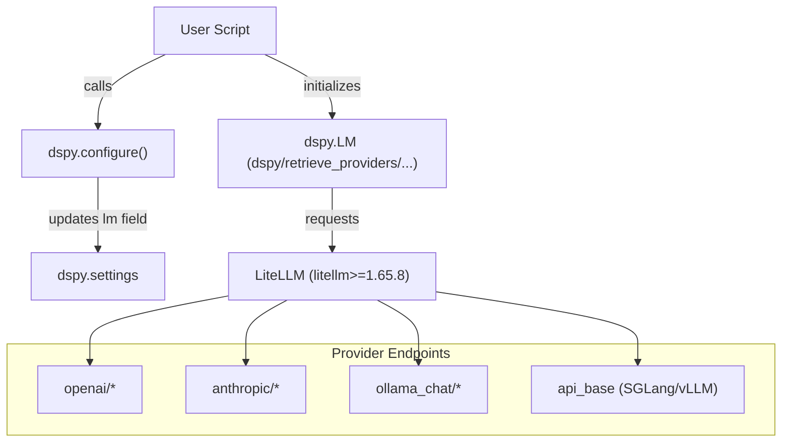
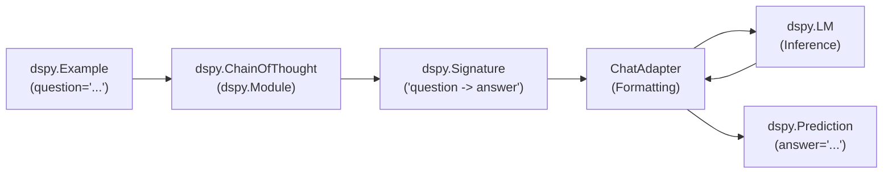

<!-- source: DeepWiki mcp.deepwiki.com · repo stanfordnlp/dspy · page 1.3 Installation & Quick Start · fetched 2026-10-27 -->

# Installation & Quick Start

<details>
<summary>Relevant source files</summary>

The following files were used as context for generating this wiki page:

- [.github/.internal_dspyai/pyproject.toml](.github/.internal_dspyai/pyproject.toml)
- [.github/.tmp/.generated-actions/run-pypi-publish-in-docker-container/action.yml](.github/.tmp/.generated-actions/run-pypi-publish-in-docker-container/action.yml)
- [.github/workflows/dependency-range.yml](.github/workflows/dependency-range.yml)
- [docs/docs/getting-started/metrics.md](docs/docs/getting-started/metrics.md)
- [docs/docs/index.md](docs/docs/index.md)
- [docs/docs/static/img/logos/microsoft-ai.svg](docs/docs/static/img/logos/microsoft-ai.svg)
- [docs/docs/stylesheets/extra.css](docs/docs/stylesheets/extra.css)
- [dspy/__metadata__.py](dspy/__metadata__.py)
- [pyproject.toml](pyproject.toml)
- [uv.lock](uv.lock)

</details>


This page guides you through installing DSPy, configuring a language model, and writing your first DSPy program. DSPy (Declarative Self-improving Python) shifts the focus from manual prompt engineering to programming with structured natural-language modules.

## Prerequisites

DSPy requires:
- **Python 3.10 or higher** (up to 3.14). [pyproject.toml:16-16]()
- An API key for a language model provider (OpenAI, Anthropic, etc.) or a local LM server like Ollama or SGLang.

---

## Installation

### Basic Installation

Install the latest version of DSPy from PyPI:

```bash
pip install -U dspy
```

This installs core dependencies including `litellm` for provider abstraction, `pydantic` for schema validation, `orjson` for fast serialization, `diskcache` for automatic request caching, and `gepa` for reflective optimization. [pyproject.toml:23-38]()

### Optional Dependencies

DSPy uses optional extras for specific integrations:

| Feature | Installation Command | Purpose |
|---------|---------------------|---------|
| Anthropic | `pip install dspy[anthropic]` | Native Anthropic client support. [pyproject.toml:41-41]() |
| Weaviate | `pip install dspy[weaviate]` | Integration with Weaviate vector database. [pyproject.toml:42-42]() |
| MCP | `pip install dspy[mcp]` | Model Context Protocol for tool use. [pyproject.toml:43-43]() |
| Deno | `pip install dspy[deno]` | Sandboxed JavaScript/TypeScript execution for tools. [pyproject.toml:44-44]() |
| LangChain | `pip install dspy[langchain]` | Compatibility with LangChain Core. [pyproject.toml:45-45]() |
| Optuna | `pip install dspy[optuna]` | Required for Bayesian optimization in `MIPROv2`. [pyproject.toml:46-46]() |
| Dev Tools | `pip install dspy[dev]` | Includes `pytest`, `ruff`, and `pre-commit`. [pyproject.toml:49-64]() |

**Sources:** [pyproject.toml:40-72]()

---

## Configuration

### Configuration Architecture

DSPy uses a global `settings` object to manage the default language model (`LM`) and adapter. The configuration flow bridges high-level user code to low-level provider APIs.



**Configuration Flow from Code to Provider**  
**Sources:** [pyproject.toml:30-30](), [dspy/__init__.py:188-192]() (Note: `dspy.settings` is the central configuration store).

### Setting Up Your Language Model

The `dspy.LM` class is the primary interface for language models. Once initialized, it should be passed to `dspy.configure`.

#### Cloud Providers (OpenAI, Anthropic)
```python
import dspy

# OpenAI (requires openai>=1.66.2)
lm = dspy.LM("openai/gpt-4o-mini", api_key="YOUR_KEY")
# Anthropic
# lm = dspy.LM("anthropic/claude-3-5-sonnet-latest", api_key="YOUR_KEY")

dspy.configure(lm=lm)
```
**Sources:** [dspy/__metadata__.py:1-8](), [pyproject.toml:24-30]()

#### Local Models (Ollama)
```python
import dspy
lm = dspy.LM('ollama_chat/llama3.2', api_base='http://localhost:11434', api_key='')
dspy.configure(lm=lm)
```

---

## Quick Start: Your First Program

### Execution Flow: Natural Language to Code

DSPy translates declarative **Signatures** into optimized prompts using **Modules**. Data is encapsulated in `dspy.Example` objects and returned as `dspy.Prediction`.



**Data Flow through DSPy Primitives**  
**Sources:** [docs/docs/getting-started/metrics.md:39-44](), [dspy/__init__.py:1-192]()

### Example: Basic QA with Chain of Thought

```python
import dspy

# 1. Setup
dspy.configure(lm=dspy.LM("openai/gpt-4o-mini"))

# 2. Define Module with inline Signature
# "question -> answer" defines the input and output fields
qa = dspy.ChainOfThought("question -> answer")

# 3. Execute
response = qa(question="How many floors are in the castle David Gregory inherited?")

print(f"Reasoning: {response.reasoning}")
print(f"Answer: {response.answer}")
```

### Example: Typed Signature

You can define complex signatures using Python classes for better structure and validation.

```python
class BasicQA(dspy.Signature):
    """Answer questions with short factoid answers."""

    question: str = dspy.InputField()
    answer: str = dspy.OutputField(desc="often between 1 and 5 words")

generate_answer = dspy.ChainOfThought(BasicQA)
pred = generate_answer(question="What is the color of the sky?")
print(pred.answer)
```

---

## Advanced Quick Start: Optimization

A unique feature of DSPy is the ability to **compile** programs. Optimizers tune your prompts or weights based on a metric. [docs/docs/getting-started/metrics.md:9-13]()

### Simple Optimization Flow
```python
import dspy
from dspy.teleprompt import LabeledFewShot

# 1. Define data using dspy.Example
# .with_inputs() marks which fields the program receives
trainset = [
    dspy.Example(question="1+1", answer="2").with_inputs("question")
]

# 2. Define program
program = dspy.Predict("question -> answer")

# 3. Optimize (Labeled Few-Shot)
optimizer = LabeledFewShot(k=1)
compiled_program = optimizer.compile(student=program, trainset=trainset)

# 4. Save
compiled_program.save("math_bot.json")
```
**Sources:** [docs/docs/getting-started/metrics.md:39-52]()

### Building a Metric
To decide what “better” means, an optimizer needs a **metric**: a Python function that scores a single prediction. [docs/docs/getting-started/metrics.md:11-13]()

```python
def simple_metric(example, prediction) -> float:
    # Return 1.0 for correct, 0.0 for incorrect
    return 1.0 if example.answer == prediction.answer else 0.0

# Evaluate a program
evaluate = dspy.Evaluate(devset=trainset, metric=simple_metric)
score = evaluate(program)
```
**Sources:** [docs/docs/getting-started/metrics.md:56-61](), [docs/docs/getting-started/metrics.md:76-78]()

---

## Testing Your Installation

To verify that DSPy is correctly communicating with your LM and utilizing the internal caching systems (powered by `diskcache` and `cachetools`):

```python
import dspy

lm = dspy.LM("openai/gpt-4o-mini")
dspy.configure(lm=lm)

# Test 1: Direct Call (Uses automatic request_cache)
# Uses diskcache>=5.6.0 and cachetools>=5.5.0 internally
print(lm("Say this is a test!")) 

# Test 2: Check version metadata
from dspy.__metadata__ import __version__
print(f"DSPy Version: {__version__}")
```
**Sources:** [dspy/__metadata__.py:4-4](), [pyproject.toml:31-35]()

---

