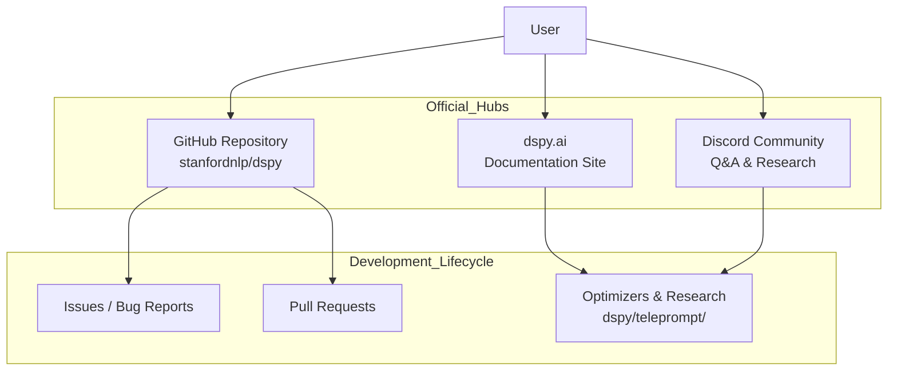
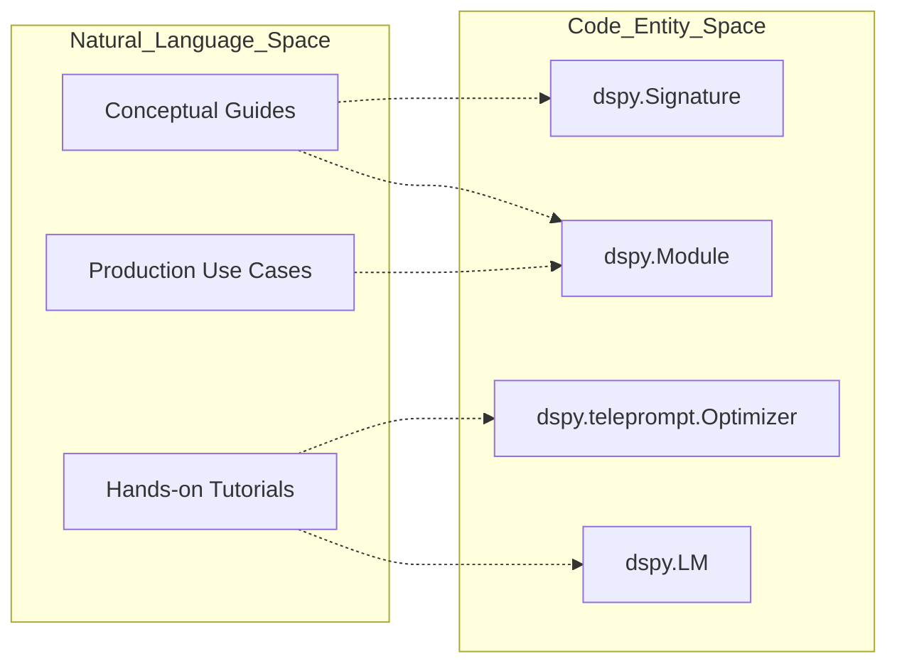
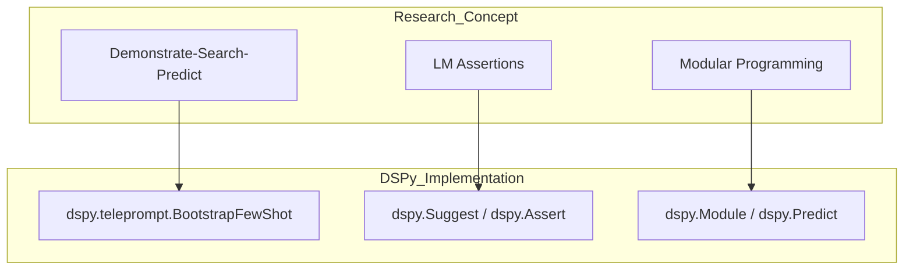

<!-- source: DeepWiki mcp.deepwiki.com · repo stanfordnlp/dspy · page 1.4 Community & Resources · fetched 2026-10-27 -->

# Community & Resources

Relevant source files

The following files were used as context for generating this wiki page:

- [docs/README.md](docs/README.md)
- [docs/docs/community/built-with-dspy.md](docs/docs/community/built-with-dspy.md)
- [docs/docs/community/community-resources.md](docs/docs/community/community-resources.md)
- [docs/docs/community/use-cases.md](docs/docs/community/use-cases.md)
- [docs/docs/production/index.md](docs/docs/production/index.md)
- [docs/docs/roadmap.md](docs/docs/roadmap.md)
- [docs/docs/static/img/logos/aws.svg](docs/docs/static/img/logos/aws.svg)
- [docs/docs/static/img/logos/databricks-wordmark.svg](docs/docs/static/img/logos/databricks-wordmark.svg)
- [docs/docs/static/img/logos/databricks.svg](docs/docs/static/img/logos/databricks.svg)
- [docs/docs/static/img/logos/dropbox-wordmark.svg](docs/docs/static/img/logos/dropbox-wordmark.svg)
- [docs/docs/static/img/logos/dropbox.svg](docs/docs/static/img/logos/dropbox.svg)
- [docs/requirements.txt](docs/requirements.txt)
- [docs/vercel.json](docs/vercel.json)

This page provides links to DSPy's official community channels, details the documentation system architecture, and catalogues the extensive ecosystem of production use cases, research, and community-maintained tools.

## Official Channels

DSPy maintains several primary hubs for development, support, and documentation. The project is led by Omar Khattab at Stanford and Databricks [docs/docs/roadmap.md:36-36]().

| Channel | Purpose | Location |
|---------|---------|----------|
| **GitHub Repository** | Source code, issues, and PRs | [stanfordnlp/dspy](https://github.com/stanfordnlp/dspy) |
| **Discord Server** | Real-time support and research discussion | [Join Discord](https://discord.gg/XCGy2WDCQB) |
| **Documentation Site** | Official guides and API reference | [dspy.ai](https://dspy.ai) |

**Community Interaction Flow**

Sources: [docs/docs/roadmap.md:11-13](), [docs/README.md:1-1]()

## Documentation System Architecture

The DSPy documentation is built using `MkDocs` with the `Material` theme [docs/README.md:16-16](). It is designed for both human consumption and LLM-based development via a specialized `/llms.txt` file generated by `mkdocs-llmstxt` [docs/README.md:77-79]().

### Build Configuration & Dependencies
The documentation pipeline relies on several technical components to bridge the gap between code and documentation:
- **mkdocstrings-python**: Extracts documentation directly from Python source code [docs/requirements.txt:6-7]().
- **mkdocs-jupyter**: Renders `.ipynb` files, allowing tutorials to function as executable notebooks [docs/requirements.txt:3-3]().
- **Static Generation**: The site is built into the `site` directory using `mkdocs build` [docs/README.md:46-49]().
- **API Automation**: Two internal scripts, `generate_api_docs.py` and `generate_api_summary.py`, are used to index the codebase before the MkDocs build [docs/README.md:32-35]().

### Documentation Source to Entity Mapping

Sources: [docs/requirements.txt:1-10](), [docs/README.md:16-55](), [docs/vercel.json:1-18]()

## Ecosystem & Learning Resources

DSPy has a rapidly growing ecosystem of research papers, production implementations, and community-maintained tools.

### Production Implementations
DSPy is utilized in production by high-scale organizations to optimize LM pipelines [docs/docs/community/use-cases.md:1-14]().
- **Shopify**: Scaled DSPy + `GEPA` for structured metadata extraction, reducing costs by ~550x [docs/docs/community/use-cases.md:20-25]().
- **Dropbox**: Optimized the "Dash" relevance judge for ranking and offline evaluation [docs/docs/community/use-cases.md:27-32]().
- **Microsoft AI**: Curated pretraining data for MAI-Thinking-1 using DSPy + `GEPA` [docs/docs/community/use-cases.md:44-44]().
- **AWS**: Migrates prompts from larger to smaller models on Amazon Nova while maintaining performance [docs/docs/community/use-cases.md:45-45]().
- **Moody's**: Leverages DSPy to optimize RAG systems and agentic workflows [docs/docs/community/use-cases.md:60-60]().

### Research & Community Ports
The framework is propelled by academic research from the Stanford NLP group and industry collaborators [docs/docs/roadmap.md:32-35]().
- **Research Papers**: Notable works include **STORM** for Wikipedia-like article generation and **MIPRO** for prompt optimization [docs/docs/community/built-with-dspy.md:9-14]().
- **Language Ports**: The community has created native implementations in languages including **Rust** (`DSRs`), **Go** (`dspy-go`), **TypeScript** (`dspy.ts`), and **Elixir** (`dspy.ex`) [docs/docs/community/built-with-dspy.md:60-70]().

**Research to Code Mapping**

Sources: [docs/docs/community/use-cases.md:1-71](), [docs/docs/roadmap.md:9-49](), [docs/docs/community/built-with-dspy.md:1-72]()

## Deployment & Production Tooling
DSPy provides native integrations for productionizing LM programs [docs/docs/production/index.md:1-4]():
- **Observability**: Integration with **MLflow Tracing** based on OpenTelemetry [docs/docs/production/index.md:11-17]().
- **Reproducibility**: Logging of programs, metrics, and environments via MLflow [docs/docs/production/index.md:19-25]().
- **Scalability**: Native support for thread-safety and asynchronous execution using `asyncify` utilities [docs/docs/production/index.md:35-41]().

Sources: [docs/docs/production/index.md:1-43]()

---

