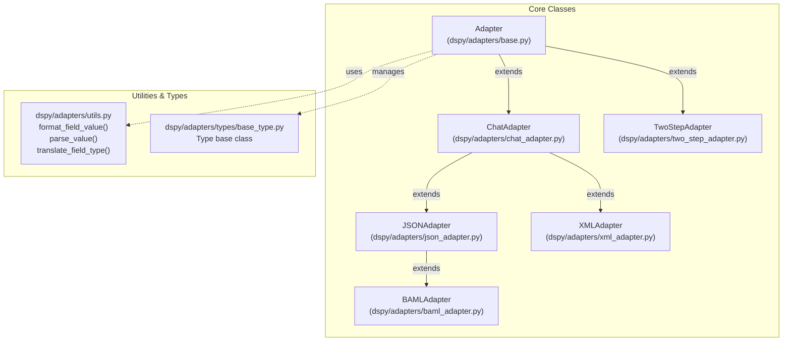
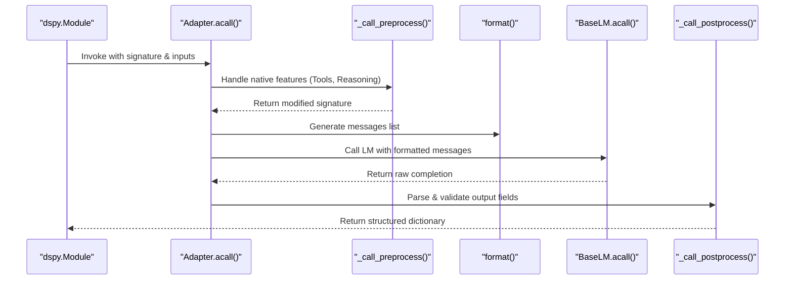
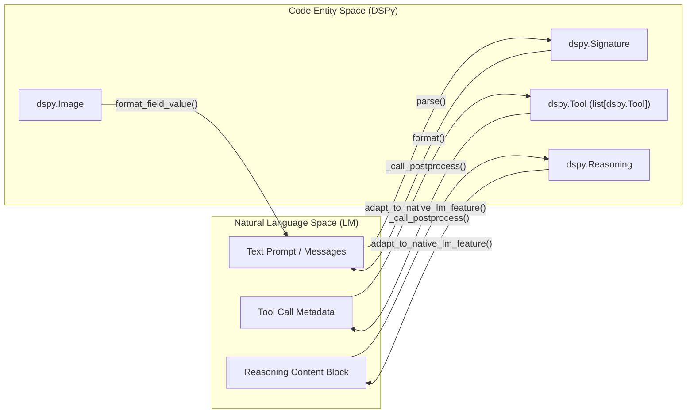

<!-- source: DeepWiki mcp.deepwiki.com · repo stanfordnlp/dspy · page 2.4 Adapter System · fetched 2026-10-27 -->

# Adapter System

Relevant source files

The following files were used as context for generating this wiki page:

- [docs/docs/api/adapters/Adapter.md](docs/docs/api/adapters/Adapter.md)
- [docs/docs/api/adapters/ChatAdapter.md](docs/docs/api/adapters/ChatAdapter.md)
- [docs/docs/api/adapters/JSONAdapter.md](docs/docs/api/adapters/JSONAdapter.md)
- [docs/docs/api/adapters/TwoStepAdapter.md](docs/docs/api/adapters/TwoStepAdapter.md)
- [docs/docs/api/tools/Embeddings.md](docs/docs/api/tools/Embeddings.md)
- [docs/docs/api/utils/StreamListener.md](docs/docs/api/utils/StreamListener.md)
- [docs/docs/learn/programming/signatures.md](docs/docs/learn/programming/signatures.md)
- [dspy/adapters/baml_adapter.py](dspy/adapters/baml_adapter.py)
- [dspy/adapters/base.py](dspy/adapters/base.py)
- [dspy/adapters/chat_adapter.py](dspy/adapters/chat_adapter.py)
- [dspy/adapters/json_adapter.py](dspy/adapters/json_adapter.py)
- [dspy/adapters/two_step_adapter.py](dspy/adapters/two_step_adapter.py)
- [dspy/adapters/utils.py](dspy/adapters/utils.py)
- [dspy/adapters/xml_adapter.py](dspy/adapters/xml_adapter.py)
- [dspy/predict/flex/bridge.py](dspy/predict/flex/bridge.py)
- [tests/adapters/conftest.py](tests/adapters/conftest.py)
- [tests/adapters/test_baml_adapter.py](tests/adapters/test_baml_adapter.py)
- [tests/adapters/test_chat_adapter.py](tests/adapters/test_chat_adapter.py)
- [tests/adapters/test_json_adapter.py](tests/adapters/test_json_adapter.py)
- [tests/adapters/test_two_step_adapter.py](tests/adapters/test_two_step_adapter.py)
- [tests/adapters/test_xml_adapter.py](tests/adapters/test_xml_adapter.py)

The Adapter System serves as the interface layer between DSPy's programming abstractions (signatures, modules) and Language Models. Adapters transform DSPy signatures and inputs into LM-specific prompt formats, then parse LM responses back into structured dictionaries matching the signature's output fields. This layer enables DSPy to work consistently across different LM providers and prompt formats while maintaining a uniform programming model.

## Architecture Overview

The adapter system follows a hierarchy with `Adapter` as the base class and specialized implementations for different prompt formats.

Title: Adapter Class Hierarchy and Data Flow

**Sources:** [dspy/adapters/base.py:34-49](), [dspy/adapters/chat_adapter.py:29-39](), [dspy/adapters/json_adapter.py:40-43](), [dspy/adapters/xml_adapter.py:11-12](), [dspy/adapters/two_step_adapter.py:22-41](), [dspy/adapters/baml_adapter.py:10-10]()

## Adapter Execution Flow

When a DSPy module (like `dspy.Predict`) makes an LM call, the adapter orchestrates the transformation pipeline, handling the transition from structured Python entities to natural language prompts and back.

Title: Signature to LM Message Transformation

**Sources:** [dspy/adapters/base.py:83-135](), [dspy/adapters/base.py:137-176](), [dspy/adapters/base.py:520-533]()

## Base Adapter Class

The `Adapter` class [dspy/adapters/base.py:34-49]() defines the core interface for all implementations. It manages the lifecycle of an LM request, including preprocessing for native features and postprocessing for output validation.

### Constructor Configuration
The `Adapter.__init__` [dspy/adapters/base.py:51-74]() accepts:
* `callbacks`: Hooks for logging or monitoring.
* `use_native_function_calling`: Enables `dspy.Tool` integration with provider APIs.
* `native_response_types`: Types like `Citations` or `Reasoning` that use built-in LM capabilities. Defaults to `[Citations, Reasoning]` [dspy/adapters/base.py:30]().

### Native Feature Handling
* **Preprocessing**: `_call_preprocess` [dspy/adapters/base.py:83-135]() detects if a signature contains `dspy.Tool` or `dspy.Reasoning`. If the LM supports these natively (e.g., via `lm.supports_function_calling`), it modifies `lm_kwargs` to include `tools` [dspy/adapters/base.py:116]() and strips these fields from the text prompt.
* **Postprocessing**: `_call_postprocess` [dspy/adapters/base.py:137-176]() re-assembles the final dictionary, extracting `tool_calls` [dspy/adapters/base.py:162]() or reasoning blocks from LM response metadata and placing them back into the expected signature fields.

**Sources:** [dspy/adapters/base.py:34-176]()

## Core Adapter Implementations

### ChatAdapter
The default adapter for most models. It uses text-based delimiters to delineate fields within chat messages.
* **Format**: Uses `[[ ## field_name ## ]]` headers [dspy/adapters/chat_adapter.py:21-22]().
* **Fallback**: Automatically retries with `JSONAdapter` if an error occurs, unless it is a `LMError` or fallback is disabled [dspy/adapters/chat_adapter.py:85-95]().
* **Structure**: Appends a `[[ ## completed ## ]]` marker to indicate the end of expected output [dspy/adapters/chat_adapter.py:141-142]().

### JSONAdapter
Extends `ChatAdapter` to enforce JSON structures, ideal for programmatic data extraction.
* **Structured Outputs**: If the LM supports response schemas, it generates a strict Pydantic model from the signature via `_get_structured_outputs_response_format` to use OpenAI-style "Structured Output" mode [dspy/adapters/json_adapter.py:81-85]().
* **Parsing**: Uses `json_repair` [dspy/adapters/json_adapter.py:171]() to handle trailing commas or minor syntax errors in LM output.

### XMLAdapter
Formats inputs and outputs within XML tags (e.g., `<answer>...</answer>`).
* **Regex Parsing**: Uses `re.compile(r"<(?P<name>\w+)>((?P<content>.*?))</\1>", re.DOTALL)` to extract field values [dspy/adapters/xml_adapter.py:12]().
* **Type Casting**: Raw XML string content is passed to `parse_value` [dspy/adapters/xml_adapter.py:111]() to convert it to the signature's annotated type (int, bool, etc.).

### TwoStepAdapter
A specialized adapter for reasoning models (like OpenAI o1/o3) that struggle with strict formatting.
1. **Step 1**: Sends a natural language prompt to the main LM to get a detailed response [dspy/adapters/two_step_adapter.py:49-76]().
2. **Step 2**: Uses a secondary `extraction_model` [dspy/adapters/two_step_adapter.py:43-47]() to parse the first LM's output into the structured signature fields via `ChatAdapter` [dspy/adapters/two_step_adapter.py:95-102]().

### BAMLAdapter
Generates simplified schemas for complex Pydantic models to improve LM adherence.
* **Schema Generation**: Converts Pydantic models into a concise string representation via `_build_simplified_schema` [dspy/adapters/baml_adapter.py:89-160]() with comments and "or null" syntax for optional fields.
* **Indentation**: Uses configurable `INDENTATION` (default 2 spaces) for schema readability [dspy/adapters/baml_adapter.py:10]().

**Sources:** [dspy/adapters/chat_adapter.py:29-115](), [dspy/adapters/json_adapter.py:40-121](), [dspy/adapters/xml_adapter.py:11-120](), [dspy/adapters/two_step_adapter.py:22-176](), [dspy/adapters/baml_adapter.py:10-160]()

## Data Formatting and Parsing Utilities

The system relies on `dspy/adapters/utils.py` to bridge the gap between Python objects and LM strings.

| Function | Role |
| :--- | :--- |
| `format_field_value` | Serializes Python types. Lists are converted to numbered strings; dicts/lists to JSON [dspy/adapters/utils.py:83-112](). |
| `translate_field_type` | Generates instructions for the LM based on types (e.g., "must be True or False" for `bool`) [dspy/adapters/utils.py:131-156](). |
| `parse_value` | The inverse of formatting. It attempts `json_repair`, then Pydantic validation [dspy/adapters/utils.py:187-250](). |
| `serialize_for_json` | Uses Pydantic's `TypeAdapter` to dump objects into JSON-compatible primitives [dspy/adapters/utils.py:65-81](). |

**Sources:** [dspy/adapters/utils.py:65-250]()

## Multimodal and Native Feature Handling

The adapter system manages the transition from high-level DSPy types to provider-specific formats.

Title: Multimodal Data and Native Feature Mapping

* **Custom Type Identification**: Adapters use identifiers to wrap multimodal data. For example, `dspy.Image` values are formatted for inclusion in message content [dspy/adapters/utils.py:83-112]().
* **Reasoning Type**: The `Reasoning` type allows the adapter to handle reasoning content as a native LM feature while still exposing it to the DSPy program as a structured field [dspy/adapters/base.py:74]().
* **Legacy Support**: Internal utilities ensure backward compatibility during the transition to new multimodal formats [dspy/adapters/base.py:7-10]().

**Sources:** [dspy/adapters/base.py:7-10](), [dspy/adapters/utils.py:83-112](), [dspy/adapters/base.py:74]()

---

