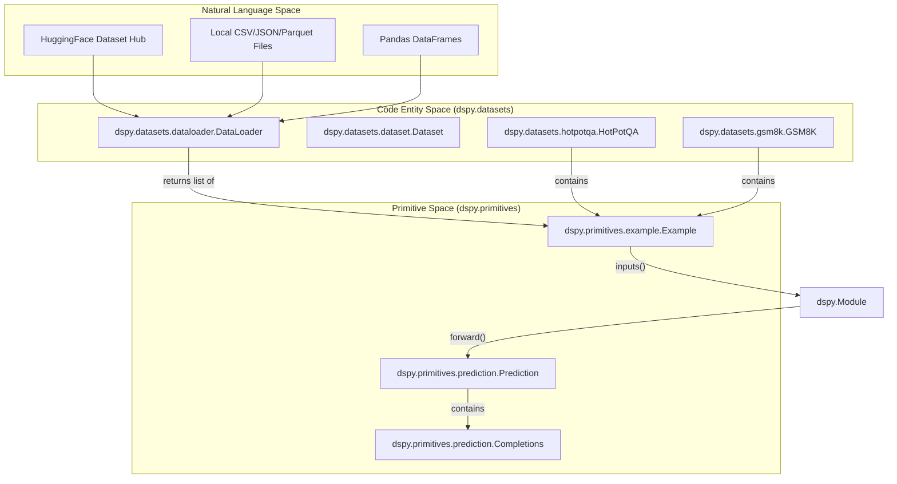
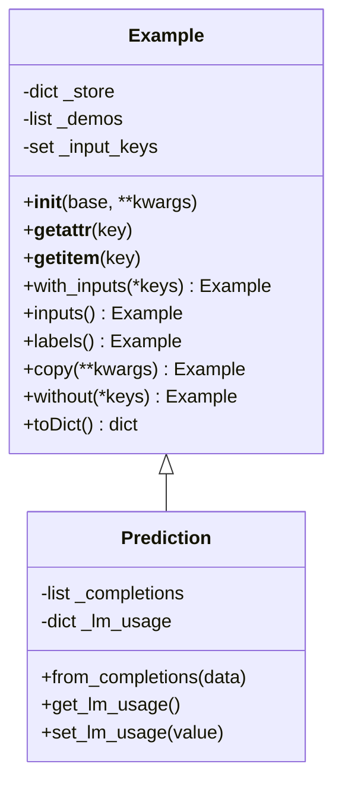
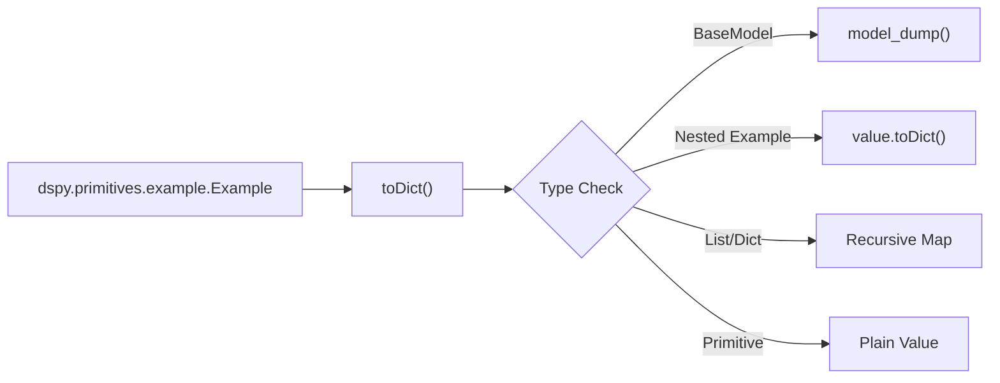

<!-- source: DeepWiki mcp.deepwiki.com · repo stanfordnlp/dspy · page 2.6 Example & Data Primitives · fetched 2026-10-27 -->

# Example & Data Primitives

<details>
<summary>Relevant source files</summary>

The following files were used as context for generating this wiki page:

- [dspy/datasets/__init__.py](dspy/datasets/__init__.py)
- [dspy/datasets/alfworld/__init__.py](dspy/datasets/alfworld/__init__.py)
- [dspy/datasets/alfworld/alfworld.py](dspy/datasets/alfworld/alfworld.py)
- [dspy/datasets/alfworld/base_config.yml](dspy/datasets/alfworld/base_config.yml)
- [dspy/datasets/colors.py](dspy/datasets/colors.py)
- [dspy/datasets/dataloader.py](dspy/datasets/dataloader.py)
- [dspy/datasets/dataset.py](dspy/datasets/dataset.py)
- [dspy/datasets/gsm8k.py](dspy/datasets/gsm8k.py)
- [dspy/datasets/hotpotqa.py](dspy/datasets/hotpotqa.py)
- [dspy/datasets/math.py](dspy/datasets/math.py)
- [dspy/predict/aggregation.py](dspy/predict/aggregation.py)
- [dspy/predict/parameter.py](dspy/predict/parameter.py)
- [dspy/primitives/example.py](dspy/primitives/example.py)
- [dspy/primitives/prediction.py](dspy/primitives/prediction.py)
- [tests/evaluate/test_metrics.py](tests/evaluate/test_metrics.py)
- [tests/predict/test_aggregation.py](tests/predict/test_aggregation.py)
- [tests/primitives/test_example.py](tests/primitives/test_example.py)

</details>


This page documents DSPy's core data primitives: `dspy.Example` for handling training/evaluation data, `dspy.Prediction` for representing module outputs, and the `DataLoader` system for ingesting external data. These classes form the foundation of DSPy's data handling model, providing flexible containers with dictionary-like access patterns, input/output separation, and serialization support.

## Overview

DSPy's data primitives serve distinct roles in the framework:

- **`Example`**: A flexible container for training and evaluation data with support for input/output field separation. [dspy/primitives/example.py:4-21]()
- **`Prediction`**: The output type returned by DSPy modules, inheriting from `Example` but optimized for model outputs and scores. [dspy/primitives/prediction.py:4-16]()
- **`Completions`**: A container for multiple candidate outputs from a language model, often found inside a `Prediction`. [dspy/primitives/prediction.py:119-122]()
- **`DataLoader`**: A utility for loading data from various formats (HuggingFace, CSV, JSON, Pandas) into `dspy.Example` objects. [dspy/datasets/dataloader.py:12-23]()

### Data Flow and Entity Mapping

The following diagram maps the flow from external data sources to DSPy internal entities.

**Data Source to DSPy Primitive Mapping**


**Sources:**
- [dspy/datasets/dataloader.py:12-23]()
- [dspy/primitives/example.py:4-21]()
- [dspy/primitives/prediction.py:4-16]()
- [dspy/datasets/hotpotqa.py:6-67]()
- [dspy/datasets/gsm8k.py:6-60]()

---

## The Example Class

### Class Structure and Design

The `Example` class provides a dictionary-like container with attribute access patterns. It stores data in an internal `_store` dictionary while providing multiple access interfaces. [dspy/primitives/example.py:107-110]()

**Example and Prediction Class Relationship**


**Sources:**
- [dspy/primitives/example.py:4-121]()
- [dspy/primitives/prediction.py:4-33]()

### Initialization Patterns

`Example` supports three initialization patterns for flexibility: [dspy/primitives/example.py:91-105]()

| Pattern | Usage | Implementation Detail |
|---------|-------|---------|
| **Keyword arguments** | Direct field specification | `self._store.update(kwargs)` [dspy/primitives/example.py:120-120]() |
| **Dictionary base** | Initialize from dict | `self._store = base.copy()` [dspy/primitives/example.py:116-117]() |
| **Example base** | Copy another Example | `self._store = base._store.copy()` [dspy/primitives/example.py:112-113]() |

**Sources:**
- [dspy/primitives/example.py:91-120]()
- [tests/primitives/test_example.py:7-27]()

### Dictionary-Like Interface

`Example` implements the full dictionary protocol, supporting both item access (`example["key"]`) and attribute access (`example.key`). [dspy/primitives/example.py:122-143]()

- **Attribute access**: Uses `__getattr__` to look up in `_store`. [dspy/primitives/example.py:122-127]()
- **Item access**: Uses `__getitem__` for standard dict syntax. [dspy/primitives/example.py:135-136]()
- **Length**: `__len__` filters out internal `dspy_` prefixed fields. [dspy/primitives/example.py:147-148]()
- **Equality**: Based on the equality of the underlying `_store`. [dspy/primitives/example.py:158-159]()

**Sources:**
- [dspy/primitives/example.py:122-162]()
- [tests/primitives/test_example.py:29-97]()

---

## Input/Output Separation

A core concept in DSPy is marking which fields are "inputs" to a module versus "labels" (outputs) for evaluation or optimization.

### The with_inputs() Method

The `with_inputs()` method marks specific fields as inputs, returning a new `Example` instance with `_input_keys` set. [dspy/primitives/example.py:205-209]()

```python
# Usage example
example = dspy.Example(question="What is 2+2?", answer="4").with_inputs("question")
```

### Input and Label Extraction

Once inputs are defined, `inputs()` and `labels()` allow subsetting the data: [dspy/primitives/example.py:211-226]()

- **`inputs()`**: Returns a new `Example` containing only fields present in `_input_keys`. [dspy/primitives/example.py:211-218]()
- **`labels()`**: Returns a new `Example` containing all fields *not* in `_input_keys`. [dspy/primitives/example.py:220-226]()

**Sources:**
- [dspy/primitives/example.py:205-226]()
- [tests/primitives/test_example.py:100-111]()

---

## Prediction & Completions

The `Prediction` class extends `Example` to represent module outputs. It adds support for multi-candidate outputs and usage tracking. [dspy/primitives/prediction.py:4-16]()

### Multi-Completion Handling

Modules often generate multiple candidate responses. These are managed via the `Completions` class. [dspy/primitives/prediction.py:119-122]()

- **`from_completions`**: Factory method to create a `Prediction` from a list of dicts. The first completion is used to populate the main `_store`. [dspy/primitives/prediction.py:34-39]()
- **Score Arithmetic**: If a `Prediction` has a `score` field, it supports comparison (`<`, `>`, `==`) and arithmetic (`+`, `/`) directly on the score value. [dspy/primitives/prediction.py:53-112]()
- **Majority Voting**: The `majority` utility can aggregate multiple completions from a `Prediction` or `Completions` object, returning the most common response based on a specific field. [dspy/predict/aggregation.py:9-54]()

### Majority Voting Logic

The `majority` function performs aggregation across multiple candidate outputs: [dspy/predict/aggregation.py:9-54]()

1. **Extraction**: It identifies the target field to aggregate, defaulting to the last field in the signature if not specified. [dspy/predict/aggregation.py:30-35]()
2. **Normalization**: Applies a normalization function (defaulting to `normalize_text`) to field values. [dspy/predict/aggregation.py:37-39]()
3. **Counting**: Counts occurrences of normalized values. [dspy/predict/aggregation.py:42-44]()
4. **Selection**: Returns a new `Prediction` containing the first original completion that matches the majority normalized value. [dspy/predict/aggregation.py:46-54]()

**Sources:**
- [dspy/primitives/prediction.py:4-174]()
- [dspy/predict/aggregation.py:9-54]()
- [tests/predict/test_aggregation.py:6-43]()

---

## Data Loading (DataLoader)

The `DataLoader` class simplifies the conversion of external datasets into `dspy.Example` lists. [dspy/datasets/dataloader.py:12-14]()

### Supported Formats

| Method | Source | Implementation |
|--------|--------|----------------|
| `from_huggingface` | HuggingFace Hub | Uses `datasets.load_dataset` [dspy/datasets/dataloader.py:16-32]() |
| `from_csv` | Local CSV file | Loads as HF dataset "csv" [dspy/datasets/dataloader.py:63-71]() |
| `from_json` | Local JSON file | Loads as HF dataset "json" [dspy/datasets/dataloader.py:91-99]() |
| `from_parquet` | Local Parquet file | Loads as HF dataset "parquet" [dspy/datasets/dataloader.py:106-114]() |
| `from_pandas` | DataFrame object | Iterates via `df.iterrows()` [dspy/datasets/dataloader.py:78-89]() |
| `from_rm` | Retrieval Module | Calls `rm.get_objects` [dspy/datasets/dataloader.py:121-128]() |

### Splitting and Sampling

`DataLoader` and the base `Dataset` class provide utilities for preparing data: [dspy/datasets/dataloader.py:138-190]()

- **`sample`**: Randomly samples `n` examples from a list. [dspy/datasets/dataloader.py:138-150]()
- **`train_test_split`**: Splits a dataset into training and testing sets based on size or proportion. [dspy/datasets/dataloader.py:152-190]()
- **`_shuffle_and_sample`**: Internal method in `Dataset` that assigns unique `dspy_uuid` and `dspy_split` metadata to examples. [dspy/datasets/dataset.py:79-103]()

**Sources:**
- [dspy/datasets/dataloader.py:12-190]()
- [dspy/datasets/dataset.py:12-103]()

---

## Serialization

The `toDict()` method provides deep serialization of `Example` objects, ensuring they are JSON-compatible for logging or persistence. [dspy/primitives/example.py:240-258]()

**Serialization Logic Flow**


This serialization is critical for handling complex types like `dspy.History` (which is a `pydantic.BaseModel`) or nested `Example` objects within a single data record. [tests/primitives/test_example.py:128-157]()

**Sources:**
- [dspy/primitives/example.py:240-258]()
- [tests/primitives/test_example.py:123-157]()

---

