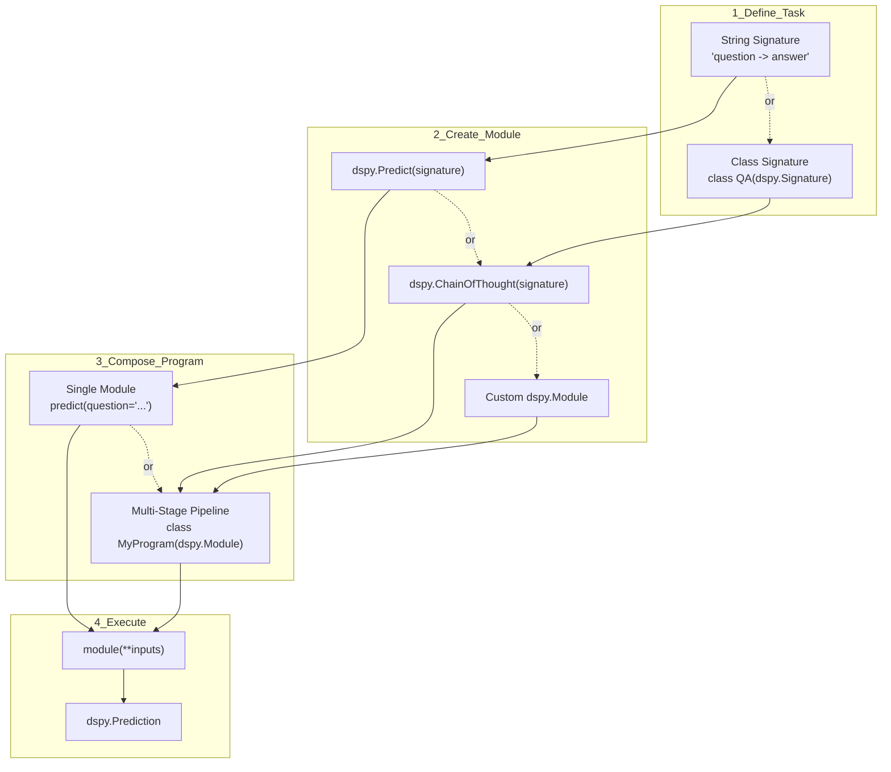
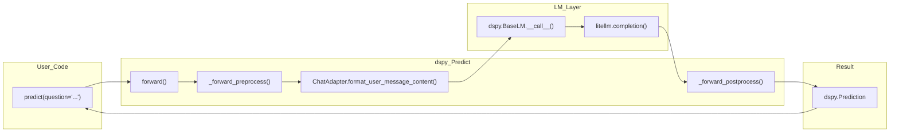

<!-- source: DeepWiki mcp.deepwiki.com · repo stanfordnlp/dspy · page 3 Building DSPy Programs · fetched 2026-10-27 -->

# Building DSPy Programs

<details>
<summary>Relevant source files</summary>

The following files were used as context for generating this wiki page:

- [docs/docs/api/optimizers/SIMBA.md](docs/docs/api/optimizers/SIMBA.md)
- [docs/docs/cheatsheet.md](docs/docs/cheatsheet.md)
- [dspy/predict/best_of_n.py](dspy/predict/best_of_n.py)
- [dspy/predict/predict.py](dspy/predict/predict.py)
- [dspy/predict/refine.py](dspy/predict/refine.py)
- [dspy/primitives/base_module.py](dspy/primitives/base_module.py)
- [dspy/teleprompt/infer_rules.py](dspy/teleprompt/infer_rules.py)
- [dspy/teleprompt/simba.py](dspy/teleprompt/simba.py)
- [dspy/teleprompt/simba_utils.py](dspy/teleprompt/simba_utils.py)
- [tests/predict/test_predict.py](tests/predict/test_predict.py)

</details>


DSPy programs are built by composing reusable modules that define how language models should process inputs to produce outputs. This page demonstrates how to construct programs from basic predictors to complex multi-stage pipelines.

**Key concepts covered:**
- Using `dspy.Predict` and signatures to define tasks
- Composing modules with `dspy.Module` for multi-step logic
- Common program patterns (sequential, conditional, iterative)
- Configuration and state management
- Integration with specialized modules

For detailed documentation on specific features, see the subpages: [Predict Module](#3.1), [Reasoning Strategies](#3.2), [Tool Integration & Function Calling](#3.3), [Custom Types & Multimodal Support](#3.4), [Module Composition & Refinement](#3.5), and [History & Conversation Management](#3.6).

## Getting Started: Basic Program Structure

A minimal DSPy program consists of three elements:

1. **Signature**: Defines input/output fields [dspy/signatures/signature.py:1-20]()
2. **Module**: Wraps the signature with execution logic (`dspy.Predict` or custom `dspy.Module`) [dspy/predict/predict.py:42-55]()
3. **LM Configuration**: Specifies which language model to use via `dspy.configure` [dspy/dsp/utils/settings.py:11-15]()

```python
import dspy

# 1. Configure the language model
dspy.configure(lm=dspy.LM('openai/gpt-4o-mini'))

# 2. Define a signature (input -> output)
signature = "question -> answer"

# 3. Create a module that uses this signature
predict = dspy.Predict(signature)

# 4. Execute the module
result = predict(question="What is the capital of France?")
print(result.answer)  # "Paris"
```

**Sources:** [dspy/predict/predict.py:42-64](), [dspy/dsp/utils/settings.py:11-15]()

## Core Building Blocks

DSPy programs are constructed from primary abstractions that work together to define, execute, and optimize language model interactions.

### Program Building Blocks Diagram



**Sources:** [dspy/predict/predict.py:42-64](), [dspy/primitives/module.py:1-50](), [docs/docs/cheatsheet.md:25-35]()

### Signature: Task Specification

A `Signature` declares the input and output fields for a task. Signatures define what the language model should do, separating task specification from implementation details.

**String Notation (Simple):**
```python
# Single input, single output
"question -> answer"

# Multiple inputs/outputs
"context, question -> answer, confidence"
```

**Class Notation (Structured):**
```python
class Classify(dspy.Signature):
    """Classify sentiment of a given sentence."""
    
    sentence: str = dspy.InputField()
    sentiment: Literal["positive", "negative", "neutral"] = dspy.OutputField()
    confidence: float = dspy.OutputField()
```

Class-based signatures support type annotations for structured outputs (lists, dicts, Pydantic models) and field descriptions [tests/predict/test_predict.py:188-200]().

See [Signatures & Task Definition](#2.3) for complete details.

**Sources:** [dspy/signatures/signature.py:1-100](), [tests/predict/test_predict.py:45-51](), [docs/docs/cheatsheet.md:25-30]()

### Predict: The Fundamental Module

`Predict` is the basic building block for DSPy programs. It takes a signature and invokes the language model to produce outputs.

```python
predict = dspy.Predict("question -> answer")
result = predict(question="What is the capital of France?")
print(result.answer)  # "Paris"
```

The `Predict` class inherits from both `Module` and `Parameter`, making it both composable and optimizable [dspy/predict/predict.py:43](). Key responsibilities include:

- **Signature management**: Stores the task specification [dspy/predict/predict.py:61]()
- **State management**: Maintains demonstrations (`demos`), LM reference (`lm`), and traces [dspy/predict/predict.py:65-69]()
- **Execution orchestration**: Coordinates preprocessing and adapter invocation [dspy/predict/predict.py:142-200]()
- **Serialization**: Supports saving/loading via `dump_state()`/`load_state()` [dspy/predict/predict.py:71-120]()

**Sources:** [dspy/predict/predict.py:43-200](), [tests/predict/test_predict.py:66-93]()

### Module: Composition and Subclassing

The `Module` base class enables composition of multiple `Predict` instances and other modules. Custom modules inherit from `dspy.Module` and define their logic in the `forward()` method [dspy/primitives/module.py:1-50]().

```python
class RAG(dspy.Module):
    def __init__(self, num_passages=3):
        super().__init__()
        self.retrieve = dspy.Retrieve(k=num_passages)
        self.generate = dspy.Predict("context, question -> answer")
    
    def forward(self, question):
        context = self.retrieve(question).passages
        return self.generate(context=context, question=question)
```

Modules provide automatic parameter discovery and optimization support via `named_parameters()` [dspy/primitives/base_module.py:23-67]().

See [Module System & Base Classes](#2.5) for architectural details.

**Sources:** [dspy/primitives/module.py:1-50](), [dspy/primitives/base_module.py:23-67]()

## Basic Module Usage

### dspy.Predict: The Foundation

`dspy.Predict` is the fundamental module for invoking language models. It wraps a signature and handles execution.

```python
# Create a predictor
predict = dspy.Predict("question -> answer")

# Execute with keyword arguments
result = predict(question="What is 2+2?")

# Access output fields
print(result.answer)  # "4"
```

Key characteristics of `dspy.Predict`:
- Only accepts **keyword arguments** matching signature input fields [dspy/predict/predict.py:130-134]()
- Returns a `dspy.Prediction` object [dspy/predict/predict.py:15]()
- Maintains state (demonstrations, traces) for optimization [dspy/predict/predict.py:65-69]()

**Sources:** [dspy/predict/predict.py:43-64](), [tests/predict/test_predict.py:140-146](), [dspy/predict/predict.py:130-134]()

### Program Execution Flow



The execution flow involves:
1. **Preprocessing**: Resolves LM, merges configs, validates inputs [dspy/predict/predict.py:142-167]()
2. **Adapter formatting**: Converts signature + inputs to LM messages [dspy/predict/predict.py:189-192]()
3. **LM invocation**: Calls language model via the configured LM client [dspy/predict/predict.py:192]()
4. **Postprocessing**: Parses outputs into structured `Prediction` [dspy/predict/predict.py:194-200]()

For detailed lifecycle documentation, see [Predict Module](#3.1).

**Sources:** [dspy/predict/predict.py:142-200](), [dspy/adapters/chat_adapter.py:9-9]()

## Configuration

DSPy provides multiple configuration levels that cascade from global to call-time scope.

### Configuration Hierarchy

| Level | Method | Scope | Example |
|-------|--------|-------|---------|
| **Global** | `dspy.configure()` | All modules | `dspy.configure(lm=dspy.LM('openai/gpt-4o'))` |
| **Instance** | Constructor kwargs | Single module | `dspy.Predict("q -> a", temperature=0.9)` |
| **Call-time** | `config={}` parameter | Single call | `predict(q="...", config={"temperature": 0.5})` |

**Resolution order:** Call-time > Instance > Global [dspy/predict/predict.py:147-150]()

**Sources:** [dspy/predict/predict.py:147-150](), [dspy/dsp/utils/settings.py:12-12]()

## Program Composition

DSPy programs are built by composing multiple modules.

### Sequential Composition

One module's output feeds into another's input within a custom `dspy.Module`.

```python
class MultiStepRAG(dspy.Module):
    def __init__(self):
        super().__init__()
        self.retrieve = dspy.Retrieve(k=5)
        self.answer = dspy.Predict("passages, question -> answer")
    
    def forward(self, question):
        context = self.retrieve(question).passages
        return self.answer(passages=context, question=question)
```

**Sources:** [dspy/primitives/module.py:1-50]()

### Iterative Refinement and Best-of-N

Programs can iteratively improve outputs through multiple passes. 
- `dspy.BestOfN`: Runs a module $N$ times with different rollout IDs at `temperature=1.0` and returns the highest-scoring prediction based on a reward function [dspy/predict/best_of_n.py:7-34]().
- `dspy.Refine`: Similar to `BestOfN`, but automatically generates feedback/hints to improve future predictions if the threshold is not met [dspy/predict/refine.py:41-86]().

See [Module Composition & Refinement](#3.5) for details.

**Sources:** [dspy/predict/best_of_n.py:7-34](), [dspy/predict/refine.py:41-86]()

## State Management and Persistence

DSPy modules maintain state that can be saved and reloaded using `dump_state()` and `load_state()` [dspy/predict/predict.py:71-120]().

### Saving and Loading Programs

```python
# Save state
state = predict.dump_state()

# Load state
predict.load_state(state)
```

**Security note:** By default, `load_state()` blocks potentially unsafe LM configuration keys (`api_base`, `base_url`, `model_list`) defined in `UNSAFE_LM_STATE_KEYS` [dspy/predict/predict.py:22-40](). Use `allow_unsafe_lm_state=True` only for trusted sources [dspy/predict/predict.py:92-99]().

**Sources:** [dspy/predict/predict.py:71-120](), [tests/predict/test_predict.py:66-93](), [dspy/predict/predict.py:22-40]()

## Specialized Modules

Beyond basic `Predict`, DSPy provides specialized modules for common patterns.

### Reasoning Modules
For step-by-step reasoning, see [Reasoning Strategies](#3.2):
- `ChainOfThought`: Adds a `rationale` field for intermediate steps [docs/docs/cheatsheet.md:32-35]().
- `ProgramOfThought`: Generates and executes code to produce answers [docs/docs/cheatsheet.md:42-45]().
- `ReAct`: Agent-based reasoning that interleaves thoughts and tool calls [docs/docs/cheatsheet.md:54-57]().

### Tool Integration
For external tool use, see [Tool Integration & Function Calling](#3.3). `CodeAct` natively support tool registration via the `tools` argument [docs/docs/cheatsheet.md:84-98]().

### Optimization via Teleprompters
Programs can be optimized using teleprompters like `SIMBA` (Stochastic Introspective Mini-Batch Ascent), which generates improvement rules based on performance analysis [dspy/teleprompt/simba.py:17-27](), or `InferRules` which induces natural language rules from examples [dspy/teleprompt/infer_rules.py:12-22]().

**Sources:** [dspy/teleprompt/simba.py:17-27](), [dspy/teleprompt/infer_rules.py:12-22](), [docs/docs/cheatsheet.md:32-60]()

## Next Steps

For deeper understanding of specific topics:

- **[Predict Module](#3.1)**: Detailed API reference for `Predict` class
- **[Reasoning Strategies](#3.2)**: Chain-of-thought, ReAct, and other reasoning patterns
- **[Tool Integration & Function Calling](#3.3)**: Function calling and external tool use
- **[Custom Types & Multimodal Support](#3.4)**: Multimodal and specialized data types
- **[Module Composition & Refinement](#3.5)**: Advanced composition patterns and refinement
- **[History & Conversation Management](#3.6)**: Conversation state and context management
- **[Program Optimization](#4)**: Using optimizers to improve program performance

---

