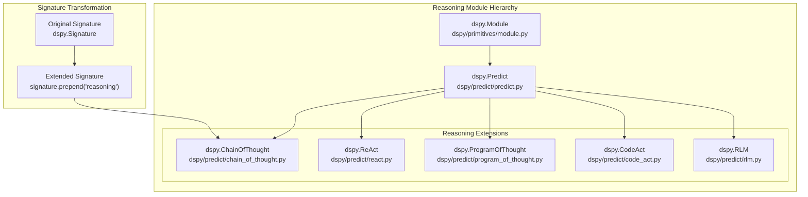
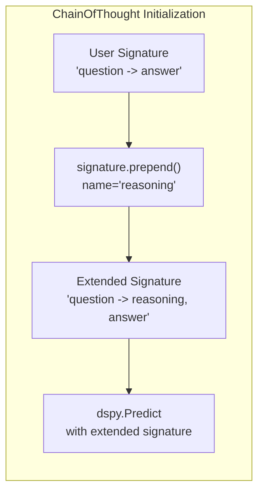
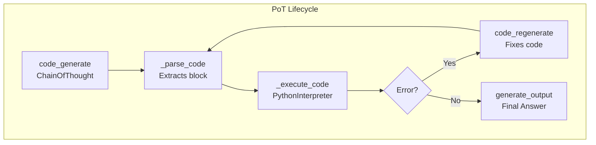
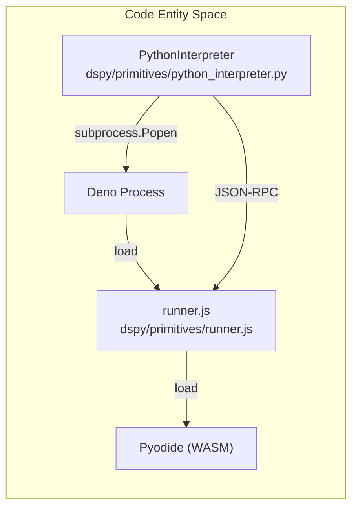

<!-- source: DeepWiki mcp.deepwiki.com · repo stanfordnlp/dspy · page 3.2 Reasoning Strategies · fetched 2026-10-27 -->

# Reasoning Strategies

Relevant source files

The following files were used as context for generating this wiki page:

- [docs/docs/api/tools/PythonInterpreter.md](docs/docs/api/tools/PythonInterpreter.md)
- [docs/docs/diving-deeper/built-in-module-variants.md](docs/docs/diving-deeper/built-in-module-variants.md)
- [docs/docs/diving-deeper/rlm.md](docs/docs/diving-deeper/rlm.md)
- [dspy/predict/__init__.py](dspy/predict/__init__.py)
- [dspy/predict/chain_of_thought.py](dspy/predict/chain_of_thought.py)
- [dspy/predict/program_of_thought.py](dspy/predict/program_of_thought.py)
- [dspy/predict/react.py](dspy/predict/react.py)
- [dspy/predict/react_v2.py](dspy/predict/react_v2.py)
- [dspy/predict/retry.py](dspy/predict/retry.py)
- [dspy/primitives/code_interpreter.py](dspy/primitives/code_interpreter.py)
- [dspy/primitives/python_interpreter.py](dspy/primitives/python_interpreter.py)
- [dspy/primitives/runner.js](dspy/primitives/runner.js)
- [dspy/utils/exceptions.py](dspy/utils/exceptions.py)
- [tests/adapters/test_reasoning.py](tests/adapters/test_reasoning.py)
- [tests/mock_interpreter.py](tests/mock_interpreter.py)
- [tests/predict/test_chain_of_thought.py](tests/predict/test_chain_of_thought.py)
- [tests/predict/test_multi_chain_comparison.py](tests/predict/test_multi_chain_comparison.py)
- [tests/predict/test_program_of_thought.py](tests/predict/test_program_of_thought.py)
- [tests/predict/test_react.py](tests/predict/test_react.py)
- [tests/predict/test_react_v2.py](tests/predict/test_react_v2.py)
- [tests/predict/test_retry.py](tests/predict/test_retry.py)
- [tests/primitives/test_python_interpreter.py](tests/primitives/test_python_interpreter.py)
- [tests/teleprompt/test_bootstrap.py](tests/teleprompt/test_bootstrap.py)
- [tests/teleprompt/test_copro_optimizer.py](tests/teleprompt/test_copro_optimizer.py)
- [tests/utils/test_exceptions.py](tests/utils/test_exceptions.py)

## Purpose and Scope

This document describes reasoning modules in DSPy that extend basic prediction with intermediate reasoning steps. These modules enhance the language model's ability to solve complex tasks by explicitly structuring how the model thinks through problems.

For basic prediction without reasoning, see [Predict Module](3.1). For tool integration with reasoning, see [Tool Integration & Function Calling](3.3). For code execution internals, see [Code Execution & Sandboxing](5.6).

## Overview

DSPy provides several reasoning modules that augment basic prediction with structured intermediate steps. All reasoning modules extend the base prediction mechanism by modifying the [Signature](2.3) to include additional output fields that capture reasoning traces.

The primary reasoning strategies available in DSPy are:

| Module | Strategy | Use Case |
|--------|----------|----------|
| `dspy.ChainOfThought` | Step-by-step reasoning before answering | General reasoning tasks requiring explanation |
| `dspy.ReAct` | Reasoning interleaved with tool actions | Agent tasks requiring external information and tool use |
| `dspy.ProgramOfThought` | Program generation for computation | Mathematical or algorithmic problems requiring precision (Deprecated in 3.4) |
| `dspy.RLM` | Recursive Language Model for code | Modern replacement for PoT, using recursive code generation |
| `dspy.CodeAct` | Actions expressed as code blocks | Agents that use a REPL or code execution environment |

Sources: [dspy/predict/__init__.py:1-31](), [dspy/predict/chain_of_thought.py:12-28](), [dspy/predict/react.py:16-39](), [dspy/predict/program_of_thought.py:25-42]()

## Module Architecture

**Signature Extension Pattern**: Reasoning modules work by prepending or appending intermediate output fields to the user's signature. The language model is then prompted to generate these fields in sequence, creating a reasoning trace before producing the final output.

Sources: [dspy/predict/chain_of_thought.py:12-49](), [dspy/predict/react.py:73-85](), [dspy/predict/program_of_thought.py:64-87]()

## ChainOfThought

`dspy.ChainOfThought` is the most common reasoning module. It adds a `reasoning` field to the signature, prompting the model to think step-by-step.

### Implementation

The implementation transforms the user's signature by prepending a `reasoning` output field:

| Component | Implementation |
|-----------|----------------|
| Signature Extension | [dspy/predict/chain_of_thought.py:48]() uses `signature.prepend()` to add the field |
| Field Name | Defaults to `reasoning` with description `${reasoning}` [dspy/predict/chain_of_thought.py:45-48]() |
| Forward Method | [dspy/predict/chain_of_thought.py:51-52]() delegates directly to `self.predict` |
| Async Support | [dspy/predict/chain_of_thought.py:54-55]() provides `aforward()` calling `acall()` |

Sources: [dspy/predict/chain_of_thought.py:12-56]()

## ReAct (Reasoning + Acting)

`dspy.ReAct` implements an agentic loop where the model interleaves reasoning with tool calls. It generalizes the ReAct paradigm to work over any DSPy signature [dspy/predict/react.py:19-23]().

### The Agent Loop

ReAct constructs a specialized signature that includes a `trajectory` (input) and three output fields: `next_thought`, `next_tool_name`, and `next_tool_args` [dspy/predict/react.py:73-79]().

1.  **Initialization**: Tools are wrapped in `dspy.Tool` objects [dspy/predict/react.py:44-45]().
2.  **Trajectory Management**: The module maintains a `trajectory` dictionary of thoughts, tool names, arguments, and observations [dspy/predict/react.py:96-113]().
3.  **Truncation**: If the context window is exceeded, ReAct attempts to truncate the trajectory and retry [dspy/predict/react.py:101-103]().
4.  **Extraction**: Once the "finish" tool is called or `max_iters` is reached, a final `ChainOfThought` pass extracts the output fields defined in the original signature [dspy/predict/react.py:117-121]().

### Implementation Details

| Function/Class | Role |
|----------------|------|
| `ReAct.__init__` | Constructs the agent signature and toolset [dspy/predict/react.py:17-89]() |
| `forward` | The main loop managing iterations and tool execution [dspy/predict/react.py:95-121]() |
| `_format_trajectory` | Uses `ChatAdapter` to format history into the prompt [dspy/predict/react.py:90-93]() |
| `finish` Tool | A built-in tool that signals task completion [dspy/predict/react.py:62-67]() |

Sources: [dspy/predict/react.py:16-121]()

## ProgramOfThought (PoT)

`dspy.ProgramOfThought` generates and executes Python code to solve tasks. **Note**: As of DSPy 3.4, PoT is deprecated in favor of `RLM` (Recursive Language Model) [dspy/predict/program_of_thought.py:27-28]().

### Execution Flow

1.  **Generation**: Uses `ChainOfThought` to generate Python code [dspy/predict/program_of_thought.py:70-75]().
2.  **Execution**: Code is run using a `CodeInterpreter` (defaulting to `PythonInterpreter`), which utilizes a Deno-based WASM sandbox [dspy/predict/program_of_thought.py:48](), [dspy/primitives/python_interpreter.py:2-7]().
3.  **Submission**: The generated code must call `SUBMIT()` to return results [dspy/predict/program_of_thought.py:150-152]().
4.  **Self-Correction**: If execution fails, PoT uses a `code_regenerate` module that takes the previous code and error message as inputs to produce a fix [dspy/predict/program_of_thought.py:76-81]().

Sources: [dspy/predict/program_of_thought.py:25-163](), [dspy/primitives/python_interpreter.py:2-7]()

## PythonInterpreter and Sandbox

The `PythonInterpreter` provides a secure environment for executing code generated by reasoning modules.

- **Sandbox Security**: Code runs in an isolated Pyodide environment. Permissions like `enable_read_paths` or `enable_env_vars` must be explicitly configured [dspy/primitives/python_interpreter.py:237-250]().
- **Communication**: Uses JSON-RPC 2.0 for messaging between the Python host and the Deno runner [dspy/primitives/python_interpreter.py:47-65](), [dspy/primitives/runner.js:95-132]().
- **Tool Bridge**: Allows Python code inside the sandbox to call host-side tools via `toolCallBridge` [dspy/primitives/runner.js:153-204]().

Sources: [dspy/primitives/python_interpreter.py:2-65](), [dspy/primitives/runner.js:1-207]()

## Native Reasoning Support

Modern LMs (e.g., OpenAI o1, DeepSeek R1, Claude 3.7) have native reasoning capabilities. DSPy handles this through its module and adapter systems.

### Reasoning Type and Adapters

In `ChainOfThought`, even if a model supports native reasoning, DSPy can still use manual fields (like `[[ ## reasoning ## ]]`) to ensure consistent extraction and observability across different model providers [tests/predict/test_chain_of_thought.py:31-86]().

When models provide native reasoning fields in their API response (e.g., `litellm` returning a `reasoning` field), DSPy's `ChainOfThought` can extract this into the module's reasoning output [tests/predict/test_chain_of_thought.py:61-86]().

Sources: [tests/predict/test_chain_of_thought.py:31-86](), [dspy/predict/chain_of_thought.py:12-41]()

---

