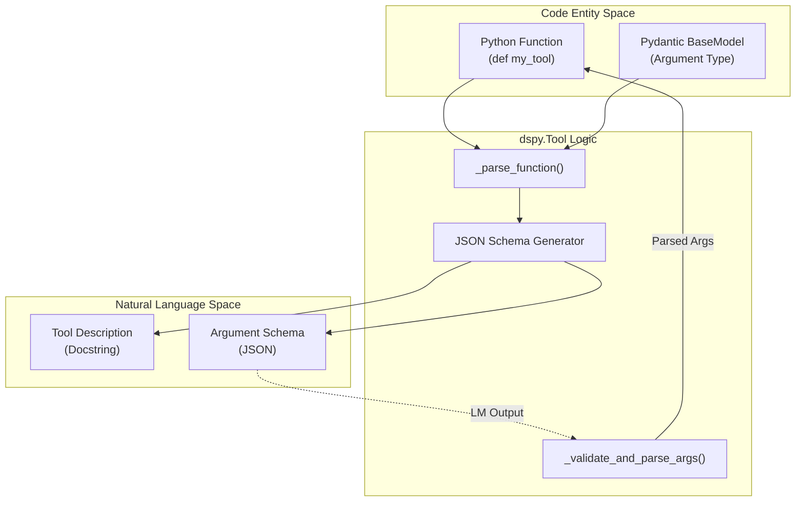
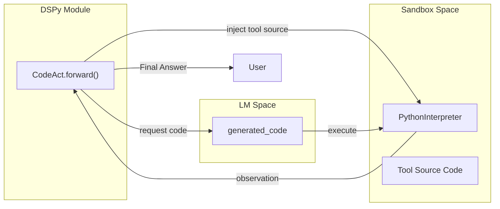

<!-- source: DeepWiki mcp.deepwiki.com · repo stanfordnlp/dspy · page 3.3 Tool Integration & Function Calling · fetched 2026-10-27 -->

# Tool Integration & Function Calling

<details>
<summary>Relevant source files</summary>

The following files were used as context for generating this wiki page:

- [docs/docs/api/modules/CodeAct.md](docs/docs/api/modules/CodeAct.md)
- [docs/docs/api/modules/ProgramOfThought.md](docs/docs/api/modules/ProgramOfThought.md)
- [docs/docs/diving-deeper/bootstrap-fewshot-family.md](docs/docs/diving-deeper/bootstrap-fewshot-family.md)
- [docs/docs/diving-deeper/choosing-an-optimizer.md](docs/docs/diving-deeper/choosing-an-optimizer.md)
- [docs/docs/diving-deeper/flex.md](docs/docs/diving-deeper/flex.md)
- [docs/docs/diving-deeper/gepa-in-depth.md](docs/docs/diving-deeper/gepa-in-depth.md)
- [docs/docs/diving-deeper/metrics-and-evaluation.md](docs/docs/diving-deeper/metrics-and-evaluation.md)
- [docs/docs/diving-deeper/modules.md](docs/docs/diving-deeper/modules.md)
- [docs/docs/diving-deeper/saving-and-loading.md](docs/docs/diving-deeper/saving-and-loading.md)
- [docs/docs/diving-deeper/settings-and-context.md](docs/docs/diving-deeper/settings-and-context.md)
- [docs/docs/diving-deeper/tools-react-and-mcp.md](docs/docs/diving-deeper/tools-react-and-mcp.md)
- [docs/docs/learn/figures/native_tool_call.png](docs/docs/learn/figures/native_tool_call.png)
- [docs/docs/learn/programming/tools.md](docs/docs/learn/programming/tools.md)
- [dspy/adapters/types/base_type.py](dspy/adapters/types/base_type.py)
- [dspy/adapters/types/reasoning.py](dspy/adapters/types/reasoning.py)
- [dspy/adapters/types/tool.py](dspy/adapters/types/tool.py)
- [dspy/predict/code_act.py](dspy/predict/code_act.py)
- [tests/adapters/test_tool.py](tests/adapters/test_tool.py)
- [tests/predict/test_code_act.py](tests/predict/test_code_act.py)

</details>


## Purpose and Scope

This document explains how to integrate external tools and enable function calling in DSPy programs. It covers the `dspy.Tool` and `dspy.ToolCalls` types, the orchestration of tools via the `dspy.ReAct` and `dspy.CodeAct` modules, and the underlying adapter system that maps Python functions to language model (LM) function-calling schemas.

---

## Overview of Tool Integration

DSPy treats tools as first-class citizens through a type-based system. Any Python callable can be transformed into a tool that a language model can reason about and invoke.

**Core Components:**
- **`dspy.Tool`**: A wrapper class that inspects Python functions to extract metadata (name, docstring, arguments, and type hints) for the LM [dspy/adapters/types/tool.py:21-34]().
- **`dspy.ToolCalls`**: A container for one or more tool invocations generated by an LM [dspy/adapters/types/tool.py:8]().
- **`dspy.ReAct`**: A module implementing the "Reasoning and Acting" paradigm, interleaving thought, tool selection, and observation [docs/docs/learn/programming/tools.md:14-16]().
- **`dspy.CodeAct`**: An agentic module that generates and executes Python code snippets to interact with tools. Note: `CodeAct` is deprecated in favor of `RLM` [dspy/predict/code_act.py:17-23](), [docs/docs/api/modules/CodeAct.md:3-5]().
- **`dspy.Flex`**: An experimental module where the program structure itself (including tool usage) is an optimizable parameter [docs/docs/diving-deeper/flex.md:1-5]().

### Tool Registration Workflow

When a function is passed to a tool-using module, DSPy performs the following "Natural Language Space" to "Code Entity Space" mapping:

1. **Introspection**: `dspy.Tool` uses `inspect.signature` and `get_type_hints` to build a JSON schema of the function [dspy/adapters/types/tool.py:89-93]().
2. **Execution**: When the LM selects a tool, the module invokes the underlying Python function, handles errors, and appends the result to the trajectory [docs/docs/learn/programming/tools.md:110-118]().

Sources: [dspy/adapters/types/tool.py:21-118](), [docs/docs/learn/programming/tools.md:14-45](), [dspy/predict/code_act.py:17-23]()

---

## The `dspy.Tool` Type System

The `dspy.Tool` class is the primary bridge between standard Python code and LM-accessible functions. It inherits from `dspy.Type` [dspy/adapters/types/tool.py:21]().

### Metadata Extraction
`dspy.Tool` automatically extracts:
- **Name**: From the function's `__name__` or the class name if a callable object is used [dspy/adapters/types/tool.py:83]().
- **Description**: From the function's docstring (`__doc__`) [dspy/adapters/types/tool.py:84]().
- **Parameters**: A JSON schema generated from type hints and default values [dspy/adapters/types/tool.py:96-112]().

### Complex Type Support
DSPy supports complex nested types in tool arguments using Pydantic. If an argument is a `BaseModel`, `dspy.Tool` resolves its JSON schema (including nested references) and handles validation/parsing during invocation [dspy/adapters/types/tool.py:101-105](), [dspy/adapters/types/tool.py:137-146]().

**Diagram: Tool Introspection and Validation**


Sources: [dspy/adapters/types/tool.py:76-118](), [dspy/adapters/types/tool.py:120-147](), [dspy/adapters/types/base_type.py:19-34]()

---

## ReAct: Reasoning and Acting

The `dspy.ReAct` module implements the Reasoning and Acting pattern, where the model iteratively reasons about the situation and decides which tools to call [docs/docs/learn/programming/tools.md:14-16]().

### ReAct Loop Mechanics
1. **Thought**: The LM produces a `next_thought` field [docs/docs/diving-deeper/tools-react-and-mcp.md:28-29]().
2. **Action**: The LM selects a tool name and provides arguments [docs/docs/diving-deeper/tools-react-and-mcp.md:29]().
3. **Observation**: The tool is executed, and the result (or error) is added to the trajectory [docs/docs/diving-deeper/tools-react-and-mcp.md:39-42]().
4. **Termination**: The loop ends when the LM calls the auto-added `finish` tool or hits `max_iters` [docs/docs/diving-deeper/tools-react-and-mcp.md:31-34]().

### Trajectory Management
ReAct uses a separate extractor module (typically `dspy.ChainOfThought`) to read the final trajectory and produce the typed outputs defined in the signature [docs/docs/diving-deeper/tools-react-and-mcp.md:43-46]().

Sources: [docs/docs/learn/programming/tools.md:14-63](), [docs/docs/diving-deeper/tools-react-and-mcp.md:24-46]()

---

## CodeAct: Code-Based Tool Usage

`dspy.CodeAct` combines code generation with tool execution. It generates Python code snippets that use provided tools and the Python standard library to accomplish tasks [docs/docs/api/modules/CodeAct.md:37-38]().

### Execution Flow
1. **Initialization**: Takes input parameters and available tools [dspy/predict/code_act.py:25-66]().
2. **Code Generation**: The LM generates Python code snippets [dspy/predict/code_act.py:134]().
3. **Sandboxed Execution**: Code is executed using a `CodeInterpreter` (e.g., `PythonInterpreter`) [dspy/predict/code_act.py:126-143]().
4. **Extraction**: After iterations, an extractor produces the final answer from the trajectory [dspy/predict/code_act.py:153-154]().

### Limitations & Deprecation
- **Pure Functions Only**: Does not accept callable objects as tools [docs/docs/api/modules/CodeAct.md:74-84]().
- **Dependency Isolation**: All dependent functions must be passed explicitly [docs/docs/api/modules/CodeAct.md:101-137]().
- **Replacement**: `CodeAct` is deprecated and will be removed in 3.5; `RLM` is the preferred replacement [dspy/predict/code_act.py:53-57]().

**Diagram: CodeAct Data Flow**


Sources: [dspy/predict/code_act.py:17-154](), [docs/docs/api/modules/CodeAct.md:37-137]()

---

## Native Function Calling Support

DSPy adapters support native function calling, leveraging the underlying model's built-in capabilities instead of text-based parsing [docs/docs/learn/programming/tools.md:172-174]().

### Adapter Behavior
- **`ChatAdapter`**: Uses `use_native_function_calling=False` by default (relies on text parsing) [docs/docs/learn/programming/tools.md:184]().
- **`JSONAdapter`**: Uses `use_native_function_calling=True` by default [docs/docs/learn/programming/tools.md:185]().

### External Tool Conversions
- **Model Context Protocol (MCP)**: Tools from MCP servers can be bridged into DSPy using `Tool.from_mcp_tool` [docs/docs/diving-deeper/tools-react-and-mcp.md:5-6]().
- **Native Formatting**: Tools can be formatted for specific providers using `format_as_litellm_function_call` [dspy/adapters/types/tool.py:152-163]().

Sources: [docs/docs/learn/programming/tools.md:170-188](), [dspy/adapters/types/tool.py:152-163](), [docs/docs/diving-deeper/tools-react-and-mcp.md:51-58]()

---

## Practical Examples

### Basic ReAct Usage
```python
def get_weather(city: str) -> str:
    """Get the current weather for a city."""
    return f"The weather in {city} is sunny"

react_agent = dspy.ReAct(
    signature="question -> answer",
    tools=[get_weather]
)
result = react_agent(question="What's the weather in Tokyo?")
```
[docs/docs/learn/programming/tools.md:24-43]()

### Manual Tool Handling with ToolCalls
```python
class ToolSignature(dspy.Signature):
    question: str = dspy.InputField()
    tools: list[dspy.Tool] = dspy.InputField()
    outputs: dspy.ToolCalls = dspy.OutputField()

predictor = dspy.Predict(ToolSignature)
response = predictor(question="...", tools=[dspy.Tool(weather)])

# Execute the tool calls manually
for call in response.outputs.tool_calls:
    result = call.execute() # Automatically finds functions by name
```
[docs/docs/learn/programming/tools.md:77-113](), [docs/docs/learn/programming/tools.md:155]()

Sources: [docs/docs/learn/programming/tools.md:20-45](), [docs/docs/learn/programming/tools.md:74-118](), [docs/docs/learn/programming/tools.md:148-168]()

---

