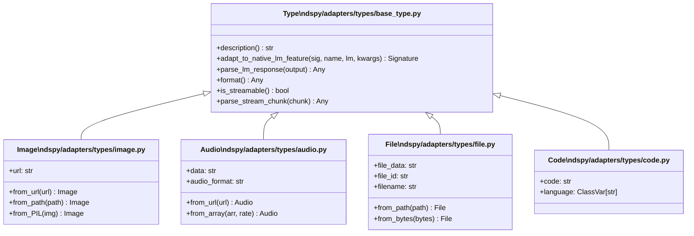
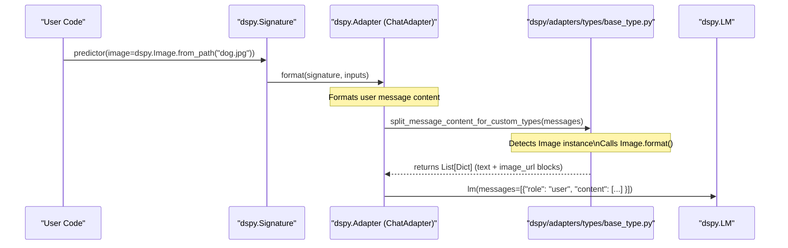

<!-- source: DeepWiki mcp.deepwiki.com · repo stanfordnlp/dspy · page 3.4 Custom Types & Multimodal Support · fetched 2026-10-27 -->

# Custom Types & Multimodal Support

<details>
<summary>Relevant source files</summary>

The following files were used as context for generating this wiki page:

- [docs/docs/api/evaluation/EvaluationResult.md](docs/docs/api/evaluation/EvaluationResult.md)
- [docs/docs/api/experimental/Citations.md](docs/docs/api/experimental/Citations.md)
- [docs/docs/api/experimental/Document.md](docs/docs/api/experimental/Document.md)
- [docs/docs/api/primitives/Audio.md](docs/docs/api/primitives/Audio.md)
- [docs/docs/api/primitives/Code.md](docs/docs/api/primitives/Code.md)
- [docs/docs/api/primitives/Image.md](docs/docs/api/primitives/Image.md)
- [docs/docs/api/primitives/ToolCalls.md](docs/docs/api/primitives/ToolCalls.md)
- [docs/docs/diving-deeper/adapters.md](docs/docs/diving-deeper/adapters.md)
- [docs/docs/tutorials/audio/index.ipynb](docs/docs/tutorials/audio/index.ipynb)
- [docs/docs/tutorials/image_generation_prompting/index.ipynb](docs/docs/tutorials/image_generation_prompting/index.ipynb)
- [dspy/adapters/types/audio.py](dspy/adapters/types/audio.py)
- [dspy/adapters/types/code.py](dspy/adapters/types/code.py)
- [dspy/adapters/types/file.py](dspy/adapters/types/file.py)
- [dspy/adapters/types/image.py](dspy/adapters/types/image.py)
- [tests/adapters/test_code.py](tests/adapters/test_code.py)
- [tests/adapters/test_resource_loading.py](tests/adapters/test_resource_loading.py)
- [tests/signatures/test_adapter_file.py](tests/signatures/test_adapter_file.py)
- [tests/signatures/test_adapter_image.py](tests/signatures/test_adapter_image.py)

</details>


This page documents DSPy's custom type system, which allows signatures to carry structured, non-text data (images, audio, files, code) and semantic annotations (reasoning, tool calls, citations) through the adapter pipeline. The type system determines how field values are serialized into LM messages and how LM responses are parsed back into typed Python objects.

---

## The `Type` Extension System

All custom DSPy types descend from a single base class, `Type`, defined in `dspy/adapters/types/base_type.py` [dspy/adapters/types/base_type.py:13](). Subclasses of `Type` can hook into the adapter lifecycle to handle multimodal formatting, native feature activation, and streaming.

| Class Method | Purpose |
|---|---|
| `description()` | Returns a string injected into the system prompt to describe the type to the LM [dspy/adapters/types/base_type.py:39-42](). |
| `adapt_to_native_lm_feature(signature, name, lm, lm_kwargs)` | Modifies the signature and LM kwargs before the call to activate native LM features (e.g., enabling reasoning or citation APIs) [dspy/adapters/types/base_type.py:79-102](). |
| `parse_lm_response(response)` | Extracts the field value from the raw LM response dict when native features are in use [dspy/adapters/types/base_type.py:123-132](). |
| `format()` | Defines how the type instance is converted into a structured message content block (e.g., `image_url` or `input_audio`) [dspy/adapters/types/base_type.py:36-37](). |
| `is_streamable()` | Boolean indicating if the type supports incremental parsing during streaming [dspy/adapters/types/base_type.py:104-107](). |
| `parse_stream_chunk(chunk)` | Logic to extract partial data from a `ModelResponseStream` chunk [dspy/adapters/types/base_type.py:109-121](). |

The function `split_message_content_for_custom_types` is called during the adapter's message preparation. It scans every message's content for embedded custom type instances and transforms string content into a mixed list of content blocks [dspy/adapters/types/base_type.py:135-195]().

**Sources:** `dspy/adapters/types/base_type.py` [dspy/adapters/types/base_type.py:13-195]()

---

## Built-in Custom Types

DSPy provides several built-in types to handle multimodal and semantic tasks.

**Type class hierarchy:**



**Sources:** `dspy/adapters/types/base_type.py` [dspy/adapters/types/base_type.py:19-37](), `dspy/adapters/types/image.py` [dspy/adapters/types/image.py:27-105](), `dspy/adapters/types/audio.py` [dspy/adapters/types/audio.py:27-63](), `dspy/adapters/types/file.py` [dspy/adapters/types/file.py:11-59](), `dspy/adapters/types/code.py` [dspy/adapters/types/code.py:10-84]()

---

## Multimodal Types: Image, Audio, and File

### Image
`dspy.Image` supports automatic normalization of various inputs (URLs, local paths, bytes, PIL images) into base64 data URIs or plain URLs [dspy/adapters/types/image.py:37-61](). The `format()` method generates an OpenAI-compatible `image_url` block [dspy/adapters/types/image.py:107-113]().

### Audio
`dspy.Audio` captures base64-encoded audio data and its format (e.g., `wav`, `mp3`) [dspy/adapters/types/audio.py:37-38](). It provides a `from_array` helper that uses `soundfile` to encode numpy arrays into bytes [dspy/adapters/types/audio.py:145-161](). Its `format()` method produces a block with `type: "input_audio"` [dspy/adapters/types/audio.py:65-70]().

### File
`dspy.File` handles generic file inputs, supporting `file_data` (Data URIs), `file_id` (pre-uploaded IDs), and `filename` [dspy/adapters/types/file.py:36-38](). It provides `from_path` to read local files and `from_bytes` for raw binary data [dspy/adapters/types/file.py:115-155](). The `format()` method outputs a `type: "file"` block [dspy/adapters/types/file.py:78-88]().

**Sources:** `dspy/adapters/types/image.py` [dspy/adapters/types/image.py:27-113](), `dspy/adapters/types/audio.py` [dspy/adapters/types/audio.py:27-161](), `dspy/adapters/types/file.py` [dspy/adapters/types/file.py:11-88]()

---

## Code Type

`dspy.Code` is used for fields containing source code. It supports dynamic language tagging using `dspy.Code["python"]` syntax via `__class_getitem__` [dspy/adapters/types/code.py:125-131]().

Key features include:
- **Markdown Filtering:** The `_filter_code` utility automatically extracts code from markdown code blocks (e.g., ` ```python ... ``` `) in LM responses [dspy/adapters/types/code.py:105-121]().
- **Serialization:** It overrides `serialize_model()` to return the raw code string, bypassing the standard `<<CUSTOM-TYPE-START-IDENTIFIER>>` tags used by other custom types [dspy/adapters/types/code.py:73-76]().

**Sources:** `dspy/adapters/types/code.py` [dspy/adapters/types/code.py:10-131]()

---

## Multimodal Data Flow: From Signature to LM

The diagram below illustrates how a `dspy.Image` entity in a signature is processed into the raw format expected by model providers.



**Sources:** `dspy/adapters/types/base_type.py` [dspy/adapters/types/base_type.py:135-160](), `dspy/adapters/types/image.py` [dspy/adapters/types/image.py:107-113](), `tests/signatures/test_adapter_image.py` [tests/signatures/test_adapter_image.py:113-128]()

---

## Type Coercion and Parsing

Adapters rely on `dspy/adapters/utils.py::parse_value` to handle type conversion, but custom types can provide their own parsing logic.

- **Input Validation:** Types use Pydantic `model_validator` or custom `__init__` logic to normalize inputs (e.g., converting a raw string to a `dspy.Code` object) [dspy/adapters/types/code.py:86-102]().
- **LM Response Parsing:** The `parse_lm_response` hook allows types to extract data from provider-specific response fields rather than just the text body [dspy/adapters/types/base_type.py:123-132]().

**Sources:** `dspy/adapters/types/base_type.py` [dspy/adapters/types/base_type.py:123-132](), `dspy/adapters/types/code.py` [dspy/adapters/types/code.py:86-102](), `dspy/diving-deeper/adapters.md` [docs/docs/diving-deeper/adapters.md:23-29]()

---

## Optimization and Persistence

Custom types ensure that structured data remains intact during optimization and serialization.

- **Example Data:** `dspy.Example` can store `Image`, `Audio`, or `File` objects, which are preserved by optimizers like `LabeledFewShot` during bootstrapping [tests/signatures/test_adapter_image.py:165-175](), [tests/signatures/test_adapter_file.py:193-202]().
- **Serialization:** Types use `serialize_model()` to ensure they can be saved/loaded within compiled programs. By default, this wraps the formatted value in `<<CUSTOM-TYPE-START-IDENTIFIER>>` tags [dspy/adapters/types/base_type.py:70-77]().

**Sources:** `dspy/adapters/types/base_type.py` [dspy/adapters/types/base_type.py:70-77](), `tests/signatures/test_adapter_image.py` [tests/signatures/test_adapter_image.py:165-184](), `tests/signatures/test_adapter_file.py` [tests/signatures/test_adapter_file.py:193-202]()

---

