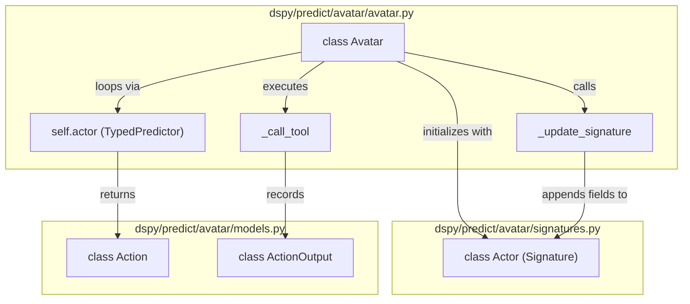
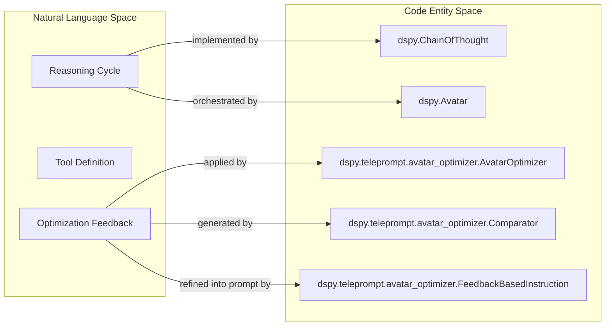

<!-- source: DeepWiki mcp.deepwiki.com · repo stanfordnlp/dspy · page 3.5 Module Composition & Refinement · fetched 2026-10-27 -->

# Module Composition & Refinement

Relevant source files

The following files were used as context for generating this wiki page:

- [docs/docs/api/optimizers/SIMBA.md](docs/docs/api/optimizers/SIMBA.md)
- [docs/docs/cheatsheet.md](docs/docs/cheatsheet.md)
- [docs/docs/tutorials/output_refinement/best-of-n-and-refine.md](docs/docs/tutorials/output_refinement/best-of-n-and-refine.md)
- [dspy/predict/avatar/__init__.py](dspy/predict/avatar/__init__.py)
- [dspy/predict/avatar/avatar.py](dspy/predict/avatar/avatar.py)
- [dspy/predict/avatar/models.py](dspy/predict/avatar/models.py)
- [dspy/predict/avatar/signatures.py](dspy/predict/avatar/signatures.py)
- [dspy/predict/best_of_n.py](dspy/predict/best_of_n.py)
- [dspy/predict/parallel.py](dspy/predict/parallel.py)
- [dspy/predict/refine.py](dspy/predict/refine.py)
- [dspy/teleprompt/avatar_optimizer.py](dspy/teleprompt/avatar_optimizer.py)
- [dspy/teleprompt/infer_rules.py](dspy/teleprompt/infer_rules.py)
- [dspy/teleprompt/simba.py](dspy/teleprompt/simba.py)
- [dspy/teleprompt/simba_utils.py](dspy/teleprompt/simba_utils.py)
- [dspy/utils/parallelizer.py](dspy/utils/parallelizer.py)
- [tests/evaluate/test_evaluate.py](tests/evaluate/test_evaluate.py)
- [tests/predict/test_parallel.py](tests/predict/test_parallel.py)
- [tests/utils/test_parallelizer.py](tests/utils/test_parallelizer.py)

## Purpose and Scope

This page documents DSPy's module composition patterns for building complex programs from simpler components. It covers the `Parallel`, `BestOfN`, and `Refine` modules that enable concurrent execution, output selection, and iterative refinement. It also details the `ReAct` and `Avatar` agentic modules, which compose reasoning and tool-use cycles, and the `Retry` mechanism for error handling.

For basic prediction modules like `Predict`, see [3.1 Predict Module](). For reasoning strategies like `ChainOfThought`, see [3.2 Reasoning Strategies](). For tool integration, see [3.3 Tool Integration & Function Calling]().

---

## Composition Architecture

DSPy modules follow a composable architecture where modules can wrap, coordinate, or chain other modules. This design enables both simple and complex composition patterns.

### Module Wrapping and Coordination

DSPy provides two distinct approaches to combining modules:

| Pattern | Description | Examples | Use Case |
|---------|-------------|----------|----------|
| **Wrapping** | One module internally uses another to extend its behavior. | `ChainOfThought` wraps `Predict` [dspy/predict/chain_of_thought.py:12-35]() | Adding reasoning or structure to a single step. |
| **Coordination** | A module manages the execution flow of multiple sub-modules. | `ReAct`, `Parallel`, `BestOfN`, `Avatar` | Multi-step reasoning, tool use, or concurrent exploration. |

**Sources:** [dspy/predict/chain_of_thought.py:12-35](), [dspy/predict/avatar/avatar.py:22-54]()

---

## Parallel Execution

The `Parallel` module provides a utility for multi-threaded execution of `(module, example)` pairs [dspy/predict/parallel.py:9-22](). It abstracts the complexity of thread management and isolation of global settings across tasks.

### Implementation Details
- **ParallelExecutor**: `Parallel` utilizes `ParallelExecutor` [dspy/utils/parallelizer.py:21-31]() to manage the `ThreadPoolExecutor`.
- **Context Isolation**: Each thread receives a copy of the parent's `thread_local_overrides` to ensure that settings like `lm` or `usage_tracker` do not leak between concurrent tasks [dspy/utils/parallelizer.py:125-131]().
- **Batch Method**: Most `dspy.Module` instances support a `.batch()` method which internally uses `Parallel` to execute inputs concurrently [tests/predict/test_parallel.py:100-115]().
- **Error Handling**: The executor tracks `failed_indices` and an `exceptions_map` to provide robust error reporting [dspy/utils/parallelizer.py:47-48]().

**Sources:** [dspy/predict/parallel.py:9-125](), [dspy/utils/parallelizer.py:21-156](), [tests/predict/test_parallel.py:100-115]()

---

## Agentic Composition: ReAct and Avatar

Agentic modules compose reasoning steps with external tool execution in a loop.

### ReAct (Reasoning and Acting)
`ReAct` implements an iterative loop where the model selects a tool, receives an observation, and updates its trajectory [dspy/predict/react.py:16-23]().
- **Polymorphism**: The DSPy version is generalized to work over any `Signature` [dspy/predict/react.py:22-23]().
- **Internal Modules**: It uses a `Predict` module for the `react_signature` (deciding thoughts/tools) and a `ChainOfThought` module for the `fallback_signature` (final extraction) [dspy/predict/react.py:87-88]().

### Avatar
`Avatar` is a dynamic agentic module that uses `TypedPredictor` and signature modification to handle multi-turn tool use [dspy/predict/avatar/avatar.py:22-52]().
- **Dynamic Signatures**: Unlike fixed reasoning chains, `Avatar` updates its signature at each iteration using `_update_signature` [dspy/predict/avatar/avatar.py:68-100]().
- **State Progression**: It appends `action_{idx}` and `result_{idx}` fields to the `Actor` signature to maintain a structured history of tool interactions [dspy/predict/avatar/avatar.py:73-80]().
- **Tool Handling**: It uses a `finish_tool` to signal task completion and extract the final `Prediction` [dspy/predict/avatar/avatar.py:34-40]().

### Code Entity Space: Agentic Flow

**Diagram: Avatar Implementation Entities**

**Sources:** [dspy/predict/avatar/avatar.py:22-163](), [dspy/predict/avatar/signatures.py:5-21](), [dspy/predict/avatar/models.py:1-10](), [dspy/predict/react.py:16-118]()

---

## Error Handling: The Retry Mechanism

The `Retry` module provides a way to handle validation failures by passing errors back to the model for correction. It wraps an existing module and modifies its signature to accept feedback.

1. **Signature Expansion**: It creates a `new_signature` by adding `past_[field]` input fields for every output field in the original signature, plus a `feedback` field [dspy/predict/retry.py:16-32]().
2. **Backtracking Integration**: In the `__call__` method, it checks `dspy.settings.backtrack_to` to determine if it should trigger the retry logic using `past_outputs` and feedback instructions [dspy/predict/retry.py:52-74]().

**Sources:** [dspy/predict/retry.py:8-74]()

---

## Selection and Refinement Patterns

### BestOfN
The `BestOfN` module executes a sub-module up to `N` times with different `rollout_id` values and `temperature=1.0` [dspy/predict/best_of_n.py:7-19](). It selects the first prediction that meets a `threshold` defined by a `reward_fn`, or returns the highest-scoring prediction after `N` attempts [dspy/predict/best_of_n.py:53-74]().

### Refine
`Refine` extends the `BestOfN` concept by providing feedback to subsequent attempts. If a prediction fails to meet the `threshold`, it uses an `OfferFeedback` signature to analyze the program code, trajectory, and reward to generate `advice` [dspy/predict/refine.py:15-40](). This advice is passed as a `hint_` field to the module's signature in the next rollout via a `WrapperAdapter` [dspy/predict/refine.py:121-130]().

**Sources:** [dspy/predict/best_of_n.py:7-84](), [dspy/predict/refine.py:41-160]()

---

## Optimization of Composed Modules

Composed programs can be optimized using specialized teleprompters like `AvatarOptimizer` or `SIMBA`.

### Avatar Optimization Logic
1. **Evaluation**: Runs the agent on a training set and scores results using a provided `metric` [dspy/teleprompt/avatar_optimizer.py:93-112]().
2. **Comparison**: Uses a `Comparator` signature to contrast patterns in successful (`pos_input_with_metrics`) vs. failed (`neg_input_with_metrics`) inputs [dspy/teleprompt/avatar_optimizer.py:22-44]().
3. **Refinement**: Incorporates feedback into a `FeedbackBasedInstruction` signature to generate a `new_instruction` for the agent [dspy/teleprompt/avatar_optimizer.py:47-64]().

### SIMBA (Stochastic Introspective Mini-Batch Ascent)
`SIMBA` is an introspective optimizer that uses an LLM to generate improvement rules [dspy/teleprompt/simba.py:17-27](). It identifies challenging examples with high output variability and uses strategies like `append_a_rule` or `append_a_demo` to create self-reflective instructions or add successful examples as demonstrations [dspy/teleprompt/simba.py:81-84]().

### Natural Language to Code Entity Mapping

**Diagram: Mapping Agentic Concepts to DSPy Classes**

**Sources:** [dspy/teleprompt/avatar_optimizer.py:22-91](), [dspy/predict/avatar/avatar.py:22-54](), [dspy/predict/chain_of_thought.py:12-35](), [dspy/teleprompt/simba.py:17-85]()

---

## Summary of Composition Modules

| Module | Implementation Class | Core Logic | File Reference |
|--------|----------------------|------------|----------------|
| **Parallel** | `dspy.Parallel` | Concurrent execution of multiple module calls via `ParallelExecutor` | [dspy/predict/parallel.py:9]() |
| **Avatar** | `dspy.Avatar` | Dynamic signature modification for multi-turn tool-using agents | [dspy/predict/avatar/avatar.py:22]() |
| **BestOfN** | `dspy.BestOfN` | Generates multiple candidates and selects the best based on a metric | [dspy/predict/best_of_n.py:7]() |
| **Refine** | `dspy.Refine` | Iteratively improves an initial output by providing previous attempts as context | [dspy/predict/refine.py:41]() |
| **ReAct** | `dspy.ReAct` | Iterative reasoning and tool-calling loop over any signature | [dspy/predict/react.py:16]() |
| **ChainOfThought** | `dspy.ChainOfThought` | Prepends a reasoning field to a signature and wraps it in `Predict` | [dspy/predict/chain_of_thought.py:12]() |

**Sources:** [dspy/predict/parallel.py:9-20](), [dspy/predict/avatar/avatar.py:22-30](), [dspy/predict/chain_of_thought.py:12-35](), [dspy/predict/react.py:16-41](), [dspy/predict/best_of_n.py:7-15](), [dspy/predict/refine.py:41-49]()

---

