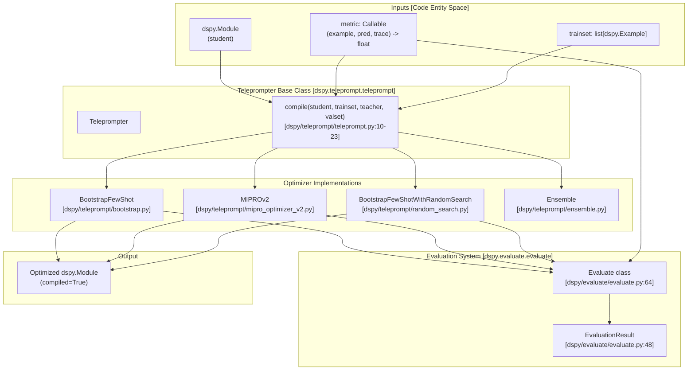
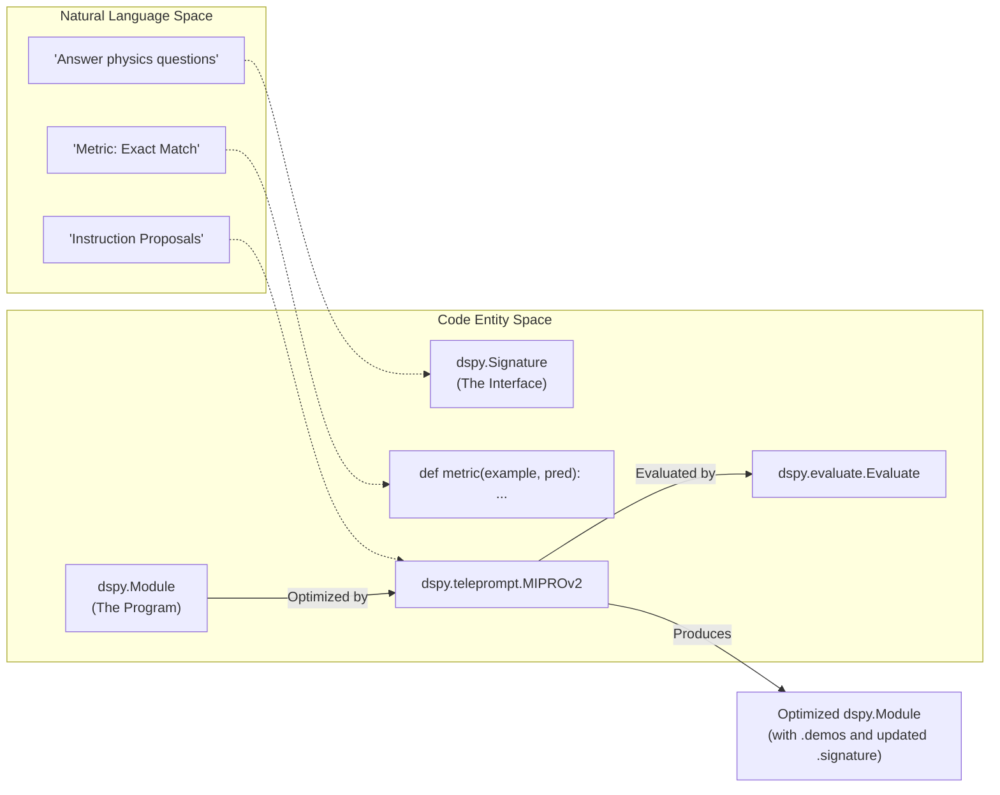

<!-- source: DeepWiki mcp.deepwiki.com · repo stanfordnlp/dspy · page 4 Program Optimization · fetched 2026-10-27 -->

# Program Optimization

Relevant source files

The following files were used as context for generating this wiki page:

- [docs/docs/api/optimizers/BetterTogether.md](docs/docs/api/optimizers/BetterTogether.md)
- [docs/docs/learn/optimization/optimizers.md](docs/docs/learn/optimization/optimizers.md)
- [docs/docs/learn/optimization/overview.md](docs/docs/learn/optimization/overview.md)
- [dspy/evaluate/evaluate.py](dspy/evaluate/evaluate.py)
- [dspy/teleprompt/__init__.py](dspy/teleprompt/__init__.py)
- [dspy/teleprompt/bootstrap.py](dspy/teleprompt/bootstrap.py)
- [dspy/teleprompt/copro_optimizer.py](dspy/teleprompt/copro_optimizer.py)
- [dspy/teleprompt/random_search.py](dspy/teleprompt/random_search.py)
- [dspy/teleprompt/signature_opt.py](dspy/teleprompt/signature_opt.py)
- [dspy/teleprompt/teleprompt_optuna.py](dspy/teleprompt/teleprompt_optuna.py)
- [tests/teleprompt/test_bettertogether.py](tests/teleprompt/test_bettertogether.py)
- [tests/teleprompt/test_random_search.py](tests/teleprompt/test_random_search.py)

## Purpose and Scope

This page provides a high-level technical guide to DSPy's optimization system, referred to in the codebase as the **Teleprompter** system. A DSPy optimizer is an algorithm that tunes the parameters of a DSPy program—specifically the natural language prompts (instructions and demonstrations) and/or the LM weights—to maximize a specified metric [docs/docs/learn/optimization/optimizers.md:8-9]().

The system follows a "compile-then-run" philosophy where a declarative program is passed through an optimizer to produce an executable, high-performing artifact. Optimizers typically require three inputs: the program (`student`), a metric function, and a training set (`trainset`) [dspy/teleprompt/bootstrap.py:84-85]().

For detailed information on specific subsystems, see the child pages:
- **[Optimization Overview](#4.1)** — Philosophy, the compile-then-run model, and the selection logic for different optimizers [docs/docs/learn/optimization/overview.md:6-12]().
- **[Evaluation Framework](#4.2)** — `dspy.Evaluate`, parallel execution, and `EvaluationResult` handling [dspy/evaluate/evaluate.py:48-64]().
- **[Few-Shot Optimizers](#4.3)** — `BootstrapFewShot`, `LabeledFewShot`, `KNNFewShot`, and `BootstrapFewShotWithRandomSearch` [dspy/teleprompt/bootstrap.py:36](), [dspy/teleprompt/vanilla.py:15](), [dspy/teleprompt/random_search.py:27]().
- **[MIPROv2: Instruction & Parameter Optimization](#4.4)** — Bayesian optimization of instructions and demonstrations [dspy/teleprompt/mipro_optimizer_v2.py:60]().
- **[GEPA & SIMBA: Reflective and Stochastic Optimization](#4.5)** — Evolution, self-reflective improvement rules, and trajectory reflection [dspy/teleprompt/simba.py:12](), [dspy/teleprompt/__init__.py:17]().
- **[Fine-tuning & Weight Optimization](#4.6)** — `BootstrapFinetune` and reinforcement learning workflows like `GRPO` for distilling programs into weight updates [dspy/teleprompt/bootstrap_finetune.py:10]().

## Optimization System Architecture

DSPy's optimization system transforms unoptimized programs into high-performing systems by automatically generating demonstrations, instructions, and weight updates. The system operates on three required inputs: a `dspy.Module` program, a metric function, and training examples stored as `dspy.Example` objects.

**System Architecture: Optimization Pipeline**

Sources: [dspy/teleprompt/teleprompt.py:6-23](), [dspy/evaluate/evaluate.py:48-64](), [dspy/teleprompt/bootstrap.py:36-46](), [dspy/teleprompt/random_search.py:27-40]()

## Core Components

### Teleprompter Base Class
The `Teleprompter` class at [dspy/teleprompt/teleprompt.py:6-33]() is the abstract base class. It defines the `compile` method signature which all optimizers must implement. Most optimizers take a `student` program and an optional `teacher` program to generate traces [dspy/teleprompt/bootstrap.py:84-100]().

### Evaluation Framework (`dspy.Evaluate`)
The `Evaluate` class [dspy/evaluate/evaluate.py:64-111]() is the primary engine for measuring program performance. It handles parallel execution via `ParallelExecutor` [dspy/evaluate/evaluate.py:162]() and returns `EvaluationResult` objects containing aggregate scores and individual results [dspy/evaluate/evaluate.py:48-62]().

### Metric Functions
Metrics are the "loss functions" of DSPy. A metric is a `Callable` that accepts an `Example`, a `Prediction`, and an optional `trace` [dspy/evaluate/evaluate.py:149-153](). Metrics return a numeric score where higher is better. During optimization (specifically bootstrapping), the `trace` is used to determine if a specific execution path was successful enough to be used as a few-shot demonstration [dspy/teleprompt/bootstrap.py:152-160]().

## Optimizer Categories

### Few-Shot Optimizers
These optimizers extend signatures by automatically generating and including optimized examples (demos) within the prompt [docs/docs/learn/optimization/optimizers.md:40-43]().
- **`LabeledFewShot`**: Constructs demos from provided labeled data points [dspy/teleprompt/vanilla.py:15]().
- **`BootstrapFewShot`**: Uses a teacher module to generate complete demonstrations for every stage of a program by tracing successful executions [dspy/teleprompt/bootstrap.py:36-46]().
- **`BootstrapFewShotWithRandomSearch`**: Runs `BootstrapFewShot` multiple times with randomized example sets and selects the best candidate [dspy/teleprompt/random_search.py:27-40]().
- **`KNNFewShot`**: Uses k-Nearest Neighbors to find the most relevant training examples for a given input [dspy/teleprompt/__init__.py:9]().

### Instruction & Parameter Optimizers
- **`MIPROv2`**: Jointly optimizes instructions and few-shot examples using Bayesian Optimization (via `optuna`) to search the space of potential prompts [dspy/teleprompt/mipro_optimizer_v2.py:60-79]().
- **`COPRO`**: Generates and refines instructions using coordinate ascent (hill-climbing) [dspy/teleprompt/copro_optimizer.py:60-68]().
- **`SIMBA`**: Uses stochastic mini-batch sampling to identify challenging examples and generates self-reflective improvement rules [dspy/teleprompt/simba.py:12]().
- **`GEPA`**: Uses LMs to reflect on program trajectories to identify gaps and propose prompt improvements [dspy/teleprompt/__init__.py:17]().

### Weight Optimization & Meta-Optimizers
- **`BootstrapFinetune`**: Distills prompt-based programs into weight updates for the underlying LLM [dspy/teleprompt/bootstrap_finetune.py:10]().
- **`BetterTogether`**: A meta-optimizer that chains prompt and weight optimization (e.g., `"p -> w -> p"`) to leverage their complementary strengths [docs/docs/api/optimizers/BetterTogether.md:31-51]().

## Optimization Workflow

**Natural Language to Code Entity Mapping**

Sources: [dspy/teleprompt/mipro_optimizer_v2.py:60-79](), [dspy/evaluate/evaluate.py:118-128](), [docs/docs/learn/optimization/optimizers.md:24-32]()

1.  **Define Program**: Create a `dspy.Module` with defined `Signatures`.
2.  **Define Metric**: Create a function to evaluate output quality [dspy/evaluate/evaluate.py:149]().
3.  **Select Optimizer**: Choose a `Teleprompter` based on whether you need few-shot demos, instruction optimization, or fine-tuning [dspy/teleprompt/__init__.py:1-17]().
4.  **Compile**: Call `optimizer.compile(student, trainset=...)` which triggers the optimization loop [dspy/teleprompt/bootstrap.py:84]().
5.  **Iterate**: Use `dspy.Evaluate` to verify the performance of the compiled program against a validation set [dspy/evaluate/evaluate.py:117]().

Sources: [dspy/teleprompt/teleprompt.py:6-23](), [dspy/evaluate/evaluate.py:64-111](), [dspy/teleprompt/bootstrap.py:84-94](), [docs/docs/api/optimizers/BetterTogether.md:42-51]()

---

