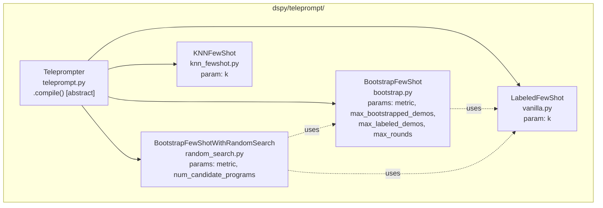
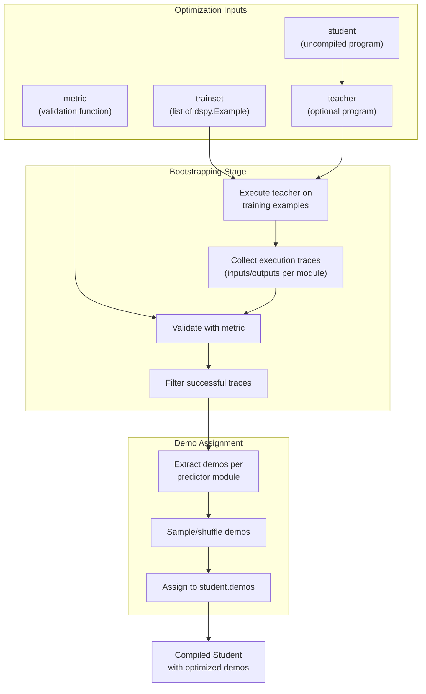
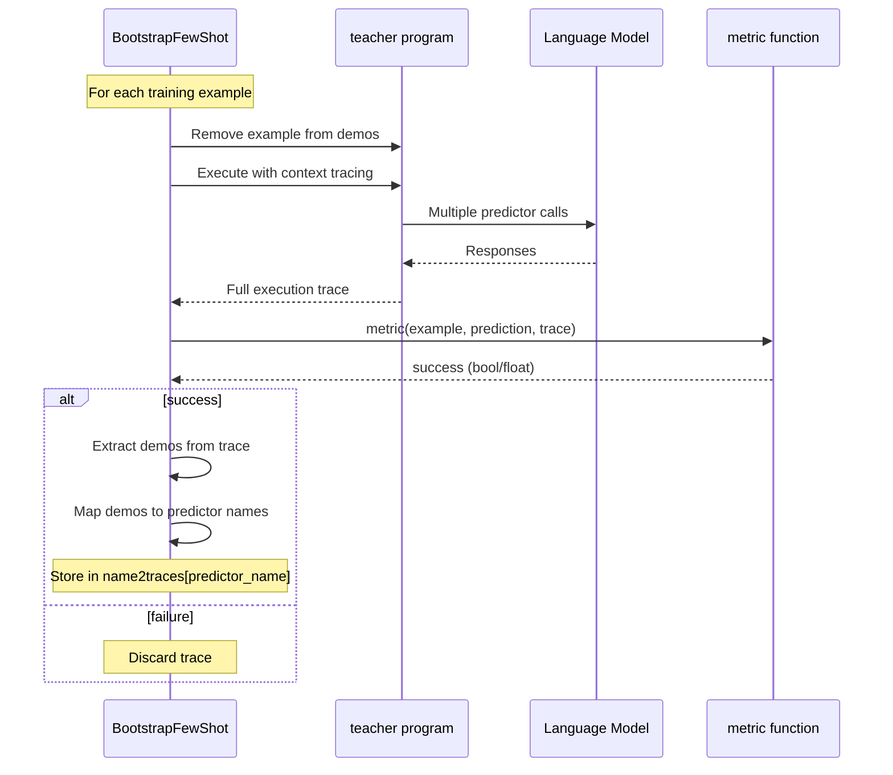
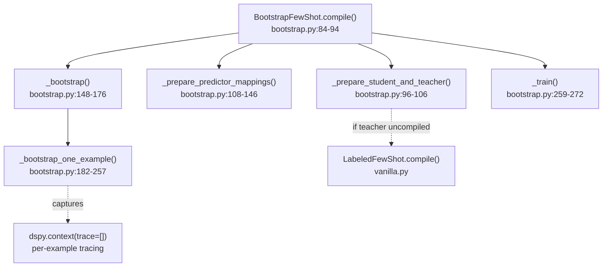
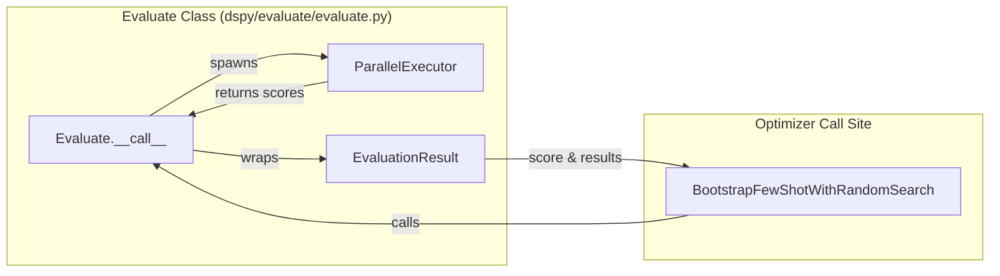

<!-- source: DeepWiki mcp.deepwiki.com · repo stanfordnlp/dspy · page 4.3 Few-Shot Optimizers · fetched 2026-10-27 -->

# Few-Shot Optimizers

Relevant source files

The following files were used as context for generating this wiki page:

- [dspy/adapters/types/history.py](dspy/adapters/types/history.py)
- [dspy/evaluate/evaluate.py](dspy/evaluate/evaluate.py)
- [dspy/predict/chain_of_thought.py](dspy/predict/chain_of_thought.py)
- [dspy/predict/knn.py](dspy/predict/knn.py)
- [dspy/teleprompt/__init__.py](dspy/teleprompt/__init__.py)
- [dspy/teleprompt/bootstrap.py](dspy/teleprompt/bootstrap.py)
- [dspy/teleprompt/copro_optimizer.py](dspy/teleprompt/copro_optimizer.py)
- [dspy/teleprompt/ensemble.py](dspy/teleprompt/ensemble.py)
- [dspy/teleprompt/knn_fewshot.py](dspy/teleprompt/knn_fewshot.py)
- [dspy/teleprompt/random_search.py](dspy/teleprompt/random_search.py)
- [dspy/teleprompt/signature_opt.py](dspy/teleprompt/signature_opt.py)
- [dspy/teleprompt/teleprompt_optuna.py](dspy/teleprompt/teleprompt_optuna.py)
- [dspy/teleprompt/vanilla.py](dspy/teleprompt/vanilla.py)
- [tests/adapters/test_reasoning.py](tests/adapters/test_reasoning.py)
- [tests/predict/test_chain_of_thought.py](tests/predict/test_chain_of_thought.py)
- [tests/predict/test_knn.py](tests/predict/test_knn.py)
- [tests/predict/test_multi_chain_comparison.py](tests/predict/test_multi_chain_comparison.py)
- [tests/predict/test_retry.py](tests/predict/test_retry.py)
- [tests/teleprompt/test_bootstrap.py](tests/teleprompt/test_bootstrap.py)
- [tests/teleprompt/test_copro_optimizer.py](tests/teleprompt/test_copro_optimizer.py)
- [tests/teleprompt/test_knn_fewshot.py](tests/teleprompt/test_knn_fewshot.py)
- [tests/teleprompt/test_random_search.py](tests/teleprompt/test_random_search.py)

## Purpose and Scope

This page documents DSPy optimizers that improve program performance by automatically generating or selecting **few-shot demonstrations** (examples) to include in prompts. These optimizers focus on enhancing the in-context learning capabilities of language models by providing high-quality examples that illustrate the desired input-output behavior.

For instruction optimization (tuning the natural-language instructions in prompts), see page 4.4 (MIPROv2: Instruction & Parameter Optimization). For weight-based optimization through fine-tuning, see page 4.6 (Fine-tuning & Weight Optimization). For the general optimization framework and evaluation, see page 4.1 (Optimization Overview) and page 4.2 (Evaluation Framework).

Sources: `[dspy/teleprompt/bootstrap.py:36-72]()`, `[dspy/teleprompt/random_search.py:27-56]()`

---

## Overview of Few-Shot Optimization

Few-shot optimizers in DSPy extend module signatures by automatically generating and including optimized demonstrations within prompts sent to the language model. Rather than manually crafting examples or using random samples from training data, these optimizers intelligently select or generate demonstrations that maximize the program's performance on a given metric.

The key distinction among few-shot optimizers is their **demo generation strategy**:

| Optimizer | Demo Source | Selection Strategy | Use Case |
|-----------|-------------|-------------------|----------|
| `LabeledFewShot` | Labeled training data | Random sampling | Simple baseline with labeled data |
| `BootstrapFewShot` | Generated via teacher execution | Metric-based filtering | Self-improving with partial data |
| `BootstrapFewShotWithRandomSearch` | Multiple bootstrap runs | Random search over candidates | Finding optimal demo combinations |
| `KNNFewShot` | Training data via similarity | K-nearest neighbors | Task-adaptive demo selection |

All few-shot optimizers produce a compiled program where each `dspy.Predict` module (or subclass) has its `demos` attribute populated with demonstration examples.

---

**Class Hierarchy: Few-Shot Optimizer Implementations**

Sources: `[dspy/teleprompt/bootstrap.py:1-10]()`, `[dspy/teleprompt/random_search.py:1-9]()`, `[dspy/teleprompt/knn_fewshot.py:11-22]()`

---

## The Bootstrapping Process

### Conceptual Overview

**Bootstrapping** is the core mechanism used by `BootstrapFewShot` and related optimizers. It involves using a "teacher" program (which may be the same program being optimized) to generate complete input-output traces that serve as demonstrations for the "student" program.

**Diagram: Bootstrapping Pipeline Overview**

The process consists of three phases:
1. **Execution**: Run the teacher program on training examples to generate candidate demonstrations.
2. **Validation**: Filter demonstrations using the provided metric function.
3. **Assignment**: Distribute validated demonstrations to corresponding modules in the student program.

Sources: `[dspy/teleprompt/bootstrap.py:148-272]()`

### Detailed Bootstrapping Mechanism

The `_bootstrap_one_example()` method in `BootstrapFewShot` implements the per-example bootstrapping logic:

**Diagram: Single Example Bootstrapping Sequence**

Key implementation details:

1. **Temperature Bypass**: For multiple rounds (`round_idx > 0`), the LM is copied with `temperature=1.0` and a fresh `rollout_id` to bypass caches and generate diverse traces `[dspy/teleprompt/bootstrap.py:188-190]()`.

2. **Demo Exclusion**: The current example is temporarily removed from the teacher's demos to prevent leakage during self-bootstrapping `[dspy/teleprompt/bootstrap.py:194-195]()`.

3. **Trace Collection**: DSPy's context tracing captures each predictor's inputs and outputs during the teacher's forward pass `[dspy/teleprompt/bootstrap.py:185-186]()`.

4. **Metric Validation**: Traces are only kept if they satisfy the metric. If `metric_threshold` is provided, numeric scores are compared; otherwise, the metric's boolean result is used `[dspy/teleprompt/bootstrap.py:202-209]()`.

5. **Multi-Step Handling**: When a single example generates multiple traces for the same predictor (e.g., in multi-hop pipelines), the optimizer randomly samples either from the intermediate traces or the final trace with 50/50 probability `[dspy/teleprompt/bootstrap.py:247-251]()`.

Sources: `[dspy/teleprompt/bootstrap.py:179-254]()`

---

## Individual Optimizers

### LabeledFewShot

**Class**: `dspy.teleprompt.LabeledFewShot`

The simplest few-shot optimizer that constructs demonstrations directly from labeled training data without any bootstrapping. It randomly samples `k` complete examples from the `trainset` and assigns them as demos to each predictor.

Sources: `[dspy/teleprompt/vanilla.py:1-16]()` (referenced via `[dspy/teleprompt/bootstrap.py:10]()`)

---

### BootstrapFewShot

**Class**: `dspy.teleprompt.BootstrapFewShot`

The core bootstrapping optimizer that generates demonstrations by executing a teacher program on training examples and validating the results with a metric function.

**BootstrapFewShot: Internal Method Structure**

Sources: `[dspy/teleprompt/bootstrap.py:84-272]()`

**Key Parameters**:
- `metric` (Callable): Function that evaluates `(example, prediction, trace)` `[dspy/teleprompt/bootstrap.py:54-56]()`.
- `metric_threshold` (float, optional): Minimum metric score for accepting a trace `[dspy/teleprompt/bootstrap.py:57-59]()`.
- `max_bootstrapped_demos` (int): Maximum bootstrapped demonstrations per predictor (default: 4) `[dspy/teleprompt/bootstrap.py:61-62]()`.
- `max_labeled_demos` (int): Maximum labeled demonstrations per predictor (default: 16) `[dspy/teleprompt/bootstrap.py:63-64]()`.
- `max_rounds` (int): Number of bootstrap attempts per example (default: 1) `[dspy/teleprompt/bootstrap.py:65-69]()`.

**Teacher Preparation**:
- If `teacher` is None, a `deepcopy()` of the student is used as teacher `[dspy/teleprompt/bootstrap.py:100]()`.
- If the teacher is uncompiled, it's first compiled with `LabeledFewShot` using `max_labeled_demos` `[dspy/teleprompt/bootstrap.py:104-106]()`.

---

### BootstrapFewShotWithRandomSearch

**Class**: `dspy.teleprompt.BootstrapFewShotWithRandomSearch` (also known as **BootstrapRS**)

Extends `BootstrapFewShot` by performing random search over multiple candidate programs with different demo configurations, then selecting the best performer on a validation set.

**Candidate Generation Strategy**:
The optimizer generates `num_candidate_programs + 3` candidates with special seeds `[dspy/teleprompt/random_search.py:75-120]()`:
1. **Seed -3**: Zero-shot baseline `[dspy/teleprompt/random_search.py:81-83]()`.
2. **Seed -2**: `LabeledFewShot` only `[dspy/teleprompt/random_search.py:85-88]()`.
3. **Seed -1**: Standard `BootstrapFewShot` with unshuffled trainset `[dspy/teleprompt/random_search.py:90-101]()`.
4. **Seeds 0+**: Multiple `BootstrapFewShot` runs with shuffled trainsets and randomized demo counts `[dspy/teleprompt/random_search.py:103-119]()`.

**Evaluation and Selection**:
Each candidate is evaluated on `valset` (or `trainset` if `valset` is not provided) using `dspy.Evaluate` `[dspy/teleprompt/random_search.py:121-130]()`. The best program is returned, and all evaluated candidates are attached to the `candidate_programs` attribute sorted by score `[dspy/teleprompt/random_search.py:151-154]()`.

Sources: `[dspy/teleprompt/random_search.py:27-158]()`

---

### KNNFewShot

**Class**: `dspy.teleprompt.KNNFewShot`

Uses k-Nearest Neighbors (KNN) algorithm to dynamically select demonstrations at inference time based on similarity to the current input.

**Mechanism**:
1. At initialization, it creates a `KNN` retriever instance with the training set and an `Embedder` `[dspy/teleprompt/knn_fewshot.py:52]()`.
2. The `KNN` class computes embeddings for all training examples by concatenating input keys `[dspy/predict/knn.py:43-47]()`.
3. During the forward pass of the compiled program, it retrieves the `k` most similar examples for the specific input `[dspy/teleprompt/knn_fewshot.py:59]()`.
4. It then dynamically compiles a temporary `BootstrapFewShot` program using those specific neighbors as the training set for that specific call `[dspy/teleprompt/knn_fewshot.py:60-66]()`.

Sources: `[dspy/teleprompt/knn_fewshot.py:11-70]()`, `[dspy/predict/knn.py:8-53]()`

---

### BootstrapFewShotWithOptuna

**Class**: `dspy.teleprompt.BootstrapFewShotWithOptuna`

An advanced optimizer that uses Bayesian optimization via the `optuna` library to select the best combination of demonstrations.

**Workflow**:
1. It first runs `BootstrapFewShot` to gather a pool of candidate demonstrations for each predictor `[dspy/teleprompt/teleprompt_optuna.py:74-83]()`.
2. It defines an `objective` function for Optuna that samples a `demo_index` for each predictor and evaluates the resulting program on the validation set `[dspy/teleprompt/teleprompt_optuna.py:48-66]()`.
3. It creates an Optuna study to maximize the metric over `num_candidate_programs` trials `[dspy/teleprompt/teleprompt_optuna.py:84-85]()`.

Sources: `[dspy/teleprompt/teleprompt_optuna.py:20-90]()`

---

## Interaction with Evaluation Framework

Few-shot optimizers rely on `dspy.Evaluate` for validation and selection. The evaluation framework provides parallel execution and metric aggregation.

**Implementation Details**:
- `Evaluate` supports `num_threads` for parallel processing `[dspy/evaluate/evaluate.py:90]()`.
- The `metric` function is expected to return a boolean or float representing the quality of a prediction `[dspy/teleprompt/bootstrap.py:54-56]()`.
- `BootstrapFewShotWithRandomSearch` utilizes `Evaluate` to score each candidate program `[dspy/teleprompt/random_search.py:121-132]()`.

Sources: `[dspy/evaluate/evaluate.py:64-161]()`, `[dspy/teleprompt/random_search.py:121-132]()`, `[dspy/teleprompt/bootstrap.py:73-74]()`

---

## Error Handling during Optimization

The bootstrapping process tracks errors with thread-safe counting to ensure robustness during long optimization runs:

- **Error Lock**: A `threading.Lock` is used to increment the error count across multiple threads `[dspy/teleprompt/bootstrap.py:81-82]()`.
- **Threshold**: If `error_count` exceeds `max_errors`, the optimizer terminates and raises the exception `[dspy/teleprompt/bootstrap.py:210-218]()`.
- **Defaulting**: If not explicitly provided, `max_errors` inherits from global `dspy.settings.max_errors` `[dspy/teleprompt/bootstrap.py:71]()`.

Sources: `[dspy/teleprompt/bootstrap.py:36-82]()`, `[dspy/teleprompt/bootstrap.py:210-218]()`

---

