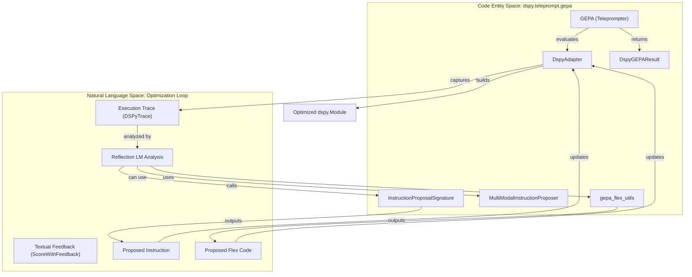
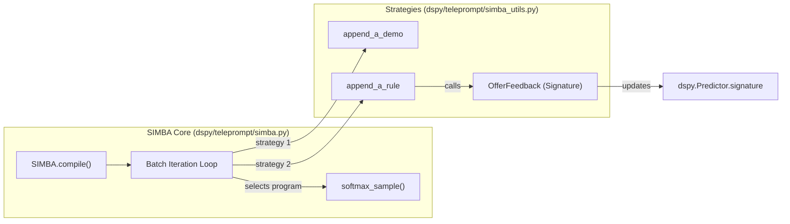
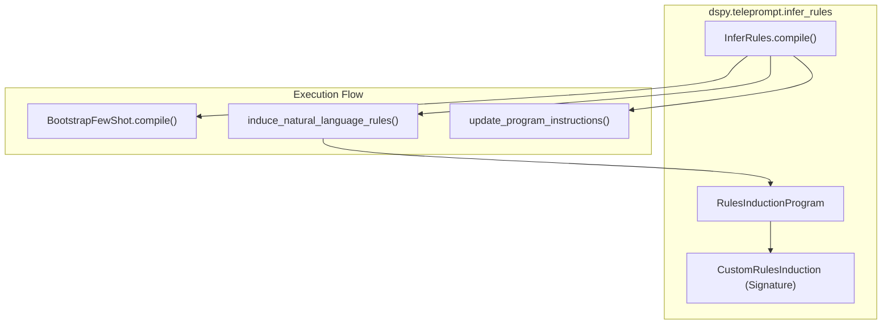

<!-- source: DeepWiki mcp.deepwiki.com · repo stanfordnlp/dspy · page 4.5 GEPA & SIMBA: Reflective and Stochastic Optimization · fetched 2026-10-27 -->

# GEPA & SIMBA: Reflective and Stochastic Optimization

Relevant source files

The following files were used as context for generating this wiki page:

- [docs/docs/api/optimizers/GEPA/GEPA_Advanced.md](docs/docs/api/optimizers/GEPA/GEPA_Advanced.md)
- [docs/docs/api/optimizers/GEPA/overview.md](docs/docs/api/optimizers/GEPA/overview.md)
- [docs/docs/api/optimizers/SIMBA.md](docs/docs/api/optimizers/SIMBA.md)
- [docs/docs/cheatsheet.md](docs/docs/cheatsheet.md)
- [docs/docs/tutorials/gepa_aime/index.ipynb](docs/docs/tutorials/gepa_aime/index.ipynb)
- [docs/docs/tutorials/gepa_facilitysupportanalyzer/index.ipynb](docs/docs/tutorials/gepa_facilitysupportanalyzer/index.ipynb)
- [docs/docs/tutorials/gepa_papillon/index.ipynb](docs/docs/tutorials/gepa_papillon/index.ipynb)
- [dspy/predict/best_of_n.py](dspy/predict/best_of_n.py)
- [dspy/predict/refine.py](dspy/predict/refine.py)
- [dspy/teleprompt/bootstrap_trace.py](dspy/teleprompt/bootstrap_trace.py)
- [dspy/teleprompt/gepa/gepa.py](dspy/teleprompt/gepa/gepa.py)
- [dspy/teleprompt/gepa/gepa_utils.py](dspy/teleprompt/gepa/gepa_utils.py)
- [dspy/teleprompt/gepa/instruction_proposal.py](dspy/teleprompt/gepa/instruction_proposal.py)
- [dspy/teleprompt/infer_rules.py](dspy/teleprompt/infer_rules.py)
- [dspy/teleprompt/simba.py](dspy/teleprompt/simba.py)
- [dspy/teleprompt/simba_utils.py](dspy/teleprompt/simba_utils.py)
- [tests/teleprompt/test_bootstrap_trace.py](tests/teleprompt/test_bootstrap_trace.py)
- [tests/teleprompt/test_gepa.py](tests/teleprompt/test_gepa.py)
- [tests/teleprompt/test_gepa_instruction_proposer.py](tests/teleprompt/test_gepa_instruction_proposer.py)

## Purpose and Scope

This page documents two advanced optimization strategies in DSPy: **GEPA** (Genetic Evolution of Prompts through Adaptation) and **SIMBA** (Stochastic Introspective Mini-Batch Ascent). While both aim to improve program performance through automated prompt refinement, they employ fundamentally different philosophies: GEPA uses a **reflective, tree-based evolution** driven by textual feedback, while SIMBA uses a **stochastic, mini-batch ascent** approach that alternates between adding successful demonstrations and introspective rule generation.

Sources: [dspy/teleprompt/gepa/gepa.py:155-165](), [dspy/teleprompt/simba.py:18-26]()

## GEPA: Reflective Prompt Evolution

GEPA is an evolutionary optimizer that uses reflection to evolve text components of complex systems. It captures full execution traces of a DSPy module, identifies predictor-specific segments, and reflects on their behavior to propose new instructions. A unique capability of GEPA is its support for `dspy.Flex` modules, where it can optimize raw Python code alongside natural language instructions [dspy/teleprompt/gepa/gepa.py:121-129]().

### System Architecture & Data Flow

GEPA's optimization loop is managed by the `GEPA` class [dspy/teleprompt/gepa/gepa.py:155](), which coordinates with a `DspyAdapter` [dspy/teleprompt/gepa/gepa_utils.py:86]() to interface between the DSPy module and the underlying GEPA evolutionary engine.

Sources: [dspy/teleprompt/gepa/gepa.py:155-165](), [dspy/teleprompt/gepa/gepa_utils.py:86-134](), [dspy/teleprompt/gepa/gepa.py:60-80](), [dspy/teleprompt/gepa/instruction_proposal.py:13-88](), [dspy/teleprompt/gepa/gepa_utils.py:114-117]()

### Key Classes and Functions

*   **`GEPA` Class**: The main entry point. It accepts a `metric` (which should return `ScoreWithFeedback`), and optional `reflection_lm` [dspy/teleprompt/gepa/gepa.py:155-200](). It maintains a Pareto frontier of candidates [docs/docs/api/optimizers/GEPA/overview.md:80-83]().
*   **`DspyAdapter`**: Manages the program lifecycle. It implements `build_program` [dspy/teleprompt/gepa/gepa_utils.py:175]() to apply new instructions to predictors and `propose_new_texts` [dspy/teleprompt/gepa/gepa_utils.py:119]() to coordinate between the instruction proposer and the `dspy.Flex` code proposer.
*   **`ScoreWithFeedback`**: A specialized `Prediction` type that includes both a numeric `score` and a string `feedback` [dspy/teleprompt/gepa/gepa_utils.py:55-57]().
*   **`InstructionProposalSignature`**: An internal signature used by the reflection LM to generate `new_instruction` based on `current_instruction_doc` and `dataset_with_feedback` [dspy/teleprompt/gepa/gepa_utils.py:165-171]().
*   **`MultiModalInstructionProposer`**: An advanced proposer that handles `dspy.Image` inputs by analyzing visual patterns alongside textual feedback [dspy/teleprompt/gepa/instruction_proposal.py:13-49]().

Sources: [dspy/teleprompt/gepa/gepa.py:155-200](), [dspy/teleprompt/gepa/gepa_utils.py:55-171](), [dspy/teleprompt/gepa/instruction_proposal.py:13-88](), [docs/docs/api/optimizers/GEPA/overview.md:80-83]()

## SIMBA: Stochastic Introspective Mini-Batch Ascent

SIMBA optimizes DSPy programs by analyzing performance across mini-batches. It identifies "challenging" examples (high variability) and applies two strategies: appending successful demonstrations or generating self-reflective rules.

### Optimization Strategy

SIMBA maintains a pool of candidate programs and iteratively improves them over `max_steps` [dspy/teleprompt/simba.py:35](). In each step, it samples a mini-batch of size `bsize` [dspy/teleprompt/simba.py:33]() and selects trajectories for improvement using softmax sampling based on average scores [dspy/teleprompt/simba.py:131-145]().

Sources: [dspy/teleprompt/simba.py:86-184](), [dspy/teleprompt/simba_utils.py:73-168]()

### Key Components

*   **`append_a_demo`**: Identifies a "good" trajectory from the batch and adds the execution steps as `dspy.Example` objects to the predictor's `demos` list [dspy/teleprompt/simba_utils.py:73-101]().
*   **`append_a_rule`**: Compares a "good" trajectory against a "bad" one. It uses the `OfferFeedback` signature to generate advice, which is then appended to the predictor's signature instructions [dspy/teleprompt/simba_utils.py:108-172]().
*   **`OfferFeedback`**: A signature that analyzes `better_program_trajectory` and `worse_program_trajectory` to prescribe concrete advice for specific modules [dspy/teleprompt/simba_utils.py:174-182]().
*   **`prepare_models_for_resampling`**: A utility that creates copies of the LM with different `rollout_id` values to enable stochastic sampling [dspy/teleprompt/simba_utils.py:14-32]().

Sources: [dspy/teleprompt/simba_utils.py:14-182]()

## InferRules: Iterative Rule Induction

The `InferRules` optimizer extends `BootstrapFewShot` by adding a rule induction phase [dspy/teleprompt/infer_rules.py:12](). It uses a `RulesInductionProgram` [dspy/teleprompt/infer_rules.py:126]() to extract natural language rules from training examples.

### Data Flow in InferRules

Sources: [dspy/teleprompt/infer_rules.py:12-59](), [dspy/teleprompt/infer_rules.py:126-152]()

### Key Classes
*   **`InferRules`**: Inherits from `BootstrapFewShot`. It iterates through `num_candidates` to find the best set of instructions and induced rules [dspy/teleprompt/infer_rules.py:12-59]().
*   **`RulesInductionProgram`**: A `dspy.Module` that uses `ChainOfThought` with a dynamically defined `CustomRulesInduction` signature to generate concise, actionable rules [dspy/teleprompt/infer_rules.py:126-152]().

Sources: [dspy/teleprompt/infer_rules.py:12-152]()

## Comparative Metrics and Iterative Refinement

Both optimizers rely on iterative refinement, but they handle the "feedback" loop differently.

| Feature | GEPA | SIMBA |
| :--- | :--- | :--- |
| **Primary Mechanism** | Pareto-based Genetic Evolution | Mini-batch Stochastic Ascent |
| **Refinement Type** | Instruction mutation via reflection | Demos + Rule-based instructions |
| **Metric Input** | `ScoreWithFeedback` (Direct textual) | Scalar `metric` (Implicit contrast) |
| **Trace Usage** | Full trace reflection [dspy/teleprompt/gepa/gepa.py:161-163]() | Trajectory contrast (Good vs Bad) [dspy/teleprompt/simba_utils.py:132-151]() |
| **Parallelism** | Supported via `num_threads` [dspy/teleprompt/gepa/gepa_utils.py:105]() | Supported via `dspy.Parallel` [dspy/teleprompt/simba.py:169]() |
| **Multimodal** | Supported via `MultiModalInstructionProposer` | Primarily text-based rules |
| **Code Optimization** | Supports `dspy.Flex` code mutation | Focuses on prompts and demos |

### Implementation Details: Trace Capture

Both GEPA and SIMBA rely on capturing execution traces to understand internal module behavior. This is typically achieved via `bootstrap_trace_data` [dspy/teleprompt/bootstrap_trace.py:30](), which collects `dspy.settings.trace`.

The trace data structure (`TraceData`) includes:
1.  **`example`**: The input data [dspy/teleprompt/bootstrap_trace.py:24]().
2.  **`prediction`**: The final output [dspy/teleprompt/bootstrap_trace.py:25]().
3.  **`trace`**: A list of tuples `(Predictor, Inputs, Prediction)` representing each step [dspy/teleprompt/bootstrap_trace.py:26]().

Sources: [dspy/teleprompt/bootstrap_trace.py:22-41](), [dspy/teleprompt/gepa/gepa_utils.py:37-68](), [dspy/teleprompt/simba_utils.py:34-69]()

---

