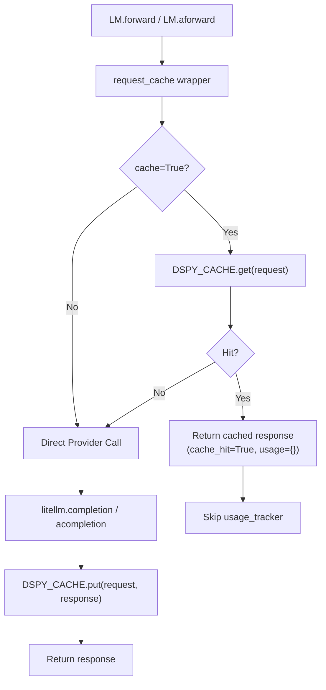
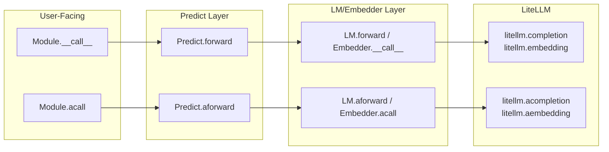
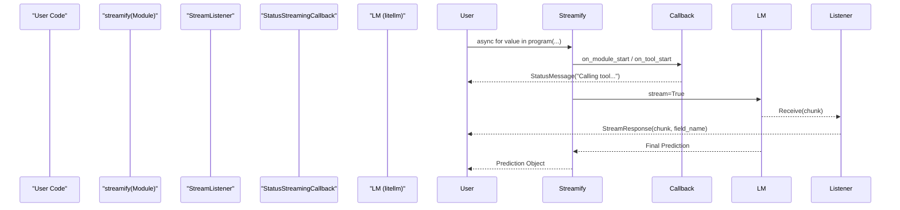
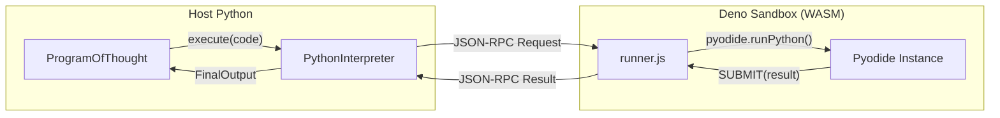

<!-- source: DeepWiki mcp.deepwiki.com · repo stanfordnlp/dspy · page 5 Advanced Features · fetched 2026-10-27 -->

# Advanced Features

<details>
<summary>Relevant source files</summary>

The following files were used as context for generating this wiki page:

- [dspy/adapters/types/citation.py](dspy/adapters/types/citation.py)
- [dspy/adapters/types/document.py](dspy/adapters/types/document.py)
- [dspy/clients/__init__.py](dspy/clients/__init__.py)
- [dspy/clients/cache.py](dspy/clients/cache.py)
- [dspy/clients/embedding.py](dspy/clients/embedding.py)
- [dspy/streaming/__init__.py](dspy/streaming/__init__.py)
- [dspy/streaming/messages.py](dspy/streaming/messages.py)
- [dspy/streaming/streamify.py](dspy/streaming/streamify.py)
- [dspy/streaming/streaming_listener.py](dspy/streaming/streaming_listener.py)
- [dspy/utils/asyncify.py](dspy/utils/asyncify.py)
- [tests/adapters/test_citation.py](tests/adapters/test_citation.py)
- [tests/adapters/test_document.py](tests/adapters/test_document.py)
- [tests/clients/test_cache.py](tests/clients/test_cache.py)
- [tests/clients/test_embedding.py](tests/clients/test_embedding.py)
- [tests/streaming/test_streaming.py](tests/streaming/test_streaming.py)

</details>


This page provides a unified overview of DSPy's advanced runtime capabilities: caching, asynchronous and parallel execution, streaming responses, program state serialization, output validation, and sandboxed code execution. These features are layered on top of the core `LM`, `Predict`, and `Module` abstractions and apply across most program patterns.

For foundational module construction, see [Building DSPy Programs](#3). For configuration of LM providers, see [Language Model Integration](#2.2). Each section below has a dedicated sub-page with full implementation details.

---

## Feature Areas at a Glance

| Feature | Primary Code Entities | Sub-Page |
|---|---|---|
| Caching | `request_cache`, `DSPY_CACHE`, `configure_cache`, `Cache` | [Caching & Performance Optimization](#5.1) |
| Async Execution | `LM.aforward`, `BaseLM.acall`, `asyncify`, `syncify` | [Parallel & Async Execution](#5.2) |
| Streaming Output | `streamify`, `StreamListener`, `StatusMessageProvider`, `StreamResponse` | [Streaming Output](#5.3) |
| State Management | `Predict.dump_state`, `Predict.load_state`, `Module.save`, `dspy.load` | [State Management & Serialization](#5.4) |
| Assertions & Validation | `dspy.Assert`, `dspy.Suggest`, `Retry` | [Assertions & Output Validation](#5.5) |
| Code Execution | `PythonInterpreter`, `ProgramOfThought`, `JSON-RPC` | [Code Execution & Sandboxing](#5.6) |

---

## Caching & Performance Optimization

By default, every `LM` instance caches its responses. The cache is a two-tier system—memory first (LRU), then disk (Fanout)—implemented in `dspy/clients/cache.py` and exposed as `dspy.cache` (`DSPY_CACHE`).

### How Caching Fits Into the LM Call

**Diagram: LM Call with Cache Layers**


Sources: [dspy/clients/cache.py:40-46](), [dspy/clients/cache.py:115-147](), [dspy/clients/lm.py:133-169]()

### Cache Configuration

The cache is configured via `dspy.clients.configure_cache`. It supports `disk_cache_dir` (defaulting to `~/.dspy_cache`) and `disk_size_limit_bytes` (default 30GB).

```python
dspy.clients.configure_cache(
    enable_disk_cache=True,
    enable_memory_cache=True,
    disk_cache_dir=".dspy_cache",
)
```
Sources: [dspy/clients/__init__.py:15-17](), [dspy/clients/__init__.py:19-51](), [dspy/clients/cache.py:48-57]()

### Cache Key Computation

Cache keys are generated by hashing a JSON representation of the request via `sha256`. The `Cache.cache_key` method handles JSON-incompatible types by transforming Pydantic models and capturing source code for callables via `inspect.getsource`.

Sources: [dspy/clients/cache.py:24-37](), [dspy/clients/cache.py:104-113](), [tests/clients/test_cache.py:115-138]()

---

## Parallel & Async Execution

Every entry point in DSPy has a sync and an async variant. Async variants use Python `asyncio` and delegate to the corresponding `litellm.acompletion` / `litellm.aembedding` functions.

### Code Entity Map

**Diagram: Sync vs Async Execution Paths**


Sources: [dspy/clients/lm.py:133-207](), [dspy/clients/embedding.py:113-147](), [dspy/predict/predict.py:211-236]()

### `asyncify` Utility

`asyncify` wraps a synchronous `dspy.Module` to run in a worker thread using `anyio.to_thread.run_sync`. It propagates `thread_local_overrides` to ensure settings are preserved across threads.

Sources: [dspy/utils/asyncify.py:31-65](), [dspy/streaming/streamify.py:165-166]()

---

## Streaming Output

Streaming allows partial tokens and status updates to be emitted while the program is running. DSPy uses a `streamify` wrapper to turn any module into an async generator.

### Streaming Architecture

**Diagram: Streaming and Status Flow**


Sources: [dspy/streaming/streamify.py:31-63](), [dspy/streaming/streaming_listener.py:26-50](), [dspy/streaming/messages.py:98-129]()

### Key Streaming Components

| Component | Location | Role |
|---|---|---|
| `streamify` | `dspy/streaming/streamify.py` | Wraps a module to return an async generator of `StatusMessage`, `StreamResponse`, and `Prediction`. |
| `StreamListener` | `dspy/streaming/streaming_listener.py` | Listens to specific signature fields (e.g., "answer") and parses chunks using regex for `ChatAdapter`, `XMLAdapter`, or `JSONAdapter`. |
| `StatusMessageProvider` | `dspy/streaming/messages.py` | Interface for customizing messages emitted during tool calls or module execution. |

Sources: [dspy/streaming/streamify.py:31-63](), [dspy/streaming/streaming_listener.py:59-81](), [dspy/streaming/messages.py:53-73]()

---

## State Management & Serialization

DSPy programs can be serialized to JSON and restored. The state captures signature fields, few-shot demos, and LM configuration.

### Security: Unsafe LM State Keys

`UNSAFE_LM_STATE_KEYS` (e.g., `api_base`, `base_url`, `api_key`) are stripped from deserialized state by default to prevent loading malicious redirects or sensitive credentials from untrusted files. Loading them requires explicit opt-in.

Sources: [dspy/predict/predict.py:19-37](), [dspy/predict/predict.py:89-113]()

---

## Code Execution & Sandboxing

DSPy provides a secure environment for executing LLM-generated Python code, primarily used in `ProgramOfThought`.

### Architecture: PythonInterpreter

The `PythonInterpreter` uses a WASM-based sandbox (Pyodide) running on Deno. Communication between the host Python process and the sandbox occurs via JSON-RPC 2.0 over standard I/O.

**Diagram: Sandboxed Execution Flow**


Sources: [dspy/primitives/python_interpreter.py:97-120](), [dspy/primitives/runner.js:141-151](), [dspy/predict/program_of_thought.py:140-156]()

### Key Security Features
- **Filesystem Isolation**: Restricted access to host paths via `--allow-read` and `--allow-write` flags passed to Deno.
- **Network Control**: Network access is disabled by default unless domains are explicitly whitelisted via `enable_network_access`.
- **Tool Bridge**: Allows sandboxed code to call host-side tools safely via `toolCallBridge` in `runner.js`.

Sources: [dspy/primitives/python_interpreter.py:151-183](), [dspy/primitives/runner.js:151-202](), [tests/primitives/test_python_interpreter.py:95-119]()

For details, see [Code Execution & Sandboxing](#5.6).

---

## Observability

### Usage and History

- **Usage Tracking**: Managed via `dspy.settings.usage_tracker`. Cache hits are explicitly excluded from usage counts via `_prepare_cached_response`.
- **History**: `BaseLM` maintains a `history` list for inspection.

Sources: [dspy/clients/cache.py:149-155](), [dspy/clients/base_lm.py:7-10](), [dspy/clients/base_lm.py:166-190]()

---

