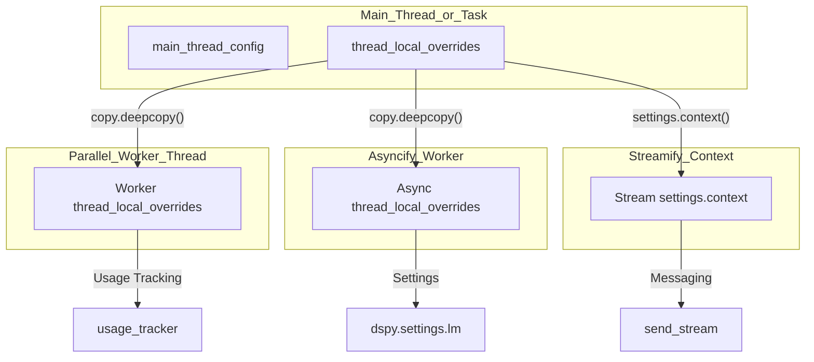
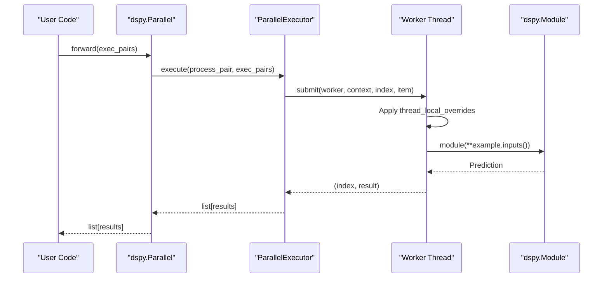
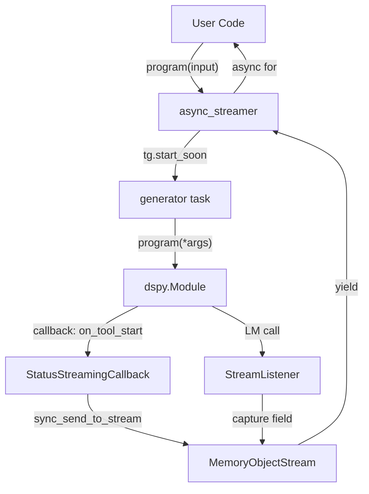

<!-- source: DeepWiki mcp.deepwiki.com · repo stanfordnlp/dspy · page 5.2 Parallel & Async Execution · fetched 2026-10-27 -->

# Parallel & Async Execution

Relevant source files

The following files were used as context for generating this wiki page:

- [docs/docs/tutorials/async/index.md](docs/docs/tutorials/async/index.md)
- [docs/docs/tutorials/yahoo_finance_react/index.md](docs/docs/tutorials/yahoo_finance_react/index.md)
- [dspy/adapters/types/citation.py](dspy/adapters/types/citation.py)
- [dspy/adapters/types/document.py](dspy/adapters/types/document.py)
- [dspy/predict/parallel.py](dspy/predict/parallel.py)
- [dspy/streaming/__init__.py](dspy/streaming/__init__.py)
- [dspy/streaming/messages.py](dspy/streaming/messages.py)
- [dspy/streaming/streamify.py](dspy/streaming/streamify.py)
- [dspy/streaming/streaming_listener.py](dspy/streaming/streaming_listener.py)
- [dspy/utils/asyncify.py](dspy/utils/asyncify.py)
- [dspy/utils/parallelizer.py](dspy/utils/parallelizer.py)
- [tests/adapters/test_citation.py](tests/adapters/test_citation.py)
- [tests/adapters/test_document.py](tests/adapters/test_document.py)
- [tests/evaluate/test_evaluate.py](tests/evaluate/test_evaluate.py)
- [tests/predict/test_parallel.py](tests/predict/test_parallel.py)
- [tests/streaming/test_streaming.py](tests/streaming/test_streaming.py)
- [tests/utils/test_parallelizer.py](tests/utils/test_parallelizer.py)

This page covers DSPy's asynchronous and parallel execution capabilities: the `aforward`/`acall` method pair on modules, the `asyncify` utility wrapper, the `streamify` infrastructure, and the `Parallel` module for multi-threaded execution.

---

## Overview

DSPy provides two primary execution paths: a synchronous path and an asynchronous path. Both paths share the same prompt-formatting and response-parsing logic; they differ in how they manage concurrency and I/O. The async path is built on `asyncio` and is supported natively by the `LM` and `Adapter` classes. For high-throughput synchronous workflows, the `Parallel` module provides a thread-pool based executor that maintains strict context isolation.

The main code entities involved are:

| Class / Function | File | Role |
|---|---|---|
| `Settings` | [dspy/dsp/utils/settings.py:51]() | Manages thread-local and async-task-local configuration |
| `Parallel` | [dspy/predict/parallel.py:9]() | High-level module for parallel (module, example) execution |
| `ParallelExecutor` | [dspy/utils/parallelizer.py:21]() | Internal engine for thread-based isolation and execution |
| `asyncify` | [dspy/utils/asyncify.py:31]() | Wraps a DSPy program for execution in a worker thread |
| `streamify` | [dspy/streaming/streamify.py:31]() | Wraps a program to yield incremental outputs and status messages |
| `StreamListener` | [dspy/streaming/streaming_listener.py:26]() | Captures streaming of specific output fields from a predictor |

---

## Configuration & Context Isolation

DSPy uses `contextvars.ContextVar` to manage settings like the current language model (`lm`) or adapter across different execution contexts [dspy/dsp/utils/settings.py:48](). 

### Settings Management
The `Settings` class is a singleton that ensures thread-safe global configuration [dspy/dsp/utils/settings.py:53-72](). 
- `dspy.configure()`: Sets global state in `main_thread_config` [dspy/dsp/utils/settings.py:82](). It can only be called by the "owner" thread/task that initialized it [dspy/dsp/utils/settings.py:117-163]().
- `dspy.context()`: Creates temporary overrides. These overrides are stored in `thread_local_overrides` and propagate to child threads or async tasks created via DSPy primitives like `Parallel` or `asyncify` [dspy/dsp/utils/settings.py:57-64]().

### Context Propagation
When spawning new threads or tasks, DSPy explicitly copies the current context to ensure consistency:
- **Parallel Threads**: `ParallelExecutor` captures `parent_overrides` and sets them in the worker thread [dspy/utils/parallelizer.py:125-131](). It specifically performs a `copy.deepcopy()` on the `usage_tracker` so each thread tracks its own usage [dspy/utils/parallelizer.py:129-130]().
- **Async Tasks**: `asyncify` captures `parent_overrides` and restores them within the worker thread using `thread_local_overrides.set()` [dspy/utils/asyncify.py:48-56]().
- **Streaming**: `streamify` uses `settings.context` to inject `send_stream`, `callbacks`, and `stream_listeners` into the execution context of the program [dspy/streaming/streamify.py:173-175]().

**Diagram: Context Propagation across Execution Boundaries**

Sources: [dspy/dsp/utils/settings.py:48-65](), [dspy/utils/parallelizer.py:125-131](), [dspy/utils/asyncify.py:48-56](), [dspy/streaming/streamify.py:173-175]()

---

## Parallel Execution with `dspy.Parallel`

The `dspy.Parallel` module is a utility for multi-threaded execution of `(module, example)` pairs [dspy/predict/parallel.py:9-20](). It is commonly used for batch processing or evaluation.

### Implementation Details
- **Execution Engine**: It uses `ParallelExecutor`, which wraps a `concurrent.futures.ThreadPoolExecutor` [dspy/utils/parallelizer.py:157]().
- **Data Flow**: The `forward` method accepts a list of execution pairs. It unpacks `dspy.Example` objects using `.inputs()` before passing them to the module [dspy/predict/parallel.py:93-97]().
- **Error Handling**: It tracks `error_count` and can halt execution if `max_errors` is reached [dspy/utils/parallelizer.py:64-67](). It can optionally return failed examples and their exceptions [dspy/predict/parallel.py:114-124]().
- **Straggler Handling**: It includes logic for `timeout` (default 120s) and `straggler_limit` (default 3) to prevent slow calls from blocking the entire batch [dspy/utils/parallelizer.py:41-42]().

**Diagram: Parallel Execution Data Flow**

Sources: [dspy/predict/parallel.py:9-124](), [dspy/utils/parallelizer.py:21-157]()

---

## Async & Streaming Infrastructure

DSPy provides utilities to bridge synchronous programs into async environments and enable real-time output.

### `asyncify` Utility
The `asyncify` function wraps a standard `dspy.Module` to make it awaitable [dspy/utils/asyncify.py:31-44]().
- **Limiter**: It uses `anyio.CapacityLimiter` to control the number of concurrent worker threads, governed by `dspy.settings.async_max_workers` [dspy/utils/asyncify.py:19-28]().
- **Thread Management**: It executes the wrapped program using `anyio.to_thread.run_sync` [dspy/utils/asyncify.py:63]().

### `streamify` Infrastructure
`streamify` transforms a module into an async generator that yields `StatusMessage` and `StreamResponse` objects [dspy/streaming/streamify.py:31-63]().
- **Status Callbacks**: It attaches a `StatusStreamingCallback` to `settings.callbacks` to capture lifecycle events like `on_tool_start` or `on_module_end` [dspy/streaming/streamify.py:168-171](), [dspy/streaming/messages.py:98]().
- **Stream Listeners**: `StreamListener` objects can be attached to specific signature fields (e.g., "answer"). They use regex-based identifiers for `ChatAdapter`, `JSONAdapter`, and `XMLAdapter` to detect when specific fields begin and end in the LM's token stream [dspy/streaming/streaming_listener.py:59-81]().
- **Custom Types**: Types like `Citations` can implement `is_streamable()` and `parse_stream_chunk()` to support native provider streaming features [dspy/adapters/types/citation.py:177-182](), [dspy/streaming/streaming_listener.py:142-154]().
- **Concurrency**: It uses `anyio.create_memory_object_stream` and `anyio.create_task_group` to manage the producer-consumer relationship between the running module and the yielding generator [dspy/streaming/streamify.py:180-181]().

**Diagram: Streaming Execution Logic**

Sources: [dspy/streaming/streamify.py:31-181](), [dspy/streaming/streaming_listener.py:26-81](), [dspy/streaming/messages.py:98-185](), [dspy/adapters/types/citation.py:177-191]()

---

## Summary of Execution Primitives

| Primitive | Mechanism | Primary File | Key Configuration |
|---|---|---|---|
| `dspy.Parallel` | `ThreadPoolExecutor` | [dspy/predict/parallel.py]() | `num_threads`, `max_errors` |
| `asyncify` | Worker Threads + `anyio` | [dspy/utils/asyncify.py]() | `async_max_workers` |
| `streamify` | `anyio` Memory Streams | [dspy/streaming/streamify.py]() | `status_message_provider`, `stream_listeners` |
| `ParallelExecutor` | Thread Management | [dspy/utils/parallelizer.py]() | `timeout`, `straggler_limit` |

Sources: [dspy/predict/parallel.py:9-20](), [dspy/utils/asyncify.py:31-65](), [dspy/utils/parallelizer.py:21-42](), [dspy/streaming/streamify.py:31-63]()

---

