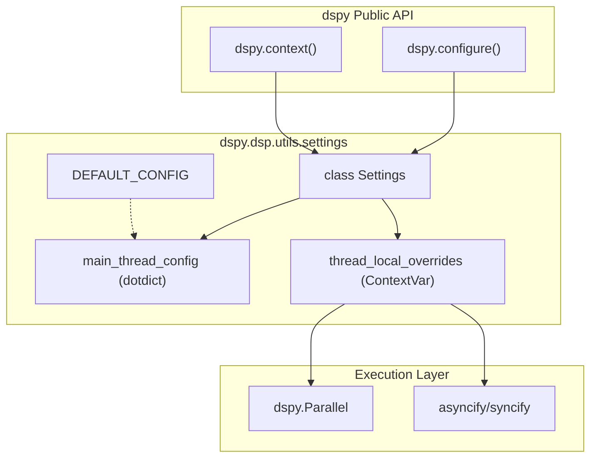
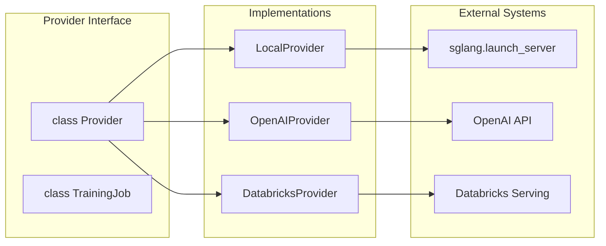

<!-- source: DeepWiki mcp.deepwiki.com · repo stanfordnlp/dspy · page 6 Configuration & Integration · fetched 2026-10-27 -->

# Configuration & Integration

Relevant source files

The following files were used as context for generating this wiki page:

- [docs/docs/api/utils/configure.md](docs/docs/api/utils/configure.md)
- [docs/docs/api/utils/context.md](docs/docs/api/utils/context.md)
- [dspy/clients/databricks.py](dspy/clients/databricks.py)
- [dspy/clients/lm_local.py](dspy/clients/lm_local.py)
- [dspy/clients/openai.py](dspy/clients/openai.py)
- [dspy/clients/provider.py](dspy/clients/provider.py)
- [dspy/clients/utils_finetune.py](dspy/clients/utils_finetune.py)
- [dspy/dsp/utils/settings.py](dspy/dsp/utils/settings.py)
- [tests/clients/test_lm_local.py](tests/clients/test_lm_local.py)
- [tests/utils/test_settings.py](tests/utils/test_settings.py)

This page provides an overview of how DSPy is configured at runtime and how it integrates with external systems. It covers the settings system, model providers, retrieval backends, observability tools, and optional third-party framework integrations.

For detailed treatment of each topic, see the sub-pages: [Settings & Configuration Management](#6.1), [Model Providers & LiteLLM Integration](#6.2), [Vector Databases & Retrieval](#6.3), [Observability & Monitoring](#6.4), [External Framework Integration](#6.5), and [Model Context Protocol (MCP)](#6.6).

---

## Configuration & Integration Landscape

DSPy exposes its configuration surface primarily through the `Settings` singleton and global cache management functions. These are exposed in the top-level `dspy` namespace.

| Public Name | Underlying Binding | Purpose |
|---|---|---|
| `dspy.settings` | `dspy.dsp.utils.settings.Settings` | Singleton holding global configuration state |
| `dspy.configure` | `Settings.configure` | Set global options (LM, RM, callbacks, etc.) |
| `dspy.context` | `Settings.context` | Thread-safe temporary configuration override |
| `dspy.cache` | `DSPY_CACHE` | Access to the `Cache` object (disk/memory) |

[dspy/dsp/utils/settings.py:51-65](), [dspy/dsp/utils/settings.py:165-182]()

Integrations are managed via core dependencies (like `litellm` and `diskcache`) and optional extras. The system is designed to be thread-safe, using `contextvars` to isolate state across concurrent execution blocks.

Sources: [dspy/dsp/utils/settings.py:51-116](), [dspy/dsp/utils/settings.py:15-38]()

---

## Configuration Architecture

**Diagram: Configuration Architecture and State Management**

Sources: [dspy/dsp/utils/settings.py:15-48](), [dspy/dsp/utils/settings.py:51-65](), [dspy/dsp/utils/settings.py:117-145]()

---

## Global Settings Object

The `Settings` object is a thread-safe singleton defined in `dspy/dsp/utils/settings.py`. It uses `contextvars.ContextVar` to manage `thread_local_overrides`, ensuring that temporary changes made within a `dspy.context` block do not leak into other threads or async tasks [dspy/dsp/utils/settings.py:48-65]().

| Setting Key | Default | Description |
|---|---|---|
| `lm` | `None` | Default language model instance [dspy/dsp/utils/settings.py:16]() |
| `adapter` | `None` | Default adapter for formatting (e.g., `ChatAdapter`) [dspy/dsp/utils/settings.py:17]() |
| `rm` | `None` | Default retrieval model [dspy/dsp/utils/settings.py:18]() |
| `async_max_workers` | `8` | Max concurrency for async operations [dspy/dsp/utils/settings.py:22]() |
| `num_threads` | `8` | Max threads for parallel processing [dspy/dsp/utils/settings.py:31]() |
| `track_usage` | `False` | Whether to record token usage globally [dspy/dsp/utils/settings.py:25]() |
| `max_errors` | `10` | Maximum errors before halting parallel operations [dspy/dsp/utils/settings.py:32]() |

Ownership of `dspy.configure` is restricted to the thread that first initialized the configuration to prevent race conditions [dspy/dsp/utils/settings.py:117-128](). In async environments, only the initial task may call `configure`; other tasks must use `dspy.context` [dspy/dsp/utils/settings.py:159-163]().

Sources: [dspy/dsp/utils/settings.py:15-38](), [dspy/dsp/utils/settings.py:51-116](), [dspy/dsp/utils/settings.py:165-182](), [tests/utils/test_settings.py:20-29]()

---

## Model Providers & Training Integration

DSPy integrates with various model providers through the `Provider` base class [dspy/clients/provider.py:180-192](). This allows for unified handling of standard inference, local serving, and fine-tuning.

*   **OpenAI**: Managed via `OpenAIProvider`, supporting remote fine-tuning jobs [dspy/clients/openai.py:42-55]().
*   **Local Models**: Supported via `LocalProvider`, which uses `sglang` for launching local servers and `trl` for local SFT (Supervised Fine-Tuning) [dspy/clients/lm_local.py:22-36](), [dspy/clients/lm_local.py:200-205]().
*   **Databricks**: Supported via `DatabricksProvider`, enabling deployment to provisioned throughput endpoints [dspy/clients/databricks.py:41-57]().

**Diagram: Provider and Training Job Flow**

Sources: [dspy/clients/provider.py:12-80](), [dspy/clients/openai.py:42-55](), [dspy/clients/lm_local.py:22-69](), [dspy/clients/databricks.py:41-57]()

---

## Model Context Protocol (MCP)

DSPy integrates with the Model Context Protocol (MCP) to enable seamless tool usage from MCP-compliant servers. The `convert_mcp_tool` utility bridges the gap between `mcp.types.Tool` and DSPy's internal `Tool` representation [dspy/utils/mcp.py:30-47]().

*   **Session Management**: Requires an active `mcp.ClientSession` for communication [dspy/utils/mcp.py:30-34]().
*   **Schema Conversion**: Automatically converts MCP input schemas to DSPy tool arguments [dspy/utils/mcp.py:40]().
*   **Error Handling**: Validates `CallToolResult` and handles server-side errors [dspy/utils/mcp.py:9-27]().

Sources: [dspy/utils/mcp.py:9-47](), [tests/utils/test_mcp.py:14-46]()

---

## Sub-page Reference

| Sub-page | Topic |
|---|---|
| [Settings & Configuration Management](#6.1) | Deep dive into `dspy.settings`, `dspy.configure`, and thread-safe context management. |
| [Model Providers & LiteLLM Integration](#6.2) | Configuration for OpenAI, Anthropic, Databricks, and local models via SGLang. |
| [Vector Databases & Retrieval](#6.3) | Integration with ColBERTv2 and other retrieval backends via the `rm` setting. |
| [Observability & Monitoring](#6.4) | Tracing LM calls, usage tracking, and history management using `callbacks`. |
| [External Framework Integration](#6.5) | Optional integrations with LangChain and optimization libraries like Optuna. |
| [Model Context Protocol (MCP)](#6.6) | Using MCP for tool discovery and enhanced context management. |

---

