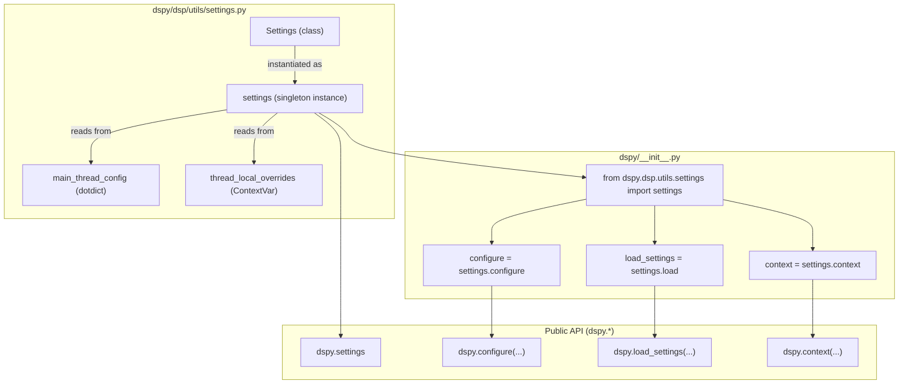
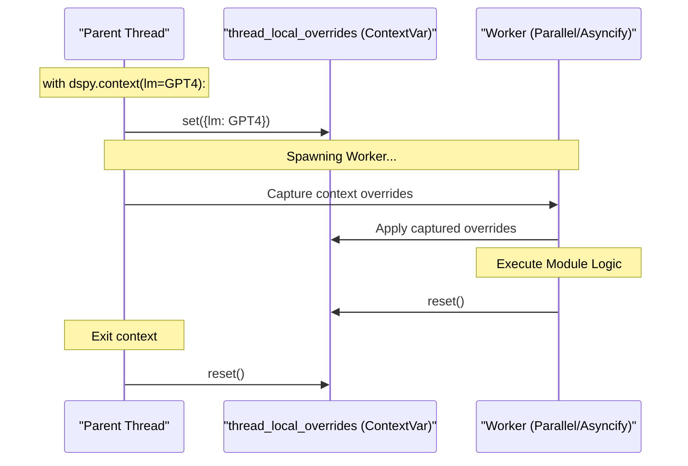
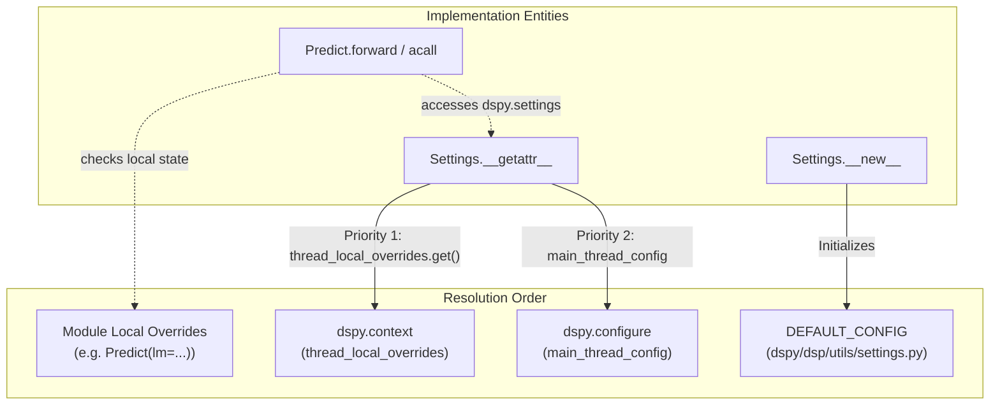

<!-- source: DeepWiki mcp.deepwiki.com · repo stanfordnlp/dspy · page 6.1 Settings & Configuration Management · fetched 2026-10-27 -->

# Settings & Configuration Management

<details>
<summary>Relevant source files</summary>

The following files were used as context for generating this wiki page:

- [docs/docs/api/utils/configure.md](docs/docs/api/utils/configure.md)
- [docs/docs/api/utils/context.md](docs/docs/api/utils/context.md)
- [dspy/__init__.py](dspy/__init__.py)
- [dspy/adapters/__init__.py](dspy/adapters/__init__.py)
- [dspy/adapters/types/__init__.py](dspy/adapters/types/__init__.py)
- [dspy/dsp/utils/settings.py](dspy/dsp/utils/settings.py)
- [tests/utils/test_settings.py](tests/utils/test_settings.py)

</details>


This page documents `dspy.settings`, the global configuration singleton, and the methods used to read and write configuration (`dspy.configure`, `dspy.context`). It covers the available configuration keys, their effects on program behavior, and the thread-safe context management mechanism including async task propagation.

For documentation on configuring specific language model providers, see [Model Providers & LiteLLM Integration](6.2). For tracing and observability settings, see [Observability & Monitoring](6.4).

---

## Settings Architecture

The DSPy settings system centers on a single module-level singleton, `settings`, instantiated from the `Settings` class in `dspy/dsp/utils/settings.py` [dspy/dsp/utils/settings.py:51-72](). This singleton is imported into the public namespace and several aliases are created at module load time [dspy/__init__.py:59-61]().

**Diagram: Settings Singleton and Public API Aliases**



Sources: [dspy/dsp/utils/settings.py:51-72](), [dspy/dsp/utils/settings.py:15-38](), [dspy/__init__.py:51-61]()

---

## The `settings` Singleton

`dspy.settings` is the live configuration object. Accessing `dspy.settings.<key>` returns the current effective value, resolving first from thread-local overrides and falling back to global defaults.

The `Settings` class utilizes `contextvars.ContextVar` via `thread_local_overrides` to ensure that context-scoped overrides are isolated per-thread and per-async task [dspy/dsp/utils/settings.py:48-49]().

### Configuration Resolution Logic
When a setting is accessed via `__getattr__`, the following priority is applied:
1. **Thread-Local/Async-Local Overrides**: Values set within a `dspy.context` block [dspy/dsp/utils/settings.py:79-81]().
2. **Main Thread Config**: Global values set via `dspy.configure` [dspy/dsp/utils/settings.py:82-83]().
3. **AttributeError**: If the key does not exist in either [dspy/dsp/utils/settings.py:85]().

---

## Configuration Methods

### `dspy.configure(**kwargs)`
Sets global configuration keys. This method enforces **Owner Thread** restrictions: only the thread (or async task) that first calls `configure` is permitted to call it again [dspy/dsp/utils/settings.py:117-127](). This prevents race conditions in concurrent environments where global state might be accidentally mutated by worker threads.

In async environments, `configure` can only be called from the same async task that called it first, unless running in an IPython environment [dspy/dsp/utils/settings.py:142-163]().

```python
import dspy
# Initial configuration sets the 'owner'
dspy.configure(lm=dspy.LM("openai/gpt-4o"), num_threads=10)
```

### `dspy.context(**kwargs)`
A context manager for temporary, thread-local overrides. It captures the current state, merges the new `kwargs`, and restores the previous state upon exit [dspy/dsp/utils/settings.py:204-219](). Unlike `configure`, `context` can be called from any thread or async task [dspy/dsp/utils/settings.py:64-65]().

```python
with dspy.context(lm=dspy.LM("openai/gpt-4o-mini")):
    # Overrides are active here
    result = module(input="...") 
```

Sources: [dspy/dsp/utils/settings.py:165-219](), [docs/docs/api/utils/configure.md:1-94](), [docs/docs/api/utils/context.md:1-102]()

---

## Context Propagation in Parallelism

DSPy ensures that `dspy.context` settings propagate correctly from a parent thread/task to spawned workers using `ContextVar` propagation and manual copying in parallel executors.

**Diagram: Context Propagation Flow**



### Parallel Propagation
When using `dspy.Parallel`, the parent's configuration context is maintained across worker threads [tests/utils/test_settings.py:57-98](). The `Settings` class provides a `copy()` method that merges `main_thread_config` with `thread_local_overrides` to facilitate this state transfer [dspy/dsp/utils/settings.py:109-112]().

### Async Propagation
In async tasks, `dspy.context` uses `asyncio` task-local storage (via `ContextVar`) to ensure that `await` calls within the block see the correct settings, even when interleaved with other tasks [tests/utils/test_settings.py:100-156]().

Sources: [dspy/dsp/utils/settings.py:57-65](), [dspy/dsp/utils/settings.py:109-112](), [tests/utils/test_settings.py:31-98]()

---

## Available Configuration Keys

The following keys are defined in `DEFAULT_CONFIG` [dspy/dsp/utils/settings.py:15-38]():

| Key | Default | Description |
|-----|---------|-------------|
| `lm` | `None` | Default `dspy.LM` instance for all modules [docs/docs/api/utils/configure.md:22](). |
| `adapter` | `None` | Default `Adapter`. If `None`, modules default to `ChatAdapter` [docs/docs/api/utils/configure.md:23](). |
| `num_threads` | `8` | Thread count for parallel processing [dspy/dsp/utils/settings.py:31](). |
| `async_max_workers` | `8` | Maximum concurrent workers for async operations [dspy/dsp/utils/settings.py:22](). |
| `max_errors` | `10` | Error threshold before halting parallel operations [dspy/dsp/utils/settings.py:32](). |
| `track_usage` | `False` | Enables token usage tracking [dspy/dsp/utils/settings.py:25](). |
| `max_history_size` | `10000` | Maximum number of history entries to maintain [dspy/dsp/utils/settings.py:35](). |
| `provide_traceback` | `False` | Includes Python tracebacks in error logs [dspy/dsp/utils/settings.py:30](). |
| `warn_on_type_mismatch`| `True` | Logs warnings for Signature type mismatches [dspy/dsp/utils/settings.py:37](). |
| `allow_tool_async_sync_conversion` | `False` | Allows async tools to be converted to sync for synchronous modules [dspy/dsp/utils/settings.py:34](). |
| `disable_history` | `False` | If True, disables the global history tracking of LM calls [dspy/dsp/utils/settings.py:24](). |
| `trace` | `[]` | List used to store execution traces for optimization and debugging [dspy/dsp/utils/settings.py:20](). |

---

## Configuration Resolution Hierarchy

**Diagram: Code Entity Space Resolution**



Sources: [dspy/dsp/utils/settings.py:15-38](), [dspy/dsp/utils/settings.py:78-85]()

---

## Typical Usage Patterns

### Global Initialization
```python
import dspy
lm = dspy.LM("openai/gpt-4o")
dspy.configure(lm=lm, track_usage=True, adapter=dspy.JSONAdapter())
```
Sources: [docs/docs/api/utils/configure.md:49-58](), [tests/utils/test_settings.py:13-18]()

### Nested Context Overrides
Inner blocks override outer ones, and settings are restored cleanly on exit [docs/docs/api/utils/context.md:68-84]().
```python
with dspy.context(lm=dspy.LM("anthropic/claude-3-5-sonnet")):
    # Uses Claude
    with dspy.context(track_usage=True):
        # Uses Claude + Usage Tracking
        pass
    # Uses Claude (Usage Tracking restored to False)
# Restored to global default (e.g. GPT-4o)
```
Sources: [docs/docs/api/utils/context.md:72-83](), [tests/utils/test_settings.py:31-39]()

### Async Task Isolation
When using `asyncio.gather`, `dspy.context` prevents settings from "leaking" between concurrent tasks [tests/utils/test_settings.py:100-156]().
```python
async def run_task(question, model_name):
    with dspy.context(lm=dspy.LM(model_name)):
        # predictor uses the LM from the current context
        return await predictor.acall(question=question)

# Each task uses its own LM independently without interference
results = await asyncio.gather(
    run_task("Q1", "openai/gpt-4o"),
    run_task("Q2", "anthropic/claude-3-opus")
)
```
Sources: [tests/utils/test_settings.py:100-156]()

---

