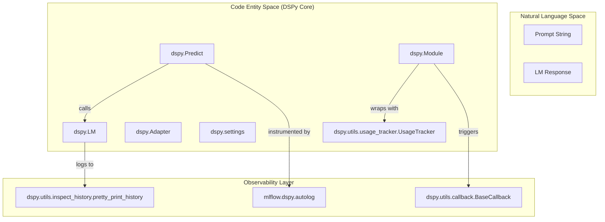
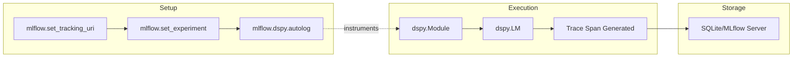

<!-- source: DeepWiki mcp.deepwiki.com · repo stanfordnlp/dspy · page 6.4 Observability & Monitoring · fetched 2026-10-27 -->

# Observability & Monitoring

Relevant source files

The following files were used as context for generating this wiki page:

- [docs/docs/tutorials/observability/index.md](docs/docs/tutorials/observability/index.md)
- [dspy/primitives/module.py](dspy/primitives/module.py)
- [dspy/teleprompt/teleprompt.py](dspy/teleprompt/teleprompt.py)
- [dspy/utils/callback.py](dspy/utils/callback.py)
- [dspy/utils/callback_context.py](dspy/utils/callback_context.py)
- [dspy/utils/inspect_history.py](dspy/utils/inspect_history.py)
- [dspy/utils/saving.py](dspy/utils/saving.py)
- [dspy/utils/usage_tracker.py](dspy/utils/usage_tracker.py)
- [tests/callback/test_callback.py](tests/callback/test_callback.py)
- [tests/callback/test_interpreter_callback.py](tests/callback/test_interpreter_callback.py)
- [tests/callback/test_optimizer_callback.py](tests/callback/test_optimizer_callback.py)
- [tests/clients/test_databricks.py](tests/clients/test_databricks.py)
- [tests/clients/test_inspect_global_history.py](tests/clients/test_inspect_global_history.py)
- [tests/docs/test_mkdocs_links.py](tests/docs/test_mkdocs_links.py)
- [tests/metadata/test_metadata.py](tests/metadata/test_metadata.py)
- [tests/primitives/test_base_module.py](tests/primitives/test_base_module.py)
- [tests/primitives/test_module.py](tests/primitives/test_module.py)
- [tests/teleprompt/test_teleprompt.py](tests/teleprompt/test_teleprompt.py)
- [tests/utils/test_saving.py](tests/utils/test_saving.py)
- [tests/utils/test_usage_tracker.py](tests/utils/test_usage_tracker.py)

## Purpose and Scope

This document covers DSPy's integration with observability and monitoring platforms for tracking optimization runs, monitoring production predictions, and debugging failures. DSPy supports multiple third-party observability providers that enable real-time visibility into program execution, trace analysis, and performance metrics. Additionally, this page details DSPy's built-in mechanisms for history tracking, usage tracking, and callback-based logging.

For information about caching and performance optimization, see [Caching & Performance Optimization](5.1). For deployment infrastructure, see [External Framework Integration](6.5). For the evaluation framework itself, see [Evaluation Framework](4.2).

Sources: [docs/docs/tutorials/observability/index.md:1-7](), [dspy/utils/callback.py:22-70]()

---

## Supported Observability Platforms

DSPy integrates with several observability platforms, each providing complementary capabilities for tracking LM program execution and optimization:

| **Platform** | **Primary Focus** | **Key Capabilities** |
|---|---|---|
| **MLflow** | End-to-end LLMOps | Automatic tracing via `autolog`, trace visualization, experiment tracking |
| **Weights & Biases Weave** | Experiment tracking | Trace visualization, prompt comparisons, optimization tracking |
| **Arize Phoenix** | Production monitoring | Real-time trace analysis, performance monitoring, failure detection |
| **LangWatch** | DSPy-specific visualization | Visualizer for optimization runs, prompt evolution tracking |
| **Langtrace** | Distributed tracing | End-to-end trace collection, latency analysis, cost tracking |
| **Langfuse** | Production analytics | Usage analytics, prompt versioning, cost monitoring |
| **OpenLIT** | OpenTelemetry standards | Standards-based observability, custom instrumentation |

These platforms provide visibility into critical phases:
1. **Development**: Debugging intermediate steps in `dspy.Predict` or `dspy.ReAct` modules.
2. **Optimization**: Tracking optimizer trials (e.g., MIPROv2) and evaluation scores.
3. **Production**: Monitoring deployed programs for latency and token usage.

Sources: [docs/docs/tutorials/observability/index.md:89-95]()

---

## Architecture Overview

The following diagram associates DSPy code entities with the observability data flow:

### Data Flow: Execution to Trace

Sources: [dspy/utils/inspect_history.py:27-36](), [dspy/utils/callback.py:22-30](), [docs/docs/tutorials/observability/index.md:105-110](), [dspy/primitives/module.py:102-108](), [dspy/utils/usage_tracker.py:12-13]()

---

## Built-in Observability Features

DSPy provides several built-in features for basic observability and debugging without external integrations.

### History Tracking (`dspy.inspect_history`)

The `dspy.inspect_history()` utility allows you to view the history of LLM invocations. It is a wrapper around `pretty_print_history` defined in `dspy/utils/inspect_history.py`. [dspy/utils/inspect_history.py:27-36]()

The utility prints:
- **Timestamps**: When the call occurred, extracted from the history entry. [dspy/utils/inspect_history.py:53-56]()
- **Message Roles**: System, User, Assistant, and Tool messages. [dspy/utils/inspect_history.py:58-61]()
- **Multimodal Content**: Handles `image_url`, `input_audio`, and `file` types by displaying metadata (e.g., base64 length, filename) to keep logs readable. [dspy/utils/inspect_history.py:63-89]()
- **Tool Calls**: Displays the function name and arguments for tool-enabled models, including automatic JSON decoding of arguments. [dspy/utils/inspect_history.py:40-49]()

Sources: [dspy/utils/inspect_history.py:1-108](), [docs/docs/tutorials/observability/index.md:48-55]()

### Usage Tracking (`UsageTracker`)

DSPy includes a native usage tracking system to monitor token consumption across models. This is managed via the `track_usage` context manager. [dspy/utils/usage_tracker.py:69-75]()

- **`UsageTracker` Class**: Maintains a mapping of LM names to lists of usage entries. [dspy/utils/usage_tracker.py:12-23]()
- **Token Aggregation**: The `get_total_tokens()` method merges usage data across multiple calls, handling nested structures like `prompt_tokens_details` (e.g., cached tokens, reasoning tokens). [dspy/utils/usage_tracker.py:57-65](), [tests/utils/test_usage_tracker.py:32-90]()
- **Integration**: `dspy.Module` automatically triggers usage tracking during its `__call__` or `acall` if `settings.track_usage` is enabled. [dspy/primitives/module.py:102-108](), [dspy/primitives/module.py:121-127]()

Sources: [dspy/utils/usage_tracker.py:1-75](), [dspy/primitives/module.py:102-127]()

### Callback System (`BaseCallback`)

DSPy includes a callback system for fine-grained monitoring of internal operations. Users can subclass `BaseCallback` to intercept events at various stages of the program lifecycle. [dspy/utils/callback.py:22-70]()

| **Handler Method** | **Trigger Point** |
|---|---|
| `on_module_start` / `on_module_end` | Execution of `dspy.Module.forward()`. [dspy/utils/callback.py:72-102]() |
| `on_lm_start` / `on_lm_end` | Invocations of the `dspy.LM` instance. [dspy/utils/callback.py:104-134]() |
| `on_adapter_format_start` / `on_adapter_format_end` | When an adapter formats inputs into a prompt. [dspy/utils/callback.py:136-166]() |
| `on_adapter_parse_start` / `on_adapter_parse_end` | When an adapter parses LM output into fields. [dspy/utils/callback.py:168-198]() |
| `on_tool_start` / `on_tool_end` | Execution of tools (e.g., in `ReAct`). [dspy/utils/callback.py:200-230]() |

Callbacks can be set globally via `dspy.configure(callbacks=[...])` or locally in a module constructor. [dspy/utils/callback.py:32-48](), [dspy/primitives/module.py:74-75]()

Sources: [dspy/utils/callback.py:22-230](), [tests/callback/test_callback.py:23-58]()

---

## MLflow Integration

MLflow serves as the primary recommended external observability tool. It provides automatic instrumentation for DSPy modules and language model calls.

### Configuration Flow

Sources: [docs/docs/tutorials/observability/index.md:119-126]()

### Trace Inspection
MLflow generates a **trace** for each prediction. Each trace contains multiple **spans**:
- **Module Spans**: The input/output of a `dspy.Predict` or `dspy.ChainOfThought` call.
- **Tool Spans**: Inputs and outputs for functions passed to `dspy.ReAct`. [docs/docs/tutorials/observability/index.md:149-150]()
- **LM Spans**: The raw prompt sent to the provider and the completion received.

Sources: [docs/docs/tutorials/observability/index.md:89-150]()

---

## Logging & Trace Configuration

Tracing and logging behavior is controlled via `dspy.settings` and context variables.

- **`dspy.settings.trace`**: A list that captures internal execution steps when active.
- **`ACTIVE_CALL_ID`**: A `ContextVar` used to uniquely identify and link start/end events in callbacks across asynchronous or concurrent calls. [dspy/utils/callback.py:10]()
- **Context Management**: Use `dspy.context(callbacks=...)` or `dspy.configure(callbacks=...)` to manage how telemetry is collected. [tests/callback/test_callback.py:14-21]()

### Multimodal and File Handling in Logs
For modules handling complex types, `pretty_print_history` formats these objects to avoid flooding the console:
- **Images**: Displays `<IMAGE BASE 64 ENCODED(length)>` or the URL. [dspy/utils/inspect_history.py:70-76]()
- **Audio**: Displays format and data length. [dspy/utils/inspect_history.py:78-82]()
- **Files**: Displays `filename`, `file_id`, and `data_length`. [dspy/utils/inspect_history.py:83-89]()

Sources: [dspy/utils/inspect_history.py:63-89](), [dspy/utils/callback.py:10]()

---

