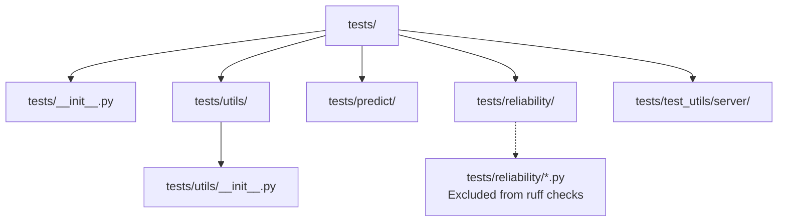
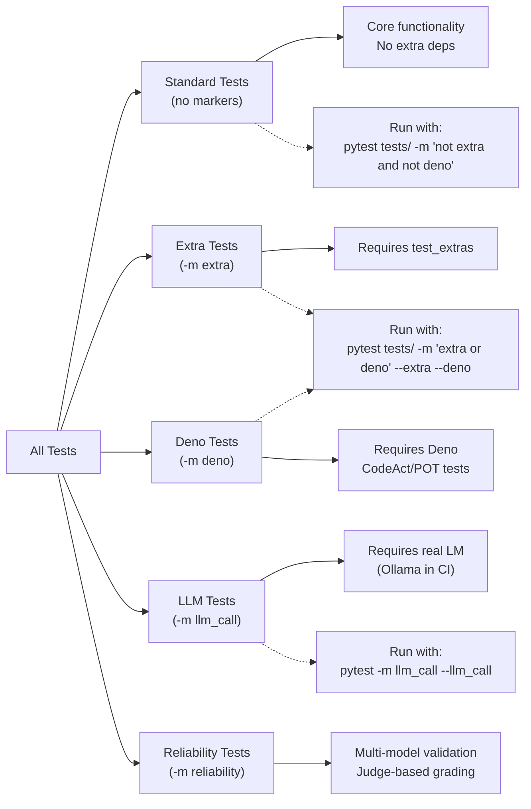
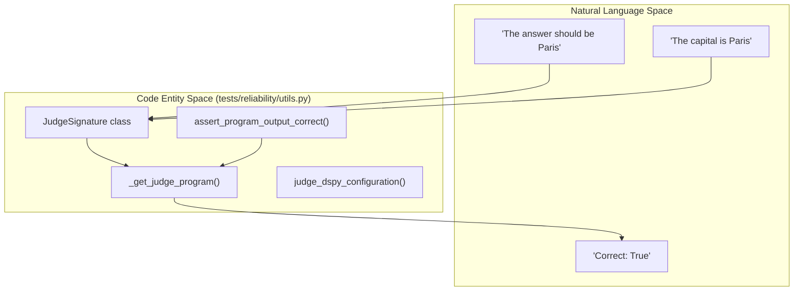
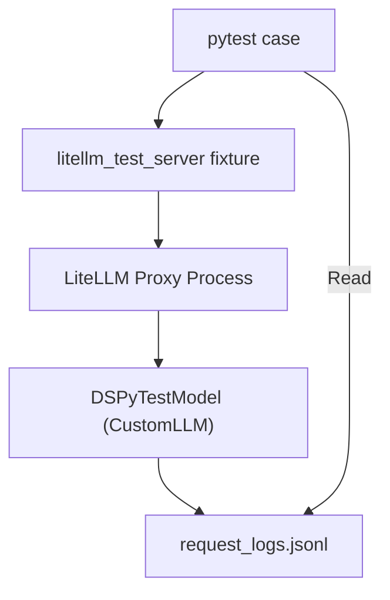
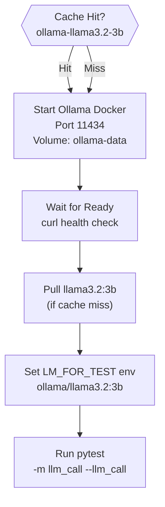

<!-- source: DeepWiki mcp.deepwiki.com · repo stanfordnlp/dspy · page 7.2 Testing Framework · fetched 2026-10-27 -->

# Testing Framework

<details>
<summary>Relevant source files</summary>

The following files were used as context for generating this wiki page:

- [.github/workflows/build_and_release.yml](.github/workflows/build_and_release.yml)
- [.github/workflows/docs-push.yml](.github/workflows/docs-push.yml)
- [.github/workflows/precommits_check.yml](.github/workflows/precommits_check.yml)
- [.github/workflows/run_tests.yml](.github/workflows/run_tests.yml)
- [.pre-commit-config.yaml](.pre-commit-config.yaml)
- [CONTRIBUTING.md](CONTRIBUTING.md)
- [tests/conftest.py](tests/conftest.py)
- [tests/reliability/README.md](tests/reliability/README.md)
- [tests/reliability/__init__.py](tests/reliability/__init__.py)
- [tests/reliability/conftest.py](tests/reliability/conftest.py)
- [tests/reliability/generate/__init__.py](tests/reliability/generate/__init__.py)
- [tests/reliability/generate/__main__.py](tests/reliability/generate/__main__.py)
- [tests/reliability/generate/utils.py](tests/reliability/generate/utils.py)
- [tests/reliability/reliability_conf.yaml](tests/reliability/reliability_conf.yaml)
- [tests/reliability/test_generated.py](tests/reliability/test_generated.py)
- [tests/reliability/test_pydantic_models.py](tests/reliability/test_pydantic_models.py)
- [tests/reliability/utils.py](tests/reliability/utils.py)
- [tests/test_utils/__init__.py](tests/test_utils/__init__.py)
- [tests/test_utils/server/__init__.py](tests/test_utils/server/__init__.py)
- [tests/test_utils/server/litellm_server.py](tests/test_utils/server/litellm_server.py)
- [tests/test_utils/server/litellm_server_config.yaml](tests/test_utils/server/litellm_server_config.yaml)

</details>


## Purpose and Scope

This document describes DSPy's testing infrastructure, including test organization, pytest configuration, test execution strategies, and the CI/CD pipeline. It covers how tests are categorized, how to run them locally, and the unique infrastructure for testing against real language models. For information about the build system and release process, see [Build System & CI/CD](7.1). For documentation practices, see [Documentation System](7.3).

**Sources:** [.github/workflows/run_tests.yml:1-171](), [CONTRIBUTING.md:124-128]()

---

## Test Organization

DSPy tests are organized in the `tests/` directory and use `pytest` as the testing framework. Tests are categorized using pytest markers to enable selective execution of different test suites.

### Test Directory Structure



**Sources:** [tests/conftest.py:8-12](), [CONTRIBUTING.md:124-128](), [.github/workflows/run_tests.yml:100-101](), [.pre-commit-config.yaml:12-12]()

---

## Pytest Configuration

DSPy's pytest configuration is customized via `tests/conftest.py`. The framework manages environment-specific flags and global settings cleanup to ensure test isolation.

### Configuration and Hooks

| Hook / Setting | File | Purpose |
|---------|-------|---------|
| `clear_settings` | [tests/conftest.py:23-42]() | Autouse fixture that resets `dspy.settings` and isolates the disk cache using `_close_cache` to prevent cross-test contamination. |
| `pytest_addoption` | [tests/conftest.py:50-58]() | Adds CLI flags for specialized test suites defined in `SKIP_DEFAULT_FLAGS`: `--reliability`, `--extra`, `--llm_call`, and `--deno`. |
| `pytest_configure` | [tests/conftest.py:60-63]() | Registers the custom markers from `SKIP_DEFAULT_FLAGS` into the pytest configuration. |
| `pytest_collection_modifyitems` | [tests/conftest.py:65-74]() | Automatically skips tests marked with specific flags unless the corresponding CLI option is provided. |
| `anyio_backend` | [tests/conftest.py:44-46]() | Sets the default async backend to `asyncio` for async tests. |
| `lm_for_test` | [tests/conftest.py:76-81]() | Fixture that retrieves the model string from the `LM_FOR_TEST` environment variable. |
| `pooled_interpreter` | [tests/conftest.py:111-142]() | A shared `PythonInterpreter` fixture for Deno tests that uses `_POOL_SETUP_CODE` and `_pool_reset()` to restore the global namespace between tests. |

**Sources:** [tests/conftest.py:14-142](), [.github/workflows/run_tests.yml:100-101]()

---

## Test Dependencies

DSPy separates test dependencies into development and optional test extras, managed through `pyproject.toml` and synchronized via `uv`.

### Core Testing Dependencies
The `dev` extra includes essential tools for linting and unit testing:
- `pytest`: Core framework.
- `ruff`: Linting and formatting [CONTRIBUTING.md:40-41]().
- `pre-commit`: Hook management [CONTRIBUTING.md:42-45]().

### Extended Testing Dependencies
Specialized tests require additional extras:
- `test_extras`: Installed for general extended tests [.github/workflows/run_tests.yml:131-131]().
- `deno`: Installed for code execution tests [.github/workflows/run_tests.yml:131-131]().

**Sources:** [.github/workflows/run_tests.yml:98-131](), [CONTRIBUTING.md:118-120]()

---

## Test Categories and Markers

DSPy uses pytest markers to categorize tests into different execution groups.



### Specialized Markers
- **`extra`**: Tests requiring `test_extras` [tests/conftest.py:14]().
- **`deno`**: Tests requiring the Deno runtime, specifically for `PythonInterpreter` execution [tests/conftest.py:84-90]().
- **`llm_call`**: Integration tests performing actual network requests to a language model [.github/workflows/run_tests.yml:136-137]().
- **`reliability`**: Tests for model consistency using complex Pydantic models and Enums [tests/reliability/test_pydantic_models.py:10]().

**Sources:** [tests/conftest.py:14-14](), [.github/workflows/run_tests.yml:101-134](), [tests/reliability/test_pydantic_models.py:10-10]()

---

## Reliability and Judge Infrastructure

DSPy includes a reliability testing framework that uses LLMs to judge the output of other LLMs, ensuring high-quality responses for complex schemas.

### Natural Language to Code Entity Mapping: Reliability



### Key Reliability Components
- **`assert_program_output_correct`**: Uses an LLM judge to validate program outputs against natural language guidelines [tests/reliability/utils.py:15-41]().
- **`JudgeSignature`**: A `dspy.Signature` that evaluates `program_input`, `program_output`, and `guidelines` to produce a `JudgeResponse` [tests/reliability/utils.py:92-111]().
- **`known_failing_models`**: A decorator used to mark test cases that are known to fail for specific models, allowing them to be reported as passed with an `xfail` note [tests/reliability/utils.py:43-62](), [tests/reliability/conftest.py:77-81]().
- **`judge_dspy_configuration`**: A context manager that configures DSPy to use the specific "judge" model defined in `reliability_conf.yaml` [tests/reliability/utils.py:65-85]().

**Sources:** [tests/reliability/utils.py:12-113](), [tests/reliability/test_pydantic_models.py:29-40](), [tests/reliability/conftest.py:69-82]()

---

## Integration Testing with LiteLLM Server

For tests requiring a simulated or proxied LM environment, DSPy provides a LiteLLM test server fixture.

### LM Simulation Flow



- **`litellm_test_server`**: A fixture that starts a LiteLLM proxy server on a random port and provides the URL and log file path [tests/test_utils/server/__init__.py:16-58]().
- **`DSPyTestModel`**: A `CustomLLM` implementation that mocks responses and logs requests to a file for assertion [tests/test_utils/server/litellm_server.py:12-42]().
- **`read_litellm_test_server_request_logs`**: Utility to parse the JSONL logs generated during a test run [tests/test_utils/server/__init__.py:60-74]().

**Sources:** [tests/test_utils/server/__init__.py:1-74](), [tests/test_utils/server/litellm_server.py:12-90]()

---

## Running Tests Locally

### Basic Test Execution
Developers should use `uv` to ensure dependencies are correctly managed within the virtual environment.

```bash
# Set up environment
uv venv --python 3.10
uv sync --extra dev

# Run standard unit tests
uv run pytest tests/predict
```

### Running Specialized Tests
Specialized tests require explicit flags to enable the markers and install necessary binaries.

```bash
# Run Deno-based tests (requires Deno installed)
uv run pytest tests/ -m deno --deno

# Run Reliability tests
uv run pytest tests/reliability/ --reliability
```

**Sources:** [CONTRIBUTING.md:105-132](), [.github/workflows/run_tests.yml:92-101](), [tests/conftest.py:50-58]()

---

## CI/CD Pipeline

The CI/CD pipeline in `.github/workflows/run_tests.yml` executes the test suite across multiple Python versions [77]().

### LLM Call Test Job Infrastructure
This job uses **Ollama** in a Docker container to provide a local LM (llama3.2:3b) for integration testing [.github/workflows/run_tests.yml:178-192]().



**Sources:** [.github/workflows/run_tests.yml:136-200](), [tests/conftest.py:76-81]()

---

## Testing Best Practices

1. **Global State Cleanup**: Always rely on the `clear_settings` fixture. It ensures each test gets fresh DSPy settings and an isolated cache [tests/conftest.py:23-42]().
2. **Interpreter Pooling**: When testing code execution, use the `pooled_interpreter` fixture to avoid the ~2.5s overhead of booting a new Deno process for every test [tests/conftest.py:84-119]().
3. **Pydantic Validation**: When testing output formatting, use `assert_program_output_correct` to verify that complex fields are correctly populated by the model according to natural language guidelines [tests/reliability/test_pydantic_models.py:29-40]().
4. **Environment Isolation**: Integration tests requiring an LM should check for the `LM_FOR_TEST` environment variable and skip if not present [tests/conftest.py:76-81]().

**Sources:** [tests/conftest.py:23-142](), [tests/reliability/utils.py:15-41](), [tests/reliability/test_pydantic_models.py:29-40]()

---

