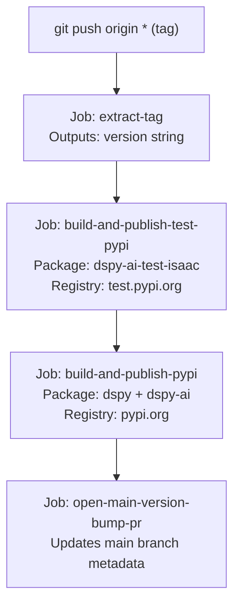
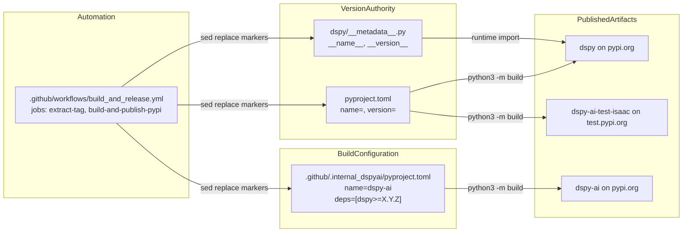

<!-- source: DeepWiki mcp.deepwiki.com · repo stanfordnlp/dspy · page 7.4 Package Metadata & Release Process · fetched 2026-10-27 -->

# Package Metadata & Release Process

<details>
<summary>Relevant source files</summary>

The following files were used as context for generating this wiki page:

- [.github/.internal_dspyai/internals/build-and-release.md](.github/.internal_dspyai/internals/build-and-release.md)
- [.github/.internal_dspyai/internals/release-checklist.md](.github/.internal_dspyai/internals/release-checklist.md)
- [.github/.internal_dspyai/pyproject.toml](.github/.internal_dspyai/pyproject.toml)
- [.github/.tmp/.generated-actions/run-pypi-publish-in-docker-container/action.yml](.github/.tmp/.generated-actions/run-pypi-publish-in-docker-container/action.yml)
- [.github/workflows/build_and_release.yml](.github/workflows/build_and_release.yml)
- [.github/workflows/dependency-range.yml](.github/workflows/dependency-range.yml)
- [.github/workflows/docs-push.yml](.github/workflows/docs-push.yml)
- [.github/workflows/precommits_check.yml](.github/workflows/precommits_check.yml)
- [.github/workflows/run_tests.yml](.github/workflows/run_tests.yml)
- [.pre-commit-config.yaml](.pre-commit-config.yaml)
- [CONTRIBUTING.md](CONTRIBUTING.md)
- [dspy/__metadata__.py](dspy/__metadata__.py)
- [pyproject.toml](pyproject.toml)
- [uv.lock](uv.lock)

</details>


This page covers DSPy's package metadata structure, version management, and the automated release pipeline that publishes to PyPI. It focuses on the artifact-production side of the development workflow — how a git tag becomes a published package.

For information about the broader CI/CD pipeline (linting, unit tests, integration tests), see [Build System & CI/CD](7.1). For the test suite itself, see [Testing Framework](7.2).

---

## Package Metadata

DSPy stores canonical package metadata in two locations that are kept in sync during the release process:

| Field | `dspy/__metadata__.py` | `pyproject.toml` |
|---|---|---|
| Package name | `__name__` | `name=` |
| Version | `__version__` | `version=` |
| Description | `__description__` | `description` |
| Homepage URL | `__url__` | `homepage` |
| Author | `__author__` | `authors[0].name` |
| Author email | `__author_email__` | `authors[0].email` |

**`dspy/__metadata__.py`** [dspy/__metadata__.py:1-8]() is the authoritative runtime source. It is imported by `dspy/__init__.py` and exposes these fields directly on the `dspy` module, allowing code like `dspy.__version__` to work.

**`pyproject.toml`** [pyproject.toml:5-22]() contains the same values for the build system. The two files are only guaranteed to match after a release workflow run; during development they may be updated independently.

### Metadata Validation

A dedicated test validates that the runtime metadata is correct and well-formed. This test is located at `tests/metadata/test_metadata.py`. This test is explicitly invoked as a pre-publish validation step in the release workflow [.github/workflows/build_and_release.yml:73]().

Sources: [dspy/__metadata__.py:1-8](), [pyproject.toml:5-22](), [.github/workflows/build_and_release.yml:73]()

---

## Published Packages

DSPy publishes under three distinct package names:

| Package Name | Registry | Purpose |
|---|---|---|
| `dspy` | PyPI | Main installable package [pyproject.toml:9]() |
| `dspy-ai` | PyPI | Thin compatibility shim; depends on `dspy>=X.Y.Z` [.github/.internal_dspyai/pyproject.toml:3-14]() |
| `dspy-ai-test-isaac` | TestPyPI | Pre-release validation; not for production use [.github/workflows/build_and_release.yml:50]() |

The `dspy-ai` package exists for users who originally installed DSPy via `pip install dspy-ai`. It is defined in a separate `pyproject.toml` at [.github/.internal_dspyai/pyproject.toml:1-23]() and has a single runtime dependency: `dspy>=<current_version>` [.github/.internal_dspyai/pyproject.toml:14]().

Sources: [pyproject.toml:9](), [.github/workflows/build_and_release.yml:50](), [.github/.internal_dspyai/pyproject.toml:3-14]()

---

## Version & Name Marker System

Both `pyproject.toml` and `dspy/__metadata__.py` use specially formatted comment markers that allow the release workflow to substitute the package name and version with `sed` commands without parsing the files as TOML or Python:

**Marker comments in `pyproject.toml`** [pyproject.toml:8-11]():
```toml
#replace_package_name_marker
name="dspy"
#replace_package_version_marker
version="3.3.0"
```

**Marker comments in `dspy/__metadata__.py`** [dspy/__metadata__.py:1-4]():
```python
#replace_package_name_marker
__name__="dspy"
#replace_package_version_marker
__version__="3.3.0"
```

The workflow uses `sed` to replace the line immediately following each marker [.github/workflows/build_and_release.yml:58-60](). The `pyproject.toml` documentation comment [pyproject.toml:6-7]() explicitly warns: *"Do not add spaces around the '=' sign for any of the fields preceded by a marker comment as it affects the publish workflow."*

**Diagram: Marker-based substitution flow**

```mermaid
flowchart LR
  subgraph "SourceFiles"
    PM["pyproject.toml\n#replace_package_name_marker\nname=\"dspy\"\n#replace_package_version_marker\nversion=\"3.3.0\""]
    MD["dspy/__metadata__.py\n#replace_package_name_marker\n__name__=\"dspy\"\n#replace_package_version_marker\n__version__=\"3.3.0\""]
  end

  subgraph "WorkflowSedCommands"
    SED1["sed: replace name field"]
    SED2["sed: replace version field"]
  end

  subgraph "BuildTargets"
    T1["dspy-ai-test-isaac (TestPyPI)"]
    T2["dspy (PyPI)"]
    T3["dspy-ai (PyPI)"]
  end

  PM --> SED1
  PM --> SED2
  MD --> SED2
  SED1 --> T1
  SED1 --> T2
  SED1 --> T3
  SED2 --> T1
  SED2 --> T2
  SED2 --> T3
```

Sources: [pyproject.toml:6-11](), [dspy/__metadata__.py:1-4](), [.github/workflows/build_and_release.yml:58-60]()

---

## Release Workflow

The release is fully automated via `.github/workflows/build_and_release.yml`. It is triggered by pushing any git tag to the repository [.github/workflows/build_and_release.yml:3-6]().

### Jobs Overview

**Diagram: Release workflow job sequence**



Sources: [.github/workflows/build_and_release.yml:1-161]()

---

### Job: `extract-tag`

[.github/workflows/build_and_release.yml:9-21]()

Extracts the version string from the git ref using:
```bash
run: echo "tag=${GITHUB_REF_NAME}" >> "$GITHUB_OUTPUT"
```

The extracted version is passed as `needs.extract-tag.outputs.version` to subsequent jobs [.github/workflows/build_and_release.yml:14]().

---

### Job: `build-and-publish-test-pypi`

[.github/workflows/build_and_release.yml:23-79]()

This job handles TestPyPI publication and pre-publish validation:

1. **Version calculation** — runs `.github/workflows/build_utils/test_version.py` to determine the correct version for TestPyPI, incrementing pre-release identifiers if the version already exists [.github/workflows/build_and_release.yml:52]().
2. **Substitution** — replaces `name=` with `dspy-ai-test-isaac` and updates `version=` in `pyproject.toml` [.github/workflows/build_and_release.yml:58-60]().
3. **Build** — runs `python3 -m build` to produce the distribution [.github/workflows/build_and_release.yml:62]().
4. **Validation** — uses `twine check --strict` [.github/workflows/build_and_release.yml:64]() and runs tests from `tests/metadata/test_metadata.py` and `tests/predict` in a fresh virtual environment [.github/workflows/build_and_release.yml:67-74]().
5. **Publish** — uses `pypa/gh-action-pypi-publish` with OIDC trusted publishing to `https://test.pypi.org/legacy/` [.github/workflows/build_and_release.yml:76-79]().

---

### Job: `build-and-publish-pypi`

[.github/workflows/build_and_release.yml:83-158]()

This job runs only on the `stanfordnlp` organization repository [.github/workflows/build_and_release.yml:86]().

**Publishing `dspy`:**
1. Substitutes the release tag version into `pyproject.toml` [.github/workflows/build_and_release.yml:110]() and `dspy/__metadata__.py` [.github/workflows/build_and_release.yml:114]().
2. Updates `name="dspy"` in both metadata files [.github/workflows/build_and_release.yml:117-119]().
3. Builds the wheel and runs local validation tests [.github/workflows/build_and_release.yml:121-133]().
4. Publishes to PyPI [.github/workflows/build_and_release.yml:135-138]().

**Publishing `dspy-ai`:**
1. Updates `name="dspy-ai"` and the version in `.github/.internal_dspyai/pyproject.toml` [.github/workflows/build_and_release.yml:141-145]().
2. Updates the `dspy>=<version>` dependency pin [.github/workflows/build_and_release.yml:149]().
3. Builds from the `.github/.internal_dspyai/` directory and publishes [.github/workflows/build_and_release.yml:151-158]().

Sources: [.github/workflows/build_and_release.yml:83-158]()

---

## `pyproject.toml` Configuration

The main `pyproject.toml` configures the build system, dependencies, and tooling.

### Build System
[pyproject.toml:1-3]()
```toml
[build-system]
requires = ["setuptools>=77.0.1"]
build-backend = "setuptools.build_meta"
```

### Core Dependencies
[pyproject.toml:23-38]()
Key dependencies include:
- `litellm>=1.65.8` [pyproject.toml:30]()
- `pydantic>=2.0` [pyproject.toml:29]()
- `gepa[dspy]==0.1.1` [pyproject.toml:37]()
- `anyio` [pyproject.toml:34]()
- `diskcache>=5.6.0` [pyproject.toml:31]()
- `openai>=1.66.2` [pyproject.toml:24]()

### Optional Dependency Groups
[pyproject.toml:40-72]()
- `mcp`: `mcp; python_version >= '3.10'` [pyproject.toml:43]()
- `deno`: `deno>=2.4.5,<3.0.0` [pyproject.toml:44]()
- `dev`: Includes `pytest`, `ruff`, `pre-commit`, and `build` [pyproject.toml:49-64]().
- `test_extras`: Includes `datasets`, `pandas`, and `optuna` [pyproject.toml:65-72]().

Sources: [pyproject.toml:1-72]()

---

## Code Entity Map

**Diagram: Files and their roles in the release pipeline**



Sources: [dspy/__metadata__.py:1-8](), [pyproject.toml:1-22](), [.github/workflows/build_and_release.yml:1-161](), [.github/.internal_dspyai/pyproject.toml:1-23]()

---

