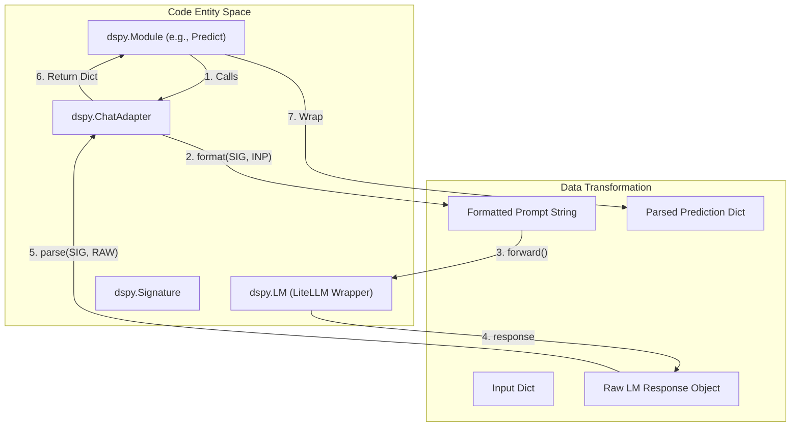
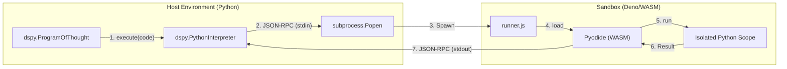

<!-- source: DeepWiki mcp.deepwiki.com · repo stanfordnlp/dspy · page 8 Glossary · fetched 2026-10-27 -->

# Glossary

Relevant source files

The following files were used as context for generating this wiki page:

- [README.md](README.md)
- [docs/docs/api/tools/PythonInterpreter.md](docs/docs/api/tools/PythonInterpreter.md)
- [docs/docs/api/utils/Errors.md](docs/docs/api/utils/Errors.md)
- [docs/docs/faqs.md](docs/docs/faqs.md)
- [docs/docs/learn/programming/language_models.md](docs/docs/learn/programming/language_models.md)
- [docs/docs/learn/programming/signatures.md](docs/docs/learn/programming/signatures.md)
- [dspy/__init__.py](dspy/__init__.py)
- [dspy/adapters/__init__.py](dspy/adapters/__init__.py)
- [dspy/adapters/base.py](dspy/adapters/base.py)
- [dspy/adapters/chat_adapter.py](dspy/adapters/chat_adapter.py)
- [dspy/adapters/json_adapter.py](dspy/adapters/json_adapter.py)
- [dspy/adapters/types/__init__.py](dspy/adapters/types/__init__.py)
- [dspy/adapters/utils.py](dspy/adapters/utils.py)
- [dspy/adapters/xml_adapter.py](dspy/adapters/xml_adapter.py)
- [dspy/clients/base_lm.py](dspy/clients/base_lm.py)
- [dspy/clients/lm.py](dspy/clients/lm.py)
- [dspy/evaluate/evaluate.py](dspy/evaluate/evaluate.py)
- [dspy/predict/flex/bridge.py](dspy/predict/flex/bridge.py)
- [dspy/predict/program_of_thought.py](dspy/predict/program_of_thought.py)
- [dspy/primitives/code_interpreter.py](dspy/primitives/code_interpreter.py)
- [dspy/primitives/python_interpreter.py](dspy/primitives/python_interpreter.py)
- [dspy/primitives/runner.js](dspy/primitives/runner.js)
- [dspy/propose/__init__.py](dspy/propose/__init__.py)
- [dspy/propose/dataset_summary_generator.py](dspy/propose/dataset_summary_generator.py)
- [dspy/propose/grounded_proposer.py](dspy/propose/grounded_proposer.py)
- [dspy/propose/propose_base.py](dspy/propose/propose_base.py)
- [dspy/propose/utils.py](dspy/propose/utils.py)
- [dspy/teleprompt/__init__.py](dspy/teleprompt/__init__.py)
- [dspy/teleprompt/bootstrap.py](dspy/teleprompt/bootstrap.py)
- [dspy/teleprompt/copro_optimizer.py](dspy/teleprompt/copro_optimizer.py)
- [dspy/teleprompt/mipro_optimizer_v2.py](dspy/teleprompt/mipro_optimizer_v2.py)
- [dspy/teleprompt/random_search.py](dspy/teleprompt/random_search.py)
- [dspy/teleprompt/signature_opt.py](dspy/teleprompt/signature_opt.py)
- [dspy/teleprompt/teleprompt_optuna.py](dspy/teleprompt/teleprompt_optuna.py)
- [dspy/teleprompt/utils.py](dspy/teleprompt/utils.py)
- [dspy/utils/dummies.py](dspy/utils/dummies.py)
- [tests/adapters/test_chat_adapter.py](tests/adapters/test_chat_adapter.py)
- [tests/adapters/test_json_adapter.py](tests/adapters/test_json_adapter.py)
- [tests/adapters/test_xml_adapter.py](tests/adapters/test_xml_adapter.py)
- [tests/clients/test_lm.py](tests/clients/test_lm.py)
- [tests/mock_interpreter.py](tests/mock_interpreter.py)
- [tests/predict/test_program_of_thought.py](tests/predict/test_program_of_thought.py)
- [tests/primitives/test_python_interpreter.py](tests/primitives/test_python_interpreter.py)
- [tests/propose/test_grounded_proposer.py](tests/propose/test_grounded_proposer.py)
- [tests/teleprompt/test_random_search.py](tests/teleprompt/test_random_search.py)
- [tests/teleprompt/test_utils.py](tests/teleprompt/test_utils.py)

This glossary defines the core technical terms, implementation patterns, and domain-specific jargon used within the DSPy codebase. It is intended to help onboarding engineers navigate the transition from "natural language prompting" to "declarative AI programming."

## Core Concepts & Data Primitives

### Signature
A declarative specification of the input/output behavior for an LM call. Unlike a prompt, a signature defines *what* the task is, not *how* to prompt for it.
*   **Implementation**: Defined as a class inheriting from `dspy.Signature` [dspy/signatures/signature.py:1-7](). It uses `InputField` and `OutputField` to define the schema [dspy/signatures/field.py:1-10]().
*   **Key Logic**: The `SignatureMeta` metaclass handles the parsing of short-hand string signatures (e.g., `"question -> answer"`) into class representations via `make_signature` [dspy/signatures/signature.py:41-51]().
*   **Code Pointers**: `dspy/signatures/signature.py`, `dspy/signatures/field.py`.

### Module
A functional unit that processes inputs into outputs based on a `Signature`. Modules are the building blocks of DSPy programs and can contain internal state (like prompts or learned weights).
*   **Implementation**: Inherits from `dspy.Module`.
*   **Lifecycle**: Modules typically implement a `forward` or `aforward` method to process data.
*   **Code Pointers**: `dspy/predict/predict.py` (for the base `Predict` module), `dspy/propose/grounded_proposer.py` (for `GenerateModuleInstruction` [dspy/propose/grounded_proposer.py:114-124]()).

### Example
The fundamental data unit in DSPy, used for training, evaluation, and few-shot demonstrations.
*   **Implementation**: `dspy.Example`. It distinguishes between `inputs` and `labels`.
*   **Code Pointers**: `dspy/primitives/example.py`.

**Sources**: [dspy/signatures/signature.py:1-51](), [dspy/signatures/field.py:1-10](), [dspy/propose/grounded_proposer.py:114-124]().

---

## The Adapter System

The **Adapter** acts as the translation layer between the high-level DSPy `Module` and the raw `BaseLM`. It handles the transformation pipeline from DSPy inputs to LM calls and back to structured outputs [dspy/adapters/base.py:34-49]().

### ChatAdapter
The default adapter for most modern chat-based LMs. It structures interactions using section headers like `[[ ## field_name ## ]]` to delineate input and output fields [dspy/adapters/chat_adapter.py:29-39]().
*   **Implementation**: `dspy.ChatAdapter`.
*   **Fallback**: Provides automatic fallback to `JSONAdapter` if the chat format fails during parsing or execution [dspy/adapters/chat_adapter.py:84-94]().
*   **Code Pointers**: `dspy/adapters/chat_adapter.py`.

### JSONAdapter
An adapter that enforces JSON formatting, leveraging "Structured Outputs" or "JSON Mode" from providers like OpenAI.
*   **Implementation**: `dspy.JSONAdapter`.
*   **Logic**: It checks if the LM supports `response_format` and `response_schema` before attempting structured output [dspy/adapters/json_adapter.py:56-66](). It uses `json_repair` to handle malformed LM outputs [dspy/adapters/json_adapter.py:167-168]().
*   **Code Pointers**: `dspy/adapters/json_adapter.py`.

### Adapter Flow Diagram
This diagram illustrates how a DSPy Module uses an Adapter to communicate with an LM.

**Bridge: Module to LM via Adapter**

**Sources**: [dspy/adapters/base.py:34-49](), [dspy/adapters/chat_adapter.py:29-39](), [dspy/adapters/json_adapter.py:56-66](), [dspy/clients/lm.py:55-102]().

---

## Optimization (Teleprompters)

**Teleprompters** (Optimizers) are algorithms that take a DSPy program and a `trainset` to produce an optimized version of the program by updating instructions or demonstrations [dspy/teleprompt/teleprompt.py:1-10]().

### Bootstrapping
The process of using a "Teacher" model to generate synthetic "traces" (intermediate steps) for a program. If the trace leads to a correct output (based on a `metric`), it is saved as a demonstration for the "Student" model [dspy/teleprompt/bootstrap.py:47-52]().
*   **Code Pointers**: `dspy/teleprompt/bootstrap.py`.
*   **Key Function**: `BootstrapFewShot._bootstrap()` [dspy/teleprompt/bootstrap.py:148-160]().

### MIPROv2 (Multi-stage Instruction Proposal and Response Optimization)
A sophisticated optimizer that proposes multiple instruction candidates and few-shot sets, then uses Bayesian Optimization (via `optuna`) to find the best combination [dspy/teleprompt/mipro_optimizer_v2.py:60-79]().
*   **Implementation**: `dspy.MIPROv2`.
*   **Components**: Uses `GroundedProposer` to generate instructions based on data and code [dspy/teleprompt/mipro_optimizer_v2.py:9-10]().
*   **Code Pointers**: `dspy/teleprompt/mipro_optimizer_v2.py`.

### GEPA (Reflective Prompt Evolution)
An evolutionary optimizer that uses reflection to evolve text components of complex systems [dspy/teleprompt/gepa/gepa.py:156-160](). It identifies parts of a trace corresponding to a predictor and reflects on behavior to propose new instructions [dspy/teleprompt/gepa/gepa.py:162-166]().
*   **Code Pointers**: `dspy/teleprompt/gepa/gepa.py`.

### GroundedProposer
A component used by MIPROv2 to propose instructions that are "grounded" in the program's code, dataset summaries, and execution history [dspy/propose/grounded_proposer.py:114-142]().
*   **Signatures**: Uses internal signatures like `DescribeProgram` and `DescribeModule` to understand the task before proposing instructions [dspy/propose/grounded_proposer.py:28-62]().
*   **Code Pointers**: `dspy/propose/grounded_proposer.py`.

---

## Execution & Sandboxing

### PythonInterpreter
A secure execution environment for running Python code generated by LMs (e.g., in `ProgramOfThought`).
*   **Implementation**: `dspy.PythonInterpreter`.
*   **Technology**: Uses **Deno** and **Pyodide** (WASM) to sandbox the code, preventing access to the host filesystem or network unless explicitly allowed [dspy/primitives/python_interpreter.py:97-103]().
*   **Communication**: Communicates with the WASM worker via **JSON-RPC 2.0** [dspy/primitives/python_interpreter.py:60-85]().
*   **Code Pointers**: `dspy/primitives/python_interpreter.py`.

**Bridge: Code Execution Architecture**

**Sources**: [dspy/primitives/python_interpreter.py:97-120](), [dspy/primitives/python_interpreter.py:161-185](), [dspy/predict/program_of_thought.py:1-20]().

---

## Evaluation Framework

### Evaluate
A utility class for running a DSPy program over a dataset and computing a score.
*   **Implementation**: `dspy.Evaluate`.
*   **Features**: Supports multi-threading and generates detailed results containing scores and individual (example, prediction, score) tuples [dspy/evaluate/evaluate.py:64-69]().
*   **Code Pointers**: `dspy/evaluate/evaluate.py`.

### Metric
A user-defined function that takes `(gold_example, prediction)` and returns a `float` or `bool`. It is the primary signal for all DSPy optimizers [dspy/teleprompt/mipro_optimizer_v2.py:63-88]().

---

## Technical Abbreviations & Jargon

| Term | Definition | Code Pointer |
| :--- | :--- | :--- |
| **LM** | Language Model. The base interface for calling LLMs via LiteLLM. | [dspy/clients/lm.py:55-61]() |
| **RM** | Retrieval Model. Used in RAG pipelines. | `dspy/retrievers/__init__.py` |
| **COT** | Chain of Thought. A reasoning strategy. | `dspy/predict/chain_of_thought.py` |
| **GRPO** | Group Relative Policy Optimization. Used in weight optimization. | `dspy/teleprompt/grpo_optimizer.py` |
| **Trace** | A recording of the inputs and outputs of every module call during a program's execution. | `dspy/teleprompt/bootstrap.py` |
| **rollout_id** | An integer used to differentiate cache entries for identical requests, forcing a bypass of the cache when temperature > 0. | [dspy/clients/lm.py:97-101]() |
| **request_cache** | The internal system for caching LM responses to reduce cost and latency. | [dspy/clients/lm.py:14-14]() |

**Sources**: [dspy/clients/lm.py:15-101](), [dspy/teleprompt/mipro_optimizer_v2.py:60-88](), [dspy/adapters/base.py:34-49](), [dspy/evaluate/evaluate.py:64-128]().