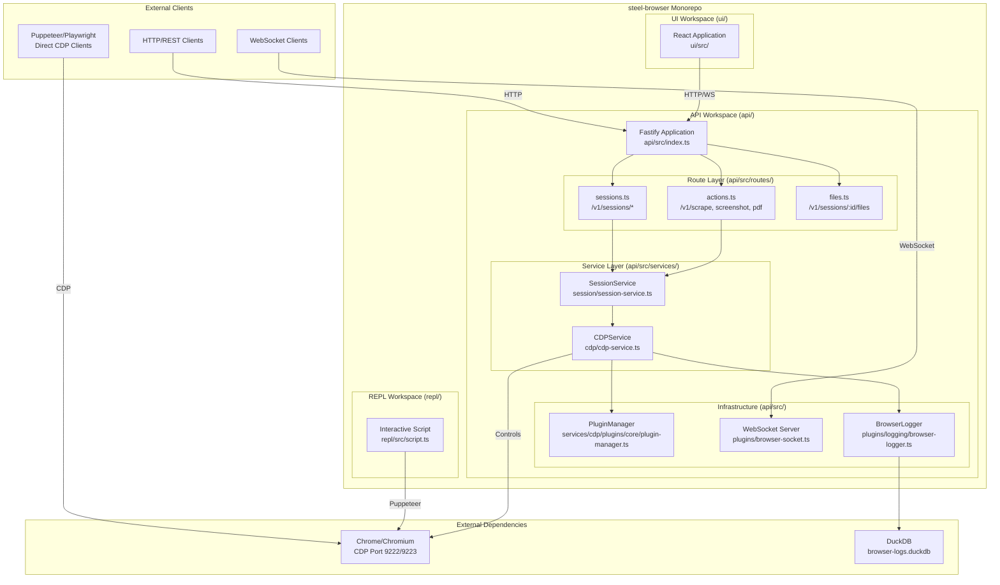
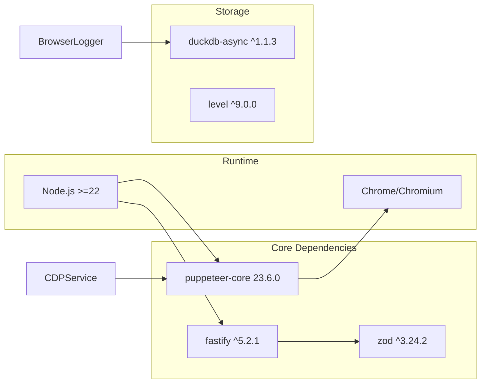

<!-- source: DeepWiki mcp.deepwiki.com · repo steel-dev/steel-browser · page 1 Overview · fetched 2026-10-27 -->

# Overview

Relevant source files

The following files were used as context for generating this wiki page:

- [Dockerfile](Dockerfile)
- [README.md](README.md)
- [api/package.json](api/package.json)
- [images/star_img.png](images/star_img.png)
- [package-lock.json](package-lock.json)
- [package.json](package.json)
- [render.yaml](render.yaml)

This document provides a high-level introduction to the steel-browser system, explaining its purpose, core architecture, and major components. For detailed information on specific subsystems, refer to the corresponding sections: [System Architecture](#1.1) for architectural details, [Key Features](#1.2) for capability descriptions, and [Monorepo Structure](#1.3) for workspace organization.

## Purpose and Scope

Steel-browser is an open-source browser API designed to enable AI agents and applications to interact with the web programmatically [README.md:10-14](). It manages the complexity of browser infrastructure, including sessions, processes, and anti-detection, allowing developers to focus on application logic [README.md:47-49]().

**Sources:** [README.md:1-70](), [package.json:1-40]()

## What is Steel Browser

Steel-browser is a comprehensive browser automation infrastructure built on Chrome DevTools Protocol (CDP) and Puppeteer [README.md:50-50](). It provides a REST API and WebSocket interface for controlling Chrome browser instances, maintaining state across requests, and performing common web automation tasks.

### Core Capabilities

| Capability | Description | Implementation |
|------------|-------------|----------------|
| **Full Browser Control** | Complete control via Puppeteer and CDP; compatible with Playwright and Selenium | `puppeteer-core`, `CDPService` |
| **Session Management** | Maintains cookies, local storage, and state across requests | `SessionService` |
| **Proxy Support** | Built-in proxy chain management for IP rotation | `proxy-chain`, `ProxyFactory` |
| **Anti-Detection** | Includes stealth plugins and fingerprint management | `fingerprint-generator`, `fingerprint-injector` |
| **Browser Tools** | APIs to convert pages to Markdown, Readability, screenshots, or PDFs | Action route handlers |
| **Debugging Tools** | Built-in request logging and a UI for session debugging | `BrowserLogger`, `ui` workspace |

**Sources:** [README.md:45-58](), [api/package.json:66-113]()

## System Architecture

The steel-browser system is organized as a Node.js monorepo consisting of an API server, a management UI, and a REPL for testing [package.json:8-12]().

### High-Level Component Architecture

**Sources:** [api/package.json:8-39](), [package.json:8-12](), [README.md:109-156]()

### Technology Stack

**Sources:** [package.json:27-36](), [api/package.json:72-113]()

## Core Service Layer

The service layer implements the logic for browser orchestration and lifecycle management. For details, see [System Architecture](#1.1).

*   **`SessionService`**: Orchestrates browser sessions, manages proxies, and handles high-level session lifecycle [api/package.json:11-13]().
*   **`CDPService`**: Manages the low-level Chrome DevTools Protocol connection, browser launches, and page instrumentation [api/package.json:15-19]().
*   **`BrowserLogger`**: Captures browser events and persists them to DuckDB for debugging and monitoring [api/package.json:21-25]().

**Sources:** [api/package.json:8-39]()

## Monorepo Structure

The codebase is organized into three primary workspaces to separate concerns. For details, see [Monorepo Structure](#1.3).

*   **`api/`**: The core Fastify server. It contains the browser automation logic, CDP integration, and the REST/WebSocket endpoints [api/package.json:1-7]().
*   **`ui/`**: A React-based dashboard for viewing and debugging live browser sessions [README.md:94-94]().
*   **`repl/`**: A workspace for interactive script development and testing [package.json:11-11]().

**Sources:** [package.json:8-12](), [README.md:109-115]()

## Key Features

Steel-browser includes several advanced features for modern web automation. For details, see [Key Features](#1.2).

*   **Anti-Detection**: Uses `fingerprint-generator` and `fingerprint-injector` to avoid bot detection [api/package.json:93-94]().
*   **Proxy Chaining**: Supports complex proxy configurations via `proxy-chain` [api/package.json:107-107]().
*   **Content Conversion**: Built-in support for converting web pages to Markdown (via Turndown) and PDF [api/package.json:81-83](), [api/package.json:104-104]().
*   **Extension Support**: Ability to load custom Chrome extensions into sessions [README.md:53-53]().

**Sources:** [README.md:45-58](), [api/package.json:72-113]()

## Deployment

Steel-browser is distributed as a Docker image that bundles the API, UI, and necessary system dependencies like Chromium and Xvfb [Dockerfile:72-108]().

*   **Docker**: The primary deployment method, supporting both combined and separate API/UI containers [README.md:87-101]().
*   **Cloud**: Support for 1-click deployments to Railway and Render [README.md:76-81](), [render.yaml:1-6]().

**Sources:** [Dockerfile:1-126](), [README.md:70-108](), [render.yaml:1-18]()

---

