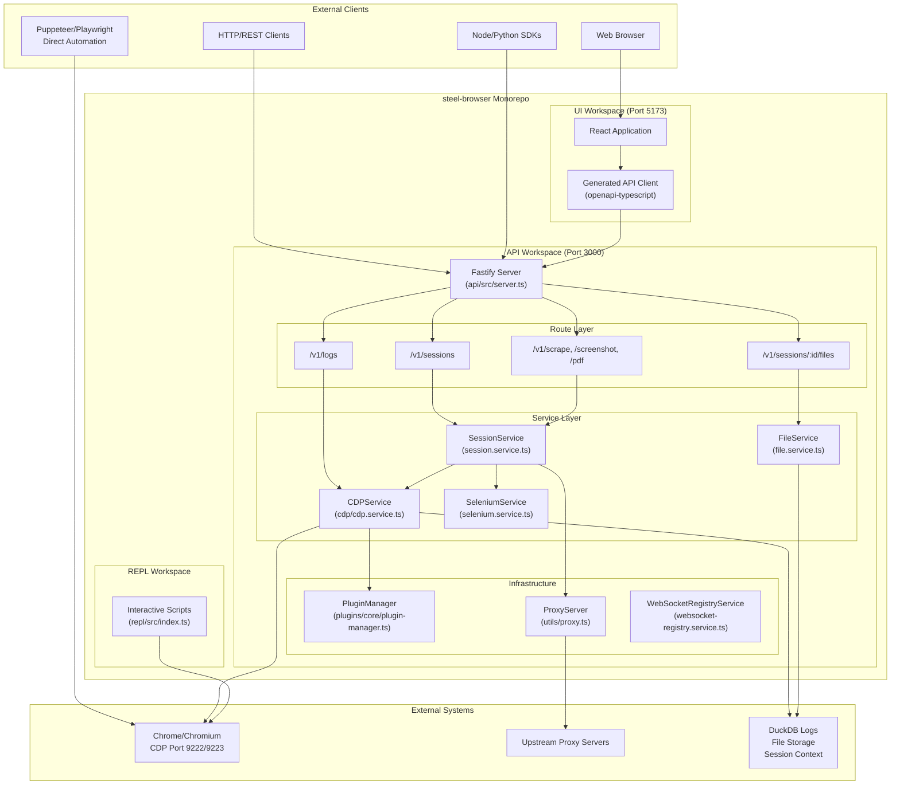
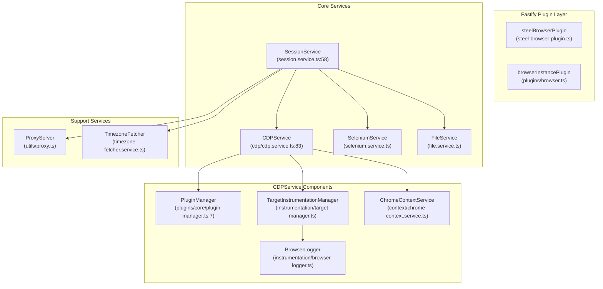
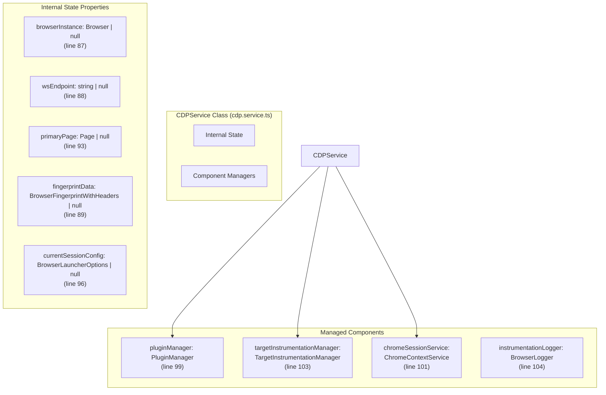
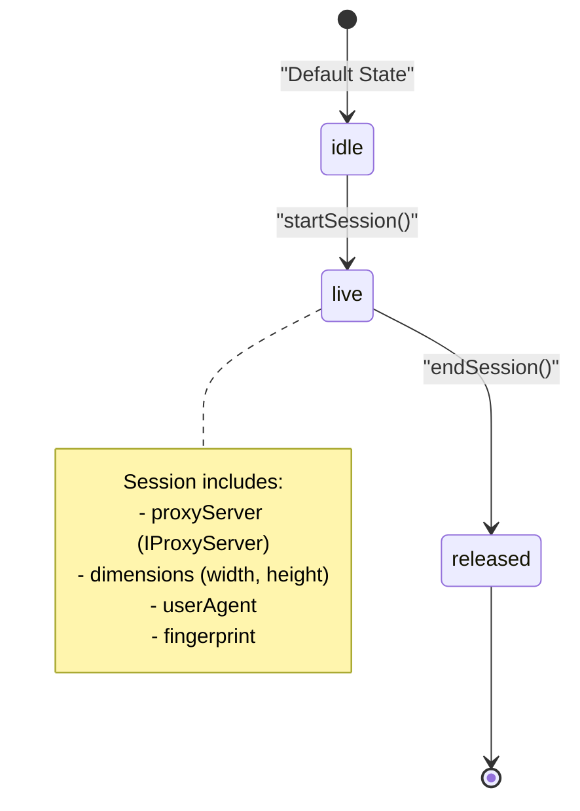

<!-- source: DeepWiki mcp.deepwiki.com · repo steel-dev/steel-browser · page 1.1 System Architecture · fetched 2026-10-27 -->

# System Architecture

Relevant source files

The following files were used as context for generating this wiki page:

- [api/src/services/cdp/cdp.service.ts](api/src/services/cdp/cdp.service.ts)
- [api/src/services/cdp/plugins/core/base-plugin.ts](api/src/services/cdp/plugins/core/base-plugin.ts)
- [api/src/services/cdp/plugins/core/plugin-manager.ts](api/src/services/cdp/plugins/core/plugin-manager.ts)
- [api/src/services/session.service.ts](api/src/services/session.service.ts)
- [docs/ARCHITECTURE.md](docs/ARCHITECTURE.md)
- [docs/DEVELOPMENT_SETUP.md](docs/DEVELOPMENT_SETUP.md)
- [docs/README.md](docs/README.md)
- [docs/TROUBLESHOOTING.md](docs/TROUBLESHOOTING.md)

Steel Browser is a containerized browser automation platform built as a TypeScript monorepo. The system provides programmatic browser control through RESTful APIs, WebSocket streaming, and direct CDP/Selenium interfaces. The architecture follows a layered service design with plugin extensibility, event-driven instrumentation, and comprehensive session management.

## Overview

The steel-browser repository is organized as a monorepo with three workspaces:

- **API Workspace** (`api/`) - Fastify server exposing REST/WebSocket APIs and managing browser sessions [api/src/server.ts:1-50]()
- **UI Workspace** (`ui/`) - React application for visual session management and monitoring [ui/src/main.tsx:1-20]()
- **REPL Workspace** (`repl/`) - Interactive scripts for direct browser automation [repl/src/index.ts:1-30]()

The API workspace contains the core system: route handlers, service layer (`CDPService`, `SessionService`), plugin architecture, and browser instrumentation.

### Monorepo Architecture

Sources: [api/src/server.ts:1-50](), [api/src/services/session.service.ts:58-91](), [api/src/services/cdp/cdp.service.ts:83-185](), [docs/ARCHITECTURE.md:5-24]()

## Core Service Layer

The API workspace implements a three-tier architecture: HTTP routes → controllers → service layer. The service layer contains core business logic and orchestrates browser automation through `CDPService` and `SessionService`.

### Service Layer Architecture

**Service Responsibilities:**

| Service | File | Primary Role |
|---------|------|-------------|
| `SessionService` | [api/src/services/session.service.ts:58]() | Manages session lifecycle, proxy setup, coordinates between CDP and Selenium modes. |
| `CDPService` | [api/src/services/cdp/cdp.service.ts:83]() | Controls Chrome via CDP, manages browser instances, handles page instrumentation. |
| `SeleniumService` | [api/src/services/selenium.service.ts]() | Provides WebDriver compatibility for Selenium clients. |
| `FileService` | [api/src/services/file.service.ts]() | Manages session file uploads/downloads and storage. |
| `PluginManager` | [api/src/services/cdp/plugins/core/plugin-manager.ts:7]() | Coordinates plugin lifecycle and ensure error isolation. |

Sources: [api/src/services/session.service.ts:58-80](), [api/src/services/cdp/cdp.service.ts:83-105](), [docs/ARCHITECTURE.md:28-115]()

## CDPService: Browser Orchestration Engine

The `CDPService` class [api/src/services/cdp/cdp.service.ts:83]() is the heart of Steel Browser. It manages the Puppeteer browser instance, handles fingerprinting, and coordinates the plugin system.

### CDPService Internal Architecture

**Key Features:**
- **Lifecycle Management**: Handles `launch()`, `shutdown()`, and `refreshPrimaryPage()` [docs/ARCHITECTURE.md:44-46]().
- **Context Isolation**: Uses `ChromeContextService` to manage cookies, localStorage, and sessionStorage [api/src/services/cdp/cdp.service.ts:101]().
- **Instrumentation**: Uses `TargetInstrumentationManager` to capture browser events [api/src/services/cdp/cdp.service.ts:177-180]().

Sources: [api/src/services/cdp/cdp.service.ts:83-185](), [docs/ARCHITECTURE.md:28-56]()

## SessionService: Session Lifecycle Management

The `SessionService` [api/src/services/session.service.ts:58]() manages browser sessions with isolated contexts. It is responsible for creating sessions with custom configurations like proxies, user agents, and fingerprints.

### Session Lifecycle and State

The service maintains an `activeSession` [api/src/services/session.service.ts:67]() and a list of `pastSessions` [api/src/services/session.service.ts:66]().

**Session Creation Flow:**
1. **Timezone Resolution**: Fetches timezone early via `TimezoneFetcher` [api/src/services/session.service.ts:143-151]().
2. **Proxy Setup**: Initializes `ProxyServer` if a `proxyUrl` is provided [api/src/services/session.service.ts:208-211]().
3. **Configuration Merging**: Merges user preferences and browser options [api/src/services/session.service.ts:182-191]().
4. **Browser Launch**: Delegates to `CDPService` or `SeleniumService` [api/src/services/session.service.ts:213-235]().

Sources: [api/src/services/session.service.ts:58-243](), [docs/ARCHITECTURE.md:86-105]()

## Plugin System Architecture

Steel Browser's plugin architecture allows for extensible functionality (e.g., ad blocking, captcha solving) without modifying core code.

### Plugin Lifecycle Hooks

The `BasePlugin` [api/src/services/cdp/plugins/core/base-plugin.ts:27]() defines hooks that the `PluginManager` [api/src/services/cdp/plugins/core/plugin-manager.ts:7]() triggers during browser events:

| Hook | Trigger Point |
|------|---------------|
| `onBrowserLaunch` | When the browser process starts [api/src/services/cdp/plugins/core/plugin-manager.ts:96](). |
| `onBrowserReady` | After the browser is fully configured [api/src/services/cdp/plugins/core/plugin-manager.ts:107](). |
| `onPageCreated` | When a new page or tab is opened [api/src/services/cdp/plugins/core/plugin-manager.ts:123](). |
| `onPageNavigate` | Before a page navigates to a new URL [api/src/services/cdp/plugins/core/plugin-manager.ts:151](). |
| `onShutdown` | When the system is shutting down with a specific `ShutdownReason` [api/src/services/cdp/plugins/core/plugin-manager.ts:193](). |

### Plugin Manager Coordination

The `PluginManager` handles:
- **Registration**: Ensures plugins are uniquely named and injected with the `CDPService` [api/src/services/cdp/plugins/core/plugin-manager.ts:21-29]().
- **Error Isolation**: Wraps plugin calls in try-catch blocks to prevent a single plugin failure from crashing the browser session [api/src/services/cdp/plugins/core/plugin-manager.ts:59, 100, 128]().

Sources: [api/src/services/cdp/plugins/core/base-plugin.ts:9-55](), [api/src/services/cdp/plugins/core/plugin-manager.ts:7-217](), [docs/ARCHITECTURE.md:58-84]()

## API & Communication Layer

The backend uses **Fastify** for its REST and WebSocket API. Routes are organized by functionality:
- **Sessions** (`/v1/sessions/*`): Lifecycle management.
- **Actions** (`/v1/*`): High-level automation like `scrape`, `screenshot`, and `pdf`.
- **Files** (`/v1/files/*`): Session-scoped storage operations.

All API endpoints use **Zod** schemas for strict request and response validation [docs/ARCHITECTURE.md:202-212]().

Sources: [docs/ARCHITECTURE.md:172-212]()

---

