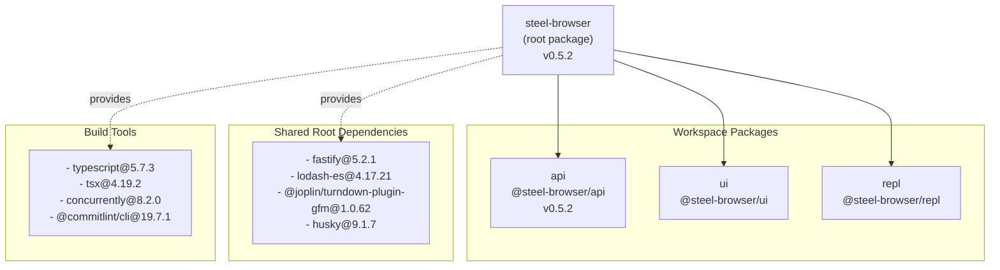
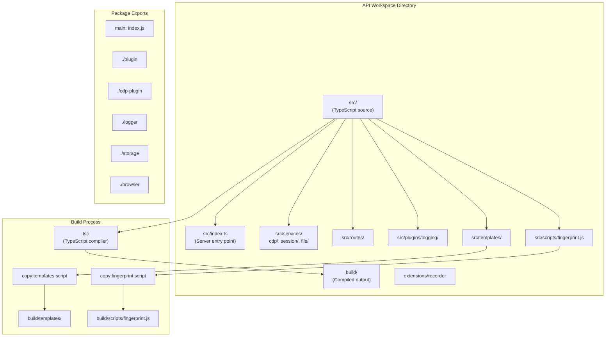
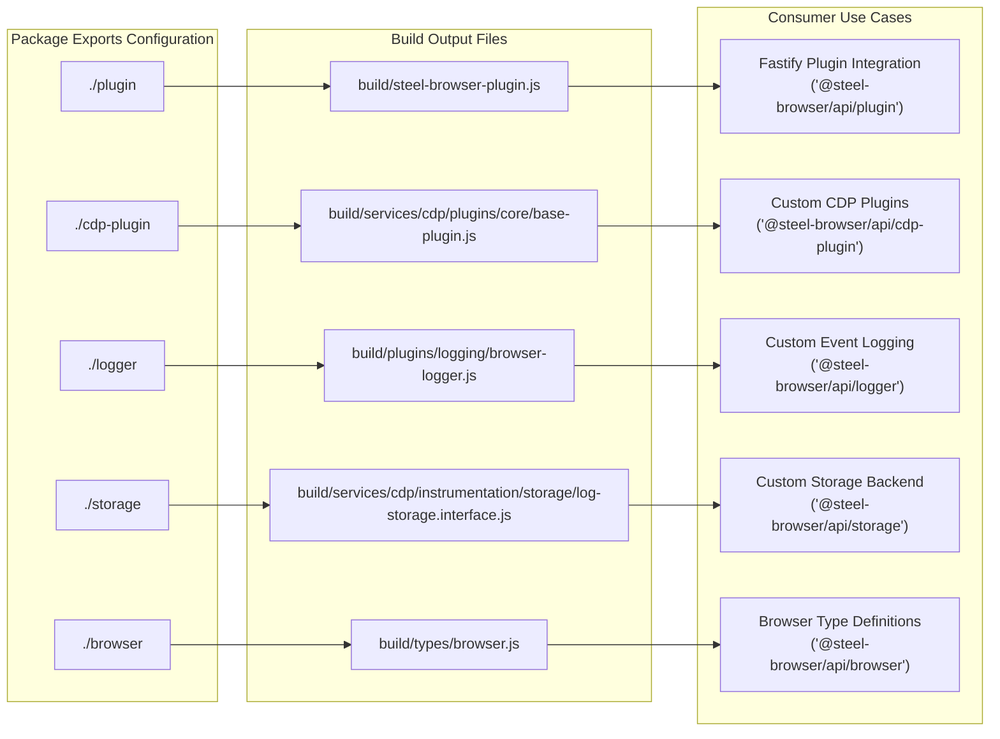
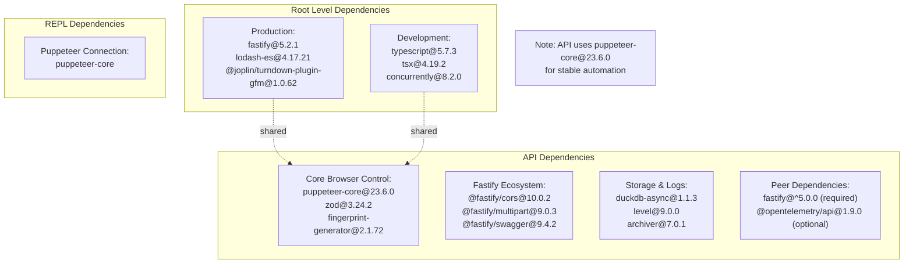
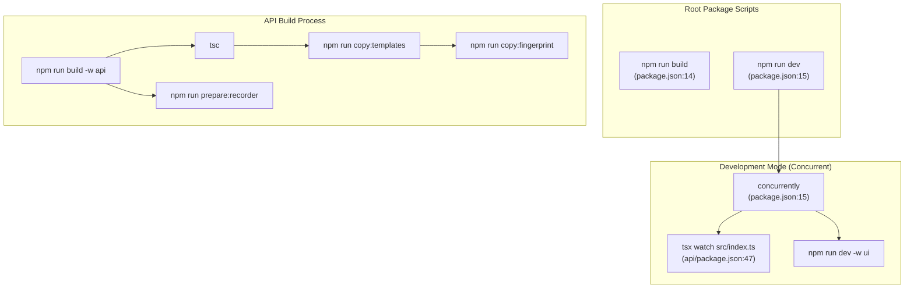
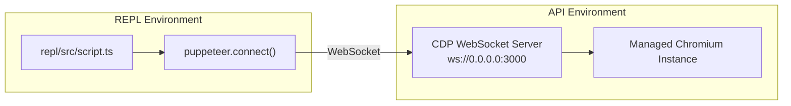

<!-- source: DeepWiki mcp.deepwiki.com · repo steel-dev/steel-browser · page 1.3 Monorepo Structure · fetched 2026-10-27 -->

# Monorepo Structure

<details>
<summary>Relevant source files</summary>

The following files were used as context for generating this wiki page:

- [api/package.json](api/package.json)
- [package-lock.json](package-lock.json)
- [package.json](package.json)
- [repl/README.md](repl/README.md)
- [repl/src/script.ts](repl/src/script.ts)

</details>


This document explains the workspace organization, package dependencies, build system, and how the three main packages (api, ui, repl) are structured and relate to each other within the Steel Browser monorepo. For deployment architecture and containerization, see page 2.3.

## Overview

Steel Browser uses npm workspaces to organize three distinct packages within a single repository at version `0.5.2`. The monorepo structure enables shared dependencies, coordinated builds, and consistent versioning across the Fastify-based API server (port 3000), React UI dashboard (port 5173), and development REPL.

**Sources:** [package.json:1-12](), [package-lock.json:1-15]()

## Workspace Organization

The monorepo defines three workspaces at the root level:



**Sources:** [package.json:1-12](), [package.json:30-36](), [api/package.json:2-3](), [package-lock.json:1-15]()

| Workspace | Package Name | Description | Type |
|-----------|-------------|-------------|------|
| `api` | `@steel-browser/api` | Core browser automation API server, CDPService, SessionService, and plugin system | Private |
| `ui` | `@steel-browser/ui` | React-based dashboard for session management and monitoring | Private |
| `repl` | `@steel-browser/repl` | Development REPL for testing Puppeteer scripts | Private |

**Sources:** [api/package.json:1-7](), [package.json:8-12]()

## API Package Structure

The API package (`@steel-browser/api`) is the most complex workspace, providing multiple export paths for different integration scenarios. It contains the core `CDPService`, `SessionService`, `FileService`, and plugin system.

**Workspace Structure Diagram**



**Sources:** [api/package.json:5-39](), [api/package.json:41-45]()

**API Package Export Paths**



**Sources:** [api/package.json:8-39]()

### Export Paths

The API package defines five distinct export paths for consumers:

| Export Path | Type Definition | JavaScript Module | Purpose |
|-------------|----------------|-------------------|---------|
| `./plugin` | `build/steel-browser-plugin.d.ts` | `build/steel-browser-plugin.js` | Main Fastify plugin for integrating Steel into existing applications |
| `./cdp-plugin` | `build/services/cdp/plugins/core/base-plugin.d.ts` | `build/services/cdp/plugins/core/base-plugin.js` | Base class for creating browser lifecycle plugins |
| `./logger` | `build/plugins/logging/browser-logger.d.ts` | `build/plugins/logging/browser-logger.js` | Browser event logging infrastructure |
| `./storage` | `build/services/cdp/instrumentation/storage/log-storage.interface.d.ts` | `build/services/cdp/instrumentation/storage/log-storage.interface.js` | Log storage interface for custom backends |
| `./browser` | `build/types/browser.d.ts` | `build/types/browser.js` | Core browser type definitions |

**Sources:** [api/package.json:8-39]()

## Dependency Architecture

**Dependency Distribution Across Workspaces**



**Sources:** [package.json:30-36](), [api/package.json:72-113](), [repl/src/script.ts:1]()

### API Package Peer Dependencies

The API package uses peer dependencies to avoid version conflicts when integrated into other applications:

```json
{
  "peerDependencies": {
    "@opentelemetry/api": "1.9.0",
    "fastify": "^5.0.0"
  },
  "peerDependenciesMeta": {
    "fastify": {
      "optional": false
    },
    "@opentelemetry/api": {
      "optional": true
    }
  }
}
```

**Sources:** [api/package.json:118-129]()

## Build System

**Root and Workspace Build Flow**



**Sources:** [package.json:13-17](), [api/package.json:40-51]()

### Build Scripts

#### API Workspace Scripts

| Command | Script | Output/Action |
|---------|--------|---------------|
| `npm run start` | `node ./build/index.js` | Run compiled API server |
| `npm run build` | `tsc && npm run copy:templates && npm run copy:fingerprint` | Production build |
| `npm run dev` | `npm run prepare:recorder && tsx watch src/index.ts` | Dev mode with hot reload |
| `npm run copy:templates` | `mkdir -p build/templates && cp -r src/templates/* build/templates/` | Copy EJS templates |
| `npm run copy:fingerprint` | `cp src/scripts/fingerprint.js build/scripts/fingerprint.js` | Copy fingerprint script |
| `npm run prepare:recorder` | `cd extensions/recorder && npm install && npm run build` | Build recorder extension |

**Sources:** [api/package.json:40-51]()

## REPL Integration

The REPL workspace provides a standalone script to interact with the API's managed browser instances via the Chrome DevTools Protocol (CDP).



**Sources:** [repl/src/script.ts:1-23](), [repl/README.md:1-15]()

### REPL Script Logic
The REPL connects to the API's WebSocket endpoint using `puppeteer.connect` ([repl/src/script.ts:6]()). It navigates to a target URL, performs actions, and performs cleanup by closing pages and disconnecting ([repl/src/script.ts:12-18]()).

## Dependency Overrides

The monorepo enforces specific versions of transitive dependencies to ensure security and compatibility.

```json
{
  "overrides": {
    "tar-fs": ">=3.1.1",
    "cross-spawn": "^7.0.6"
  }
}
```

- `tar-fs`: Overridden to `>=3.1.1` across the monorepo to address security vulnerabilities.
- `cross-spawn`: Overridden to `^7.0.6` in the API workspace.

**Sources:** [package.json:37-39](), [api/package.json:114-117]()

---

