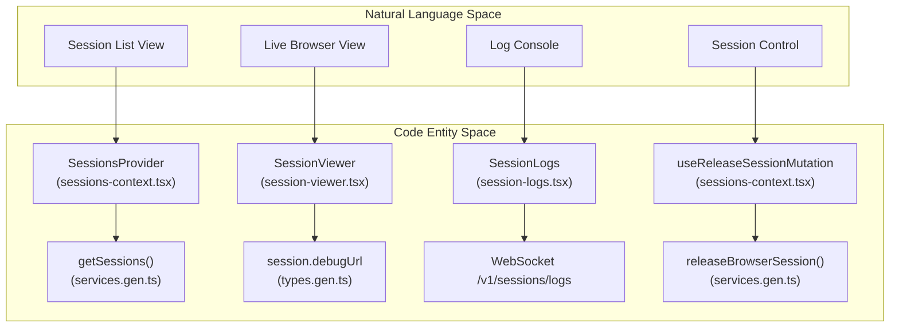
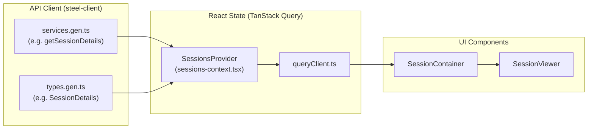

<!-- source: DeepWiki mcp.deepwiki.com · repo steel-dev/steel-browser · page 11 UI Dashboard · fetched 2026-10-27 -->

# UI Dashboard

Relevant source files

The following files were used as context for generating this wiki page:

- [ui/src/components/sessions/session-console/session-logs.tsx](ui/src/components/sessions/session-console/session-logs.tsx)
- [ui/src/components/sessions/session-viewer/session-viewer.tsx](ui/src/components/sessions/session-viewer/session-viewer.tsx)
- [ui/src/containers/session-container.tsx](ui/src/containers/session-container.tsx)
- [ui/src/contexts/sessions-context/sessions-context.tsx](ui/src/contexts/sessions-context/sessions-context.tsx)
- [ui/src/contexts/sessions-context/sessions-context.types.ts](ui/src/contexts/sessions-context/sessions-context.types.ts)
- [ui/src/lib/query-client.ts](ui/src/lib/query-client.ts)
- [ui/src/main.tsx](ui/src/main.tsx)
- [ui/src/root-layout.tsx](ui/src/root-layout.tsx)

The UI Dashboard is a React-based web application that provides a graphical interface for managing and monitoring browser automation sessions. It serves as the primary user interface for interacting with the steel-browser API, enabling session creation, real-time monitoring, and session management through an intuitive web interface.

For programmatic API access and automation workflows, see [API Reference](#12). For details on the underlying session management logic, see [Session Management API](#4.1).

---

## Purpose and Scope

The UI Dashboard provides:

- **Session Management Interface**: Create, monitor, and release browser sessions through a visual interface. For details, see [Session Management Interface](#11.1).
- **Real-time Monitoring**: Live session details, browser state, and event streaming via WebSockets.
- **Type-Safe API Client**: Auto-generated TypeScript client from OpenAPI specifications. For details, see [Generated API Client](#11.2).
- **Responsive UI Components**: Built with Radix UI and Tailwind CSS for modern UX.

The UI workspace is located at [ui/]() within the steel-browser monorepo and runs independently on port 5173 during development.

---

## Architecture Overview

The UI Dashboard follows a modern React architecture with clear separation between the presentation layer and API communication layer.

### UI Component to API Mapping

The following diagram bridges the natural language UI concepts to the specific code entities responsible for their implementation.

**Sources:**
- [ui/src/contexts/sessions-context/sessions-context.tsx:24-94]()
- [ui/src/components/sessions/session-viewer/session-viewer.tsx:12-195]()
- [ui/src/components/sessions/session-console/session-logs.tsx:4-88]()

---

## Session Management Interface

The dashboard organizes session monitoring through a unified container that manages the layout between the browser view and the developer console.

- **Session Context**: The `SessionsProvider` manages the global state for the active session and provides hooks like `useSession` and `useReleaseSessionMutation` to child components [ui/src/contexts/sessions-context/sessions-context.tsx:24-81]().
- **Live Viewer**: The `SessionViewer` component renders an `<iframe>` targeting the session's `debugUrl` [ui/src/components/sessions/session-viewer/session-viewer.tsx:184-193](). It implements a clipboard bridge to allow copy-paste operations between the host OS and the remote browser [ui/src/components/sessions/session-viewer/session-viewer.tsx:24-86]().
- **Real-time Logs**: The `SessionLogs` component establishes a WebSocket connection to stream browser events, network requests, and console logs directly to the UI [ui/src/components/sessions/session-console/session-logs.tsx:8-26]().

For details, see [Session Management Interface](#11.1).

**Sources:**
- [ui/src/containers/session-container.tsx:9-51]()
- [ui/src/components/sessions/session-viewer/session-viewer.tsx:12-195]()
- [ui/src/components/sessions/session-console/session-logs.tsx:4-88]()

---

## Generated API Client

The UI uses a fully type-safe API client generated from the OpenAPI specification exposed by the Fastify backend. This eliminates manual API client maintenance and ensures type safety across the stack.

### Client-Side Data Flow

The client provides functions like `getSessions`, `getSessionDetails`, and `releaseBrowserSession` which are wrapped by React Query for caching and automatic refetching [ui/src/contexts/sessions-context/sessions-context.tsx:30-56]().

For details, see [Generated API Client](#11.2).

**Sources:**
- [ui/src/contexts/sessions-context/sessions-context.tsx:6-14]()
- [ui/src/lib/query-client.ts:1-10]()
- [ui/src/contexts/sessions-context/sessions-context.tsx:58-81]()

---

## Technology Stack

The UI Dashboard leverages modern React ecosystem tools for optimal developer experience and performance.

| Category | Technology | Purpose |
|----------|------------|---------|
| **Framework** | React 18 | UI library [ui/src/main.tsx:1-12]() |
| **State Management** | TanStack Query | Server state and caching [ui/src/lib/query-client.ts:3-9]() |
| **Routing** | React Router | Client-side navigation [ui/src/containers/session-container.tsx:10]() |
| **Styling** | Tailwind CSS | Utility-first styling [ui/src/index.css]() |
| **Icons** | Radix UI Icons | UI iconography [ui/src/containers/session-container.tsx:5]() |
| **API Client** | OpenAPI TS | Generated fetch client [ui/src/contexts/sessions-context/sessions-context.tsx:14]() |

---

## Development Workflow

### Running the UI

| Command | Purpose |
|---------|---------|
| `npm run dev -w ui` | Start development server (port 5173) |
| `npm run build -w ui` | Build production bundle |
| `npm run generate-api -w ui` | Regenerate API client from schemas |

### Configuration

The UI can be configured via environment variables:

| Variable | Purpose | Usage Site |
|----------|---------|------------|
| `VITE_WS_URL` | WebSocket base URL | [ui/src/components/sessions/session-console/session-logs.tsx:9]() |
| `VITE_API_URL` | API base URL | Used by generated client configuration |

**Sources:**
- [ui/src/components/sessions/session-console/session-logs.tsx:1-9]()
- [ui/package.json:8-12]()

---

