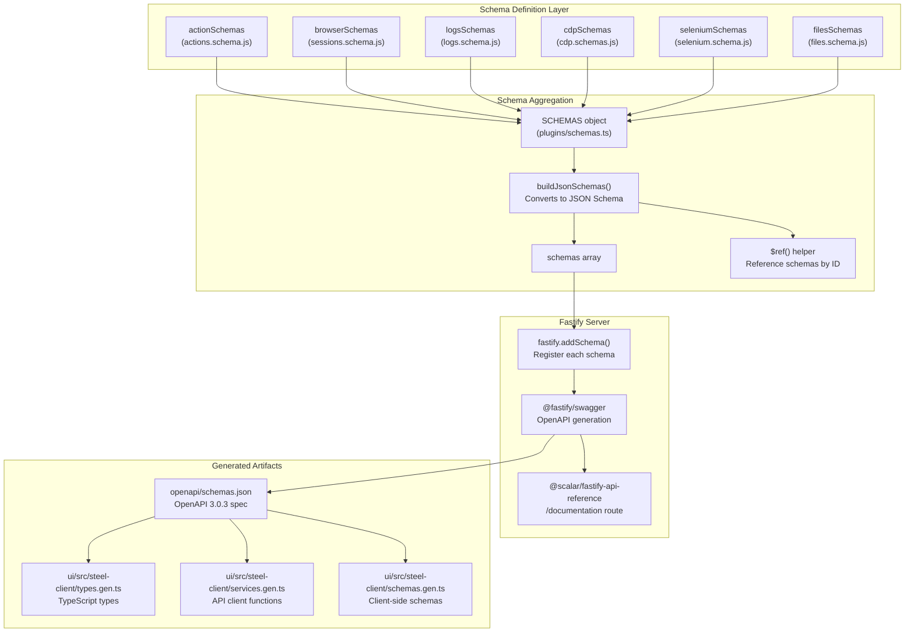
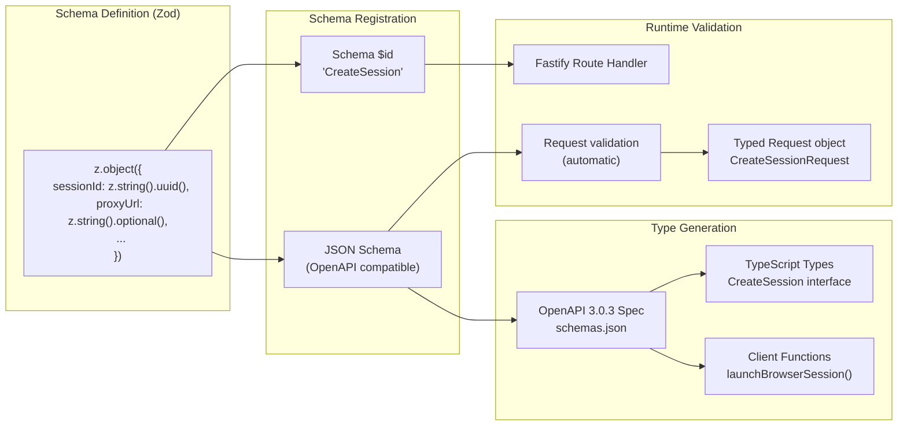

<!-- source: DeepWiki mcp.deepwiki.com · repo steel-dev/steel-browser · page 12 API Reference · fetched 2026-10-27 -->

# API Reference

<details>
<summary>Relevant source files</summary>

The following files were used as context for generating this wiki page:

- [api/.env.example](api/.env.example)
- [api/openapi/generate.ts](api/openapi/generate.ts)
- [api/openapi/schemas.json](api/openapi/schemas.json)
- [api/src/config.ts](api/src/config.ts)
- [api/src/env.ts](api/src/env.ts)
- [api/src/plugins/schemas.ts](api/src/plugins/schemas.ts)
- [api/src/routes.ts](api/src/routes.ts)
- [ui/src/steel-client/schemas.gen.ts](ui/src/steel-client/schemas.gen.ts)

</details>


This page provides a complete reference for the steel-browser REST API, including all HTTP endpoints, WebSocket connections, request/response schemas, and the type system. For information about specific session configuration options, see [Session Configuration](#4.2). For details on using quick actions, see [Quick Actions API](#5). For WebSocket streaming capabilities, see [WebSocket API](#10.1).

For detailed technical specifications, refer to the following child pages:
- [OpenAPI Schema](#12.1) — Document the OpenAPI specification generation and schema structure
- [Type System](#12.2) — Explain Zod schemas, TypeScript types, and validation

## API Overview

The steel-browser API is a RESTful HTTP service organized under the `/v1` base path. All endpoints enforce schema validation using Zod schemas that are automatically transformed into OpenAPI specifications. The API is exposed through a Fastify server and includes both stateless quick actions and stateful session management endpoints.

**Base URL Structure**
```
http://{HOST}:{PORT}/v1/*
```

**API Categories**
- **Health**: Service health checks
- **Sessions**: Browser session lifecycle management
- **Quick Actions**: Single-request operations (scrape, screenshot, PDF)
- **Session Actions**: Operations within existing sessions
- **File Operations**: File upload/download per session
- **Logs & Monitoring**: Browser event query and streaming
- **CDP Integration**: Chrome DevTools Protocol access
- **Selenium**: WebDriver compatibility endpoints

Sources: [api/src/modules/sessions/sessions.routes.ts](), [api/openapi/schemas.json](), [api/src/plugins/schemas.ts]()

## Schema Registration Architecture

The following diagram shows how schemas flow from Zod definitions through the Fastify server to OpenAPI generation and client code generation:



Sources: [api/src/plugins/schemas.ts:16-25](), [api/src/plugins/schemas.ts:27-66](), [api/openapi/generate.ts]()

## HTTP Endpoint Reference

### Health Endpoints

| Method | Path | Operation ID | Description | Request | Response |
|--------|------|--------------|-------------|---------|----------|
| GET | `/v1/health` | `health` | Check server and browser status | - | `{ status: "ok" }` or 503 |

Sources: [api/src/modules/sessions/sessions.routes.ts:24-40]()

### Session Management Endpoints

| Method | Path | Operation ID | Description | Request Schema | Response Schema |
|--------|------|--------------|-------------|----------------|-----------------|
| POST | `/v1/sessions` | `launch_browser_session` | Launch a new browser session | `CreateSession` | `SessionDetails` |
| GET | `/v1/sessions` | `get_sessions` | List all active sessions | - | `MultipleSessions` |
| GET | `/v1/sessions/:sessionId` | `get_session_details` | Get details for a specific session | - | `SessionDetails` |
| GET | `/v1/sessions/:sessionId/context` | `get_browser_context` | Retrieve session context (cookies, storage) | - | `SessionContextSchema` |
| POST | `/v1/sessions/:sessionId/release` | `release_browser_session` | Release a specific session | - | `ReleaseSession` |
| POST | `/v1/sessions/release` | `release_browser_sessions` | Release all sessions | - | `ReleaseSession` |
| GET | `/v1/sessions/:id/live-details` | `get_session_live_details` | Get live session state with pages | - | `SessionLiveDetailsResponse` |
| GET | `/v1/sessions/debug` | `get_session_debugger_stream` | HTML debugger view of session | `SessionStreamQuery` | HTML content |
| POST | `/v1/events` | `receive_events` | Receive browser recording events | `RecordedEvents` | `{ status: "ok" }` |

Sources: [api/src/modules/sessions/sessions.routes.ts:41-201](), [api/openapi/schemas.json:207-848]()

### Quick Action Endpoints

These endpoints perform single-request operations that launch a browser, execute the action, and clean up automatically:

| Method | Path | Operation ID | Description | Request Schema | Response Schema |
|--------|------|--------------|-------------|----------------|-----------------|
| POST | `/v1/scrape` | `scrape` | Scrape content from URL | `ScrapeRequest` | `ScrapeResponse` |
| POST | `/v1/screenshot` | `screenshot` | Capture screenshot of URL | `ScreenshotRequest` | `ScreenshotResponse` |
| POST | `/v1/pdf` | `pdf` | Generate PDF of URL | `PDFRequest` | `PDFResponse` |

Sources: [api/openapi/schemas.json:11-206]()

### Session Action Endpoints

These endpoints perform actions within an existing session context:

| Method | Path | Operation ID | Description | Request Schema | Response Schema |
|--------|------|--------------|-------------|----------------|-----------------|
| POST | `/v1/sessions/scrape` | `scrape_session` | Scrape current session page | `ScrapeRequest` | `ScrapeResponse` |
| POST | `/v1/sessions/screenshot` | `screenshot_session` | Screenshot current session page | `ScreenshotRequest` | `ScreenshotResponse` |
| POST | `/v1/sessions/pdf` | `pdf_session` | Generate PDF of current session page | `PDFRequest` | `PDFResponse` |

Sources: [api/src/modules/sessions/sessions.routes.ts:203-255]()

### File Operation Endpoints

| Method | Path | Operation ID | Description | Request | Response Schema |
|--------|------|--------------|-------------|---------|-----------------|
| POST | `/v1/sessions/:sessionId/files` | `upload_file` | Upload file via multipart/form-data | `FileUploadRequest` | `FileDetails` |
| GET | `/v1/sessions/:sessionId/files` | `list_files` | List all session files | - | `MultipleFiles` |
| GET | `/v1/sessions/:sessionId/files/*` | `download_file` | Download specific file | - | Binary data |
| DELETE | `/v1/sessions/:sessionId/files/*` | `delete_file` | Delete specific file | - | `void` |
| DELETE | `/v1/sessions/:sessionId/files` | `delete_all_files` | Delete all session files | - | `void` |
| GET | `/v1/sessions/:sessionId/files.zip` | `download_archive` | Download all files as ZIP | - | Binary ZIP data |

Sources: [api/openapi/schemas.json]()

### Logs & Monitoring Endpoints

| Method | Path | Operation ID | Description | Query Parameters | Response |
|--------|------|--------------|-------------|------------------|----------|
| GET | `/v1/logs/query` | `get_v1_logs_query` | Query stored browser logs | `LogQuerySchema` | Log events array |
| GET | `/v1/logs/stats` | `get_v1_logs_stats` | Get log statistics | - | `LogStatsSchema` |
| GET | `/v1/logs/stream` | `get_v1_logs_stream` | Stream logs via SSE | - | Server-Sent Events |
| POST | `/v1/logs/export` | `post_v1_logs_export` | Export logs to Parquet | `ExportLogsSchema` | Parquet file |
| DELETE | `/v1/logs/` | `delete_v1_logs` | Clear all logs | - | Success response |

Sources: [api/openapi/schemas.json]()

### CDP Integration Endpoints

| Method | Path | Operation ID | Description |
|--------|------|--------------|-------------|
| GET | `/v1/devtools/inspector.html` | `get_devtools_url` | Get Chrome DevTools inspector URL |

Sources: [ui/src/steel-client/services.gen.ts:373-388]()

## Schema Type System

The following diagram illustrates how Zod schemas are transformed into TypeScript types and used for validation:



Sources: [api/src/plugins/schemas.ts](), [api/src/utils/schema.js](), [ui/src/steel-client/types.gen.ts]()

## Core Request/Response Schemas

For a deep dive into the Zod-based validation and full TypeScript type definitions, see [Type System](#12.2).

### CreateSession Schema

The `CreateSession` schema defines all options for launching a new browser session.

**Key Properties:**

| Property | Type | Description |
|----------|------|-------------|
| `sessionId` | `string (uuid)` | Optional unique identifier for the session |
| `proxyUrl` | `string` | Proxy URL for the session |
| `userAgent` | `string` | Custom user agent string |
| `sessionContext` | `SessionContextSchema` | Cookies, localStorage, sessionStorage, indexedDB to initialize |
| `isSelenium` | `boolean` | Enable Selenium WebDriver compatibility mode |
| `blockAds` | `boolean` | Block advertisements |
| `headless` | `boolean` | Run browser in headless mode |

Sources: [api/openapi/schemas.json:207-602](), [ui/src/steel-client/types.gen.ts:74-292]()

### ScrapeRequest Schema

Request schema for web scraping operations.

| Property | Type | Description |
|----------|------|-------------|
| `url` | `string` | URL to scrape |
| `format` | `Array<"html" \| "readability" \| "cleaned_html" \| "markdown">` | Output format(s) |
| `screenshot` | `boolean` | Include screenshot |
| `pdf` | `boolean` | Include PDF |

Sources: [api/openapi/schemas.json:11-49](), [ui/src/steel-client/types.gen.ts:3-14]()

## Environment Configuration Schema

The environment configuration is validated using Zod schemas in `env.ts`.

**Server Configuration:**

| Variable | Type | Default | Description |
|----------|------|---------|-------------|
| `NODE_ENV` | `"test" \| "development" \| "staging" \| "production" \| "preview"` | `"development"` | Runtime environment |
| `PORT` | `string` | `"3000"` | Server port |
| `USE_SSL` | `boolean` | `false` | Enable HTTPS/WSS |

**Browser Configuration:**

| Variable | Type | Default | Description |
|----------|------|---------|-------------|
| `CHROME_EXECUTABLE_PATH` | `string` | - | Path to Chrome binary |
| `CHROME_HEADLESS` | `boolean` | `true` | Run Chrome in headless mode |
| `CDP_REDIRECT_PORT` | `string` | `"9222"` | Chrome DevTools Protocol port |

Sources: [api/src/env.ts:6-82](), [api/.env.example:1-31]()

## OpenAPI Specification Generation

The system automatically generates an OpenAPI 3.0.3 specification from registered schemas. For more details on the generation logic and schema structure, see [OpenAPI Schema](#12.1).

**Generation Process:**
1. **Schema Definition**: Zod schemas defined in module schema files.
2. **Schema Aggregation**: Combined in `SCHEMAS` object in `plugins/schemas.ts`.
3. **JSON Schema Conversion**: `buildJsonSchemas()` converts Zod to JSON Schema.
4. **Fastify Registration**: Each schema registered with `fastify.addSchema()`.
5. **File Export**: `openapi/generate.ts` writes `schemas.json`.

Sources: [api/openapi/generate.ts:15-35](), [api/src/plugins/schemas.ts:32-64](), [api/openapi/schemas.json:1-10]()

## Type-Safe Client Generation

The system generates a fully type-safe TypeScript client from the OpenAPI specification using `@hey-api/openapi-ts`.

| File | Purpose |
|------|---------|
| `ui/src/steel-client/types.gen.ts` | TypeScript interfaces for all schemas |
| `ui/src/steel-client/services.gen.ts` | Type-safe API client functions |
| `ui/src/steel-client/schemas.gen.ts` | Client-side Zod schemas |

Sources: [ui/src/steel-client/services.gen.ts:1-96](), [ui/src/steel-client/types.gen.ts:1-1246](), [ui/src/steel-client/schemas.gen.ts:1-37]()

---

