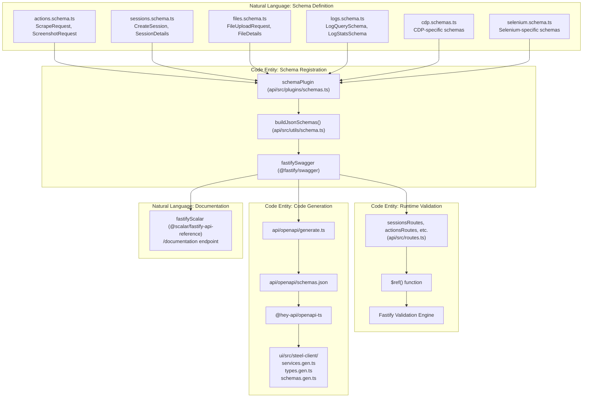
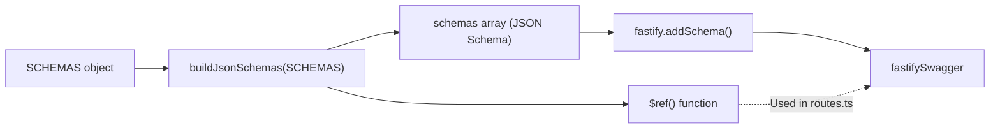
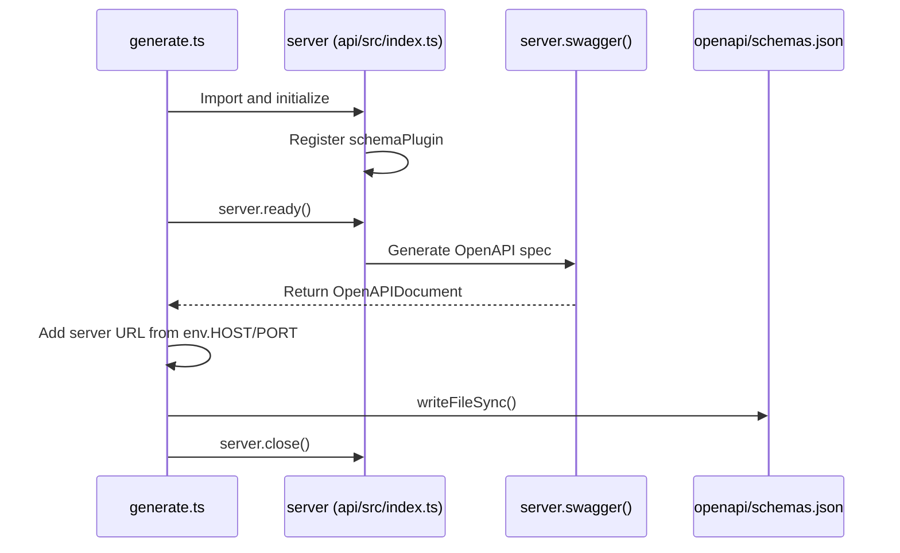

<!-- source: DeepWiki mcp.deepwiki.com · repo steel-dev/steel-browser · page 12.1 OpenAPI Schema · fetched 2026-10-27 -->

# OpenAPI Schema

Relevant source files

The following files were used as context for generating this wiki page:

- [api/.env.example](api/.env.example)
- [api/openapi/generate.ts](api/openapi/generate.ts)
- [api/openapi/schemas.json](api/openapi/schemas.json)
- [api/src/config.ts](api/src/config.ts)
- [api/src/env.ts](api/src/env.ts)
- [api/src/plugins/schemas.ts](api/src/plugins/schemas.ts)
- [api/src/routes.ts](api/src/routes.ts)
- [ui/src/steel-client/schemas.gen.ts](ui/src/steel-client/schemas.gen.ts)

This document explains the OpenAPI specification system used in steel-browser. It covers how schemas are defined, registered, validated, and used to automatically generate API documentation and type-safe client code.

For information about specific API endpoints and their usage, see [Session Management API](#4.1) and [Quick Actions API](#5). For details on the underlying type system using Zod, see [Type System](#12.2).

---

## Purpose and Architecture

The OpenAPI schema system in steel-browser provides:

1. **Type-safe request/response validation** using Zod schemas converted to JSON Schema.
2. **Auto-generated API documentation** served at `/documentation` via Scalar UI.
3. **Type-safe client code generation** for the React UI workspace.
4. **Contract-first API design** ensuring consistency between server and clients.

The schema system follows a modular architecture where each feature module (sessions, actions, files, logs, CDP, Selenium) defines its own schemas, which are then aggregated and registered with Fastify.

### System Data Flow

The following diagram bridges the natural language concepts of "API Definitions" to the actual code entities that implement them.

**Schema to Client Flow**

**Sources:** [api/src/plugins/schemas.ts:1-67](), [api/openapi/generate.ts:1-36](), [api/src/routes.ts:1-7]()

---

## Schema Plugin Registration

The schema plugin is the central orchestrator for the OpenAPI system. It aggregates all feature-specific schemas, registers them with Fastify, and configures the OpenAPI documentation.

### Schema Aggregation

All schemas from feature modules are collected into a single `SCHEMAS` object:
[api/src/plugins/schemas.ts:16-23]()

The `buildJsonSchemas()` utility converts these Zod schemas to JSON Schema format and provides the `$ref()` function for referencing schemas in routes:
[api/src/plugins/schemas.ts:25]()

### Fastify Registration

The `schemaPlugin` registers each schema with Fastify and configures the OpenAPI specification:

**Fastify Schema Integration**

**Sources:** [api/src/plugins/schemas.ts:27-55]()

### OpenAPI Configuration

The OpenAPI specification is configured with metadata and server information. The `refResolver` is customized to use the schema's `$id` in title case for clean documentation labels.

| Configuration | Value | Purpose |
|--------------|-------|---------|
| `openapi` | `3.0.3` | OpenAPI specification version [api/openapi/schemas.json:2]() |
| `info.title` | "Steel Browser Instance API" | API title [api/src/plugins/schemas.ts:35]() |
| `info.version` | `0.0.1` | API version [api/src/plugins/schemas.ts:37]() |
| `servers[0].url` | From `getBaseUrl()` | Server URL [api/src/plugins/schemas.ts:41]() |
| `refResolver.buildLocalReference` | `titleCase(json.$id)` | Schema reference naming [api/src/plugins/schemas.ts:51-53]() |

**Sources:** [api/src/plugins/schemas.ts:32-55](), [api/openapi/schemas.json:1-7]()

---

## Schema Definition Structure

Each feature module defines its schemas using Zod for type-safe validation. The schemas follow consistent patterns for requests, responses, and shared types.

### Schema Organization by Module

The system categorizes schemas into functional groups:

| Module | Primary Schemas | File Source |
|--------|-----------------|-------------|
| **Actions** | `ScrapeRequest`, `ScrapeResponse`, `ScreenshotRequest`, `PDFRequest` | [api/openapi/schemas.json:11-206]() |
| **Sessions** | `CreateSession`, `SessionDetails`, `SessionContextSchema` | [api/openapi/schemas.json:207-350]() |
| **Files** | `FileUploadRequest`, `FileDetails`, `MultipleFiles` | [api/src/plugins/schemas.ts:22]() |
| **Logs** | `LogQuerySchema`, `LogStatsSchema` | [api/src/plugins/schemas.ts:19]() |

**Sources:** [api/src/plugins/schemas.ts:16-23](), [api/openapi/schemas.json:11-207]()

### Common Schema Patterns

#### Request Schema Pattern
Request schemas define optional and required fields with strict validation. For example, the `ScrapeRequest` defines supported formats and proxy options.
[api/openapi/schemas.json:11-49]()

#### Response Schema Pattern
Response schemas define the structure of successful responses, such as `ScrapeResponse` which includes `content`, `metadata`, and `links`.
[api/openapi/schemas.json:50-155]()

---

## OpenAPI Document Generation

The OpenAPI specification is generated at build time and exported as JSON. This document serves as the contract for client code generation.

### Generation Process

The `api/openapi/generate.ts` script initializes the Fastify server, waits for it to be ready, and then writes the swagger output to a file.

**Generation Sequence**

**Sources:** [api/openapi/generate.ts:1-36]()

### Server URL Injection
The generation script specifically injects the server URL derived from the environment variables `HOST` and `PORT`.
[api/openapi/generate.ts:19-26]()

---

## Client Code Generation

The OpenAPI specification is used to generate type-safe client code for the React UI. This ensures perfect synchronization between the API and frontend.

### Generated Service Functions
Each API endpoint becomes a typed function in `ui/src/steel-client/services.gen.ts`. For example, scraping operations are mapped to service calls.
[ui/src/steel-client/services.gen.ts:164-180]()

### Generated TypeScript Types
Request and response types are generated from schemas. The `ScrapeRequest` type in the client workspace perfectly matches the server-side Zod definition.
[ui/src/steel-client/types.gen.ts:74-110]()

### Generated Schema Objects
Schema objects are also exported to the client for runtime validation or form handling.
[ui/src/steel-client/schemas.gen.ts:3-37]()

**Sources:** [ui/src/steel-client/services.gen.ts:1-577](), [ui/src/steel-client/types.gen.ts:1-1246](), [ui/src/steel-client/schemas.gen.ts:1-193]()

---

## API Documentation UI

The Scalar UI provides interactive API documentation at `/documentation`, generated from the OpenAPI specification.

### Scalar Configuration
The Scalar plugin is registered with custom theming provided by `scalarTheme`.
[api/src/plugins/schemas.ts:57-64]()

### Accessing Documentation
- **Route:** `/documentation` [api/src/plugins/schemas.ts:59]()
- **Base URL:** Dynamically determined by `getBaseUrl()` [api/src/plugins/schemas.ts:41]()

**Sources:** [api/src/plugins/schemas.ts:57-64](), [api/src/utils/url.ts]()

---

## Environment Integration

The schema system integrates with environment configuration for server URLs and validation settings.

### Environment Variables
The `envSchema` defines the configuration parameters that influence the API behavior and schema generation.
[api/src/env.ts:6-84]()

| Variable | Default | Purpose |
|----------|---------|---------|
| `HOST` | `0.0.0.0` | Server hostname [api/src/env.ts:10]() |
| `PORT` | `3000` | Server port [api/src/env.ts:12]() |
| `DOMAIN` | - | Optional domain override [api/src/env.ts:11]() |
| `USE_SSL` | `false` | Protocol selection (HTTP vs HTTPS) [api/src/env.ts:13-17]() |

**Sources:** [api/src/env.ts:6-84](), [api/.env.example:1-31]()

---

