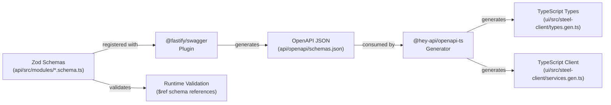
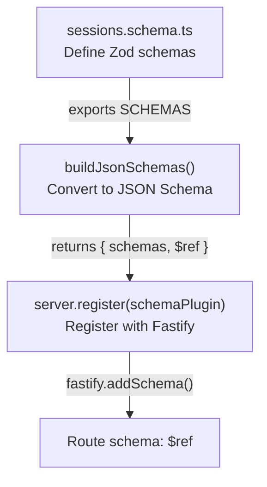
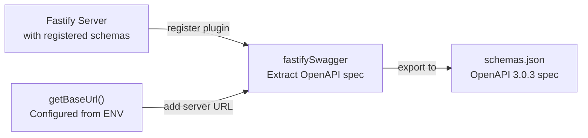
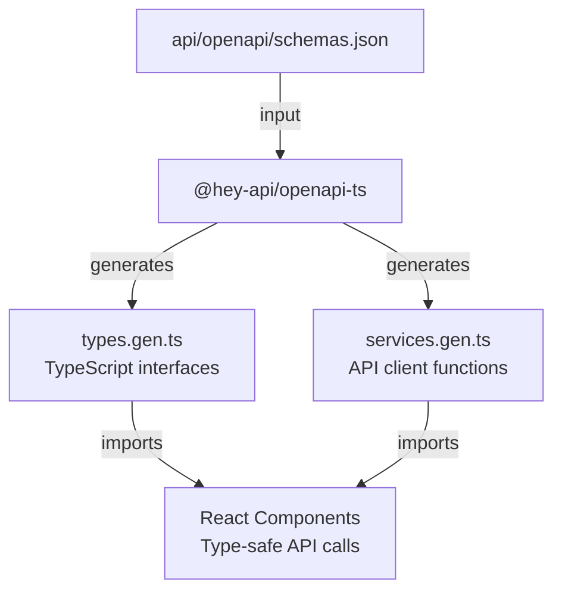
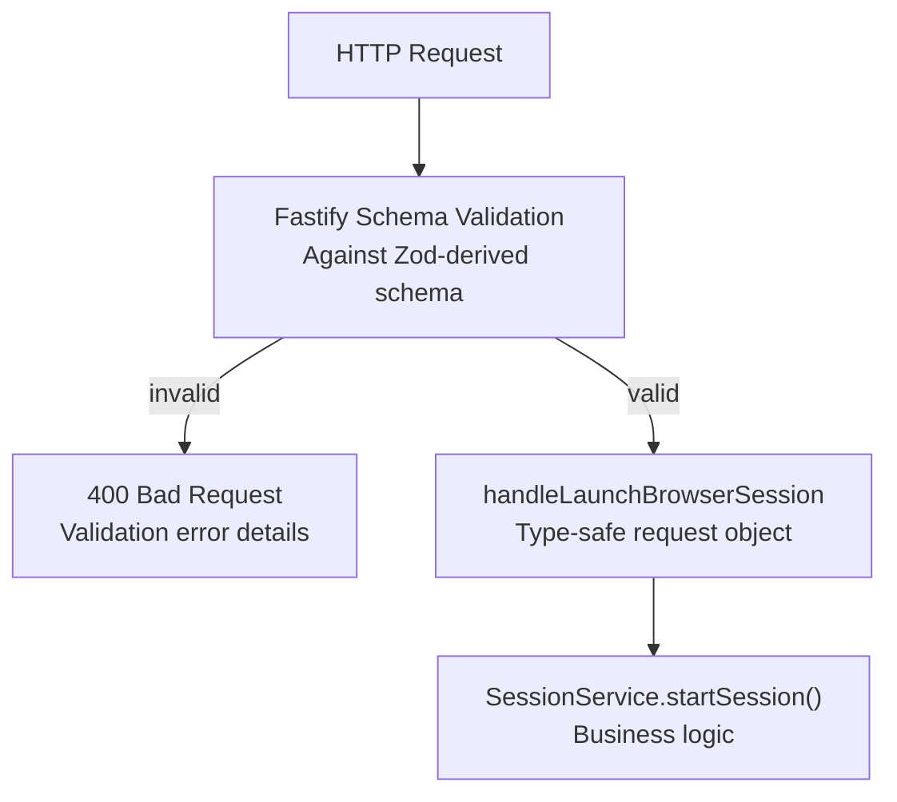
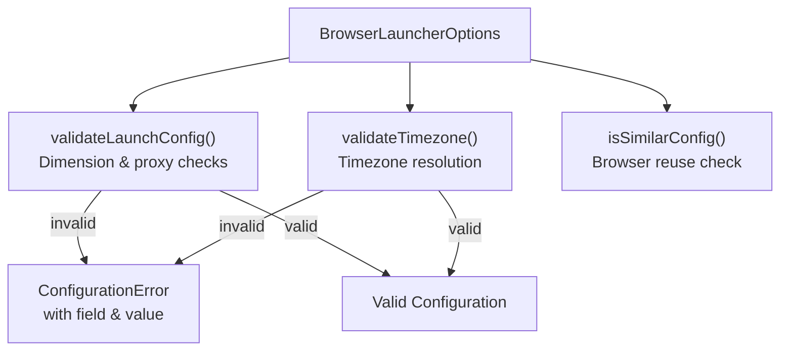
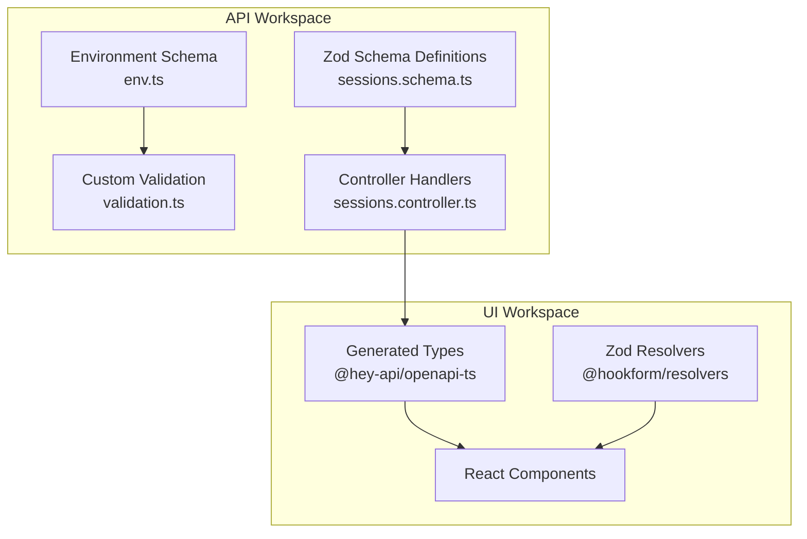

<!-- source: DeepWiki mcp.deepwiki.com · repo steel-dev/steel-browser · page 12.2 Type System · fetched 2026-10-27 -->

# Type System

<details>
<summary>Relevant source files</summary>

The following files were used as context for generating this wiki page:

- [api/.env.example](api/.env.example)
- [api/src/env.ts](api/src/env.ts)
- [api/src/modules/sessions/sessions.controller.ts](api/src/modules/sessions/sessions.controller.ts)
- [api/src/modules/sessions/sessions.schema.ts](api/src/modules/sessions/sessions.schema.ts)
- [api/src/plugins/schemas.ts](api/src/plugins/schemas.ts)
- [api/src/routes.ts](api/src/routes.ts)
- [api/src/services/cdp/utils/validation.ts](api/src/services/cdp/utils/validation.ts)
- [api/src/types/browser.ts](api/src/types/browser.ts)
- [repl/package.json](repl/package.json)
- [ui/package.json](ui/package.json)

</details>


## Purpose

This document explains the type system architecture in `steel-browser`, which provides end-to-end type safety from API request validation to client-side type checking. The system uses Zod schemas as the single source of truth, automatically generates OpenAPI specifications, and produces type-safe TypeScript clients for the UI workspace.

For information about environment configuration validation, see [Environment Configuration](#2.2). For API endpoint documentation, see [OpenAPI Schema](#12.1).

---

## Architecture Overview

The `steel-browser` type system follows a unidirectional flow where Zod schemas serve as the canonical definition, which are then transformed into OpenAPI specifications and finally into TypeScript types for the client.

**Type System Flow Diagram**



**Sources:** [api/src/plugins/schemas.ts:1-25](), [ui/package.json:53-54]()

---

## Schema Definition with Zod

Zod schemas define request and response structures in the API workspace. Each module defines its schemas using Zod, which are then registered with Fastify's schema plugin using the `buildJsonSchemas` helper.

**Schema Registration Pattern**



**Sources:** [api/src/modules/sessions/sessions.schema.ts:10-182](), [api/src/plugins/schemas.ts:16-30]()

### Schema Reference System

Routes reference schemas using the `$ref` helper function, which creates JSON Schema `$ref` pointers to registered schemas. This enables schema reuse and automatic validation.

**Example Route Schema Definition**

The session creation endpoint demonstrates the pattern in `sessions.routes.ts`:

```typescript
// Conceptual example based on registration pattern
server.post("/sessions", {
  schema: {
    body: $ref("CreateSession"),    // Request validation
    response: {
      200: $ref("SessionDetails"),  // Response validation
    },
  },
})
```

**Sources:** [api/src/plugins/schemas.ts:25-30](), [api/src/modules/sessions/sessions.schema.ts:28-127]()

---

## OpenAPI Schema Generation

The system generates OpenAPI 3.0.3 specifications from the registered Zod schemas. This happens during the build process and creates a machine-readable API contract.

**OpenAPI Generation Process**



**Sources:** [api/src/plugins/schemas.ts:32-55](), [api/src/utils/url.ts]()

### Key Schema Types

| Schema Name | Purpose | Key Fields |
|------------|---------|----------------|
| `CreateSession` | Session creation request | `sessionId`, `proxyUrl`, `userAgent`, `sessionContext`, `dimensions` |
| `SessionDetails` | Session information response | `id`, `createdAt`, `status`, `duration`, `websocketUrl`, `debugUrl` |
| `SessionContextSchema` | Browser state persistence | `cookies`, `localStorage` |
| `deviceConfigSchema` | Viewport/UA configuration | `device` (desktop/mobile) |

**Sources:** [api/src/modules/sessions/sessions.schema.ts:10-127]()

---

## Type-Safe Client Generation

The UI workspace uses `@hey-api/openapi-ts` to generate a fully type-safe client from the OpenAPI specification. This ensures compile-time type safety when making API calls from the React frontend.

**Client Generation Flow**



**Sources:** [ui/package.json:12](), [ui/package.json:54]()

---

## Runtime Validation

Fastify performs runtime validation of incoming requests against the registered Zod-derived schemas. This catches type mismatches before they reach application code.

**Validation Flow**



**Sources:** [api/src/modules/sessions/sessions.controller.ts:8-65](), [api/src/modules/sessions/sessions.schema.ts:28-91]()

---

## Configuration Validation

The system validates configuration using custom validation logic in `validation.ts` for complex constraints that cannot be expressed in basic schemas.

**Configuration Validation Functions**



**Sources:** [api/src/services/cdp/utils/validation.ts:31-105]()

### Dimension Validation

The `validateLaunchConfig` function enforces constraints on browser dimensions:

- Dimensions must be positive numbers.
- Maximum dimensions: 7680x4320 pixels (8K resolution).
- Proxy URLs must be valid URL format.

**Sources:** [api/src/services/cdp/utils/validation.ts:31-62]()

### Timezone Validation

The `validateTimezone` function validates timezone strings and includes timeout protection:

- Resolves timezone promises with a default 10-second timeout.
- Validates using `Intl.DateTimeFormat` API.
- Throws `ConfigurationError` with `ConfigurationField.TIMEZONE` on failure.

**Sources:** [api/src/services/cdp/utils/validation.ts:72-105]()

### Configuration Comparison

The `isSimilarConfig` function determines if two browser configurations are similar enough to reuse an existing browser instance. It compares fields like `headless`, `proxyUrl`, `userAgent`, and `dimensions`.

**Sources:** [api/src/services/cdp/utils/validation.ts:114-189]()

---

## Environment Variable Validation

The system uses Zod to validate environment variables at startup, ensuring that the application doesn't run with invalid configuration.

**Environment Schema Definition**

The `envSchema` in `api/src/env.ts` handles:
- **Type Coercion**: Converting string env vars to booleans or numbers.
- **Default Values**: Providing sensible defaults (e.g., `PORT: "3000"`).
- **Complex Parsing**: Parsing `DEFAULT_HEADERS` from a JSON string into a record.

**Sources:** [api/src/env.ts:6-86]()

---

## Type System Components

**Component Mapping**



**Sources:** [api/src/env.ts:1-86](), [api/src/modules/sessions/sessions.schema.ts:1-127](), [ui/package.json:16-17]()

---

## Complex Type Examples

### Browser Launcher Options

The `BrowserLauncherOptions` interface in `api/src/types/browser.ts` is the central type for browser configuration, bridging the API schema and the `CDPService`.

**Key Fields:**
- `sessionContext`: Includes cookies, localStorage, and IndexedDB state.
- `optimizeBandwidth`: A boolean or a granular `OptimizeBandwidthOptions` object.
- `fingerprint`: Uses `BrowserFingerprintWithHeaders` from `fingerprint-generator`.

**Sources:** [api/src/types/browser.ts:28-58]()

### Session Details

The `SessionDetails` schema provides a comprehensive view of a session's state, including usage metrics and connection URLs.

**Key Fields:**
- `status`: Enum of `["idle", "live", "released", "failed"]`.
- `proxyTxBytes` / `proxyRxBytes`: Metrics for data transmitted through the proxy.
- `websocketUrl`: The endpoint for streaming the browser view.

**Sources:** [api/src/modules/sessions/sessions.schema.ts:93-127]()

---

