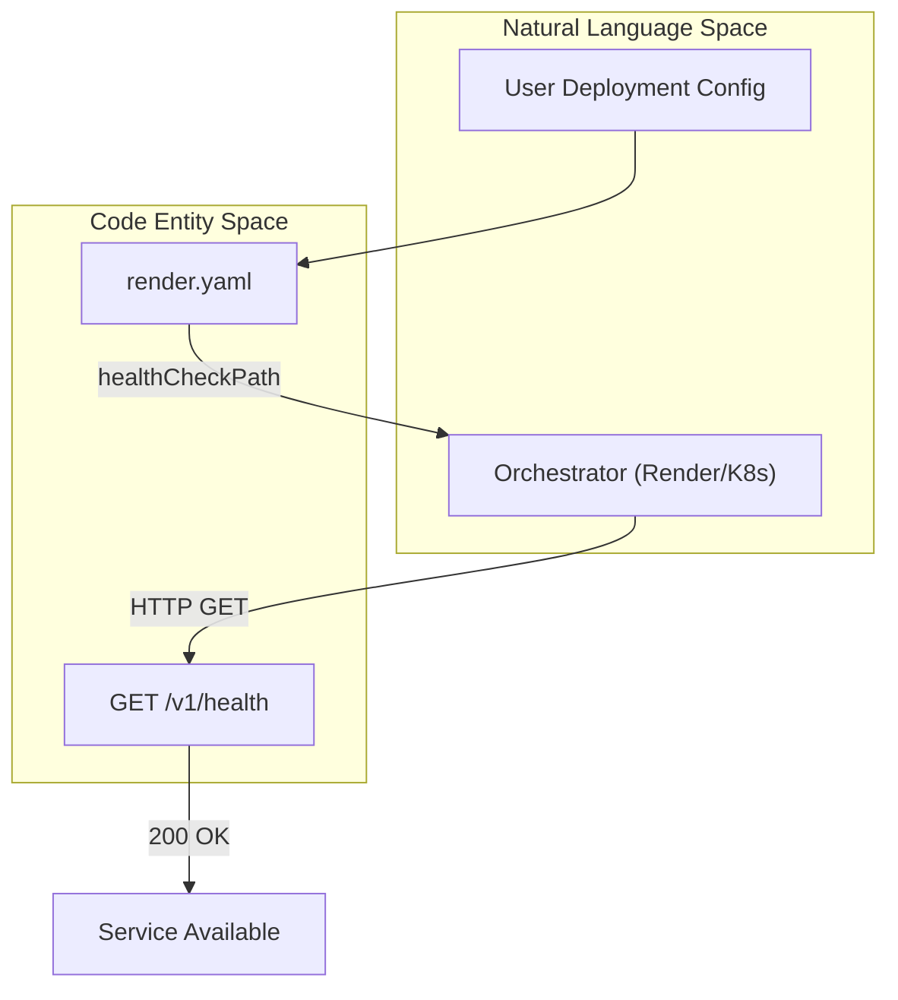
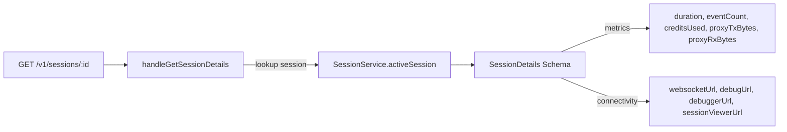
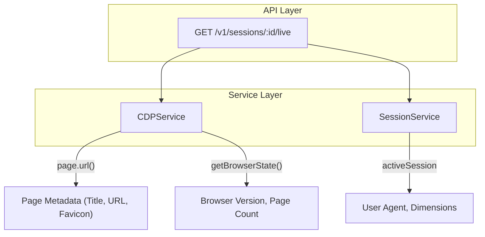
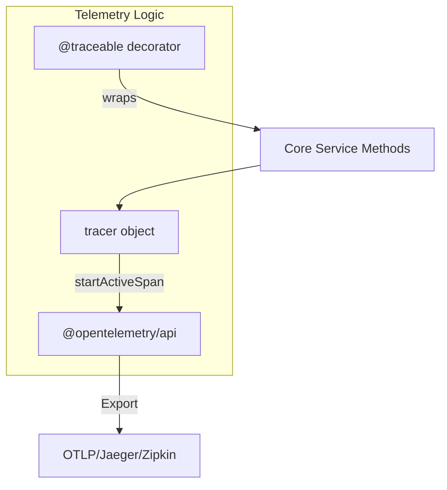

<!-- source: DeepWiki mcp.deepwiki.com · repo steel-dev/steel-browser · page 13.5 Health Checks & Monitoring · fetched 2026-10-27 -->

# Health Checks & Monitoring

Relevant source files

The following files were used as context for generating this wiki page:

- [Dockerfile](Dockerfile)
- [README.md](README.md)
- [api/.env.example](api/.env.example)
- [api/src/env.ts](api/src/env.ts)
- [api/src/plugins/schemas.ts](api/src/plugins/schemas.ts)
- [api/src/routes.ts](api/src/routes.ts)
- [api/src/telemetry/noop.ts](api/src/telemetry/noop.ts)
- [api/src/telemetry/tracer.ts](api/src/telemetry/tracer.ts)
- [images/star_img.png](images/star_img.png)
- [render.yaml](render.yaml)

This document covers the health check endpoints, browser state monitoring, session statistics, and operational metrics available in Steel Browser. These features enable production monitoring, debugging, and observability of browser sessions and system health.

For information about real-time event streaming and WebSocket-based monitoring, see [WebSocket API](). For deployment architecture and container health, see [Container Architecture]().

## Overview

Steel Browser provides multiple monitoring surfaces:
- **Health Check Endpoint**: Basic service health validation for container orchestration.
- **Session Statistics**: Detailed metrics about active and past browser sessions.
- **Live Browser State**: Real-time information about running browser instances and pages.
- **Operational Metrics**: Resource usage, proxy statistics, and session performance data.
- **Telemetry**: OpenTelemetry integration for tracing system execution.

## Health Check Endpoint

The system exposes a health check endpoint at `/v1/health` for container orchestrators and monitoring tools to verify service availability.

### Health Check Configuration

**Sources:** [render.yaml:6-6]()

The health check path is configured in deployment manifests and invoked periodically by the orchestration platform to determine if the container should receive traffic or needs to be restarted.

**Sources:** [render.yaml:1-13]()

## Session Monitoring API

The Sessions API provides comprehensive monitoring of browser session lifecycle, state, and resource consumption.

### Session Details Endpoint

The `GET /v1/sessions/:id` endpoint returns detailed information about a specific session.

**Sources:** [api/src/modules/sessions/sessions.schema.ts:89-122](), [api/src/routes.ts:2-2]()

### Session Details Schema

| Field | Type | Description |
|-------|------|-------------|
| `id` | `string (uuid)` | Unique identifier for the session |
| `status` | `enum` | Current status: `idle`, `live`, `released`, `failed` |
| `duration` | `number` | Session duration in milliseconds |
| `eventCount` | `number` | Number of events processed |
| `proxyTxBytes` | `number` | Data transmitted through proxy (bytes) |
| `proxyRxBytes` | `number` | Data received through proxy (bytes) |
| `websocketUrl` | `string` | WebSocket connection URL for events |
| `debugUrl` | `string` | Live browser view URL |

**Sources:** [api/src/modules/sessions/sessions.schema.ts:89-122]()

## Live Browser State Monitoring

The live details endpoint provides real-time information about the browser instance, including all open pages and their current state.

### Live Session Details Data Flow

**Sources:** [api/src/modules/sessions/sessions.schema.ts:148-170](), [api/src/routes.ts:2-2]()

### Browser State Object

The `browserState` object in the live details response includes:
- **`status`**: Current lifecycle state (`idle`, `live`, `released`, `failed`).
- **`userAgent`**: The specific User-Agent string used by the browser instance.
- **`browserVersion`**: Version string retrieved from the Chrome process.
- **`pageCount`**: Number of active tabs/pages currently open.

**Sources:** [api/src/modules/sessions/sessions.schema.ts:155-165]()

## Telemetry & Tracing

Steel Browser includes an OpenTelemetry-based tracing system to monitor internal function execution and performance.

### Tracer Implementation

The system uses a `tracer` utility to wrap core functions in active spans. This is implemented in `api/src/telemetry/tracer.ts`.

**Sources:** [api/src/telemetry/tracer.ts:18-75]()

### Tracing Utilities
- **`@traceable`**: A method decorator used to automatically create spans for class methods. It converts class names to kebab-case for tracer names (e.g., `SessionService` becomes `session-service`). [api/src/telemetry/tracer.ts:77-122]()
- **`tracer.startActiveSpan`**: A functional wrapper for manual instrumentation. [api/src/telemetry/tracer.ts:19-63]()
- **`noopSpan`**: A fallback implementation used when OpenTelemetry is not configured or fails to load, preventing system crashes during monitoring failures. [api/src/telemetry/noop.ts:3-38]()

## Operational Configuration

Monitoring behavior is influenced by several environment variables defined in `api/src/env.ts`:

| Variable | Default | Description |
|----------|---------|-------------|
| `ENABLE_CDP_LOGGING` | `false` | Enables verbose logging of Chrome DevTools Protocol traffic. |
| `ENABLE_VERBOSE_LOGGING`| `false` | Increases log granularity for debugging. |
| `LOG_STORAGE_ENABLED` | `false` | Enables persistent storage of logs (typically via DuckDB). |
| `LOG_STORAGE_PATH` | - | Filesystem path for persistent log storage. |

**Sources:** [api/src/env.ts:34-48](), [api/src/env.ts:73-78]()

## Monitoring Released Sessions

When a session is released, the system maintains a record of its final metrics in `pastSessions`. Monitoring systems can still query these IDs to retrieve historical performance data such as total duration and final proxy usage.

**Sources:** [api/src/modules/sessions/sessions.schema.ts:89-122]()

---

