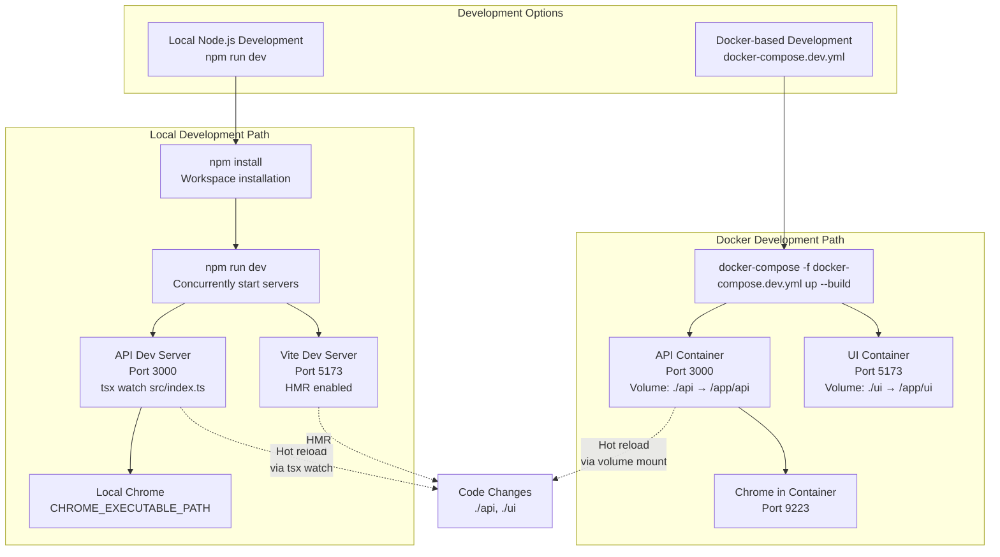
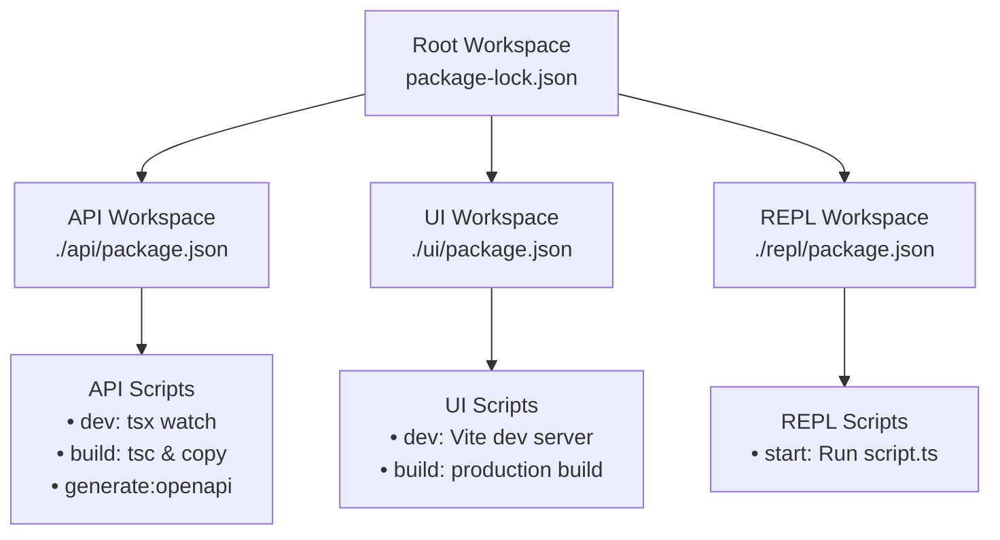
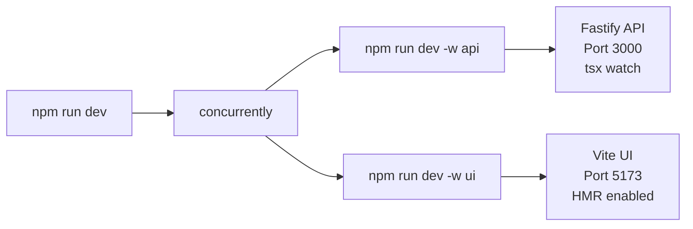

<!-- source: DeepWiki mcp.deepwiki.com · repo steel-dev/steel-browser · page 14.1 Development Environment Setup · fetched 2026-10-27 -->

# Development Environment Setup

<details>
<summary>Relevant source files</summary>

The following files were used as context for generating this wiki page:

- [api/package.json](api/package.json)
- [api/src/index.ts](api/src/index.ts)
- [api/src/plugins/selenium.ts](api/src/plugins/selenium.ts)
- [api/tsconfig.json](api/tsconfig.json)
- [docs/ARCHITECTURE.md](docs/ARCHITECTURE.md)
- [docs/DEVELOPMENT_SETUP.md](docs/DEVELOPMENT_SETUP.md)
- [docs/README.md](docs/README.md)
- [docs/TROUBLESHOOTING.md](docs/TROUBLESHOOTING.md)
- [package-lock.json](package-lock.json)

</details>


This document covers the local development workflow for Steel Browser, including environment setup, npm scripts, development servers, hot reload mechanisms, and debugging tools. This guide is intended for contributors developing and extending the Steel Browser codebase.

For production deployment configuration, see [Docker Deployment](). For environment variable configuration, see [Environment Configuration]().

---

## Prerequisites

Steel Browser requires the following tools for local development:

| Requirement | Version | Purpose |
|------------|---------|---------|
| Node.js | >= 22.0.0 | Runtime for API and build tools |
| npm | Latest | Package manager |
| Chrome/Chromium | Latest stable | Browser automation target |
| Docker (optional) | Latest | Containerized development |

The Node.js version requirement is specified in the root engines configuration [package-lock.json:32-34]().

**Sources:** [package-lock.json:32-34](), [docs/DEVELOPMENT_SETUP.md:16-41](), [docs/TROUBLESHOOTING.md:23-37]()

---

## Development Workflow Architecture

Steel Browser supports two development workflows: Docker-based and local Node.js-based. Both approaches provide hot reload capabilities and access to all development tools.

### Development Flow Overview



**Sources:** [docs/DEVELOPMENT_SETUP.md:119-176](), [docs/DEVELOPMENT_SETUP.md:180-191](), [api/package.json:47]()

---

## Docker-based Development

### Using docker-compose.dev.yml

The development Docker Compose configuration mounts local source directories into containers, enabling live code changes without rebuilding images.

```bash
# Start development environment with volume mounts
docker-compose -f docker-compose.dev.yml up --build

# View logs
docker-compose -f docker-compose.dev.yml logs -f
```

The `docker-compose.dev.yml` file allows developers to modify code in `./api` or `./ui` and see changes reflected immediately via container-side watchers.

### Port Mappings

| Service | Container Port | Host Port | Purpose |
|---------|---------------|-----------|---------|
| API | 3000 | 3000 | Fastify server and REST API [api/src/index.ts:11]() |
| UI Dev Server | 5173 | 5173 | Vite development server |
| CDP | 9223 | 9223 | Chrome DevTools Protocol [docs/DEVELOPMENT_SETUP.md:220]() |

**Sources:** [docs/DEVELOPMENT_SETUP.md:180-191](), [docs/DEVELOPMENT_SETUP.md:213-234](), [api/src/index.ts:10-18]()

---

## Local Node.js Development

### Installation and Setup

The Steel Browser monorepo uses npm workspaces to manage the `api`, `ui`, and `repl` packages.

```bash
# Install dependencies for all workspaces
npm install

# Build all workspaces
npm run build

# Start both API and UI development servers
npm run dev
```

### Workspace Structure

The workspace configuration is defined in [package-lock.json:11-15]():



**Sources:** [package-lock.json:11-15](), [api/package.json:40-51](), [docs/DEVELOPMENT_SETUP.md:132-163]()

---

## NPM Script Reference

### API Workspace Scripts

Defined in [api/package.json:40-51]():

| Script | Command | Description |
|--------|---------|-------------|
| `dev` | `npm run prepare:recorder && tsx watch src/index.ts` | Start API with auto-restart and recorder build |
| `build` | `tsc && npm run copy:templates && npm run copy:fingerprint` | Compile TS and copy assets to `build/` |
| `prepare:recorder` | `cd extensions/recorder && npm install && npm run build` | Build the browser extension for session recording |
| `generate:openapi` | `tsx ./openapi/generate.ts` | Generate the OpenAPI specification |

### Root and UI Scripts

The root workspace uses `concurrently` to run both the API and UI development servers simultaneously [docs/DEVELOPMENT_SETUP.md:157]().



**Sources:** [api/package.json:40-51](), [docs/DEVELOPMENT_SETUP.md:144-163]()

---

## Chrome Executable Configuration

### Required Paths

Steel Browser requires a Chrome or Chromium executable. Developers must ensure the `CHROME_EXECUTABLE_PATH` environment variable points to a valid binary if it is not in the system PATH [docs/DEVELOPMENT_SETUP.md:224]().

| Platform | Common Paths |
|----------|-------------|
| Linux | `/usr/bin/google-chrome` |
| macOS | `/Applications/Google Chrome.app/Contents/MacOS/Google Chrome` |
| Windows | `C:\Program Files\Google\Chrome\Application\chrome.exe` |

### Environment Variables

Configure these in a `.env` file at the root or within the `api` directory:

```bash
# Browser Configuration
CHROME_HEADLESS=false  # Set to true for headless mode
CHROME_EXECUTABLE_PATH=/usr/bin/google-chrome
ENABLE_CDP_LOGGING=true
ENABLE_VERBOSE_LOGGING=true

# Network
HOST=0.0.0.0
PORT=3000
CDP_REDIRECT_PORT=9223
```

**Sources:** [docs/DEVELOPMENT_SETUP.md:211-234](), [docs/TROUBLESHOOTING.md:50-58]()

---

## Hot Reload and Live Development

### API Server Auto-restart

The API uses `tsx watch` to monitor source files in `api/src/`. When a file change is detected, the process is restarted, reloading the Fastify server and re-initializing services like `CDPService` and `SessionService` [api/package.json:47]().

### Vite Hot Module Replacement (HMR)

The UI development server (Vite) provides instant HMR. It tracks changes in the `ui/src` directory and pushes updates to the browser via WebSockets without a full page refresh.

### Docker Volume Mounts

In `docker-compose.dev.yml`, the following mounts are critical for hot reloading:

| Source | Container Destination | Purpose |
|-------|--------|-------------|
| `./api` | `/app/api` | API Source & built assets |
| `./ui` | `/app/ui` | UI Source & Vite config |
| `./.cache` | `/app/.cache` | Persistent browser profiles |

**Sources:** [api/package.json:47](), [docs/DEVELOPMENT_SETUP.md:180-191](), [docs/TROUBLESHOOTING.md:197-199]()

---

## Debugging Setup

### Chrome DevTools Protocol Access

Steel Browser exposes a CDP redirect port (default `9223`) which proxies connections to the underlying Chromium instances [docs/DEVELOPMENT_SETUP.md:220]().

1. Start the API in dev mode: `npm run dev -w api`.
2. Open Chrome and navigate to `chrome://inspect`.
3. Configure "Discover network targets" to include `localhost:9223`.

### Node.js Debugging

To debug the API logic itself:

```bash
# Start API with inspector
node --inspect ./api/build/index.js
```

You can then attach VS Code or Chrome DevTools to the Node.js process (default port `9229`) [docs/TROUBLESHOOTING.md:219-227]().

### REPL Testing

The `repl` workspace provides a `script.ts` for quick prototyping against a running API instance [docs/DEVELOPMENT_SETUP.md:173-176]().

```bash
cd repl
npm start
```

**Sources:** [docs/DEVELOPMENT_SETUP.md:211-234](), [docs/TROUBLESHOOTING.md:203-227](), [docs/DEVELOPMENT_SETUP.md:173-176]()

---

## Building for Production

The build process involves compiling TypeScript and preparing static assets.

```bash
# Build API
npm run build -w api
```

The API build script [api/package.json:42]() performs:
1. `tsc`: Compiles TypeScript to the `build/` directory using settings in [api/tsconfig.json]().
2. `copy:templates`: Copies EJS templates to `build/templates/`.
3. `copy:fingerprint`: Copies the `fingerprint.js` script to `build/scripts/`.

In production mode, the API server can also serve the UI static files if `NODE_ENV` is set to `production` and the UI files exist in `ui/dist` [api/src/index.ts:25-30]().

**Sources:** [api/package.json:42-45](), [api/tsconfig.json:1-25](), [api/src/index.ts:25-30]()

---

