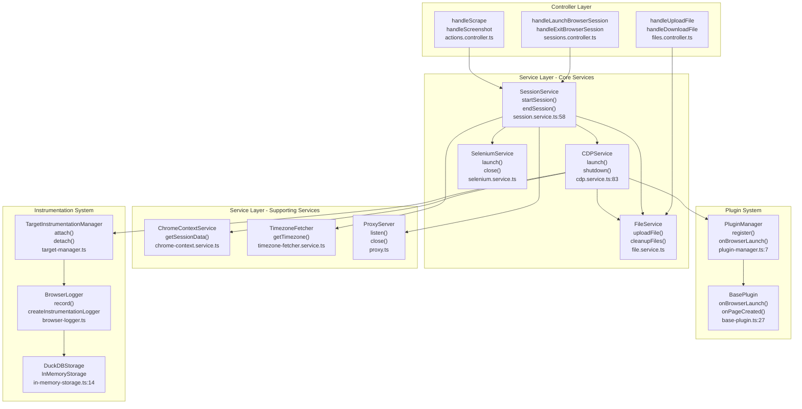
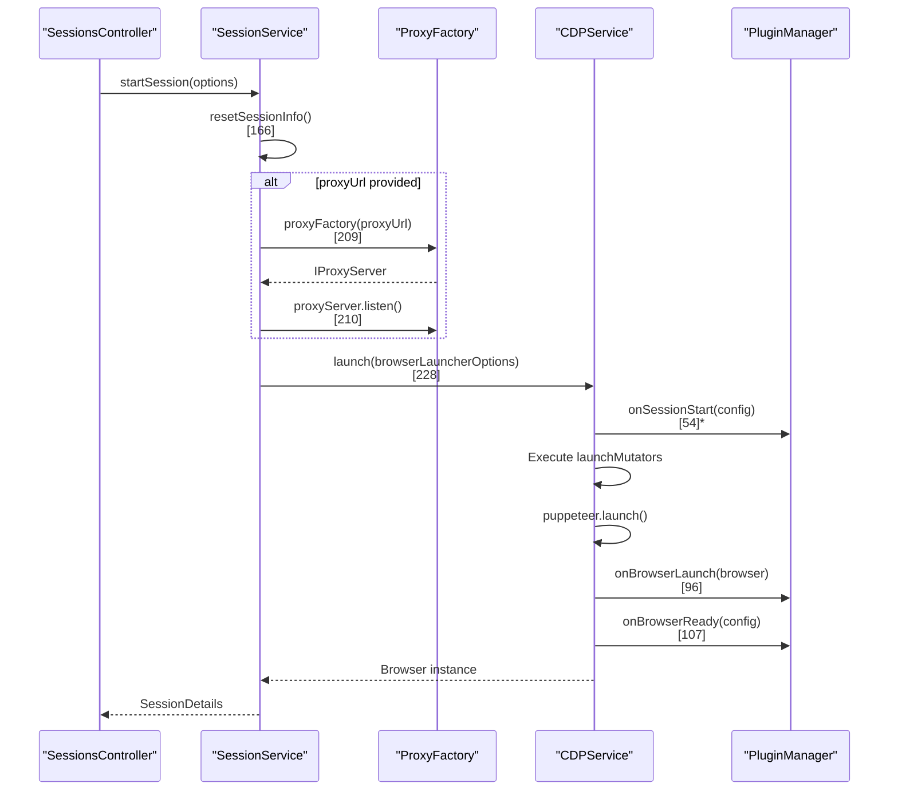
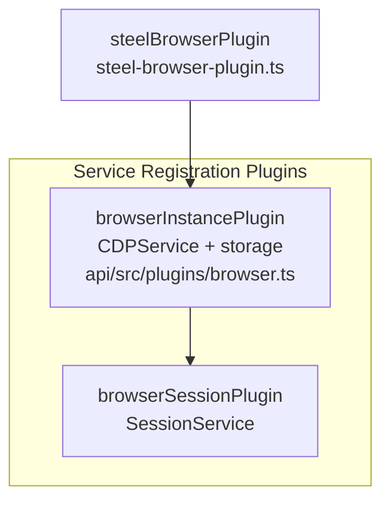
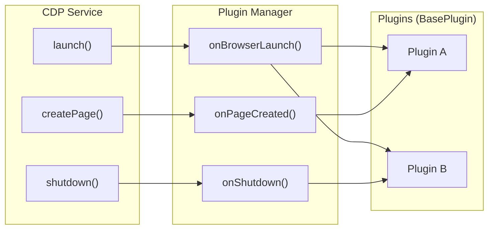

<!-- source: DeepWiki mcp.deepwiki.com · repo steel-dev/steel-browser · page 14.2 Architecture Deep Dive · fetched 2026-10-27 -->

# Architecture Deep Dive

Relevant source files

The following files were used as context for generating this wiki page:

- [api/src/plugins/browser.ts](api/src/plugins/browser.ts)
- [api/src/services/cdp/cdp.service.ts](api/src/services/cdp/cdp.service.ts)
- [api/src/services/cdp/instrumentation/storage/in-memory-storage.ts](api/src/services/cdp/instrumentation/storage/in-memory-storage.ts)
- [api/src/services/cdp/instrumentation/storage/log-storage.interface.ts](api/src/services/cdp/instrumentation/storage/log-storage.interface.ts)
- [api/src/services/cdp/instrumentation/worker-events.ts](api/src/services/cdp/instrumentation/worker-events.ts)
- [api/src/services/cdp/plugins/core/base-plugin.ts](api/src/services/cdp/plugins/core/base-plugin.ts)
- [api/src/services/cdp/plugins/core/plugin-manager.ts](api/src/services/cdp/plugins/core/plugin-manager.ts)
- [api/src/services/session.service.ts](api/src/services/session.service.ts)
- [docs/ARCHITECTURE.md](docs/ARCHITECTURE.md)
- [docs/DEVELOPMENT_SETUP.md](docs/DEVELOPMENT_SETUP.md)
- [docs/README.md](docs/README.md)
- [docs/TROUBLESHOOTING.md](docs/TROUBLESHOOTING.md)

## Purpose and Scope

This document provides a detailed technical explanation of the Steel Browser service layer architecture, focusing on how services are structured, how dependencies are injected via Fastify plugins, the event-driven communication patterns, sophisticated error handling strategies, and resource lifecycle management. This is intended for developers contributing to the Steel Browser codebase or extending it with custom functionality.

For configuration validation details, see [Configuration Validation](#14.3). For initial setup instructions, see [Development Environment Setup](#14.1). For plugin development, see [BasePlugin & PluginManager](#9.1).

---

## Service Layer Architecture

### Core Services Overview

Steel Browser is built around three primary service classes that form the core business logic layer, operating beneath the HTTP controller layer and above the browser automation primitives.

**Core Services Architecture Diagram**

**Sources:** [api/src/services/cdp/cdp.service.ts:83-185](), [api/src/services/session.service.ts:58-91](), [docs/ARCHITECTURE.md:28-55]()

### Service Responsibilities

| Service | Primary Responsibility | Key Methods | Lifecycle |
|---------|----------------------|-------------|-----------|
| `CDPService` | Browser process orchestration, page management, CDP protocol communication | `launch()` [517]*, `shutdown()` [455]*, `createPage()` [441]* | Singleton per API server, manages browser instance [api/src/services/cdp/cdp.service.ts:83]() |
| `SessionService` | Session lifecycle, state tracking, proxy setup, session metadata | `startSession()` [93](), `endSession()` [245](), `resetSessionInfo()` [275]() | Singleton per API server, maintains session registry [api/src/services/session.service.ts:58]() |
| `FileService` | File storage, upload/download, automatic zip archiving | `uploadFile()`, `downloadFile()`, `cleanupFiles()` | Singleton managed by SessionService [api/src/services/session.service.ts:72]() |
| `SeleniumService` | WebDriver protocol compatibility for Selenium mode | `launch()`, `close()` | Created on-demand for Selenium sessions [api/src/services/session.service.ts:61]() |
| `PluginManager` | Plugin lifecycle hooks, plugin registration | `register()` [21](), `onBrowserLaunch()` [96]() | Owned by CDPService instance [api/src/services/cdp/cdp.service.ts:99]() |

\* *Line numbers refer to approximate locations in CDPService as seen in `docs/ARCHITECTURE.md`*

**Sources:** [api/src/services/cdp/cdp.service.ts:83-185](), [api/src/services/session.service.ts:58-91](), [api/src/services/cdp/plugins/core/plugin-manager.ts:7-217]()

### Service Communication Patterns

The services communicate through three primary patterns:

1. **Direct Method Calls**: `SessionService` calls `CDPService` methods directly for browser operations, such as `this.cdpService.launch()` [api/src/services/session.service.ts:228]().
2. **Event Emission**: `CDPService` extends `EventEmitter` to broadcast browser events [api/src/services/cdp/cdp.service.ts:83]().
3. **Plugin Hooks**: Plugins register with `PluginManager` to receive lifecycle notifications like `onBrowserLaunch` [api/src/services/cdp/plugins/core/plugin-manager.ts:96]().

**Session Creation Sequence Diagram**

\* *Line numbers for PluginManager refer to `api/src/services/cdp/plugins/core/plugin-manager.ts`*

**Sources:** [api/src/services/session.service.ts:93-243](), [api/src/services/cdp/cdp.service.ts:169-213](), [api/src/services/cdp/plugins/core/plugin-manager.ts:54-118]()

---

## Dependency Injection via Fastify Plugins

Steel Browser uses Fastify's plugin system as a lightweight dependency injection framework. Services are instantiated and registered as decorators on the Fastify instance.

### Plugin Registration Flow

**Sources:** [api/src/plugins/browser.ts:24-75](), [docs/ARCHITECTURE.md:173-188]()

### Decorated Services and Hooks

The Fastify instance is decorated with several service instances and hook registration functions in `api/src/plugins/browser.ts`:

- `fastify.cdpService`: The singleton `CDPService` [api/src/plugins/browser.ts:57]().
- `fastify.registerCDPLaunchHook`: For adding custom launch logic [api/src/plugins/browser.ts:58-63]().
- `fastify.registerCDPShutdownHook`: For adding custom cleanup logic [api/src/plugins/browser.ts:64-69]().

The registration happens in sequence:
1. **Log Storage Initialization**: Initializes `DuckDBStorage` or `InMemoryStorage` [api/src/plugins/browser.ts:30-53]().
2. **CDPService Creation**: Instantiates `CDPService` with the storage [api/src/plugins/browser.ts:55]().
3. **Automatic Launch**: The browser is launched when Fastify starts listening [api/src/plugins/browser.ts:71-74]().

**Sources:** [api/src/plugins/browser.ts:24-75]()

---

## Event-Driven Architecture

### EventEmitter Pattern in CDPService

The `CDPService` extends Node.js `EventEmitter` to broadcast browser-related events [api/src/services/cdp/cdp.service.ts:83]().

**Instrumentation Event Flow**

The instrumentation system captures browser events (Console, Errors) and propagates them through the `BrowserLogger` [api/src/services/cdp/instrumentation/worker-events.ts:6-37]().

| Event Type | Source | Trigger | Destination |
|------------|--------|---------|-------------|
| `Console` | `CDPSession` | `Runtime.consoleAPICalled` | `BrowserLogger.record` [api/src/services/cdp/instrumentation/worker-events.ts:14-25]() |
| `PageError` | `CDPSession` | `Runtime.exceptionThrown` | `BrowserLogger.record` [api/src/services/cdp/instrumentation/worker-events.ts:27-36]() |
| `Log` | `BrowserLogger` | Any recorded event | `CDPService` emission [api/src/services/cdp/cdp.service.ts:181-183]() |

### Plugin Lifecycle Architecture

The `PluginManager` coordinates event distribution to all registered plugins:

**Sources:** [api/src/services/cdp/plugins/core/plugin-manager.ts:96-202](), [api/src/services/cdp/plugins/core/base-plugin.ts:43-54]()

---

## Error Handling Strategies

Steel Browser implements a tiered error handling system, distinguishing between critical operations and best-effort attempts.

### Categorized Error Types

Errors are categorized into specific types such as `BrowserProcessError`, `FingerprintError`, and `PluginError` [api/src/services/cdp/errors/launch-errors.ts]().

### Three-Tier Error Handling Functions

CDPService uses utility functions to manage execution risk:

| Function | Purpose | Location |
|----------|---------|----------|
| `executeCritical` | Operations that must succeed (e.g., Puppeteer launch) | [api/src/services/cdp/cdp.service.ts:80]() |
| `executeBestEffort` | Operations that should succeed but aren't fatal | [api/src/services/cdp/cdp.service.ts:80]() |
| `executeOptional` | Nice-to-have operations (e.g., instrumentation) | [api/src/services/cdp/cdp.service.ts:80]() |

**Sources:** [api/src/services/cdp/cdp.service.ts:80](), [api/src/services/cdp/errors/launch-errors.ts]()

---

## Resource Lifecycle Management

### Browser Instance Lifecycle

The browser instance is managed by `CDPService`, which handles setup, plugins, and instrumentation [api/src/services/cdp/cdp.service.ts:121-185]().

### Cleanup Patterns

Cleanup occurs at multiple levels to ensure no orphaned processes or files remain.

#### Browser Shutdown Sequence

When `shutdown()` is called, the system performs the following in order:
1. **Plugin Notification**: Calls `onBrowserClose` and `onShutdown` for all plugins [api/src/services/cdp/plugins/core/plugin-manager.ts:137-193]().
2. **Process Termination**: Closes the browser instance.
3. **Hook Execution**: Runs all registered `shutdownMutators` [api/src/services/cdp/cdp.service.ts:108]().

#### Session Cleanup Sequence

The `SessionService.endSession()` method handles the graceful exit of a session:
1. **Status Update**: Marks session as `released` [api/src/services/session.service.ts:247]().
2. **Proxy Shutdown**: Closes the `proxyServer` if one was used [api/src/services/session.service.ts:278]().
3. **Service Handover**: For CDP sessions, it calls `cdpService.endSession()` [api/src/services/session.service.ts:260]().
4. **Archiving**: Moves the session to `pastSessions` [api/src/services/session.service.ts:270]().

**Sources:** [api/src/services/session.service.ts:245-273](), [api/src/services/cdp/cdp.service.ts:455-503](), [api/src/services/cdp/plugins/core/plugin-manager.ts:137-216]()

### Memory Management Patterns

Steel Browser employs several patterns to prevent memory leaks:

| Pattern | Implementation | Purpose |
|---------|----------------|---------|
| **In-Memory Trimming** | `InMemoryStorage` slices events array at `maxEvents` [api/src/services/cdp/instrumentation/storage/in-memory-storage.ts:34-36]() | Prevents log storage from consuming all RAM |
| **Batch Flushing** | `DuckDBStorage` uses write buffers [api/src/plugins/browser.ts:41-43]() | Optimizes I/O and memory pressure |
| **Explicit Nullification** | `CDPService` nullifies `browserInstance` on shutdown | Ensures garbage collection of large browser objects |

**Sources:** [api/src/services/cdp/instrumentation/storage/in-memory-storage.ts:14-37](), [api/src/plugins/browser.ts:36-44]()

---

